**Volume 05. Mobile Manipulator Projects and Development Manual**

# Chapter 01. Requirements

## 01 Product Vision

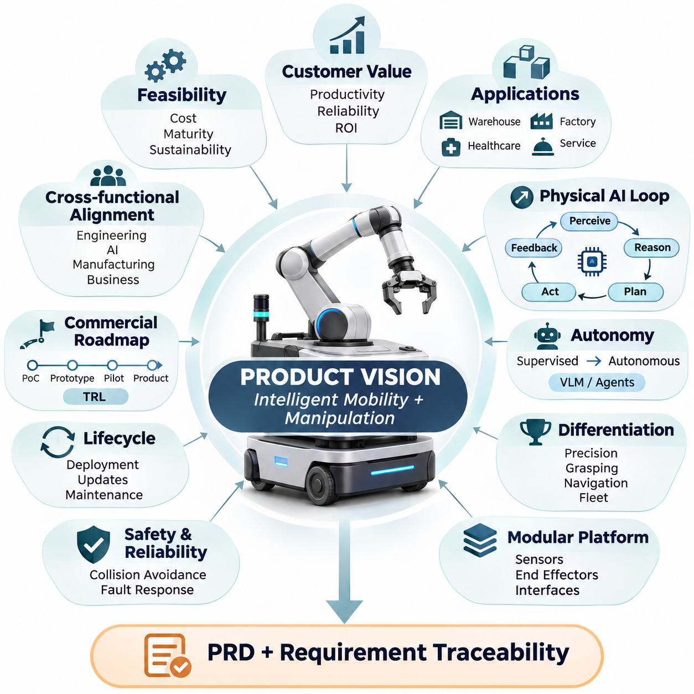{width="7.268055555555556in" height="7.268055555555556in"}

Product vision establishes the fundamental direction of a mobile manipulator development project by defining what the product is intended to achieve, who will benefit from its capabilities, and how it will create sustainable value. It provides a common foundation for engineering, research, manufacturing, commercialization, and operational activities, ensuring that multidisciplinary development teams pursue consistent strategic objectives throughout the product lifecycle.

A mobile manipulator integrates an Autonomous Mobile Robot (AMR), a robotic manipulator, environmental perception, artificial intelligence, and autonomous decision-making into a unified robotic system. The product vision should focus on the intelligent coordination of mobility and manipulation rather than the simple integration of individual components. This coordination enables robots to perform complex physical tasks across distributed and dynamically changing workspaces.

The formulation of a product vision begins with identifying practical problems that conventional automation technologies cannot adequately address. Fixed industrial robots provide high precision and productivity but are constrained by their installation locations. Conventional mobile robots can transport materials but generally lack advanced manipulation capabilities. Mobile manipulators overcome these limitations by combining autonomous navigation with flexible physical interaction.

The intended application domain significantly influences the direction of product development. Warehouse environments require autonomous picking, material transportation, inventory handling, and order fulfillment. Manufacturing facilities demand machine tending, component assembly, inspection, and material feeding. Healthcare institutions may benefit from autonomous delivery and logistics support, while commercial environments require adaptable service capabilities.

A customer-oriented product vision emphasizes measurable operational value instead of technological sophistication alone. Customers typically evaluate robotic systems according to productivity improvements, operational reliability, labor efficiency, deployment costs, and return on investment. Advanced artificial intelligence, sophisticated control algorithms, and high-performance computing resources should therefore contribute directly to meaningful operational outcomes.

From a Physical AI perspective, the product vision should emphasize the continuous integration of perception, reasoning, planning, action, and environmental feedback. A mobile manipulator must recognize surrounding objects, understand spatial relationships, determine feasible actions, execute physical movements, and evaluate their results. This closed-loop intelligence enables the robotic system to respond appropriately to environmental changes and unexpected operational conditions.

The desired level of autonomy represents another essential dimension of product vision. Depending on the application, mobile manipulators may operate under human supervision, execute predefined missions autonomously, or dynamically generate task execution strategies. Advanced systems may incorporate Vision-Language Models (VLMs), robotic agents, and learning-based manipulation techniques to improve adaptability within clearly defined operational and safety boundaries.

Product differentiation should be established through capabilities that provide meaningful competitive advantages. These capabilities may include superior manipulation accuracy, intelligent grasp planning, robust autonomous navigation, seamless fleet coordination, rapid deployment, and simplified system integration. Differentiation should be supported by measurable evidence rather than general claims of technological superiority or artificial intelligence performance.

A scalable product vision considers the development of a reusable robotic platform instead of a single application-specific machine. Modular mechanical structures, standardized electrical interfaces, configurable sensor architectures, interchangeable end effectors, and reusable software components enable the same technological foundation to support multiple industrial applications. Platform-based development also reduces engineering costs and accelerates future product development.

The product vision must balance technological ambition with engineering feasibility and commercial sustainability. Excessive hardware complexity, computational requirements, or artificial intelligence capabilities may increase development costs without delivering proportional customer value. Engineering teams should evaluate technical maturity, component availability, manufacturing feasibility, maintenance requirements, and expected operational benefits when defining the product direction.

Safety and reliability must be recognized as fundamental elements of product identity rather than supplementary engineering requirements. Mobile manipulators frequently operate near human workers, valuable equipment, and dynamic obstacles. The product vision should therefore incorporate dependable environmental monitoring, collision avoidance, controlled physical interaction, fault detection, emergency response, and appropriate human intervention mechanisms.

Lifecycle-oriented product development extends the vision beyond initial prototype completion. A commercially viable mobile manipulator must support manufacturing, deployment, calibration, software updates, preventive maintenance, diagnostics, component replacement, and long-term operational monitoring. These lifecycle considerations influence architectural decisions from the earliest development stages and contribute to sustainable product performance.

The product vision should also establish a progressive commercialization roadmap aligned with Technology Readiness Levels (TRLs). Early development may concentrate on feasibility studies and Proof of Concept (PoC) demonstrations, followed by integrated prototypes, representative environment testing, pilot deployments, and commercial product validation. Each development stage should produce objective evidence supporting the advancement of technical and operational maturity.

Cross-functional alignment is necessary to transform the product vision into an executable development strategy. Mechanical engineers, electrical engineers, AI researchers, software developers, control engineers, quality assurance personnel, and business stakeholders must share a consistent understanding of product objectives. This alignment supports effective resource allocation, requirement prioritization, architectural decision-making, and multidisciplinary system integration.

Ultimately, the product vision provides the strategic foundation for market requirements, customer requirements, operational scenarios, functional specifications, performance targets, AI requirements, and safety requirements. These elements are subsequently consolidated into a Product Requirements Document (PRD) and maintained through requirement traceability. A clearly established vision connects technological innovation with practical deployment, commercial competitiveness, and continuous product improvement.

## 02 Market Requirements

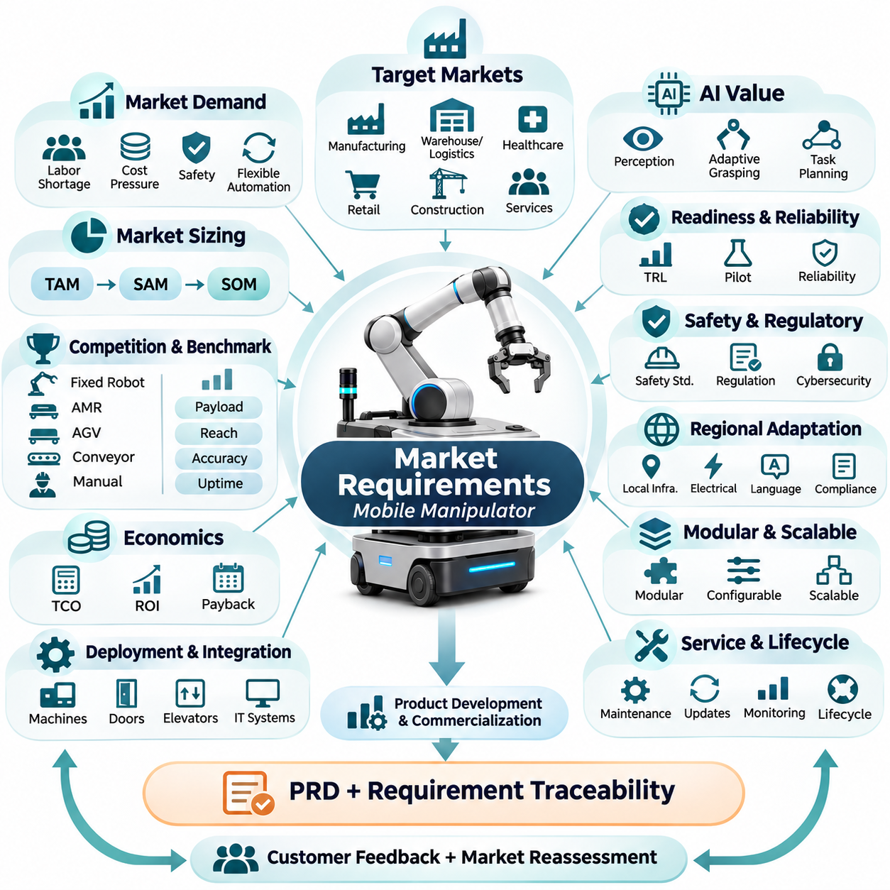{width="7.268055555555556in" height="7.268055555555556in"}

Market requirements define the commercial and operational conditions that a mobile manipulator must satisfy to achieve successful market adoption. They translate market opportunities, industry trends, competitive conditions, and operational challenges into strategic product development objectives. A systematic understanding of market requirements helps engineering organizations develop robotic products that address actual industrial needs rather than technology-driven assumptions.

The development of market requirements begins with market segmentation. Mobile manipulators can serve diverse industries, including manufacturing, warehousing, logistics, healthcare, retail, construction, and commercial services. Each market segment presents different operational environments, productivity expectations, investment capabilities, and regulatory constraints. Product development priorities must therefore reflect the characteristics of the intended target market.

Market demand analysis evaluates the operational problems that potential customers experience and the economic significance of resolving them. Labor shortages, increasing operational costs, repetitive physical workloads, workplace safety concerns, and growing requirements for flexible automation can contribute to demand for mobile manipulation technologies. These factors should be evaluated systematically to identify commercially sustainable application opportunities.

Market sizing provides a quantitative foundation for evaluating business opportunities and allocating development resources. Total Addressable Market (TAM), Serviceable Available Market (SAM), and Serviceable Obtainable Market (SOM) represent different levels of commercial potential. These estimates should consider the number of potential deployment sites, applicable operational processes, expected product pricing, and realistic technology adoption rates.

Competitive landscape analysis identifies existing robotic solutions, alternative automation technologies, and emerging competitors. Mobile manipulators may compete with fixed industrial robots, conventional Autonomous Mobile Robots (AMRs), Automated Guided Vehicles (AGVs), conveyor systems, and manually operated equipment. Understanding the strengths and limitations of these alternatives enables development teams to establish meaningful product differentiation.

Competitive benchmarking should examine both technical performance and commercial characteristics. Relevant comparison factors include payload capacity, manipulation reach, positioning accuracy, task completion time, battery endurance, operational availability, deployment complexity, and maintenance costs. Product differentiation must be supported by measurable capabilities that provide practical advantages under representative operating conditions.

Economic feasibility represents a central component of market requirements. Industrial customers typically evaluate automation investments according to Total Cost of Ownership (TCO), Return on Investment (ROI), payback period, and expected productivity improvements. Product development must consider manufacturing costs, installation expenses, software licensing, energy consumption, maintenance requirements, and long-term operational support.

Market requirements must also address deployment flexibility and compatibility with existing industrial infrastructure. Customers frequently expect robotic systems to operate within established facilities without extensive structural modifications. Compatibility with production equipment, storage systems, elevators, automatic doors, charging stations, and enterprise information systems can significantly influence purchasing decisions and deployment costs.

The increasing integration of artificial intelligence into industrial automation creates additional market opportunities for mobile manipulators. Intelligent perception, adaptive grasping, autonomous task planning, and learning-based manipulation can enable robotic systems to address operational variability. However, AI capabilities should be prioritized according to demonstrated customer value, operational reliability, and commercially achievable implementation costs.

Market adoption is strongly influenced by product reliability and technological maturity. Industrial customers generally require predictable performance, stable operation, effective fault recovery, and minimal production interruptions. Technology Readiness Levels (TRLs), prototype demonstrations, representative environment testing, and pilot deployment results provide important evidence for evaluating whether a robotic product is ready for commercial introduction.

Market requirements should incorporate safety expectations, regulatory obligations, and industry-specific operating conditions. Mobile manipulators frequently operate near human workers and sensitive industrial equipment, making safety assurance essential for commercial acceptance. Applicable machinery safety standards, electrical regulations, cybersecurity requirements, and occupational safety policies must be identified for each target market and deployment region.

International market expansion requires consideration of regional differences in industrial infrastructure, labor costs, purchasing practices, and regulatory frameworks. A product designed for one geographical market may require different communication interfaces, language support, electrical configurations, or safety documentation in another region. Modular architectures and configurable software can help accommodate these variations efficiently.

Commercial scalability requires a balance between standardized products and customer-specific customization. Excessive customization increases engineering expenditures, manufacturing complexity, and long-term maintenance burdens. A modular mobile manipulator platform with configurable hardware, software, sensors, and end effectors can support multiple market segments while maintaining a common technological and manufacturing foundation.

Serviceability and lifecycle support represent important factors in long-term market competitiveness. Customers expect reliable technical assistance, spare parts availability, preventive maintenance, remote diagnostics, and controlled software updates. Product development should incorporate these expectations from the initial planning stages to minimize operational downtime and establish sustainable relationships with commercial users.

Ultimately, market requirements provide a commercial foundation for customer requirements, operational scenarios, functional specifications, and performance targets. They should be documented within the Product Requirements Document (PRD) and maintained through requirement traceability. Since markets evolve continuously, these requirements must be periodically reassessed against competitive developments, customer feedback, and field deployment results.

## 03 Customer Requirements

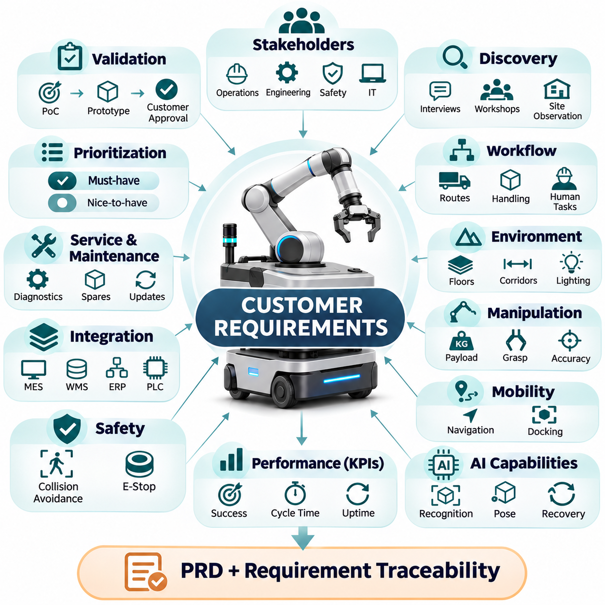{width="7.268055555555556in" height="7.268055555555556in"}

Customer requirements define the specific needs, expectations, and operational conditions that a mobile manipulator must satisfy to deliver practical value to its intended users. Unlike market requirements, which address broader commercial opportunities and industry trends, customer requirements focus on individual operational challenges, existing workflows, environmental constraints, and measurable expectations associated with actual robotic deployments.

Customer requirement development begins with identifying relevant stakeholders within the target organization. These stakeholders may include facility managers, production engineers, logistics operators, maintenance personnel, safety managers, information technology specialists, and business executives. Each stakeholder provides a different perspective on system functionality, operational performance, installation requirements, economic feasibility, and long-term support.

Customer interviews, technical workshops, questionnaires, and on-site observations provide essential methods for collecting operational requirements. Engineering teams should investigate how existing tasks are performed, which resources are required, where operational inefficiencies occur, and what limitations prevent further automation. Direct observation is particularly valuable because customers may not explicitly communicate every environmental or procedural constraint.

Existing workflow analysis establishes the operational foundation for mobile manipulator development. Engineers should examine material transportation routes, object handling procedures, equipment interactions, task execution sequences, and human intervention requirements. Understanding the complete workflow enables development teams to identify opportunities for automation without introducing unnecessary operational complexity or disrupting established production activities.

Physical operating environments significantly influence customer requirements. Relevant environmental characteristics include corridor widths, floor conditions, slopes, door dimensions, workspace accessibility, lighting variations, temperature ranges, humidity, and electromagnetic interference. The mobile platform, robotic manipulator, perception sensors, and electrical systems must be selected or designed to accommodate these conditions throughout normal operation.

Manipulation requirements describe the physical interactions that customers expect the robotic system to perform. These requirements may include object picking, material loading, component placement, machine tending, inspection, assembly, and handling irregularly shaped objects. Object dimensions, weight distributions, surface properties, grasping characteristics, required manipulation accuracy, and accessible working positions should be documented before detailed engineering begins.

Mobility requirements establish how the robotic system must navigate and position itself within the customer\'s facility. Typical considerations include travel speed, turning radius, obstacle avoidance, localization accuracy, docking repeatability, and accessibility within restricted spaces. Since manipulation performance depends on the positioning of the mobile platform, mobility and manipulation requirements must be evaluated as interconnected system capabilities.

Operational performance requirements should translate customer expectations into measurable engineering targets. Key Performance Indicators (KPIs) may include mission success rate, task completion time, picking accuracy, operational availability, battery endurance, recovery success rate, and daily throughput. Each performance target should specify representative operating conditions, measurement procedures, acceptable tolerances, and objective acceptance criteria.

Customer requirements for artificial intelligence should emphasize practical operational capabilities rather than specific model architectures. Customers may require reliable object recognition, accurate pose estimation, adaptive grasp planning, intelligent task scheduling, or autonomous error recovery. Engineering teams must translate these expectations into measurable AI performance targets while considering computational resources, environmental variability, and the operational consequences of incorrect predictions.

Safety requirements must reflect the customer\'s workplace characteristics, operational procedures, and human-robot interaction conditions. Mobile manipulators may operate alongside workers, transportation equipment, production machinery, and other autonomous robots. Customer expectations regarding protective functions, emergency stop accessibility, collision prevention, safe operating speeds, fault responses, and human intervention must be incorporated into the system requirements.

Integration requirements define how the mobile manipulator interacts with the customer\'s existing equipment and digital infrastructure. Relevant systems may include Manufacturing Execution Systems (MES), Warehouse Management Systems (WMS), Enterprise Resource Planning (ERP), Programmable Logic Controllers (PLCs), and fleet management platforms. Communication interfaces, data exchange formats, authentication mechanisms, and cybersecurity constraints should be identified early.

Maintenance and operational support requirements significantly influence customer satisfaction throughout the product lifecycle. Customers may expect simplified component replacement, remote diagnostics, preventive maintenance, software updates, spare parts availability, and defined technical support response times. These expectations should influence mechanical accessibility, electrical modularity, software architecture, diagnostic functions, and maintenance documentation during development.

Customer requirements should distinguish mandatory capabilities from desirable features and potential future enhancements. Prioritization enables engineering teams to allocate development resources effectively while maintaining realistic project schedules and technical objectives. Conflicting expectations involving performance, cost, safety, flexibility, and delivery schedules should be resolved through documented discussions and mutually agreed engineering trade-offs.

Requirement validation should confirm that the documented customer expectations accurately represent actual operational needs. Technical reviews, simulation environments, Proof of Concept (PoC) demonstrations, and prototype evaluations provide opportunities to identify misunderstandings before substantial development investments are made. Customer approval of measurable acceptance criteria also establishes a foundation for subsequent system verification and field validation.

Ultimately, validated customer requirements must be incorporated into the Product Requirements Document (PRD) and connected to functional specifications, performance targets, system architecture, and verification procedures through requirement traceability. Changes should be evaluated through formal requirement management processes to maintain alignment between customer expectations, engineering implementation, commercial commitments, and long-term product development objectives.

## 04 Operational Scenarios

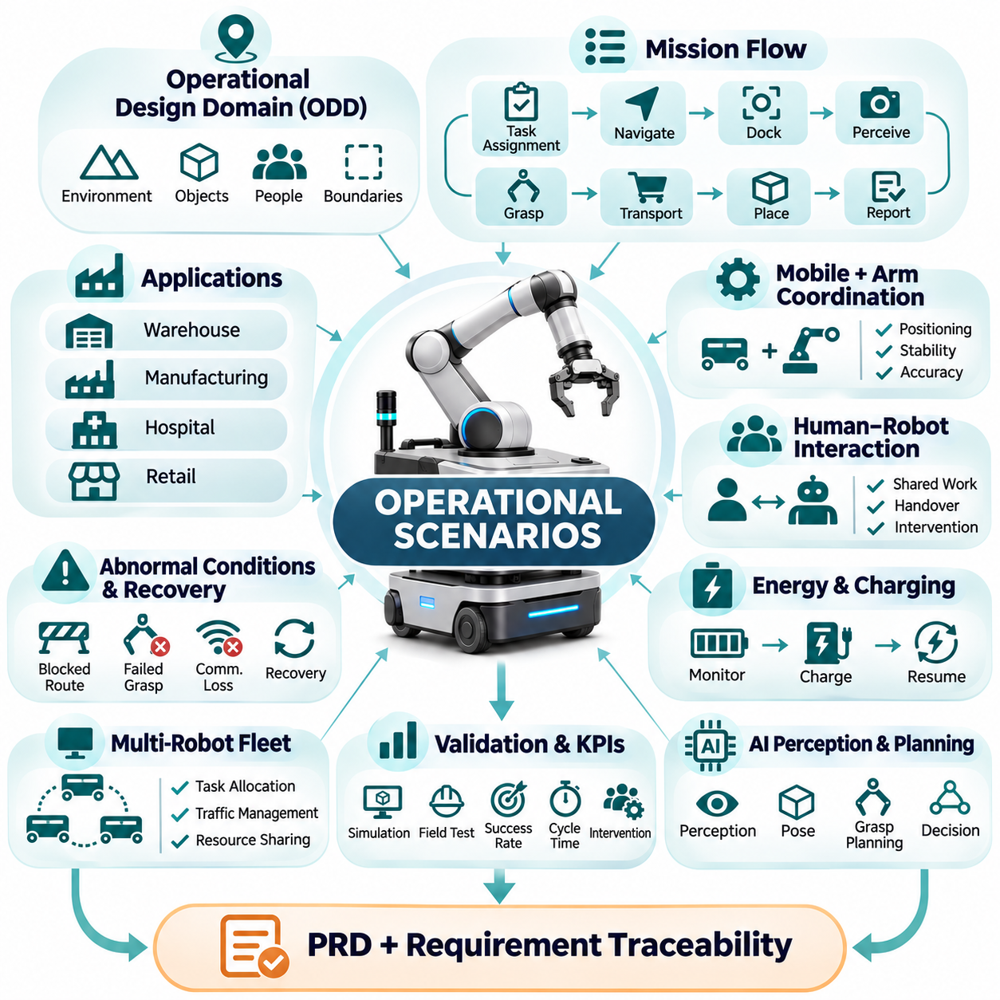{width="7.268055555555556in" height="7.268055555555556in"}

Operational scenarios describe how a mobile manipulator is expected to perform practical tasks within its intended operating environment. They translate product vision, market requirements, and customer expectations into representative execution situations that guide system development. Clearly defined scenarios establish a foundation for functional requirements, architectural decisions, performance evaluation, safety analysis, and field validation.

The development of operational scenarios begins with defining the Operational Design Domain (ODD) of the robotic system. The ODD specifies the environmental conditions, workspace characteristics, infrastructure limitations, object properties, and human interaction conditions under which autonomous operation is intended. Establishing these boundaries prevents unrealistic assumptions regarding the capabilities and operational flexibility of mobile manipulators.

A representative operational scenario should describe the complete mission lifecycle, beginning with task assignment and ending with task completion and result reporting. Intermediate activities may include autonomous navigation, obstacle avoidance, precision docking, environmental perception, object recognition, manipulation, and verification. Each activity should identify its initial conditions, expected outcomes, execution constraints, and possible failure conditions.

Warehouse operations represent a major application domain for mobile manipulators. A typical scenario involves receiving a picking request from a Warehouse Management System (WMS), navigating toward the designated storage location, identifying the target object, estimating its pose, and executing a suitable grasp. The robot subsequently transports the object to a designated destination and updates the inventory system after successful placement.

Manufacturing scenarios frequently involve machine tending, component loading, material feeding, assembly, and automated inspection. A mobile manipulator may navigate between multiple production stations, establish communication with industrial equipment, and perform predefined manipulation tasks. Precise positioning, coordinated equipment synchronization, production cycle compatibility, and reliable task execution are particularly important in these environments.

Hospital logistics scenarios emphasize safe autonomous transportation and manipulation within environments shared by medical personnel, patients, and visitors. Mobile manipulators may deliver medical supplies, handle standardized containers, operate compatible storage systems, and interact with designated logistics stations. These scenarios require careful consideration of hygiene, unpredictable pedestrian movement, accessibility, and service continuity.

Retail and commercial service scenarios introduce additional environmental variability and interaction complexity. Mobile manipulators may perform shelf replenishment, inventory inspection, merchandise handling, and routine service activities. Changes in object placement, human behavior, lighting conditions, and workspace accessibility require robust perception, adaptive manipulation, and appropriately constrained autonomous decision-making.

Operational scenarios should explicitly address the coordination between mobile navigation and robotic manipulation. The mobile platform must establish a suitable working position before the manipulator executes its assigned task. Depending on the application, coordinated base movement and arm motion may improve workspace accessibility. Positioning uncertainty, mechanical stability, collision constraints, and manipulation accuracy must be evaluated jointly.

Human-robot interaction scenarios define how mobile manipulators coexist and cooperate with human workers during routine operations. These scenarios may include shared workspace navigation, supervised task execution, object handover, manual intervention, and emergency assistance. The robotic system must respond predictably to human presence while maintaining appropriate separation distances, controlled movements, and applicable protective functions.

Abnormal operational scenarios are essential for evaluating system robustness beyond nominal operating conditions. Representative situations include blocked navigation routes, failed object recognition, unsuccessful grasping, communication interruptions, localization degradation, equipment unavailability, and unexpected obstacle movements. Each scenario should establish detection mechanisms, permissible recovery actions, escalation procedures, and safe termination conditions.

Energy management scenarios describe how mobile manipulators maintain operational availability throughout extended working periods. The robotic system should monitor battery status, estimate the energy required to complete assigned missions, and schedule charging activities appropriately. Scenarios should also address interrupted charging, unsuccessful docking, charging station unavailability, and the resumption of suspended tasks following energy replenishment.

Multi-robot operational scenarios become increasingly important when mobile manipulators operate as part of a coordinated robotic fleet. Multiple robots may share transportation routes, charging stations, manipulation workspaces, and production equipment. Fleet management must coordinate task allocation, resource reservations, traffic management, and conflict resolution while preventing deadlocks, unnecessary waiting, and interference between concurrent missions.

Artificial intelligence requirements should be derived from the perceptual and decision-making challenges identified within operational scenarios. Variations in object appearance, occlusion, illumination, geometry, and environmental conditions influence the required capabilities of perception models and grasp planning algorithms. Scenario-based evaluation helps determine whether AI performance remains sufficient under representative conditions and foreseeable operational disturbances.

Operational scenarios should be progressively validated through simulation, digital twins, integrated prototypes, and representative field deployments. Each scenario should incorporate measurable Key Performance Indicators (KPIs), such as mission success rate, cycle time, manipulation accuracy, intervention frequency, and recovery success rate. Systematic scenario execution provides objective evidence for identifying deficiencies and evaluating product maturity.

Ultimately, documented operational scenarios connect customer expectations with functional specifications, performance targets, AI requirements, safety requirements, and maintenance requirements. Each scenario should receive a unique identifier and remain traceable throughout the Product Requirements Document (PRD), system design, testing, and field validation processes. This approach ensures that development activities remain aligned with realistic operational objectives.

## 05 Functional Requirements

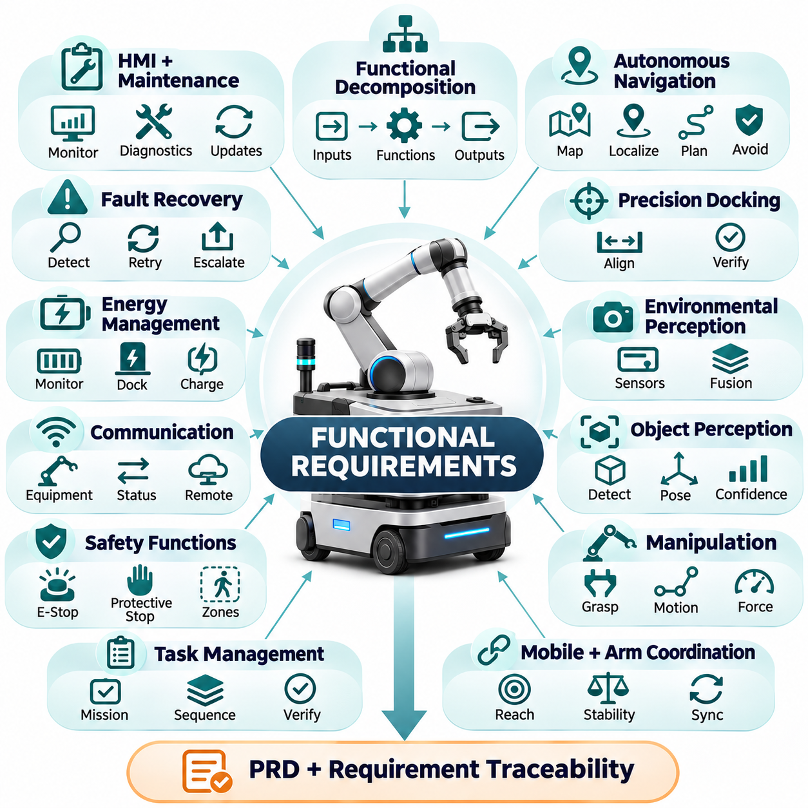{width="7.268055555555556in" height="7.268055555555556in"}

Functional requirements define the specific capabilities and behaviors that a mobile manipulator must provide to accomplish its intended operational objectives. They translate customer requirements and operational scenarios into engineering specifications that describe what the robotic system must perform. These requirements establish the foundation for system architecture, hardware development, software implementation, artificial intelligence integration, and subsequent system verification.

The development of functional requirements begins with decomposing representative operational scenarios into individual system functions. Each function should describe the required inputs, expected outputs, execution conditions, operational constraints, and interactions with other functions. Functional decomposition enables engineering teams to manage system complexity while maintaining consistent relationships between system-level objectives and subsystem-level responsibilities.

Autonomous navigation represents a fundamental functional capability of mobile manipulators. The robotic system must support environmental mapping, localization, global path planning, local trajectory generation, obstacle detection, and dynamic obstacle avoidance. Navigation functions should enable the robot to reach designated destinations, adapt to changing environmental conditions, and respond appropriately when planned transportation routes become unavailable.

Precision positioning and docking functions establish the spatial conditions necessary for successful manipulation. The mobile platform must approach designated workstations, determine its relative position and orientation, and perform alignment procedures. Docking functions should support position verification, alignment correction, and controlled transitions between navigation and manipulation modes while maintaining appropriate mechanical stability.

Environmental perception functions enable the mobile manipulator to acquire and interpret information about its surrounding environment. Cameras, LiDAR sensors, depth sensors, inertial measurement units, and other sensing devices provide information for environmental understanding. The system must support sensor data acquisition, synchronization, preprocessing, sensor fusion, obstacle recognition, and the generation of environment representations required for autonomous operation.

Object perception functions provide information necessary for intelligent physical interaction. The robotic system must identify target objects, estimate their positions and orientations, evaluate relevant geometric characteristics, and determine whether manipulation is feasible. These functions should communicate perception confidence, identify uncertain observations, and support additional sensing or alternative viewpoints when initial perception results are insufficient for reliable execution.

Manipulation functions define how the robotic arm interacts with objects and industrial equipment. Required capabilities may include forward and inverse kinematics, workspace evaluation, grasp planning, motion planning, trajectory execution, gripper control, and force-controlled interaction. The manipulator must coordinate these functions with perception results and mobile platform status to execute picking, placement, loading, inspection, and other physical tasks.

Coordinated mobility and manipulation functions enable the mobile platform and robotic arm to operate as an integrated system. The system should determine appropriate base positions, evaluate manipulator reachability, and coordinate movement sequences according to task objectives. Functional requirements must address synchronization, collision constraints, stability conditions, and permissible simultaneous movements to ensure consistent execution across distributed workspaces.

Task management functions coordinate the execution of complete operational missions. The robotic system must support mission reception, task decomposition, execution sequencing, operational state monitoring, and completion verification. Task planning mechanisms, including state machines, behavior trees, and AI-based planning components, may be employed to manage dependencies, conditional execution, task transitions, and controlled adaptation to environmental changes.

Safety-related functions must enable the robotic system to detect hazardous conditions and initiate appropriate protective responses. These functions may include emergency stopping, protective stopping, speed limitation, safety zone monitoring, collision detection, and fault management. Safety-critical functions must operate with appropriate independence from non-safety-rated AI components, while restart and recovery procedures must prevent unintended hazardous movements.

Communication and integration functions define how mobile manipulators exchange information with external equipment and operational management systems. The robotic system should support mission requests, status reporting, equipment handshakes, data exchange, and remote monitoring through defined communication interfaces. Communication interruptions must be detected, and the system must transition to an appropriate operational or safe state according to predefined conditions.

Energy management functions support continuous operation by monitoring battery status, estimating remaining operational capacity, and coordinating charging activities. The robotic system must recognize insufficient energy conditions, navigate toward available charging stations, perform automatic docking, and verify charging status. Where operationally appropriate, interrupted missions should be suspended and resumed after sufficient energy has been restored.

Fault detection and recovery functions enable the mobile manipulator to respond systematically to abnormal operating conditions. The system should identify navigation failures, perception errors, unsuccessful grasps, actuator faults, sensor malfunctions, and communication interruptions. Recovery functions must support permitted retry procedures, alternative execution strategies, diagnostic reporting, operator intervention, and safe termination when autonomous recovery is not feasible.

Human-machine interface and maintenance functions provide mechanisms for system configuration, operational supervision, troubleshooting, and lifecycle support. Authorized personnel should be able to assign missions, monitor system status, review diagnostic information, manage operational parameters, and perform controlled maintenance activities. Access control, event logging, calibration support, and software update management contribute to secure and maintainable robotic operations.

Ultimately, functional requirements must be documented using clear, consistent, and verifiable statements within the Product Requirements Document (PRD). Each requirement should receive a unique identifier and remain traceable to its originating customer requirement or operational scenario, corresponding system architecture, implementation components, and verification procedures. This approach establishes continuity between requirement definition, engineering development, system testing, and field validation.

## 06 Performance Requirements

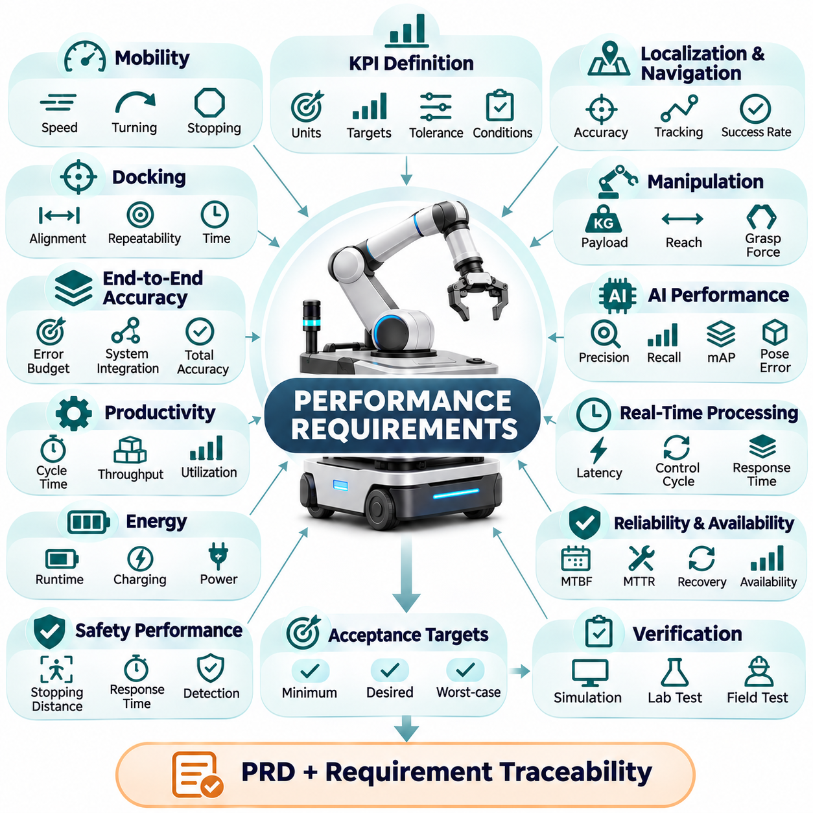{width="7.268055555555556in" height="7.268055555555556in"}

Performance requirements define the measurable capabilities that a mobile manipulator must achieve under specified operational conditions. While functional requirements describe what the robotic system must perform, performance requirements establish how effectively, accurately, rapidly, and reliably those functions must be executed. They provide quantitative engineering objectives for system design, development, verification, and field validation.

The development of performance requirements begins with translating customer expectations and operational scenarios into measurable Key Performance Indicators (KPIs). Each performance indicator should specify a measurement unit, target value, acceptable tolerance, operating conditions, and evaluation methodology. Clearly defined performance criteria enable development teams to assess system capabilities objectively and prevent ambiguity during product acceptance.

Mobility performance requirements establish the operational capabilities of the autonomous mobile platform. Relevant parameters include maximum travel speed, acceleration, deceleration, turning radius, climbing capability, obstacle negotiation, and stopping distance. These parameters must reflect the physical operating environment, payload conditions, transportation efficiency, mechanical stability, and applicable safety constraints.

Localization and navigation performance requirements determine how accurately and consistently the mobile manipulator navigates within its operating environment. Relevant metrics include absolute localization accuracy, relative positioning accuracy, trajectory tracking error, navigation success rate, and destination arrival repeatability. Performance should be evaluated under changing environmental conditions, dynamic obstacles, and varying sensor availability.

Docking performance requirements are particularly important because mobile platform positioning directly influences manipulation accuracy. Evaluation parameters include docking position error, angular alignment error, docking repeatability, execution time, and successful docking rate. The allowable positioning error should be derived from the manipulation task, coordinate transformation uncertainty, and available local correction mechanisms.

Manipulation performance requirements characterize the physical capabilities of the robotic arm and associated end effectors. Important parameters include rated payload, maximum reach, positioning accuracy, repeatability, joint velocity, grasping force, and task execution time. These requirements must consider the combined effects of mobile platform stability, manipulator configuration, tool weight, object properties, and external disturbances.

Integrated system accuracy must be evaluated separately from the nominal accuracy of individual subsystems. Mobile platform positioning errors, sensor measurement uncertainties, calibration errors, structural deformation, and manipulator positioning errors contribute to overall task execution accuracy. An error budget should allocate permissible uncertainty across subsystems and establish measurable end-to-end performance targets.

Artificial intelligence performance requirements establish quantitative expectations for perception, recognition, pose estimation, grasp detection, and intelligent decision-making. Evaluation metrics may include precision, recall, mean Average Precision (mAP), pose estimation error, grasp success rate, and inference latency. AI performance must be assessed using representative datasets and realistic operating conditions rather than isolated benchmark results.

Real-time processing performance determines whether the robotic system can respond adequately to changing environmental and operational conditions. Relevant metrics include sensor acquisition frequency, perception processing latency, control cycle time, communication latency, and end-to-end response time. Computing resources must accommodate concurrent workloads while maintaining acceptable timing behavior during demanding operational situations.

Operational productivity requirements evaluate the ability of a mobile manipulator to complete useful work within a specified period. Typical metrics include mission completion time, picking cycle time, objects handled per hour, daily mission throughput, and equipment utilization. Productivity assessments should incorporate navigation, docking, perception, manipulation, verification, charging, waiting, and foreseeable operational interruptions.

Reliability and availability requirements characterize the consistency of robotic operations over extended periods. Relevant indicators include mission success rate, Mean Time Between Failures (MTBF), Mean Time to Repair (MTTR), operational availability, and autonomous recovery success rate. These metrics should distinguish hardware failures, software errors, perception limitations, environmental disturbances, and external infrastructure interruptions.

Energy performance requirements determine whether the mobile manipulator can sustain its intended operational workload. Evaluation parameters include battery capacity, average power consumption, peak power demand, operating duration, charging time, and energy consumption per mission. Measurements should consider different payloads, travel speeds, manipulation workloads, computing demands, and battery degradation throughout the product lifecycle.

Safety-related performance requirements establish measurable criteria for evaluating protective functions under defined hazardous conditions. Relevant parameters include protective stopping distance, safety system response time, speed monitoring accuracy, and protective zone detection capability. Acceptance limits must be derived from risk assessments and applicable safety standards rather than productivity objectives or assumptions about AI performance.

Performance targets should distinguish minimum acceptable requirements, desired engineering objectives, and future optimization goals. Numerical thresholds must be established according to customer agreements, technical feasibility, operational constraints, and commercial considerations. Tracking average performance, statistical variability, percentile distributions, and worst-case behavior helps identify limitations that average measurements may conceal.

Ultimately, performance requirements must be documented within the Product Requirements Document (PRD) and maintained through requirement traceability. Each requirement should be connected to its originating operational scenario, corresponding architectural components, verification methods, and acceptance criteria. Simulation, laboratory testing, integrated system evaluation, and field validation provide objective evidence of performance compliance.

## 07 AI Requirements

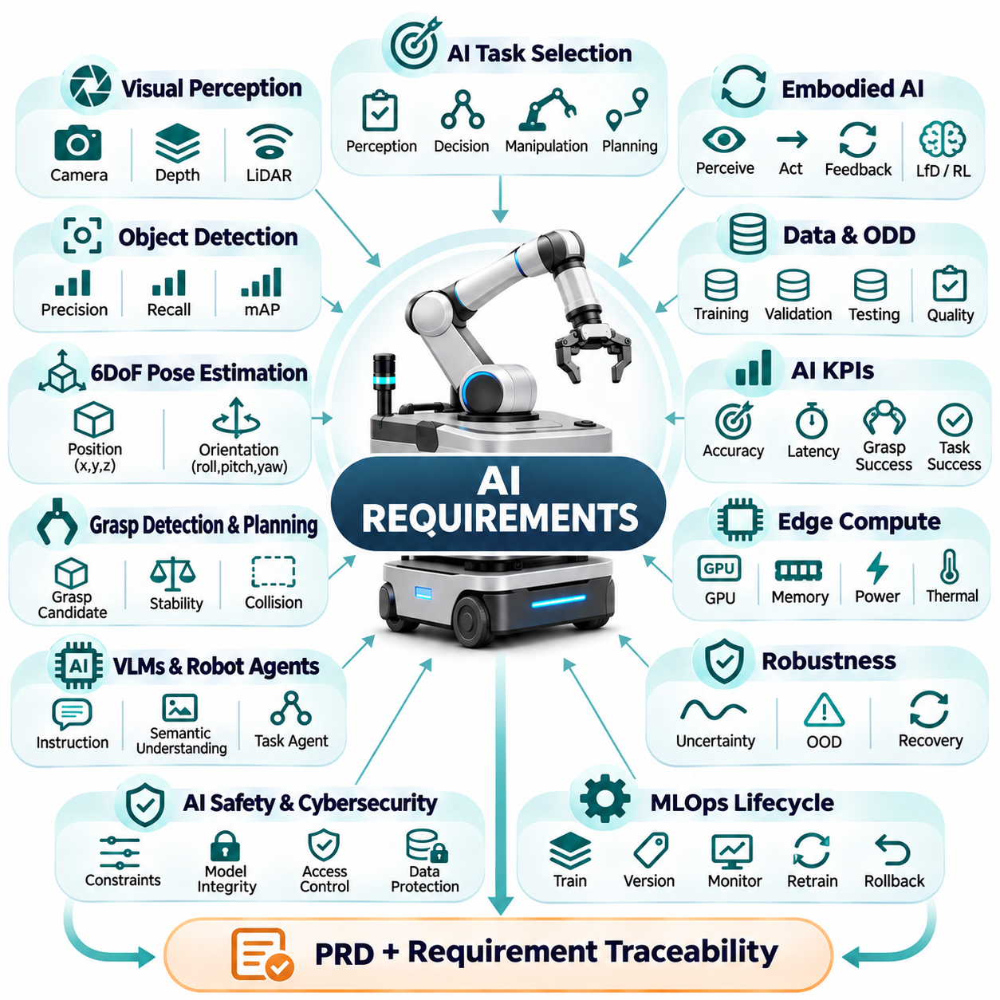{width="7.268055555555556in" height="7.268055555555556in"}

Artificial intelligence requirements define the intelligent capabilities that a mobile manipulator must possess to perceive its environment, interpret operational conditions, make appropriate decisions, and execute physical tasks. These requirements translate customer expectations and operational scenarios into measurable AI objectives that guide data collection, model development, system integration, deployment, and operational validation.

The development of AI requirements begins with identifying tasks that cannot be adequately addressed through conventional rule-based algorithms or deterministic control methods. Object recognition, pose estimation, adaptive grasping, environmental understanding, and complex task planning frequently require AI-based approaches. The selection of AI capabilities should reflect operational necessity, technical feasibility, and measurable customer value.

Visual perception requirements establish the ability of the robotic system to extract meaningful information from cameras, depth sensors, LiDAR sensors, and other sensing devices. The perception system should recognize relevant objects, identify environmental structures, detect obstacles, and interpret spatial relationships. Perception capabilities must remain effective under representative variations in illumination, viewing angles, occlusion, and background complexity.

Object detection and recognition requirements define the categories of objects that the mobile manipulator must identify during autonomous operations. These requirements should specify target object classes, dimensional ranges, appearance variations, detection distances, and acceptable recognition errors. Evaluation metrics such as precision, recall, and mean Average Precision (mAP) provide quantitative criteria for assessing model performance.

Object pose estimation requirements determine the ability of the AI system to estimate the position and orientation of target objects within three-dimensional space. Six Degrees of Freedom (6DoF) pose estimation is particularly important for precise robotic manipulation. Requirements should establish acceptable translational and rotational errors, coordinate frame definitions, confidence thresholds, and robustness against partial occlusion.

Intelligent grasp detection and planning requirements define the ability of a mobile manipulator to generate feasible grasp configurations for objects with diverse geometries, materials, dimensions, and orientations. The AI system should evaluate grasp candidates according to accessibility, stability, collision constraints, and anticipated task objectives. Grasp success rates and physical execution results provide essential validation criteria.

Advanced AI requirements may incorporate Vision-Language Models (VLMs), foundation models, and robotic agents to support semantic understanding and flexible task execution. These technologies enable mobile manipulators to interpret high-level instructions, recognize previously unfamiliar objects, and generate context-aware task plans. Their outputs must remain subject to deterministic execution constraints and independent safety mechanisms.

Embodied AI requirements emphasize the continuous interaction between intelligent perception, decision-making, physical action, and environmental feedback. The robotic system should evaluate the consequences of executed actions and adjust subsequent behavior when operational conditions change. Learning from Demonstration (LfD) and Reinforcement Learning (RL) may support adaptation when their behavior can be adequately validated.

Data requirements establish the foundation for reliable AI development and validation. Training, validation, and test datasets should represent the intended Operational Design Domain (ODD), including relevant objects, environmental conditions, sensor configurations, and foreseeable disturbances. Data quality, annotation consistency, class distribution, dataset versioning, and separation between training and evaluation datasets must be systematically managed.

AI performance requirements must specify measurable acceptance criteria for each intelligent function. Relevant metrics include detection accuracy, pose estimation error, grasp success rate, inference latency, prediction confidence, and task execution success rate. Performance targets should be evaluated under representative operating conditions and connected to system-level productivity, manipulation accuracy, and operational reliability.

Computational requirements define the processing resources necessary to execute AI workloads within the mobile manipulator. Edge AI accelerators, embedded computing platforms, GPUs, and system memory must support concurrent perception, navigation, manipulation, and decision-making processes. Requirements should address inference throughput, processing latency, memory utilization, power consumption, and thermal constraints during sustained operation.

AI robustness requirements establish how intelligent functions respond to uncertainty, unfamiliar objects, sensor degradation, environmental disturbances, and distribution shifts. The system should identify unreliable predictions, detect out-of-distribution inputs where feasible, and communicate uncertainty to higher-level control functions. Low-confidence results should trigger defined actions such as additional observation, task suspension, or operator intervention.

AI safety and cybersecurity requirements must prevent intelligent components from initiating unauthorized or hazardous physical actions. AI-generated decisions should be evaluated against operational boundaries, motion constraints, and applicable protective functions before execution. Model integrity, secure deployment, access control, data protection, and resistance to malicious or misleading inputs should be considered throughout the development lifecycle.

AI lifecycle management requirements address model training, version control, deployment, performance monitoring, retraining, and controlled software updates. Machine Learning Operations (MLOps) processes should support reproducible experiments, dataset traceability, model validation, deployment approval, and rollback mechanisms. Operational data and field performance monitoring can provide evidence for identifying model degradation and future improvements.

Ultimately, AI requirements must be documented within the Product Requirements Document (PRD) and maintained through requirement traceability. Each requirement should be connected to its originating operational scenario, associated dataset, model architecture, computing infrastructure, and verification procedure. Numerical acceptance thresholds must be determined according to application-specific needs and validated through laboratory testing and representative field operations.

## 08 Safety Requirements

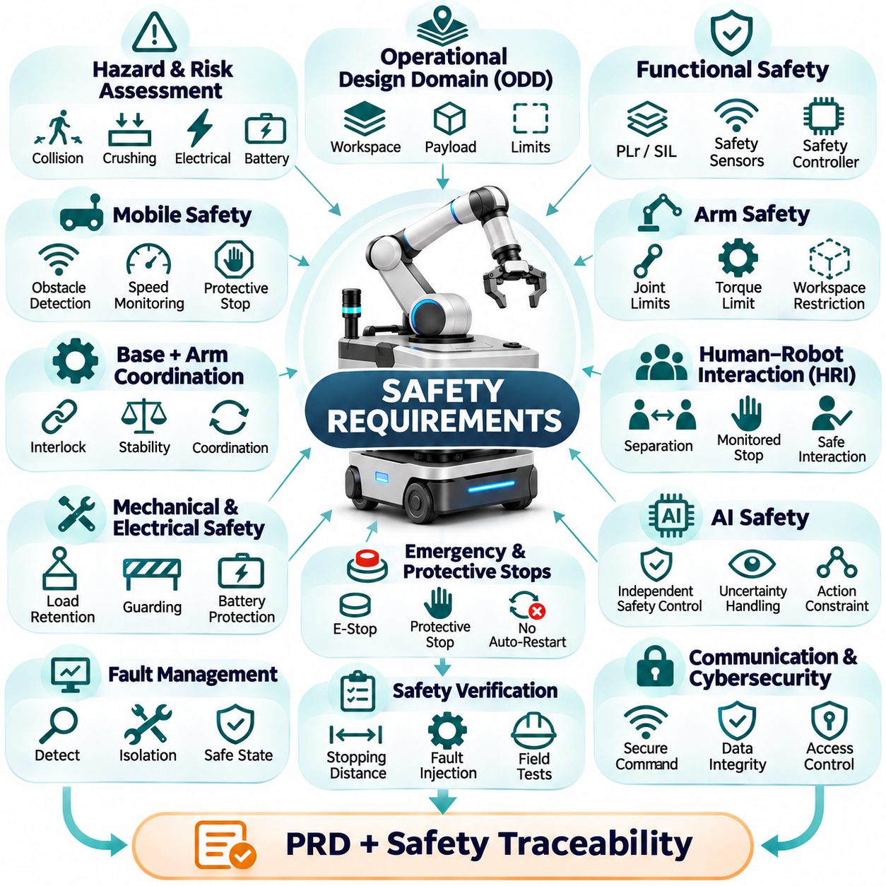{width="7.268055555555556in" height="7.268055555555556in"}

Safety requirements define the protective capabilities, operational constraints, and risk reduction measures necessary to ensure the safe operation of a mobile manipulator throughout its product lifecycle. Because mobile manipulators combine autonomous mobility, robotic manipulation, artificial intelligence, and physical interaction with surrounding environments, safety must be established as a fundamental engineering objective from the earliest development stages.

The development of safety requirements begins with systematic hazard identification and risk assessment. Potential hazards include collisions, crushing, trapping, unexpected movement, falling objects, electrical faults, battery failures, and loss of system control. Risk assessment should consider the severity of potential injuries, frequency and duration of exposure, and the possibility of avoiding hazardous situations during intended use and foreseeable misuse.

Safety requirements must establish the operational boundaries within which a mobile manipulator is permitted to function. The Operational Design Domain (ODD) should specify environmental conditions, authorized workspaces, floor characteristics, payload limitations, human accessibility, and equipment interaction constraints. Operating conditions outside these boundaries must trigger predefined responses, including restricted operation or transition to a safe state.

Mobile platform safety requirements address hazards associated with autonomous navigation and transportation. The system must support protective obstacle detection, speed monitoring, controlled deceleration, protective stopping, and emergency stopping. Protective detection zones and stopping distances should account for travel speed, payload, braking capability, floor conditions, sensor coverage, and the movement of surrounding personnel.

Manipulator safety requirements address hazards generated by robotic arm movements and physical interactions. Relevant protective functions include joint position monitoring, speed limitation, torque limitation, workspace restriction, and collision detection. Safety requirements must consider the complete manipulator configuration, including end effectors, attached tools, transported objects, maximum reach, and potential contact with surrounding personnel.

Integrated mobility and manipulation safety requirements address risks arising from the combined operation of the mobile base and robotic arm. Simultaneous movements may introduce additional collision hazards, dynamic instability, and unexpected changes in the reachable workspace. Requirements should define permissible movement combinations, manipulator transport configurations, stability limitations, and protective interlocks between subsystems.

Human-Robot Interaction (HRI) safety requirements establish protective conditions for operation in environments shared with human personnel. Depending on the application and risk assessment, protective strategies may include physical separation, speed and separation monitoring, safety-rated monitored stopping, and power and force limiting. Human accessibility and foreseeable human behavior must be considered when defining these requirements.

Functional safety requirements establish the reliability and integrity of safety-related control functions. Required Performance Levels (PLr) or Safety Integrity Levels (SIL) should be determined through applicable risk assessment methods and safety standards. Safety-related sensors, controllers, communication interfaces, and actuators must collectively satisfy the required safety performance rather than relying solely on individual component certifications.

Emergency stopping and protective stopping requirements must define the conditions under which hazardous movements are terminated. Appropriate stopping behavior depends on the operational state, mechanical configuration, and nature of the identified hazard. The system must prevent unintended restart following emergency stopping, safety device activation, power interruption, or fault recovery until defined restart conditions have been satisfied.

Mechanical and electrical safety requirements address structural integrity, load retention, electrical insulation, overheating, and hazardous energy sources. The mobile manipulator must maintain adequate stability under specified payloads and operating conditions. Battery protection, electrical circuit protection, mechanical guarding, secure end-effector attachment, and prevention of uncontrolled load release should be incorporated into the safety requirements.

Artificial intelligence safety requirements establish boundaries for intelligent perception, decision-making, and autonomous task execution. AI-generated predictions and action plans must not independently override safety-related control functions. Uncertain perception results, unexpected objects, invalid task commands, and model failures should trigger defined responses, while independent protective mechanisms maintain the required level of safety.

Communication safety and cybersecurity requirements address hazards associated with network failures, corrupted messages, unauthorized commands, and malicious interference. Safety-critical communication must provide appropriate mechanisms for detecting transmission errors, message delays, and communication loss. Remote operation, software updates, and external system integration must not compromise established protective functions.

Fault management and safe-state requirements define how the mobile manipulator responds to component failures and abnormal operating conditions. The system should detect relevant sensor faults, actuator failures, controller malfunctions, and power abnormalities. Depending on the identified hazard, predefined responses may include controlled stopping, load retention, movement restriction, fault isolation, and notification of authorized personnel.

Safety verification and validation requirements establish objective methods for demonstrating the effectiveness of protective measures. Testing should cover safety response times, stopping distances, protective detection coverage, fault injection, and foreseeable hazardous scenarios. Integrated system testing and representative field validation must demonstrate that safety functions remain effective under specified operating conditions.

Ultimately, safety requirements must be documented within the Product Requirements Document (PRD) and associated safety specifications. Each requirement should remain traceable to identified hazards, risk assessment results, safety architecture, implementation components, and verification evidence. Application-specific safety thresholds must be established through formal risk assessment and applicable standards, with residual risks documented throughout the product lifecycle.

## 09 Regulatory Requirements

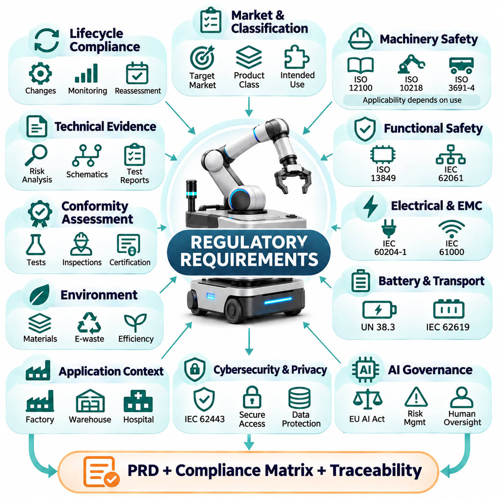{width="7.268055555555556in" height="7.268055555555556in"}

Regulatory requirements define the legal obligations, applicable standards, and conformity assessment conditions that a mobile manipulator must satisfy before commercialization and operational deployment. These requirements establish the framework for product development, safety engineering, manufacturing, and market entry. Regulatory compliance must be considered throughout the product lifecycle rather than treated as a final certification activity.

The development of regulatory requirements begins with identifying the intended markets, product classification, operational environments, and applicable legal frameworks. Mobile manipulators combine autonomous mobile platforms, robotic arms, electrical equipment, wireless communication devices, and intelligent software. Consequently, multiple regulatory frameworks may apply to the integrated robotic system and its individual components.

International safety standards provide an essential foundation for defining regulatory requirements. ISO 12100 establishes general principles for machinery risk assessment and risk reduction, while ISO 10218 addresses industrial robot safety. ISO 3691-4 provides safety requirements for driverless industrial trucks and their systems. The applicability of each standard must be evaluated according to the intended system configuration and operational purpose.

Functional safety standards establish requirements for the design and evaluation of safety-related control systems. ISO 13849 and IEC 62061 provide frameworks for determining and achieving appropriate safety performance. Safety-related sensors, controllers, actuators, and communication interfaces must collectively satisfy the required integrity levels, supported by documented engineering analyses and verification evidence.

Electrical safety and Electromagnetic Compatibility (EMC) requirements address hazards associated with electrical equipment and electromagnetic interference. IEC 60204-1 provides electrical safety requirements for machinery, while applicable IEC 61000 series standards support electromagnetic compatibility assessment. Requirements should consider electrical insulation, grounding, circuit protection, emissions, and immunity under representative operating conditions.

Battery and energy storage regulatory requirements are particularly important for mobile manipulators equipped with rechargeable lithium-based battery systems. Applicable requirements may address battery protection, thermal management, electrical isolation, transportation, and environmental sustainability. UN 38.3 testing is relevant to lithium battery transportation, while IEC 62619 may apply to industrial secondary lithium battery systems.

Regional regulatory requirements must be identified separately for each intended commercialization market. The European Union requires conformity with applicable legislation before CE marking, while the United States maintains product, workplace, and communication requirements through different regulatory frameworks. South Korea, Japan, and other markets may impose additional safety, electrical, and wireless equipment conformity obligations.

Artificial intelligence regulatory requirements are becoming increasingly important as mobile manipulators incorporate intelligent perception, autonomous decision-making, and adaptive behavior. Applicable frameworks, such as the European Union Artificial Intelligence Act, may introduce obligations concerning risk management, technical documentation, data governance, transparency, human oversight, and post-market monitoring, depending on system classification.

Cybersecurity and data protection requirements address risks arising from connected robotic systems, remote operations, cloud infrastructure, and software updates. Frameworks such as IEC 62443 may support industrial cybersecurity engineering, while applicable data protection legislation governs personal information processing. Requirements should address authentication, access control, secure communication, vulnerability management, and software integrity.

Application-specific regulatory requirements depend on the intended operational environment and the activities performed by the mobile manipulator. Manufacturing facilities, warehouses, hospitals, retail environments, and public spaces may impose different operational obligations. Healthcare deployment may require additional hygiene, infection control, and facility safety measures, with medical device regulations applying when the intended purpose meets relevant classification criteria.

Environmental and sustainability requirements must also be considered during product development and commercialization. Applicable legislation may restrict hazardous substances, establish battery management obligations, and require responsible treatment of electronic waste. Material selection, component procurement, energy efficiency, product repairability, and end-of-life disposal should reflect the environmental obligations of each target market.

Conformity assessment requirements establish the procedures necessary to demonstrate that the mobile manipulator satisfies applicable regulatory obligations. Depending on the product classification and jurisdiction, these procedures may involve internal assessments, accredited laboratory testing, independent inspections, or third-party certification. Certification of individual components does not automatically establish conformity of the complete integrated robotic system.

Technical documentation requirements provide objective evidence of regulatory compliance throughout the development process. Relevant documentation includes product specifications, system architecture, electrical schematics, risk assessment reports, safety calculations, software configurations, test reports, and operating instructions. Documentation must remain consistent with the actual product configuration, manufacturing processes, and approved engineering changes.

Regulatory compliance management must continue after product commercialization. Engineering modifications, component substitutions, software updates, AI model revisions, and changes in operational environments may affect previously established conformity. Organizations should maintain regulatory monitoring, configuration management, incident reporting, corrective actions, and reassessment procedures throughout the product lifecycle.

Ultimately, regulatory requirements must be documented within the Product Requirements Document (PRD) and a dedicated regulatory compliance matrix. Each requirement should remain traceable to applicable legislation, standards, implementation responsibilities, verification procedures, and conformity evidence. Specific legal obligations, applicable standard editions, and certification procedures must be confirmed for each target market before commercial deployment.

## 10 Maintenance Requirements

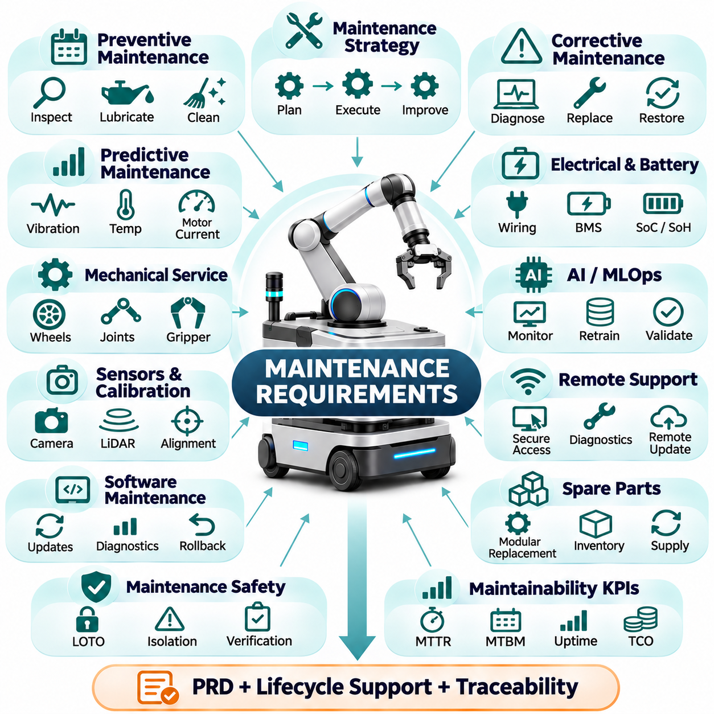{width="7.268055555555556in" height="7.268055555555556in"}

Maintenance requirements define the capabilities, procedures, resources, and engineering conditions necessary to maintain a mobile manipulator throughout its operational lifecycle. These requirements aim to preserve system functionality, operational reliability, safety performance, and equipment availability while minimizing maintenance costs and operational downtime. Maintainability must therefore be considered from the earliest stages of product development.

The development of maintenance requirements begins with analyzing operational scenarios, expected equipment lifetimes, environmental conditions, and potential failure mechanisms. Mechanical components, electrical systems, sensing devices, computing platforms, and intelligent software exhibit different degradation characteristics. Maintenance requirements should reflect these differences while establishing a consistent lifecycle support strategy for the integrated robotic system.

Preventive maintenance requirements establish scheduled maintenance activities intended to reduce the probability of equipment failure. Typical activities include mechanical inspections, lubrication, fastener verification, sensor cleaning, electrical connection inspections, and battery condition assessments. Maintenance intervals should be determined according to component specifications, accumulated operating hours, environmental conditions, and historical reliability data.

Corrective maintenance requirements define the procedures and resources necessary to restore system functionality following equipment failures. The mobile manipulator should support systematic fault identification, diagnostic information retrieval, defective component replacement, and functional recovery. Maintenance procedures must minimize unnecessary disassembly while ensuring that repaired systems satisfy applicable functional, performance, and safety requirements.

Predictive maintenance requirements establish the ability to anticipate equipment degradation through continuous condition monitoring and operational data analysis. Parameters such as motor current, vibration, temperature, battery health, actuator torque, and communication errors can provide indicators of emerging failures. Predictive models should generate actionable maintenance recommendations based on validated degradation patterns and equipment operating histories.

Mechanical maintenance requirements address the physical components of the mobile platform, robotic arm, and end effectors. Wheels, bearings, transmission systems, steering mechanisms, joints, grippers, and structural connections should be accessible for inspection and replacement. Mechanical design should support standardized maintenance procedures, modular component replacement, appropriate lubrication, and verification of structural integrity after maintenance.

Electrical and battery maintenance requirements establish procedures for inspecting power distribution systems, wiring harnesses, connectors, protective devices, and energy storage components. Battery management systems should provide information concerning State of Charge (SoC), State of Health (SoH), temperature, and abnormal operating conditions. Maintenance activities must incorporate appropriate electrical isolation and hazardous energy control procedures.

Sensor maintenance and calibration requirements ensure that perception, localization, navigation, and manipulation functions remain accurate throughout extended operation. Cameras, LiDAR sensors, depth sensors, inertial measurement units, and force sensors require appropriate inspection and calibration procedures. Calibration requirements should address sensor alignment, coordinate transformations, measurement accuracy, and verification following component replacement.

Software maintenance requirements address operating systems, robotic middleware, device drivers, control algorithms, communication interfaces, and application software. The system should support controlled software updates, configuration management, diagnostic logging, compatibility verification, and rollback mechanisms. Software maintenance must preserve established functional behavior and safety performance while addressing defects, security vulnerabilities, and operational improvements.

Artificial intelligence maintenance requirements address model degradation, dataset changes, environmental variations, and evolving operational demands. Deployed AI models should be monitored for declining recognition accuracy, increased inference latency, and unexpected prediction behavior. Model retraining, validation, version management, deployment approval, and rollback procedures should be integrated into Machine Learning Operations (MLOps).

Remote maintenance requirements establish capabilities for diagnosing and supporting robotic systems without requiring continuous on-site technical assistance. Remote monitoring, diagnostic data collection, system health assessment, and authorized software updates can improve maintenance efficiency. Remote access must incorporate secure authentication, access control, activity logging, and safeguards against unintended physical movements.

Maintainability performance requirements provide measurable criteria for evaluating maintenance efficiency and lifecycle support effectiveness. Relevant indicators include Mean Time to Repair (MTTR), Mean Time Between Maintenance (MTBM), maintenance labor hours, equipment downtime, spare parts availability, and restoration success rate. These indicators should support operational availability targets and Total Cost of Ownership (TCO) assessments.

Spare parts and serviceability requirements establish the resources necessary to support long-term robotic system operation. Critical replacement components should be identified according to failure probability, procurement lead time, replacement cost, and operational impact. Standardized components, modular architecture, accessible service connections, and controlled spare parts inventories can reduce maintenance complexity and lifecycle costs.

Maintenance safety and documentation requirements establish consistent procedures for protecting personnel during inspection, repair, calibration, and testing. Maintenance manuals should describe equipment isolation, Lockout/Tagout (LOTO), stored energy management, required tools, replacement procedures, and post-maintenance verification. Authorized personnel must receive appropriate training before performing activities involving hazardous equipment.

Ultimately, maintenance requirements must be documented within the Product Requirements Document (PRD) and associated lifecycle support specifications. Each requirement should remain traceable to system components, failure analysis results, maintenance procedures, and verification evidence. Application-specific maintenance intervals, service life targets, and resource requirements must be established through engineering analysis and representative operational validation.

## 11 Product Requirement Document PRD

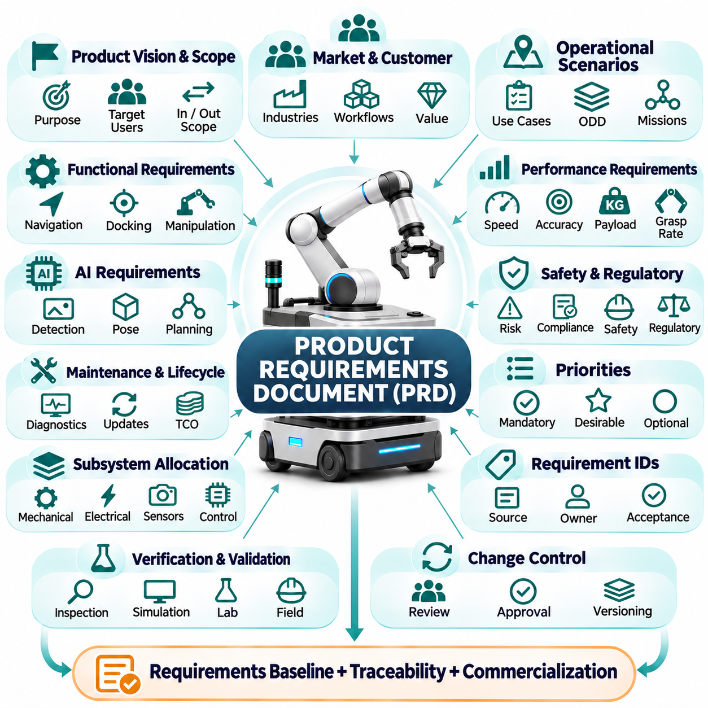{width="7.268055555555556in" height="7.268055555555556in"}

The Product Requirements Document (PRD) is a comprehensive engineering document that defines the objectives, capabilities, constraints, and acceptance criteria of a mobile manipulator. It consolidates product vision, market requirements, customer expectations, operational scenarios, and technical requirements into a unified reference. The PRD establishes a common foundation for product development, system integration, and commercialization.

The development of a PRD begins with defining the product purpose, intended applications, target customers, and expected operational value. These elements establish the boundaries of the development project and provide direction for technical decision-making. The document should distinguish essential product capabilities from optional features, future development objectives, and functions that are explicitly excluded from the current product scope.

Market and customer requirements within the PRD describe the commercial and operational expectations that the mobile manipulator must satisfy. These requirements should address target industries, customer workflows, operational challenges, competitive advantages, investment constraints, and expected economic benefits. Customer expectations must be translated into engineering requirements that can be implemented, measured, and objectively evaluated.

Operational scenarios provide contextual information describing how the mobile manipulator is expected to function within its intended environment. The PRD should define representative use cases, mission sequences, environmental conditions, equipment interactions, human involvement, and abnormal operating situations. These scenarios establish the basis for identifying required system functions, operational limitations, and acceptance testing conditions.

Functional requirements specify the capabilities that the mobile manipulator must provide to accomplish its intended tasks. These requirements should address autonomous navigation, localization, docking, environmental perception, object recognition, robotic manipulation, mission management, communication, and fault recovery. Each function should be described through clear statements that establish expected behavior without unnecessarily restricting implementation methods.

Performance requirements establish measurable engineering targets for evaluating the effectiveness of system functions. Relevant parameters include travel speed, positioning accuracy, docking repeatability, manipulator payload, grasp success rate, mission completion time, operational availability, and energy consumption. Each performance requirement should specify its measurement conditions, acceptance thresholds, allowable tolerances, and evaluation methodology.

Artificial intelligence requirements define the intelligent capabilities necessary for autonomous perception, decision-making, and physical task execution. The PRD should address object detection, pose estimation, grasp planning, semantic understanding, inference performance, data quality, and model robustness. Requirements must also establish acceptable responses to uncertain predictions, unfamiliar situations, and AI-related operational failures.

Safety and regulatory requirements establish the protective capabilities and compliance obligations applicable to the mobile manipulator. The PRD should incorporate requirements derived from hazard identification, risk assessment, functional safety analysis, and applicable regulations. Safety requirements must remain mandatory constraints throughout development and must not be compromised to achieve productivity, cost reduction, or delivery objectives.

Maintenance and lifecycle requirements define the conditions necessary to sustain reliable robotic operations after commercial deployment. The PRD should address maintainability, preventive maintenance, diagnostic capabilities, component replacement, remote technical support, software updates, and AI model management. These requirements should support equipment availability, service life objectives, spare parts planning, and Total Cost of Ownership (TCO) targets.

Requirement classification and prioritization enable development teams to manage competing technical and commercial objectives. Requirements may be categorized as mandatory, desirable, optional, or intended for future product releases. Prioritization should consider customer value, safety criticality, regulatory obligations, technical dependencies, implementation costs, and development schedules while preserving all mandatory compliance requirements.

Each requirement within the PRD should receive a unique identifier and contain sufficient information to support implementation and verification. Typical requirement attributes include a descriptive statement, originating source, rationale, priority, responsible organization, acceptance criteria, verification method, and approval status. Standardized requirement descriptions reduce ambiguity and improve communication across multidisciplinary engineering teams.

Requirement allocation establishes the relationship between product-level objectives and subsystem-level engineering specifications. The PRD provides inputs for mechanical architecture, electrical architecture, sensor architecture, computing infrastructure, AI architecture, and control software development. Allocation must account for subsystem dependencies, interface constraints, shared resources, and integrated system performance objectives.

Verification and validation planning should be incorporated into the PRD from the beginning of product development. Each requirement should be associated with an appropriate evaluation method, including inspection, engineering analysis, simulation, laboratory testing, or field validation. Acceptance criteria must provide objective evidence that the implemented product satisfies specified requirements and intended customer needs.

PRD management requires formal review, approval, version control, and engineering change management throughout the development lifecycle. Proposed requirement modifications should be evaluated according to their effects on system architecture, development costs, project schedules, safety compliance, and previously completed verification activities. Approved changes must be communicated to all responsible engineering and project management organizations.

Ultimately, the PRD serves as the central requirements baseline connecting product planning, system design, hardware development, AI development, manipulation engineering, testing, field validation, manufacturing, and quality assurance. Maintaining requirement traceability throughout these activities ensures that engineering decisions remain aligned with approved product objectives and supports the systematic transition from initial requirements to commercial deployment.

## 12 Requirement Traceability

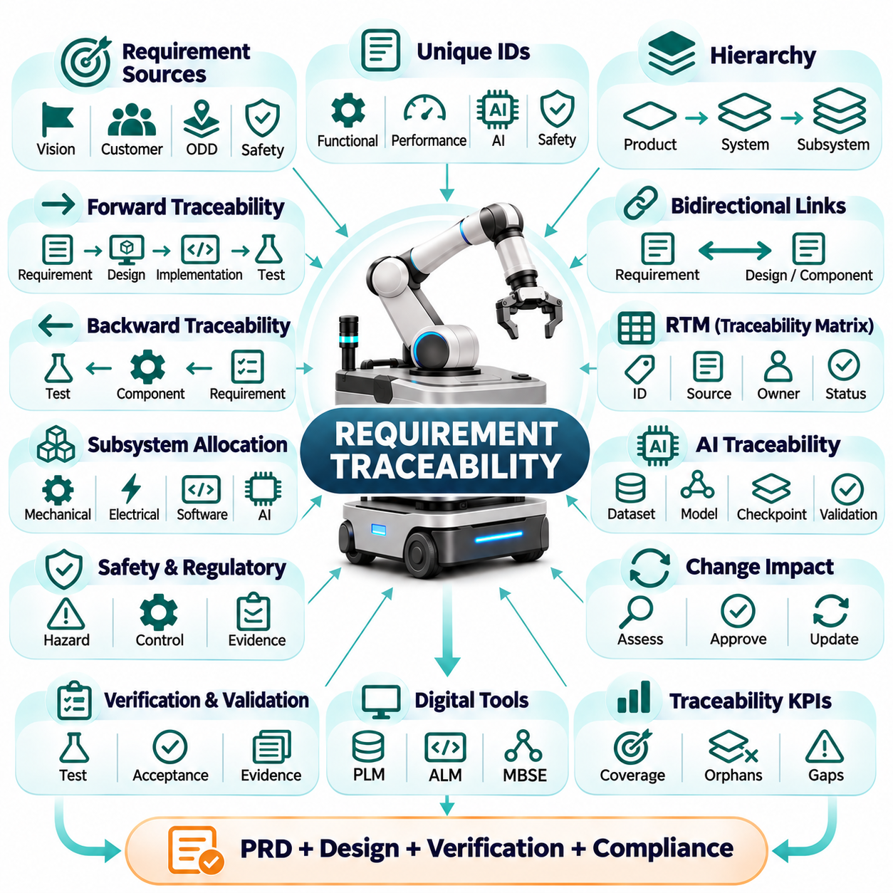{width="7.268055555555556in" height="7.268055555555556in"}

Requirement traceability establishes a systematic relationship between product requirements, engineering specifications, design decisions, implementation activities, and verification evidence throughout the development lifecycle of a mobile manipulator. It ensures that every approved requirement can be tracked from its original source to its final implementation and that engineering activities remain aligned with established product objectives.

The development of requirement traceability begins with identifying the origins of individual requirements. Product vision, market expectations, customer needs, operational scenarios, safety assessments, regulatory obligations, and maintenance objectives represent important sources. Each requirement should retain an explicit relationship with its originating source, engineering rationale, responsible stakeholder, and associated product objectives.

Unique requirement identification provides the foundation for consistent traceability across multidisciplinary development activities. Each requirement should receive a stable identifier that remains associated with the requirement throughout its lifecycle. Identification conventions may distinguish functional, performance, artificial intelligence, safety, regulatory, interface, and maintenance requirements while supporting hierarchical relationships.

Forward traceability establishes relationships between approved product requirements and subsequent engineering activities. Product-level requirements should be linked to system specifications, subsystem designs, hardware components, software modules, AI models, and verification procedures. These relationships enable engineering teams to determine whether each requirement has been allocated, implemented, and adequately evaluated.

Backward traceability establishes relationships from implemented system components and verification results to their originating requirements. Every significant engineering function, hardware component, software capability, and AI model should have a documented justification. Backward traceability helps identify unnecessary functionality, unauthorized design changes, unsupported engineering decisions, and deviations from approved development objectives.

Bidirectional traceability combines forward and backward relationships to establish comprehensive visibility across the development lifecycle. Engineering teams can determine which components implement a particular requirement and which requirements justify a particular design element. This capability becomes especially important when multiple mechanical, electrical, software, and AI subsystems contribute to integrated robotic functions.

The Requirements Traceability Matrix (RTM) provides a structured mechanism for documenting relationships among requirements and associated engineering artifacts. Typical matrix attributes include requirement identifiers, originating sources, subsystem allocations, implementation references, verification methods, test case identifiers, acceptance criteria, responsible organizations, and current compliance status.

Hierarchical requirement traceability supports the decomposition of product-level objectives into system-level and subsystem-level requirements. For example, a docking accuracy requirement may generate derived requirements for localization accuracy, sensor calibration, mechanical tolerances, steering control, and manipulator positioning. Each derived requirement must maintain a documented relationship with its parent requirement.

Artificial intelligence requirement traceability extends conventional engineering relationships to datasets, annotation specifications, training configurations, model architectures, evaluation metrics, and deployment environments. AI models should remain traceable to approved operational requirements, dataset versions, trained checkpoints, validation results, and runtime configurations to support reproducibility and controlled model evolution.

Safety and regulatory requirement traceability establishes explicit relationships between identified hazards, risk assessments, protective measures, safety functions, applicable standards, and compliance evidence. Each safety requirement should be traceable to its implementation and validation results. Such relationships support safety assessments, conformity evaluations, engineering reviews, and post-deployment incident investigations.

Verification and validation traceability connects individual requirements with corresponding evaluation procedures and objective evidence. Test cases should identify the requirements they evaluate, relevant operating conditions, measurement methods, and acceptance criteria. Verification records should document observed results, deviations, unresolved failures, corrective actions, and final acceptance decisions for the evaluated system configuration.

Requirement change management relies on traceability to evaluate the consequences of proposed modifications. Changes to payload capacity, positioning accuracy, operating speed, or AI performance may affect mechanical structures, electrical capacity, computing resources, safety functions, and test procedures. Impact analysis should identify affected engineering artifacts before requirement changes are formally approved and implemented.

Digital engineering platforms support traceability through integrated requirements management, Product Lifecycle Management (PLM), Application Lifecycle Management (ALM), and Model-Based Systems Engineering (MBSE). These environments can maintain relationships among requirements, architecture models, engineering documents, software repositories, test results, and product configurations while supporting collaborative development.

Traceability quality should be evaluated through measurable indicators such as requirement allocation coverage, verification coverage, unresolved requirement counts, orphan requirements, and acceptance status. High traceability coverage alone does not guarantee product quality because documented relationships may be incomplete or incorrect. Regular engineering reviews must therefore evaluate both the completeness and validity of traceability relationships.

Ultimately, requirement traceability connects the Product Requirements Document (PRD) with system design, hardware development, AI development, manipulation engineering, testing, field validation, manufacturing, and quality assurance. Maintaining these relationships throughout the product lifecycle supports engineering accountability, systematic verification, regulatory compliance, controlled product evolution, and successful commercialization.
