# Chapter 01. Requirements

## 01 Product Vision

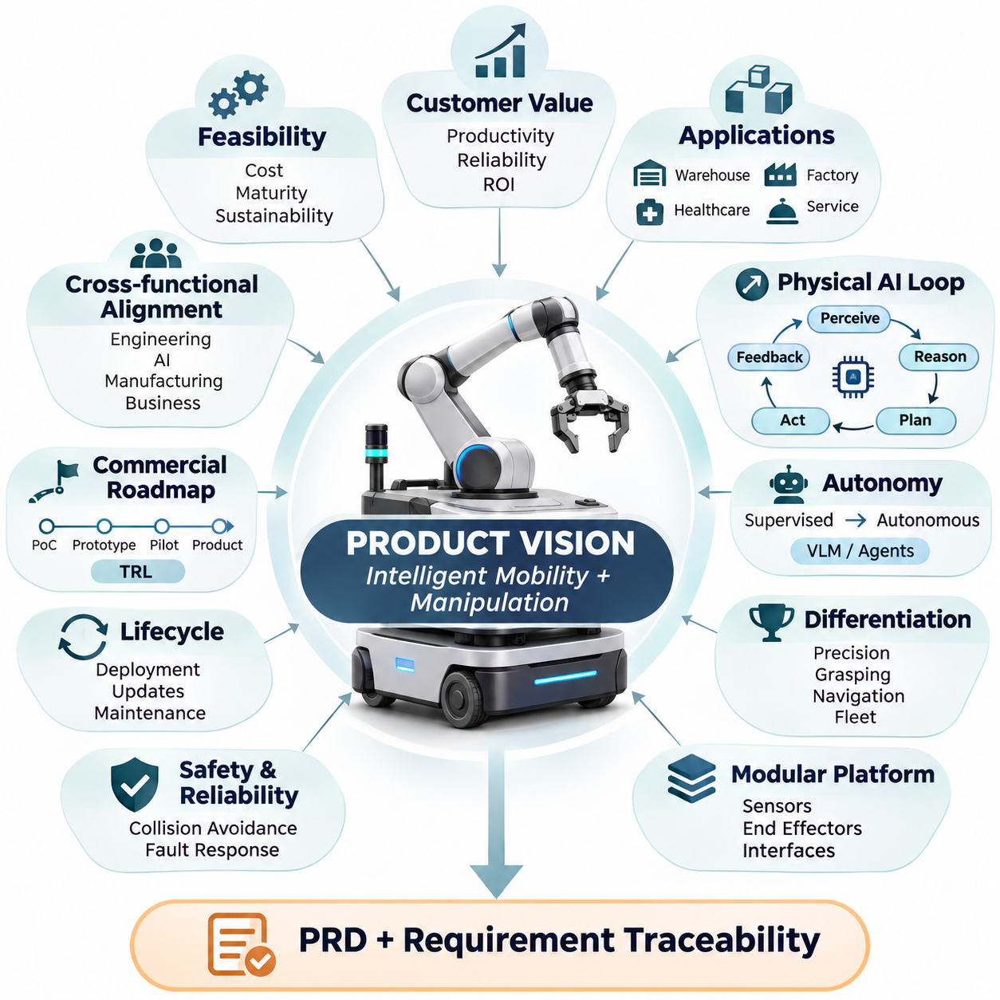{width="7.268055555555556in" height="7.268055555555556in"}

제품 비전(Product Vision)은 제품이 달성하고자 하는 목표, 제품의 기능을 통해 혜택을 얻는 대상, 지속 가능한 가치를 창출하는 방법을 정의함으로써 모바일 매니퓰레이터(Mobile Manipulator) 개발 프로젝트의 근본적인 방향을 설정한다. 또한 엔지니어링(Engineering), 연구개발(Research and Development), 제조(Manufacturing), 상용화(Commercialization), 운영(Operations) 활동을 위한 공통 기반을 제공하며, 다학제적 개발 조직이 제품 수명주기(Product Lifecycle) 전반에 걸쳐 일관된 전략적 목표를 추구하도록 한다.

모바일 매니퓰레이터(Mobile Manipulator)는 자율 이동 로봇(Autonomous Mobile Robot, AMR), 로봇 매니퓰레이터(Robotic Manipulator), 환경 인식(Environmental Perception), 인공지능(Artificial Intelligence, AI), 자율 의사결정(Autonomous Decision-Making)을 하나의 통합 로봇 시스템으로 구성한다. 제품 비전은 개별 구성요소의 단순한 통합보다는 이동(Mobility)과 조작(Manipulation)의 지능적인 협조에 중점을 두어야 한다. 이러한 협조를 통해 로봇은 분산되어 있고 동적으로 변화하는 작업 공간에서 복잡한 물리적 작업을 수행할 수 있다.

제품 비전의 수립은 기존 자동화 기술(Automation Technology)로 충분히 해결하기 어려운 실제 문제를 식별하는 것에서 시작된다. 고정형 산업용 로봇(Fixed Industrial Robot)은 높은 정밀도와 생산성을 제공하지만 설치 위치에 따른 제약이 존재한다. 기존 이동 로봇(Mobile Robot)은 자재를 운반할 수 있지만 일반적으로 고도화된 조작 능력이 부족하다. 모바일 매니퓰레이터는 자율주행(Autonomous Navigation)과 유연한 물리적 상호작용(Physical Interaction)을 결합함으로써 이러한 한계를 극복한다.

목표 적용 분야(Application Domain)는 제품 개발의 방향에 상당한 영향을 미친다. 물류창고 환경(Warehouse Environment)에서는 자율 피킹(Autonomous Picking), 자재 운송(Material Transportation), 재고 처리(Inventory Handling), 주문 이행(Order Fulfillment)이 요구된다. 제조시설에서는 머신 텐딩(Machine Tending), 부품 조립(Component Assembly), 검사(Inspection), 자재 공급(Material Feeding)이 필요하다. 의료기관에서는 자율 배송(Autonomous Delivery)과 물류 지원(Logistics Support)이 활용될 수 있으며, 상업 환경에서는 적응형 서비스(Adaptive Service) 기능이 요구된다.

고객 중심의 제품 비전(Customer-Oriented Product Vision)은 기술적 정교함 자체보다는 측정 가능한 운영 가치(Operational Value)를 강조한다. 고객은 일반적으로 생산성 향상(Productivity Improvement), 운영 신뢰성(Operational Reliability), 노동 효율성(Labor Efficiency), 구축 비용(Deployment Cost), 투자수익률(Return on Investment, ROI)을 기준으로 로봇 시스템을 평가한다. 따라서 고도화된 인공지능, 정교한 제어 알고리즘(Control Algorithm), 고성능 컴퓨팅 자원(High-Performance Computing Resources)은 실질적인 운영 성과에 직접적으로 기여해야 한다.

물리적 인공지능(Physical AI)의 관점에서 제품 비전은 인식(Perception), 추론(Reasoning), 계획(Planning), 행동(Action), 환경 피드백(Environmental Feedback)의 지속적인 통합을 강조해야 한다. 모바일 매니퓰레이터는 주변 객체를 인식하고, 공간적 관계(Spatial Relationship)를 이해하며, 실행 가능한 행동을 결정하고, 물리적 움직임을 수행한 후 그 결과를 평가해야 한다. 이러한 폐루프 지능(Closed-Loop Intelligence)은 로봇 시스템이 환경 변화와 예기치 않은 운영 상황에 적절하게 대응할 수 있도록 한다.

목표 자율성 수준(Level of Autonomy)은 제품 비전을 구성하는 또 다른 핵심 요소이다. 적용 분야에 따라 모바일 매니퓰레이터는 인간의 감독(Human Supervision)하에서 동작하거나, 사전에 정의된 임무를 자율적으로 수행하거나, 작업 실행 전략(Task Execution Strategy)을 동적으로 생성할 수 있다. 고도화된 시스템은 명확하게 정의된 운영 및 안전 경계(Operational and Safety Boundaries) 내에서 적응성을 향상하기 위해 비전-언어 모델(Vision-Language Model, VLM), 로봇 에이전트(Robot Agent), 학습 기반 조작(Learning-Based Manipulation) 기술을 활용할 수 있다.

제품 차별화(Product Differentiation)는 실질적인 경쟁 우위(Competitive Advantage)를 제공하는 기능을 통해 확립되어야 한다. 이러한 기능에는 우수한 조작 정밀도(Manipulation Accuracy), 지능형 파지 계획(Intelligent Grasp Planning), 강건한 자율주행(Robust Autonomous Navigation), 원활한 플릿 협조(Fleet Coordination), 신속한 현장 구축(Rapid Deployment), 간소화된 시스템 통합(System Integration) 등이 포함될 수 있다. 차별화는 기술적 우수성이나 인공지능 성능에 대한 일반적인 주장보다는 측정 가능한 객관적 증거를 통해 뒷받침되어야 한다.

확장 가능한 제품 비전(Scalable Product Vision)은 단일 응용 분야에 특화된 기계보다는 재사용 가능한 로봇 플랫폼(Reusable Robotic Platform)의 개발을 고려한다. 모듈형 기계 구조(Modular Mechanical Structure), 표준화된 전기 인터페이스(Standardized Electrical Interface), 구성 가능한 센서 아키텍처(Configurable Sensor Architecture), 교체 가능한 말단 작동기(Interchangeable End Effector), 재사용 가능한 소프트웨어 구성요소(Reusable Software Component)는 동일한 기술적 기반을 통해 다양한 산업 응용 분야를 지원할 수 있도록 한다. 플랫폼 기반 개발(Platform-Based Development)은 엔지니어링 비용을 절감하고 향후 제품 개발을 가속화한다.

제품 비전은 기술적 목표(Technological Ambition), 엔지니어링 실현 가능성(Engineering Feasibility), 상업적 지속 가능성(Commercial Sustainability) 사이의 균형을 유지해야 한다. 과도한 하드웨어 복잡성(Hardware Complexity), 컴퓨팅 요구사항(Computational Requirements), 인공지능 기능은 고객 가치의 비례적인 증가 없이 개발 비용을 상승시킬 수 있다. 엔지니어링 조직은 제품의 방향을 정의할 때 기술 성숙도(Technical Maturity), 부품 가용성(Component Availability), 제조 가능성(Manufacturing Feasibility), 유지보수 요구사항(Maintenance Requirements), 예상 운영 효과를 종합적으로 평가해야 한다.

안전성(Safety)과 신뢰성(Reliability)은 부가적인 엔지니어링 요구사항이 아니라 제품 정체성(Product Identity)을 구성하는 근본적인 요소로 인식되어야 한다. 모바일 매니퓰레이터는 인간 작업자, 고가의 설비, 동적 장애물(Dynamic Obstacle) 주변에서 빈번하게 동작한다. 따라서 제품 비전에는 신뢰할 수 있는 환경 모니터링(Environmental Monitoring), 충돌 회피(Collision Avoidance), 제어된 물리적 상호작용(Controlled Physical Interaction), 고장 감지(Fault Detection), 비상 대응(Emergency Response), 적절한 인간 개입 메커니즘(Human Intervention Mechanism)이 포함되어야 한다.

수명주기 중심의 제품 개발(Lifecycle-Oriented Product Development)은 초기 시제품(Prototype)의 완성을 넘어 제품 비전의 범위를 확장한다. 상업적으로 실현 가능한 모바일 매니퓰레이터는 제조, 현장 배치, 보정(Calibration), 소프트웨어 업데이트(Software Update), 예방 정비(Preventive Maintenance), 진단(Diagnostics), 부품 교체(Component Replacement), 장기 운영 모니터링(Long-Term Operational Monitoring)을 지원해야 한다. 이러한 수명주기 고려사항(Lifecycle Considerations)은 개발 초기 단계부터 아키텍처 의사결정(Architectural Decision-Making)에 영향을 미치며 지속 가능한 제품 성능 확보에 기여한다.

제품 비전은 기술성숙도(Technology Readiness Level, TRL)와 연계된 단계적 상용화 로드맵(Commercialization Roadmap)을 수립해야 한다. 초기 개발 단계에서는 실현 가능성 연구(Feasibility Study)와 개념 증명(Proof of Concept, PoC) 시연에 집중할 수 있으며, 이후 통합 시제품(Integrated Prototype), 대표 환경 시험(Representative Environment Testing), 시범 구축(Pilot Deployment), 상용 제품 검증(Commercial Product Validation)으로 발전한다. 각 개발 단계에서는 기술적 및 운영적 성숙도의 향상을 뒷받침할 수 있는 객관적인 증거(Objective Evidence)를 확보해야 한다.

제품 비전을 실행 가능한 개발 전략(Executable Development Strategy)으로 전환하기 위해서는 조직 간 협업 및 목표 정렬(Cross-Functional Alignment)이 필요하다. 기계 엔지니어(Mechanical Engineer), 전기 엔지니어(Electrical Engineer), 인공지능 연구원(AI Researcher), 소프트웨어 개발자(Software Developer), 제어 엔지니어(Control Engineer), 품질보증 담당자(Quality Assurance Personnel), 사업 이해관계자(Business Stakeholder)는 제품 목표에 대한 일관된 이해를 공유해야 한다. 이러한 목표 정렬은 효과적인 자원 배분(Resource Allocation), 요구사항 우선순위 설정(Requirement Prioritization), 아키텍처 의사결정, 다학제적 시스템 통합(Multidisciplinary System Integration)을 지원한다.

궁극적으로 제품 비전은 시장 요구사항(Market Requirements), 고객 요구사항(Customer Requirements), 운영 시나리오(Operational Scenarios), 기능 명세(Functional Specifications), 성능 목표(Performance Targets), 인공지능 요구사항(AI Requirements), 안전 요구사항(Safety Requirements)을 정의하기 위한 전략적 기반을 제공한다. 이러한 요소들은 이후 제품 요구사항 정의서(Product Requirements Document, PRD)로 통합되며, 요구사항 추적성(Requirement Traceability)을 통해 지속적으로 관리된다. 명확하게 수립된 제품 비전은 기술 혁신(Technological Innovation)을 실질적인 현장 구축, 상업적 경쟁력(Commercial Competitiveness), 지속적인 제품 개선(Continuous Product Improvement)과 연결한다.

## 02 Market Requirements

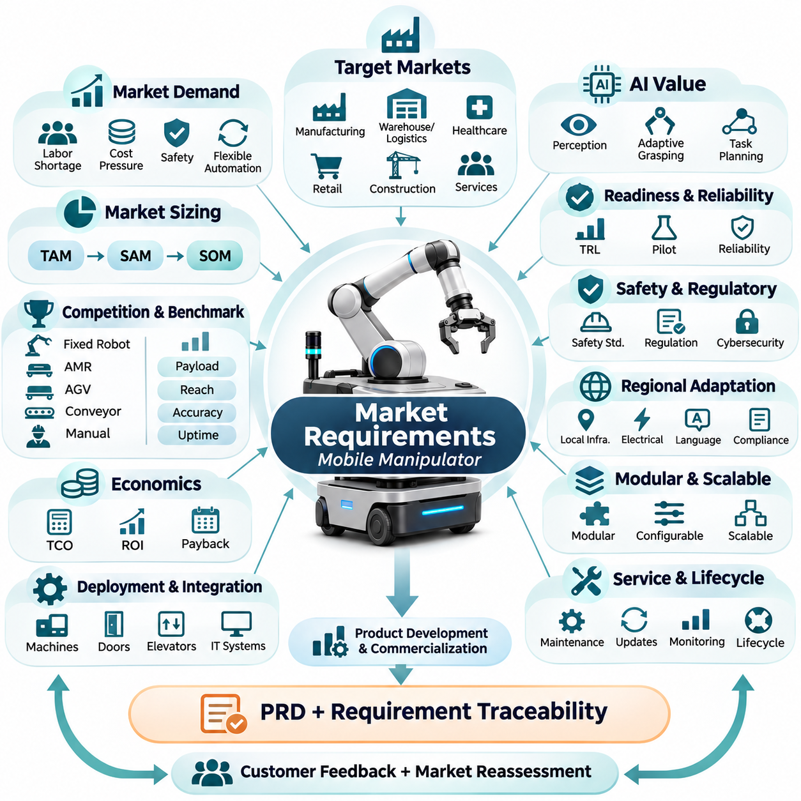{width="7.268055555555556in" height="7.268055555555556in"}

시장 요구사항(Market Requirements)은 모바일 매니퓰레이터(Mobile Manipulator)가 성공적인 시장 도입(Market Adoption)을 달성하기 위해 충족해야 하는 상업적 및 운영적 조건을 정의한다. 시장 기회(Market Opportunity), 산업 동향(Industry Trend), 경쟁 환경(Competitive Environment), 운영상의 과제(Operational Challenge)를 전략적 제품 개발 목표로 전환한다. 시장 요구사항에 대한 체계적인 이해는 엔지니어링 조직이 기술 중심의 가정(Technology-Driven Assumption)이 아닌 실제 산업적 요구를 충족하는 로봇 제품을 개발할 수 있도록 한다.

시장 요구사항의 개발은 시장 세분화(Market Segmentation)에서 시작된다. 모바일 매니퓰레이터는 제조(Manufacturing), 물류창고(Warehousing), 물류(Logistics), 의료(Healthcare), 소매(Retail), 건설(Construction), 상업 서비스(Commercial Service) 등 다양한 산업 분야에 적용될 수 있다. 각 시장 세그먼트(Market Segment)는 서로 다른 운영 환경(Operational Environment), 생산성 기대 수준(Productivity Expectation), 투자 역량(Investment Capability), 규제 제약사항(Regulatory Constraint)을 가진다. 따라서 제품 개발의 우선순위는 목표 시장(Target Market)의 특성을 반영해야 한다.

시장 수요 분석(Market Demand Analysis)은 잠재 고객(Potential Customer)이 경험하는 운영상의 문제와 이를 해결함으로써 얻을 수 있는 경제적 가치를 평가한다. 노동력 부족(Labor Shortage), 운영 비용 증가(Operating Cost Increase), 반복적인 물리적 작업(Repetitive Physical Workload), 작업장 안전 문제(Workplace Safety Concern), 유연한 자동화(Flexible Automation)에 대한 요구 증가는 모바일 조작 기술(Mobile Manipulation Technology)의 수요를 확대하는 요인이 될 수 있다. 이러한 요인들을 체계적으로 평가하여 상업적으로 지속 가능한 응용 기회(Application Opportunity)를 식별해야 한다.

시장 규모 산정(Market Sizing)은 사업 기회(Business Opportunity)를 평가하고 개발 자원(Development Resource)을 배분하기 위한 정량적 기반을 제공한다. 전체 잠재 시장(Total Addressable Market, TAM), 유효 시장(Serviceable Available Market, SAM), 실제 확보 가능 시장(Serviceable Obtainable Market, SOM)은 서로 다른 수준의 상업적 잠재력을 나타낸다. 이러한 시장 규모의 추정에는 잠재적인 구축 현장의 수, 적용 가능한 운영 프로세스(Operational Process), 예상 제품 가격(Product Pricing), 현실적인 기술 도입률(Technology Adoption Rate)이 고려되어야 한다.

경쟁 환경 분석(Competitive Landscape Analysis)은 기존 로봇 솔루션(Robotic Solution), 대체 자동화 기술(Alternative Automation Technology), 신규 경쟁업체(Emerging Competitor)를 식별한다. 모바일 매니퓰레이터는 고정형 산업용 로봇(Fixed Industrial Robot), 기존 자율 이동 로봇(Autonomous Mobile Robot, AMR), 무인 운반 차량(Automated Guided Vehicle, AGV), 컨베이어 시스템(Conveyor System), 수동 조작 장비(Manually Operated Equipment) 등과 경쟁할 수 있다. 이러한 대체 기술의 강점과 한계를 이해함으로써 개발 조직은 실질적인 제품 차별화(Product Differentiation)를 확립할 수 있다.

경쟁 제품 벤치마킹(Competitive Benchmarking)은 기술적 성능(Technical Performance)과 상업적 특성(Commercial Characteristic)을 모두 검토해야 한다. 주요 비교 요소에는 적재하중(Payload Capacity), 조작 도달 범위(Manipulation Reach), 위치 결정 정밀도(Positioning Accuracy), 작업 완료 시간(Task Completion Time), 배터리 지속시간(Battery Endurance), 운영 가용성(Operational Availability), 구축 복잡성(Deployment Complexity), 유지보수 비용(Maintenance Cost)이 포함된다. 제품 차별화는 대표적인 운영 조건(Representative Operating Condition)에서 실질적인 이점을 제공하는 측정 가능한 기능과 성능을 통해 입증되어야 한다.

경제적 실현 가능성(Economic Feasibility)은 시장 요구사항의 핵심 구성요소이다. 산업 고객은 일반적으로 총소유비용(Total Cost of Ownership, TCO), 투자수익률(Return on Investment, ROI), 투자 회수 기간(Payback Period), 예상 생산성 향상(Productivity Improvement)을 기준으로 자동화 투자를 평가한다. 제품 개발 과정에서는 제조 비용(Manufacturing Cost), 설치 비용(Installation Expense), 소프트웨어 라이선스(Software Licensing), 에너지 소비(Energy Consumption), 유지보수 요구사항(Maintenance Requirements), 장기 운영 지원(Long-Term Operational Support)을 고려해야 한다.

시장 요구사항은 구축 유연성(Deployment Flexibility)과 기존 산업 인프라(Industrial Infrastructure)에 대한 호환성(Compatibility)도 다루어야 한다. 고객은 일반적으로 로봇 시스템이 대규모 구조적 변경 없이 기존 시설 내에서 운영될 수 있기를 기대한다. 생산 설비(Production Equipment), 보관 시스템(Storage System), 엘리베이터(Elevator), 자동문(Automatic Door), 충전 스테이션(Charging Station), 기업 정보 시스템(Enterprise Information System)과의 호환성은 제품 구매 결정(Purchasing Decision)과 구축 비용(Deployment Cost)에 상당한 영향을 미칠 수 있다.

산업 자동화(Industrial Automation)에 대한 인공지능(Artificial Intelligence, AI)의 통합 확대는 모바일 매니퓰레이터에 새로운 시장 기회를 창출한다. 지능형 인식(Intelligent Perception), 적응형 파지(Adaptive Grasping), 자율 작업 계획(Autonomous Task Planning), 학습 기반 조작(Learning-Based Manipulation)은 로봇 시스템이 운영 환경의 변동성(Operational Variability)에 대응할 수 있도록 한다. 그러나 인공지능 기능의 우선순위는 입증된 고객 가치(Customer Value), 운영 신뢰성(Operational Reliability), 상업적으로 실현 가능한 구현 비용(Implementation Cost)을 기준으로 설정해야 한다.

시장 도입은 제품 신뢰성(Product Reliability)과 기술 성숙도(Technological Maturity)에 큰 영향을 받는다. 산업 고객은 일반적으로 예측 가능한 성능(Predictable Performance), 안정적인 운영(Stable Operation), 효과적인 고장 복구(Fault Recovery), 생산 중단(Production Interruption)의 최소화를 요구한다. 기술성숙도(Technology Readiness Level, TRL), 시제품 시연(Prototype Demonstration), 대표 환경 시험(Representative Environment Testing), 시범 구축 결과(Pilot Deployment Result)는 로봇 제품이 상업적 시장 출시(Commercial Introduction)를 준비할 수 있는 수준에 도달했는지 평가하기 위한 중요한 근거를 제공한다.

시장 요구사항에는 안전성에 대한 기대 수준(Safety Expectation), 규제 준수 의무(Regulatory Obligation), 산업별 운영 조건(Industry-Specific Operating Condition)이 포함되어야 한다. 모바일 매니퓰레이터는 인간 작업자와 민감한 산업 설비 주변에서 빈번하게 동작하므로 안전성 보증(Safety Assurance)은 상업적 시장 수용(Commercial Acceptance)을 위한 필수 요소이다. 각 목표 시장과 구축 지역에 적용되는 기계 안전 표준(Machinery Safety Standard), 전기 관련 규정(Electrical Regulation), 사이버보안 요구사항(Cybersecurity Requirements), 산업안전 정책(Occupational Safety Policy)을 식별해야 한다.

국제 시장 확장(International Market Expansion)을 위해서는 산업 인프라, 노동 비용(Labor Cost), 구매 관행(Purchasing Practice), 규제 체계(Regulatory Framework)의 지역별 차이를 고려해야 한다. 특정 지역 시장을 대상으로 설계된 제품이 다른 지역에 진출하기 위해서는 상이한 통신 인터페이스(Communication Interface), 언어 지원(Language Support), 전기적 구성(Electrical Configuration), 안전 관련 문서(Safety Documentation)가 필요할 수 있다. 모듈형 아키텍처(Modular Architecture)와 구성 가능한 소프트웨어(Configurable Software)는 이러한 지역별 차이에 효율적으로 대응할 수 있도록 한다.

상업적 확장성(Commercial Scalability)을 확보하기 위해서는 표준화된 제품(Standardized Product)과 고객 맞춤형 구성(Customer-Specific Customization) 사이의 균형이 필요하다. 과도한 맞춤형 개발(Customization)은 엔지니어링 지출(Engineering Expenditure), 제조 복잡성(Manufacturing Complexity), 장기적인 유지보수 부담(Maintenance Burden)을 증가시킨다. 구성 가능한 하드웨어(Hardware), 소프트웨어(Software), 센서(Sensor), 말단 작동기(End Effector)를 갖춘 모듈형 모바일 매니퓰레이터 플랫폼(Modular Mobile Manipulator Platform)은 공통 기술 및 제조 기반을 유지하면서 다양한 시장 세그먼트를 지원할 수 있다.

정비 용이성(Serviceability)과 수명주기 지원(Lifecycle Support)은 장기적인 시장 경쟁력(Market Competitiveness)을 확보하기 위한 중요한 요소이다. 고객은 신뢰할 수 있는 기술 지원(Technical Assistance), 예비 부품 가용성(Spare Parts Availability), 예방 정비(Preventive Maintenance), 원격 진단(Remote Diagnostics), 체계적으로 관리되는 소프트웨어 업데이트(Controlled Software Update)를 기대한다. 제품 개발 과정에서는 초기 계획 단계부터 이러한 기대사항을 반영하여 운영 중단 시간(Operational Downtime)을 최소화하고 상업적 사용자와 지속 가능한 관계를 구축해야 한다.

궁극적으로 시장 요구사항은 고객 요구사항(Customer Requirements), 운영 시나리오(Operational Scenarios), 기능 명세(Functional Specifications), 성능 목표(Performance Targets)를 정의하기 위한 상업적 기반을 제공한다. 이러한 요구사항은 제품 요구사항 정의서(Product Requirements Document, PRD)에 문서화되어야 하며, 요구사항 추적성(Requirement Traceability)을 통해 지속적으로 관리되어야 한다. 시장은 지속적으로 변화하므로 경쟁 환경의 변화(Competitive Development), 고객 피드백(Customer Feedback), 현장 구축 결과(Field Deployment Result)를 기반으로 시장 요구사항을 주기적으로 재평가해야 한다.

## 03 Customer Requirements

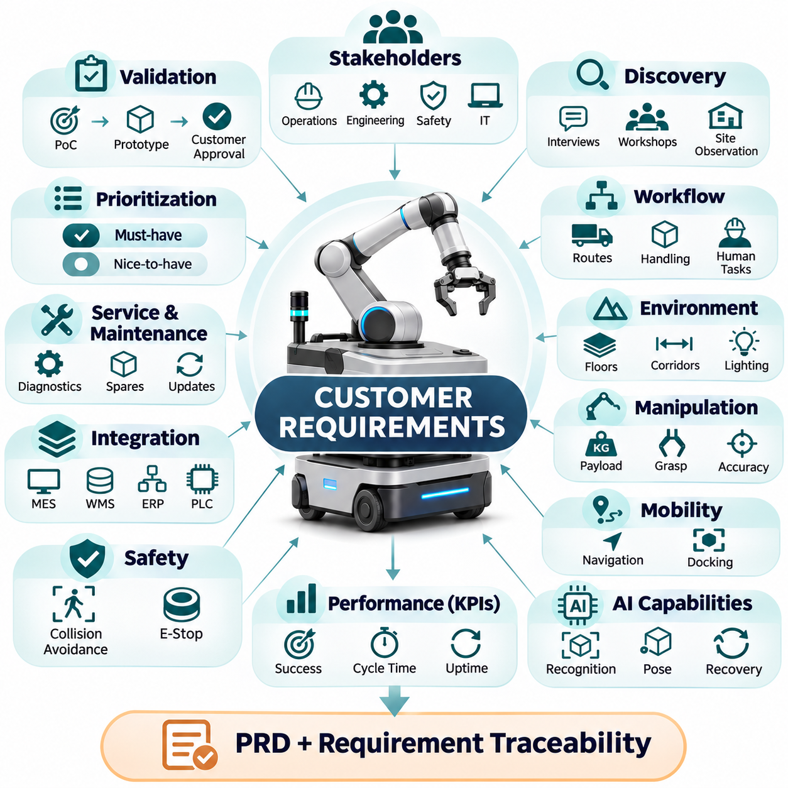{width="7.268055555555556in" height="7.268055555555556in"}

고객 요구사항(Customer Requirements)은 모바일 매니퓰레이터(Mobile Manipulator)가 목표 사용자에게 실질적인 가치를 제공하기 위해 충족해야 하는 구체적인 요구, 기대사항 및 운영 조건을 정의한다. 광범위한 상업적 기회와 산업 동향을 다루는 시장 요구사항(Market Requirements)과 달리, 고객 요구사항은 실제 로봇 구축(Robotic Deployment)과 관련된 개별 운영상의 과제(Operational Challenge), 기존 작업 흐름(Workflow), 환경적 제약사항(Environmental Constraint), 측정 가능한 기대사항에 중점을 둔다.

고객 요구사항의 개발은 목표 조직 내의 관련 이해관계자(Stakeholder)를 식별하는 것에서 시작된다. 이러한 이해관계자에는 시설 관리자(Facility Manager), 생산 엔지니어(Production Engineer), 물류 운영자(Logistics Operator), 유지보수 담당자(Maintenance Personnel), 안전 관리자(Safety Manager), 정보기술 전문가(Information Technology Specialist), 경영진(Business Executive)이 포함될 수 있다. 각 이해관계자는 시스템 기능(System Functionality), 운영 성능(Operational Performance), 설치 요구사항(Installation Requirements), 경제적 실현 가능성(Economic Feasibility), 장기 지원(Long-Term Support)에 대해 서로 다른 관점을 제공한다.

고객 인터뷰(Customer Interview), 기술 워크숍(Technical Workshop), 설문조사(Questionnaire), 현장 관찰(On-Site Observation)은 운영 요구사항(Operational Requirements)을 수집하기 위한 핵심적인 방법이다. 엔지니어링 조직은 기존 작업이 어떻게 수행되는지, 어떠한 자원이 필요한지, 어느 부분에서 운영 비효율성(Operational Inefficiency)이 발생하는지, 어떠한 제약사항이 추가적인 자동화를 방해하는지를 조사해야 한다. 고객이 모든 환경적 또는 절차적 제약사항을 명시적으로 전달하지 않을 수 있으므로 직접 관찰(Direct Observation)은 특히 중요하다.

기존 작업 흐름 분석(Existing Workflow Analysis)은 모바일 매니퓰레이터 개발을 위한 운영적 기반을 확립한다. 엔지니어는 자재 운송 경로(Material Transportation Route), 객체 취급 절차(Object Handling Procedure), 설비 상호작용(Equipment Interaction), 작업 실행 순서(Task Execution Sequence), 인간 개입 요구사항(Human Intervention Requirements)을 검토해야 한다. 전체 작업 흐름을 이해함으로써 개발 조직은 불필요한 운영 복잡성(Operational Complexity)을 유발하거나 기존 생산 활동을 방해하지 않으면서 자동화 기회(Automation Opportunity)를 식별할 수 있다.

물리적 운영 환경(Physical Operating Environment)은 고객 요구사항에 상당한 영향을 미친다. 주요 환경적 특성에는 통로 폭(Corridor Width), 바닥 상태(Floor Condition), 경사도(Slope), 출입문 치수(Door Dimension), 작업 공간 접근성(Workspace Accessibility), 조명 변화(Lighting Variation), 온도 범위(Temperature Range), 습도(Humidity), 전자기 간섭(Electromagnetic Interference, EMI)이 포함된다. 이동 플랫폼(Mobile Platform), 로봇 매니퓰레이터(Robotic Manipulator), 인식 센서(Perception Sensor), 전기 시스템(Electrical System)은 정상 운영 전반에 걸쳐 이러한 조건을 수용할 수 있도록 선정하거나 설계해야 한다.

조작 요구사항(Manipulation Requirements)은 고객이 로봇 시스템에 기대하는 물리적 상호작용(Physical Interaction)을 정의한다. 이러한 요구사항에는 객체 피킹(Object Picking), 자재 적재(Material Loading), 부품 배치(Component Placement), 머신 텐딩(Machine Tending), 검사(Inspection), 조립(Assembly), 비정형 객체 취급(Irregularly Shaped Object Handling)이 포함될 수 있다. 상세 엔지니어링(Detailed Engineering)을 시작하기 전에 객체 치수(Object Dimension), 중량 분포(Weight Distribution), 표면 특성(Surface Property), 파지 특성(Grasping Characteristic), 요구 조작 정밀도(Manipulation Accuracy), 접근 가능한 작업 위치(Accessible Working Position)를 문서화해야 한다.

이동 요구사항(Mobility Requirements)은 로봇 시스템이 고객의 시설 내에서 어떻게 자율주행하고 위치를 결정해야 하는지를 정의한다. 일반적인 고려사항에는 주행 속도(Travel Speed), 회전 반경(Turning Radius), 장애물 회피(Obstacle Avoidance), 위치 추정 정밀도(Localization Accuracy), 도킹 반복 정밀도(Docking Repeatability), 제한된 공간 내에서의 접근성(Accessibility)이 포함된다. 조작 성능(Manipulation Performance)은 이동 플랫폼의 위치 결정(Positioning)에 영향을 받으므로 이동 요구사항과 조작 요구사항은 상호 연결된 시스템 기능(System Capability)으로 평가해야 한다.

운영 성능 요구사항(Operational Performance Requirements)은 고객의 기대사항을 측정 가능한 엔지니어링 목표(Engineering Target)로 전환해야 한다. 핵심 성과 지표(Key Performance Indicator, KPI)에는 임무 성공률(Mission Success Rate), 작업 완료 시간(Task Completion Time), 피킹 정밀도(Picking Accuracy), 운영 가용성(Operational Availability), 배터리 지속시간(Battery Endurance), 복구 성공률(Recovery Success Rate), 일일 처리량(Daily Throughput)이 포함될 수 있다. 각각의 성능 목표에는 대표적인 운영 조건(Representative Operating Condition), 측정 절차(Measurement Procedure), 허용 오차(Acceptable Tolerance), 객관적인 인수 기준(Acceptance Criteria)이 명시되어야 한다.

인공지능에 대한 고객 요구사항(AI Customer Requirements)은 특정 모델 아키텍처(Model Architecture)보다는 실질적인 운영 능력(Operational Capability)을 강조해야 한다. 고객은 신뢰할 수 있는 객체 인식(Object Recognition), 정확한 자세 추정(Pose Estimation), 적응형 파지 계획(Adaptive Grasp Planning), 지능형 작업 스케줄링(Intelligent Task Scheduling), 자율 오류 복구(Autonomous Error Recovery)를 요구할 수 있다. 엔지니어링 조직은 컴퓨팅 자원(Computational Resource), 환경적 변동성(Environmental Variability), 잘못된 예측의 운영상 영향을 고려하면서 이러한 기대사항을 측정 가능한 인공지능 성능 목표(AI Performance Target)로 전환해야 한다.

안전 요구사항(Safety Requirements)은 고객의 작업장 특성(Workplace Characteristic), 운영 절차(Operational Procedure), 인간-로봇 상호작용(Human-Robot Interaction, HRI) 조건을 반영해야 한다. 모바일 매니퓰레이터는 작업자, 운송 장비(Transportation Equipment), 생산 설비(Production Machinery), 다른 자율 로봇(Autonomous Robot)과 함께 운영될 수 있다. 보호 기능(Protective Function), 비상 정지 접근성(Emergency Stop Accessibility), 충돌 방지(Collision Prevention), 안전 운영 속도(Safe Operating Speed), 고장 대응(Fault Response), 인간 개입(Human Intervention)에 대한 고객의 기대사항은 시스템 요구사항(System Requirements)에 반영되어야 한다.

통합 요구사항(Integration Requirements)은 모바일 매니퓰레이터가 고객의 기존 설비 및 디지털 인프라(Digital Infrastructure)와 어떻게 상호작용하는지를 정의한다. 관련 시스템에는 제조 실행 시스템(Manufacturing Execution System, MES), 창고 관리 시스템(Warehouse Management System, WMS), 전사적 자원 관리(Enterprise Resource Planning, ERP), 프로그래머블 논리 제어기(Programmable Logic Controller, PLC), 플릿 관리 플랫폼(Fleet Management Platform)이 포함될 수 있다. 통신 인터페이스(Communication Interface), 데이터 교환 형식(Data Exchange Format), 인증 메커니즘(Authentication Mechanism), 사이버보안 제약사항(Cybersecurity Constraint)은 개발 초기 단계에서 식별되어야 한다.

유지보수 및 운영 지원 요구사항(Maintenance and Operational Support Requirements)은 제품 수명주기(Product Lifecycle) 전반에 걸쳐 고객 만족도(Customer Satisfaction)에 상당한 영향을 미친다. 고객은 간소화된 부품 교체(Component Replacement), 원격 진단(Remote Diagnostics), 예방 정비(Preventive Maintenance), 소프트웨어 업데이트(Software Update), 예비 부품 가용성(Spare Parts Availability), 명확하게 정의된 기술 지원 응답 시간(Technical Support Response Time)을 기대할 수 있다. 이러한 기대사항은 개발 과정에서 기계적 접근성(Mechanical Accessibility), 전기적 모듈화(Electrical Modularity), 소프트웨어 아키텍처(Software Architecture), 진단 기능(Diagnostic Function), 유지보수 문서(Maintenance Documentation)에 반영되어야 한다.

고객 요구사항은 필수 기능(Mandatory Capability), 권장 기능(Desirable Feature), 잠재적인 미래 개선사항(Future Enhancement)을 구분해야 한다. 요구사항 우선순위 설정(Requirement Prioritization)은 현실적인 프로젝트 일정(Project Schedule)과 기술적 목표(Technical Objective)를 유지하면서 엔지니어링 조직이 개발 자원(Development Resource)을 효과적으로 배분할 수 있도록 한다. 성능(Performance), 비용(Cost), 안전성(Safety), 유연성(Flexibility), 납품 일정(Delivery Schedule)과 관련된 상충하는 기대사항은 문서화된 협의와 상호 합의된 엔지니어링 절충안(Engineering Trade-Off)을 통해 해결해야 한다.

요구사항 타당성 확인(Requirement Validation)은 문서화된 고객의 기대사항이 실제 운영상의 요구를 정확하게 반영하는지 확인해야 한다. 기술 검토(Technical Review), 시뮬레이션 환경(Simulation Environment), 개념 증명(Proof of Concept, PoC) 시연, 시제품 평가(Prototype Evaluation)는 상당한 개발 투자가 이루어지기 전에 상호 이해의 불일치와 오해를 식별할 수 있는 기회를 제공한다. 또한 측정 가능한 인수 기준에 대한 고객 승인(Customer Approval)은 이후의 시스템 검증(System Verification)과 현장 유효성 검증(Field Validation)을 위한 기반을 확립한다.

궁극적으로 타당성이 확인된 고객 요구사항은 제품 요구사항 정의서(Product Requirements Document, PRD)에 통합되어야 하며, 요구사항 추적성(Requirement Traceability)을 통해 기능 명세(Functional Specifications), 성능 목표(Performance Targets), 시스템 아키텍처(System Architecture), 검증 절차(Verification Procedure)와 연결되어야 한다. 요구사항 변경(Requirement Change)은 공식적인 요구사항 관리 프로세스(Requirement Management Process)를 통해 평가되어야 하며, 이를 통해 고객의 기대사항, 엔지니어링 구현(Engineering Implementation), 상업적 계약 및 약속(Commercial Commitment), 장기적인 제품 개발 목표(Long-Term Product Development Objective) 사이의 일관성을 유지해야 한다.

## 04 Operational Scenarios

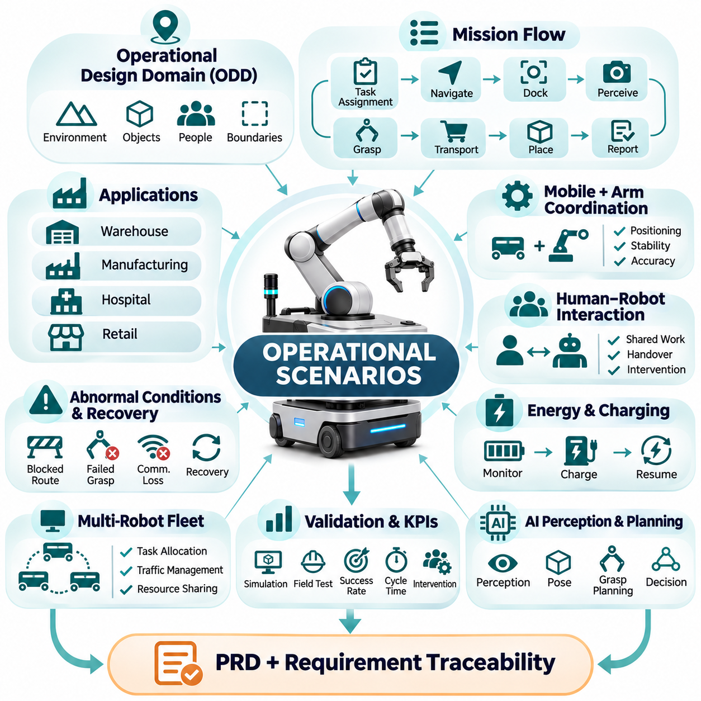{width="7.268055555555556in" height="7.268055555555556in"}

운영 시나리오(Operational Scenarios)는 모바일 매니퓰레이터(Mobile Manipulator)가 목표 운영 환경에서 실제 작업을 어떻게 수행해야 하는지를 설명한다. 제품 비전(Product Vision), 시장 요구사항(Market Requirements), 고객의 기대사항(Customer Expectations)을 시스템 개발의 방향을 제시하는 대표적인 작업 실행 상황으로 전환한다. 명확하게 정의된 시나리오는 기능 요구사항(Functional Requirements), 아키텍처 의사결정(Architectural Decision-Making), 성능 평가(Performance Evaluation), 안전 분석(Safety Analysis), 현장 유효성 검증(Field Validation)을 위한 기반을 확립한다.

운영 시나리오의 개발은 로봇 시스템의 운영 설계 영역(Operational Design Domain, ODD)을 정의하는 것에서 시작된다. 운영 설계 영역은 자율 운영(Autonomous Operation)이 이루어지도록 설계된 환경 조건(Environmental Condition), 작업 공간 특성(Workspace Characteristic), 인프라 제약사항(Infrastructure Limitation), 객체 특성(Object Property), 인간 상호작용 조건(Human Interaction Condition)을 명시한다. 이러한 운영 경계를 설정함으로써 모바일 매니퓰레이터의 기능과 운영 유연성(Operational Flexibility)에 대한 비현실적인 가정을 방지할 수 있다.

대표적인 운영 시나리오는 작업 할당(Task Assignment)에서 시작하여 작업 완료(Task Completion) 및 결과 보고(Result Reporting)로 종료되는 전체 임무 수명주기(Mission Lifecycle)를 설명해야 한다. 중간 활동에는 자율주행(Autonomous Navigation), 장애물 회피(Obstacle Avoidance), 정밀 도킹(Precision Docking), 환경 인식(Environmental Perception), 객체 인식(Object Recognition), 조작(Manipulation), 검증(Verification)이 포함될 수 있다. 각 활동에는 초기 조건(Initial Condition), 예상 결과(Expected Outcome), 실행 제약사항(Execution Constraint), 잠재적 실패 조건(Failure Condition)이 명시되어야 한다.

물류창고 운영(Warehouse Operation)은 모바일 매니퓰레이터의 주요 응용 분야(Application Domain) 중 하나이다. 대표적인 시나리오는 창고 관리 시스템(Warehouse Management System, WMS)으로부터 피킹 요청(Picking Request)을 수신하고, 지정된 보관 위치까지 자율주행하며, 목표 객체(Target Object)를 식별하고, 객체의 자세를 추정한 후 적절한 파지(Grasping)를 수행하는 과정으로 구성된다. 이후 로봇은 객체를 지정된 목적지로 운반하고 성공적인 배치(Placement)가 완료되면 재고 관리 시스템(Inventory System)을 업데이트한다.

제조 운영 시나리오(Manufacturing Scenario)는 일반적으로 머신 텐딩(Machine Tending), 부품 적재(Component Loading), 자재 공급(Material Feeding), 조립(Assembly), 자동 검사(Automated Inspection)를 포함한다. 모바일 매니퓰레이터는 여러 생산 스테이션(Production Station) 사이를 자율적으로 이동하고 산업 설비(Industrial Equipment)와 통신을 설정한 후 사전에 정의된 조작 작업을 수행할 수 있다. 이러한 환경에서는 정밀 위치 결정(Precise Positioning), 협조적인 설비 동기화(Equipment Synchronization), 생산 주기 호환성(Production Cycle Compatibility), 신뢰성 높은 작업 실행(Task Execution)이 특히 중요하다.

병원 물류 시나리오(Hospital Logistics Scenario)는 의료진, 환자, 방문객이 공유하는 환경에서 안전한 자율 운송(Autonomous Transportation)과 조작을 강조한다. 모바일 매니퓰레이터는 의료용품(Medical Supply)을 배송하고, 표준화된 용기(Standardized Container)를 취급하며, 호환 가능한 보관 시스템(Storage System)을 조작하고, 지정된 물류 스테이션(Logistics Station)과 상호작용할 수 있다. 이러한 시나리오에서는 위생(Hygiene), 예측하기 어려운 보행자 이동(Pedestrian Movement), 접근성(Accessibility), 서비스 연속성(Service Continuity)을 신중하게 고려해야 한다.

소매 및 상업 서비스 시나리오(Retail and Commercial Service Scenario)는 추가적인 환경적 변동성(Environmental Variability)과 상호작용 복잡성(Interaction Complexity)을 수반한다. 모바일 매니퓰레이터는 진열대 상품 보충(Shelf Replenishment), 재고 검사(Inventory Inspection), 상품 취급(Merchandise Handling), 일상적인 서비스 활동을 수행할 수 있다. 객체 배치(Object Placement), 인간 행동(Human Behavior), 조명 조건(Lighting Condition), 작업 공간 접근성의 변화에 대응하기 위해서는 강건한 인식(Robust Perception), 적응형 조작(Adaptive Manipulation), 적절하게 제한된 자율 의사결정(Autonomous Decision-Making)이 필요하다.

운영 시나리오는 이동 플랫폼의 자율주행과 로봇 조작 사이의 협조 제어(Coordinated Control)를 명확하게 다루어야 한다. 이동 플랫폼(Mobile Platform)은 매니퓰레이터가 할당된 작업을 수행하기 전에 적절한 작업 위치(Working Position)를 확보해야 한다. 적용 분야에 따라 이동 플랫폼의 움직임(Base Movement)과 로봇 팔의 동작(Arm Motion)을 협조적으로 제어함으로써 작업 공간 접근성을 향상할 수 있다. 위치 결정 불확실성(Positioning Uncertainty), 기계적 안정성(Mechanical Stability), 충돌 제약사항(Collision Constraint), 조작 정밀도(Manipulation Accuracy)는 통합적으로 평가되어야 한다.

인간-로봇 상호작용 시나리오(Human-Robot Interaction Scenario, HRI Scenario)는 일상적인 운영 과정에서 모바일 매니퓰레이터가 인간 작업자와 어떻게 공존하고 협력하는지를 정의한다. 이러한 시나리오에는 공유 작업 공간 내 자율주행(Shared Workspace Navigation), 감독 기반 작업 실행(Supervised Task Execution), 객체 전달(Object Handover), 수동 개입(Manual Intervention), 비상 지원(Emergency Assistance)이 포함될 수 있다. 로봇 시스템은 적절한 분리 거리(Separation Distance), 제어된 움직임(Controlled Movement), 적용 가능한 보호 기능(Protective Function)을 유지하면서 인간의 존재에 예측 가능한 방식으로 대응해야 한다.

비정상 운영 시나리오(Abnormal Operational Scenario)는 정상 운영 조건(Nominal Operating Condition)을 벗어난 상황에서 시스템의 강건성(System Robustness)을 평가하는 데 필수적이다. 대표적인 상황에는 주행 경로 차단(Blocked Navigation Route), 객체 인식 실패(Object Recognition Failure), 파지 실패(Grasping Failure), 통신 중단(Communication Interruption), 위치 추정 성능 저하(Localization Degradation), 설비 사용 불가(Equipment Unavailability), 예기치 않은 장애물 이동(Unexpected Obstacle Movement)이 포함된다. 각 시나리오에는 감지 메커니즘(Detection Mechanism), 허용 가능한 복구 행동(Recovery Action), 상위 대응 절차(Escalation Procedure), 안전 종료 조건(Safe Termination Condition)이 정의되어야 한다.

에너지 관리 시나리오(Energy Management Scenario)는 모바일 매니퓰레이터가 장시간의 작업 기간 동안 운영 가용성(Operational Availability)을 어떻게 유지하는지를 설명한다. 로봇 시스템은 배터리 상태(Battery Status)를 모니터링하고, 할당된 임무를 완료하는 데 필요한 에너지를 추정하며, 충전 활동(Charging Activity)을 적절하게 스케줄링해야 한다. 또한 충전 중단(Charging Interruption), 도킹 실패(Docking Failure), 충전 스테이션 사용 불가(Charging Station Unavailability), 에너지 보충 이후 중단된 작업의 재개(Task Resumption)도 시나리오에 포함되어야 한다.

다중 로봇 운영 시나리오(Multi-Robot Operational Scenario)는 모바일 매니퓰레이터가 협조적인 로봇 플릿(Robotic Fleet)의 일부로 운영될 때 더욱 중요해진다. 여러 로봇은 운송 경로(Transportation Route), 충전 스테이션(Charging Station), 조작 작업 공간(Manipulation Workspace), 생산 설비를 공유할 수 있다. 플릿 관리(Fleet Management)는 교착 상태(Deadlock), 불필요한 대기(Unnecessary Waiting), 동시 실행 임무 간 간섭(Interference)을 방지하면서 작업 할당(Task Allocation), 자원 예약(Resource Reservation), 교통 관리(Traffic Management), 충돌 및 경합 해결(Conflict Resolution)을 조정해야 한다.

인공지능 요구사항(AI Requirements)은 운영 시나리오에서 식별된 인식 및 의사결정 과제(Perceptual and Decision-Making Challenge)로부터 도출되어야 한다. 객체 외관(Object Appearance), 가림 현상(Occlusion), 조명(Illumination), 기하학적 형상(Geometry), 환경 조건의 변화는 인식 모델(Perception Model)과 파지 계획 알고리즘(Grasp Planning Algorithm)에 요구되는 기능에 영향을 미친다. 시나리오 기반 평가(Scenario-Based Evaluation)는 대표적인 운영 조건과 예측 가능한 운영 교란(Operational Disturbance) 상황에서도 인공지능 성능이 충분한 수준으로 유지되는지를 판단하는 데 도움을 준다.

운영 시나리오는 시뮬레이션(Simulation), 디지털 트윈(Digital Twin), 통합 시제품(Integrated Prototype), 대표적인 현장 구축(Representative Field Deployment)을 통해 단계적으로 유효성을 검증해야 한다. 각 시나리오에는 임무 성공률(Mission Success Rate), 작업 주기 시간(Cycle Time), 조작 정밀도(Manipulation Accuracy), 개입 빈도(Intervention Frequency), 복구 성공률(Recovery Success Rate)과 같은 측정 가능한 핵심 성과 지표(Key Performance Indicator, KPI)가 포함되어야 한다. 체계적인 시나리오 실행(Scenario Execution)은 시스템의 미비점을 식별하고 제품 성숙도(Product Maturity)를 평가하기 위한 객관적인 증거를 제공한다.

궁극적으로 문서화된 운영 시나리오는 고객의 기대사항을 기능 명세(Functional Specifications), 성능 목표(Performance Targets), 인공지능 요구사항(AI Requirements), 안전 요구사항(Safety Requirements), 유지보수 요구사항(Maintenance Requirements)과 연결한다. 각 시나리오에는 고유 식별자(Unique Identifier)가 부여되어야 하며, 제품 요구사항 정의서(Product Requirements Document, PRD), 시스템 설계(System Design), 시험(Testing), 현장 유효성 검증(Field Validation) 프로세스 전반에 걸쳐 추적성(Traceability)이 유지되어야 한다. 이러한 접근 방식은 모든 개발 활동이 현실적인 운영 목표(Operational Objective)와 일관성을 유지하도록 보장한다.

## 05 Functional Requirements

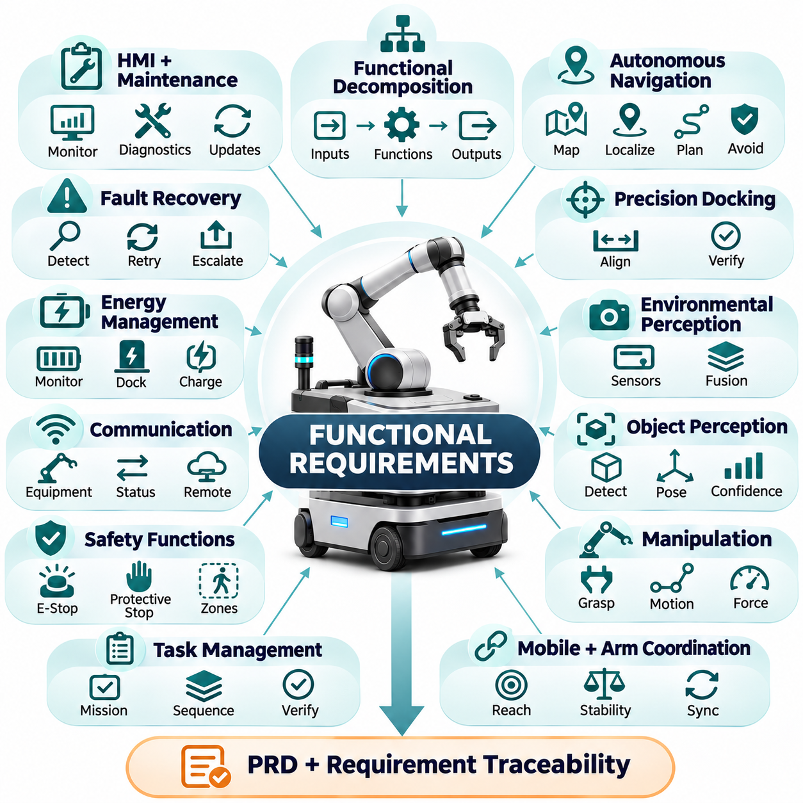{width="7.268055555555556in" height="7.268055555555556in"}

기능 요구사항(Functional Requirements)은 모바일 매니퓰레이터(Mobile Manipulator)가 목표 운영 목적을 달성하기 위해 제공해야 하는 구체적인 기능과 행동을 정의한다. 고객 요구사항(Customer Requirements)과 운영 시나리오(Operational Scenarios)를 로봇 시스템이 수행해야 하는 기능을 설명하는 엔지니어링 명세(Engineering Specifications)로 전환한다. 이러한 요구사항은 시스템 아키텍처(System Architecture), 하드웨어 개발(Hardware Development), 소프트웨어 구현(Software Implementation), 인공지능 통합(AI Integration), 후속 시스템 검증(System Verification)을 위한 기반을 확립한다.

기능 요구사항의 개발은 대표적인 운영 시나리오를 개별 시스템 기능(System Function)으로 분해하는 것에서 시작된다. 각 기능에는 요구 입력(Required Input), 예상 출력(Expected Output), 실행 조건(Execution Condition), 운영 제약사항(Operational Constraint), 다른 기능과의 상호작용(Functional Interaction)이 명시되어야 한다. 기능 분해(Functional Decomposition)는 시스템 수준의 목표(System-Level Objective)와 하위 시스템 수준의 책임(Subsystem-Level Responsibility) 사이의 일관된 관계를 유지하면서 엔지니어링 조직이 시스템 복잡성(System Complexity)을 관리할 수 있도록 한다.

자율주행(Autonomous Navigation)은 모바일 매니퓰레이터의 근본적인 기능적 역량(Functional Capability)이다. 로봇 시스템은 환경 지도 생성(Environmental Mapping), 위치 추정(Localization), 전역 경로 계획(Global Path Planning), 지역 궤적 생성(Local Trajectory Generation), 장애물 감지(Obstacle Detection), 동적 장애물 회피(Dynamic Obstacle Avoidance)를 지원해야 한다. 자율주행 기능은 로봇이 지정된 목적지에 도달하고, 변화하는 환경 조건에 적응하며, 계획된 이동 경로를 사용할 수 없게 되었을 때 적절하게 대응할 수 있도록 해야 한다.

정밀 위치 결정(Precision Positioning)과 도킹(Docking) 기능은 성공적인 조작에 필요한 공간적 조건(Spatial Condition)을 확립한다. 이동 플랫폼(Mobile Platform)은 지정된 작업 스테이션(Workstation)에 접근하고, 상대적 위치(Relative Position)와 방향(Orientation)을 파악하며, 정렬 절차(Alignment Procedure)를 수행해야 한다. 도킹 기능은 적절한 기계적 안정성(Mechanical Stability)을 유지하면서 위치 검증(Position Verification), 정렬 보정(Alignment Correction), 자율주행 모드(Navigation Mode)와 조작 모드(Manipulation Mode) 사이의 제어된 전환(Controlled Transition)을 지원해야 한다.

환경 인식 기능(Environmental Perception Function)은 모바일 매니퓰레이터가 주변 환경에 대한 정보를 획득하고 해석할 수 있도록 한다. 카메라(Camera), 라이다 센서(LiDAR Sensor), 깊이 센서(Depth Sensor), 관성 측정 장치(Inertial Measurement Unit, IMU) 및 기타 감지 장치는 환경 이해(Environmental Understanding)에 필요한 정보를 제공한다. 시스템은 센서 데이터 획득(Sensor Data Acquisition), 동기화(Synchronization), 전처리(Preprocessing), 센서 융합(Sensor Fusion), 장애물 인식(Obstacle Recognition), 자율 운영에 필요한 환경 표현(Environment Representation)의 생성을 지원해야 한다.

객체 인식 기능(Object Perception Function)은 지능적인 물리적 상호작용(Intelligent Physical Interaction)에 필요한 정보를 제공한다. 로봇 시스템은 목표 객체(Target Object)를 식별하고, 객체의 위치와 방향을 추정하며, 관련 기하학적 특성(Geometric Characteristic)을 평가하고, 조작 실현 가능성(Manipulation Feasibility)을 판단해야 한다. 이러한 기능은 인식 신뢰도(Perception Confidence)를 전달하고, 불확실한 관측 결과(Uncertain Observation)를 식별하며, 초기 인식 결과가 신뢰성 높은 작업 실행에 충분하지 않을 경우 추가 감지(Additional Sensing) 또는 대체 관측 시점(Alternative Viewpoint)을 지원해야 한다.

조작 기능(Manipulation Function)은 로봇 팔(Robotic Arm)이 객체 및 산업 설비와 어떻게 상호작용하는지를 정의한다. 요구되는 기능에는 순기구학(Forward Kinematics), 역기구학(Inverse Kinematics), 작업 공간 평가(Workspace Evaluation), 파지 계획(Grasp Planning), 동작 계획(Motion Planning), 궤적 실행(Trajectory Execution), 그리퍼 제어(Gripper Control), 힘 제어 기반 상호작용(Force-Controlled Interaction)이 포함될 수 있다. 매니퓰레이터는 피킹(Picking), 배치(Placement), 적재(Loading), 검사(Inspection) 및 기타 물리적 작업을 수행하기 위해 이러한 기능을 인식 결과 및 이동 플랫폼의 상태와 연계해야 한다.

이동 및 조작 협조 기능(Coordinated Mobility and Manipulation Function)은 이동 플랫폼과 로봇 팔이 하나의 통합 시스템(Integrated System)으로 동작할 수 있도록 한다. 시스템은 작업 목표에 따라 적절한 이동 플랫폼 위치(Base Position)를 결정하고, 매니퓰레이터의 도달 가능성(Manipulator Reachability)을 평가하며, 움직임의 실행 순서(Movement Sequence)를 조정해야 한다. 기능 요구사항에는 분산된 작업 공간에서 일관된 작업 실행을 보장하기 위한 동기화(Synchronization), 충돌 제약사항(Collision Constraint), 안정성 조건(Stability Condition), 허용 가능한 동시 움직임(Simultaneous Movement)이 포함되어야 한다.

작업 관리 기능(Task Management Function)은 전체 운영 임무(Operational Mission)의 실행을 조정한다. 로봇 시스템은 임무 수신(Mission Reception), 작업 분해(Task Decomposition), 실행 순서 설정(Execution Sequencing), 운영 상태 모니터링(Operational State Monitoring), 완료 검증(Completion Verification)을 지원해야 한다. 상태 머신(State Machine), 행동 트리(Behavior Tree), 인공지능 기반 계획 구성요소(AI-Based Planning Component)를 포함한 작업 계획 메커니즘(Task Planning Mechanism)은 작업 의존성(Task Dependency), 조건부 실행(Conditional Execution), 작업 전환(Task Transition), 환경 변화에 대한 제어된 적응(Controlled Adaptation)을 관리하기 위해 활용될 수 있다.

안전 관련 기능(Safety-Related Function)은 로봇 시스템이 위험 조건(Hazardous Condition)을 감지하고 적절한 보호 대응(Protective Response)을 실행할 수 있도록 해야 한다. 이러한 기능에는 비상 정지(Emergency Stop), 보호 정지(Protective Stop), 속도 제한(Speed Limitation), 안전 영역 모니터링(Safety Zone Monitoring), 충돌 감지(Collision Detection), 고장 관리(Fault Management)가 포함될 수 있다. 안전 필수 기능(Safety-Critical Function)은 안전 등급이 인증되지 않은 인공지능 구성요소(Non-Safety-Rated AI Component)로부터 적절한 독립성을 확보하여 동작해야 하며, 재시작 및 복구 절차(Restart and Recovery Procedure)는 의도하지 않은 위험한 움직임을 방지해야 한다.

통신 및 통합 기능(Communication and Integration Function)은 모바일 매니퓰레이터가 외부 설비 및 운영 관리 시스템(Operational Management System)과 어떻게 정보를 교환하는지를 정의한다. 로봇 시스템은 정의된 통신 인터페이스(Communication Interface)를 통해 임무 요청(Mission Request), 상태 보고(Status Reporting), 설비 간 핸드셰이크(Equipment Handshake), 데이터 교환(Data Exchange), 원격 모니터링(Remote Monitoring)을 지원해야 한다. 통신 중단(Communication Interruption)은 감지되어야 하며, 시스템은 사전에 정의된 조건에 따라 적절한 운영 상태(Operational State) 또는 안전 상태(Safe State)로 전환되어야 한다.

에너지 관리 기능(Energy Management Function)은 배터리 상태(Battery Status)를 모니터링하고, 잔여 운영 가능 용량(Remaining Operational Capacity)을 추정하며, 충전 활동(Charging Activity)을 조정함으로써 지속적인 운영을 지원한다. 로봇 시스템은 에너지 부족 상태(Insufficient Energy Condition)를 인식하고, 사용 가능한 충전 스테이션(Charging Station)으로 자율주행하며, 자동 도킹(Automatic Docking)을 수행하고, 충전 상태(Charging Status)를 검증해야 한다. 운영상 적절한 경우에는 진행 중인 임무를 일시 중단(Mission Suspension)하고 충분한 에너지가 확보된 이후 임무를 재개(Mission Resumption)해야 한다.

고장 감지 및 복구 기능(Fault Detection and Recovery Function)은 모바일 매니퓰레이터가 비정상 운영 조건(Abnormal Operating Condition)에 체계적으로 대응할 수 있도록 한다. 시스템은 자율주행 실패(Navigation Failure), 인식 오류(Perception Error), 파지 실패(Grasping Failure), 액추에이터 고장(Actuator Fault), 센서 오작동(Sensor Malfunction), 통신 중단을 식별해야 한다. 복구 기능은 허용된 재시도 절차(Retry Procedure), 대체 실행 전략(Alternative Execution Strategy), 진단 보고(Diagnostic Reporting), 운영자 개입(Operator Intervention), 자율 복구(Autonomous Recovery)가 불가능한 경우의 안전 종료(Safe Termination)를 지원해야 한다.

인간-기계 인터페이스 및 유지보수 기능(Human-Machine Interface and Maintenance Function)은 시스템 구성(System Configuration), 운영 감독(Operational Supervision), 문제 해결(Troubleshooting), 수명주기 지원(Lifecycle Support)을 위한 메커니즘을 제공한다. 권한이 부여된 담당자는 임무를 할당하고, 시스템 상태를 모니터링하며, 진단 정보(Diagnostic Information)를 검토하고, 운영 매개변수(Operational Parameter)를 관리하며, 제어된 유지보수 활동을 수행할 수 있어야 한다. 접근 제어(Access Control), 이벤트 기록(Event Logging), 보정 지원(Calibration Support), 소프트웨어 업데이트 관리(Software Update Management)는 안전하고 유지보수가 용이한 로봇 운영에 기여한다.

궁극적으로 기능 요구사항은 명확하고 일관되며 검증 가능한 요구사항 문장(Verifiable Requirement Statement)을 사용하여 제품 요구사항 정의서(Product Requirements Document, PRD)에 문서화되어야 한다. 각 요구사항에는 고유 식별자(Unique Identifier)가 부여되어야 하며, 해당 요구사항의 근원이 되는 고객 요구사항 또는 운영 시나리오, 관련 시스템 아키텍처, 구현 구성요소(Implementation Component), 검증 절차(Verification Procedure)와의 요구사항 추적성(Requirement Traceability)이 유지되어야 한다. 이러한 접근 방식은 요구사항 정의(Requirement Definition), 엔지니어링 개발(Engineering Development), 시스템 시험(System Testing), 현장 유효성 검증(Field Validation) 사이의 연속성을 확립한다.

## 06 Performance Requirements

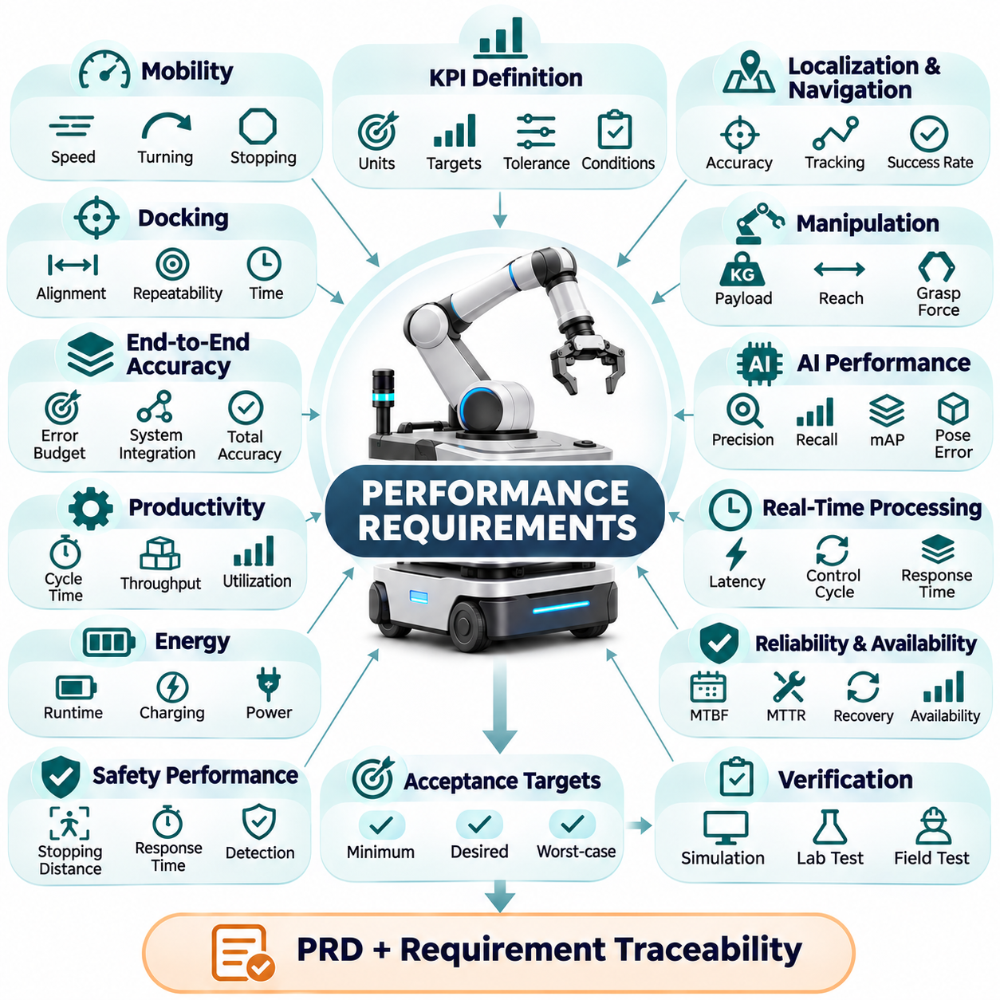{width="7.268055555555556in" height="7.268055555555556in"}

성능 요구사항(Performance Requirements)은 모바일 매니퓰레이터(Mobile Manipulator)가 명시된 운영 조건에서 달성해야 하는 측정 가능한 역량을 정의한다. 기능 요구사항(Functional Requirements)이 로봇 시스템이 무엇을 수행해야 하는지를 설명하는 반면, 성능 요구사항은 해당 기능을 얼마나 효과적이고 정확하며 신속하고 신뢰성 있게 수행해야 하는지를 규정한다. 이러한 요구사항은 시스템 설계(System Design), 개발(Development), 검증(Verification), 현장 유효성 검증(Field Validation)을 위한 정량적 엔지니어링 목표(Quantitative Engineering Objective)를 제공한다.

성능 요구사항의 개발은 고객의 기대사항(Customer Expectations)과 운영 시나리오(Operational Scenarios)를 측정 가능한 핵심 성과 지표(Key Performance Indicator, KPI)로 전환하는 것에서 시작된다. 각 성능 지표(Performance Indicator)에는 측정 단위(Measurement Unit), 목표값(Target Value), 허용 오차(Acceptable Tolerance), 운영 조건(Operating Condition), 평가 방법론(Evaluation Methodology)이 명시되어야 한다. 명확하게 정의된 성능 기준(Performance Criteria)은 개발 조직이 시스템 역량을 객관적으로 평가하고 제품 인수(Product Acceptance) 과정에서 발생할 수 있는 모호성을 방지할 수 있도록 한다.

이동 성능 요구사항(Mobility Performance Requirements)은 자율 이동 플랫폼(Autonomous Mobile Platform)의 운영 역량을 규정한다. 관련 매개변수에는 최대 주행 속도(Maximum Travel Speed), 가속도(Acceleration), 감속도(Deceleration), 회전 반경(Turning Radius), 등판 능력(Climbing Capability), 장애물 극복 능력(Obstacle Negotiation), 정지 거리(Stopping Distance)가 포함된다. 이러한 매개변수는 물리적 운영 환경(Physical Operating Environment), 적재하중 조건(Payload Condition), 운송 효율성(Transportation Efficiency), 기계적 안정성(Mechanical Stability), 적용 가능한 안전 제약사항(Safety Constraint)을 반영해야 한다.

위치 추정 및 자율주행 성능 요구사항(Localization and Navigation Performance Requirements)은 모바일 매니퓰레이터가 운영 환경 내에서 얼마나 정확하고 일관되게 자율주행할 수 있는지를 규정한다. 관련 성능 지표에는 절대 위치 추정 정확도(Absolute Localization Accuracy), 상대 위치 결정 정확도(Relative Positioning Accuracy), 궤적 추종 오차(Trajectory Tracking Error), 자율주행 성공률(Navigation Success Rate), 목적지 도달 반복 정밀도(Destination Arrival Repeatability)가 포함된다. 성능은 변화하는 환경 조건, 동적 장애물(Dynamic Obstacle), 센서 가용성(Sensor Availability)의 변화 등을 고려하여 평가해야 한다.

도킹 성능 요구사항(Docking Performance Requirements)은 이동 플랫폼의 위치 결정이 조작 정밀도(Manipulation Accuracy)에 직접적인 영향을 미치기 때문에 특히 중요하다. 평가 매개변수에는 도킹 위치 오차(Docking Position Error), 각도 정렬 오차(Angular Alignment Error), 도킹 반복 정밀도(Docking Repeatability), 실행 시간(Execution Time), 도킹 성공률(Docking Success Rate)이 포함된다. 허용 위치 결정 오차(Allowable Positioning Error)는 조작 작업의 특성, 좌표 변환 불확실성(Coordinate Transformation Uncertainty), 활용 가능한 국부 보정 메커니즘(Local Correction Mechanism)을 기반으로 도출되어야 한다.

조작 성능 요구사항(Manipulation Performance Requirements)은 로봇 팔(Robotic Arm)과 관련 말단 작동기(End Effector)의 물리적 역량을 규정한다. 주요 매개변수에는 정격 적재하중(Rated Payload), 최대 도달 거리(Maximum Reach), 위치 결정 정확도(Positioning Accuracy), 반복 정밀도(Repeatability), 관절 속도(Joint Velocity), 파지력(Grasping Force), 작업 실행 시간(Task Execution Time)이 포함된다. 이러한 요구사항은 이동 플랫폼의 안정성, 매니퓰레이터 구성(Manipulator Configuration), 공구 중량(Tool Weight), 객체 특성(Object Property), 외부 교란(External Disturbance)의 복합적인 영향을 고려해야 한다.

통합 시스템 정확도(Integrated System Accuracy)는 개별 하위 시스템(Subsystem)의 공칭 정확도(Nominal Accuracy)와 구분하여 평가해야 한다. 이동 플랫폼의 위치 결정 오차(Positioning Error), 센서 측정 불확실성(Sensor Measurement Uncertainty), 보정 오차(Calibration Error), 구조적 변형(Structural Deformation), 매니퓰레이터 위치 결정 오차는 전체 작업 실행 정확도(Task Execution Accuracy)에 영향을 미친다. 오차 예산(Error Budget)을 통해 각 하위 시스템에 허용 불확실성(Permissible Uncertainty)을 배분하고 측정 가능한 종단 간 성능 목표(End-to-End Performance Target)를 수립해야 한다.

인공지능 성능 요구사항(AI Performance Requirements)은 인식(Perception), 객체 인식(Recognition), 자세 추정(Pose Estimation), 파지 감지(Grasp Detection), 지능형 의사결정(Intelligent Decision-Making)에 대한 정량적 기대 수준을 규정한다. 평가 지표에는 정밀도(Precision), 재현율(Recall), 평균 정밀도 평균(mean Average Precision, mAP), 자세 추정 오차(Pose Estimation Error), 파지 성공률(Grasp Success Rate), 추론 지연시간(Inference Latency)이 포함될 수 있다. 인공지능 성능은 독립적인 벤치마크 결과(Benchmark Result)에만 의존하지 않고 대표 데이터셋(Representative Dataset)과 현실적인 운영 조건을 기반으로 평가해야 한다.

실시간 처리 성능(Real-Time Processing Performance)은 로봇 시스템이 변화하는 환경 및 운영 조건에 적절하게 대응할 수 있는지를 결정한다. 관련 성능 지표에는 센서 데이터 획득 주파수(Sensor Acquisition Frequency), 인식 처리 지연시간(Perception Processing Latency), 제어 주기 시간(Control Cycle Time), 통신 지연시간(Communication Latency), 종단 간 응답 시간(End-to-End Response Time)이 포함된다. 컴퓨팅 자원(Computational Resource)은 높은 처리 부하가 발생하는 운영 상황에서도 허용 가능한 시간적 응답 특성(Timing Behavior)을 유지하면서 동시 작업 부하(Concurrent Workload)를 처리할 수 있어야 한다.

운영 생산성 요구사항(Operational Productivity Requirements)은 모바일 매니퓰레이터가 명시된 시간 내에 유효한 작업을 완료할 수 있는 역량을 평가한다. 대표적인 성능 지표에는 임무 완료 시간(Mission Completion Time), 피킹 주기 시간(Picking Cycle Time), 시간당 객체 처리량(Objects Handled per Hour), 일일 임무 처리량(Daily Mission Throughput), 설비 활용률(Equipment Utilization)이 포함된다. 생산성 평가(Productivity Assessment)는 자율주행, 도킹, 인식, 조작, 검증, 충전, 대기 및 예측 가능한 운영 중단(Operational Interruption)을 종합적으로 고려해야 한다.

신뢰성 및 가용성 요구사항(Reliability and Availability Requirements)은 장시간에 걸친 로봇 운영의 일관성을 규정한다. 관련 지표에는 임무 성공률(Mission Success Rate), 평균 고장 간격(Mean Time Between Failures, MTBF), 평균 수리 시간(Mean Time to Repair, MTTR), 운영 가용성(Operational Availability), 자율 복구 성공률(Autonomous Recovery Success Rate)이 포함된다. 이러한 성능 지표는 하드웨어 고장(Hardware Failure), 소프트웨어 오류(Software Error), 인식 한계(Perception Limitation), 환경적 교란(Environmental Disturbance), 외부 인프라 중단(External Infrastructure Interruption)을 구분하여 평가해야 한다.

에너지 성능 요구사항(Energy Performance Requirements)은 모바일 매니퓰레이터가 목표 운영 작업 부하(Operational Workload)를 지속적으로 감당할 수 있는지를 결정한다. 평가 매개변수에는 배터리 용량(Battery Capacity), 평균 소비전력(Average Power Consumption), 최대 전력 수요(Peak Power Demand), 운영 지속시간(Operating Duration), 충전 시간(Charging Time), 임무당 에너지 소비량(Energy Consumption per Mission)이 포함된다. 측정 과정에서는 다양한 적재하중, 주행 속도, 조작 작업 부하(Manipulation Workload), 컴퓨팅 자원 요구량(Computing Demand), 제품 수명주기(Product Lifecycle) 전반에 걸친 배터리 성능 저하(Battery Degradation)를 고려해야 한다.

안전 관련 성능 요구사항(Safety-Related Performance Requirements)은 명확하게 정의된 위험 조건(Hazardous Condition)에서 보호 기능(Protective Function)을 평가하기 위한 측정 가능한 기준을 수립한다. 관련 매개변수에는 보호 정지 거리(Protective Stopping Distance), 안전 시스템 응답 시간(Safety System Response Time), 속도 모니터링 정확도(Speed Monitoring Accuracy), 보호 영역 감지 능력(Protective Zone Detection Capability)이 포함된다. 인수 허용 한계(Acceptance Limit)는 생산성 목표(Productivity Objective)나 인공지능 성능에 대한 가정이 아닌 위험성 평가(Risk Assessment)와 적용 가능한 안전 표준(Safety Standard)을 기반으로 도출되어야 한다.

성능 목표(Performance Target)는 최소 허용 요구사항(Minimum Acceptable Requirement), 권장 엔지니어링 목표(Desired Engineering Objective), 미래 최적화 목표(Future Optimization Goal)를 구분해야 한다. 정량적 임계값(Numerical Threshold)은 고객과의 합의(Customer Agreement), 기술적 실현 가능성(Technical Feasibility), 운영 제약사항(Operational Constraint), 상업적 고려사항(Commercial Consideration)에 따라 설정되어야 한다. 평균 성능(Average Performance), 통계적 변동성(Statistical Variability), 백분위수 분포(Percentile Distribution), 최악 조건에서의 동작 특성(Worst-Case Behavior)을 추적함으로써 평균 측정값만으로는 확인하기 어려운 성능 한계를 식별할 수 있다.

궁극적으로 성능 요구사항은 제품 요구사항 정의서(Product Requirements Document, PRD)에 문서화되어야 하며, 요구사항 추적성(Requirement Traceability)을 통해 지속적으로 관리되어야 한다. 각 요구사항은 해당 요구사항의 근원이 되는 운영 시나리오, 관련 아키텍처 구성요소(Architectural Component), 검증 방법(Verification Method), 인수 기준(Acceptance Criteria)과 연결되어야 한다. 시뮬레이션(Simulation), 실험실 시험(Laboratory Testing), 통합 시스템 평가(Integrated System Evaluation), 현장 유효성 검증(Field Validation)은 성능 요구사항 충족 여부(Performance Compliance)를 입증하기 위한 객관적인 증거(Objective Evidence)를 제공한다.

## 07 AI Requirements

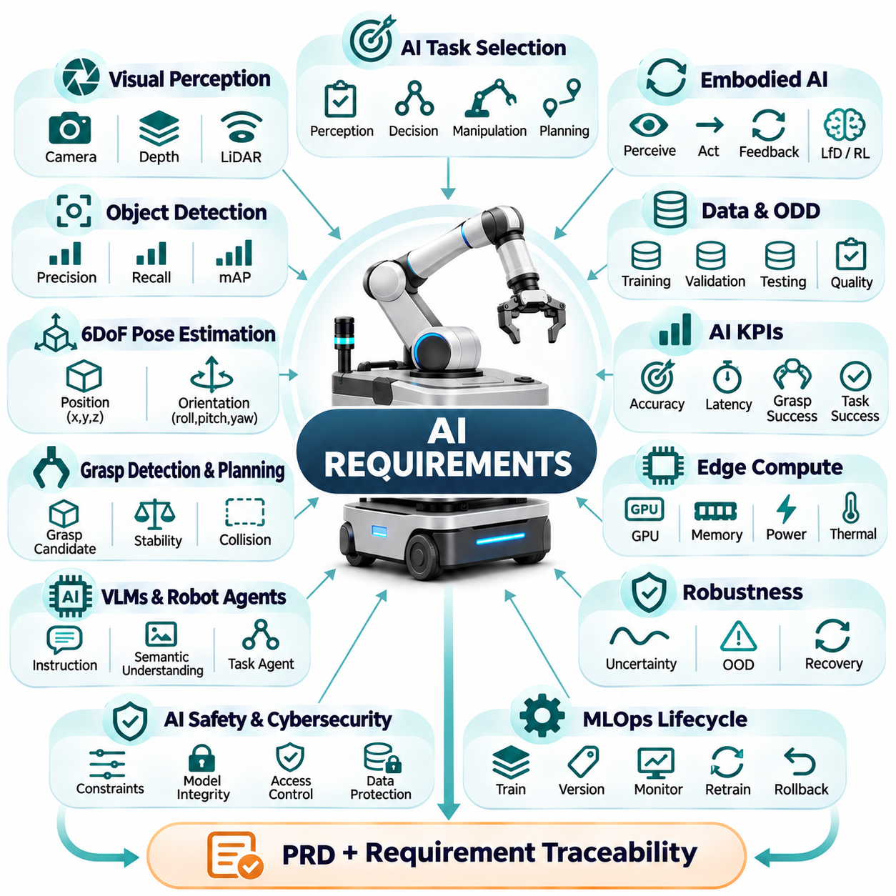{width="7.268055555555556in" height="7.268055555555556in"}

인공지능 요구사항(AI Requirements)은 모바일 매니퓰레이터(Mobile Manipulator)가 주변 환경을 인식하고, 운영 조건을 해석하며, 적절한 의사결정을 내리고, 물리적 작업을 수행하기 위해 갖추어야 하는 지능적 역량(Intelligent Capability)을 정의한다. 이러한 요구사항은 고객 기대사항(Customer Expectations)과 운영 시나리오(Operational Scenarios)를 측정 가능한 인공지능 목표(AI Objective)로 전환하여 데이터 수집(Data Collection), 모델 개발(Model Development), 시스템 통합(System Integration), 배포(Deployment), 운영 유효성 검증(Operational Validation)의 방향을 제시한다.

인공지능 요구사항의 개발은 기존의 규칙 기반 알고리즘(Rule-Based Algorithm)이나 결정론적 제어 방법(Deterministic Control Method)만으로는 충분히 해결하기 어려운 작업을 식별하는 것에서 시작된다. 객체 인식(Object Recognition), 자세 추정(Pose Estimation), 적응형 파지(Adaptive Grasping), 환경 이해(Environmental Understanding), 복잡한 작업 계획(Complex Task Planning)에는 인공지능 기반 접근 방식(AI-Based Approach)이 필요한 경우가 많다. 인공지능 역량의 선정은 운영상 필요성(Operational Necessity), 기술적 실현 가능성(Technical Feasibility), 측정 가능한 고객 가치(Customer Value)를 반영해야 한다.

시각 인식 요구사항(Visual Perception Requirements)은 로봇 시스템이 카메라(Camera), 깊이 센서(Depth Sensor), 라이다 센서(LiDAR Sensor) 및 기타 감지 장치로부터 의미 있는 정보를 추출할 수 있는 역량을 규정한다. 인식 시스템(Perception System)은 관련 객체를 인식하고, 환경 구조물(Environmental Structure)을 식별하며, 장애물을 감지하고, 공간적 관계(Spatial Relationship)를 해석할 수 있어야 한다. 인식 역량은 조명(Illumination), 관측 각도(Viewing Angle), 가려짐(Occlusion), 배경 복잡성(Background Complexity)의 대표적인 변화 조건에서도 효과적으로 유지되어야 한다.

객체 검출 및 인식 요구사항(Object Detection and Recognition Requirements)은 모바일 매니퓰레이터가 자율 운영(Autonomous Operation) 중 식별해야 하는 객체의 범주(Object Category)를 정의한다. 이러한 요구사항에는 목표 객체 클래스(Target Object Class), 치수 범위(Dimensional Range), 외형 변화(Appearance Variation), 검출 거리(Detection Distance), 허용 가능한 인식 오류(Acceptable Recognition Error)가 명시되어야 한다. 정밀도(Precision), 재현율(Recall), 평균 정밀도(mean Average Precision, mAP)와 같은 평가 지표(Evaluation Metric)는 모델 성능(Model Performance)을 평가하기 위한 정량적 기준(Quantitative Criteria)을 제공한다.

객체 자세 추정 요구사항(Object Pose Estimation Requirements)은 인공지능 시스템이 3차원 공간(Three-Dimensional Space) 내에서 목표 객체의 위치(Position)와 방향(Orientation)을 추정할 수 있는 역량을 규정한다. 6자유도 자세 추정(Six Degrees of Freedom Pose Estimation, 6DoF Pose Estimation)은 정밀 로봇 조작(Precision Robotic Manipulation)에 특히 중요하다. 요구사항에는 허용 가능한 병진 오차(Translational Error)와 회전 오차(Rotational Error), 좌표계 정의(Coordinate Frame Definition), 신뢰도 임계값(Confidence Threshold), 부분 가려짐(Partial Occlusion)에 대한 강건성(Robustness)이 규정되어야 한다.

지능형 파지 검출 및 계획 요구사항(Intelligent Grasp Detection and Planning Requirements)은 모바일 매니퓰레이터가 다양한 기하학적 형상(Geometry), 재질(Material), 치수(Dimension), 방향을 가진 객체에 대해 실현 가능한 파지 구성(Feasible Grasp Configuration)을 생성할 수 있는 역량을 정의한다. 인공지능 시스템은 접근 가능성(Accessibility), 안정성(Stability), 충돌 제약사항(Collision Constraint), 예상 작업 목표(Task Objective)를 기반으로 파지 후보(Grasp Candidate)를 평가해야 한다. 파지 성공률(Grasp Success Rate)과 물리적 실행 결과(Physical Execution Result)는 필수적인 유효성 검증 기준(Validation Criteria)을 제공한다.

고급 인공지능 요구사항(Advanced AI Requirements)에는 의미론적 이해(Semantic Understanding)와 유연한 작업 실행(Flexible Task Execution)을 지원하기 위한 비전-언어 모델(Vision-Language Model, VLM), 기반 모델(Foundation Model), 로봇 에이전트(Robotic Agent)가 포함될 수 있다. 이러한 기술은 모바일 매니퓰레이터가 상위 수준의 명령(High-Level Instruction)을 해석하고, 이전에 접하지 못한 객체를 인식하며, 상황 인지형 작업 계획(Context-Aware Task Plan)을 생성할 수 있도록 한다. 이러한 기술의 출력은 결정론적 실행 제약사항(Deterministic Execution Constraint)과 독립적인 안전 메커니즘(Independent Safety Mechanism)의 통제를 받아야 한다.

체화 인공지능 요구사항(Embodied AI Requirements)은 지능형 인식(Intelligent Perception), 의사결정(Decision-Making), 물리적 행동(Physical Action), 환경 피드백(Environmental Feedback) 사이의 지속적인 상호작용을 강조한다. 로봇 시스템은 실행된 행동의 결과를 평가하고, 운영 조건이 변화할 때 후속 행동(Subsequent Behavior)을 조정할 수 있어야 한다. 시연 기반 학습(Learning from Demonstration, LfD)과 강화학습(Reinforcement Learning, RL)은 해당 기술의 행동 특성을 충분히 검증할 수 있는 경우 적응 능력(Adaptation Capability)을 지원하는 데 활용될 수 있다.

데이터 요구사항(Data Requirements)은 신뢰성 높은 인공지능 개발(AI Development)과 유효성 검증(AI Validation)을 위한 기반을 확립한다. 학습 데이터셋(Training Dataset), 검증 데이터셋(Validation Dataset), 시험 데이터셋(Test Dataset)은 관련 객체, 환경 조건, 센서 구성(Sensor Configuration), 예측 가능한 교란(Disturbance)을 포함하여 목표 운영 설계 영역(Operational Design Domain, ODD)을 대표할 수 있어야 한다. 데이터 품질(Data Quality), 데이터 주석 일관성(Annotation Consistency), 클래스 분포(Class Distribution), 데이터셋 버전 관리(Dataset Versioning), 학습 데이터셋과 평가 데이터셋의 분리는 체계적으로 관리되어야 한다.

인공지능 성능 요구사항(AI Performance Requirements)은 각각의 지능형 기능(Intelligent Function)에 대해 측정 가능한 인수 기준(Acceptance Criteria)을 명시해야 한다. 관련 성능 지표에는 검출 정확도(Detection Accuracy), 자세 추정 오차(Pose Estimation Error), 파지 성공률, 추론 지연시간(Inference Latency), 예측 신뢰도(Prediction Confidence), 작업 실행 성공률(Task Execution Success Rate)이 포함된다. 성능 목표(Performance Target)는 대표적인 운영 조건에서 평가되어야 하며, 시스템 수준의 생산성(System-Level Productivity), 조작 정확도(Manipulation Accuracy), 운영 신뢰성(Operational Reliability)과 연계되어야 한다.

컴퓨팅 요구사항(Computational Requirements)은 모바일 매니퓰레이터 내부에서 인공지능 작업 부하(AI Workload)를 처리하는 데 필요한 연산 자원을 정의한다. 엣지 인공지능 가속기(Edge AI Accelerator), 임베디드 컴퓨팅 플랫폼(Embedded Computing Platform), 그래픽 처리 장치(Graphics Processing Unit, GPU), 시스템 메모리(System Memory)는 인식, 자율주행(Navigation), 조작(Manipulation), 의사결정 프로세스의 동시 실행을 지원해야 한다. 요구사항에는 지속적인 운영 과정에서의 추론 처리량(Inference Throughput), 처리 지연시간(Processing Latency), 메모리 사용률(Memory Utilization), 소비전력(Power Consumption), 열적 제약사항(Thermal Constraint)이 포함되어야 한다.

인공지능 강건성 요구사항(AI Robustness Requirements)은 지능형 기능이 불확실성(Uncertainty), 미지의 객체(Unfamiliar Object), 센서 성능 저하(Sensor Degradation), 환경적 교란(Environmental Disturbance), 데이터 분포 변화(Distribution Shift)에 어떻게 대응해야 하는지를 규정한다. 시스템은 신뢰할 수 없는 예측(Unreliable Prediction)을 식별하고, 기술적으로 가능한 경우 분포 외 입력(Out-of-Distribution Input, OOD Input)을 감지하며, 불확실성 정보를 상위 수준의 제어 기능(Higher-Level Control Function)에 전달해야 한다. 신뢰도가 낮은 결과는 추가 관측(Additional Observation), 작업 일시 중단(Task Suspension), 운영자 개입(Operator Intervention)과 같이 사전에 정의된 대응 행동을 유발해야 한다.

인공지능 안전 및 사이버 보안 요구사항(AI Safety and Cybersecurity Requirements)은 지능형 구성요소(Intelligent Component)가 승인되지 않았거나 위험한 물리적 행동을 시작하는 것을 방지해야 한다. 인공지능이 생성한 의사결정(AI-Generated Decision)은 실행되기 전에 운영 경계(Operational Boundary), 동작 제약사항(Motion Constraint), 적용 가능한 보호 기능(Protective Function)을 기준으로 평가되어야 한다. 모델 무결성(Model Integrity), 보안 배포(Secure Deployment), 접근 제어(Access Control), 데이터 보호(Data Protection), 악의적이거나 오해를 유발하는 입력(Malicious or Misleading Input)에 대한 저항성은 전체 개발 수명주기(Development Lifecycle)에 걸쳐 고려되어야 한다.

인공지능 수명주기 관리 요구사항(AI Lifecycle Management Requirements)은 모델 학습(Model Training), 버전 제어(Version Control), 배포, 성능 모니터링(Performance Monitoring), 재학습(Retraining), 제어된 소프트웨어 업데이트(Controlled Software Update)를 다룬다. 기계학습 운영(Machine Learning Operations, MLOps) 프로세스는 재현 가능한 실험(Reproducible Experiment), 데이터셋 추적성(Dataset Traceability), 모델 유효성 검증(Model Validation), 배포 승인(Deployment Approval), 이전 버전 복원 메커니즘(Rollback Mechanism)을 지원해야 한다. 운영 데이터(Operational Data)와 현장 성능 모니터링(Field Performance Monitoring)은 모델 성능 저하(Model Degradation)를 식별하고 향후 개선 방향을 도출하기 위한 근거를 제공할 수 있다.

궁극적으로 인공지능 요구사항은 제품 요구사항 정의서(Product Requirements Document, PRD)에 문서화되어야 하며, 요구사항 추적성(Requirement Traceability)을 통해 지속적으로 관리되어야 한다. 각 요구사항은 해당 요구사항의 근원이 되는 운영 시나리오, 관련 데이터셋(Associated Dataset), 모델 아키텍처(Model Architecture), 컴퓨팅 인프라(Computing Infrastructure), 검증 절차(Verification Procedure)와 연결되어야 한다. 정량적 인수 임계값(Numerical Acceptance Threshold)은 응용 분야별 요구사항(Application-Specific Requirement)에 따라 결정되어야 하며, 실험실 시험(Laboratory Testing)과 대표적인 현장 운영(Representative Field Operation)을 통해 유효성이 검증되어야 한다.

## 08 Safety Requirements

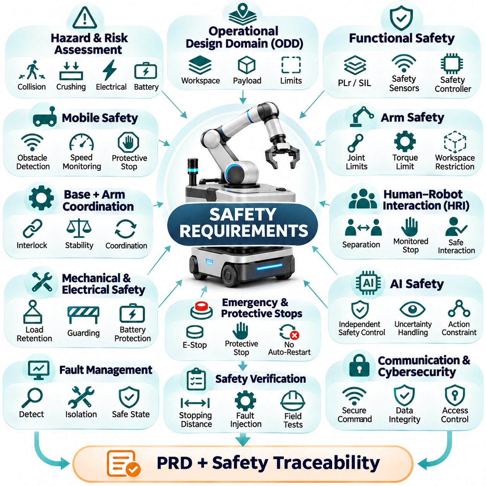{width="7.268055555555556in" height="7.268055555555556in"}

안전 요구사항(Safety Requirements)은 모바일 매니퓰레이터(Mobile Manipulator)가 전체 제품 수명주기(Product Lifecycle)에 걸쳐 안전하게 운영되는 데 필요한 보호 역량(Protective Capability), 운영 제약사항(Operational Constraint), 위험 저감 조치(Risk Reduction Measure)를 정의한다. 모바일 매니퓰레이터는 자율 이동(Autonomous Mobility), 로봇 조작(Robotic Manipulation), 인공지능(Artificial Intelligence, AI), 주변 환경과의 물리적 상호작용(Physical Interaction)을 결합하므로, 안전은 초기 개발 단계부터 근본적인 엔지니어링 목표(Engineering Objective)로 설정되어야 한다.

안전 요구사항의 개발은 체계적인 위험원 식별(Hazard Identification)과 위험성 평가(Risk Assessment)에서 시작된다. 잠재적 위험원(Potential Hazard)에는 충돌(Collision), 압착(Crushing), 끼임(Trapping), 예기치 않은 움직임(Unexpected Movement), 객체 낙하(Falling Object), 전기적 고장(Electrical Fault), 배터리 고장(Battery Failure), 시스템 제어 상실(Loss of System Control)이 포함된다. 위험성 평가는 의도된 사용(Intended Use)과 예측 가능한 오사용(Foreseeable Misuse) 과정에서 발생할 수 있는 상해의 심각도(Severity), 위험 노출 빈도 및 지속시간(Frequency and Duration of Exposure), 위험 상황의 회피 가능성(Possibility of Avoidance)을 고려해야 한다.

안전 요구사항은 모바일 매니퓰레이터의 동작이 허용되는 운영 경계(Operational Boundary)를 설정해야 한다. 운영 설계 영역(Operational Design Domain, ODD)에는 환경 조건(Environmental Condition), 허가된 작업 공간(Authorized Workspace), 바닥 특성(Floor Characteristic), 적재하중 제한(Payload Limitation), 인간 접근 가능성(Human Accessibility), 설비 상호작용 제약사항(Equipment Interaction Constraint)이 명시되어야 한다. 이러한 경계를 벗어나는 운영 조건에서는 제한된 운영(Restricted Operation) 또는 안전 상태(Safe State)로의 전환을 포함하여 사전에 정의된 대응(Predefined Response)이 실행되어야 한다.

이동 플랫폼 안전 요구사항(Mobile Platform Safety Requirements)은 자율주행(Autonomous Navigation)과 운송(Transportation) 과정에서 발생하는 위험원을 다룬다. 시스템은 보호 목적의 장애물 감지(Protective Obstacle Detection), 속도 모니터링(Speed Monitoring), 제어된 감속(Controlled Deceleration), 보호 정지(Protective Stop), 비상 정지(Emergency Stop)를 지원해야 한다. 보호 감지 영역(Protective Detection Zone)과 정지 거리(Stopping Distance)는 주행 속도(Travel Speed), 적재하중(Payload), 제동 능력(Braking Capability), 바닥 상태(Floor Condition), 센서 감지 범위(Sensor Coverage), 주변 작업자의 움직임을 고려하여 설정되어야 한다.

매니퓰레이터 안전 요구사항(Manipulator Safety Requirements)은 로봇 팔(Robotic Arm)의 움직임과 물리적 상호작용으로 인해 발생하는 위험원을 다룬다. 관련 보호 기능(Protective Function)에는 관절 위치 모니터링(Joint Position Monitoring), 속도 제한(Speed Limitation), 토크 제한(Torque Limitation), 작업 공간 제한(Workspace Restriction), 충돌 감지(Collision Detection)가 포함된다. 안전 요구사항은 말단 작동기(End Effector), 장착 공구(Attached Tool), 운반 객체(Transported Object), 최대 도달 거리(Maximum Reach), 주변 작업자와의 잠재적 접촉을 포함한 전체 매니퓰레이터 구성(Manipulator Configuration)을 고려해야 한다.

통합 이동 및 조작 안전 요구사항(Integrated Mobility and Manipulation Safety Requirements)은 이동 베이스(Mobile Base)와 로봇 팔의 결합 운영(Combined Operation)으로 인해 발생하는 위험을 다룬다. 동시 움직임(Simultaneous Movement)은 추가적인 충돌 위험(Collision Hazard), 동적 불안정성(Dynamic Instability), 도달 가능한 작업 공간(Reachable Workspace)의 예기치 않은 변화를 초래할 수 있다. 요구사항에는 허용 가능한 움직임 조합(Permissible Movement Combination), 매니퓰레이터 운송 자세(Manipulator Transport Configuration), 안정성 제한(Stability Limitation), 하위 시스템 사이의 보호 인터록(Protective Interlock)이 정의되어야 한다.

인간-로봇 상호작용 안전 요구사항(Human-Robot Interaction Safety Requirements, HRI Safety Requirements)은 인간 작업자와 공유하는 환경에서의 운영을 위한 보호 조건(Protective Condition)을 설정한다. 응용 분야와 위험성 평가 결과에 따라 보호 전략(Protective Strategy)에는 물리적 분리(Physical Separation), 속도 및 이격 거리 모니터링(Speed and Separation Monitoring), 안전 등급 감시 정지(Safety-Rated Monitored Stop), 동력 및 힘 제한(Power and Force Limiting)이 포함될 수 있다. 이러한 요구사항을 정의할 때는 인간 접근 가능성과 예측 가능한 인간 행동(Foreseeable Human Behavior)을 고려해야 한다.

기능 안전 요구사항(Functional Safety Requirements)은 안전 관련 제어 기능(Safety-Related Control Function)의 신뢰성(Reliability)과 무결성(Integrity)을 규정한다. 요구 성능 수준(Required Performance Level, PLr) 또는 안전 무결성 수준(Safety Integrity Level, SIL)은 적용 가능한 위험성 평가 방법(Risk Assessment Method)과 안전 표준(Safety Standard)을 통해 결정되어야 한다. 안전 관련 센서(Safety-Related Sensor), 제어기(Controller), 통신 인터페이스(Communication Interface), 액추에이터(Actuator)는 개별 구성요소의 인증(Component Certification)에만 의존하지 않고 전체적으로 요구되는 안전 성능(Safety Performance)을 충족해야 한다.

비상 정지 및 보호 정지 요구사항(Emergency and Protective Stop Requirements)은 위험한 움직임(Hazardous Movement)이 종료되어야 하는 조건을 정의해야 한다. 적절한 정지 동작(Stopping Behavior)은 운영 상태(Operational State), 기계적 구성(Mechanical Configuration), 식별된 위험원의 특성에 따라 달라진다. 시스템은 비상 정지, 안전 장치 작동(Safety Device Activation), 전원 공급 중단(Power Interruption), 고장 복구(Fault Recovery) 이후 사전에 정의된 재시작 조건(Restart Condition)이 충족될 때까지 의도하지 않은 재시작(Unintended Restart)을 방지해야 한다.

기계적 및 전기적 안전 요구사항(Mechanical and Electrical Safety Requirements)은 구조적 건전성(Structural Integrity), 하중 유지(Load Retention), 전기 절연(Electrical Insulation), 과열(Overheating), 위험 에너지원(Hazardous Energy Source)을 다룬다. 모바일 매니퓰레이터는 명시된 적재하중과 운영 조건에서 적절한 안정성(Stability)을 유지해야 한다. 배터리 보호(Battery Protection), 전기 회로 보호(Electrical Circuit Protection), 기계적 방호(Mechanical Guarding), 안전한 말단 작동기 체결(Secure End-Effector Attachment), 제어되지 않은 하중 이탈(Uncontrolled Load Release)의 방지가 안전 요구사항에 포함되어야 한다.

인공지능 안전 요구사항(AI Safety Requirements)은 지능형 인식(Intelligent Perception), 의사결정(Decision-Making), 자율 작업 실행(Autonomous Task Execution)에 대한 허용 경계를 설정한다. 인공지능이 생성한 예측(AI-Generated Prediction)과 행동 계획(Action Plan)은 안전 관련 제어 기능을 독립적으로 무효화하거나 우회해서는 안 된다. 불확실한 인식 결과(Uncertain Perception Result), 예기치 않은 객체(Unexpected Object), 유효하지 않은 작업 명령(Invalid Task Command), 모델 고장(Model Failure)은 사전에 정의된 대응을 유발해야 하며, 독립적인 보호 메커니즘(Independent Protective Mechanism)은 요구되는 안전 수준을 유지해야 한다.

통신 안전 및 사이버 보안 요구사항(Communication Safety and Cybersecurity Requirements)은 네트워크 장애(Network Failure), 손상된 메시지(Corrupted Message), 승인되지 않은 명령(Unauthorized Command), 악의적 간섭(Malicious Interference)과 관련된 위험원을 다룬다. 안전 필수 통신(Safety-Critical Communication)은 전송 오류(Transmission Error), 메시지 지연(Message Delay), 통신 상실(Communication Loss)을 감지하기 위한 적절한 메커니즘을 제공해야 한다. 원격 운영(Remote Operation), 소프트웨어 업데이트(Software Update), 외부 시스템 통합(External System Integration)은 이미 확립된 보호 기능을 저해해서는 안 된다.

고장 관리 및 안전 상태 요구사항(Fault Management and Safe-State Requirements)은 모바일 매니퓰레이터가 구성요소 고장(Component Failure)과 비정상 운영 조건(Abnormal Operating Condition)에 어떻게 대응해야 하는지를 정의한다. 시스템은 관련 센서 고장(Sensor Fault), 액추에이터 고장(Actuator Failure), 제어기 오작동(Controller Malfunction), 전원 이상(Power Abnormality)을 감지할 수 있어야 한다. 식별된 위험원에 따라 사전에 정의된 대응에는 제어 정지(Controlled Stop), 하중 유지, 움직임 제한(Movement Restriction), 고장 격리(Fault Isolation), 권한이 부여된 담당자에 대한 통보(Notification)가 포함될 수 있다.

안전 검증 및 유효성 검증 요구사항(Safety Verification and Validation Requirements)은 보호 조치(Protective Measure)의 효과를 입증하기 위한 객관적인 방법을 확립한다. 시험은 안전 응답 시간(Safety Response Time), 정지 거리, 보호 감지 범위(Protective Detection Coverage), 고장 주입(Fault Injection), 예측 가능한 위험 시나리오(Foreseeable Hazardous Scenario)를 포괄해야 한다. 통합 시스템 시험(Integrated System Testing)과 대표적인 현장 유효성 검증(Representative Field Validation)을 통해 명시된 운영 조건에서도 안전 기능이 효과적으로 유지된다는 사실을 입증해야 한다.

궁극적으로 안전 요구사항은 제품 요구사항 정의서(Product Requirements Document, PRD)와 관련 안전 명세서(Safety Specification)에 문서화되어야 한다. 각 요구사항은 식별된 위험원, 위험성 평가 결과(Risk Assessment Result), 안전 아키텍처(Safety Architecture), 구현 구성요소(Implementation Component), 검증 증거(Verification Evidence)와의 요구사항 추적성(Requirement Traceability)을 유지해야 한다. 응용 분야별 안전 임계값(Application-Specific Safety Threshold)은 공식적인 위험성 평가와 적용 가능한 표준을 기반으로 설정되어야 하며, 잔류 위험(Residual Risk)은 전체 제품 수명주기에 걸쳐 문서화되어야 한다.

## 09 Regulatory Requirements

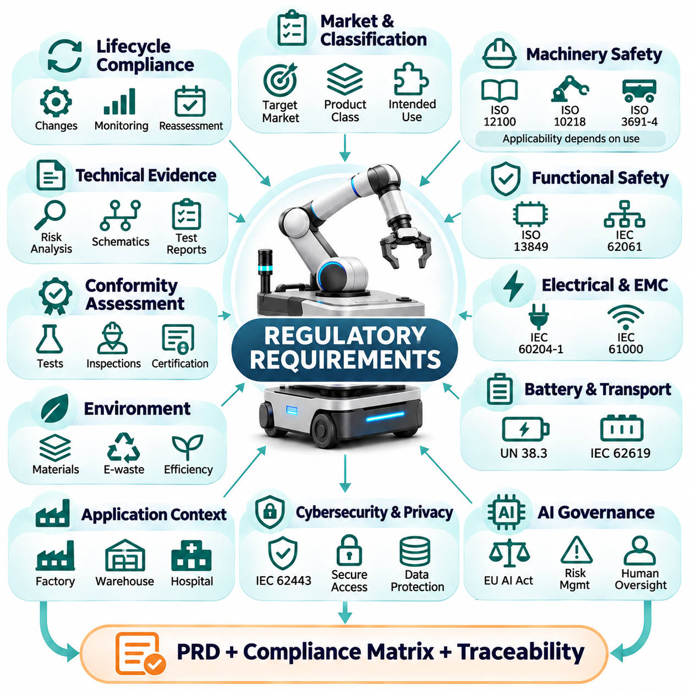{width="7.268055555555556in" height="7.268055555555556in"}

규제 요구사항(Regulatory Requirements)은 모바일 매니퓰레이터(Mobile Manipulator)가 상용화(Commercialization) 및 운영 배치(Operational Deployment) 이전에 충족해야 하는 법적 의무(Legal Obligation), 적용 가능한 표준(Applicable Standard), 적합성 평가 조건(Conformity Assessment Condition)을 정의한다. 이러한 요구사항은 제품 개발(Product Development), 안전 엔지니어링(Safety Engineering), 제조(Manufacturing), 시장 진입(Market Entry)을 위한 체계를 확립한다. 규제 준수(Regulatory Compliance)는 최종 인증 활동(Certification Activity)으로만 간주하는 것이 아니라 전체 제품 수명주기(Product Lifecycle)에 걸쳐 고려되어야 한다.

규제 요구사항의 개발은 목표 시장(Intended Market), 제품 분류(Product Classification), 운영 환경(Operational Environment), 적용 가능한 법적 체계(Legal Framework)를 식별하는 것에서 시작된다. 모바일 매니퓰레이터는 자율 이동 플랫폼(Autonomous Mobile Platform), 로봇 팔(Robotic Arm), 전기 장비(Electrical Equipment), 무선 통신 장치(Wireless Communication Device), 지능형 소프트웨어(Intelligent Software)를 결합한다. 따라서 통합 로봇 시스템(Integrated Robotic System)과 개별 구성요소(Individual Component)에 여러 규제 체계(Regulatory Framework)가 적용될 수 있다.

국제 안전 표준(International Safety Standard)은 규제 요구사항을 정의하기 위한 필수적인 기반을 제공한다. ISO 12100은 기계류 위험성 평가(Machinery Risk Assessment)와 위험 저감(Risk Reduction)에 대한 일반 원칙을 규정하며, ISO 10218은 산업용 로봇 안전(Industrial Robot Safety)을 다룬다. ISO 3691-4는 무인 산업용 운반차(Driverless Industrial Truck)와 관련 시스템에 대한 안전 요구사항을 제공한다. 각 표준의 적용 가능성(Applicability)은 목표 시스템 구성(System Configuration)과 운영 목적(Operational Purpose)에 따라 평가되어야 한다.

기능 안전 표준(Functional Safety Standard)은 안전 관련 제어 시스템(Safety-Related Control System)의 설계 및 평가에 대한 요구사항을 규정한다. ISO 13849와 IEC 62061은 적절한 안전 성능(Safety Performance)을 결정하고 달성하기 위한 체계를 제공한다. 안전 관련 센서(Safety-Related Sensor), 제어기(Controller), 액추에이터(Actuator), 통신 인터페이스(Communication Interface)는 문서화된 엔지니어링 분석(Engineering Analysis)과 검증 증거(Verification Evidence)를 기반으로 전체적으로 요구되는 안전 무결성 수준(Safety Integrity Level)을 충족해야 한다.

전기 안전 및 전자기 적합성 요구사항(Electrical Safety and Electromagnetic Compatibility Requirements, EMC Requirements)은 전기 장비와 전자기 간섭(Electromagnetic Interference, EMI)으로 인해 발생하는 위험원을 다룬다. IEC 60204-1은 기계류의 전기 안전 요구사항(Electrical Safety Requirements)을 제공하며, 적용 가능한 IEC 61000 계열 표준은 전자기 적합성 평가(Electromagnetic Compatibility Assessment)를 지원한다. 요구사항은 대표적인 운영 조건에서의 전기 절연(Electrical Insulation), 접지(Grounding), 회로 보호(Circuit Protection), 전자기 방출(Emission), 전자기 내성(Immunity)을 고려해야 한다.

배터리 및 에너지 저장 규제 요구사항(Battery and Energy Storage Regulatory Requirements)은 충전식 리튬 기반 배터리 시스템(Rechargeable Lithium-Based Battery System)을 탑재한 모바일 매니퓰레이터에 특히 중요하다. 적용 가능한 요구사항에는 배터리 보호(Battery Protection), 열 관리(Thermal Management), 전기적 절연(Electrical Isolation), 운송(Transportation), 환경적 지속 가능성(Environmental Sustainability)이 포함될 수 있다. UN 38.3 시험은 리튬 배터리 운송(Lithium Battery Transportation)과 관련되며, IEC 62619는 산업용 리튬 이차전지 시스템(Industrial Secondary Lithium Battery System)에 적용될 수 있다.

지역별 규제 요구사항(Regional Regulatory Requirements)은 상용화를 목표로 하는 각각의 시장에 대해 별도로 식별되어야 한다. 유럽연합(European Union, EU)은 CE 마킹(CE Marking) 이전에 적용 가능한 법률에 대한 적합성(Conformity)을 요구하는 반면, 미국(United States)은 다양한 규제 체계를 통해 제품(Product), 작업장(Workplace), 통신(Communication) 관련 요구사항을 관리한다. 대한민국(South Korea), 일본(Japan) 및 기타 시장에서는 추가적인 안전, 전기 장비, 무선 통신 장비의 적합성 의무(Conformity Obligation)가 부과될 수 있다.

인공지능 규제 요구사항(AI Regulatory Requirements)은 모바일 매니퓰레이터에 지능형 인식(Intelligent Perception), 자율 의사결정(Autonomous Decision-Making), 적응형 행동(Adaptive Behavior)이 통합됨에 따라 점차 중요해지고 있다. 유럽연합 인공지능법(European Union Artificial Intelligence Act, EU AI Act)과 같은 적용 가능한 규제 체계는 시스템 분류(System Classification)에 따라 위험 관리(Risk Management), 기술 문서화(Technical Documentation), 데이터 거버넌스(Data Governance), 투명성(Transparency), 인간 감독(Human Oversight), 출시 후 모니터링(Post-Market Monitoring)에 관한 의무를 부과할 수 있다.

사이버 보안 및 데이터 보호 요구사항(Cybersecurity and Data Protection Requirements)은 네트워크로 연결된 로봇 시스템(Connected Robotic System), 원격 운영(Remote Operation), 클라우드 인프라(Cloud Infrastructure), 소프트웨어 업데이트(Software Update)로 인해 발생하는 위험을 다룬다. IEC 62443과 같은 표준 체계는 산업 사이버 보안 엔지니어링(Industrial Cybersecurity Engineering)을 지원할 수 있으며, 적용 가능한 데이터 보호 법률(Data Protection Legislation)은 개인정보 처리(Personal Information Processing)를 규율한다. 요구사항에는 인증(Authentication), 접근 제어(Access Control), 보안 통신(Secure Communication), 취약점 관리(Vulnerability Management), 소프트웨어 무결성(Software Integrity)이 포함되어야 한다.

응용 분야별 규제 요구사항(Application-Specific Regulatory Requirements)은 모바일 매니퓰레이터의 목표 운영 환경과 수행 작업에 따라 달라진다. 제조 시설(Manufacturing Facility), 물류 창고(Warehouse), 병원(Hospital), 소매 환경(Retail Environment), 공공장소(Public Space)에서는 서로 다른 운영 의무(Operational Obligation)가 부과될 수 있다. 의료 환경 배치(Healthcare Deployment)에서는 추가적인 위생(Hygiene), 감염 관리(Infection Control), 시설 안전 조치(Facility Safety Measure)가 요구될 수 있으며, 의도된 사용 목적이 관련 분류 기준을 충족하는 경우 의료기기 규제(Medical Device Regulation)가 적용된다.

환경 및 지속 가능성 요구사항(Environmental and Sustainability Requirements)도 제품 개발과 상용화 과정에서 고려되어야 한다. 적용 가능한 법률은 유해 물질(Hazardous Substance)의 사용을 제한하고, 배터리 관리 의무(Battery Management Obligation)를 규정하며, 전자 폐기물(Electronic Waste)의 책임 있는 처리를 요구할 수 있다. 재료 선정(Material Selection), 구성요소 조달(Component Procurement), 에너지 효율성(Energy Efficiency), 제품 수리 가능성(Product Repairability), 수명 종료 후 폐기(End-of-Life Disposal)는 각 목표 시장의 환경적 의무(Environmental Obligation)를 반영해야 한다.

적합성 평가 요구사항(Conformity Assessment Requirements)은 모바일 매니퓰레이터가 적용 가능한 규제 의무(Regulatory Obligation)를 충족한다는 사실을 입증하기 위한 절차를 확립한다. 제품 분류와 관할권(Jurisdiction)에 따라 이러한 절차에는 자체 평가(Internal Assessment), 공인 시험기관 시험(Accredited Laboratory Testing), 독립 검사(Independent Inspection), 제3자 인증(Third-Party Certification)이 포함될 수 있다. 개별 구성요소의 인증(Component Certification)이 전체 통합 로봇 시스템의 적합성을 자동으로 보장하는 것은 아니다.

기술 문서화 요구사항(Technical Documentation Requirements)은 전체 개발 과정에서 규제 준수를 입증하기 위한 객관적인 증거(Objective Evidence)를 제공한다. 관련 문서에는 제품 명세서(Product Specification), 시스템 아키텍처(System Architecture), 전기 회로도(Electrical Schematic), 위험성 평가 보고서(Risk Assessment Report), 안전 계산서(Safety Calculation), 소프트웨어 구성 정보(Software Configuration), 시험 보고서(Test Report), 운영 지침서(Operating Instruction)가 포함된다. 문서는 실제 제품 구성(Product Configuration), 제조 공정(Manufacturing Process), 승인된 엔지니어링 변경사항(Approved Engineering Change)과 일관성을 유지해야 한다.

규제 준수 관리(Regulatory Compliance Management)는 제품 상용화 이후에도 지속되어야 한다. 엔지니어링 변경(Engineering Modification), 구성요소 대체(Component Substitution), 소프트웨어 업데이트, 인공지능 모델 개정(AI Model Revision), 운영 환경의 변화는 기존에 확립된 적합성에 영향을 미칠 수 있다. 조직은 전체 제품 수명주기에 걸쳐 규제 모니터링(Regulatory Monitoring), 형상 관리(Configuration Management), 사고 보고(Incident Reporting), 시정 조치(Corrective Action), 재평가 절차(Reassessment Procedure)를 지속적으로 유지해야 한다.

궁극적으로 규제 요구사항은 제품 요구사항 정의서(Product Requirements Document, PRD)와 전용 규제 준수 매트릭스(Regulatory Compliance Matrix)에 문서화되어야 한다. 각 요구사항은 적용 가능한 법률(Legislation), 표준(Standard), 구현 책임(Implementation Responsibility), 검증 절차(Verification Procedure), 적합성 증거(Conformity Evidence)와의 요구사항 추적성(Requirement Traceability)을 유지해야 한다. 구체적인 법적 의무, 적용 가능한 표준의 판본(Standard Edition), 인증 절차(Certification Procedure)는 상업적 배치(Commercial Deployment) 이전에 각 목표 시장에 대해 확인되어야 한다.

## 10 Maintenance Requirements

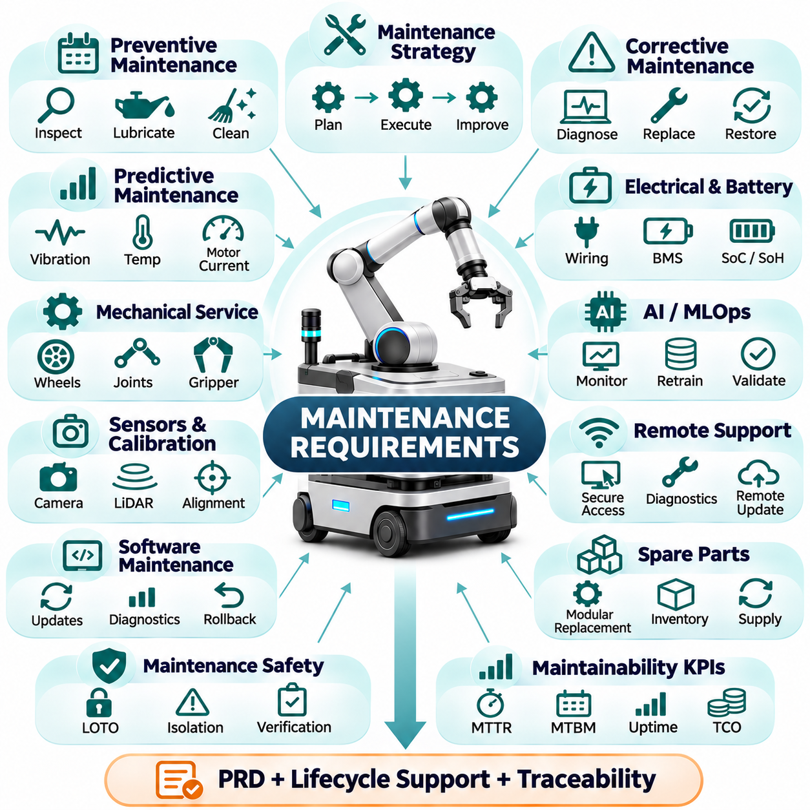{width="7.268055555555556in" height="7.268055555555556in"}

유지보수 요구사항(Maintenance Requirements)은 모바일 매니퓰레이터(Mobile Manipulator)의 전체 운영 수명주기(Operational Lifecycle)에 걸쳐 유지보수를 수행하는 데 필요한 역량, 절차, 자원 및 엔지니어링 조건을 정의한다. 이러한 요구사항은 유지보수 비용(Maintenance Cost)과 운영 중단시간(Operational Downtime)을 최소화하면서 시스템 기능성(System Functionality), 운영 신뢰성(Operational Reliability), 안전 성능(Safety Performance), 설비 가용성(Equipment Availability)을 유지하는 것을 목표로 한다. 따라서 유지보수성(Maintainability)은 제품 개발의 초기 단계부터 고려되어야 한다.

유지보수 요구사항의 개발은 운영 시나리오(Operational Scenario), 예상 설비 수명(Expected Equipment Lifetime), 환경 조건(Environmental Condition), 잠재적 고장 메커니즘(Potential Failure Mechanism)을 분석하는 것에서 시작된다. 기계적 구성요소(Mechanical Component), 전기 시스템(Electrical System), 감지 장치(Sensing Device), 컴퓨팅 플랫폼(Computing Platform), 지능형 소프트웨어(Intelligent Software)는 서로 다른 성능 저하 특성(Degradation Characteristic)을 나타낸다. 유지보수 요구사항은 이러한 차이점을 반영하면서 통합 로봇 시스템(Integrated Robotic System)을 위한 일관된 수명주기 지원 전략(Lifecycle Support Strategy)을 확립해야 한다.

예방 유지보수 요구사항(Preventive Maintenance Requirements)은 설비 고장(Equipment Failure)의 발생 가능성을 줄이기 위한 계획된 유지보수 활동(Scheduled Maintenance Activity)을 규정한다. 대표적인 활동에는 기계적 검사(Mechanical Inspection), 윤활(Lubrication), 체결부 검증(Fastener Verification), 센서 청소(Sensor Cleaning), 전기 연결부 검사(Electrical Connection Inspection), 배터리 상태 평가(Battery Condition Assessment)가 포함된다. 유지보수 주기(Maintenance Interval)는 구성요소 명세(Component Specification), 누적 운영 시간(Accumulated Operating Hours), 환경 조건, 과거 신뢰성 데이터(Historical Reliability Data)를 기반으로 결정되어야 한다.

사후 유지보수 요구사항(Corrective Maintenance Requirements)은 설비 고장 이후 시스템 기능을 복원하는 데 필요한 절차와 자원을 정의한다. 모바일 매니퓰레이터는 체계적인 고장 식별(Fault Identification), 진단 정보 검색(Diagnostic Information Retrieval), 결함 구성요소 교체(Defective Component Replacement), 기능 복구(Functional Recovery)를 지원해야 한다. 유지보수 절차(Maintenance Procedure)는 불필요한 분해(Disassembly)를 최소화하는 동시에 수리가 완료된 시스템이 적용 가능한 기능 요구사항(Functional Requirements), 성능 요구사항(Performance Requirements), 안전 요구사항(Safety Requirements)을 충족하도록 보장해야 한다.

예지 유지보수 요구사항(Predictive Maintenance Requirements)은 지속적인 상태 모니터링(Condition Monitoring)과 운영 데이터 분석(Operational Data Analysis)을 통해 설비의 성능 저하를 사전에 예측할 수 있는 역량을 규정한다. 모터 전류(Motor Current), 진동(Vibration), 온도(Temperature), 배터리 건전성(Battery Health), 액추에이터 토크(Actuator Torque), 통신 오류(Communication Error)와 같은 매개변수는 초기 고장 징후(Emerging Failure)의 지표를 제공할 수 있다. 예측 모델(Predictive Model)은 검증된 성능 저하 패턴(Degradation Pattern)과 설비 운영 이력(Equipment Operating History)을 기반으로 실행 가능한 유지보수 권고사항(Maintenance Recommendation)을 생성해야 한다.

기계적 유지보수 요구사항(Mechanical Maintenance Requirements)은 이동 플랫폼(Mobile Platform), 로봇 팔(Robotic Arm), 말단 작동기(End Effector)의 물리적 구성요소를 다룬다. 휠(Wheel), 베어링(Bearing), 동력 전달 시스템(Transmission System), 조향 메커니즘(Steering Mechanism), 관절(Joint), 그리퍼(Gripper), 구조적 연결부(Structural Connection)는 검사와 교체가 용이하도록 접근 가능해야 한다. 기계 설계(Mechanical Design)는 표준화된 유지보수 절차(Standardized Maintenance Procedure), 모듈형 구성요소 교체(Modular Component Replacement), 적절한 윤활, 유지보수 이후의 구조적 건전성(Structural Integrity) 검증을 지원해야 한다.

전기 및 배터리 유지보수 요구사항(Electrical and Battery Maintenance Requirements)은 전력 분배 시스템(Power Distribution System), 와이어링 하네스(Wiring Harness), 커넥터(Connector), 보호 장치(Protective Device), 에너지 저장 구성요소(Energy Storage Component)를 검사하기 위한 절차를 규정한다. 배터리 관리 시스템(Battery Management System, BMS)은 충전 상태(State of Charge, SoC), 건전성 상태(State of Health, SoH), 온도, 비정상 운영 조건(Abnormal Operating Condition)에 관한 정보를 제공해야 한다. 유지보수 활동에는 적절한 전기적 격리(Electrical Isolation)와 위험 에너지 제어 절차(Hazardous Energy Control Procedure)가 포함되어야 한다.

센서 유지보수 및 보정 요구사항(Sensor Maintenance and Calibration Requirements)은 장기간의 운영 과정에서도 인식(Perception), 위치 추정(Localization), 자율주행(Navigation), 조작(Manipulation) 기능의 정확도가 유지되도록 한다. 카메라(Camera), 라이다 센서(LiDAR Sensor), 깊이 센서(Depth Sensor), 관성 측정 장치(Inertial Measurement Unit, IMU), 힘 센서(Force Sensor)에는 적절한 검사 및 보정 절차(Calibration Procedure)가 필요하다. 보정 요구사항(Calibration Requirements)은 센서 정렬(Sensor Alignment), 좌표 변환(Coordinate Transformation), 측정 정확도(Measurement Accuracy), 구성요소 교체 이후의 검증(Verification)을 다루어야 한다.

소프트웨어 유지보수 요구사항(Software Maintenance Requirements)은 운영체제(Operating System), 로봇 미들웨어(Robotic Middleware), 장치 드라이버(Device Driver), 제어 알고리즘(Control Algorithm), 통신 인터페이스(Communication Interface), 응용 소프트웨어(Application Software)를 다룬다. 시스템은 제어된 소프트웨어 업데이트(Controlled Software Update), 형상 관리(Configuration Management), 진단 로그 기록(Diagnostic Logging), 호환성 검증(Compatibility Verification), 이전 버전 복원 메커니즘(Rollback Mechanism)을 지원해야 한다. 소프트웨어 유지보수는 결함(Defect), 보안 취약점(Security Vulnerability), 운영 개선사항(Operational Improvement)을 처리하면서 기존에 확립된 기능적 동작(Functional Behavior)과 안전 성능을 유지해야 한다.

인공지능 유지보수 요구사항(AI Maintenance Requirements)은 모델 성능 저하(Model Degradation), 데이터셋 변화(Dataset Change), 환경적 변화(Environmental Variation), 지속적으로 변화하는 운영 요구사항(Operational Demand)을 다룬다. 배포된 인공지능 모델(Deployed AI Model)은 인식 정확도(Recognition Accuracy)의 저하, 추론 지연시간(Inference Latency)의 증가, 예기치 않은 예측 동작(Unexpected Prediction Behavior)에 대해 지속적으로 모니터링되어야 한다. 모델 재학습(Model Retraining), 유효성 검증(Validation), 버전 관리(Version Management), 배포 승인(Deployment Approval), 이전 버전 복원 절차(Rollback Procedure)는 기계학습 운영(Machine Learning Operations, MLOps)에 통합되어야 한다.

원격 유지보수 요구사항(Remote Maintenance Requirements)은 지속적인 현장 기술 지원(On-Site Technical Assistance) 없이 로봇 시스템을 진단하고 지원할 수 있는 역량을 규정한다. 원격 모니터링(Remote Monitoring), 진단 데이터 수집(Diagnostic Data Collection), 시스템 건전성 평가(System Health Assessment), 승인된 소프트웨어 업데이트(Authorized Software Update)는 유지보수 효율성(Maintenance Efficiency)을 향상시킬 수 있다. 원격 접근(Remote Access)에는 보안 인증(Secure Authentication), 접근 제어(Access Control), 활동 로그 기록(Activity Logging), 의도하지 않은 물리적 움직임(Unintended Physical Movement)을 방지하기 위한 보호 조치(Safeguard)가 포함되어야 한다.

유지보수성 성능 요구사항(Maintainability Performance Requirements)은 유지보수 효율성과 수명주기 지원 효과성(Lifecycle Support Effectiveness)을 평가하기 위한 측정 가능한 기준을 제공한다. 관련 성능 지표에는 평균 수리 시간(Mean Time to Repair, MTTR), 평균 유지보수 간격(Mean Time Between Maintenance, MTBM), 유지보수 작업 시간(Maintenance Labor Hours), 설비 중단시간(Equipment Downtime), 예비 부품 가용성(Spare Parts Availability), 복구 성공률(Restoration Success Rate)이 포함된다. 이러한 성능 지표는 운영 가용성 목표(Operational Availability Target)와 총소유비용(Total Cost of Ownership, TCO) 평가를 지원해야 한다.

예비 부품 및 정비성 요구사항(Spare Parts and Serviceability Requirements)은 장기간의 로봇 시스템 운영을 지원하는 데 필요한 자원을 규정한다. 핵심 교체 구성요소(Critical Replacement Component)는 고장 발생 확률(Failure Probability), 조달 소요시간(Procurement Lead Time), 교체 비용(Replacement Cost), 운영 영향(Operational Impact)을 기반으로 식별되어야 한다. 표준화된 구성요소(Standardized Component), 모듈형 아키텍처(Modular Architecture), 접근이 용이한 정비 연결부(Accessible Service Connection), 체계적으로 관리되는 예비 부품 재고(Spare Parts Inventory)는 유지보수 복잡성(Maintenance Complexity)과 수명주기 비용(Lifecycle Cost)을 감소시킬 수 있다.

유지보수 안전 및 문서화 요구사항(Maintenance Safety and Documentation Requirements)은 검사(Inspection), 수리(Repair), 보정(Calibration), 시험(Testing) 과정에서 작업자를 보호하기 위한 일관된 절차를 확립한다. 유지보수 매뉴얼(Maintenance Manual)에는 설비 격리(Equipment Isolation), 잠금 및 표찰 절차(Lockout/Tagout, LOTO), 저장 에너지 관리(Stored Energy Management), 필요 공구(Required Tool), 교체 절차(Replacement Procedure), 유지보수 이후 검증(Post-Maintenance Verification)이 명시되어야 한다. 권한이 부여된 담당자(Authorized Personnel)는 위험 설비(Hazardous Equipment)와 관련된 활동을 수행하기 전에 적절한 교육 및 훈련(Training)을 받아야 한다.

궁극적으로 유지보수 요구사항은 제품 요구사항 정의서(Product Requirements Document, PRD)와 관련 수명주기 지원 명세서(Lifecycle Support Specification)에 문서화되어야 한다. 각 요구사항은 시스템 구성요소(System Component), 고장 분석 결과(Failure Analysis Result), 유지보수 절차, 검증 증거(Verification Evidence)와의 요구사항 추적성(Requirement Traceability)을 유지해야 한다. 응용 분야별 유지보수 주기(Application-Specific Maintenance Interval), 사용 수명 목표(Service Life Target), 자원 요구사항(Resource Requirements)은 엔지니어링 분석(Engineering Analysis)과 대표적인 운영 유효성 검증(Representative Operational Validation)을 통해 확립되어야 한다.

## 11 Product Requirement Document PRD

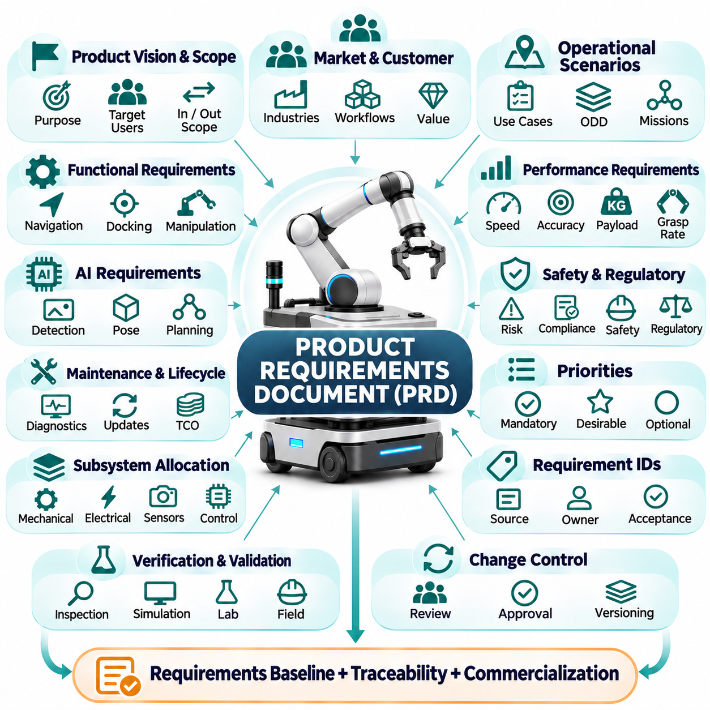{width="7.268055555555556in" height="7.268055555555556in"}

제품 요구사항 정의서(Product Requirements Document, PRD)는 모바일 매니퓰레이터(Mobile Manipulator)의 목표(Objective), 역량(Capability), 제약사항(Constraint), 인수 기준(Acceptance Criteria)을 정의하는 종합적인 엔지니어링 문서(Engineering Document)이다. 제품 비전(Product Vision), 시장 요구사항(Market Requirements), 고객 기대사항(Customer Expectations), 운영 시나리오(Operational Scenarios), 기술 요구사항(Technical Requirements)을 하나의 통합 참조 문서(Unified Reference Document)로 구성한다. PRD는 제품 개발(Product Development), 시스템 통합(System Integration), 상용화(Commercialization)를 위한 공통 기반을 확립한다.

제품 요구사항 정의서의 개발은 제품 목적(Product Purpose), 목표 응용 분야(Intended Application), 목표 고객(Target Customer), 예상 운영 가치(Expected Operational Value)를 정의하는 것에서 시작된다. 이러한 요소는 개발 프로젝트(Development Project)의 범위를 설정하고 기술적 의사결정(Technical Decision-Making)의 방향을 제시한다. 문서에서는 필수 제품 역량(Essential Product Capability), 선택적 기능(Optional Feature), 미래 개발 목표(Future Development Objective), 현재 제품 개발 범위(Product Scope)에서 명시적으로 제외되는 기능을 구분해야 한다.

제품 요구사항 정의서에 포함되는 시장 및 고객 요구사항(Market and Customer Requirements)은 모바일 매니퓰레이터가 충족해야 하는 상업적 및 운영적 기대사항(Commercial and Operational Expectations)을 설명한다. 이러한 요구사항은 목표 산업(Target Industry), 고객 작업 흐름(Customer Workflow), 운영상 과제(Operational Challenge), 경쟁 우위(Competitive Advantage), 투자 제약사항(Investment Constraint), 예상 경제적 이점(Expected Economic Benefit)을 다루어야 한다. 고객 기대사항은 구현(Implementation), 측정(Measurement), 객관적 평가(Objective Evaluation)가 가능한 엔지니어링 요구사항(Engineering Requirements)으로 전환되어야 한다.

운영 시나리오는 모바일 매니퓰레이터가 목표 환경에서 어떻게 동작할 것으로 예상되는지를 설명하는 상황적 정보(Contextual Information)를 제공한다. 제품 요구사항 정의서는 대표적인 사용 사례(Representative Use Case), 임무 실행 순서(Mission Sequence), 환경 조건(Environmental Condition), 설비 상호작용(Equipment Interaction), 인간 참여(Human Involvement), 비정상 운영 상황(Abnormal Operating Situation)을 정의해야 한다. 이러한 시나리오는 요구되는 시스템 기능(System Function), 운영 제한사항(Operational Limitation), 인수 시험 조건(Acceptance Testing Condition)을 식별하기 위한 기반을 확립한다.

기능 요구사항(Functional Requirements)은 모바일 매니퓰레이터가 목표 작업을 수행하기 위해 제공해야 하는 역량을 규정한다. 이러한 요구사항은 자율주행(Autonomous Navigation), 위치 추정(Localization), 도킹(Docking), 환경 인식(Environmental Perception), 객체 인식(Object Recognition), 로봇 조작(Robotic Manipulation), 임무 관리(Mission Management), 통신(Communication), 고장 복구(Fault Recovery)를 다루어야 한다. 각 기능은 구현 방법(Implementation Method)을 불필요하게 제한하지 않으면서 예상 동작(Expected Behavior)을 명확하게 규정하는 문장으로 기술되어야 한다.

성능 요구사항(Performance Requirements)은 시스템 기능의 효과성(Effectiveness)을 평가하기 위한 측정 가능한 엔지니어링 목표(Engineering Target)를 확립한다. 관련 매개변수에는 주행 속도(Travel Speed), 위치 결정 정확도(Positioning Accuracy), 도킹 반복 정밀도(Docking Repeatability), 매니퓰레이터 적재하중(Manipulator Payload), 파지 성공률(Grasp Success Rate), 임무 완료 시간(Mission Completion Time), 운영 가용성(Operational Availability), 에너지 소비량(Energy Consumption)이 포함된다. 각 성능 요구사항에는 측정 조건(Measurement Condition), 인수 임계값(Acceptance Threshold), 허용 오차(Allowable Tolerance), 평가 방법론(Evaluation Methodology)이 명시되어야 한다.

인공지능 요구사항(AI Requirements)은 자율 인식(Autonomous Perception), 의사결정(Decision-Making), 물리적 작업 실행(Physical Task Execution)에 필요한 지능적 역량(Intelligent Capability)을 정의한다. 제품 요구사항 정의서는 객체 검출(Object Detection), 자세 추정(Pose Estimation), 파지 계획(Grasp Planning), 의미론적 이해(Semantic Understanding), 추론 성능(Inference Performance), 데이터 품질(Data Quality), 모델 강건성(Model Robustness)을 다루어야 한다. 또한 요구사항은 불확실한 예측(Uncertain Prediction), 익숙하지 않은 상황(Unfamiliar Situation), 인공지능 관련 운영 실패(AI-Related Operational Failure)에 대한 허용 가능한 대응(Acceptable Response)을 규정해야 한다.

안전 및 규제 요구사항(Safety and Regulatory Requirements)은 모바일 매니퓰레이터에 적용되는 보호 역량(Protective Capability)과 규제 준수 의무(Compliance Obligation)를 확립한다. 제품 요구사항 정의서에는 위험원 식별(Hazard Identification), 위험성 평가(Risk Assessment), 기능 안전 분석(Functional Safety Analysis), 적용 가능한 규제(Applicable Regulation)로부터 도출된 요구사항이 포함되어야 한다. 안전 요구사항은 전체 개발 과정에서 필수 제약사항(Mandatory Constraint)으로 유지되어야 하며, 생산성(Productivity), 비용 절감(Cost Reduction), 납기 목표(Delivery Objective)를 달성하기 위해 타협되어서는 안 된다.

유지보수 및 수명주기 요구사항(Maintenance and Lifecycle Requirements)은 상업적 배치(Commercial Deployment) 이후 신뢰성 높은 로봇 운영을 지속하는 데 필요한 조건을 정의한다. 제품 요구사항 정의서는 유지보수성(Maintainability), 예방 유지보수(Preventive Maintenance), 진단 역량(Diagnostic Capability), 구성요소 교체(Component Replacement), 원격 기술 지원(Remote Technical Support), 소프트웨어 업데이트(Software Update), 인공지능 모델 관리(AI Model Management)를 다루어야 한다. 이러한 요구사항은 설비 가용성(Equipment Availability), 사용 수명 목표(Service Life Objective), 예비 부품 계획(Spare Parts Planning), 총소유비용(Total Cost of Ownership, TCO) 목표를 지원해야 한다.

요구사항 분류 및 우선순위 설정(Requirement Classification and Prioritization)은 개발 조직이 상충하는 기술적 및 상업적 목표를 관리할 수 있도록 한다. 요구사항은 필수 요구사항(Mandatory Requirement), 권장 요구사항(Desirable Requirement), 선택적 요구사항(Optional Requirement), 향후 제품 출시(Future Product Release)를 위한 요구사항으로 분류될 수 있다. 우선순위 설정은 모든 필수 규제 준수 요구사항을 유지하면서 고객 가치(Customer Value), 안전 중요도(Safety Criticality), 규제 의무(Regulatory Obligation), 기술적 의존성(Technical Dependency), 구현 비용(Implementation Cost), 개발 일정(Development Schedule)을 고려해야 한다.

제품 요구사항 정의서 내의 각 요구사항에는 고유 식별자(Unique Identifier)가 부여되어야 하며, 구현과 검증(Verification)을 지원하기 위한 충분한 정보가 포함되어야 한다. 대표적인 요구사항 속성(Requirement Attribute)에는 요구사항 설명문(Descriptive Statement), 요구사항 출처(Originating Source), 설정 근거(Rationale), 우선순위(Priority), 담당 조직(Responsible Organization), 인수 기준, 검증 방법(Verification Method), 승인 상태(Approval Status)가 포함된다. 표준화된 요구사항 기술 방식(Standardized Requirement Description)은 모호성(Ambiguity)을 감소시키고 다학제 엔지니어링 조직(Multidisciplinary Engineering Team) 간의 의사소통을 향상시킨다.

요구사항 할당(Requirement Allocation)은 제품 수준의 목표(Product-Level Objective)와 하위 시스템 수준의 엔지니어링 명세(Subsystem-Level Engineering Specification) 사이의 관계를 확립한다. 제품 요구사항 정의서는 기계 아키텍처(Mechanical Architecture), 전기 아키텍처(Electrical Architecture), 센서 아키텍처(Sensor Architecture), 컴퓨팅 인프라(Computing Infrastructure), 인공지능 아키텍처(AI Architecture), 제어 소프트웨어 개발(Control Software Development)을 위한 입력 정보를 제공한다. 요구사항 할당은 하위 시스템 간 의존성(Subsystem Dependency), 인터페이스 제약사항(Interface Constraint), 공유 자원(Shared Resource), 통합 시스템 성능 목표(Integrated System Performance Objective)를 고려해야 한다.

검증 및 유효성 검증 계획(Verification and Validation Planning)은 제품 개발의 초기 단계부터 제품 요구사항 정의서에 포함되어야 한다. 각 요구사항은 검사(Inspection), 엔지니어링 분석(Engineering Analysis), 시뮬레이션(Simulation), 실험실 시험(Laboratory Testing), 현장 유효성 검증(Field Validation)을 포함하는 적절한 평가 방법(Evaluation Method)과 연계되어야 한다. 인수 기준은 구현된 제품이 명시된 요구사항과 의도된 고객 요구(Customer Needs)를 충족한다는 사실을 입증할 수 있는 객관적인 증거(Objective Evidence)를 제공해야 한다.

제품 요구사항 정의서 관리(PRD Management)는 전체 개발 수명주기(Development Lifecycle)에 걸쳐 공식적인 검토(Formal Review), 승인(Approval), 버전 제어(Version Control), 엔지니어링 변경 관리(Engineering Change Management)를 요구한다. 제안된 요구사항 변경사항(Proposed Requirement Modification)은 시스템 아키텍처(System Architecture), 개발 비용(Development Cost), 프로젝트 일정(Project Schedule), 안전 준수(Safety Compliance), 이전에 완료된 검증 활동(Verification Activity)에 미치는 영향을 기반으로 평가되어야 한다. 승인된 변경사항(Approved Change)은 모든 담당 엔지니어링 조직과 프로젝트 관리 조직(Project Management Organization)에 전달되어야 한다.

궁극적으로 제품 요구사항 정의서는 제품 기획(Product Planning), 시스템 설계(System Design), 하드웨어 개발(Hardware Development), 인공지능 개발(AI Development), 조작 엔지니어링(Manipulation Engineering), 시험(Testing), 현장 유효성 검증(Field Validation), 제조(Manufacturing), 품질 보증(Quality Assurance)을 연결하는 핵심 요구사항 기준선(Requirements Baseline)의 역할을 수행한다. 이러한 모든 활동에 걸쳐 요구사항 추적성(Requirement Traceability)을 유지함으로써 엔지니어링 의사결정(Engineering Decision-Making)이 승인된 제품 목표와 일관성을 유지하도록 보장하고, 초기 요구사항 정의부터 상업적 배치까지의 체계적인 전환(Systematic Transition)을 지원할 수 있다.

## 12 Requirement Traceability

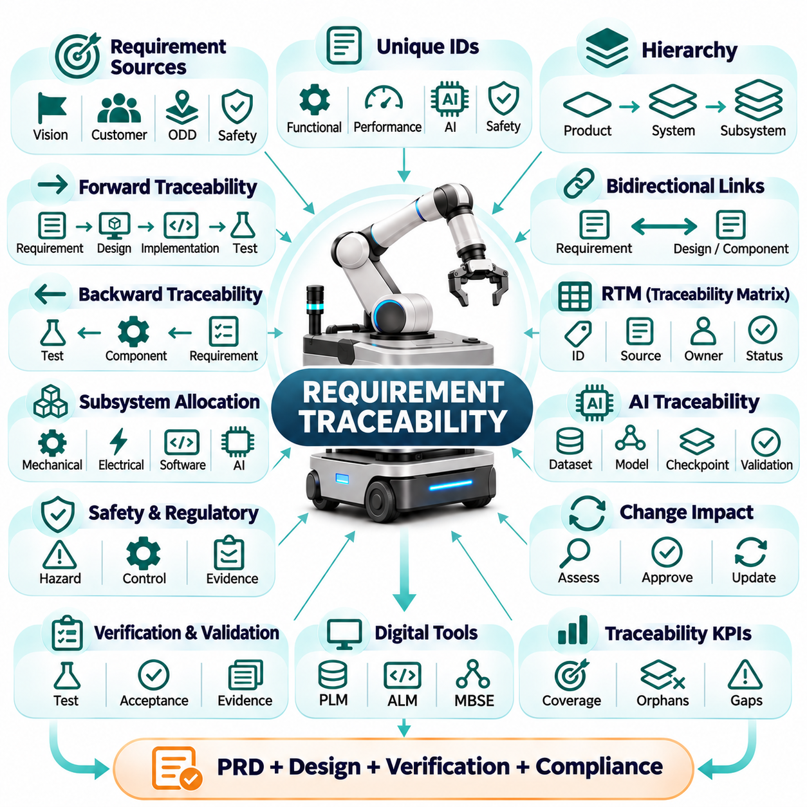{width="7.268055555555556in" height="7.268055555555556in"}

요구사항 추적성(Requirement Traceability)은 모바일 매니퓰레이터(Mobile Manipulator)의 전체 개발 수명주기(Development Lifecycle)에 걸쳐 제품 요구사항(Product Requirements), 엔지니어링 명세(Engineering Specification), 설계 의사결정(Design Decision), 구현 활동(Implementation Activity), 검증 증거(Verification Evidence) 사이의 체계적인 관계를 확립한다. 이를 통해 승인된 모든 요구사항을 최초 출처(Original Source)부터 최종 구현(Final Implementation)까지 추적할 수 있으며, 엔지니어링 활동이 확립된 제품 목표(Product Objective)와 일관성을 유지하도록 보장한다.

요구사항 추적성의 개발은 개별 요구사항(Individual Requirement)의 출처를 식별하는 것에서 시작된다. 제품 비전(Product Vision), 시장 기대사항(Market Expectations), 고객 요구(Customer Needs), 운영 시나리오(Operational Scenario), 안전성 평가(Safety Assessment), 규제 의무(Regulatory Obligation), 유지보수 목표(Maintenance Objective)는 주요 요구사항 출처에 해당한다. 각 요구사항은 최초 출처, 엔지니어링 근거(Engineering Rationale), 담당 이해관계자(Responsible Stakeholder), 관련 제품 목표와의 명시적인 관계를 유지해야 한다.

고유 요구사항 식별(Unique Requirement Identification)은 다학제 개발 활동(Multidisciplinary Development Activity) 전반에 걸쳐 일관된 추적성을 확보하기 위한 기반을 제공한다. 각 요구사항에는 전체 수명주기 동안 해당 요구사항과 지속적으로 연계되는 고유 식별자(Stable Identifier)가 부여되어야 한다. 식별 규칙(Identification Convention)은 계층적 관계(Hierarchical Relationship)를 지원하면서 기능 요구사항(Functional Requirements), 성능 요구사항(Performance Requirements), 인공지능 요구사항(AI Requirements), 안전 요구사항(Safety Requirements), 규제 요구사항(Regulatory Requirements), 인터페이스 요구사항(Interface Requirements), 유지보수 요구사항(Maintenance Requirements)을 구분할 수 있도록 구성될 수 있다.

순방향 추적성(Forward Traceability)은 승인된 제품 요구사항과 후속 엔지니어링 활동 사이의 관계를 확립한다. 제품 수준 요구사항(Product-Level Requirements)은 시스템 명세(System Specification), 하위 시스템 설계(Subsystem Design), 하드웨어 구성요소(Hardware Component), 소프트웨어 모듈(Software Module), 인공지능 모델(AI Model), 검증 절차(Verification Procedure)와 연계되어야 한다. 이러한 관계를 통해 엔지니어링 조직은 각 요구사항이 적절하게 할당(Allocation), 구현(Implementation), 평가(Evaluation)되었는지를 확인할 수 있다.

역방향 추적성(Backward Traceability)은 구현된 시스템 구성요소(System Component)와 검증 결과(Verification Result)에서 최초 요구사항(Originating Requirement)으로 이어지는 관계를 확립한다. 모든 주요 엔지니어링 기능(Engineering Function), 하드웨어 구성요소, 소프트웨어 역량(Software Capability), 인공지능 모델에는 문서화된 정당화 근거(Documented Justification)가 존재해야 한다. 역방향 추적성은 불필요한 기능(Unnecessary Functionality), 승인되지 않은 설계 변경(Unauthorized Design Change), 근거가 부족한 엔지니어링 의사결정(Unsupported Engineering Decision), 승인된 개발 목표로부터의 이탈(Deviation)을 식별하는 데 기여한다.

양방향 추적성(Bidirectional Traceability)은 순방향 및 역방향 관계를 결합하여 전체 개발 수명주기에 걸쳐 포괄적인 가시성(Comprehensive Visibility)을 확보한다. 엔지니어링 조직은 특정 요구사항을 구현하는 구성요소와 특정 설계 요소(Design Element)의 타당성을 뒷받침하는 요구사항을 확인할 수 있다. 이러한 역량은 여러 기계(Mechanical), 전기(Electrical), 소프트웨어(Software), 인공지능(AI) 하위 시스템이 통합 로봇 기능(Integrated Robotic Function)을 구현하는 과정에서 특히 중요하다.

요구사항 추적성 매트릭스(Requirements Traceability Matrix, RTM)는 요구사항과 관련 엔지니어링 산출물(Engineering Artifact) 사이의 관계를 문서화하기 위한 구조화된 메커니즘(Structured Mechanism)을 제공한다. 대표적인 매트릭스 속성(Matrix Attribute)에는 요구사항 식별자(Requirement Identifier), 최초 출처(Originating Source), 하위 시스템 할당(Subsystem Allocation), 구현 참조 정보(Implementation Reference), 검증 방법(Verification Method), 시험 사례 식별자(Test Case Identifier), 인수 기준(Acceptance Criteria), 담당 조직(Responsible Organization), 현재 준수 상태(Compliance Status)가 포함된다.

계층적 요구사항 추적성(Hierarchical Requirement Traceability)은 제품 수준 목표(Product-Level Objective)를 시스템 수준 요구사항(System-Level Requirements)과 하위 시스템 수준 요구사항(Subsystem-Level Requirements)으로 분해(Decomposition)하는 과정을 지원한다. 예를 들어, 도킹 정확도 요구사항(Docking Accuracy Requirement)은 위치 추정 정확도(Localization Accuracy), 센서 보정(Sensor Calibration), 기계적 공차(Mechanical Tolerance), 조향 제어(Steering Control), 매니퓰레이터 위치 결정(Manipulator Positioning)에 대한 파생 요구사항(Derived Requirement)을 생성할 수 있다. 각 파생 요구사항은 상위 요구사항(Parent Requirement)과 문서화된 관계를 유지해야 한다.

인공지능 요구사항 추적성(AI Requirement Traceability)은 기존의 엔지니어링 관계를 데이터셋(Dataset), 주석 명세(Annotation Specification), 학습 구성(Training Configuration), 모델 아키텍처(Model Architecture), 평가 지표(Evaluation Metric), 배포 환경(Deployment Environment)으로 확장한다. 인공지능 모델은 재현성(Reproducibility)과 통제된 모델 발전(Controlled Model Evolution)을 지원하기 위해 승인된 운영 요구사항(Operational Requirements), 데이터셋 버전(Dataset Version), 학습된 체크포인트(Trained Checkpoint), 유효성 검증 결과(Validation Result), 실행 환경 구성(Runtime Configuration)과의 추적성을 유지해야 한다.

안전 및 규제 요구사항 추적성(Safety and Regulatory Requirement Traceability)은 식별된 위험원(Identified Hazard), 위험성 평가(Risk Assessment), 보호 조치(Protective Measure), 안전 기능(Safety Function), 적용 가능한 표준(Applicable Standard), 규제 준수 증거(Compliance Evidence) 사이의 명시적인 관계를 확립한다. 각 안전 요구사항은 해당 구현 결과 및 유효성 검증 결과까지 추적할 수 있어야 한다. 이러한 관계는 안전성 평가(Safety Assessment), 적합성 평가(Conformity Evaluation), 엔지니어링 검토(Engineering Review), 배치 이후 사고 조사(Post-Deployment Incident Investigation)를 지원한다.

검증 및 유효성 검증 추적성(Verification and Validation Traceability)은 개별 요구사항을 해당 평가 절차(Evaluation Procedure) 및 객관적 증거(Objective Evidence)와 연결한다. 시험 사례(Test Case)는 평가 대상 요구사항, 관련 운영 조건(Operating Condition), 측정 방법(Measurement Method), 인수 기준을 명확하게 식별해야 한다. 검증 기록(Verification Record)에는 평가 대상 시스템 구성(System Configuration)에 대한 관측 결과(Observed Result), 편차(Deviation), 미해결 실패(Unresolved Failure), 시정 조치(Corrective Action), 최종 인수 결정(Final Acceptance Decision)이 문서화되어야 한다.

요구사항 변경 관리(Requirement Change Management)는 제안된 변경사항(Proposed Modification)의 영향을 평가하기 위해 요구사항 추적성에 의존한다. 적재하중(Payload Capacity), 위치 결정 정확도(Positioning Accuracy), 운영 속도(Operating Speed), 인공지능 성능(AI Performance)의 변경은 기계 구조(Mechanical Structure), 전기적 용량(Electrical Capacity), 컴퓨팅 자원(Computing Resource), 안전 기능, 시험 절차(Test Procedure)에 영향을 미칠 수 있다. 영향 분석(Impact Analysis)은 요구사항 변경이 공식적으로 승인되고 구현되기 전에 영향을 받는 엔지니어링 산출물을 식별해야 한다.

디지털 엔지니어링 플랫폼(Digital Engineering Platform)은 통합 요구사항 관리(Integrated Requirements Management), 제품 수명주기 관리(Product Lifecycle Management, PLM), 응용 프로그램 수명주기 관리(Application Lifecycle Management, ALM), 모델 기반 시스템 엔지니어링(Model-Based Systems Engineering, MBSE)을 통해 요구사항 추적성을 지원한다. 이러한 환경은 협업 개발(Collaborative Development)을 지원하면서 요구사항, 아키텍처 모델(Architecture Model), 엔지니어링 문서(Engineering Document), 소프트웨어 저장소(Software Repository), 시험 결과(Test Result), 제품 구성(Product Configuration) 사이의 관계를 유지할 수 있다.

추적성 품질(Traceability Quality)은 요구사항 할당 충족률(Requirement Allocation Coverage), 검증 충족률(Verification Coverage), 미해결 요구사항 수(Unresolved Requirement Count), 연결 관계가 누락된 고립 요구사항(Orphan Requirement), 인수 상태(Acceptance Status)와 같은 측정 가능한 지표를 통해 평가되어야 한다. 문서화된 관계가 불완전하거나 부정확할 수 있으므로 높은 추적성 충족률(Traceability Coverage)만으로 제품 품질(Product Quality)이 보장되는 것은 아니다. 따라서 정기적인 엔지니어링 검토를 통해 추적성 관계의 완전성(Completeness)과 유효성(Validity)을 모두 평가해야 한다.

궁극적으로 요구사항 추적성은 제품 요구사항 정의서(Product Requirements Document, PRD)를 시스템 설계(System Design), 하드웨어 개발(Hardware Development), 인공지능 개발(AI Development), 조작 엔지니어링(Manipulation Engineering), 시험(Testing), 현장 유효성 검증(Field Validation), 제조(Manufacturing), 품질 보증(Quality Assurance)과 연결한다. 전체 제품 수명주기(Product Lifecycle)에 걸쳐 이러한 관계를 유지함으로써 엔지니어링 책임성(Engineering Accountability), 체계적인 검증(Systematic Verification), 규제 준수(Regulatory Compliance), 통제된 제품 발전(Controlled Product Evolution), 성공적인 상용화(Successful Commercialization)를 지원할 수 있다.
