**Volume 05. Mobile Manipulator Projects and Development Manual**


# Chapter 02. System Design

##  

## 01 System Architecture Overview

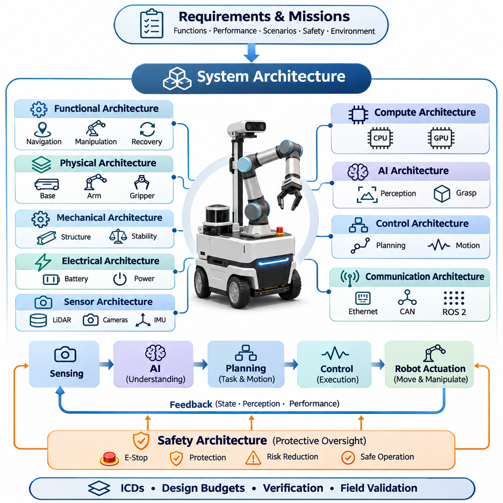{width="7.268055555555556in" height="7.268055555555556in"}

System architecture provides the fundamental engineering framework for designing, developing, integrating, and deploying a mobile manipulator. Unlike conventional industrial robots or standalone Autonomous Mobile Robots (AMRs), a mobile manipulator combines autonomous mobility, robotic manipulation, environmental perception, artificial intelligence, and intelligent decision-making within a unified system architecture. These capabilities must operate as a coordinated system to accomplish complex physical tasks.

The system architecture translates product requirements into a structured engineering solution. Functional requirements, performance targets, operational scenarios, safety constraints, and environmental conditions established during the requirements engineering phase become inputs to architectural development. Each requirement must be allocated to appropriate subsystems, establishing clear relationships between expected product capabilities and technical implementation.

A mobile manipulator architecture can be organized into multiple engineering domains, including functional, physical, mechanical, electrical, sensor, computing, AI, control, communication, and safety architectures. Although each domain addresses specific technical responsibilities, their design must be coordinated through common system-level requirements and interfaces. Independent optimization without system-level coordination can introduce integration problems.

Functional architecture defines what the mobile manipulator must accomplish independently of specific hardware implementations. Major functions include autonomous navigation, localization, environmental perception, object recognition, grasp planning, manipulation, mission execution, energy management, and fault recovery. Functional decomposition divides complex operational capabilities into manageable engineering functions with clearly defined responsibilities and dependencies.

Physical architecture establishes how functional capabilities are implemented through actual hardware and software components. A typical mobile manipulator incorporates a mobile base, robotic arm, end effector, battery system, motor controllers, environmental sensors, onboard computing platforms, communication devices, and safety equipment. Physical component selection must consider performance, compatibility, reliability, maintainability, and future scalability.

Mechanical architecture defines the structural relationships between the mobile platform, robotic manipulator, end effector, and supporting components. Structural rigidity, payload distribution, center of gravity, vibration, workspace accessibility, and dynamic stability directly influence operational performance. Particular attention must be given to changes in mass distribution and reaction forces when the robotic arm extends, accelerates, or manipulates heavy objects.

Electrical architecture provides reliable power distribution and electrical connectivity across the entire robotic system. Battery management systems, power distribution units, DC/DC converters, motor drives, protective circuits, and wiring harnesses support electrical operation. Power consumption, peak current demand, grounding, electromagnetic compatibility, thermal management, and electrical protection must be evaluated under representative operating conditions.

Sensor architecture enables the mobile manipulator to acquire information about its surroundings, internal state, and physical interactions. LiDAR, RGB cameras, depth cameras, inertial measurement units, wheel encoders, joint encoders, and force-torque sensors provide complementary measurements. Sensor placement, calibration, synchronization, coverage, measurement uncertainty, and environmental robustness determine the quality of information available to downstream subsystems.

Compute architecture distributes computational workloads across embedded controllers, central processing units, graphics processing units, and dedicated safety controllers. Autonomous navigation, visual perception, AI inference, trajectory generation, and system monitoring impose different computational requirements. Processing resources must be allocated according to workload characteristics, latency constraints, thermal limitations, energy consumption, and operational priorities.

Artificial intelligence architecture transforms sensory information into actionable environmental understanding and intelligent behavior. Object detection, semantic segmentation, pose estimation, grasp detection, and vision-language models can support increasingly complex manipulation tasks. AI components must interact with conventional planning and control systems through defined interfaces while providing confidence information and mechanisms for handling uncertain predictions.

Control architecture coordinates physical motion across the mobile base and robotic manipulator. Hierarchical control structures generally separate mission-level decisions, task execution, motion planning, trajectory generation, and low-level actuator control. Coordinated mobility and manipulation require consistent reference frames, synchronized state information, collision avoidance, and consideration of platform stability during simultaneous or sequential movement.

Communication architecture establishes dependable information exchange between distributed hardware and software components. Industrial Ethernet, CAN, EtherCAT, wireless networking, and ROS 2 communication mechanisms may support different operational requirements. Communication interfaces must address bandwidth, latency, message priority, synchronization, cybersecurity, and fault handling. Critical control functions should remain available during external network interruptions.

Safety architecture establishes protective mechanisms that reduce risks associated with autonomous movement, robotic manipulation, human interaction, and equipment failure. Emergency stopping, protective stopping, speed monitoring, collision prevention, and safety-related control functions must be integrated according to identified hazards. Safety functions must achieve the required performance independently of non-safety-rated AI or mission management components where necessary.

Interface Control Documents (ICDs) establish formal agreements between engineering subsystems. These documents define mechanical mounting specifications, electrical connections, communication protocols, software interfaces, coordinate systems, timing requirements, and error-handling behaviors. Standardized interfaces enable parallel development, component replacement, systematic integration, and controlled architectural modifications throughout the product lifecycle.

Architecture development also requires system-level engineering budgets covering mass, power, computational resources, communication bandwidth, response latency, manufacturing costs, and operational performance. Architectural alternatives must be evaluated through feasibility analysis, simulation, prototyping, and structured design reviews. Maintaining requirement traceability and configuration control establishes a reliable foundation for integration, verification, field validation, and commercialization.

시스템 아키텍처(System Architecture)는 모바일 매니퓰레이터(Mobile Manipulator)의 설계, 개발, 통합 및 배포를 위한 기본적인 엔지니어링 프레임워크(Engineering Framework)를 제공한다. 기존의 산업용 로봇(Industrial Robot)이나 독립적인 자율이동로봇(Autonomous Mobile Robot, AMR)과 달리 모바일 매니퓰레이터는 자율 이동(Autonomous Mobility), 로봇 조작(Robotic Manipulation), 환경 인식(Environmental Perception), 인공지능(Artificial Intelligence), 지능형 의사결정(Intelligent Decision-Making)을 하나의 통합된 시스템 아키텍처로 결합한다. 이러한 기능은 복잡한 물리적 작업을 수행하기 위해 유기적으로 연결된 하나의 시스템으로 동작해야 한다.

시스템 아키텍처(System Architecture)는 제품 요구사항(Product Requirements)을 구조화된 엔지니어링 솔루션(Engineering Solution)으로 변환한다. 요구사항 공학(Requirements Engineering) 단계에서 정의된 기능 요구사항(Functional Requirements), 성능 목표(Performance Targets), 운영 시나리오(Operational Scenarios), 안전 제약조건(Safety Constraints), 환경 조건(Environmental Conditions)은 아키텍처 개발을 위한 입력으로 활용된다. 각각의 요구사항은 적절한 하위 시스템(Subsystem)에 할당되어 예상되는 제품 기능과 기술적 구현 사이의 명확한 관계를 형성해야 한다.

모바일 매니퓰레이터 아키텍처는 기능 아키텍처(Functional Architecture), 물리적 아키텍처(Physical Architecture), 기계 아키텍처(Mechanical Architecture), 전기 아키텍처(Electrical Architecture), 센서 아키텍처(Sensor Architecture), 컴퓨팅 아키텍처(Compute Architecture), 인공지능 아키텍처(AI Architecture), 제어 아키텍처(Control Architecture), 통신 아키텍처(Communication Architecture), 안전 아키텍처(Safety Architecture)를 포함하는 여러 엔지니어링 영역으로 구성될 수 있다. 각 영역은 고유한 기술적 책임을 담당하지만, 공통적인 시스템 수준 요구사항과 인터페이스(Interface)를 기반으로 설계되어야 한다. 시스템 수준의 조정 없이 개별적인 최적화(Optimization)를 수행하면 통합 과정에서 문제가 발생할 수 있다.

기능 아키텍처(Functional Architecture)는 특정 하드웨어 구현 방식과 독립적으로 모바일 매니퓰레이터가 수행해야 하는 기능을 정의한다. 주요 기능에는 자율주행(Autonomous Navigation), 위치 추정(Localization), 환경 인식(Environmental Perception), 객체 인식(Object Recognition), 파지 계획(Grasp Planning), 로봇 조작(Manipulation), 임무 실행(Mission Execution), 에너지 관리(Energy Management), 장애 복구(Fault Recovery)가 포함된다. 기능 분해(Functional Decomposition)는 복잡한 운영 기능을 명확한 책임과 의존성을 가지는 관리 가능한 엔지니어링 기능으로 구분한다.

물리적 아키텍처(Physical Architecture)는 기능적 요구사항이 실제 하드웨어(Hardware) 및 소프트웨어(Software) 구성요소를 통해 어떻게 구현되는지를 정의한다. 일반적인 모바일 매니퓰레이터는 이동 플랫폼(Mobile Base), 로봇 팔(Robotic Arm), 말단 작동기(End Effector), 배터리 시스템(Battery System), 모터 제어기(Motor Controller), 환경 센서(Environmental Sensor), 온보드 컴퓨팅 플랫폼(Onboard Computing Platform), 통신 장치(Communication Device), 안전 장비(Safety Equipment)로 구성된다. 물리적 구성요소를 선정할 때는 성능(Performance), 호환성(Compatibility), 신뢰성(Reliability), 유지보수성(Maintainability), 향후 확장성(Scalability)을 고려해야 한다.

기계 아키텍처(Mechanical Architecture)는 이동 플랫폼(Mobile Platform), 로봇 매니퓰레이터(Robotic Manipulator), 말단 작동기(End Effector), 지원 구성요소 사이의 구조적 관계를 정의한다. 구조적 강성(Structural Rigidity), 적재 하중 분포(Payload Distribution), 무게중심(Center of Gravity), 진동(Vibration), 작업공간 접근성(Workspace Accessibility), 동적 안정성(Dynamic Stability)은 운영 성능에 직접적인 영향을 미친다. 특히 로봇 팔이 확장되거나 가속할 때 또는 무거운 물체를 조작할 때 발생하는 질량 분포(Mass Distribution) 및 반력(Reaction Force)의 변화에 특별한 주의를 기울여야 한다.

전기 아키텍처(Electrical Architecture)는 전체 로봇 시스템에서 안정적인 전력 분배(Power Distribution)와 전기적 연결성(Electrical Connectivity)을 제공한다. 배터리 관리 시스템(Battery Management System, BMS), 전력 분배 장치(Power Distribution Unit, PDU), 직류 변환기(DC/DC Converter), 모터 드라이브(Motor Drive), 보호 회로(Protective Circuit), 와이어링 하네스(Wiring Harness)는 전기적 동작을 지원한다. 전력 소비(Power Consumption), 최대 전류 요구량(Peak Current Demand), 접지(Grounding), 전자기 적합성(Electromagnetic Compatibility, EMC), 열 관리(Thermal Management), 전기적 보호(Electrical Protection)는 실제 운영을 대표하는 조건에서 평가되어야 한다.

센서 아키텍처(Sensor Architecture)는 모바일 매니퓰레이터가 주변 환경, 내부 상태(Internal State), 물리적 상호작용(Physical Interaction)에 대한 정보를 획득할 수 있도록 한다. 라이다(LiDAR), RGB 카메라(RGB Camera), 깊이 카메라(Depth Camera), 관성 측정 장치(Inertial Measurement Unit, IMU), 휠 엔코더(Wheel Encoder), 관절 엔코더(Joint Encoder), 힘·토크 센서(Force-Torque Sensor)는 상호보완적인 측정 정보를 제공한다. 센서 배치(Sensor Placement), 보정(Calibration), 동기화(Synchronization), 감지 범위(Coverage), 측정 불확실성(Measurement Uncertainty), 환경 강건성(Environmental Robustness)은 후속 하위 시스템에서 활용할 수 있는 정보의 품질을 결정한다.

컴퓨팅 아키텍처(Compute Architecture)는 임베디드 제어기(Embedded Controller), 중앙처리장치(Central Processing Unit, CPU), 그래픽처리장치(Graphics Processing Unit, GPU), 전용 안전 제어기(Dedicated Safety Controller)에 컴퓨팅 작업부하(Computational Workload)를 분산한다. 자율주행(Autonomous Navigation), 시각적 인식(Visual Perception), 인공지능 추론(AI Inference), 궤적 생성(Trajectory Generation), 시스템 모니터링(System Monitoring)은 서로 다른 컴퓨팅 요구사항을 가진다. 처리 자원(Processing Resource)은 작업부하의 특성, 지연시간 제약조건(Latency Constraint), 열적 한계(Thermal Limitation), 에너지 소비(Energy Consumption), 운영 우선순위(Operational Priority)에 따라 할당되어야 한다.

인공지능 아키텍처(Artificial Intelligence Architecture)는 센서 정보를 실제 행동에 활용할 수 있는 환경 이해(Environmental Understanding)와 지능형 행동(Intelligent Behavior)으로 변환한다. 객체 검출(Object Detection), 의미론적 분할(Semantic Segmentation), 자세 추정(Pose Estimation), 파지 검출(Grasp Detection), 시각-언어 모델(Vision-Language Model, VLM)은 더욱 복잡한 로봇 조작 작업을 지원할 수 있다. 인공지능 구성요소는 정의된 인터페이스를 통해 기존의 계획 및 제어 시스템(Planning and Control System)과 상호작용해야 하며, 예측 신뢰도 정보(Confidence Information)와 불확실한 예측(Uncertain Prediction)을 처리하기 위한 메커니즘을 제공해야 한다.

제어 아키텍처(Control Architecture)는 이동 플랫폼과 로봇 매니퓰레이터의 물리적 움직임을 조정한다. 계층적 제어 구조(Hierarchical Control Structure)는 일반적으로 임무 수준 의사결정(Mission-Level Decision-Making), 작업 실행(Task Execution), 동작 계획(Motion Planning), 궤적 생성(Trajectory Generation), 저수준 작동기 제어(Low-Level Actuator Control)를 분리한다. 이동과 조작의 협조 제어(Coordinated Control)를 위해서는 일관된 기준 좌표계(Reference Frame), 동기화된 상태 정보(Synchronized State Information), 충돌 회피(Collision Avoidance), 동시 또는 순차적 움직임에서의 플랫폼 안정성(Platform Stability)을 고려해야 한다.

통신 아키텍처(Communication Architecture)는 분산된 하드웨어 및 소프트웨어 구성요소 사이에서 신뢰할 수 있는 정보 교환(Information Exchange)을 설정한다. 산업용 이더넷(Industrial Ethernet), 제어기 영역 네트워크(Controller Area Network, CAN), 이더캣(EtherCAT), 무선 네트워킹(Wireless Networking), ROS 2 통신 메커니즘(ROS 2 Communication Mechanism)은 다양한 운영 요구사항을 지원할 수 있다. 통신 인터페이스(Communication Interface)는 대역폭(Bandwidth), 지연시간(Latency), 메시지 우선순위(Message Priority), 동기화(Synchronization), 사이버 보안(Cybersecurity), 장애 처리(Fault Handling)를 고려해야 한다. 외부 네트워크 연결이 중단되는 상황에서도 핵심 제어 기능(Critical Control Function)은 유지되어야 한다.

안전 아키텍처(Safety Architecture)는 자율 이동, 로봇 조작, 인간과의 상호작용(Human Interaction), 장비 고장(Equipment Failure)과 관련된 위험을 감소시키기 위한 보호 메커니즘(Protective Mechanism)을 정의한다. 비상 정지(Emergency Stop), 보호 정지(Protective Stop), 속도 모니터링(Speed Monitoring), 충돌 방지(Collision Prevention), 안전 관련 제어 기능(Safety-Related Control Function)은 식별된 위험요인(Hazard)에 따라 통합되어야 한다. 필요한 경우 안전 기능(Safety Function)은 안전 등급이 없는 인공지능(Non-Safety-Rated AI) 또는 임무 관리 구성요소(Mission Management Component)와 독립적으로 요구되는 안전 성능을 충족해야 한다.

인터페이스 제어 문서(Interface Control Document, ICD)는 엔지니어링 하위 시스템 사이의 공식적인 합의를 수립한다. 이러한 문서는 기계적 장착 사양(Mechanical Mounting Specification), 전기적 연결(Electrical Connection), 통신 프로토콜(Communication Protocol), 소프트웨어 인터페이스(Software Interface), 좌표계(Coordinate System), 타이밍 요구사항(Timing Requirements), 오류 처리 동작(Error-Handling Behavior)을 정의한다. 표준화된 인터페이스(Standardized Interface)는 제품 수명주기(Product Lifecycle) 전반에 걸쳐 병렬 개발(Parallel Development), 구성요소 교체(Component Replacement), 체계적인 시스템 통합(System Integration), 통제된 아키텍처 변경(Architectural Modification)을 가능하게 한다.

아키텍처 개발(Architecture Development)에는 질량(Mass), 전력(Power), 컴퓨팅 자원(Computational Resource), 통신 대역폭(Communication Bandwidth), 응답 지연시간(Response Latency), 제조 비용(Manufacturing Cost), 운영 성능(Operational Performance)을 포함하는 시스템 수준의 엔지니어링 자원 예산(Engineering Budget)도 필요하다. 아키텍처 대안(Architectural Alternative)은 타당성 분석(Feasibility Analysis), 시뮬레이션(Simulation), 시제품 개발(Prototyping), 체계적인 설계 검토(Design Review)를 통해 평가되어야 한다. 요구사항 추적성(Requirement Traceability)과 형상 관리(Configuration Control)를 유지함으로써 시스템 통합(System Integration), 검증(Verification), 현장 유효성 검증(Field Validation), 상용화(Commercialization)를 위한 신뢰할 수 있는 기반을 구축할 수 있다.

##  

## 02 Functional Architecture

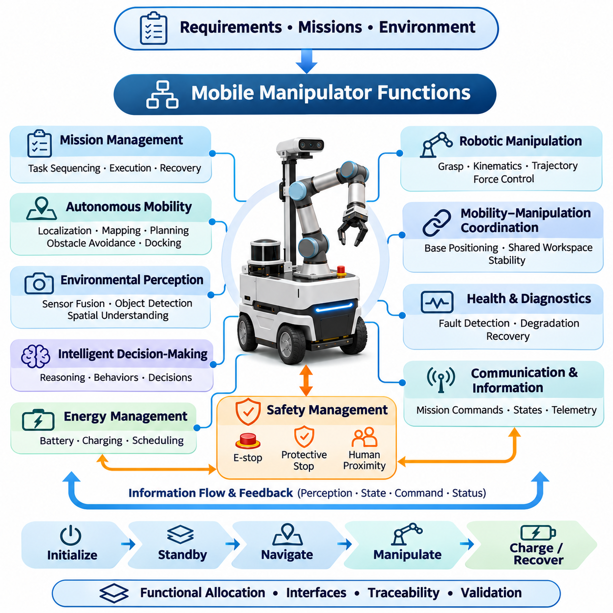{width="7.268055555555556in" height="7.268055555555556in"}

Functional architecture defines the operational capabilities, behavioral relationships, and information flows required for a mobile manipulator to accomplish its intended missions. Unlike physical architecture, which focuses on hardware and software components, functional architecture describes what the system must perform independently of specific implementation technologies. It establishes a logical foundation for subsequent engineering development and system integration.

Functional architecture development begins with the analysis of product requirements, operational scenarios, customer expectations, and environmental constraints. These inputs are transformed into a structured collection of system functions that collectively satisfy the intended operational objectives. Each function must have clearly defined responsibilities, input information, output information, execution conditions, and relationships with other system functions.

Functional decomposition divides complex system capabilities into smaller and more manageable functional elements. At the highest level, a mobile manipulator performs autonomous physical tasks within a defined operational environment. This capability can be decomposed into mission management, autonomous mobility, environmental perception, object manipulation, intelligent decision-making, energy management, safety monitoring, and system diagnostics.

Mission management functions coordinate the overall execution of operational objectives. A mission may involve receiving a transportation request, navigating toward a designated workstation, identifying a target object, performing robotic manipulation, and delivering the object to another location. Mission management determines task sequences, allocates operational resources, monitors execution status, and initiates appropriate recovery procedures when exceptions occur.

Autonomous mobility functions enable the mobile manipulator to travel safely and efficiently throughout its operating environment. Localization, mapping, global path planning, local trajectory planning, obstacle avoidance, velocity control, and precise docking represent essential mobility capabilities. These functions must coordinate with manipulation requirements to ensure that the mobile platform reaches positions suitable for subsequent robotic operations.

Environmental perception functions acquire and interpret information about the surrounding physical environment. Sensor data acquisition, preprocessing, synchronization, sensor fusion, object recognition, obstacle detection, and spatial reconstruction contribute to environmental understanding. Perception functions must provide timely and sufficiently accurate information while communicating measurement uncertainty and identifying degraded sensing conditions.

Robotic manipulation functions enable physical interaction with objects, equipment, and surrounding infrastructure. These functions include object localization, grasp candidate generation, inverse kinematics, motion planning, trajectory execution, force regulation, and grasp verification. Manipulation functions must consider object characteristics, workspace limitations, collision constraints, payload conditions, and the stability of the mobile platform.

Intelligent decision-making functions transform mission objectives and environmental information into appropriate operational actions. Rule-based reasoning, behavior trees, optimization algorithms, machine learning models, and robot agents may contribute to decision-making capabilities. Functional architecture should remain independent of particular algorithms while defining decision inputs, execution constraints, confidence requirements, and acceptable operational outcomes.

Coordination between mobility and manipulation represents a distinctive requirement of mobile manipulator functional architecture. The system must determine whether navigation and manipulation should occur sequentially or simultaneously according to operational constraints. Coordination functions manage base positioning, manipulator configuration, shared workspace accessibility, motion dependencies, collision risks, and dynamic stability throughout mission execution.

Energy management functions maintain sufficient electrical energy to support continuous robotic operation. Battery state monitoring, energy consumption estimation, remaining operating time prediction, charging management, and energy-aware mission scheduling contribute to operational availability. These functions interact with mission management to determine whether tasks can be completed or charging operations must be initiated before further execution.

Safety management functions continuously evaluate operational conditions and initiate protective responses when unacceptable risks are detected. Emergency stopping, protective stopping, speed restriction, human proximity monitoring, stability supervision, and fault detection contribute to risk reduction. Safety-related functions must be distinguished from ordinary operational functions and implemented with integrity appropriate to the required safety performance.

System health monitoring and diagnostic functions evaluate the operational condition of mechanical, electrical, computing, sensing, and software resources. Abnormal temperature, excessive actuator loading, communication interruptions, sensor degradation, and computational failures must be detected and classified. Diagnostic information supports fault isolation, maintenance planning, controlled degradation, and appropriate recovery or shutdown decisions.

Communication and information management functions support data exchange among internal subsystems, fleet management platforms, external equipment, and human operators. Mission commands, sensor measurements, operational states, diagnostic messages, and execution results must be transferred through defined functional interfaces. Information flows should specify data ownership, update frequency, timing constraints, validity conditions, and communication failure responses.

Functional architecture must describe operational behavior across different system states, including initialization, standby, autonomous operation, manipulation, charging, maintenance, degraded operation, and emergency shutdown. State transitions must define triggering conditions, prerequisites, permitted actions, and recovery criteria. Abnormal operational scenarios should receive the same systematic engineering attention as normal mission execution.

Functional allocation establishes relationships between logical system functions and the physical or software components responsible for their implementation. Computationally intensive perception functions may be assigned to onboard AI computing resources, while time-critical actuator control and safety-related functions may require dedicated controllers. Allocation decisions must consider latency, resource availability, reliability, cost, and safety requirements.

Functional architecture validation ensures that all required capabilities are represented, functional dependencies are consistent, and operational scenarios can be completed without unresolved responsibilities. Requirement traceability matrices, functional flow analysis, interface definitions, simulation, and structured design reviews support this evaluation. A validated functional architecture establishes the foundation for physical architecture development and subsequent system verification.

기능 아키텍처(Functional Architecture)는 모바일 매니퓰레이터(Mobile Manipulator)가 의도된 임무를 수행하는 데 필요한 운영 기능(Operational Capability), 행동 관계(Behavioral Relationship), 정보 흐름(Information Flow)을 정의한다. 하드웨어 및 소프트웨어 구성요소에 중점을 두는 물리적 아키텍처(Physical Architecture)와 달리 기능 아키텍처는 특정 구현 기술(Implementation Technology)과 독립적으로 시스템이 수행해야 하는 기능을 설명한다. 이는 후속 엔지니어링 개발(Engineering Development)과 시스템 통합(System Integration)을 위한 논리적 기반(Logical Foundation)을 제공한다.

기능 아키텍처 개발(Functional Architecture Development)은 제품 요구사항(Product Requirements), 운영 시나리오(Operational Scenario), 고객 기대사항(Customer Expectations), 환경 제약조건(Environmental Constraints)에 대한 분석으로 시작된다. 이러한 입력은 의도된 운영 목표(Operational Objectives)를 종합적으로 충족하는 구조화된 시스템 기능(System Function)의 집합으로 변환된다. 각각의 기능은 명확하게 정의된 책임(Responsibility), 입력 정보(Input Information), 출력 정보(Output Information), 실행 조건(Execution Condition), 다른 시스템 기능과의 관계를 가져야 한다.

기능 분해(Functional Decomposition)는 복잡한 시스템 기능을 더욱 작고 관리하기 쉬운 기능 요소(Functional Element)로 구분한다. 최상위 수준에서 모바일 매니퓰레이터는 정의된 운영 환경(Operational Environment) 내에서 자율적인 물리적 작업(Autonomous Physical Task)을 수행한다. 이러한 기능은 임무 관리(Mission Management), 자율 이동(Autonomous Mobility), 환경 인식(Environmental Perception), 객체 조작(Object Manipulation), 지능형 의사결정(Intelligent Decision-Making), 에너지 관리(Energy Management), 안전 모니터링(Safety Monitoring), 시스템 진단(System Diagnostics)으로 분해할 수 있다.

임무 관리 기능(Mission Management Function)은 운영 목표의 전반적인 실행을 조정한다. 하나의 임무는 운송 요청(Transportation Request)을 수신하고, 지정된 작업 위치(Workstation)로 이동하며, 대상 객체(Target Object)를 식별하고, 로봇 조작(Robotic Manipulation)을 수행한 후 해당 객체를 다른 위치로 전달하는 과정을 포함할 수 있다. 임무 관리는 작업 순서(Task Sequence)를 결정하고, 운영 자원(Operational Resource)을 할당하며, 실행 상태(Execution Status)를 모니터링하고, 예외 상황(Exception)이 발생하면 적절한 복구 절차(Recovery Procedure)를 시작한다.

자율 이동 기능(Autonomous Mobility Function)은 모바일 매니퓰레이터가 운영 환경 전반에서 안전하고 효율적으로 이동할 수 있도록 한다. 위치 추정(Localization), 지도 생성(Mapping), 전역 경로 계획(Global Path Planning), 지역 궤적 계획(Local Trajectory Planning), 장애물 회피(Obstacle Avoidance), 속도 제어(Velocity Control), 정밀 도킹(Precise Docking)은 필수적인 이동 기능에 해당한다. 이러한 기능은 이동 플랫폼(Mobile Platform)이 후속 로봇 조작 작업에 적합한 위치에 도달할 수 있도록 조작 요구사항(Manipulation Requirements)과 연계되어야 한다.

환경 인식 기능(Environmental Perception Function)은 주변의 물리적 환경에 대한 정보를 획득하고 해석한다. 센서 데이터 획득(Sensor Data Acquisition), 전처리(Preprocessing), 동기화(Synchronization), 센서 융합(Sensor Fusion), 객체 인식(Object Recognition), 장애물 검출(Obstacle Detection), 공간 재구성(Spatial Reconstruction)은 환경 이해(Environmental Understanding)에 기여한다. 인식 기능은 적시에 충분히 정확한 정보를 제공하는 동시에 측정 불확실성(Measurement Uncertainty)을 전달하고 센싱 성능 저하 상태(Degraded Sensing Condition)를 식별해야 한다.

로봇 조작 기능(Robotic Manipulation Function)은 객체, 장비 및 주변 인프라(Infrastructure)와의 물리적 상호작용(Physical Interaction)을 가능하게 한다. 이러한 기능에는 객체 위치 추정(Object Localization), 파지 후보 생성(Grasp Candidate Generation), 역기구학(Inverse Kinematics), 동작 계획(Motion Planning), 궤적 실행(Trajectory Execution), 힘 조절(Force Regulation), 파지 검증(Grasp Verification)이 포함된다. 조작 기능은 객체 특성(Object Characteristics), 작업공간 제한(Workspace Limitation), 충돌 제약조건(Collision Constraints), 적재 하중 조건(Payload Condition), 이동 플랫폼의 안정성(Stability)을 고려해야 한다.

지능형 의사결정 기능(Intelligent Decision-Making Function)은 임무 목표(Mission Objectives)와 환경 정보를 적절한 운영 행동(Operational Action)으로 변환한다. 규칙 기반 추론(Rule-Based Reasoning), 행동 트리(Behavior Tree), 최적화 알고리즘(Optimization Algorithm), 기계학습 모델(Machine Learning Model), 로봇 에이전트(Robot Agent)는 의사결정 기능에 기여할 수 있다. 기능 아키텍처는 특정 알고리즘과 독립성을 유지하면서 의사결정 입력(Decision Input), 실행 제약조건(Execution Constraints), 신뢰도 요구사항(Confidence Requirements), 허용 가능한 운영 결과(Operational Outcome)를 정의해야 한다.

이동과 조작 사이의 협조(Coordination between Mobility and Manipulation)는 모바일 매니퓰레이터 기능 아키텍처의 차별화된 요구사항에 해당한다. 시스템은 운영 제약조건(Operational Constraints)에 따라 자율주행과 로봇 조작이 순차적(Sequential) 또는 동시적(Simultaneous)으로 수행되어야 하는지를 결정해야 한다. 협조 기능(Coordination Function)은 임무 실행 전반에 걸쳐 이동 플랫폼 위치 설정(Base Positioning), 매니퓰레이터 구성(Manipulator Configuration), 공유 작업공간 접근성(Shared Workspace Accessibility), 동작 의존성(Motion Dependency), 충돌 위험(Collision Risk), 동적 안정성(Dynamic Stability)을 관리한다.

에너지 관리 기능(Energy Management Function)은 지속적인 로봇 운영을 지원하기 위해 충분한 전기 에너지(Electrical Energy)를 유지한다. 배터리 상태 모니터링(Battery State Monitoring), 에너지 소비량 추정(Energy Consumption Estimation), 잔여 운영 시간 예측(Remaining Operating Time Prediction), 충전 관리(Charging Management), 에너지 인식 기반 임무 스케줄링(Energy-Aware Mission Scheduling)은 운영 가용성(Operational Availability)에 기여한다. 이러한 기능은 임무 관리와 상호작용하여 작업을 완료할 수 있는지 또는 추가 작업을 실행하기 전에 충전 작업을 시작해야 하는지를 결정한다.

안전 관리 기능(Safety Management Function)은 운영 조건을 지속적으로 평가하고 허용할 수 없는 위험(Unacceptable Risk)이 감지되면 보호 대응(Protective Response)을 시작한다. 비상 정지(Emergency Stop), 보호 정지(Protective Stop), 속도 제한(Speed Restriction), 인간 접근 모니터링(Human Proximity Monitoring), 안정성 감시(Stability Supervision), 장애 검출(Fault Detection)은 위험 감소(Risk Reduction)에 기여한다. 안전 관련 기능(Safety-Related Function)은 일반 운영 기능(Ordinary Operational Function)과 구분되어야 하며, 요구되는 안전 성능(Safety Performance)에 적합한 무결성(Integrity)을 확보하도록 구현되어야 한다.

시스템 상태 모니터링 및 진단 기능(System Health Monitoring and Diagnostic Function)은 기계, 전기, 컴퓨팅, 센싱 및 소프트웨어 자원의 운영 상태를 평가한다. 비정상 온도(Abnormal Temperature), 과도한 작동기 부하(Excessive Actuator Loading), 통신 중단(Communication Interruption), 센서 성능 저하(Sensor Degradation), 컴퓨팅 장애(Computational Failure)는 검출되고 분류되어야 한다. 진단 정보(Diagnostic Information)는 장애 격리(Fault Isolation), 유지보수 계획(Maintenance Planning), 통제된 성능 저하(Controlled Degradation), 적절한 복구 또는 시스템 종료(Shutdown) 의사결정을 지원한다.

통신 및 정보 관리 기능(Communication and Information Management Function)은 내부 하위 시스템(Internal Subsystem), 플릿 관리 플랫폼(Fleet Management Platform), 외부 장비(External Equipment), 인간 운영자(Human Operator) 사이의 데이터 교환(Data Exchange)을 지원한다. 임무 명령(Mission Command), 센서 측정값(Sensor Measurement), 운영 상태(Operational State), 진단 메시지(Diagnostic Message), 실행 결과(Execution Result)는 정의된 기능 인터페이스(Functional Interface)를 통해 전달되어야 한다. 정보 흐름은 데이터 소유권(Data Ownership), 갱신 주기(Update Frequency), 타이밍 제약조건(Timing Constraints), 유효성 조건(Validity Condition), 통신 장애 대응(Communication Failure Response)을 명시해야 한다.

기능 아키텍처는 초기화(Initialization), 대기(Standby), 자율 운영(Autonomous Operation), 로봇 조작(Manipulation), 충전(Charging), 유지보수(Maintenance), 성능 저하 운영(Degraded Operation), 비상 종료(Emergency Shutdown)를 포함하는 다양한 시스템 상태(System State)에서의 운영 행동을 설명해야 한다. 상태 전이(State Transition)는 전이 발생 조건(Triggering Condition), 사전 충족 조건(Prerequisite), 허용된 행동(Permitted Action), 복구 기준(Recovery Criteria)을 정의해야 한다. 비정상 운영 시나리오(Abnormal Operational Scenario)에도 정상적인 임무 실행과 동일한 수준의 체계적인 엔지니어링 검토가 이루어져야 한다.

기능 할당(Functional Allocation)은 논리적 시스템 기능(Logical System Function)과 해당 기능의 구현을 담당하는 물리적 구성요소 또는 소프트웨어 구성요소 사이의 관계를 설정한다. 높은 컴퓨팅 성능을 요구하는 인식 기능(Computationally Intensive Perception Function)은 온보드 인공지능 컴퓨팅 자원(Onboard AI Computing Resource)에 할당할 수 있으며, 시간 제약이 엄격한 작동기 제어(Time-Critical Actuator Control) 및 안전 관련 기능에는 전용 제어기(Dedicated Controller)가 필요할 수 있다. 기능 할당에 관한 의사결정은 지연시간(Latency), 자원 가용성(Resource Availability), 신뢰성(Reliability), 비용(Cost), 안전 요구사항(Safety Requirements)을 고려해야 한다.

기능 아키텍처 유효성 검증(Functional Architecture Validation)은 요구되는 모든 기능이 반영되었는지, 기능적 의존성(Functional Dependency)이 일관성을 유지하는지, 미해결 책임 영역(Unresolved Responsibility) 없이 운영 시나리오를 완료할 수 있는지를 확인한다. 요구사항 추적성 매트릭스(Requirement Traceability Matrix, RTM), 기능 흐름 분석(Functional Flow Analysis), 인터페이스 정의(Interface Definition), 시뮬레이션(Simulation), 체계적인 설계 검토(Structured Design Review)는 이러한 평가를 지원한다. 유효성이 검증된 기능 아키텍처는 물리적 아키텍처 개발(Physical Architecture Development)과 후속 시스템 검증(System Verification)을 위한 기반을 확립한다.

##  

## 03 Physical Architecture

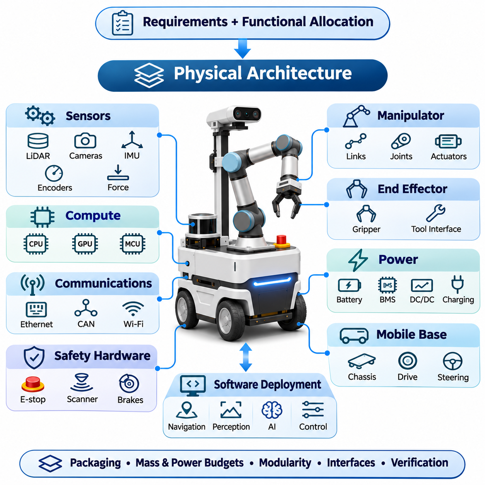{width="7.268055555555556in" height="7.268055555555556in"}

Physical architecture defines the tangible hardware and deployed software components through which the functional capabilities of a mobile manipulator are implemented. It translates logical system functions into an integrated engineering platform consisting of mechanical structures, electrical equipment, sensors, computing resources, actuators, and communication devices. Its primary objective is to establish a feasible and coordinated system configuration.

The development of physical architecture begins with functional architecture, product requirements, operational scenarios, and system-level performance targets. Each logical function must be allocated to one or more physical or software components capable of satisfying its operational requirements. This allocation establishes relationships between system capabilities and implementation resources while identifying technical dependencies and integration constraints.

The mobile base constitutes the primary physical foundation of the mobile manipulator. It integrates the chassis, propulsion system, steering mechanism, braking equipment, suspension components, and structural mounting interfaces. Different mobility configurations, including differential drive, omnidirectional drive, and independent steering systems, may be selected according to maneuverability, payload capacity, positioning accuracy, and environmental conditions.

The robotic manipulator represents the primary physical subsystem responsible for object interaction and manipulation. Its architecture includes mechanical links, joints, actuators, transmission mechanisms, position sensors, and dedicated control equipment. Manipulator selection must consider degrees of freedom, reachability, payload capacity, repeatability, operating speed, structural mass, and compatibility with the mobile platform.

The end effector establishes the physical interface between the robotic manipulator and the target object or working environment. Mechanical grippers, vacuum grippers, dexterous robotic hands, inspection instruments, and specialized process tools may be integrated according to application requirements. Modular tool interfaces and automatic tool-changing mechanisms can improve operational flexibility while reducing hardware replacement and maintenance complexity.

The electrical power subsystem supplies energy to the mobile base, robotic manipulator, computing platforms, sensors, communication equipment, and auxiliary devices. Its physical configuration typically includes battery modules, protective devices, power distribution units, DC/DC converters, charging interfaces, and battery management systems. Electrical equipment must be arranged to support reliable operation, thermal management, and safe maintenance.

Sensor components must be physically distributed to support environmental perception, localization, manipulation, and safety monitoring. LiDAR sensors, RGB cameras, depth cameras, inertial measurement units, wheel encoders, joint encoders, and force-torque sensors provide complementary information. Their mounting locations must account for viewing angles, occlusion, vibration, environmental exposure, calibration stability, and accessibility.

The onboard computing subsystem provides physical processing resources for autonomous navigation, artificial intelligence, motion planning, mission management, and diagnostic functions. Embedded computers, central processing units, graphics processing units, microcontrollers, and dedicated safety controllers may be distributed throughout the system. Computing equipment placement must consider cooling, electrical supply, connectivity, and serviceability.

The physical communication infrastructure connects distributed sensors, controllers, computing platforms, and external systems. Ethernet switches, industrial communication interfaces, CAN transceivers, wireless communication modules, antennas, connectors, and wiring harnesses establish the required connectivity. Network equipment and cable routing must support communication reliability, electromagnetic compatibility, and controlled fault isolation.

Safety-related hardware constitutes an essential part of the physical architecture. Emergency stop switches, safety laser scanners, safety controllers, protective bumpers, braking mechanisms, and safety-rated drive interfaces may be incorporated according to risk assessment results. Their physical arrangement must provide appropriate protective coverage, operator accessibility, reliable signal transmission, and the required safety performance.

Physical integration requires careful management of spatial relationships between the mobile platform, manipulator, sensors, computing equipment, and electrical components. Component placement influences center of gravity, stability, sensor visibility, maintenance accessibility, cable routing, and heat dissipation. Three-dimensional computer-aided design models support the evaluation of packaging constraints and potential mechanical interference.

Software deployment architecture establishes relationships between physical computing devices and executable software components. Navigation software, perception algorithms, AI inference models, manipulation controllers, middleware, and mission management applications must be assigned to suitable computing resources. Deployment decisions should consider computational capacity, execution frequency, communication overhead, fault containment, and real-time requirements.

Modularity and interface standardization contribute to the scalability and maintainability of physical architecture. Replaceable sensor modules, computing units, battery assemblies, manipulators, and end effectors allow the system to support multiple product configurations. Standardized mechanical, electrical, and communication interfaces reduce integration complexity and enable component upgrades without requiring extensive system redesign.

Physical architecture development must establish engineering budgets for component mass, payload, electrical power, thermal dissipation, spatial volume, computational resources, and manufacturing costs. These budgets provide quantitative constraints for subsystem development and component selection. Design margins should account for manufacturing tolerances, operational uncertainty, component replacement, and potential future system expansion.

The physical architecture must also support manufacturing, assembly, inspection, transportation, and field maintenance throughout the product lifecycle. Accessible fasteners, replaceable modules, standardized connectors, protected cable routes, and clearly defined assembly interfaces improve production efficiency and serviceability. Architectural decisions should consider component availability, supplier dependencies, spare parts, and long-term product support.

Physical architecture verification evaluates whether the selected components and their integration satisfy allocated functional, performance, environmental, and safety requirements. Engineering analysis, digital simulations, prototype integration, interface testing, and structured design reviews provide supporting evidence. The resulting architecture baseline becomes the foundation for detailed subsystem design, hardware development, and system validation.

물리적 아키텍처(Physical Architecture)는 모바일 매니퓰레이터(Mobile Manipulator)의 기능적 역량을 구현하는 실제 하드웨어(Hardware) 및 배포된 소프트웨어(Deployed Software) 구성요소를 정의한다. 논리적 시스템 기능(Logical System Function)을 기계 구조물(Mechanical Structure), 전기 장비(Electrical Equipment), 센서(Sensor), 컴퓨팅 자원(Computing Resource), 작동기(Actuator), 통신 장치(Communication Device)로 구성된 통합 엔지니어링 플랫폼(Integrated Engineering Platform)으로 변환한다. 주요 목적은 실현 가능하고 유기적으로 연결된 시스템 구성(System Configuration)을 확립하는 것이다.

물리적 아키텍처 개발(Physical Architecture Development)은 기능 아키텍처(Functional Architecture), 제품 요구사항(Product Requirements), 운영 시나리오(Operational Scenario), 시스템 수준의 성능 목표(System-Level Performance Target)를 기반으로 시작된다. 각각의 논리적 기능(Logical Function)은 해당 운영 요구사항을 충족할 수 있는 하나 이상의 물리적 구성요소 또는 소프트웨어 구성요소에 할당되어야 한다. 이러한 할당(Allocation)은 시스템 기능과 구현 자원(Implementation Resource) 사이의 관계를 설정하는 동시에 기술적 의존성(Technical Dependency)과 통합 제약조건(Integration Constraints)을 식별한다.

이동 플랫폼(Mobile Base)은 모바일 매니퓰레이터의 주요 물리적 기반(Physical Foundation)을 구성한다. 이동 플랫폼은 섀시(Chassis), 추진 시스템(Propulsion System), 조향 메커니즘(Steering Mechanism), 제동 장치(Braking Equipment), 현가장치 구성요소(Suspension Component), 구조적 장착 인터페이스(Structural Mounting Interface)를 통합한다. 차동 구동(Differential Drive), 전방향 구동(Omnidirectional Drive), 독립 조향 시스템(Independent Steering System)을 포함하는 다양한 이동 구성(Mobility Configuration)은 기동성(Maneuverability), 적재 하중 용량(Payload Capacity), 위치 결정 정확도(Positioning Accuracy), 환경 조건(Environmental Conditions)에 따라 선정할 수 있다.

로봇 매니퓰레이터(Robotic Manipulator)는 객체와의 상호작용(Object Interaction) 및 조작(Manipulation)을 담당하는 주요 물리적 하위 시스템(Physical Subsystem)이다. 아키텍처에는 기계적 링크(Mechanical Link), 관절(Joint), 작동기(Actuator), 동력 전달 메커니즘(Transmission Mechanism), 위치 센서(Position Sensor), 전용 제어 장비(Dedicated Control Equipment)가 포함된다. 매니퓰레이터 선정(Manipulator Selection) 시에는 자유도(Degrees of Freedom, DoF), 도달 가능성(Reachability), 적재 하중 용량(Payload Capacity), 반복 정밀도(Repeatability), 작동 속도(Operating Speed), 구조적 질량(Structural Mass), 이동 플랫폼과의 호환성(Compatibility)을 고려해야 한다.

말단 작동기(End Effector)는 로봇 매니퓰레이터와 대상 객체(Target Object) 또는 작업 환경(Working Environment) 사이의 물리적 인터페이스(Physical Interface)를 형성한다. 기계식 그리퍼(Mechanical Gripper), 진공 그리퍼(Vacuum Gripper), 고유연성 로봇 핸드(Dexterous Robotic Hand), 검사 장비(Inspection Instrument), 특수 공정 도구(Specialized Process Tool)는 응용 분야 요구사항(Application Requirements)에 따라 통합될 수 있다. 모듈형 도구 인터페이스(Modular Tool Interface)와 자동 도구 교환 메커니즘(Automatic Tool-Changing Mechanism)은 하드웨어 교체 및 유지보수 복잡성을 감소시키면서 운영 유연성(Operational Flexibility)을 향상시킬 수 있다.

전력 공급 하위 시스템(Electrical Power Subsystem)은 이동 플랫폼, 로봇 매니퓰레이터, 컴퓨팅 플랫폼(Computing Platform), 센서, 통신 장비(Communication Equipment), 보조 장치(Auxiliary Device)에 에너지를 공급한다. 물리적 구성(Physical Configuration)에는 일반적으로 배터리 모듈(Battery Module), 보호 장치(Protective Device), 전력 분배 장치(Power Distribution Unit, PDU), 직류 변환기(DC/DC Converter), 충전 인터페이스(Charging Interface), 배터리 관리 시스템(Battery Management System, BMS)이 포함된다. 전기 장비는 신뢰성 있는 운영(Reliable Operation), 열 관리(Thermal Management), 안전한 유지보수(Safe Maintenance)를 지원하도록 배치되어야 한다.

센서 구성요소(Sensor Component)는 환경 인식(Environmental Perception), 위치 추정(Localization), 로봇 조작(Manipulation), 안전 모니터링(Safety Monitoring)을 지원할 수 있도록 물리적으로 분산 배치되어야 한다. 라이다 센서(LiDAR Sensor), RGB 카메라(RGB Camera), 깊이 카메라(Depth Camera), 관성 측정 장치(Inertial Measurement Unit, IMU), 휠 엔코더(Wheel Encoder), 관절 엔코더(Joint Encoder), 힘·토크 센서(Force-Torque Sensor)는 상호보완적인 정보를 제공한다. 센서 장착 위치(Mounting Location)는 시야각(Viewing Angle), 가려짐(Occlusion), 진동(Vibration), 환경 노출(Environmental Exposure), 보정 안정성(Calibration Stability), 접근성(Accessibility)을 고려해야 한다.

온보드 컴퓨팅 하위 시스템(Onboard Computing Subsystem)은 자율주행(Autonomous Navigation), 인공지능(Artificial Intelligence, AI), 동작 계획(Motion Planning), 임무 관리(Mission Management), 진단 기능(Diagnostic Function)을 위한 물리적 처리 자원(Physical Processing Resource)을 제공한다. 임베디드 컴퓨터(Embedded Computer), 중앙처리장치(Central Processing Unit, CPU), 그래픽처리장치(Graphics Processing Unit, GPU), 마이크로컨트롤러(Microcontroller, MCU), 전용 안전 제어기(Dedicated Safety Controller)는 시스템 전체에 분산 배치될 수 있다. 컴퓨팅 장비의 배치는 냉각(Cooling), 전력 공급(Electrical Supply), 연결성(Connectivity), 정비 용이성(Serviceability)을 고려해야 한다.

물리적 통신 인프라(Physical Communication Infrastructure)는 분산된 센서, 제어기(Controller), 컴퓨팅 플랫폼, 외부 시스템(External System)을 연결한다. 이더넷 스위치(Ethernet Switch), 산업용 통신 인터페이스(Industrial Communication Interface), CAN 송수신기(CAN Transceiver), 무선 통신 모듈(Wireless Communication Module), 안테나(Antenna), 커넥터(Connector), 와이어링 하네스(Wiring Harness)는 요구되는 연결성을 확립한다. 네트워크 장비(Network Equipment)와 케이블 배선 경로(Cable Routing)는 통신 신뢰성(Communication Reliability), 전자기 적합성(Electromagnetic Compatibility, EMC), 통제된 장애 격리(Controlled Fault Isolation)를 지원해야 한다.

안전 관련 하드웨어(Safety-Related Hardware)는 물리적 아키텍처의 필수적인 부분을 구성한다. 비상 정지 스위치(Emergency Stop Switch), 안전 레이저 스캐너(Safety Laser Scanner), 안전 제어기(Safety Controller), 보호 범퍼(Protective Bumper), 제동 메커니즘(Braking Mechanism), 안전 등급 구동 인터페이스(Safety-Rated Drive Interface)는 위험성 평가(Risk Assessment) 결과에 따라 통합될 수 있다. 이러한 장비의 물리적 배치(Physical Arrangement)는 적절한 보호 범위(Protective Coverage), 운영자 접근성(Operator Accessibility), 신뢰성 있는 신호 전송(Reliable Signal Transmission), 요구되는 안전 성능(Safety Performance)을 확보해야 한다.

물리적 통합(Physical Integration)을 위해서는 이동 플랫폼, 매니퓰레이터, 센서, 컴퓨팅 장비, 전기 구성요소 사이의 공간적 관계(Spatial Relationship)를 신중하게 관리해야 한다. 구성요소 배치(Component Placement)는 무게중심(Center of Gravity), 안정성(Stability), 센서 가시성(Sensor Visibility), 유지보수 접근성(Maintenance Accessibility), 케이블 배선 경로(Cable Routing), 열 방출(Heat Dissipation)에 영향을 미친다. 3차원 컴퓨터 지원 설계 모델(Three-Dimensional Computer-Aided Design Model, 3D CAD Model)은 공간 배치 제약조건(Packaging Constraints)과 잠재적인 기계적 간섭(Mechanical Interference)에 대한 평가를 지원한다.

소프트웨어 배포 아키텍처(Software Deployment Architecture)는 물리적 컴퓨팅 장치(Physical Computing Device)와 실행 가능한 소프트웨어 구성요소(Executable Software Component) 사이의 관계를 설정한다. 자율주행 소프트웨어(Navigation Software), 인식 알고리즘(Perception Algorithm), 인공지능 추론 모델(AI Inference Model), 조작 제어기(Manipulation Controller), 미들웨어(Middleware), 임무 관리 애플리케이션(Mission Management Application)은 적절한 컴퓨팅 자원에 할당되어야 한다. 배포에 관한 의사결정은 컴퓨팅 용량(Computational Capacity), 실행 주기(Execution Frequency), 통신 오버헤드(Communication Overhead), 장애 확산 억제(Fault Containment), 실시간 요구사항(Real-Time Requirements)을 고려해야 한다.

모듈화(Modularity)와 인터페이스 표준화(Interface Standardization)는 물리적 아키텍처의 확장성(Scalability)과 유지보수성(Maintainability)에 기여한다. 교체 가능한 센서 모듈(Replaceable Sensor Module), 컴퓨팅 장치(Computing Unit), 배터리 어셈블리(Battery Assembly), 매니퓰레이터, 말단 작동기는 시스템이 다양한 제품 구성(Product Configuration)을 지원할 수 있도록 한다. 표준화된 기계적 인터페이스(Mechanical Interface), 전기적 인터페이스(Electrical Interface), 통신 인터페이스(Communication Interface)는 통합 복잡성(Integration Complexity)을 감소시키고 대규모 시스템 재설계(System Redesign) 없이 구성요소 업그레이드(Component Upgrade)를 가능하게 한다.

물리적 아키텍처 개발에서는 구성요소 질량(Component Mass), 적재 하중(Payload), 전력(Electrical Power), 열 방출(Thermal Dissipation), 공간 체적(Spatial Volume), 컴퓨팅 자원(Computational Resource), 제조 비용(Manufacturing Cost)에 대한 엔지니어링 자원 예산(Engineering Budget)을 확립해야 한다. 이러한 자원 예산은 하위 시스템 개발(Subsystem Development)과 구성요소 선정(Component Selection)을 위한 정량적 제약조건(Quantitative Constraints)을 제공한다. 설계 여유(Design Margin)는 제조 공차(Manufacturing Tolerance), 운영 불확실성(Operational Uncertainty), 구성요소 교체(Component Replacement), 향후 잠재적인 시스템 확장(System Expansion)을 고려해야 한다.

물리적 아키텍처는 제품 수명주기(Product Lifecycle) 전반에 걸쳐 제조(Manufacturing), 조립(Assembly), 검사(Inspection), 운송(Transportation), 현장 유지보수(Field Maintenance)를 지원해야 한다. 접근하기 쉬운 체결 부품(Accessible Fastener), 교체 가능한 모듈(Replaceable Module), 표준화된 커넥터(Standardized Connector), 보호된 케이블 배선 경로(Protected Cable Route), 명확하게 정의된 조립 인터페이스(Assembly Interface)는 생산 효율성(Production Efficiency)과 정비 용이성(Serviceability)을 향상시킨다. 아키텍처에 관한 의사결정은 구성요소 가용성(Component Availability), 공급업체 의존성(Supplier Dependency), 예비 부품(Spare Parts), 장기적인 제품 지원(Long-Term Product Support)을 고려해야 한다.

물리적 아키텍처 검증(Physical Architecture Verification)은 선정된 구성요소와 이들의 통합이 할당된 기능 요구사항(Functional Requirements), 성능 요구사항(Performance Requirements), 환경 요구사항(Environmental Requirements), 안전 요구사항(Safety Requirements)을 충족하는지를 평가한다. 엔지니어링 분석(Engineering Analysis), 디지털 시뮬레이션(Digital Simulation), 시제품 통합(Prototype Integration), 인터페이스 시험(Interface Testing), 체계적인 설계 검토(Structured Design Review)는 이러한 평가를 뒷받침하는 근거를 제공한다. 최종적으로 확립된 아키텍처 기준선(Architecture Baseline)은 상세 하위 시스템 설계(Detailed Subsystem Design), 하드웨어 개발(Hardware Development), 시스템 유효성 검증(System Validation)을 위한 기반이 된다.

##  

## 04 Mechanical Architecture

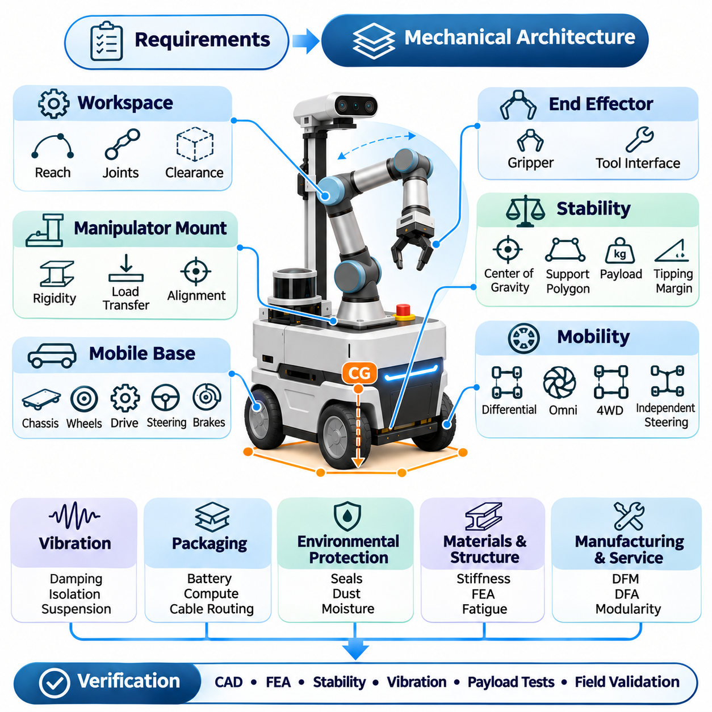{width="7.268055555555556in" height="7.268055555555556in"}

Mechanical architecture defines the structural configuration, mechanical relationships, and physical integration principles of a mobile manipulator. It establishes how the mobile base, robotic arm, end effector, propulsion system, sensor mounts, and supporting structures operate as an integrated mechanical system. Its primary objective is to achieve structural integrity, dynamic stability, operational precision, reliability, and maintainability.

Mechanical architecture development begins with product requirements, functional architecture, physical architecture, and operational constraints. Payload capacity, manipulator reach, positioning accuracy, travel speed, operating environment, and expected service life establish the primary mechanical design conditions. These requirements must be translated into measurable engineering parameters that guide structural configuration and component selection.

The mobile base provides the structural foundation for the entire robotic system. Its mechanical architecture integrates the chassis, wheel assemblies, propulsion mechanisms, steering systems, braking components, and supporting structures. The chassis must withstand static and dynamic loads generated during navigation, acceleration, braking, manipulation, and transportation while maintaining sufficient rigidity for precise robotic operations.

The selection of mobility mechanisms significantly influences overall mechanical performance. Differential drive, omnidirectional drive, four-wheel drive, and independent steering configurations provide different combinations of maneuverability, traction, positioning accuracy, and mechanical complexity. The selected configuration must satisfy operational requirements associated with narrow passages, floor conditions, turning capability, and precise docking.

Structural integration between the mobile base and robotic manipulator requires careful consideration of mounting rigidity, load transmission, and mechanical alignment. Manipulator mounting structures must withstand reaction forces and moments generated during arm movement and object handling. Excessive structural deformation can reduce positional accuracy, introduce vibration, and negatively affect perception and manipulation performance.

Center of gravity management represents a critical aspect of mobile manipulator mechanical architecture. Unlike conventional mobile robots, the distribution of mass changes as the robotic arm extends, rotates, and transports objects. Battery placement, manipulator mounting height, payload distribution, and chassis dimensions must be coordinated to maintain stability throughout the intended operating envelope and prevent overturning.

Static and dynamic stability analysis evaluates the relationship between the combined center of gravity, wheel contact points, acceleration forces, and manipulator-generated moments. Stability margins must be established for representative operating scenarios, including extended arm configurations, maximum payload conditions, emergency braking, and inclined surfaces. Mechanical design and motion restrictions should jointly maintain acceptable stability.

Manipulator integration must consider the relationship between robotic arm geometry and the operational workspace of the mobile platform. Joint configurations, mounting positions, reachability, singularities, and mechanical interference influence task execution capabilities. An optimized arrangement should maximize useful manipulation space while minimizing unnecessary platform repositioning, structural complexity, and collision risks.

End effector integration establishes the mechanical connection between the robotic arm and application-specific tools. Grippers, vacuum systems, inspection instruments, and specialized handling mechanisms introduce additional mass, inertia, and operating forces. Mechanical interfaces must provide adequate rigidity, positioning repeatability, secure attachment, and compatibility with manual or automatic tool-changing mechanisms.

Vibration management is essential for maintaining mechanical reliability, sensor accuracy, and manipulation precision. Motor operation, wheel movement, uneven surfaces, gearbox transmission, and rapid manipulator acceleration can generate mechanical disturbances. Structural reinforcement, damping materials, suspension mechanisms, and vibration isolation should be evaluated to reduce undesirable oscillations without compromising positioning stability.

Mechanical packaging determines the spatial arrangement of batteries, computing equipment, sensors, electrical components, and communication infrastructure. Component placement must balance spatial efficiency, structural accessibility, cooling requirements, cable routing, and weight distribution. Modular packaging should provide sufficient installation clearances and simplify component replacement without requiring extensive mechanical disassembly.

Environmental protection must be incorporated according to the intended operational conditions. Industrial dust, moisture, temperature variation, chemical exposure, mechanical impacts, and uneven surfaces can affect structural durability and component reliability. Protective enclosures, sealing mechanisms, corrosion-resistant materials, drainage provisions, and appropriate ingress protection contribute to long-term operational reliability.

Material selection and structural optimization influence system mass, stiffness, durability, manufacturing complexity, and production costs. Steel, aluminum alloys, engineering plastics, and composite materials provide different mechanical characteristics. Finite Element Analysis (FEA), fatigue analysis, and structural simulations support material selection, reinforcement design, weight reduction, and identification of potential structural failure locations.

Mechanical architecture must support manufacturing, assembly, transportation, and maintenance throughout the product lifecycle. Design for Manufacturing (DFM), Design for Assembly (DFA), standardized fastening methods, modular assemblies, and accessible service interfaces reduce production and maintenance complexity. Mechanical tolerances, alignment procedures, and assembly sequences must be established before production release.

Mechanical architecture verification combines engineering calculations, computer-aided design, multibody dynamics simulation, structural analysis, prototype fabrication, and physical testing. Payload tests, stability assessments, vibration measurements, dimensional inspections, and endurance tests provide evidence that allocated requirements are satisfied. The verified mechanical architecture establishes a reliable foundation for detailed hardware development, subsystem integration, and field validation.

기계 아키텍처(Mechanical Architecture)는 모바일 매니퓰레이터(Mobile Manipulator)의 구조적 구성(Structural Configuration), 기계적 관계(Mechanical Relationship), 물리적 통합 원칙(Physical Integration Principle)을 정의한다. 이동 플랫폼(Mobile Base), 로봇 팔(Robotic Arm), 말단 작동기(End Effector), 추진 시스템(Propulsion System), 센서 장착부(Sensor Mount), 지지 구조물(Supporting Structure)이 하나의 통합된 기계 시스템(Integrated Mechanical System)으로 동작하는 방식을 확립한다. 주요 목적은 구조적 건전성(Structural Integrity), 동적 안정성(Dynamic Stability), 운영 정밀도(Operational Precision), 신뢰성(Reliability), 유지보수성(Maintainability)을 확보하는 것이다.

기계 아키텍처 개발(Mechanical Architecture Development)은 제품 요구사항(Product Requirements), 기능 아키텍처(Functional Architecture), 물리적 아키텍처(Physical Architecture), 운영 제약조건(Operational Constraints)을 기반으로 시작된다. 적재 하중 용량(Payload Capacity), 매니퓰레이터 도달 거리(Manipulator Reach), 위치 결정 정확도(Positioning Accuracy), 이동 속도(Travel Speed), 운영 환경(Operating Environment), 예상 사용 수명(Expected Service Life)은 주요 기계 설계 조건(Mechanical Design Condition)을 구성한다. 이러한 요구사항은 구조적 구성과 구성요소 선정(Component Selection)의 기준이 되는 측정 가능한 엔지니어링 매개변수(Engineering Parameter)로 변환되어야 한다.

이동 플랫폼(Mobile Base)은 전체 로봇 시스템의 구조적 기반(Structural Foundation)을 제공한다. 이동 플랫폼의 기계 아키텍처는 섀시(Chassis), 휠 어셈블리(Wheel Assembly), 추진 메커니즘(Propulsion Mechanism), 조향 시스템(Steering System), 제동 구성요소(Braking Component), 지지 구조물(Supporting Structure)을 통합한다. 섀시는 자율주행(Navigation), 가속(Acceleration), 제동(Braking), 로봇 조작(Manipulation), 운송(Transportation) 과정에서 발생하는 정적 하중(Static Load)과 동적 하중(Dynamic Load)을 견디는 동시에 정밀한 로봇 작업을 수행하기 위한 충분한 강성(Rigidity)을 유지해야 한다.

이동 메커니즘(Mobility Mechanism)의 선정은 전체 기계적 성능(Mechanical Performance)에 상당한 영향을 미친다. 차동 구동(Differential Drive), 전방향 구동(Omnidirectional Drive), 사륜 구동(Four-Wheel Drive, 4WD), 독립 조향(Independent Steering) 구성은 기동성(Maneuverability), 견인력(Traction), 위치 결정 정확도(Positioning Accuracy), 기계적 복잡성(Mechanical Complexity) 측면에서 서로 다른 특성의 조합을 제공한다. 선정된 구성은 좁은 통로(Narrow Passage), 바닥 상태(Floor Condition), 회전 능력(Turning Capability), 정밀 도킹(Precise Docking)과 관련된 운영 요구사항(Operational Requirements)을 충족해야 한다.

이동 플랫폼과 로봇 매니퓰레이터(Robotic Manipulator) 사이의 구조적 통합(Structural Integration)에는 장착 강성(Mounting Rigidity), 하중 전달(Load Transmission), 기계적 정렬(Mechanical Alignment)에 대한 신중한 고려가 필요하다. 매니퓰레이터 장착 구조물(Manipulator Mounting Structure)은 로봇 팔의 움직임과 객체 취급(Object Handling) 과정에서 발생하는 반력(Reaction Force) 및 모멘트(Moment)를 견딜 수 있어야 한다. 과도한 구조적 변형(Structural Deformation)은 위치 정확도(Positional Accuracy)를 감소시키고 진동(Vibration)을 발생시키며, 인식 및 로봇 조작 성능(Perception and Manipulation Performance)에 부정적인 영향을 미칠 수 있다.

무게중심 관리(Center of Gravity Management)는 모바일 매니퓰레이터 기계 아키텍처의 핵심적인 요소에 해당한다. 기존의 이동 로봇(Mobile Robot)과 달리 로봇 팔이 확장되거나 회전하고 객체를 운반함에 따라 질량 분포(Mass Distribution)가 변화한다. 배터리 배치(Battery Placement), 매니퓰레이터 장착 높이(Manipulator Mounting Height), 적재 하중 분포(Payload Distribution), 섀시 치수(Chassis Dimensions)는 의도된 전체 운영 범위(Operating Envelope)에서 안정성(Stability)을 유지하고 전복(Overturning)을 방지할 수 있도록 상호 조정되어야 한다.

정적 및 동적 안정성 분석(Static and Dynamic Stability Analysis)은 전체 시스템의 무게중심(Combined Center of Gravity), 휠 접촉점(Wheel Contact Point), 가속력(Acceleration Force), 매니퓰레이터에서 발생하는 모멘트(Manipulator-Generated Moment) 사이의 관계를 평가한다. 안정성 여유(Stability Margin)는 로봇 팔의 확장 상태(Extended Arm Configuration), 최대 적재 하중 조건(Maximum Payload Condition), 비상 제동(Emergency Braking), 경사면(Inclined Surface)을 포함하는 대표적인 운영 시나리오(Operational Scenario)에 대해 확립되어야 한다. 기계 설계(Mechanical Design)와 동작 제한(Motion Restriction)은 상호 보완적으로 허용 가능한 안정성을 유지해야 한다.

매니퓰레이터 통합(Manipulator Integration)은 로봇 팔의 기하학적 구조(Robotic Arm Geometry)와 이동 플랫폼의 운영 작업공간(Operational Workspace) 사이의 관계를 고려해야 한다. 관절 구성(Joint Configuration), 장착 위치(Mounting Position), 도달 가능성(Reachability), 특이점(Singularity), 기계적 간섭(Mechanical Interference)은 작업 실행 능력(Task Execution Capability)에 영향을 미친다. 최적화된 배치(Optimized Arrangement)는 불필요한 이동 플랫폼의 위치 재설정(Platform Repositioning), 구조적 복잡성(Structural Complexity), 충돌 위험(Collision Risk)을 최소화하면서 실제 활용 가능한 조작 작업공간(Manipulation Workspace)을 최대화해야 한다.

말단 작동기 통합(End Effector Integration)은 로봇 팔과 응용 분야별 특수 도구(Application-Specific Tool) 사이의 기계적 연결(Mechanical Connection)을 확립한다. 그리퍼(Gripper), 진공 시스템(Vacuum System), 검사 장비(Inspection Instrument), 특수 취급 메커니즘(Specialized Handling Mechanism)은 추가적인 질량(Mass), 관성(Inertia), 작동력(Operating Force)을 발생시킨다. 기계적 인터페이스(Mechanical Interface)는 충분한 강성(Rigidity), 위치 결정 반복 정밀도(Positioning Repeatability), 견고한 체결(Secure Attachment), 수동 또는 자동 도구 교환 메커니즘(Manual or Automatic Tool-Changing Mechanism)과의 호환성(Compatibility)을 제공해야 한다.

진동 관리(Vibration Management)는 기계적 신뢰성(Mechanical Reliability), 센서 정확도(Sensor Accuracy), 조작 정밀도(Manipulation Precision)를 유지하는 데 필수적이다. 모터 동작(Motor Operation), 휠 이동(Wheel Movement), 불균일한 지면(Uneven Surface), 기어박스 동력 전달(Gearbox Transmission), 매니퓰레이터의 급격한 가속(Manipulator Acceleration)은 기계적 외란(Mechanical Disturbance)을 발생시킬 수 있다. 구조적 보강(Structural Reinforcement), 감쇠 재료(Damping Material), 현가장치 메커니즘(Suspension Mechanism), 진동 절연(Vibration Isolation)은 위치 결정 안정성(Positioning Stability)을 저하시키지 않으면서 불필요한 진동을 감소시킬 수 있도록 평가되어야 한다.

기계적 패키징(Mechanical Packaging)은 배터리(Battery), 컴퓨팅 장비(Computing Equipment), 센서(Sensor), 전기 구성요소(Electrical Component), 통신 인프라(Communication Infrastructure)의 공간적 배치(Spatial Arrangement)를 결정한다. 구성요소 배치(Component Placement)는 공간 효율성(Spatial Efficiency), 구조적 접근성(Structural Accessibility), 냉각 요구사항(Cooling Requirements), 케이블 배선 경로(Cable Routing), 중량 분포(Weight Distribution) 사이의 균형을 유지해야 한다. 모듈형 패키징(Modular Packaging)은 충분한 설치 여유 공간(Installation Clearance)을 제공하고 대규모 기계적 분해(Mechanical Disassembly) 없이 구성요소를 쉽게 교체할 수 있도록 해야 한다.

환경 보호(Environmental Protection)는 의도된 운영 조건(Operational Conditions)에 따라 기계 설계에 반영되어야 한다. 산업용 분진(Industrial Dust), 습기(Moisture), 온도 변화(Temperature Variation), 화학물질 노출(Chemical Exposure), 기계적 충격(Mechanical Impact), 불균일한 지면(Uneven Surface)은 구조적 내구성(Structural Durability)과 구성요소 신뢰성(Component Reliability)에 영향을 미칠 수 있다. 보호 외함(Protective Enclosure), 밀봉 메커니즘(Sealing Mechanism), 내부식성 재료(Corrosion-Resistant Material), 배수 구조(Drainage Provision), 적절한 방진·방수 보호(Ingress Protection)는 장기적인 운영 신뢰성(Long-Term Operational Reliability)을 확보하는 데 기여한다.

재료 선정(Material Selection)과 구조 최적화(Structural Optimization)는 시스템 질량(System Mass), 강성(Stiffness), 내구성(Durability), 제조 복잡성(Manufacturing Complexity), 생산 비용(Production Cost)에 영향을 미친다. 철강(Steel), 알루미늄 합금(Aluminum Alloy), 엔지니어링 플라스틱(Engineering Plastic), 복합재료(Composite Material)는 서로 다른 기계적 특성(Mechanical Characteristics)을 제공한다. 유한요소해석(Finite Element Analysis, FEA), 피로 해석(Fatigue Analysis), 구조 시뮬레이션(Structural Simulation)은 재료 선정, 보강 설계(Reinforcement Design), 경량화(Weight Reduction), 잠재적인 구조적 파손 위치(Structural Failure Location)의 식별을 지원한다.

기계 아키텍처는 제품 수명주기(Product Lifecycle) 전반에 걸쳐 제조(Manufacturing), 조립(Assembly), 운송(Transportation), 유지보수(Maintenance)를 지원해야 한다. 제조 용이성 설계(Design for Manufacturing, DFM), 조립 용이성 설계(Design for Assembly, DFA), 표준화된 체결 방식(Standardized Fastening Method), 모듈형 어셈블리(Modular Assembly), 접근 가능한 정비 인터페이스(Accessible Service Interface)는 생산 및 유지보수 복잡성(Production and Maintenance Complexity)을 감소시킨다. 기계적 공차(Mechanical Tolerance), 정렬 절차(Alignment Procedure), 조립 순서(Assembly Sequence)는 생산 승인(Production Release) 이전에 확립되어야 한다.

기계 아키텍처 검증(Mechanical Architecture Verification)은 엔지니어링 계산(Engineering Calculation), 컴퓨터 지원 설계(Computer-Aided Design, CAD), 다물체 동역학 시뮬레이션(Multibody Dynamics Simulation), 구조 해석(Structural Analysis), 시제품 제작(Prototype Fabrication), 물리적 시험(Physical Testing)을 결합한다. 적재 하중 시험(Payload Test), 안정성 평가(Stability Assessment), 진동 측정(Vibration Measurement), 치수 검사(Dimensional Inspection), 내구성 시험(Endurance Test)은 할당된 요구사항이 충족되었음을 입증하는 근거를 제공한다. 검증된 기계 아키텍처는 상세 하드웨어 개발(Detailed Hardware Development), 하위 시스템 통합(Subsystem Integration), 현장 유효성 검증(Field Validation)을 위한 신뢰할 수 있는 기반을 확립한다.

##  

## 05 Electrical Architecture

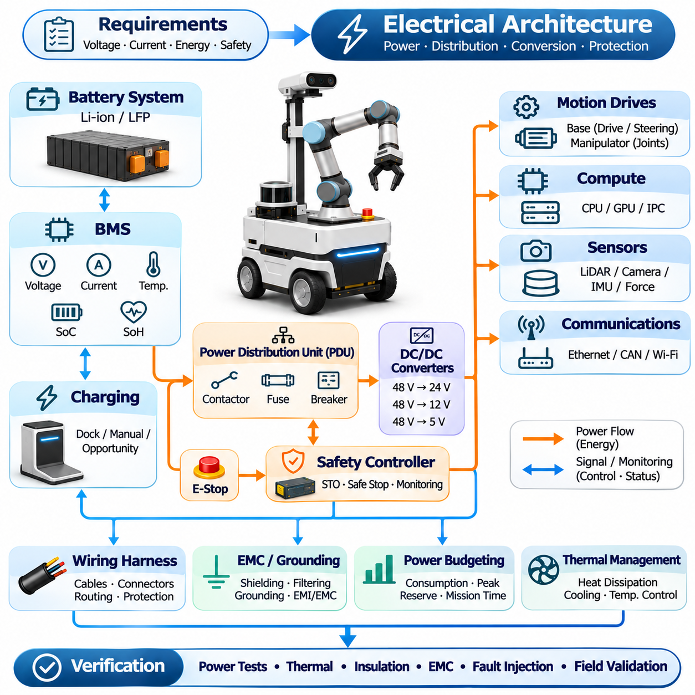{width="7.268055555555556in" height="7.268055555555556in"}

Electrical architecture defines the electrical configuration, power distribution structure, signal connectivity, and protection mechanisms of a mobile manipulator. It integrates the mobile base, robotic manipulator, end effector, sensors, computing platforms, communication equipment, and safety devices into a coordinated electrical system. Its primary objective is to ensure reliable, efficient, safe, and maintainable operation.

Electrical architecture development begins with product requirements, functional architecture, physical architecture, and mechanical design constraints. Operating voltage, maximum current, energy consumption, actuator characteristics, environmental conditions, and safety requirements establish the principal electrical design parameters. These parameters guide component selection, electrical interface definition, and subsystem integration.

The battery system provides the primary electrical energy source for autonomous operation. Lithium-ion and Lithium Iron Phosphate (LFP) batteries offer different combinations of energy density, power capability, thermal stability, and service life. Battery capacity must be determined according to mission duration, propulsion energy consumption, manipulation workloads, computing requirements, charging availability, and operational reserve requirements.

The Battery Management System (BMS) continuously monitors battery voltage, current, temperature, State of Charge (SoC), and State of Health (SoH). It manages cell balancing and supports protection against overcharging, excessive discharge, overcurrent, and abnormal thermal conditions. Battery status information must be communicated to mission management and supervisory controllers to support energy-aware operation.

Power distribution architecture establishes how electrical energy is transferred from the battery system to individual subsystems. Power Distribution Units (PDUs), contactors, relays, fuses, circuit breakers, and distribution terminals provide controlled electrical connectivity. Independent power branches should support fault isolation, maintenance accessibility, and differentiated protection according to subsystem characteristics.

Voltage conversion and regulation are required because mobile manipulators typically incorporate components with different operating voltage requirements. DC/DC converters supply regulated power to embedded controllers, sensors, communication devices, and computing equipment. Voltage domains must be defined according to electrical compatibility, conversion efficiency, transient response, isolation requirements, and maximum load conditions.

The propulsion and manipulation systems represent major electrical loads within the mobile manipulator. Motor drivers, servo amplifiers, steering actuators, robotic joint controllers, and braking mechanisms must be coordinated with the available electrical supply. Peak current demand, simultaneous actuator operation, regenerative energy, acceleration profiles, and emergency braking conditions must be considered during electrical design.

Computing and sensor power architecture must provide stable electrical conditions for reliable data acquisition and processing. Embedded computers, GPU accelerators, cameras, LiDAR sensors, and communication equipment may be sensitive to voltage fluctuations and electrical disturbances. Dedicated regulated power branches, appropriate filtering, and coordinated startup sequences help prevent unexpected resets and operational interruptions.

Electrical protection mechanisms reduce the risks associated with short circuits, overloads, reverse polarity, voltage transients, insulation failures, and abnormal operating conditions. Protective devices must be selected according to operating voltage, current characteristics, fault energy, and equipment limitations. Protection coordination should prevent localized electrical failures from unnecessarily disabling unaffected subsystems.

Safety-related electrical architecture integrates emergency stop circuits, safety controllers, protective sensors, and safety-rated actuator interfaces. Safe Torque Off (STO), contactor monitoring, and controlled stopping mechanisms may be incorporated according to the system risk assessment. Safety-related circuits must achieve the required safety integrity and remain appropriately independent of ordinary computational and communication functions.

Wiring harness architecture establishes the physical electrical connections between distributed system components. Cable sizing, conductor insulation, connector selection, terminal specifications, shielding, and grounding arrangements must satisfy electrical and environmental requirements. Harness routing must accommodate moving joints, mechanical vibration, bending radius limitations, maintenance activities, and potential abrasion.

Electromagnetic Compatibility (EMC) is essential because high-power motor drives, switching converters, wireless communication modules, and sensitive electronic equipment operate within a compact platform. Grounding strategies, cable shielding, electrical segregation, filtering, and enclosure design must minimize conducted and radiated interference. EMC performance should be evaluated under representative operating conditions.

Charging architecture defines the electrical interfaces and control mechanisms required for battery replenishment. Manual charging, automatic docking stations, and opportunity charging may be selected according to operational requirements. Charging systems must coordinate voltage and current limits, connection verification, communication handshakes, electrical protection, and safe transitions between charging and autonomous operation.

Electrical energy budgeting evaluates continuous power consumption, peak electrical demand, conversion losses, auxiliary loads, and thermal dissipation throughout representative missions. Sufficient design margins must accommodate component tolerances, battery degradation, environmental variations, and future subsystem expansion. Power consumption measurements provide essential feedback for architectural optimization.

Electrical architecture must support manufacturing, assembly, inspection, troubleshooting, and maintenance throughout the product lifecycle. Standardized connectors, clearly identified wiring harnesses, accessible protection devices, modular electrical assemblies, and documented connection interfaces improve serviceability. Electrical schematics, power distribution diagrams, and interface specifications must remain under configuration control.

Electrical architecture verification combines circuit analysis, power consumption measurements, thermal testing, insulation testing, electromagnetic compatibility assessments, and fault injection. Representative operating scenarios should include simultaneous navigation and manipulation, charging transitions, peak computational workloads, and abnormal electrical conditions. Verified results establish the foundation for detailed electrical development, system integration, and field validation.

전기 아키텍처(Electrical Architecture)는 모바일 매니퓰레이터(Mobile Manipulator)의 전기적 구성(Electrical Configuration), 전력 분배 구조(Power Distribution Structure), 신호 연결성(Signal Connectivity), 보호 메커니즘(Protection Mechanism)을 정의한다. 이동 플랫폼(Mobile Base), 로봇 매니퓰레이터(Robotic Manipulator), 말단 작동기(End Effector), 센서(Sensor), 컴퓨팅 플랫폼(Computing Platform), 통신 장비(Communication Equipment), 안전 장치(Safety Device)를 하나의 유기적으로 연결된 전기 시스템(Electrical System)으로 통합한다. 주요 목적은 신뢰성(Reliability), 효율성(Efficiency), 안전성(Safety), 유지보수성(Maintainability)을 갖춘 운영을 보장하는 것이다.

전기 아키텍처 개발(Electrical Architecture Development)은 제품 요구사항(Product Requirements), 기능 아키텍처(Functional Architecture), 물리적 아키텍처(Physical Architecture), 기계 설계 제약조건(Mechanical Design Constraints)을 기반으로 시작된다. 동작 전압(Operating Voltage), 최대 전류(Maximum Current), 에너지 소비량(Energy Consumption), 작동기 특성(Actuator Characteristics), 환경 조건(Environmental Conditions), 안전 요구사항(Safety Requirements)은 주요 전기 설계 매개변수(Electrical Design Parameter)를 구성한다. 이러한 매개변수는 구성요소 선정(Component Selection), 전기적 인터페이스 정의(Electrical Interface Definition), 하위 시스템 통합(Subsystem Integration)의 기준이 된다.

배터리 시스템(Battery System)은 자율 운영(Autonomous Operation)을 위한 주요 전기 에너지원(Electrical Energy Source)을 제공한다. 리튬이온 배터리(Lithium-Ion Battery)와 리튬인산철 배터리(Lithium Iron Phosphate Battery, LFP)는 에너지 밀도(Energy Density), 전력 공급 능력(Power Capability), 열적 안정성(Thermal Stability), 사용 수명(Service Life) 측면에서 서로 다른 특성의 조합을 제공한다. 배터리 용량(Battery Capacity)은 임무 지속시간(Mission Duration), 추진 에너지 소비량(Propulsion Energy Consumption), 조작 작업부하(Manipulation Workload), 컴퓨팅 요구사항(Computing Requirements), 충전 가용성(Charging Availability), 운영 예비 에너지 요구사항(Operational Reserve Requirements)에 따라 결정되어야 한다.

배터리 관리 시스템(Battery Management System, BMS)은 배터리 전압(Battery Voltage), 전류(Current), 온도(Temperature), 충전 상태(State of Charge, SoC), 건전성 상태(State of Health, SoH)를 지속적으로 모니터링한다. 또한 셀 밸런싱(Cell Balancing)을 관리하고 과충전(Overcharging), 과방전(Excessive Discharge), 과전류(Overcurrent), 비정상적인 열적 상태(Abnormal Thermal Condition)에 대한 보호 기능을 지원한다. 배터리 상태 정보(Battery Status Information)는 에너지 인식 기반 운영(Energy-Aware Operation)을 지원하기 위해 임무 관리 시스템(Mission Management System)과 상위 감독 제어기(Supervisory Controller)에 전달되어야 한다.

전력 분배 아키텍처(Power Distribution Architecture)는 배터리 시스템에서 개별 하위 시스템으로 전기 에너지(Electrical Energy)가 전달되는 방식을 정의한다. 전력 분배 장치(Power Distribution Unit, PDU), 접촉기(Contactor), 릴레이(Relay), 퓨즈(Fuse), 회로 차단기(Circuit Breaker), 분배 단자(Distribution Terminal)는 제어된 전기적 연결성(Controlled Electrical Connectivity)을 제공한다. 독립적인 전력 분기 회로(Independent Power Branch)는 하위 시스템의 특성에 따라 장애 격리(Fault Isolation), 유지보수 접근성(Maintenance Accessibility), 차등화된 보호 기능(Differentiated Protection)을 지원해야 한다.

모바일 매니퓰레이터는 일반적으로 서로 다른 동작 전압 요구사항(Operating Voltage Requirements)을 가진 구성요소를 포함하기 때문에 전압 변환(Voltage Conversion)과 전압 안정화(Voltage Regulation)가 필요하다. 직류 변환기(DC/DC Converter)는 임베디드 제어기(Embedded Controller), 센서, 통신 장치(Communication Device), 컴퓨팅 장비(Computing Equipment)에 안정화된 전력(Regulated Power)을 공급한다. 전압 영역(Voltage Domain)은 전기적 호환성(Electrical Compatibility), 변환 효율(Conversion Efficiency), 과도 응답(Transient Response), 전기적 절연 요구사항(Isolation Requirements), 최대 부하 조건(Maximum Load Condition)에 따라 정의되어야 한다.

추진 시스템(Propulsion System)과 조작 시스템(Manipulation System)은 모바일 매니퓰레이터 내부에서 주요 전기 부하(Electrical Load)를 구성한다. 모터 드라이버(Motor Driver), 서보 증폭기(Servo Amplifier), 조향 작동기(Steering Actuator), 로봇 관절 제어기(Robotic Joint Controller), 제동 메커니즘(Braking Mechanism)은 가용 전력 공급원(Available Electrical Supply)과 연계되어야 한다. 전기 설계 과정에서는 최대 전류 요구량(Peak Current Demand), 동시 작동기 구동(Simultaneous Actuator Operation), 회생 에너지(Regenerative Energy), 가속 프로파일(Acceleration Profile), 비상 제동 조건(Emergency Braking Condition)을 고려해야 한다.

컴퓨팅 및 센서 전력 아키텍처(Computing and Sensor Power Architecture)는 신뢰성 있는 데이터 획득(Data Acquisition)과 데이터 처리(Data Processing)를 위해 안정적인 전기적 조건(Electrical Condition)을 제공해야 한다. 임베디드 컴퓨터(Embedded Computer), GPU 가속기(GPU Accelerator), 카메라(Camera), 라이다 센서(LiDAR Sensor), 통신 장비는 전압 변동(Voltage Fluctuation)과 전기적 외란(Electrical Disturbance)에 민감할 수 있다. 전용 안정화 전력 분기 회로(Dedicated Regulated Power Branch), 적절한 필터링(Filtering), 조정된 시동 순서(Coordinated Startup Sequence)는 예기치 않은 재설정(Unexpected Reset)과 운영 중단(Operational Interruption)을 방지하는 데 기여한다.

전기적 보호 메커니즘(Electrical Protection Mechanism)은 단락(Short Circuit), 과부하(Overload), 역극성(Reverse Polarity), 과도 전압(Voltage Transient), 절연 고장(Insulation Failure), 비정상적인 운영 조건(Abnormal Operating Condition)과 관련된 위험을 감소시킨다. 보호 장치(Protective Device)는 동작 전압, 전류 특성(Current Characteristics), 고장 에너지(Fault Energy), 장비의 허용 한계(Equipment Limitation)에 따라 선정되어야 한다. 보호 협조(Protection Coordination)는 국부적인 전기적 고장(Localized Electrical Failure)이 영향을 받지 않은 다른 하위 시스템까지 불필요하게 비활성화하는 것을 방지해야 한다.

안전 관련 전기 아키텍처(Safety-Related Electrical Architecture)는 비상 정지 회로(Emergency Stop Circuit), 안전 제어기(Safety Controller), 보호 센서(Protective Sensor), 안전 등급 작동기 인터페이스(Safety-Rated Actuator Interface)를 통합한다. 안전 토크 차단(Safe Torque Off, STO), 접촉기 모니터링(Contactor Monitoring), 제어된 정지 메커니즘(Controlled Stopping Mechanism)은 시스템 위험성 평가(System Risk Assessment) 결과에 따라 적용될 수 있다. 안전 관련 회로(Safety-Related Circuit)는 요구되는 안전 무결성(Safety Integrity)을 확보해야 하며, 일반적인 컴퓨팅 및 통신 기능(Computational and Communication Function)으로부터 적절한 독립성을 유지해야 한다.

와이어링 하네스 아키텍처(Wiring Harness Architecture)는 분산된 시스템 구성요소 사이의 물리적 전기 연결(Physical Electrical Connection)을 확립한다. 케이블 규격 선정(Cable Sizing), 도체 절연(Conductor Insulation), 커넥터 선정(Connector Selection), 단자 사양(Terminal Specification), 차폐(Shielding), 접지 구성(Grounding Arrangement)은 전기적 요구사항(Electrical Requirements)과 환경 요구사항(Environmental Requirements)을 충족해야 한다. 하네스 배선 경로(Harness Routing)는 움직이는 관절(Moving Joint), 기계적 진동(Mechanical Vibration), 굽힘 반경 제한(Bending Radius Limitation), 유지보수 활동(Maintenance Activity), 잠재적인 마모(Abrasion)를 고려해야 한다.

전자기 적합성(Electromagnetic Compatibility, EMC)은 고출력 모터 드라이브(High-Power Motor Drive), 스위칭 변환기(Switching Converter), 무선 통신 모듈(Wireless Communication Module), 민감한 전자 장비(Sensitive Electronic Equipment)가 제한된 공간의 플랫폼 내부에서 동작하기 때문에 필수적이다. 접지 전략(Grounding Strategy), 케이블 차폐(Cable Shielding), 전기적 분리(Electrical Segregation), 필터링(Filtering), 외함 설계(Enclosure Design)는 전도성 간섭(Conducted Interference)과 방사성 간섭(Radiated Interference)을 최소화해야 한다. 전자기 적합성 성능(EMC Performance)은 실제 운영을 대표하는 조건에서 평가되어야 한다.

충전 아키텍처(Charging Architecture)는 배터리 에너지 보충(Battery Replenishment)에 필요한 전기적 인터페이스(Electrical Interface)와 제어 메커니즘(Control Mechanism)을 정의한다. 수동 충전(Manual Charging), 자동 도킹 스테이션(Automatic Docking Station), 기회 충전(Opportunity Charging)은 운영 요구사항(Operational Requirements)에 따라 선정될 수 있다. 충전 시스템(Charging System)은 전압 및 전류 제한(Voltage and Current Limit), 연결 검증(Connection Verification), 통신 핸드셰이크(Communication Handshake), 전기적 보호(Electrical Protection), 충전과 자율 운영 사이의 안전한 상태 전이(Safe State Transition)를 상호 조정해야 한다.

전기 에너지 예산 수립(Electrical Energy Budgeting)은 대표적인 임무 수행 과정에서 지속 전력 소비량(Continuous Power Consumption), 최대 전력 요구량(Peak Electrical Demand), 변환 손실(Conversion Loss), 보조 부하(Auxiliary Load), 열 방출(Thermal Dissipation)을 평가한다. 충분한 설계 여유(Design Margin)는 구성요소 공차(Component Tolerance), 배터리 성능 저하(Battery Degradation), 환경 변화(Environmental Variation), 향후 하위 시스템 확장(Subsystem Expansion)을 수용할 수 있어야 한다. 전력 소비량 측정(Power Consumption Measurement)은 아키텍처 최적화(Architecture Optimization)를 위한 필수적인 피드백(Feedback)을 제공한다.

전기 아키텍처는 제품 수명주기(Product Lifecycle) 전반에 걸쳐 제조(Manufacturing), 조립(Assembly), 검사(Inspection), 문제 해결(Troubleshooting), 유지보수(Maintenance)를 지원해야 한다. 표준화된 커넥터(Standardized Connector), 명확하게 식별된 와이어링 하네스(Identified Wiring Harness), 접근 가능한 보호 장치(Accessible Protection Device), 모듈형 전기 어셈블리(Modular Electrical Assembly), 문서화된 연결 인터페이스(Documented Connection Interface)는 정비 용이성(Serviceability)을 향상시킨다. 전기 회로도(Electrical Schematic), 전력 분배도(Power Distribution Diagram), 인터페이스 사양(Interface Specification)은 형상 관리(Configuration Control) 체계 내에서 지속적으로 관리되어야 한다.

전기 아키텍처 검증(Electrical Architecture Verification)은 회로 해석(Circuit Analysis), 전력 소비량 측정(Power Consumption Measurement), 열 시험(Thermal Testing), 절연 시험(Insulation Testing), 전자기 적합성 평가(Electromagnetic Compatibility Assessment), 고장 주입 시험(Fault Injection)을 결합한다. 대표적인 운영 시나리오(Operational Scenario)에는 동시 자율주행 및 로봇 조작(Simultaneous Navigation and Manipulation), 충전 상태 전이(Charging Transition), 최대 컴퓨팅 작업부하(Peak Computational Workload), 비정상적인 전기적 조건(Abnormal Electrical Condition)이 포함되어야 한다. 검증된 결과는 상세 전기 시스템 개발(Detailed Electrical Development), 시스템 통합(System Integration), 현장 유효성 검증(Field Validation)을 위한 기반을 확립한다.

##  

## 06 Sensor Architecture

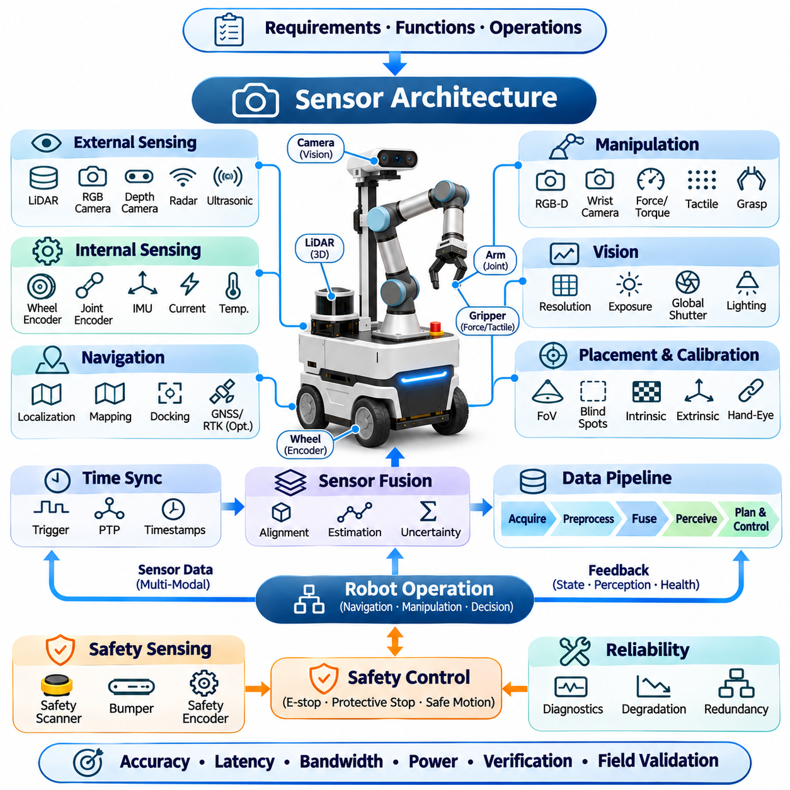{width="7.268055555555556in" height="7.268055555555556in"}

Sensor architecture defines the sensing configuration, measurement principles, data acquisition mechanisms, and integration relationships required for a mobile manipulator to understand its physical environment and internal operating conditions. It establishes a unified framework for autonomous navigation, robotic manipulation, environmental perception, intelligent decision-making, and safety monitoring through coordinated sensing capabilities.

Sensor architecture development begins with product requirements, functional architecture, physical architecture, and operational scenarios. Navigation accuracy, manipulation precision, object recognition performance, environmental conditions, and safety requirements establish the primary sensing requirements. These requirements must be translated into measurable specifications for sensor selection, placement, calibration, and integration.

Exteroceptive sensors acquire information about the external environment surrounding the mobile manipulator. LiDAR sensors, RGB cameras, depth cameras, radar sensors, and ultrasonic sensors provide different combinations of spatial, visual, and proximity information. Sensor selection must consider measurement range, spatial resolution, field of view, environmental robustness, acquisition frequency, and application-specific perception requirements.

Proprioceptive sensors provide information about the internal physical state of the mobile manipulator. Wheel encoders, joint encoders, inertial measurement units, motor current sensors, and temperature sensors support motion estimation, actuator monitoring, and system diagnostics. Accurate internal state measurements are essential for feedback control, dynamic compensation, localization, and reliable coordination between mobility and manipulation.

Navigation sensor architecture supports localization, mapping, obstacle detection, autonomous movement, and precise docking. Two-dimensional and three-dimensional LiDAR, inertial measurement units, wheel encoders, and visual sensors provide complementary measurements for estimating platform position and orientation. Outdoor applications may additionally incorporate Global Navigation Satellite System receivers with Real-Time Kinematic positioning.

Manipulation sensor architecture provides detailed information about target objects, surrounding structures, and physical interactions. RGB-D cameras, stereo cameras, wrist-mounted vision systems, force-torque sensors, and tactile sensors support object detection, six-dimensional pose estimation, grasp planning, and contact monitoring. Sensor configurations must satisfy the spatial accuracy and response requirements of intended manipulation tasks.

Vision sensor architecture must consider image resolution, acquisition frequency, exposure control, shutter characteristics, lens selection, and illumination conditions. Global shutter cameras are particularly useful when motion-induced image distortion must be minimized. Camera placement and optical configurations should provide sufficient visual coverage while reducing occlusion caused by the robotic arm, end effector, or transported objects.

Sensor placement establishes the spatial relationships between individual sensing devices and the mechanical structure of the mobile manipulator. Mounting locations must consider field of view, blind spots, mechanical interference, vibration, environmental exposure, and maintenance accessibility. Overlapping sensing regions can improve environmental coverage and provide complementary measurements when individual sensors experience performance degradation.

Sensor calibration establishes accurate relationships between sensor measurements and system reference coordinate frames. Intrinsic calibration determines internal sensor parameters, while extrinsic calibration determines spatial transformations between sensors, the mobile base, and the robotic arm. Hand-eye calibration is particularly important for translating visual observations into accurate manipulator motions within a shared coordinate system.

Temporal synchronization ensures that measurements acquired from distributed sensors correspond to consistent physical operating states. Hardware triggering, Precision Time Protocol (PTP), synchronized system clocks, and timestamp-based alignment may be employed according to timing requirements. Synchronization errors can reduce localization accuracy, distort spatial reconstruction, and introduce significant errors during dynamic manipulation.

Sensor fusion combines complementary measurements to improve the accuracy, consistency, and robustness of environmental perception and state estimation. Kalman filtering, probabilistic estimation, geometric registration, and deep learning techniques may support different fusion requirements. Fusion mechanisms must account for sensor uncertainty, measurement frequency, spatial alignment, temporal differences, and changing environmental conditions.

Sensor data acquisition architecture defines how measurements are collected, transmitted, processed, and distributed to downstream applications. Communication interfaces must support required bandwidth, acquisition frequency, timestamp precision, and data integrity. Distributed preprocessing and onboard computing resources can reduce communication overhead while preserving information required for perception, planning, and control.

Safety sensor architecture supports the detection of hazardous conditions associated with autonomous movement and robotic manipulation. Safety-rated laser scanners, protective bumpers, safety encoders, and other protective sensing devices may be integrated according to risk assessment results. Safety-related sensing functions must satisfy the required safety performance independently of ordinary AI perception wherever necessary.

Sensor reliability management must address environmental interference, contamination, calibration drift, communication failure, and unexpected measurement degradation. Diagnostic mechanisms should monitor data availability, measurement consistency, sensor temperature, communication status, and confidence indicators. Redundant or complementary sensing capabilities may support controlled operational degradation when individual sensors become unavailable.

Sensor architecture must establish engineering budgets for measurement accuracy, end-to-end latency, communication bandwidth, computational demand, electrical power, and installation space. Modular sensor interfaces and documented calibration procedures improve maintainability, component replacement, and future system expansion. Sensor specifications and configuration parameters must remain traceable to system requirements.

Sensor architecture verification combines calibration tests, measurement accuracy assessments, synchronization analysis, environmental testing, and integrated perception validation. Representative scenarios must include variable illumination, moving objects, sensor occlusion, vibration, and degraded sensing conditions. The verified sensor architecture establishes a reliable foundation for detailed sensor integration, AI development, autonomous navigation, robotic manipulation, and field validation.

센서 아키텍처(Sensor Architecture)는 모바일 매니퓰레이터(Mobile Manipulator)가 물리적 환경과 내부 운영 상태를 이해하는 데 필요한 센서 구성(Sensing Configuration), 측정 원리(Measurement Principle), 데이터 획득 메커니즘(Data Acquisition Mechanism), 통합 관계(Integration Relationship)를 정의한다. 상호 조정된 센싱 기능(Sensing Capability)을 통해 자율주행(Autonomous Navigation), 로봇 조작(Robotic Manipulation), 환경 인식(Environmental Perception), 지능형 의사결정(Intelligent Decision-Making), 안전 모니터링(Safety Monitoring)을 지원하는 통합 프레임워크(Unified Framework)를 확립한다.

센서 아키텍처 개발(Sensor Architecture Development)은 제품 요구사항(Product Requirements), 기능 아키텍처(Functional Architecture), 물리적 아키텍처(Physical Architecture), 운영 시나리오(Operational Scenario)를 기반으로 시작된다. 자율주행 정확도(Navigation Accuracy), 조작 정밀도(Manipulation Precision), 객체 인식 성능(Object Recognition Performance), 환경 조건(Environmental Conditions), 안전 요구사항(Safety Requirements)은 주요 센싱 요구사항(Sensing Requirements)을 구성한다. 이러한 요구사항은 센서 선정(Sensor Selection), 배치(Placement), 보정(Calibration), 통합(Integration)을 위한 측정 가능한 사양(Measurable Specification)으로 변환되어야 한다.

외부 감각 센서(Exteroceptive Sensor)는 모바일 매니퓰레이터를 둘러싼 외부 환경(External Environment)에 대한 정보를 획득한다. 라이다 센서(LiDAR Sensor), RGB 카메라(RGB Camera), 깊이 카메라(Depth Camera), 레이더 센서(Radar Sensor), 초음파 센서(Ultrasonic Sensor)는 공간 정보(Spatial Information), 시각 정보(Visual Information), 근접 정보(Proximity Information)의 서로 다른 조합을 제공한다. 센서 선정은 측정 범위(Measurement Range), 공간 해상도(Spatial Resolution), 시야각(Field of View, FoV), 환경 강건성(Environmental Robustness), 데이터 획득 주기(Acquisition Frequency), 응용 분야별 인식 요구사항(Application-Specific Perception Requirements)을 고려해야 한다.

고유 감각 센서(Proprioceptive Sensor)는 모바일 매니퓰레이터의 내부 물리적 상태(Internal Physical State)에 대한 정보를 제공한다. 휠 엔코더(Wheel Encoder), 관절 엔코더(Joint Encoder), 관성 측정 장치(Inertial Measurement Unit, IMU), 모터 전류 센서(Motor Current Sensor), 온도 센서(Temperature Sensor)는 동작 추정(Motion Estimation), 작동기 모니터링(Actuator Monitoring), 시스템 진단(System Diagnostics)을 지원한다. 정확한 내부 상태 측정(Internal State Measurement)은 피드백 제어(Feedback Control), 동적 보상(Dynamic Compensation), 위치 추정(Localization), 이동과 조작 사이의 신뢰성 있는 협조(Coordination)를 위해 필수적이다.

자율주행 센서 아키텍처(Navigation Sensor Architecture)는 위치 추정(Localization), 지도 생성(Mapping), 장애물 검출(Obstacle Detection), 자율 이동(Autonomous Movement), 정밀 도킹(Precise Docking)을 지원한다. 2차원 및 3차원 라이다(Two-Dimensional and Three-Dimensional LiDAR), 관성 측정 장치(Inertial Measurement Unit), 휠 엔코더(Wheel Encoder), 시각 센서(Visual Sensor)는 이동 플랫폼의 위치(Position)와 방향(Orientation)을 추정하기 위한 상호보완적인 측정값을 제공한다. 실외 응용 분야(Outdoor Application)에서는 실시간 이동 측위(Real-Time Kinematic, RTK) 기능을 갖춘 위성항법시스템(Global Navigation Satellite System, GNSS) 수신기를 추가적으로 통합할 수 있다.

조작 센서 아키텍처(Manipulation Sensor Architecture)는 대상 객체(Target Object), 주변 구조물(Surrounding Structure), 물리적 상호작용(Physical Interaction)에 대한 상세한 정보를 제공한다. RGB-D 카메라(RGB-D Camera), 스테레오 카메라(Stereo Camera), 손목 장착형 비전 시스템(Wrist-Mounted Vision System), 힘·토크 센서(Force-Torque Sensor), 촉각 센서(Tactile Sensor)는 객체 검출(Object Detection), 6차원 자세 추정(Six-Dimensional Pose Estimation, 6D Pose Estimation), 파지 계획(Grasp Planning), 접촉 모니터링(Contact Monitoring)을 지원한다. 센서 구성은 의도된 로봇 조작 작업의 공간 정확도(Spatial Accuracy)와 응답 요구사항(Response Requirements)을 충족해야 한다.

비전 센서 아키텍처(Vision Sensor Architecture)는 이미지 해상도(Image Resolution), 영상 획득 주기(Acquisition Frequency), 노출 제어(Exposure Control), 셔터 특성(Shutter Characteristics), 렌즈 선정(Lens Selection), 조명 조건(Illumination Conditions)을 고려해야 한다. 글로벌 셔터 카메라(Global Shutter Camera)는 움직임에 의해 발생하는 영상 왜곡(Motion-Induced Image Distortion)을 최소화해야 하는 경우 특히 유용하다. 카메라 배치(Camera Placement)와 광학적 구성(Optical Configuration)은 로봇 팔, 말단 작동기(End Effector), 운반 중인 객체에 의해 발생하는 가려짐(Occlusion)을 감소시키면서 충분한 시각적 감지 범위(Visual Coverage)를 제공해야 한다.

센서 배치(Sensor Placement)는 개별 센싱 장치(Sensing Device)와 모바일 매니퓰레이터의 기계적 구조(Mechanical Structure) 사이의 공간적 관계(Spatial Relationship)를 확립한다. 센서 장착 위치(Mounting Location)는 시야각(Field of View), 사각지대(Blind Spot), 기계적 간섭(Mechanical Interference), 진동(Vibration), 환경 노출(Environmental Exposure), 유지보수 접근성(Maintenance Accessibility)을 고려해야 한다. 중첩된 센싱 영역(Overlapping Sensing Region)은 환경 감지 범위(Environmental Coverage)를 향상시키고 개별 센서의 성능 저하(Sensor Performance Degradation)가 발생할 때 상호보완적인 측정값을 제공할 수 있다.

센서 보정(Sensor Calibration)은 센서 측정값(Sensor Measurement)과 시스템 기준 좌표계(System Reference Coordinate Frame) 사이의 정확한 관계를 확립한다. 내부 파라미터 보정(Intrinsic Calibration)은 센서의 내부 매개변수(Intrinsic Parameter)를 결정하는 반면, 외부 파라미터 보정(Extrinsic Calibration)은 센서, 이동 플랫폼, 로봇 팔 사이의 공간적 좌표 변환(Spatial Transformation)을 결정한다. 핸드-아이 보정(Hand-Eye Calibration)은 공유 좌표계(Shared Coordinate System) 내에서 시각적 관측 정보(Visual Observation)를 정확한 매니퓰레이터 동작(Manipulator Motion)으로 변환하는 데 특히 중요하다.

시간 동기화(Temporal Synchronization)는 분산된 센서로부터 획득한 측정값이 일관된 물리적 운영 상태(Physical Operating State)에 대응하도록 보장한다. 하드웨어 트리거(Hardware Triggering), 정밀 시간 프로토콜(Precision Time Protocol, PTP), 동기화된 시스템 클록(Synchronized System Clock), 타임스탬프 기반 정렬(Timestamp-Based Alignment)은 타이밍 요구사항(Timing Requirements)에 따라 적용될 수 있다. 동기화 오류(Synchronization Error)는 위치 추정 정확도(Localization Accuracy)를 감소시키고 공간 재구성(Spatial Reconstruction)을 왜곡하며, 동적 조작(Dynamic Manipulation) 과정에서 상당한 오차를 발생시킬 수 있다.

센서 융합(Sensor Fusion)은 상호보완적인 측정값(Complementary Measurement)을 결합하여 환경 인식(Environmental Perception)과 상태 추정(State Estimation)의 정확도(Accuracy), 일관성(Consistency), 강건성(Robustness)을 향상시킨다. 칼만 필터링(Kalman Filtering), 확률적 추정(Probabilistic Estimation), 기하학적 정합(Geometric Registration), 딥러닝 기법(Deep Learning Technique)은 다양한 융합 요구사항(Fusion Requirements)을 지원할 수 있다. 융합 메커니즘(Fusion Mechanism)은 센서 불확실성(Sensor Uncertainty), 측정 주기(Measurement Frequency), 공간적 정렬(Spatial Alignment), 시간적 차이(Temporal Difference), 변화하는 환경 조건을 고려해야 한다.

센서 데이터 획득 아키텍처(Sensor Data Acquisition Architecture)는 측정값이 수집(Collection), 전송(Transmission), 처리(Processing)되어 후속 애플리케이션(Downstream Application)에 분배되는 방식을 정의한다. 통신 인터페이스(Communication Interface)는 요구되는 대역폭(Bandwidth), 데이터 획득 주기(Acquisition Frequency), 타임스탬프 정밀도(Timestamp Precision), 데이터 무결성(Data Integrity)을 지원해야 한다. 분산 전처리(Distributed Preprocessing)와 온보드 컴퓨팅 자원(Onboard Computing Resource)은 인식(Perception), 계획(Planning), 제어(Control)에 필요한 정보를 보존하면서 통신 오버헤드(Communication Overhead)를 감소시킬 수 있다.

안전 센서 아키텍처(Safety Sensor Architecture)는 자율 이동과 로봇 조작에 관련된 위험 상태(Hazardous Condition)의 검출을 지원한다. 안전 등급 레이저 스캐너(Safety-Rated Laser Scanner), 보호 범퍼(Protective Bumper), 안전 엔코더(Safety Encoder), 기타 보호 센싱 장치(Protective Sensing Device)는 위험성 평가(Risk Assessment) 결과에 따라 통합될 수 있다. 안전 관련 센싱 기능(Safety-Related Sensing Function)은 필요한 경우 일반적인 인공지능 인식(AI Perception) 기능과 독립적으로 요구되는 안전 성능(Safety Performance)을 충족해야 한다.

센서 신뢰성 관리(Sensor Reliability Management)는 환경적 간섭(Environmental Interference), 오염(Contamination), 보정값 드리프트(Calibration Drift), 통신 장애(Communication Failure), 예기치 않은 측정 성능 저하(Unexpected Measurement Degradation)를 고려해야 한다. 진단 메커니즘(Diagnostic Mechanism)은 데이터 가용성(Data Availability), 측정 일관성(Measurement Consistency), 센서 온도(Sensor Temperature), 통신 상태(Communication Status), 신뢰도 지표(Confidence Indicator)를 모니터링해야 한다. 중복 또는 상호보완적 센싱 기능(Redundant or Complementary Sensing Capability)은 개별 센서를 사용할 수 없는 상황에서 통제된 성능 저하 운영(Controlled Operational Degradation)을 지원할 수 있다.

센서 아키텍처는 측정 정확도(Measurement Accuracy), 종단 간 지연시간(End-to-End Latency), 통신 대역폭(Communication Bandwidth), 컴퓨팅 요구량(Computational Demand), 전력(Electrical Power), 설치 공간(Installation Space)에 대한 엔지니어링 자원 예산(Engineering Budget)을 확립해야 한다. 모듈형 센서 인터페이스(Modular Sensor Interface)와 문서화된 보정 절차(Documented Calibration Procedure)는 유지보수성(Maintainability), 구성요소 교체(Component Replacement), 향후 시스템 확장(System Expansion)을 용이하게 한다. 센서 사양(Sensor Specification)과 구성 매개변수(Configuration Parameter)는 시스템 요구사항(System Requirements)에 대한 추적성(Traceability)을 유지해야 한다.

센서 아키텍처 검증(Sensor Architecture Verification)은 보정 시험(Calibration Test), 측정 정확도 평가(Measurement Accuracy Assessment), 동기화 분석(Synchronization Analysis), 환경 시험(Environmental Testing), 통합 인식 유효성 검증(Integrated Perception Validation)을 결합한다. 대표적인 운영 시나리오에는 변화하는 조명(Variable Illumination), 움직이는 객체(Moving Object), 센서 가려짐(Sensor Occlusion), 진동(Vibration), 센싱 성능 저하 상태(Degraded Sensing Condition)가 포함되어야 한다. 검증된 센서 아키텍처는 상세 센서 통합(Detailed Sensor Integration), 인공지능 개발(AI Development), 자율주행(Autonomous Navigation), 로봇 조작(Robotic Manipulation), 현장 유효성 검증(Field Validation)을 위한 신뢰할 수 있는 기반을 확립한다.

##  

## 07 Compute Architecture

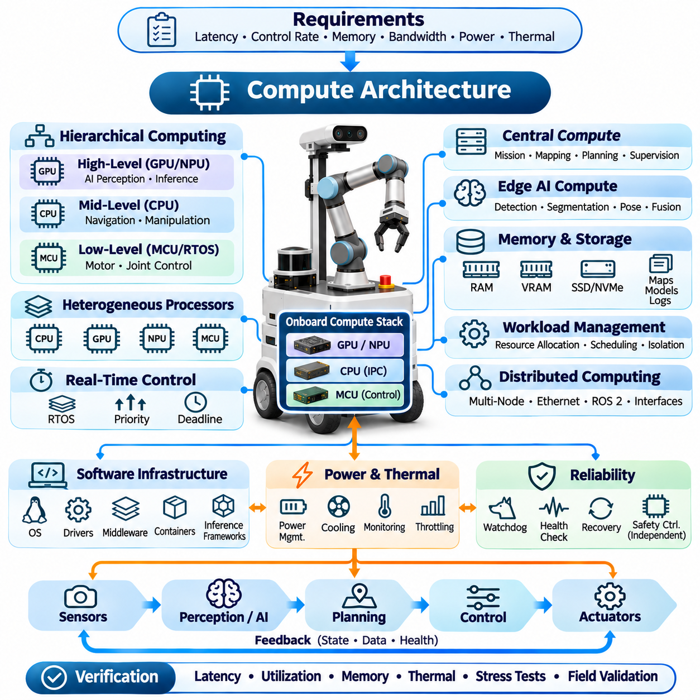{width="7.268055555555556in" height="7.268055555555556in"}

Compute architecture defines the computational resources, processing hierarchy, hardware configurations, and workload allocation mechanisms required for a mobile manipulator. It integrates embedded controllers, central processing units, graphics processing units, memory, storage, and communication interfaces into a coordinated computing environment that supports autonomous navigation, robotic manipulation, artificial intelligence, and system supervision.

Compute architecture development begins with product requirements, functional architecture, sensor architecture, and operational scenarios. Computational demand, inference latency, control frequency, memory requirements, communication bandwidth, electrical power consumption, and thermal limitations establish the principal design parameters. These parameters guide computing platform selection and computational workload distribution.

Hierarchical computing architecture separates computational functions according to their performance requirements and operational responsibilities. Low-level embedded controllers execute deterministic actuator control, intermediate computing platforms manage navigation and manipulation, and high-performance processors execute computationally intensive perception and artificial intelligence workloads. This separation improves scalability, responsiveness, and fault isolation.

Central computing platforms coordinate system-level functions across the mobile manipulator. Mission management, behavior execution, localization, environmental mapping, task planning, and subsystem supervision may operate within a centralized computing environment. The central processor must provide sufficient computational capacity and memory resources to execute concurrent processes while maintaining predictable responsiveness during complex operations.

Edge computing platforms enable computationally intensive processing directly within the mobile manipulator. Embedded GPU modules, dedicated AI accelerators, and high-performance industrial computers support real-time object detection, semantic segmentation, pose estimation, sensor fusion, and intelligent decision-making. Onboard processing reduces dependence on external communication infrastructure and minimizes network-induced latency.

Heterogeneous computing combines different processor architectures to improve computational efficiency and workload specialization. Central Processing Units (CPUs), Graphics Processing Units (GPUs), Neural Processing Units (NPUs), and microcontrollers provide complementary processing capabilities. Computational tasks should be allocated according to execution characteristics, parallelization potential, timing constraints, and overall energy efficiency.

Real-time computing architecture supports functions that must execute within predictable timing constraints. Motor control, steering control, joint trajectory execution, and critical feedback processing require deterministic or bounded execution behavior. Real-Time Operating Systems (RTOS), real-time Linux configurations, dedicated embedded controllers, and prioritized scheduling mechanisms may be employed according to task-specific timing requirements.

Memory architecture determines how computational resources access and manage operational data. System memory, GPU memory, shared memory, cache structures, and memory bandwidth influence the execution performance of AI models and sensor processing pipelines. Memory capacity must accommodate concurrent applications, high-resolution sensor streams, intermediate computational results, and temporary data buffers without excessive resource contention.

Storage architecture supports operating systems, application software, AI models, environmental maps, calibration parameters, diagnostic records, and operational datasets. Solid-State Drives (SSDs) and Non-Volatile Memory Express (NVMe) devices provide suitable storage performance for many robotic applications. Storage capacity, write endurance, data integrity, and recovery mechanisms must be evaluated according to anticipated workloads.

Computational workload management coordinates the execution of navigation, perception, manipulation, communication, and diagnostic processes. Resource allocation, process prioritization, CPU affinity, GPU utilization management, and execution scheduling help prevent computational conflicts. Critical control and monitoring functions must retain sufficient resources even when computationally intensive AI workloads experience unexpected increases in demand.

Distributed computing architecture enables multiple computational nodes to operate collaboratively within the robotic system. Dedicated navigation processors, manipulation controllers, AI inference platforms, and safety controllers may execute specialized functions independently. High-speed communication interfaces and well-defined software interfaces support coordinated operation while reducing dependence on a single general-purpose computing platform.

Software infrastructure establishes the execution environment for computational applications. Operating systems, device drivers, middleware, containerization platforms, AI inference frameworks, and hardware acceleration libraries must be selected according to system requirements. Software compatibility, version management, dependency control, and reproducible deployment contribute to reliable operation and long-term maintainability.

Power consumption and thermal management represent significant constraints in mobile computing architecture. High-performance processors and GPU accelerators generate heat and increase battery energy consumption during intensive workloads. Cooling mechanisms, thermal monitoring, power management policies, and computational throttling strategies must balance processing performance, operational endurance, and hardware reliability.

Computational reliability requires mechanisms for detecting hardware failures, software crashes, resource exhaustion, and degraded processing performance. Watchdog timers, health monitoring, process recovery, and redundant computing arrangements may improve system availability. Safety-critical functions must maintain the required independence and fault tolerance without relying exclusively on general-purpose computing resources.

Compute architecture must support future AI model upgrades, additional sensor integration, and expanded operational capabilities. Modular computing platforms, standardized interfaces, scalable memory configurations, and reserved computational capacity facilitate system evolution. Engineering budgets should establish acceptable limits for processing latency, processor utilization, memory consumption, electrical power, and thermal dissipation.

Compute architecture verification combines hardware benchmarking, real-time performance analysis, resource utilization measurement, thermal testing, and computational stress testing. Representative scenarios must include simultaneous navigation and manipulation, intensive AI inference, high-volume sensor processing, and abnormal workload conditions. Verified results establish a reliable foundation for software integration, AI deployment, system testing, and field validation.

컴퓨팅 아키텍처(Compute Architecture)는 모바일 매니퓰레이터(Mobile Manipulator)에 필요한 컴퓨팅 자원(Computational Resource), 처리 계층 구조(Processing Hierarchy), 하드웨어 구성(Hardware Configuration), 작업부하 할당 메커니즘(Workload Allocation Mechanism)을 정의한다. 임베디드 제어기(Embedded Controller), 중앙 처리 장치(Central Processing Unit), 그래픽 처리 장치(Graphics Processing Unit), 메모리(Memory), 저장 장치(Storage), 통신 인터페이스(Communication Interface)를 하나의 유기적으로 연결된 컴퓨팅 환경(Computing Environment)으로 통합하여 자율주행(Autonomous Navigation), 로봇 조작(Robotic Manipulation), 인공지능(Artificial Intelligence), 시스템 감독(System Supervision)을 지원한다.

컴퓨팅 아키텍처 개발(Compute Architecture Development)은 제품 요구사항(Product Requirements), 기능 아키텍처(Functional Architecture), 센서 아키텍처(Sensor Architecture), 운영 시나리오(Operational Scenario)를 기반으로 시작된다. 컴퓨팅 요구량(Computational Demand), 추론 지연시간(Inference Latency), 제어 주기(Control Frequency), 메모리 요구사항(Memory Requirements), 통신 대역폭(Communication Bandwidth), 전력 소비량(Electrical Power Consumption), 열적 제약조건(Thermal Limitation)은 주요 설계 매개변수(Design Parameter)를 구성한다. 이러한 매개변수는 컴퓨팅 플랫폼 선정(Computing Platform Selection)과 컴퓨팅 작업부하 분배(Computational Workload Distribution)의 기준이 된다.

계층형 컴퓨팅 아키텍처(Hierarchical Computing Architecture)는 성능 요구사항(Performance Requirements)과 운영 책임(Operational Responsibility)에 따라 컴퓨팅 기능(Computational Function)을 분리한다. 하위 계층의 임베디드 제어기(Low-Level Embedded Controller)는 결정론적 작동기 제어(Deterministic Actuator Control)를 실행하고, 중간 계층의 컴퓨팅 플랫폼(Intermediate Computing Platform)은 자율주행과 로봇 조작을 관리하며, 고성능 프로세서(High-Performance Processor)는 높은 연산량을 요구하는 인식 및 인공지능 작업부하(Perception and Artificial Intelligence Workload)를 실행한다. 이러한 분리는 확장성(Scalability), 응답성(Responsiveness), 장애 격리(Fault Isolation)를 향상시킨다.

중앙 컴퓨팅 플랫폼(Central Computing Platform)은 모바일 매니퓰레이터 전반의 시스템 수준 기능(System-Level Function)을 조정한다. 임무 관리(Mission Management), 행동 실행(Behavior Execution), 위치 추정(Localization), 환경 지도 생성(Environmental Mapping), 작업 계획(Task Planning), 하위 시스템 감독(Subsystem Supervision)은 중앙집중형 컴퓨팅 환경(Centralized Computing Environment)에서 동작할 수 있다. 중앙 프로세서(Central Processor)는 복잡한 운영 과정에서도 예측 가능한 응답성(Predictable Responsiveness)을 유지하면서 동시 실행 프로세스(Concurrent Process)를 처리할 수 있도록 충분한 연산 능력(Computational Capacity)과 메모리 자원(Memory Resource)을 제공해야 한다.

엣지 컴퓨팅 플랫폼(Edge Computing Platform)은 모바일 매니퓰레이터 내부에서 높은 연산량을 요구하는 데이터 처리를 직접 수행할 수 있도록 한다. 임베디드 GPU 모듈(Embedded GPU Module), 전용 인공지능 가속기(Dedicated AI Accelerator), 고성능 산업용 컴퓨터(High-Performance Industrial Computer)는 실시간 객체 검출(Real-Time Object Detection), 의미론적 분할(Semantic Segmentation), 자세 추정(Pose Estimation), 센서 융합(Sensor Fusion), 지능형 의사결정(Intelligent Decision-Making)을 지원한다. 온보드 처리(Onboard Processing)는 외부 통신 인프라(External Communication Infrastructure)에 대한 의존성을 감소시키고 네트워크로 인해 발생하는 지연시간(Network-Induced Latency)을 최소화한다.

이기종 컴퓨팅(Heterogeneous Computing)은 서로 다른 프로세서 아키텍처(Processor Architecture)를 결합하여 컴퓨팅 효율성(Computational Efficiency)과 작업부하 특화(Workload Specialization)를 향상시킨다. 중앙 처리 장치(Central Processing Unit, CPU), 그래픽 처리 장치(Graphics Processing Unit, GPU), 신경망 처리 장치(Neural Processing Unit, NPU), 마이크로컨트롤러(Microcontroller)는 상호보완적인 처리 능력(Processing Capability)을 제공한다. 컴퓨팅 작업(Computational Task)은 실행 특성(Execution Characteristics), 병렬화 가능성(Parallelization Potential), 타이밍 제약조건(Timing Constraints), 전체 에너지 효율성(Energy Efficiency)에 따라 할당되어야 한다.

실시간 컴퓨팅 아키텍처(Real-Time Computing Architecture)는 예측 가능한 타이밍 제약조건 내에서 실행되어야 하는 기능을 지원한다. 모터 제어(Motor Control), 조향 제어(Steering Control), 관절 궤적 실행(Joint Trajectory Execution), 핵심 피드백 처리(Critical Feedback Processing)는 결정론적 실행(Deterministic Execution) 또는 실행시간의 상한이 보장되는 동작(Bounded Execution Behavior)을 요구한다. 실시간 운영체제(Real-Time Operating System, RTOS), 실시간 리눅스 구성(Real-Time Linux Configuration), 전용 임베디드 제어기(Dedicated Embedded Controller), 우선순위 기반 스케줄링 메커니즘(Prioritized Scheduling Mechanism)은 작업별 타이밍 요구사항(Task-Specific Timing Requirements)에 따라 적용될 수 있다.

메모리 아키텍처(Memory Architecture)는 컴퓨팅 자원이 운영 데이터(Operational Data)에 접근하고 이를 관리하는 방식을 결정한다. 시스템 메모리(System Memory), GPU 메모리(GPU Memory), 공유 메모리(Shared Memory), 캐시 구조(Cache Structure), 메모리 대역폭(Memory Bandwidth)은 인공지능 모델(AI Model)과 센서 처리 파이프라인(Sensor Processing Pipeline)의 실행 성능(Execution Performance)에 영향을 미친다. 메모리 용량(Memory Capacity)은 과도한 자원 경합(Resource Contention) 없이 동시 실행 애플리케이션(Concurrent Application), 고해상도 센서 스트림(High-Resolution Sensor Stream), 중간 연산 결과(Intermediate Computational Result), 임시 데이터 버퍼(Temporary Data Buffer)를 수용할 수 있어야 한다.

저장 장치 아키텍처(Storage Architecture)는 운영체제(Operating System), 애플리케이션 소프트웨어(Application Software), 인공지능 모델(AI Model), 환경 지도(Environmental Map), 보정 매개변수(Calibration Parameter), 진단 기록(Diagnostic Record), 운영 데이터셋(Operational Dataset)의 저장을 지원한다. 솔리드 스테이트 드라이브(Solid-State Drive, SSD)와 비휘발성 메모리 익스프레스(Non-Volatile Memory Express, NVMe) 기반 장치는 다양한 로봇 응용 분야에 적합한 저장 성능(Storage Performance)을 제공한다. 저장 용량(Storage Capacity), 쓰기 내구성(Write Endurance), 데이터 무결성(Data Integrity), 복구 메커니즘(Recovery Mechanism)은 예상되는 작업부하(Anticipated Workload)에 따라 평가되어야 한다.

컴퓨팅 작업부하 관리(Computational Workload Management)는 자율주행(Navigation), 인식(Perception), 로봇 조작(Manipulation), 통신(Communication), 진단(Diagnostics) 프로세스의 실행을 조정한다. 자원 할당(Resource Allocation), 프로세스 우선순위 설정(Process Prioritization), CPU 친화도(CPU Affinity), GPU 사용률 관리(GPU Utilization Management), 실행 스케줄링(Execution Scheduling)은 컴퓨팅 자원 충돌(Computational Conflict)을 방지하는 데 기여한다. 핵심 제어 및 모니터링 기능(Critical Control and Monitoring Function)은 높은 연산량을 요구하는 인공지능 작업부하가 예기치 않게 증가하는 상황에서도 충분한 컴퓨팅 자원을 확보해야 한다.

분산 컴퓨팅 아키텍처(Distributed Computing Architecture)는 로봇 시스템 내부에서 여러 컴퓨팅 노드(Computational Node)가 협력적으로 동작할 수 있도록 한다. 전용 자율주행 프로세서(Dedicated Navigation Processor), 매니퓰레이터 제어기(Manipulation Controller), 인공지능 추론 플랫폼(AI Inference Platform), 안전 제어기(Safety Controller)는 특화된 기능(Specialized Function)을 독립적으로 실행할 수 있다. 고속 통신 인터페이스(High-Speed Communication Interface)와 명확하게 정의된 소프트웨어 인터페이스(Software Interface)는 단일 범용 컴퓨팅 플랫폼(General-Purpose Computing Platform)에 대한 의존성을 감소시키면서 상호 조정된 운영(Coordinated Operation)을 지원한다.

소프트웨어 인프라(Software Infrastructure)는 컴퓨팅 애플리케이션(Computational Application)을 위한 실행 환경(Execution Environment)을 확립한다. 운영체제(Operating System), 장치 드라이버(Device Driver), 미들웨어(Middleware), 컨테이너화 플랫폼(Containerization Platform), 인공지능 추론 프레임워크(AI Inference Framework), 하드웨어 가속 라이브러리(Hardware Acceleration Library)는 시스템 요구사항(System Requirements)에 따라 선정되어야 한다. 소프트웨어 호환성(Software Compatibility), 버전 관리(Version Management), 의존성 관리(Dependency Control), 재현 가능한 배포(Reproducible Deployment)는 신뢰성 있는 운영(Reliable Operation)과 장기적인 유지보수성(Long-Term Maintainability)을 확보하는 데 기여한다.

전력 소비(Power Consumption)와 열 관리(Thermal Management)는 모바일 컴퓨팅 아키텍처(Mobile Computing Architecture)의 중요한 제약조건에 해당한다. 고성능 프로세서(High-Performance Processor)와 GPU 가속기(GPU Accelerator)는 집중적인 작업부하(Intensive Workload)를 처리하는 과정에서 열을 발생시키고 배터리 에너지 소비량(Battery Energy Consumption)을 증가시킨다. 냉각 메커니즘(Cooling Mechanism), 열 모니터링(Thermal Monitoring), 전력 관리 정책(Power Management Policy), 연산 성능 제한 전략(Computational Throttling Strategy)은 처리 성능(Processing Performance), 운영 지속시간(Operational Endurance), 하드웨어 신뢰성(Hardware Reliability) 사이의 균형을 유지해야 한다.

컴퓨팅 신뢰성(Computational Reliability)은 하드웨어 고장(Hardware Failure), 소프트웨어 충돌(Software Crash), 자원 고갈(Resource Exhaustion), 처리 성능 저하(Degraded Processing Performance)를 검출하기 위한 메커니즘을 요구한다. 워치독 타이머(Watchdog Timer), 시스템 건전성 모니터링(Health Monitoring), 프로세스 복구(Process Recovery), 이중화 컴퓨팅 구성(Redundant Computing Arrangement)은 시스템 가용성(System Availability)을 향상시킬 수 있다. 안전 필수 기능(Safety-Critical Function)은 범용 컴퓨팅 자원(General-Purpose Computing Resource)에 전적으로 의존하지 않으면서 요구되는 독립성(Independence)과 결함 허용성(Fault Tolerance)을 유지해야 한다.

컴퓨팅 아키텍처는 향후 인공지능 모델 업그레이드(AI Model Upgrade), 추가 센서 통합(Additional Sensor Integration), 운영 기능 확장(Expanded Operational Capability)을 지원해야 한다. 모듈형 컴퓨팅 플랫폼(Modular Computing Platform), 표준화된 인터페이스(Standardized Interface), 확장 가능한 메모리 구성(Scalable Memory Configuration), 예비 연산 능력(Reserved Computational Capacity)은 시스템의 지속적인 발전(System Evolution)을 용이하게 한다. 엔지니어링 자원 예산(Engineering Budget)은 처리 지연시간(Processing Latency), 프로세서 사용률(Processor Utilization), 메모리 소비량(Memory Consumption), 전력(Electrical Power), 열 방출(Thermal Dissipation)에 대한 허용 한계(Acceptable Limit)를 확립해야 한다.

컴퓨팅 아키텍처 검증(Compute Architecture Verification)은 하드웨어 벤치마킹(Hardware Benchmarking), 실시간 성능 분석(Real-Time Performance Analysis), 자원 사용률 측정(Resource Utilization Measurement), 열 시험(Thermal Testing), 컴퓨팅 스트레스 시험(Computational Stress Testing)을 결합한다. 대표적인 운영 시나리오에는 동시 자율주행 및 로봇 조작(Simultaneous Navigation and Manipulation), 집중적인 인공지능 추론(Intensive AI Inference), 대용량 센서 데이터 처리(High-Volume Sensor Processing), 비정상적인 작업부하 조건(Abnormal Workload Condition)이 포함되어야 한다. 검증된 결과는 소프트웨어 통합(Software Integration), 인공지능 배포(AI Deployment), 시스템 시험(System Testing), 현장 유효성 검증(Field Validation)을 위한 신뢰할 수 있는 기반을 확립한다.

##  

## 08 AI Architecture

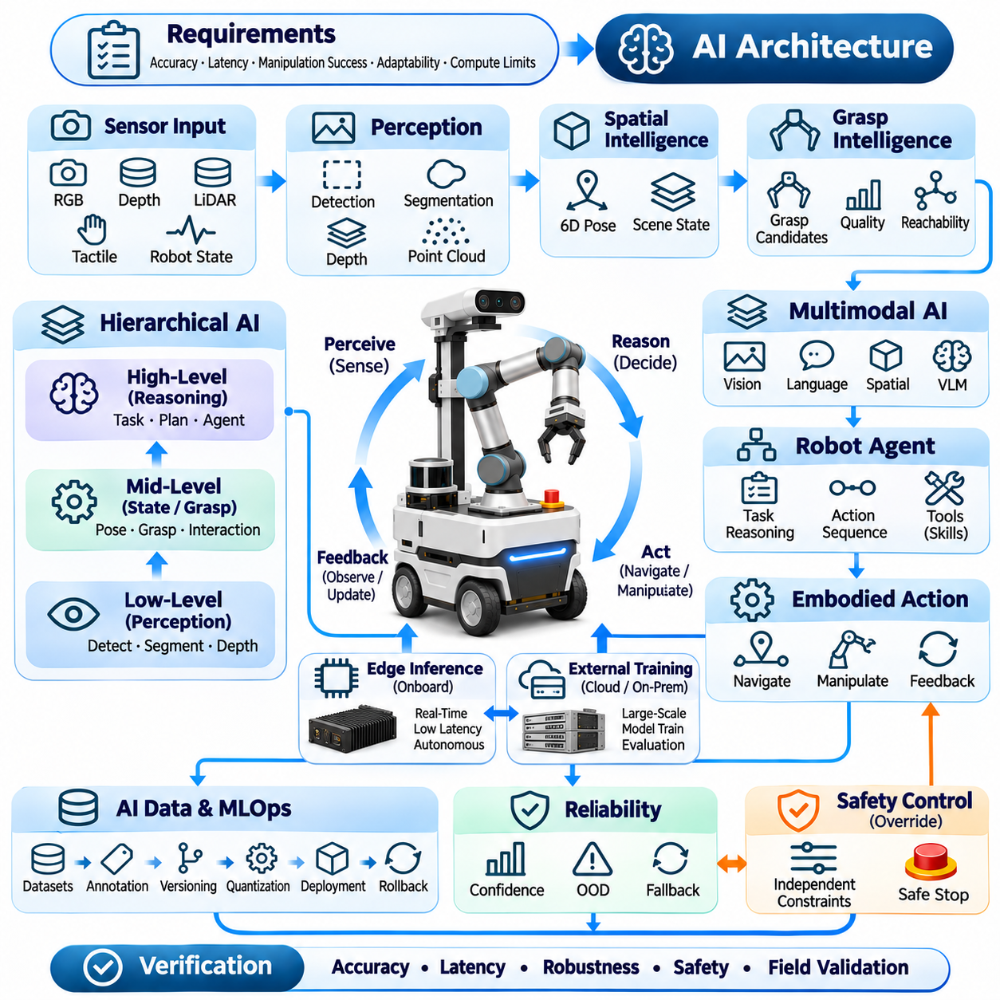{width="7.268055555555556in" height="7.268055555555556in"}

Artificial Intelligence (AI) architecture defines the intelligent processing structure, model organization, data flow, and decision-making mechanisms of a mobile manipulator. It integrates environmental perception, object recognition, pose estimation, grasp intelligence, task reasoning, and adaptive behavior into a coordinated framework that supports autonomous operation and interaction with physical environments.

AI architecture development begins with product requirements, functional architecture, sensor architecture, compute architecture, and operational scenarios. Recognition accuracy, inference latency, manipulation success rates, environmental adaptability, and computational limitations establish the principal design parameters. These requirements guide model selection, processing hierarchy, and AI workload allocation.

Hierarchical AI architecture organizes intelligent functions according to their abstraction levels and operational responsibilities. Low-level perception models interpret sensor measurements, intermediate intelligence modules estimate environmental states and manipulation opportunities, and high-level reasoning systems determine task objectives and behavioral strategies. This separation supports modular development and system scalability.

Perception architecture transforms raw sensor measurements into structured representations of the surrounding environment. Object detection, semantic segmentation, instance segmentation, depth estimation, and point cloud processing provide information about objects, obstacles, and environmental structures. Multiple perception models may operate concurrently to support navigation, manipulation, and environmental understanding.

Object pose estimation architecture determines the spatial position and orientation of target objects within defined coordinate systems. Two-dimensional observations, depth measurements, three-dimensional point clouds, and geometric representations can support six-dimensional pose estimation. Estimated poses must include appropriate confidence information and satisfy the accuracy requirements of downstream manipulation functions.

Grasp intelligence architecture identifies suitable grasping positions, orientations, and interaction strategies for target objects. Learning-based grasp detection, geometric analysis, and grasp quality estimation may be combined according to object characteristics and operational requirements. Candidate grasps must be evaluated against manipulator reachability, collision constraints, and end effector capabilities.

Multimodal AI architecture integrates visual information, spatial measurements, natural language instructions, tactile feedback, and internal robot states. Vision-Language Models (VLMs) and multimodal foundation models may support semantic understanding, object reasoning, and instruction interpretation. Their outputs must be grounded in current environmental observations and validated against physical constraints.

Robot agent architecture coordinates intelligent task interpretation, contextual reasoning, tool utilization, and behavioral decision-making. AI agents may translate high-level mission objectives into structured action sequences while accessing perception services, planning modules, and system resources. Agent-generated actions must remain subject to execution permissions, operational constraints, and independent validation mechanisms.

Embodied AI architecture connects intelligent perception and reasoning with physical action and environmental feedback. The mobile manipulator continuously observes its surroundings, estimates relevant states, selects appropriate actions, and evaluates execution outcomes. This closed-loop interaction enables adaptive behavior while maintaining coordination between autonomous navigation, robotic manipulation, and physical constraints.

AI inference architecture determines where and how trained models execute within the robotic system. Edge computing platforms support latency-sensitive perception and manipulation functions, while external computing infrastructure may support model training, large-scale analysis, and noncritical reasoning. Workload allocation must consider communication reliability, inference performance, energy consumption, and operational autonomy.

AI data architecture establishes the lifecycle of sensor measurements, training datasets, annotation information, inference outputs, and operational feedback. Data quality management, dataset versioning, preprocessing pipelines, and metadata preservation support reproducible model development. Representative operational data must capture environmental variability, object diversity, and relevant failure scenarios.

Model deployment architecture establishes standardized mechanisms for integrating trained AI models into operational robotic software. Model compression, quantization, hardware acceleration, and optimized inference runtimes may improve execution efficiency. Deployment configurations must preserve acceptable model accuracy while satisfying computational resource, memory, latency, and power consumption requirements.

AI reliability architecture addresses uncertain predictions, unfamiliar objects, environmental changes, and degraded sensor measurements. Confidence estimation, uncertainty quantification, out-of-distribution detection, and cross-validation between sensing modalities can support reliable decision-making. When prediction reliability becomes insufficient, the system should initiate appropriate recovery or safe fallback behaviors.

AI safety architecture establishes boundaries between probabilistic intelligence and safety-critical control functions. AI-generated predictions, task recommendations, and motion objectives must be evaluated against independently enforced operational constraints. Safety-rated controllers and protective mechanisms must retain authority over hazardous actions regardless of AI model performance or reasoning outcomes.

AI lifecycle management architecture supports model monitoring, performance evaluation, retraining, controlled deployment, and rollback throughout the product lifecycle. Model registries, configuration management, operational logging, and Machine Learning Operations (MLOps) infrastructure enable systematic improvement. Updated models must undergo regression testing and approval before being released into operational environments.

AI architecture verification combines model benchmarking, integrated inference testing, uncertainty analysis, computational performance measurement, and scenario-based validation. Representative scenarios must include unfamiliar objects, environmental disturbances, perception failures, and complex manipulation tasks. Verified results establish the foundation for detailed AI development, system integration, and field validation.

인공지능 아키텍처(Artificial Intelligence Architecture, AI Architecture)는 모바일 매니퓰레이터(Mobile Manipulator)의 지능형 처리 구조(Intelligent Processing Structure), 모델 구성(Model Organization), 데이터 흐름(Data Flow), 의사결정 메커니즘(Decision-Making Mechanism)을 정의한다. 환경 인식(Environmental Perception), 객체 인식(Object Recognition), 자세 추정(Pose Estimation), 파지 지능(Grasp Intelligence), 작업 추론(Task Reasoning), 적응형 행동(Adaptive Behavior)을 하나의 유기적으로 연결된 프레임워크(Framework)로 통합하여 자율 운영(Autonomous Operation)과 물리적 환경(Physical Environment)과의 상호작용을 지원한다.

인공지능 아키텍처 개발(AI Architecture Development)은 제품 요구사항(Product Requirements), 기능 아키텍처(Functional Architecture), 센서 아키텍처(Sensor Architecture), 컴퓨팅 아키텍처(Compute Architecture), 운영 시나리오(Operational Scenario)를 기반으로 시작된다. 인식 정확도(Recognition Accuracy), 추론 지연시간(Inference Latency), 조작 성공률(Manipulation Success Rate), 환경 적응성(Environmental Adaptability), 컴퓨팅 제약조건(Computational Limitation)은 주요 설계 매개변수(Design Parameter)를 구성한다. 이러한 요구사항은 모델 선정(Model Selection), 처리 계층 구조(Processing Hierarchy), 인공지능 작업부하 할당(AI Workload Allocation)의 기준이 된다.

계층형 인공지능 아키텍처(Hierarchical AI Architecture)는 추상화 수준(Abstraction Level)과 운영 책임(Operational Responsibility)에 따라 지능형 기능(Intelligent Function)을 구성한다. 하위 계층의 인식 모델(Low-Level Perception Model)은 센서 측정값(Sensor Measurement)을 해석하고, 중간 계층의 지능형 모듈(Intermediate Intelligence Module)은 환경 상태(Environmental State)와 조작 가능성(Manipulation Opportunity)을 추정하며, 상위 계층의 추론 시스템(High-Level Reasoning System)은 작업 목표(Task Objective)와 행동 전략(Behavioral Strategy)을 결정한다. 이러한 분리는 모듈형 개발(Modular Development)과 시스템 확장성(System Scalability)을 지원한다.

인식 아키텍처(Perception Architecture)는 원시 센서 측정값(Raw Sensor Measurement)을 주변 환경에 대한 구조화된 표현(Structured Representation)으로 변환한다. 객체 검출(Object Detection), 의미론적 분할(Semantic Segmentation), 인스턴스 분할(Instance Segmentation), 깊이 추정(Depth Estimation), 포인트 클라우드 처리(Point Cloud Processing)는 객체(Object), 장애물(Obstacle), 환경 구조물(Environmental Structure)에 대한 정보를 제공한다. 여러 인식 모델(Perception Model)은 자율주행(Navigation), 로봇 조작(Manipulation), 환경 이해(Environmental Understanding)를 지원하기 위해 동시에 동작할 수 있다.

객체 자세 추정 아키텍처(Object Pose Estimation Architecture)는 정의된 좌표계(Coordinate System) 내에서 대상 객체(Target Object)의 공간적 위치(Spatial Position)와 방향(Orientation)을 결정한다. 2차원 관측 정보(Two-Dimensional Observation), 깊이 측정값(Depth Measurement), 3차원 포인트 클라우드(Three-Dimensional Point Cloud), 기하학적 표현(Geometric Representation)은 6차원 자세 추정(Six-Dimensional Pose Estimation, 6D Pose Estimation)을 지원할 수 있다. 추정된 자세(Estimated Pose)는 적절한 신뢰도 정보(Confidence Information)를 포함해야 하며, 후속 조작 기능(Downstream Manipulation Function)의 정확도 요구사항(Accuracy Requirements)을 충족해야 한다.

파지 지능 아키텍처(Grasp Intelligence Architecture)는 대상 객체에 적합한 파지 위치(Grasping Position), 파지 방향(Grasping Orientation), 상호작용 전략(Interaction Strategy)을 식별한다. 학습 기반 파지 검출(Learning-Based Grasp Detection), 기하학적 분석(Geometric Analysis), 파지 품질 추정(Grasp Quality Estimation)은 객체 특성(Object Characteristics)과 운영 요구사항(Operational Requirements)에 따라 결합될 수 있다. 파지 후보(Candidate Grasp)는 매니퓰레이터 도달 가능성(Manipulator Reachability), 충돌 제약조건(Collision Constraints), 말단 작동기 기능(End Effector Capability)을 기준으로 평가되어야 한다.

멀티모달 인공지능 아키텍처(Multimodal AI Architecture)는 시각 정보(Visual Information), 공간 측정값(Spatial Measurement), 자연어 명령(Natural Language Instruction), 촉각 피드백(Tactile Feedback), 로봇 내부 상태(Internal Robot State)를 통합한다. 비전-언어 모델(Vision-Language Model, VLM)과 멀티모달 기반 모델(Multimodal Foundation Model)은 의미론적 이해(Semantic Understanding), 객체 추론(Object Reasoning), 명령 해석(Instruction Interpretation)을 지원할 수 있다. 이러한 모델의 출력(Output)은 현재 환경의 관측 정보(Environmental Observation)에 근거해야 하며, 물리적 제약조건(Physical Constraints)에 따라 유효성이 검증되어야 한다.

로봇 에이전트 아키텍처(Robot Agent Architecture)는 지능형 작업 해석(Intelligent Task Interpretation), 문맥 기반 추론(Contextual Reasoning), 도구 활용(Tool Utilization), 행동 의사결정(Behavioral Decision-Making)을 조정한다. 인공지능 에이전트(AI Agent)는 인식 서비스(Perception Service), 계획 모듈(Planning Module), 시스템 자원(System Resource)에 접근하면서 상위 수준의 임무 목표(High-Level Mission Objective)를 구조화된 행동 시퀀스(Structured Action Sequence)로 변환할 수 있다. 에이전트가 생성한 행동(Agent-Generated Action)은 실행 권한(Execution Permission), 운영 제약조건(Operational Constraints), 독립적인 유효성 검증 메커니즘(Independent Validation Mechanism)의 통제를 받아야 한다.

체화 인공지능 아키텍처(Embodied AI Architecture)는 지능형 인식(Intelligent Perception) 및 추론(Reasoning)을 물리적 행동(Physical Action)과 환경 피드백(Environmental Feedback)에 연결한다. 모바일 매니퓰레이터는 주변 환경을 지속적으로 관측하고, 관련 상태(Relevant State)를 추정하며, 적절한 행동(Appropriate Action)을 선택하고, 실행 결과(Execution Outcome)를 평가한다. 이러한 폐루프 상호작용(Closed-Loop Interaction)은 자율주행, 로봇 조작, 물리적 제약조건 사이의 상호 협조(Coordination)를 유지하면서 적응형 행동(Adaptive Behavior)을 가능하게 한다.

인공지능 추론 아키텍처(AI Inference Architecture)는 학습된 모델(Trained Model)이 로봇 시스템 내부의 어느 위치에서 어떠한 방식으로 실행되는지를 결정한다. 엣지 컴퓨팅 플랫폼(Edge Computing Platform)은 지연시간에 민감한 인식 및 조작 기능(Latency-Sensitive Perception and Manipulation Function)을 지원하며, 외부 컴퓨팅 인프라(External Computing Infrastructure)는 모델 학습(Model Training), 대규모 분석(Large-Scale Analysis), 비핵심 추론(Noncritical Reasoning)을 지원할 수 있다. 작업부하 할당(Workload Allocation)은 통신 신뢰성(Communication Reliability), 추론 성능(Inference Performance), 에너지 소비량(Energy Consumption), 운영 자율성(Operational Autonomy)을 고려해야 한다.

인공지능 데이터 아키텍처(AI Data Architecture)는 센서 측정값(Sensor Measurement), 학습 데이터셋(Training Dataset), 어노테이션 정보(Annotation Information), 추론 출력(Inference Output), 운영 피드백(Operational Feedback)의 수명주기(Lifecycle)를 확립한다. 데이터 품질 관리(Data Quality Management), 데이터셋 버전 관리(Dataset Versioning), 전처리 파이프라인(Preprocessing Pipeline), 메타데이터 보존(Metadata Preservation)은 재현 가능한 모델 개발(Reproducible Model Development)을 지원한다. 대표적인 운영 데이터(Representative Operational Data)는 환경 다양성(Environmental Variability), 객체 다양성(Object Diversity), 관련 실패 시나리오(Failure Scenario)를 포괄해야 한다.

모델 배포 아키텍처(Model Deployment Architecture)는 학습된 인공지능 모델을 실제 운영되는 로봇 소프트웨어(Operational Robotic Software)에 통합하기 위한 표준화된 메커니즘(Standardized Mechanism)을 확립한다. 모델 압축(Model Compression), 양자화(Quantization), 하드웨어 가속(Hardware Acceleration), 최적화된 추론 런타임(Optimized Inference Runtime)은 실행 효율성(Execution Efficiency)을 향상시킬 수 있다. 배포 구성(Deployment Configuration)은 컴퓨팅 자원(Computational Resource), 메모리(Memory), 지연시간(Latency), 전력 소비량(Power Consumption) 요구사항을 충족하면서 허용 가능한 모델 정확도(Model Accuracy)를 유지해야 한다.

인공지능 신뢰성 아키텍처(AI Reliability Architecture)는 불확실한 예측(Uncertain Prediction), 익숙하지 않은 객체(Unfamiliar Object), 환경 변화(Environmental Change), 센서 측정 성능 저하(Degraded Sensor Measurement)를 고려한다. 신뢰도 추정(Confidence Estimation), 불확실성 정량화(Uncertainty Quantification), 분포 외 데이터 검출(Out-of-Distribution Detection, OOD Detection), 센싱 모달리티 간 교차 검증(Cross-Validation Between Sensing Modalities)은 신뢰성 있는 의사결정(Reliable Decision-Making)을 지원할 수 있다. 예측 신뢰성(Prediction Reliability)이 충분하지 않은 경우 시스템은 적절한 복구 행동(Recovery Behavior) 또는 안전 대체 행동(Safe Fallback Behavior)을 실행해야 한다.

인공지능 안전 아키텍처(AI Safety Architecture)는 확률적 지능(Probabilistic Intelligence)과 안전 필수 제어 기능(Safety-Critical Control Function) 사이의 경계를 확립한다. 인공지능이 생성한 예측(AI-Generated Prediction), 작업 권고(Task Recommendation), 동작 목표(Motion Objective)는 독립적으로 강제되는 운영 제약조건(Independently Enforced Operational Constraints)을 기준으로 평가되어야 한다. 안전 등급 제어기(Safety-Rated Controller)와 보호 메커니즘(Protective Mechanism)은 인공지능 모델 성능(AI Model Performance)이나 추론 결과(Reasoning Outcome)와 관계없이 위험 행동(Hazardous Action)에 대한 최종 제어 권한(Control Authority)을 유지해야 한다.

인공지능 수명주기 관리 아키텍처(AI Lifecycle Management Architecture)는 제품 수명주기(Product Lifecycle) 전반에 걸쳐 모델 모니터링(Model Monitoring), 성능 평가(Performance Evaluation), 재학습(Retraining), 통제된 배포(Controlled Deployment), 이전 버전 복원(Rollback)을 지원한다. 모델 레지스트리(Model Registry), 형상 관리(Configuration Management), 운영 로깅(Operational Logging), 머신러닝 운영(Machine Learning Operations, MLOps) 인프라는 체계적인 성능 개선(Systematic Improvement)을 가능하게 한다. 업데이트된 모델(Updated Model)은 실제 운영 환경(Operational Environment)에 배포되기 전에 회귀 시험(Regression Testing)과 승인(Approval) 절차를 거쳐야 한다.

인공지능 아키텍처 검증(AI Architecture Verification)은 모델 벤치마킹(Model Benchmarking), 통합 추론 시험(Integrated Inference Testing), 불확실성 분석(Uncertainty Analysis), 컴퓨팅 성능 측정(Computational Performance Measurement), 시나리오 기반 유효성 검증(Scenario-Based Validation)을 결합한다. 대표적인 운영 시나리오에는 익숙하지 않은 객체(Unfamiliar Object), 환경적 외란(Environmental Disturbance), 인식 장애(Perception Failure), 복잡한 조작 작업(Complex Manipulation Task)이 포함되어야 한다. 검증된 결과는 상세 인공지능 개발(Detailed AI Development), 시스템 통합(System Integration), 현장 유효성 검증(Field Validation)을 위한 기반을 확립한다.

##  

## 09 Control Architecture

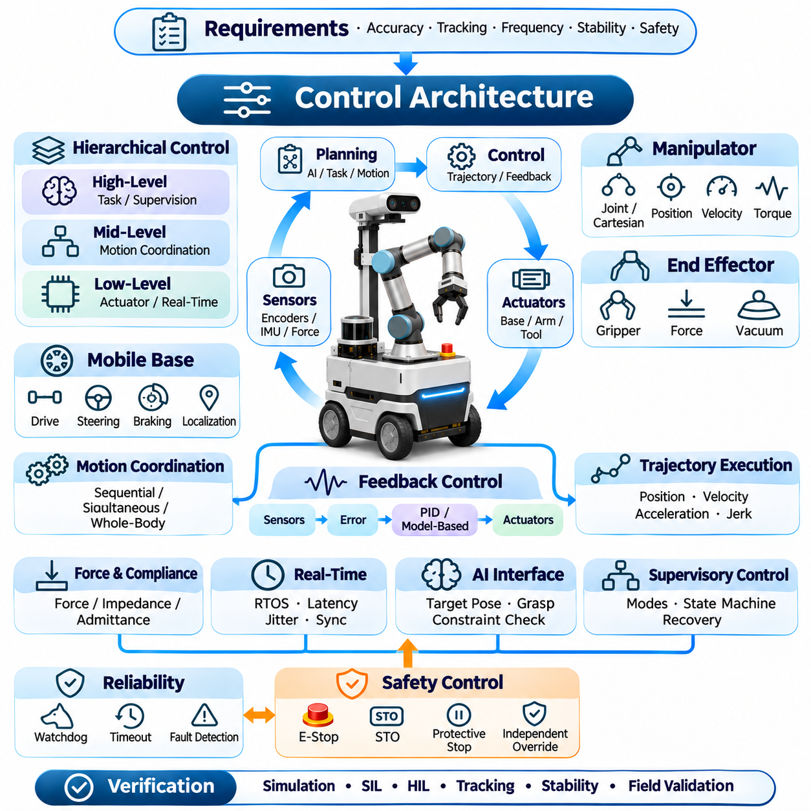{width="7.268055555555556in" height="7.268055555555556in"}

Control architecture defines the control hierarchy, feedback mechanisms, command interfaces, and execution strategies required for a mobile manipulator. It integrates mobile platform control, robotic arm control, end effector control, motion coordination, and system supervision into a unified framework that supports accurate, stable, responsive, and safe physical operation.

Control architecture development begins with product requirements, functional architecture, mechanical architecture, sensor architecture, and compute architecture. Positioning accuracy, trajectory tracking performance, control frequency, response time, dynamic stability, and safety requirements establish the principal design parameters. These parameters guide controller selection and control function allocation.

Hierarchical control architecture organizes control functions according to execution responsibilities and timing requirements. Low-level controllers regulate individual actuators, intermediate controllers coordinate subsystem movements, and high-level controllers manage task execution and operational objectives. This separation improves modularity, deterministic execution, fault isolation, and system scalability.

Mobile platform control architecture manages propulsion, steering, braking, velocity regulation, and trajectory tracking. Differential drive, omnidirectional drive, and independent steering mechanisms require different kinematic models and control strategies. Feedback from wheel encoders, inertial measurement units, and localization systems enables accurate movement and compensation for external disturbances.

Manipulator control architecture regulates robotic joint positions, velocities, accelerations, and torques according to task requirements. Joint-space control and Cartesian-space control provide complementary mechanisms for executing desired movements. Kinematic transformations, dynamic compensation, trajectory interpolation, and actuator feedback support accurate and stable motion throughout the operational workspace.

End effector control architecture manages application-specific tools such as mechanical grippers, vacuum grippers, inspection devices, and specialized handling mechanisms. Position control, force regulation, pressure monitoring, and contact detection support reliable physical interactions. Control interfaces must coordinate tool activation with manipulator movement and task execution conditions.

Closed-loop control architecture continuously evaluates the relationship between commanded objectives and measured system states. Sensor feedback enables controllers to calculate tracking errors and generate corrective commands. Proportional-Integral-Derivative (PID) control, feedforward compensation, model-based control, and adaptive control may be employed according to system dynamics and performance requirements.

Motion coordination architecture establishes the relationship between mobile platform movements and robotic manipulator operations. Sequential coordination allows navigation and manipulation to execute independently, while simultaneous coordination enables combined motion. Whole-body control may optimize mobility and manipulation while considering stability, reachability, and collision constraints.

Trajectory execution architecture converts planned motion paths into time-dependent position, velocity, and acceleration commands. Trajectory generation must consider actuator limitations, joint boundaries, velocity constraints, acceleration profiles, and jerk restrictions. Continuous trajectory monitoring ensures that deviations remain within acceptable limits during autonomous movement and manipulation.

Force and compliance control architecture enables the mobile manipulator to interact with physical objects and environmental structures. Force control, impedance control, and admittance control regulate interaction forces and mechanical responses. These mechanisms are particularly important for assembly, surface inspection, insertion, object handling, and operations involving uncertain contact conditions.

Real-time control architecture ensures that time-sensitive control functions execute within defined timing constraints. Dedicated embedded controllers, real-time operating systems, deterministic communication interfaces, and prioritized execution mechanisms support predictable control behavior. Control latency, execution jitter, synchronization accuracy, and feedback frequency must remain within established performance limits.

AI and control integration establishes controlled interfaces between intelligent decision-making and physical motion execution. AI models may generate target poses, grasp candidates, task objectives, and adaptive motion recommendations. These outputs must be evaluated by motion planning, constraint checking, and execution controllers before physical actions are performed within the permitted operating envelope.

Supervisory control architecture manages operational states, subsystem coordination, mode transitions, and abnormal operating conditions. State machines, behavior trees, and supervisory controllers may organize task execution and recovery procedures. Operational modes such as initialization, autonomous operation, manual control, charging, maintenance, and emergency operation must have explicitly defined transition conditions.

Safety-related control architecture establishes independent protective mechanisms for detecting and preventing hazardous motion. Emergency stop functions, Safe Torque Off (STO), safety-rated speed monitoring, protective stops, and movement restrictions must be selected according to risk assessment results. Safety-related controllers must retain authority over ordinary motion controllers and AI-generated commands.

Control reliability architecture addresses actuator faults, sensor failures, communication interruptions, excessive tracking errors, and unexpected dynamic disturbances. Watchdog mechanisms, command timeouts, state monitoring, and fault detection support controlled responses to abnormal conditions. Recovery strategies must distinguish recoverable execution failures from conditions requiring a protective stop.

Control architecture verification combines mathematical modeling, dynamic simulation, Software-in-the-Loop (SIL) testing, Hardware-in-the-Loop (HIL) testing, and physical experiments. Trajectory tracking accuracy, control stability, response latency, force regulation, and coordinated motion performance must be evaluated. Verified results establish the foundation for detailed controller development, system integration, and field validation.

제어 아키텍처(Control Architecture)는 모바일 매니퓰레이터(Mobile Manipulator)에 필요한 제어 계층 구조(Control Hierarchy), 피드백 메커니즘(Feedback Mechanism), 명령 인터페이스(Command Interface), 실행 전략(Execution Strategy)을 정의한다. 이동 플랫폼 제어(Mobile Platform Control), 로봇 팔 제어(Robotic Arm Control), 말단 작동기 제어(End Effector Control), 동작 협조(Motion Coordination), 시스템 감독(System Supervision)을 하나의 통합 프레임워크(Unified Framework)로 구성하여 정확성(Accuracy), 안정성(Stability), 응답성(Responsiveness), 안전성(Safety)을 갖춘 물리적 운영(Physical Operation)을 지원한다.

제어 아키텍처 개발(Control Architecture Development)은 제품 요구사항(Product Requirements), 기능 아키텍처(Functional Architecture), 기계 아키텍처(Mechanical Architecture), 센서 아키텍처(Sensor Architecture), 컴퓨팅 아키텍처(Compute Architecture)를 기반으로 시작된다. 위치 결정 정확도(Positioning Accuracy), 궤적 추종 성능(Trajectory Tracking Performance), 제어 주기(Control Frequency), 응답시간(Response Time), 동적 안정성(Dynamic Stability), 안전 요구사항(Safety Requirements)은 주요 설계 매개변수(Design Parameter)를 구성한다. 이러한 매개변수는 제어기 선정(Controller Selection)과 제어 기능 할당(Control Function Allocation)의 기준이 된다.

계층형 제어 아키텍처(Hierarchical Control Architecture)는 실행 책임(Execution Responsibility)과 타이밍 요구사항(Timing Requirements)에 따라 제어 기능(Control Function)을 구성한다. 하위 계층 제어기(Low-Level Controller)는 개별 작동기(Actuator)를 제어하고, 중간 계층 제어기(Intermediate Controller)는 하위 시스템의 동작(Subsystem Movement)을 조정하며, 상위 계층 제어기(High-Level Controller)는 작업 실행(Task Execution)과 운영 목표(Operational Objective)를 관리한다. 이러한 분리는 모듈성(Modularity), 결정론적 실행(Deterministic Execution), 장애 격리(Fault Isolation), 시스템 확장성(System Scalability)을 향상시킨다.

이동 플랫폼 제어 아키텍처(Mobile Platform Control Architecture)는 추진(Propulsion), 조향(Steering), 제동(Braking), 속도 제어(Velocity Regulation), 궤적 추종(Trajectory Tracking)을 관리한다. 차동 구동(Differential Drive), 전방향 구동(Omnidirectional Drive), 독립 조향 메커니즘(Independent Steering Mechanism)은 서로 다른 기구학 모델(Kinematic Model)과 제어 전략(Control Strategy)을 요구한다. 휠 엔코더(Wheel Encoder), 관성 측정 장치(Inertial Measurement Unit, IMU), 위치 추정 시스템(Localization System)으로부터 획득한 피드백(Feedback)은 정확한 이동과 외부 외란(External Disturbance)에 대한 보상을 가능하게 한다.

매니퓰레이터 제어 아키텍처(Manipulator Control Architecture)는 작업 요구사항(Task Requirements)에 따라 로봇 관절 위치(Joint Position), 속도(Velocity), 가속도(Acceleration), 토크(Torque)를 제어한다. 관절 공간 제어(Joint-Space Control)와 데카르트 공간 제어(Cartesian-Space Control)는 목표 동작(Desired Movement)을 실행하기 위한 상호보완적인 메커니즘을 제공한다. 기구학적 변환(Kinematic Transformation), 동역학적 보상(Dynamic Compensation), 궤적 보간(Trajectory Interpolation), 작동기 피드백(Actuator Feedback)은 운영 작업공간(Operational Workspace) 전반에서 정확하고 안정적인 동작을 지원한다.

말단 작동기 제어 아키텍처(End Effector Control Architecture)는 기계식 그리퍼(Mechanical Gripper), 진공 그리퍼(Vacuum Gripper), 검사 장치(Inspection Device), 특수 취급 메커니즘(Specialized Handling Mechanism)과 같은 응용 분야별 특수 도구(Application-Specific Tool)를 관리한다. 위치 제어(Position Control), 힘 조절(Force Regulation), 압력 모니터링(Pressure Monitoring), 접촉 검출(Contact Detection)은 신뢰성 있는 물리적 상호작용(Physical Interaction)을 지원한다. 제어 인터페이스(Control Interface)는 도구 활성화(Tool Activation)를 매니퓰레이터 동작(Manipulator Movement) 및 작업 실행 조건(Task Execution Condition)과 연계해야 한다.

폐루프 제어 아키텍처(Closed-Loop Control Architecture)는 명령된 목표(Commanded Objective)와 측정된 시스템 상태(Measured System State) 사이의 관계를 지속적으로 평가한다. 센서 피드백(Sensor Feedback)을 통해 제어기는 추종 오차(Tracking Error)를 계산하고 보정 명령(Corrective Command)을 생성할 수 있다. 비례-적분-미분 제어(Proportional-Integral-Derivative Control, PID Control), 피드포워드 보상(Feedforward Compensation), 모델 기반 제어(Model-Based Control), 적응 제어(Adaptive Control)는 시스템 동역학(System Dynamics)과 성능 요구사항(Performance Requirements)에 따라 적용될 수 있다.

동작 협조 아키텍처(Motion Coordination Architecture)는 이동 플랫폼의 움직임(Mobile Platform Movement)과 로봇 매니퓰레이터의 동작(Robotic Manipulator Operation) 사이의 관계를 확립한다. 순차적 협조(Sequential Coordination)는 자율주행과 로봇 조작을 독립적으로 실행할 수 있도록 하며, 동시적 협조(Simultaneous Coordination)는 결합된 동작(Combined Motion)을 가능하게 한다. 전신 제어(Whole-Body Control)는 안정성(Stability), 도달 가능성(Reachability), 충돌 제약조건(Collision Constraints)을 고려하면서 이동(Mobility)과 조작(Manipulation)을 최적화할 수 있다.

궤적 실행 아키텍처(Trajectory Execution Architecture)는 계획된 동작 경로(Planned Motion Path)를 시간에 따른 위치(Position), 속도(Velocity), 가속도(Acceleration) 명령으로 변환한다. 궤적 생성(Trajectory Generation)은 작동기 한계(Actuator Limitation), 관절 동작 범위(Joint Boundary), 속도 제약조건(Velocity Constraints), 가속도 프로파일(Acceleration Profile), 가가속도 제한(Jerk Restriction)을 고려해야 한다. 지속적인 궤적 모니터링(Continuous Trajectory Monitoring)은 자율 이동(Autonomous Movement)과 로봇 조작 과정에서 발생하는 편차(Deviation)가 허용 한계(Acceptable Limit) 이내로 유지되도록 한다.

힘 및 순응 제어 아키텍처(Force and Compliance Control Architecture)는 모바일 매니퓰레이터가 물리적 객체(Physical Object) 및 환경 구조물(Environmental Structure)과 상호작용할 수 있도록 한다. 힘 제어(Force Control), 임피던스 제어(Impedance Control), 어드미턴스 제어(Admittance Control)는 상호작용 힘(Interaction Force)과 기계적 응답(Mechanical Response)을 조절한다. 이러한 메커니즘은 조립(Assembly), 표면 검사(Surface Inspection), 삽입 작업(Insertion), 객체 취급(Object Handling), 불확실한 접촉 조건(Uncertain Contact Condition)을 수반하는 작업에서 특히 중요하다.

실시간 제어 아키텍처(Real-Time Control Architecture)는 시간에 민감한 제어 기능(Time-Sensitive Control Function)이 정의된 타이밍 제약조건(Timing Constraints) 내에서 실행되도록 보장한다. 전용 임베디드 제어기(Dedicated Embedded Controller), 실시간 운영체제(Real-Time Operating System, RTOS), 결정론적 통신 인터페이스(Deterministic Communication Interface), 우선순위 기반 실행 메커니즘(Prioritized Execution Mechanism)은 예측 가능한 제어 동작(Predictable Control Behavior)을 지원한다. 제어 지연시간(Control Latency), 실행 지터(Execution Jitter), 동기화 정확도(Synchronization Accuracy), 피드백 주파수(Feedback Frequency)는 확립된 성능 한계(Performance Limit) 이내로 유지되어야 한다.

인공지능 및 제어 통합(AI and Control Integration)은 지능형 의사결정(Intelligent Decision-Making)과 물리적 동작 실행(Physical Motion Execution) 사이에 통제된 인터페이스(Controlled Interface)를 확립한다. 인공지능 모델(AI Model)은 목표 자세(Target Pose), 파지 후보(Grasp Candidate), 작업 목표(Task Objective), 적응형 동작 권고(Adaptive Motion Recommendation)를 생성할 수 있다. 이러한 출력은 허용된 운영 범위(Permitted Operating Envelope) 내에서 물리적 행동(Physical Action)이 실행되기 전에 동작 계획(Motion Planning), 제약조건 검사(Constraint Checking), 실행 제어기(Execution Controller)를 통해 평가되어야 한다.

감독 제어 아키텍처(Supervisory Control Architecture)는 운영 상태(Operational State), 하위 시스템 협조(Subsystem Coordination), 운영 모드 전이(Mode Transition), 비정상적인 운영 조건(Abnormal Operating Condition)을 관리한다. 상태 머신(State Machine), 행동 트리(Behavior Tree), 감독 제어기(Supervisory Controller)는 작업 실행(Task Execution)과 복구 절차(Recovery Procedure)를 구성하는 데 활용될 수 있다. 초기화(Initialization), 자율 운영(Autonomous Operation), 수동 제어(Manual Control), 충전(Charging), 유지보수(Maintenance), 비상 운영(Emergency Operation)과 같은 운영 모드(Operational Mode)는 명확하게 정의된 전이 조건(Transition Condition)을 가져야 한다.

안전 관련 제어 아키텍처(Safety-Related Control Architecture)는 위험 동작(Hazardous Motion)을 검출하고 방지하기 위한 독립적인 보호 메커니즘(Independent Protective Mechanism)을 확립한다. 비상 정지 기능(Emergency Stop Function), 안전 토크 차단(Safe Torque Off, STO), 안전 등급 속도 모니터링(Safety-Rated Speed Monitoring), 보호 정지(Protective Stop), 동작 제한(Movement Restriction)은 위험성 평가(Risk Assessment) 결과에 따라 선정되어야 한다. 안전 관련 제어기(Safety-Related Controller)는 일반적인 동작 제어기(Motion Controller)와 인공지능이 생성한 명령(AI-Generated Command)에 대해 우선적인 제어 권한(Control Authority)을 유지해야 한다.

제어 신뢰성 아키텍처(Control Reliability Architecture)는 작동기 고장(Actuator Fault), 센서 고장(Sensor Failure), 통신 중단(Communication Interruption), 과도한 추종 오차(Excessive Tracking Error), 예기치 않은 동적 외란(Unexpected Dynamic Disturbance)을 고려한다. 워치독 메커니즘(Watchdog Mechanism), 명령 타임아웃(Command Timeout), 상태 모니터링(State Monitoring), 고장 검출(Fault Detection)은 비정상적인 조건(Abnormal Condition)에 대한 통제된 대응(Controlled Response)을 지원한다. 복구 전략(Recovery Strategy)은 복구 가능한 실행 장애(Recoverable Execution Failure)와 보호 정지(Protective Stop)가 필요한 조건을 명확하게 구분해야 한다.

제어 아키텍처 검증(Control Architecture Verification)은 수학적 모델링(Mathematical Modeling), 동역학 시뮬레이션(Dynamic Simulation), 소프트웨어 인더루프 시험(Software-in-the-Loop Testing, SIL Testing), 하드웨어 인더루프 시험(Hardware-in-the-Loop Testing, HIL Testing), 물리적 실험(Physical Experiment)을 결합한다. 궤적 추종 정확도(Trajectory Tracking Accuracy), 제어 안정성(Control Stability), 응답 지연시간(Response Latency), 힘 조절(Force Regulation), 협조 동작 성능(Coordinated Motion Performance)은 체계적으로 평가되어야 한다. 검증된 결과는 상세 제어기 개발(Detailed Controller Development), 시스템 통합(System Integration), 현장 유효성 검증(Field Validation)을 위한 기반을 확립한다.

##  

## 10 Communication Architecture

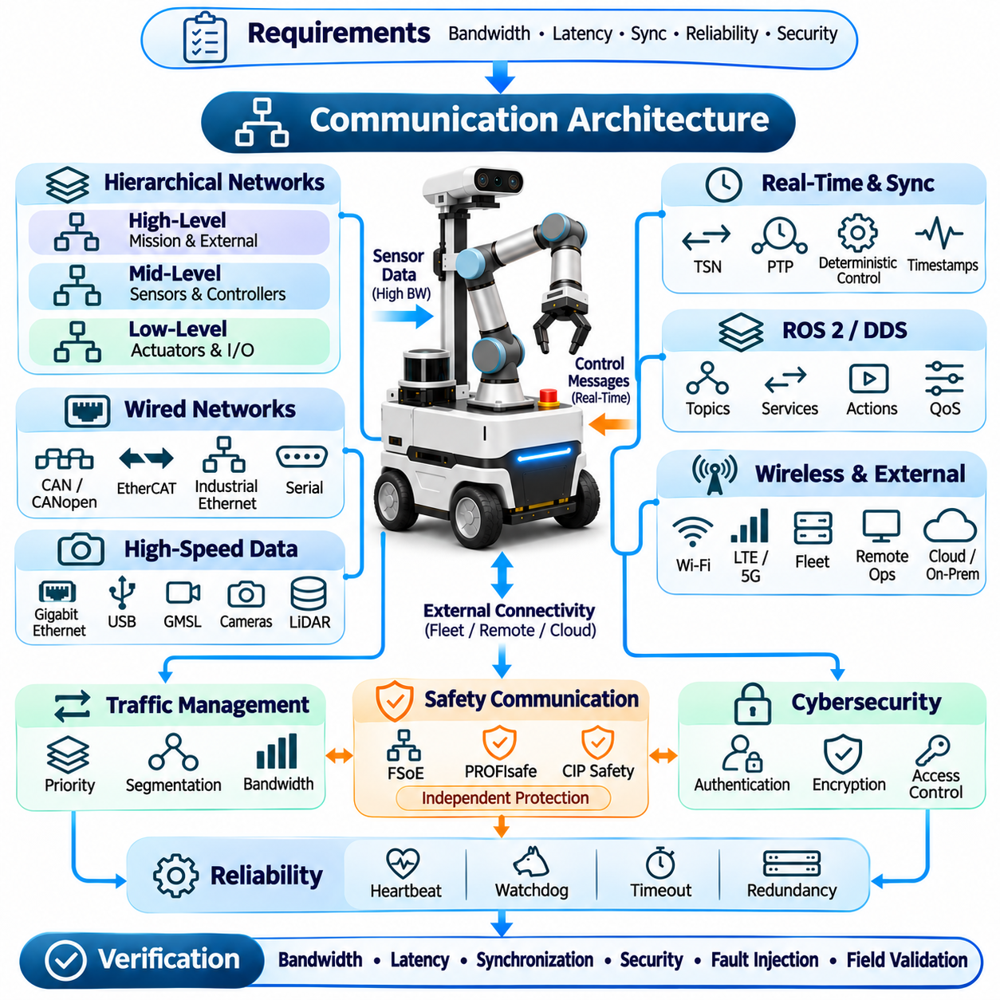{width="7.268055555555556in" height="7.268055555555556in"}

Communication architecture defines the network structure, communication protocols, data exchange mechanisms, and connectivity relationships required for a mobile manipulator. It integrates sensors, embedded controllers, computing platforms, robotic manipulators, safety devices, and external infrastructure into a coordinated communication environment that supports reliable and timely information exchange.

Communication architecture development begins with product requirements, functional architecture, sensor architecture, compute architecture, and control architecture. Data transmission rates, communication latency, synchronization accuracy, network reliability, cybersecurity, and operational coverage establish the principal design parameters. These requirements guide network topology, protocol selection, and interface definition.

Hierarchical communication architecture organizes connectivity according to operational responsibilities and timing requirements. Low-level communication networks connect actuators and embedded controllers, intermediate networks support sensor data exchange and subsystem coordination, and high-level networks provide mission management and external connectivity. This separation improves network scalability and fault isolation.

Internal communication architecture establishes wired connectivity between distributed components within the mobile manipulator. Controller Area Network (CAN), CANopen, EtherCAT, Industrial Ethernet, and serial communication interfaces provide different combinations of transmission performance and deterministic behavior. Protocol selection must consider bandwidth, latency, electrical robustness, and component compatibility.

Industrial Ethernet architecture supports high-bandwidth communication between sensors, computing platforms, and distributed control systems. Gigabit Ethernet and higher-speed Ethernet interfaces enable efficient transmission of high-resolution images, three-dimensional point clouds, and operational data. Network switches, traffic segmentation, and bandwidth allocation must accommodate concurrent communication workloads.

Real-time communication architecture supports control functions that require predictable data transmission and bounded communication delays. EtherCAT, Time-Sensitive Networking (TSN), and other deterministic communication mechanisms may support synchronized actuator control and distributed feedback processing. Communication latency, transmission jitter, packet loss, and synchronization accuracy must be evaluated.

Sensor communication architecture defines how measurements are transmitted from distributed sensing devices to perception and control platforms. Ethernet, USB, GMSL, and serial interfaces provide connectivity for cameras, LiDAR, inertial measurement units, and other sensors. Interface selection must consider data throughput, timestamp integrity, cable limitations, electromagnetic interference, and acquisition frequency.

Middleware communication architecture establishes standardized mechanisms for exchanging information between robotic software components. Robot Operating System 2 (ROS 2) and Data Distribution Service (DDS) support distributed communication through topics, services, and actions at the application layer. Quality of Service (QoS) policies must be configured according to reliability, latency, message freshness, and data delivery requirements.

Time synchronization architecture ensures that distributed sensors, computing platforms, and control systems operate with consistent temporal references. Precision Time Protocol (PTP), hardware synchronization signals, and synchronized system clocks support accurate timestamp generation and coordinated execution. Synchronization requirements must reflect platform motion, manipulation precision, and sensor fusion performance.

Wireless communication architecture enables connectivity between mobile manipulators and external operational infrastructure. Wi-Fi, Long-Term Evolution (LTE), and fifth-generation mobile networks (5G) provide different combinations of coverage, bandwidth, latency, and mobility support. Wireless network selection must consider operational environments, roaming performance, interference, and communication availability.

External communication architecture connects the mobile manipulator to fleet management systems, remote operation platforms, industrial automation infrastructure, and cloud or on-premises servers. Standardized application interfaces, message-oriented communication, and industrial integration protocols support mission assignment, operational monitoring, diagnostic reporting, and coordinated multi-robot operations.

Network traffic management establishes communication priorities according to operational importance and timing sensitivity. Control commands, sensor streams, safety-related messages, diagnostic information, and software updates impose different network requirements. Traffic prioritization, network segmentation, bandwidth reservation, and congestion management help prevent noncritical communication from disrupting essential functions.

Communication cybersecurity architecture protects robotic systems against unauthorized access, malicious commands, data manipulation, and network intrusion. Authentication, encryption, access control, secure communication protocols, and network isolation must be implemented according to cybersecurity requirements. Remote connections and software update mechanisms require controlled permissions and traceable security events.

Communication reliability architecture addresses network congestion, packet loss, connection interruptions, synchronization failures, and degraded transmission performance. Heartbeat messages, communication watchdogs, sequence monitoring, timeout mechanisms, and redundant network paths may improve fault detection and availability. Autonomous functions must support controlled responses when external connectivity becomes unavailable.

Safety-related communication architecture establishes dependable information exchange between safety controllers, protective sensors, and safety-rated actuators. Safety communication protocols such as Functional Safety over EtherCAT (FSoE), PROFIsafe, and CIP Safety may be selected according to system requirements. Ordinary communication failures must not compromise independently implemented protective functions or required safety integrity.

Communication architecture verification combines network performance testing, bandwidth measurement, latency analysis, synchronization assessment, cybersecurity evaluation, and communication fault injection. Representative scenarios must include simultaneous sensor streaming, coordinated motion, wireless roaming, and network interruptions. Verified results establish the foundation for subsystem integration, system testing, and field validation.

통신 아키텍처(Communication Architecture)는 모바일 매니퓰레이터(Mobile Manipulator)에 필요한 네트워크 구조(Network Structure), 통신 프로토콜(Communication Protocol), 데이터 교환 메커니즘(Data Exchange Mechanism), 연결 관계(Connectivity Relationship)를 정의한다. 센서(Sensor), 임베디드 제어기(Embedded Controller), 컴퓨팅 플랫폼(Computing Platform), 로봇 매니퓰레이터(Robotic Manipulator), 안전 장치(Safety Device), 외부 인프라(External Infrastructure)를 하나의 유기적으로 연결된 통신 환경(Communication Environment)으로 통합하여 신뢰성 있고 적시성 있는 정보 교환(Information Exchange)을 지원한다.

통신 아키텍처 개발(Communication Architecture Development)은 제품 요구사항(Product Requirements), 기능 아키텍처(Functional Architecture), 센서 아키텍처(Sensor Architecture), 컴퓨팅 아키텍처(Compute Architecture), 제어 아키텍처(Control Architecture)를 기반으로 시작된다. 데이터 전송률(Data Transmission Rate), 통신 지연시간(Communication Latency), 동기화 정확도(Synchronization Accuracy), 네트워크 신뢰성(Network Reliability), 사이버 보안(Cybersecurity), 운영 통신 범위(Operational Coverage)는 주요 설계 매개변수(Design Parameter)를 구성한다. 이러한 요구사항은 네트워크 토폴로지(Network Topology), 프로토콜 선정(Protocol Selection), 인터페이스 정의(Interface Definition)의 기준이 된다.

계층형 통신 아키텍처(Hierarchical Communication Architecture)는 운영 책임(Operational Responsibility)과 타이밍 요구사항(Timing Requirements)에 따라 연결 구조(Connectivity)를 구성한다. 하위 계층 통신 네트워크(Low-Level Communication Network)는 작동기(Actuator)와 임베디드 제어기를 연결하고, 중간 계층 네트워크(Intermediate Network)는 센서 데이터 교환(Sensor Data Exchange)과 하위 시스템 협조(Subsystem Coordination)를 지원하며, 상위 계층 네트워크(High-Level Network)는 임무 관리(Mission Management)와 외부 연결성(External Connectivity)을 제공한다. 이러한 분리는 네트워크 확장성(Network Scalability)과 장애 격리(Fault Isolation)를 향상시킨다.

내부 통신 아키텍처(Internal Communication Architecture)는 모바일 매니퓰레이터 내부에 분산된 구성요소(Distributed Component) 사이의 유선 연결성(Wired Connectivity)을 확립한다. 제어기 영역 네트워크(Controller Area Network, CAN), CANopen, EtherCAT, 산업용 이더넷(Industrial Ethernet), 직렬 통신 인터페이스(Serial Communication Interface)는 서로 다른 전송 성능(Transmission Performance)과 결정론적 동작(Deterministic Behavior)의 조합을 제공한다. 프로토콜 선정은 대역폭(Bandwidth), 지연시간(Latency), 전기적 강건성(Electrical Robustness), 구성요소 호환성(Component Compatibility)을 고려해야 한다.

산업용 이더넷 아키텍처(Industrial Ethernet Architecture)는 센서, 컴퓨팅 플랫폼, 분산 제어 시스템(Distributed Control System) 사이의 고대역폭 통신(High-Bandwidth Communication)을 지원한다. 기가비트 이더넷(Gigabit Ethernet)과 고속 이더넷 인터페이스(High-Speed Ethernet Interface)는 고해상도 이미지(High-Resolution Image), 3차원 포인트 클라우드(Three-Dimensional Point Cloud), 운영 데이터(Operational Data)의 효율적인 전송을 가능하게 한다. 네트워크 스위치(Network Switch), 트래픽 분할(Traffic Segmentation), 대역폭 할당(Bandwidth Allocation)은 동시에 발생하는 통신 작업부하(Concurrent Communication Workload)를 수용할 수 있어야 한다.

실시간 통신 아키텍처(Real-Time Communication Architecture)는 예측 가능한 데이터 전송(Predictable Data Transmission)과 제한된 통신 지연시간(Bounded Communication Delay)을 요구하는 제어 기능(Control Function)을 지원한다. EtherCAT, 시간 민감형 네트워킹(Time-Sensitive Networking, TSN), 기타 결정론적 통신 메커니즘(Deterministic Communication Mechanism)은 동기화된 작동기 제어(Synchronized Actuator Control)와 분산 피드백 처리(Distributed Feedback Processing)를 지원할 수 있다. 통신 지연시간, 전송 지터(Transmission Jitter), 패킷 손실(Packet Loss), 동기화 정확도는 체계적으로 평가되어야 한다.

센서 통신 아키텍처(Sensor Communication Architecture)는 분산된 센싱 장치(Distributed Sensing Device)에서 인식 및 제어 플랫폼(Perception and Control Platform)으로 측정값(Measurement)이 전송되는 방식을 정의한다. 이더넷(Ethernet), 범용 직렬 버스(Universal Serial Bus, USB), 기가비트 멀티미디어 직렬 링크(Gigabit Multimedia Serial Link, GMSL), 직렬 인터페이스(Serial Interface)는 카메라(Camera), 라이다(LiDAR), 관성 측정 장치(Inertial Measurement Unit, IMU), 기타 센서의 연결성을 제공한다. 인터페이스 선정은 데이터 처리량(Data Throughput), 타임스탬프 무결성(Timestamp Integrity), 케이블 제약조건(Cable Limitation), 전자기 간섭(Electromagnetic Interference, EMI), 데이터 획득 주파수(Acquisition Frequency)를 고려해야 한다.

미들웨어 통신 아키텍처(Middleware Communication Architecture)는 로봇 소프트웨어 구성요소(Robotic Software Component) 사이에서 정보를 교환하기 위한 표준화된 메커니즘(Standardized Mechanism)을 확립한다. 로봇 운영체제 2(Robot Operating System 2, ROS 2)와 데이터 분산 서비스(Data Distribution Service, DDS)는 응용 계층(Application Layer)의 토픽(Topic), 서비스(Service), 액션(Action)을 통해 분산 통신(Distributed Communication)을 지원한다. 서비스 품질(Quality of Service, QoS) 정책은 신뢰성(Reliability), 지연시간(Latency), 메시지 최신성(Message Freshness), 데이터 전달 요구사항(Data Delivery Requirements)에 따라 구성되어야 한다.

시간 동기화 아키텍처(Time Synchronization Architecture)는 분산 센서(Distributed Sensor), 컴퓨팅 플랫폼, 제어 시스템이 일관된 시간 기준(Consistent Temporal Reference)을 사용하여 동작하도록 보장한다. 정밀 시간 프로토콜(Precision Time Protocol, PTP), 하드웨어 동기화 신호(Hardware Synchronization Signal), 동기화된 시스템 클록(Synchronized System Clock)은 정확한 타임스탬프 생성(Timestamp Generation)과 협조 실행(Coordinated Execution)을 지원한다. 동기화 요구사항(Synchronization Requirements)은 플랫폼 동작(Platform Motion), 조작 정밀도(Manipulation Precision), 센서 융합 성능(Sensor Fusion Performance)을 반영해야 한다.

무선 통신 아키텍처(Wireless Communication Architecture)는 모바일 매니퓰레이터와 외부 운영 인프라(External Operational Infrastructure) 사이의 연결성을 제공한다. 와이파이(Wi-Fi), 장기 진화 이동통신(Long-Term Evolution, LTE), 5세대 이동통신 네트워크(Fifth-Generation Mobile Network, 5G)는 서로 다른 통신 범위(Coverage), 대역폭(Bandwidth), 지연시간(Latency), 이동성 지원(Mobility Support)의 조합을 제공한다. 무선 네트워크 선정(Wireless Network Selection)은 운영 환경(Operational Environment), 로밍 성능(Roaming Performance), 간섭(Interference), 통신 가용성(Communication Availability)을 고려해야 한다.

외부 통신 아키텍처(External Communication Architecture)는 모바일 매니퓰레이터를 플릿 관리 시스템(Fleet Management System), 원격 운영 플랫폼(Remote Operation Platform), 산업 자동화 인프라(Industrial Automation Infrastructure), 클라우드(Cloud) 또는 온프레미스 서버(On-Premises Server)와 연결한다. 표준화된 애플리케이션 인터페이스(Standardized Application Interface), 메시지 지향 통신(Message-Oriented Communication), 산업 통합 프로토콜(Industrial Integration Protocol)은 임무 할당(Mission Assignment), 운영 모니터링(Operational Monitoring), 진단 보고(Diagnostic Reporting), 협조형 다중 로봇 운영(Coordinated Multi-Robot Operation)을 지원한다.

네트워크 트래픽 관리(Network Traffic Management)는 운영 중요도(Operational Importance)와 타이밍 민감도(Timing Sensitivity)에 따라 통신 우선순위(Communication Priority)를 확립한다. 제어 명령(Control Command), 센서 데이터 스트림(Sensor Stream), 안전 관련 메시지(Safety-Related Message), 진단 정보(Diagnostic Information), 소프트웨어 업데이트(Software Update)는 서로 다른 네트워크 요구사항(Network Requirements)을 가진다. 트래픽 우선순위 설정(Traffic Prioritization), 네트워크 분할(Network Segmentation), 대역폭 예약(Bandwidth Reservation), 혼잡 관리(Congestion Management)는 비핵심 통신(Noncritical Communication)이 필수 기능(Essential Function)을 방해하지 않도록 지원한다.

통신 사이버 보안 아키텍처(Communication Cybersecurity Architecture)는 무단 접근(Unauthorized Access), 악의적인 명령(Malicious Command), 데이터 조작(Data Manipulation), 네트워크 침입(Network Intrusion)으로부터 로봇 시스템(Robotic System)을 보호한다. 인증(Authentication), 암호화(Encryption), 접근 제어(Access Control), 보안 통신 프로토콜(Secure Communication Protocol), 네트워크 격리(Network Isolation)는 사이버 보안 요구사항(Cybersecurity Requirements)에 따라 구현되어야 한다. 원격 연결(Remote Connection)과 소프트웨어 업데이트 메커니즘(Software Update Mechanism)은 통제된 접근 권한(Controlled Permission)과 추적 가능한 보안 이벤트(Traceable Security Event)를 요구한다.

통신 신뢰성 아키텍처(Communication Reliability Architecture)는 네트워크 혼잡(Network Congestion), 패킷 손실(Packet Loss), 연결 중단(Connection Interruption), 동기화 장애(Synchronization Failure), 전송 성능 저하(Degraded Transmission Performance)를 고려한다. 하트비트 메시지(Heartbeat Message), 통신 워치독(Communication Watchdog), 시퀀스 모니터링(Sequence Monitoring), 타임아웃 메커니즘(Timeout Mechanism), 이중화 네트워크 경로(Redundant Network Path)는 장애 검출(Fault Detection)과 가용성(Availability)을 향상시킬 수 있다. 자율 기능(Autonomous Function)은 외부 연결성(External Connectivity)이 상실되는 경우 통제된 대응(Controlled Response)을 지원해야 한다.

안전 관련 통신 아키텍처(Safety-Related Communication Architecture)는 안전 제어기(Safety Controller), 보호 센서(Protective Sensor), 안전 등급 작동기(Safety-Rated Actuator) 사이의 신뢰성 있는 정보 교환(Dependable Information Exchange)을 확립한다. EtherCAT 기반 기능 안전(Functional Safety over EtherCAT, FSoE), PROFIsafe, CIP Safety와 같은 안전 통신 프로토콜(Safety Communication Protocol)은 시스템 요구사항(System Requirements)에 따라 선정될 수 있다. 일반 통신 장애(Ordinary Communication Failure)는 독립적으로 구현된 보호 기능(Independently Implemented Protective Function)이나 요구되는 안전 무결성(Required Safety Integrity)을 저해해서는 안 된다.

통신 아키텍처 검증(Communication Architecture Verification)은 네트워크 성능 시험(Network Performance Testing), 대역폭 측정(Bandwidth Measurement), 지연시간 분석(Latency Analysis), 동기화 평가(Synchronization Assessment), 사이버 보안 평가(Cybersecurity Evaluation), 통신 장애 주입(Communication Fault Injection)을 결합한다. 대표적인 시험 시나리오(Representative Test Scenario)에는 동시 센서 데이터 스트리밍(Simultaneous Sensor Streaming), 협조 동작(Coordinated Motion), 무선 로밍(Wireless Roaming), 네트워크 중단(Network Interruption)이 포함되어야 한다. 검증된 결과는 하위 시스템 통합(Subsystem Integration), 시스템 시험(System Testing), 현장 유효성 검증(Field Validation)을 위한 기반을 확립한다.

##  

## 11 Safety Architecture

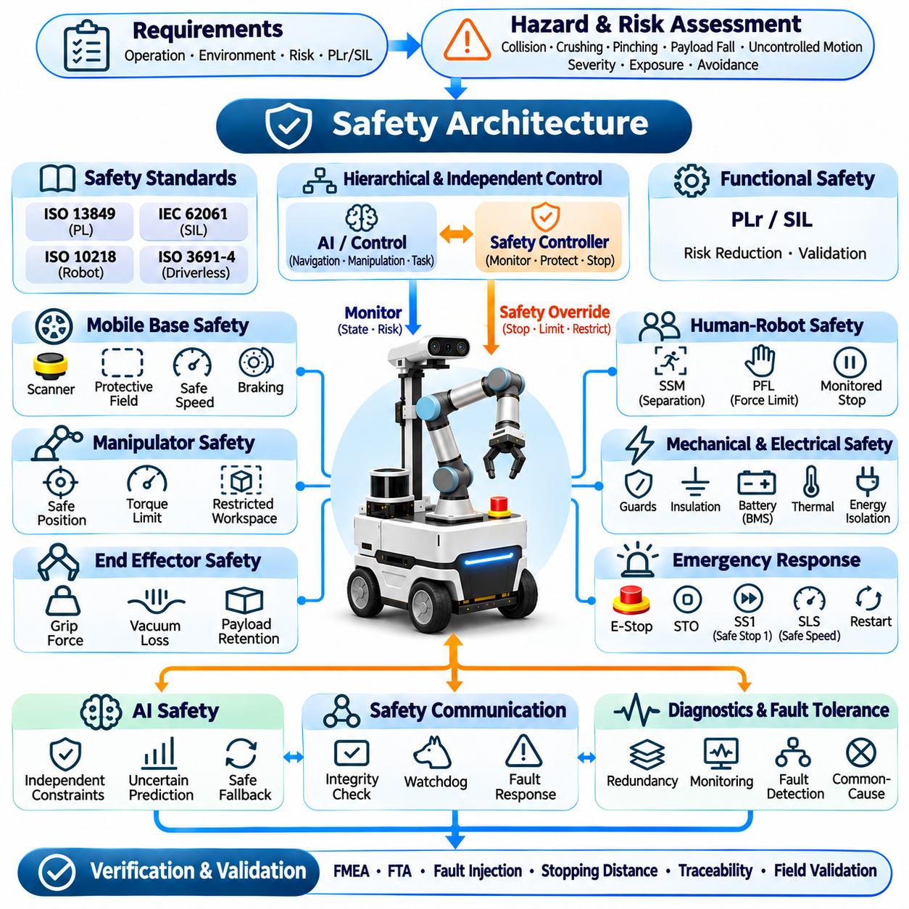{width="7.268055555555556in" height="7.268055555555556in"}

Safety architecture defines the protective mechanisms, safety-related control functions, monitoring structures, and risk mitigation strategies required for a mobile manipulator. It integrates mechanical safety, electrical safety, functional safety, operational safety, and human-robot interaction safety into a unified framework that protects personnel, equipment, and surrounding environments throughout the product lifecycle.

Safety architecture development begins with product requirements, operational scenarios, functional architecture, mechanical architecture, and control architecture. Potential hazards must be identified throughout transportation, autonomous navigation, robotic manipulation, charging, maintenance, and abnormal operation. Risk assessment establishes the required protective measures and corresponding safety performance targets.

Hazard identification addresses risks associated with mobile platform movement, robotic arm operation, end effector activation, electrical energy, and unintended system behavior. Collision, crushing, pinching, mechanical instability, falling payloads, and uncontrolled motion represent significant hazards. Risk evaluation must consider injury severity, exposure frequency, and the possibility of avoiding hazardous situations.

Functional safety architecture establishes safety-related functions that detect hazardous conditions and initiate appropriate protective responses. International standards such as ISO 13849, IEC 62061, ISO 10218, and ISO 3691-4 provide relevant engineering frameworks where applicable. Required Performance Levels (PLr) or Safety Integrity Levels (SIL) must be determined through applicable risk assessment methodologies.

Hierarchical safety architecture separates ordinary operational control from safety-related monitoring and protective control functions. Dedicated safety controllers, safety-rated sensors, and validated protective circuits provide independent or appropriately isolated safety mechanisms. Safety-related functions must retain authority over navigation, manipulation, task execution, and AI-generated commands during hazardous conditions.

Mobile platform safety architecture addresses collisions, unintended movement, excessive speed, braking failures, and platform instability. Safety laser scanners, protective fields, emergency stop devices, and safety-rated speed monitoring support risk reduction during autonomous navigation. Protective field dimensions must consider travel direction, operating velocity, braking distance, payload conditions, and system response time.

Manipulator safety architecture establishes protective mechanisms for robotic joint movement, workspace boundaries, interaction forces, and unintended contact. Safe position monitoring, speed limitation, torque monitoring, and restricted workspace definition may reduce manipulation-related hazards. Safety constraints must account for the combined movement of the mobile platform, robotic arm, and attached equipment.

End effector safety architecture addresses hazards associated with grippers, vacuum systems, inspection tools, and specialized manipulation devices. Unintended tool activation, excessive gripping force, loss of vacuum pressure, and accidental payload release must be considered. Protective mechanisms should maintain or safely release handled objects according to the application-specific risk assessment and failure conditions.

Human-robot interaction safety architecture establishes operational safeguards for environments shared by humans and robotic systems. Speed and Separation Monitoring (SSM), Power and Force Limiting (PFL), and safety-rated monitored stops may support collaborative operation where applicable. Human detection, protective separation distances, and interaction constraints must be validated under representative operating conditions.

Mechanical and electrical safety architecture addresses structural integrity, platform stability, electrical insulation, battery protection, thermal hazards, and energy isolation. Mechanical guards, protective enclosures, overcurrent protection, grounding, and battery management functions contribute to risk reduction. Protective measures must remain effective during normal operation, foreseeable misuse, and maintenance activities.

Emergency response architecture establishes controlled procedures for emergency stopping, protective stopping, hazardous energy isolation, and fault recovery. Safe Torque Off (STO), Safe Stop 1 (SS1), and Safely Limited Speed (SLS) may support application-specific safety functions. Stop categories, braking behavior, payload retention, and restart conditions must be defined according to identified hazards and operational requirements.

AI safety architecture establishes clear boundaries between probabilistic intelligence and safety-critical execution. AI-based perception, object recognition, task reasoning, and adaptive behavior must not bypass required protective functions. Uncertain predictions, invalid commands, and unexpected model behavior should trigger predefined responses, while independently validated safety mechanisms retain control over hazardous actions.

Safety communication architecture ensures dependable information exchange between safety-rated sensors, controllers, and actuators. Certified safety communication protocols, message integrity checks, sequence monitoring, and communication watchdogs may support required safety integrity. Communication interruptions, corrupted messages, and synchronization failures must result in predefined responses consistent with the safety design.

Fault tolerance and diagnostic architecture addresses component failures, sensor degradation, actuator abnormalities, wiring faults, and unexpected communication interruptions. Redundancy, diagnostic coverage, cross-monitoring, and fault detection mechanisms must be selected according to required safety performance. Common-cause failures and systematic design faults must also be considered when evaluating protective system reliability.

Safety verification and validation combine Failure Mode and Effects Analysis (FMEA), Fault Tree Analysis (FTA), safety function testing, fault injection, stopping distance measurement, and representative operational experiments. Safety requirements, implementation evidence, test results, residual risks, and corrective actions must remain traceable. Validated results establish the foundation for regulatory compliance, field deployment, and lifecycle safety management.

안전 아키텍처(Safety Architecture)는 모바일 매니퓰레이터(Mobile Manipulator)에 필요한 보호 메커니즘(Protective Mechanism), 안전 관련 제어 기능(Safety-Related Control Function), 모니터링 구조(Monitoring Structure), 위험 완화 전략(Risk Mitigation Strategy)을 정의한다. 기계적 안전(Mechanical Safety), 전기적 안전(Electrical Safety), 기능 안전(Functional Safety), 운영 안전(Operational Safety), 인간-로봇 상호작용 안전(Human-Robot Interaction Safety)을 하나의 통합 프레임워크(Unified Framework)로 구성하여 제품 수명주기(Product Lifecycle) 전반에 걸쳐 작업자, 장비 및 주변 환경을 보호한다.

안전 아키텍처 개발(Safety Architecture Development)은 제품 요구사항(Product Requirements), 운영 시나리오(Operational Scenario), 기능 아키텍처(Functional Architecture), 기계 아키텍처(Mechanical Architecture), 제어 아키텍처(Control Architecture)를 기반으로 시작된다. 운송(Transportation), 자율주행(Autonomous Navigation), 로봇 조작(Robotic Manipulation), 충전(Charging), 유지보수(Maintenance), 비정상 운영(Abnormal Operation) 전반에 걸쳐 잠재적 위험원(Potential Hazard)을 식별해야 한다. 위험성 평가(Risk Assessment)는 필요한 보호 조치(Protective Measure)와 이에 대응하는 안전 성능 목표(Safety Performance Target)를 확립한다.

위험원 식별(Hazard Identification)은 이동 플랫폼 동작(Mobile Platform Movement), 로봇 팔 동작(Robotic Arm Operation), 말단 작동기 활성화(End Effector Activation), 전기 에너지(Electrical Energy), 의도하지 않은 시스템 동작(Unintended System Behavior)과 관련된 위험을 고려한다. 충돌(Collision), 압착(Crushing), 끼임(Pinching), 기계적 불안정성(Mechanical Instability), 적재물 낙하(Falling Payload), 통제되지 않은 동작(Uncontrolled Motion)은 주요 위험원을 구성한다. 위험 평가(Risk Evaluation)는 부상 심각도(Injury Severity), 위험 노출 빈도(Exposure Frequency), 위험 상황 회피 가능성(Possibility of Avoiding Hazardous Situations)을 고려해야 한다.

기능 안전 아키텍처(Functional Safety Architecture)는 위험 조건(Hazardous Condition)을 검출하고 적절한 보호 대응(Protective Response)을 실행하는 안전 관련 기능(Safety-Related Function)을 확립한다. ISO 13849, IEC 62061, ISO 10218, ISO 3691-4와 같은 국제 표준(International Standard)은 적용 범위에 따라 관련 엔지니어링 프레임워크(Engineering Framework)를 제공한다. 요구 성능 수준(Required Performance Level, PLr) 또는 안전 무결성 수준(Safety Integrity Level, SIL)은 적용 가능한 위험성 평가 방법론(Risk Assessment Methodology)을 통해 결정되어야 한다.

계층형 안전 아키텍처(Hierarchical Safety Architecture)는 일반적인 운영 제어(Operational Control)를 안전 관련 모니터링(Safety-Related Monitoring) 및 보호 제어 기능(Protective Control Function)과 분리한다. 전용 안전 제어기(Dedicated Safety Controller), 안전 등급 센서(Safety-Rated Sensor), 유효성이 검증된 보호 회로(Validated Protective Circuit)는 독립적이거나 적절하게 격리된 안전 메커니즘(Safety Mechanism)을 제공한다. 안전 관련 기능은 위험 조건에서 자율주행(Navigation), 로봇 조작(Manipulation), 작업 실행(Task Execution), 인공지능 생성 명령(AI-Generated Command)에 대한 우선적인 제어 권한(Control Authority)을 유지해야 한다.

이동 플랫폼 안전 아키텍처(Mobile Platform Safety Architecture)는 충돌(Collision), 의도하지 않은 움직임(Unintended Movement), 과도한 속도(Excessive Speed), 제동 장애(Braking Failure), 플랫폼 불안정성(Platform Instability)을 고려한다. 안전 레이저 스캐너(Safety Laser Scanner), 보호 영역(Protective Field), 비상 정지 장치(Emergency Stop Device), 안전 등급 속도 모니터링(Safety-Rated Speed Monitoring)은 자율주행 과정에서 위험 감소(Risk Reduction)를 지원한다. 보호 영역의 크기(Protective Field Dimension)는 이동 방향(Travel Direction), 운영 속도(Operating Velocity), 제동 거리(Braking Distance), 적재 하중 조건(Payload Condition), 시스템 응답시간(System Response Time)을 고려해야 한다.

매니퓰레이터 안전 아키텍처(Manipulator Safety Architecture)는 로봇 관절 동작(Robotic Joint Movement), 작업공간 경계(Workspace Boundary), 상호작용 힘(Interaction Force), 의도하지 않은 접촉(Unintended Contact)에 대한 보호 메커니즘을 확립한다. 안전 위치 모니터링(Safe Position Monitoring), 속도 제한(Speed Limitation), 토크 모니터링(Torque Monitoring), 제한 작업공간 정의(Restricted Workspace Definition)는 로봇 조작과 관련된 위험을 감소시킬 수 있다. 안전 제약조건(Safety Constraints)은 이동 플랫폼, 로봇 팔, 부착 장비(Attached Equipment)의 결합 동작(Combined Movement)을 고려해야 한다.

말단 작동기 안전 아키텍처(End Effector Safety Architecture)는 그리퍼(Gripper), 진공 시스템(Vacuum System), 검사 도구(Inspection Tool), 특수 조작 장치(Specialized Manipulation Device)와 관련된 위험원을 고려한다. 의도하지 않은 도구 활성화(Unintended Tool Activation), 과도한 파지력(Excessive Gripping Force), 진공 압력 손실(Loss of Vacuum Pressure), 우발적인 적재물 해제(Accidental Payload Release)를 고려해야 한다. 보호 메커니즘은 응용 분야별 위험성 평가(Application-Specific Risk Assessment)와 고장 조건(Failure Condition)에 따라 취급 중인 객체를 안전하게 유지하거나 해제할 수 있어야 한다.

인간-로봇 상호작용 안전 아키텍처(Human-Robot Interaction Safety Architecture)는 인간과 로봇 시스템이 공유하는 환경(Shared Environment)에 대한 운영 보호 조치(Operational Safeguard)를 확립한다. 속도 및 분리 거리 모니터링(Speed and Separation Monitoring, SSM), 동력 및 힘 제한(Power and Force Limiting, PFL), 안전 등급 감시 정지(Safety-Rated Monitored Stop)는 적용 가능한 경우 협업 운영(Collaborative Operation)을 지원할 수 있다. 인간 검출(Human Detection), 보호 분리 거리(Protective Separation Distance), 상호작용 제약조건(Interaction Constraints)은 대표적인 운영 조건(Representative Operating Condition)에서 유효성이 검증되어야 한다.

기계 및 전기 안전 아키텍처(Mechanical and Electrical Safety Architecture)는 구조적 무결성(Structural Integrity), 플랫폼 안정성(Platform Stability), 전기 절연(Electrical Insulation), 배터리 보호(Battery Protection), 열적 위험(Thermal Hazard), 에너지 격리(Energy Isolation)를 고려한다. 기계적 보호 가드(Mechanical Guard), 보호 인클로저(Protective Enclosure), 과전류 보호(Overcurrent Protection), 접지(Grounding), 배터리 관리 기능(Battery Management Function)은 위험 감소에 기여한다. 보호 조치는 정상 운영(Normal Operation), 예측 가능한 오사용(Foreseeable Misuse), 유지보수 활동(Maintenance Activity) 중에도 유효성을 유지해야 한다.

비상 대응 아키텍처(Emergency Response Architecture)는 비상 정지(Emergency Stop), 보호 정지(Protective Stop), 위험 에너지 격리(Hazardous Energy Isolation), 장애 복구(Fault Recovery)를 위한 통제된 절차(Controlled Procedure)를 확립한다. 안전 토크 차단(Safe Torque Off, STO), 안전 정지 1(Safe Stop 1, SS1), 안전 제한 속도(Safely Limited Speed, SLS)는 응용 분야별 안전 기능(Application-Specific Safety Function)을 지원할 수 있다. 정지 범주(Stop Category), 제동 동작(Braking Behavior), 적재물 유지(Payload Retention), 재시작 조건(Restart Condition)은 식별된 위험원(Identified Hazard)과 운영 요구사항(Operational Requirements)에 따라 정의되어야 한다.

인공지능 안전 아키텍처(AI Safety Architecture)는 확률적 지능(Probabilistic Intelligence)과 안전 필수 실행(Safety-Critical Execution) 사이에 명확한 경계를 확립한다. 인공지능 기반 인식(AI-Based Perception), 객체 인식(Object Recognition), 작업 추론(Task Reasoning), 적응형 행동(Adaptive Behavior)은 필수 보호 기능(Required Protective Function)을 우회해서는 안 된다. 불확실한 예측(Uncertain Prediction), 유효하지 않은 명령(Invalid Command), 예기치 않은 모델 동작(Unexpected Model Behavior)은 사전에 정의된 대응(Predefined Response)을 유발해야 하며, 독립적으로 유효성이 검증된 안전 메커니즘은 위험 행동(Hazardous Action)에 대한 제어 권한을 유지해야 한다.

안전 통신 아키텍처(Safety Communication Architecture)는 안전 등급 센서(Safety-Rated Sensor), 제어기(Controller), 작동기(Actuator) 사이의 신뢰성 있는 정보 교환(Dependable Information Exchange)을 보장한다. 인증된 안전 통신 프로토콜(Certified Safety Communication Protocol), 메시지 무결성 검사(Message Integrity Check), 시퀀스 모니터링(Sequence Monitoring), 통신 워치독(Communication Watchdog)은 요구되는 안전 무결성(Required Safety Integrity)을 지원할 수 있다. 통신 중단(Communication Interruption), 손상된 메시지(Corrupted Message), 동기화 장애(Synchronization Failure)는 안전 설계(Safety Design)에 부합하는 사전 정의된 대응으로 이어져야 한다.

내고장성 및 진단 아키텍처(Fault Tolerance and Diagnostic Architecture)는 구성요소 고장(Component Failure), 센서 성능 저하(Sensor Degradation), 작동기 이상(Actuator Abnormality), 배선 고장(Wiring Fault), 예기치 않은 통신 중단(Unexpected Communication Interruption)을 고려한다. 이중화(Redundancy), 진단 커버리지(Diagnostic Coverage), 교차 모니터링(Cross-Monitoring), 고장 검출 메커니즘(Fault Detection Mechanism)은 요구되는 안전 성능(Required Safety Performance)에 따라 선정되어야 한다. 보호 시스템의 신뢰성(Protective System Reliability)을 평가할 때는 공통 원인 고장(Common-Cause Failure)과 체계적 설계 결함(Systematic Design Fault)도 고려해야 한다.

안전 검증 및 유효성 검증(Safety Verification and Validation)은 고장 형태 및 영향 분석(Failure Mode and Effects Analysis, FMEA), 결함 트리 분석(Fault Tree Analysis, FTA), 안전 기능 시험(Safety Function Testing), 고장 주입(Fault Injection), 정지 거리 측정(Stopping Distance Measurement), 대표적인 운영 실험(Representative Operational Experiment)을 결합한다. 안전 요구사항(Safety Requirements), 구현 증거(Implementation Evidence), 시험 결과(Test Result), 잔여 위험(Residual Risk), 시정 조치(Corrective Action)는 추적 가능성(Traceability)을 유지해야 한다. 유효성이 검증된 결과는 규제 준수(Regulatory Compliance), 현장 배포(Field Deployment), 수명주기 안전 관리(Lifecycle Safety Management)를 위한 기반을 확립한다.

##  

## 12 Interface Control Documents

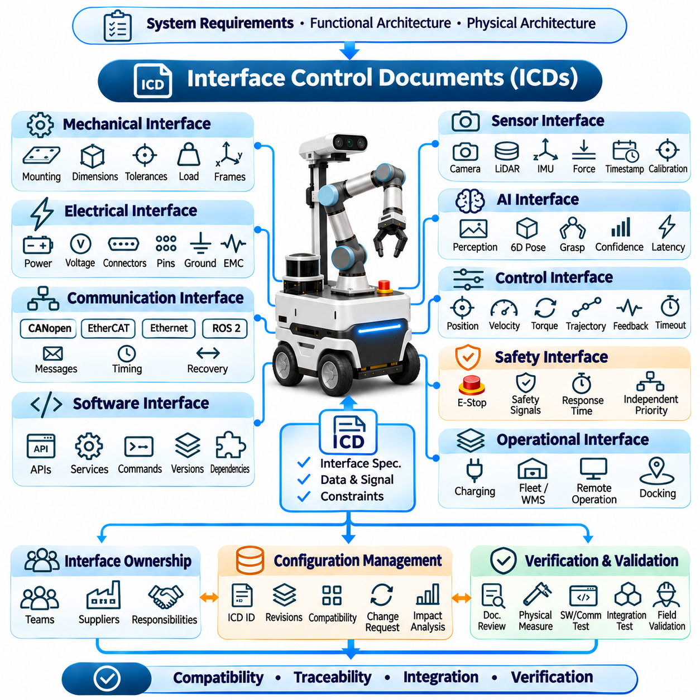{width="7.268055555555556in" height="7.268055555555556in"}

Interface Control Documents (ICDs) establish formal specifications for the interactions between hardware, software, electrical, mechanical, communication, and safety subsystems within a mobile manipulator. They define interface responsibilities, technical characteristics, operational constraints, and integration conditions to ensure consistent development across multiple engineering disciplines and participating organizations.

Interface Control Document development begins with system requirements, functional architecture, physical architecture, and subsystem design specifications. Each interface must be identified according to its purpose, participating components, information exchange requirements, and physical dependencies. Interface definitions establish a common technical baseline for independent subsystem development and subsequent system integration.

Mechanical interface specifications define the physical relationships between the mobile platform, robotic manipulator, end effector, sensor assemblies, and auxiliary equipment. Mounting dimensions, fastening mechanisms, geometric tolerances, coordinate references, load capacities, and structural requirements must be documented. These specifications ensure mechanical compatibility, structural integrity, and repeatable assembly.

Electrical interface specifications define power distribution connections, operating voltages, current limitations, connector types, pin assignments, grounding arrangements, and electrical protection requirements. Power consumption profiles, transient loads, insulation requirements, and electromagnetic compatibility constraints must also be documented. Consistent electrical interfaces reduce integration errors and electrical failure risks.

Communication interface specifications establish network configurations, communication protocols, addressing schemes, message structures, transmission frequencies, and timing requirements. Interfaces based on CANopen, EtherCAT, Ethernet, ROS 2, and other communication technologies must include appropriate implementation parameters. Communication error handling and connection recovery mechanisms must also be defined.

Software interface specifications describe interactions between navigation software, manipulation software, perception modules, task planners, fleet management systems, and supervisory controllers. Application Programming Interfaces (APIs), data structures, service definitions, command formats, and execution conditions must be documented. Version compatibility and software dependencies require systematic configuration management.

Sensor interface specifications define measurement formats, acquisition frequencies, timestamp conventions, coordinate systems, calibration parameters, and data quality indicators. Camera images, LiDAR point clouds, inertial measurements, force measurements, and position feedback must follow consistent interface definitions. Sensor validity conditions and abnormal measurement indicators must also be explicitly specified.

AI interface specifications establish the exchange of information between perception models, object pose estimation modules, grasp detection systems, robot agents, and execution controllers. Input dimensions, preprocessing requirements, output formats, confidence values, inference latency, and model compatibility must be documented. Downstream systems must clearly interpret prediction uncertainty and invalid inference results.

Control interface specifications define command structures, feedback information, execution frequencies, operational limits, and synchronization requirements between distributed controllers. Position, velocity, acceleration, torque, and trajectory commands must include consistent units and coordinate references. Command acknowledgment, timeout conditions, and abnormal execution responses must be explicitly defined.

Safety interface specifications establish communication and physical connections between safety controllers, protective sensors, emergency stop devices, motor drives, and robotic subsystems. Safety signal definitions, protective function priorities, response times, fault detection requirements, and restart conditions must be documented. Ordinary operational interfaces must not override or compromise required safety functions.

Operational interface specifications define interactions between the mobile manipulator and external systems such as charging stations, industrial equipment, warehouse management systems, and remote operation platforms. Mission commands, docking sequences, equipment interlocks, operational states, and completion acknowledgments must be standardized. Interface failures must trigger predefined recovery or protective responses.

Interface ownership establishes clear responsibilities for organizations, engineering teams, subsystem suppliers, and integration personnel. Each interface must have designated owners responsible for specification development, implementation, verification, and change approval. Responsibility boundaries must distinguish technical interface compatibility from subsystem ownership, intellectual property rights, and contractual obligations.

Interface configuration management ensures that approved specifications remain consistent throughout system development and product lifecycle management. Document identifiers, revision histories, compatibility matrices, engineering change requests, and approval records support controlled modifications. Proposed interface changes must undergo impact analysis to evaluate dependencies, integration risks, and verification requirements.

Interface verification and validation combine document reviews, compatibility assessments, physical measurements, software interface testing, communication testing, and subsystem integration experiments. Normal operation, boundary conditions, invalid commands, communication interruptions, and component failures must be evaluated. Verified Interface Control Documents establish the technical baseline for hardware development, AI development, manipulation development, system testing, and field validation.

인터페이스 제어 문서(Interface Control Document, ICD)는 모바일 매니퓰레이터(Mobile Manipulator) 내부의 하드웨어(Hardware), 소프트웨어(Software), 전기(Electrical), 기계(Mechanical), 통신(Communication), 안전(Safety) 하위 시스템 사이의 상호작용(Interaction)에 대한 공식적인 명세(Formal Specification)를 확립한다. 인터페이스 책임(Interface Responsibility), 기술적 특성(Technical Characteristic), 운영 제약조건(Operational Constraints), 통합 조건(Integration Condition)을 정의하여 여러 엔지니어링 분야(Engineering Discipline)와 참여 조직(Participating Organization) 사이에서 일관된 개발이 이루어지도록 한다.

인터페이스 제어 문서 개발(Interface Control Document Development)은 시스템 요구사항(System Requirements), 기능 아키텍처(Functional Architecture), 물리적 아키텍처(Physical Architecture), 하위 시스템 설계 명세(Subsystem Design Specification)를 기반으로 시작된다. 각 인터페이스는 목적(Purpose), 참여 구성요소(Participating Component), 정보 교환 요구사항(Information Exchange Requirements), 물리적 의존성(Physical Dependency)에 따라 식별되어야 한다. 인터페이스 정의(Interface Definition)는 독립적인 하위 시스템 개발(Independent Subsystem Development)과 후속 시스템 통합(Subsequent System Integration)을 위한 공통 기술 기준선(Common Technical Baseline)을 확립한다.

기계 인터페이스 명세(Mechanical Interface Specification)는 이동 플랫폼(Mobile Platform), 로봇 매니퓰레이터(Robotic Manipulator), 말단 작동기(End Effector), 센서 조립체(Sensor Assembly), 보조 장비(Auxiliary Equipment) 사이의 물리적 관계(Physical Relationship)를 정의한다. 장착 치수(Mounting Dimension), 체결 메커니즘(Fastening Mechanism), 기하학적 공차(Geometric Tolerance), 좌표 기준(Coordinate Reference), 하중 용량(Load Capacity), 구조적 요구사항(Structural Requirements)은 문서화되어야 한다. 이러한 명세는 기계적 호환성(Mechanical Compatibility), 구조적 무결성(Structural Integrity), 반복 가능한 조립(Repeatable Assembly)을 보장한다.

전기 인터페이스 명세(Electrical Interface Specification)는 전력 분배 연결(Power Distribution Connection), 동작 전압(Operating Voltage), 전류 제한(Current Limitation), 커넥터 유형(Connector Type), 핀 할당(Pin Assignment), 접지 구성(Grounding Arrangement), 전기적 보호 요구사항(Electrical Protection Requirements)을 정의한다. 전력 소비 프로파일(Power Consumption Profile), 과도 부하(Transient Load), 절연 요구사항(Insulation Requirements), 전자기 적합성 제약조건(Electromagnetic Compatibility Constraints)도 문서화되어야 한다. 일관된 전기 인터페이스(Consistent Electrical Interface)는 통합 오류(Integration Error)와 전기적 고장 위험(Electrical Failure Risk)을 감소시킨다.

통신 인터페이스 명세(Communication Interface Specification)는 네트워크 구성(Network Configuration), 통신 프로토콜(Communication Protocol), 주소 지정 체계(Addressing Scheme), 메시지 구조(Message Structure), 전송 주파수(Transmission Frequency), 타이밍 요구사항(Timing Requirements)을 확립한다. CANopen, EtherCAT, 이더넷(Ethernet), 로봇 운영체제 2(Robot Operating System 2, ROS 2), 기타 통신 기술(Communication Technology)을 기반으로 하는 인터페이스는 적절한 구현 매개변수(Implementation Parameter)를 포함해야 한다. 통신 오류 처리(Communication Error Handling)와 연결 복구 메커니즘(Connection Recovery Mechanism)도 정의되어야 한다.

소프트웨어 인터페이스 명세(Software Interface Specification)는 자율주행 소프트웨어(Navigation Software), 조작 소프트웨어(Manipulation Software), 인식 모듈(Perception Module), 작업 계획기(Task Planner), 플릿 관리 시스템(Fleet Management System), 감독 제어기(Supervisory Controller) 사이의 상호작용을 설명한다. 애플리케이션 프로그래밍 인터페이스(Application Programming Interface, API), 데이터 구조(Data Structure), 서비스 정의(Service Definition), 명령 형식(Command Format), 실행 조건(Execution Condition)은 문서화되어야 한다. 버전 호환성(Version Compatibility)과 소프트웨어 의존성(Software Dependency)은 체계적인 형상 관리(Configuration Management)를 요구한다.

센서 인터페이스 명세(Sensor Interface Specification)는 측정 형식(Measurement Format), 데이터 획득 주파수(Acquisition Frequency), 타임스탬프 규칙(Timestamp Convention), 좌표계(Coordinate System), 보정 매개변수(Calibration Parameter), 데이터 품질 지표(Data Quality Indicator)를 정의한다. 카메라 이미지(Camera Image), 라이다 포인트 클라우드(LiDAR Point Cloud), 관성 측정값(Inertial Measurement), 힘 측정값(Force Measurement), 위치 피드백(Position Feedback)은 일관된 인터페이스 정의를 따라야 한다. 센서 유효성 조건(Sensor Validity Condition)과 비정상 측정 지표(Abnormal Measurement Indicator)도 명확하게 명시되어야 한다.

인공지능 인터페이스 명세(AI Interface Specification)는 인식 모델(Perception Model), 객체 자세 추정 모듈(Object Pose Estimation Module), 파지 검출 시스템(Grasp Detection System), 로봇 에이전트(Robot Agent), 실행 제어기(Execution Controller) 사이의 정보 교환(Information Exchange)을 확립한다. 입력 차원(Input Dimension), 전처리 요구사항(Preprocessing Requirements), 출력 형식(Output Format), 신뢰도 값(Confidence Value), 추론 지연시간(Inference Latency), 모델 호환성(Model Compatibility)은 문서화되어야 한다. 후속 처리 시스템(Downstream System)은 예측 불확실성(Prediction Uncertainty)과 유효하지 않은 추론 결과(Invalid Inference Result)를 명확하게 해석할 수 있어야 한다.

제어 인터페이스 명세(Control Interface Specification)는 분산 제어기(Distributed Controller) 사이의 명령 구조(Command Structure), 피드백 정보(Feedback Information), 실행 주파수(Execution Frequency), 운영 한계(Operational Limit), 동기화 요구사항(Synchronization Requirements)을 정의한다. 위치(Position), 속도(Velocity), 가속도(Acceleration), 토크(Torque), 궤적 명령(Trajectory Command)은 일관된 측정 단위(Consistent Unit)와 좌표 기준(Coordinate Reference)을 포함해야 한다. 명령 수신 확인(Command Acknowledgment), 타임아웃 조건(Timeout Condition), 비정상 실행 대응(Abnormal Execution Response)은 명확하게 정의되어야 한다.

안전 인터페이스 명세(Safety Interface Specification)는 안전 제어기(Safety Controller), 보호 센서(Protective Sensor), 비상 정지 장치(Emergency Stop Device), 모터 드라이브(Motor Drive), 로봇 하위 시스템(Robotic Subsystem) 사이의 통신 및 물리적 연결(Communication and Physical Connection)을 확립한다. 안전 신호 정의(Safety Signal Definition), 보호 기능 우선순위(Protective Function Priority), 응답시간(Response Time), 고장 검출 요구사항(Fault Detection Requirements), 재시작 조건(Restart Condition)은 문서화되어야 한다. 일반 운영 인터페이스(Ordinary Operational Interface)는 필수 안전 기능(Required Safety Function)을 무효화하거나 저해해서는 안 된다.

운영 인터페이스 명세(Operational Interface Specification)는 모바일 매니퓰레이터와 충전 스테이션(Charging Station), 산업 장비(Industrial Equipment), 창고 관리 시스템(Warehouse Management System, WMS), 원격 운영 플랫폼(Remote Operation Platform)과 같은 외부 시스템(External System) 사이의 상호작용을 정의한다. 임무 명령(Mission Command), 도킹 시퀀스(Docking Sequence), 장비 인터록(Equipment Interlock), 운영 상태(Operational State), 완료 확인(Completion Acknowledgment)은 표준화되어야 한다. 인터페이스 장애(Interface Failure)가 발생하면 사전에 정의된 복구 대응(Predefined Recovery Response) 또는 보호 대응(Protective Response)이 실행되어야 한다.

인터페이스 소유권 및 관리 책임(Interface Ownership)은 참여 조직(Organization), 엔지니어링 팀(Engineering Team), 하위 시스템 공급업체(Subsystem Supplier), 통합 담당자(Integration Personnel)에 대한 명확한 책임을 확립한다. 각 인터페이스에는 명세 개발(Specification Development), 구현(Implementation), 검증(Verification), 변경 승인(Change Approval)을 담당하는 지정 책임자(Designated Owner)가 있어야 한다. 책임 경계(Responsibility Boundary)는 기술적 인터페이스 호환성(Technical Interface Compatibility)을 하위 시스템 소유권(Subsystem Ownership), 지식재산권(Intellectual Property Rights, IPR), 계약상 의무(Contractual Obligation)와 명확하게 구분해야 한다.

인터페이스 형상 관리(Interface Configuration Management)는 승인된 명세(Approved Specification)가 시스템 개발(System Development)과 제품 수명주기 관리(Product Lifecycle Management, PLM) 전반에 걸쳐 일관성을 유지하도록 보장한다. 문서 식별자(Document Identifier), 개정 이력(Revision History), 호환성 매트릭스(Compatibility Matrix), 엔지니어링 변경 요청(Engineering Change Request, ECR), 승인 기록(Approval Record)은 통제된 변경(Controlled Modification)을 지원한다. 제안된 인터페이스 변경(Proposed Interface Change)은 의존성(Dependency), 통합 위험(Integration Risk), 검증 요구사항(Verification Requirements)을 평가하기 위한 영향 분석(Impact Analysis)을 거쳐야 한다.

인터페이스 검증 및 유효성 검증(Interface Verification and Validation)은 문서 검토(Document Review), 호환성 평가(Compatibility Assessment), 물리적 측정(Physical Measurement), 소프트웨어 인터페이스 시험(Software Interface Testing), 통신 시험(Communication Testing), 하위 시스템 통합 실험(Subsystem Integration Experiment)을 결합한다. 정상 운영(Normal Operation), 경계 조건(Boundary Condition), 유효하지 않은 명령(Invalid Command), 통신 중단(Communication Interruption), 구성요소 고장(Component Failure)은 체계적으로 평가되어야 한다. 검증된 인터페이스 제어 문서(Verified Interface Control Document)는 하드웨어 개발(Hardware Development), 인공지능 개발(AI Development), 조작 시스템 개발(Manipulation Development), 시스템 시험(System Testing), 현장 유효성 검증(Field Validation)을 위한 기술 기준선(Technical Baseline)을 확립한다.

##  

## 13 Design Review Process

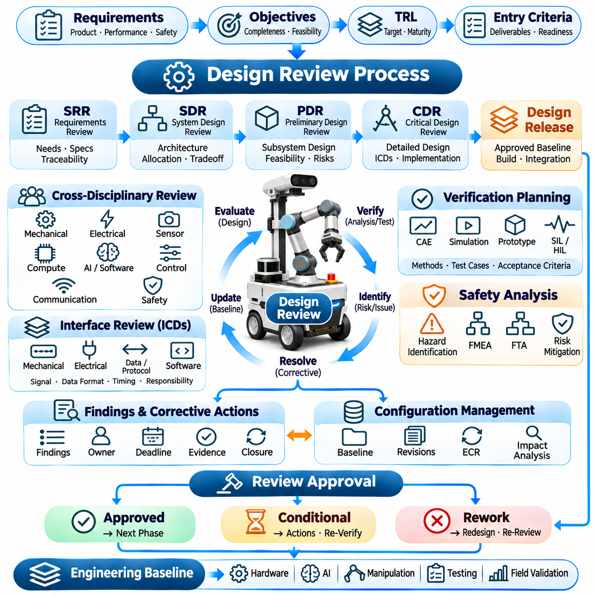{width="7.268055555555556in" height="7.268055555555556in"}

The design review process establishes a systematic engineering mechanism for evaluating the technical completeness, feasibility, consistency, and maturity of a mobile manipulator design. It ensures that system architecture, subsystem specifications, interface definitions, safety mechanisms, and implementation strategies satisfy established requirements before progressing to subsequent development phases.

Design review planning begins with the definition of review objectives, evaluation criteria, required deliverables, participating engineering disciplines, and approval responsibilities. Review activities must align with project milestones, development maturity, technical risks, and Technology Readiness Level (TRL) objectives. Each review should establish measurable entry criteria and exit criteria for development progression.

System Requirements Review (SRR) evaluates whether product requirements, customer expectations, operational scenarios, performance targets, and safety requirements are sufficiently complete and consistent. Requirements must be measurable, technically feasible, and traceable to their originating needs. Unresolved requirements and conflicting specifications must be addressed before establishing the system design baseline.

System Design Review (SDR) evaluates the overall architecture and allocation of functional responsibilities across mechanical, electrical, sensor, computing, AI, control, communication, and safety subsystems. Architectural decisions must demonstrate consistency with product requirements and operational constraints. Alternative design approaches should be assessed against performance, cost, complexity, and integration risks.

Preliminary Design Review (PDR) evaluates whether the proposed subsystem architectures and preliminary engineering solutions provide a feasible implementation pathway. Mechanical layouts, electrical configurations, computing resources, sensor arrangements, control strategies, and interface specifications must demonstrate sufficient maturity. Remaining technical uncertainties require documented mitigation plans and development actions.

Critical Design Review (CDR) determines whether detailed engineering specifications have reached sufficient maturity to support fabrication, software implementation, and subsystem integration. Engineering drawings, electrical schematics, component selections, software architecture, and Interface Control Documents (ICDs) must be reviewed. Outstanding design issues must be resolved or formally accepted before design release.

Multidisciplinary design review evaluates interactions and dependencies between engineering domains rather than assessing each subsystem independently. Mechanical dimensions may affect sensor visibility, electrical power limitations may constrain computing performance, and manipulator movement may influence platform stability. Cross-functional evaluation helps identify integration problems before physical prototype development.

AI and software design reviews evaluate model architecture, data requirements, inference performance, software modularity, computational resource allocation, and integration readiness. Particular attention must be given to prediction uncertainty, operational limitations, model compatibility, and abnormal execution behavior. Proposed intelligent functions must remain consistent with control and safety architecture requirements.

Safety design review evaluates hazard identification, risk assessment results, protective functions, emergency response mechanisms, and applicable regulatory requirements. Failure Mode and Effects Analysis (FMEA), Fault Tree Analysis (FTA), and functional safety assessments may support technical evaluation. Safety-related design decisions must demonstrate adequate risk reduction and traceability to identified hazards.

Interface design review evaluates the compatibility of mechanical, electrical, software, communication, sensor, AI, control, and safety interfaces. Interface Control Documents must establish consistent physical dimensions, signal definitions, data formats, timing requirements, and responsibility boundaries. Unresolved interface inconsistencies must be corrected before dependent subsystem implementation progresses.

Design verification planning establishes how engineering decisions and technical specifications will be evaluated against defined requirements. Mathematical analysis, Computer-Aided Engineering (CAE), simulation, prototype testing, and subsystem integration experiments provide complementary evaluation mechanisms. Verification methods and acceptance criteria must be established before implementation and testing activities begin.

Design review findings must be documented through formal review records, technical issue descriptions, risk classifications, corrective actions, responsible personnel, and completion deadlines. Each finding should include sufficient technical evidence to support resolution and subsequent verification. Critical findings must remain visible until corrective actions have been completed and their effectiveness confirmed.

Design configuration management ensures that reviewed and approved engineering deliverables remain consistent throughout the development lifecycle. Design baselines, document revisions, engineering change requests, and approval histories provide traceable control over modifications. Significant changes affecting performance, interfaces, safety, or manufacturing feasibility may require additional design reviews and verification activities.

Design review approval establishes a formal decision regarding readiness to enter the next development phase. Approval decisions may include unconditional approval, conditional approval, or rejection according to technical maturity and unresolved risks. Conditional approval must specify outstanding actions, implementation restrictions, accountable personnel, and required closure dates to prevent uncontrolled development progression.

The design review framework should be adapted to project scale, development complexity, organizational responsibilities, and commercialization objectives. Although specific review gates may vary between organizations, systematic evaluation, documented evidence, requirement traceability, and controlled approval remain essential. Completed design reviews establish the engineering baseline for hardware development, AI development, manipulation development, system testing, and field validation.

설계 검토 프로세스(Design Review Process)는 모바일 매니퓰레이터(Mobile Manipulator) 설계의 기술적 완전성(Technical Completeness), 실현 가능성(Feasibility), 일관성(Consistency), 성숙도(Maturity)를 평가하기 위한 체계적인 엔지니어링 메커니즘(Systematic Engineering Mechanism)을 확립한다. 시스템 아키텍처(System Architecture), 하위 시스템 명세(Subsystem Specification), 인터페이스 정의(Interface Definition), 안전 메커니즘(Safety Mechanism), 구현 전략(Implementation Strategy)이 후속 개발 단계(Subsequent Development Phase)로 진행되기 전에 확립된 요구사항(Established Requirements)을 충족하도록 보장한다.

설계 검토 계획(Design Review Planning)은 검토 목표(Review Objective), 평가 기준(Evaluation Criteria), 필수 산출물(Required Deliverable), 참여 엔지니어링 분야(Participating Engineering Discipline), 승인 책임(Approval Responsibility)을 정의하는 것에서 시작된다. 검토 활동(Review Activity)은 프로젝트 마일스톤(Project Milestone), 개발 성숙도(Development Maturity), 기술적 위험(Technical Risk), 기술 성숙도(Technology Readiness Level, TRL) 목표와 일치해야 한다. 각 검토 단계에서는 개발 진행을 위한 측정 가능한 진입 기준(Entry Criteria)과 종료 기준(Exit Criteria)을 확립해야 한다.

시스템 요구사항 검토(System Requirements Review, SRR)는 제품 요구사항(Product Requirements), 고객 기대사항(Customer Expectation), 운영 시나리오(Operational Scenario), 성능 목표(Performance Target), 안전 요구사항(Safety Requirements)이 충분한 완전성과 일관성을 갖추고 있는지를 평가한다. 요구사항은 측정 가능(Measurable)하고 기술적으로 실현 가능(Technically Feasible)해야 하며, 최초 요구(Originating Need)에 대한 추적 가능성(Traceability)을 확보해야 한다. 미해결 요구사항(Unresolved Requirements)과 상충하는 명세(Conflicting Specification)는 시스템 설계 기준선(System Design Baseline)을 확립하기 전에 해결되어야 한다.

시스템 설계 검토(System Design Review, SDR)는 전체 아키텍처(Overall Architecture)와 기계(Mechanical), 전기(Electrical), 센서(Sensor), 컴퓨팅(Computing), 인공지능(AI), 제어(Control), 통신(Communication), 안전(Safety) 하위 시스템 전반의 기능적 책임 할당(Functional Responsibility Allocation)을 평가한다. 아키텍처 설계 결정(Architectural Decision)은 제품 요구사항 및 운영 제약조건(Operational Constraints)과의 일관성을 입증해야 한다. 대안 설계 접근법(Alternative Design Approach)은 성능(Performance), 비용(Cost), 복잡성(Complexity), 통합 위험(Integration Risk)을 기준으로 평가되어야 한다.

예비 설계 검토(Preliminary Design Review, PDR)는 제안된 하위 시스템 아키텍처(Subsystem Architecture)와 예비 엔지니어링 솔루션(Preliminary Engineering Solution)이 실현 가능한 구현 경로(Feasible Implementation Pathway)를 제공하는지를 평가한다. 기계적 배치(Mechanical Layout), 전기적 구성(Electrical Configuration), 컴퓨팅 자원(Computing Resource), 센서 배치(Sensor Arrangement), 제어 전략(Control Strategy), 인터페이스 명세(Interface Specification)는 충분한 설계 성숙도(Design Maturity)를 입증해야 한다. 잔존 기술적 불확실성(Remaining Technical Uncertainty)에 대해서는 문서화된 위험 완화 계획(Mitigation Plan)과 개발 조치(Development Action)가 필요하다.

상세 설계 검토(Critical Design Review, CDR)는 상세 엔지니어링 명세(Detailed Engineering Specification)가 제작(Fabrication), 소프트웨어 구현(Software Implementation), 하위 시스템 통합(Subsystem Integration)을 지원할 수 있는 충분한 성숙도에 도달했는지를 판단한다. 엔지니어링 도면(Engineering Drawing), 전기 회로도(Electrical Schematic), 구성요소 선정(Component Selection), 소프트웨어 아키텍처(Software Architecture), 인터페이스 제어 문서(Interface Control Document, ICD)는 체계적으로 검토되어야 한다. 미해결 설계 문제(Outstanding Design Issue)는 설계 출도(Design Release) 이전에 해결되거나 공식적으로 수용되어야 한다.

다학제 설계 검토(Multidisciplinary Design Review)는 각 하위 시스템을 독립적으로 평가하는 대신 여러 엔지니어링 영역(Engineering Domain) 사이의 상호작용(Interaction)과 의존성(Dependency)을 평가한다. 기계적 치수(Mechanical Dimension)는 센서 가시성(Sensor Visibility)에 영향을 미칠 수 있으며, 전력 제한(Electrical Power Limitation)은 컴퓨팅 성능(Computing Performance)을 제약할 수 있고, 매니퓰레이터 동작(Manipulator Movement)은 플랫폼 안정성(Platform Stability)에 영향을 미칠 수 있다. 기능 간 교차 평가(Cross-Functional Evaluation)는 물리적 프로토타입 개발(Physical Prototype Development) 이전에 통합 문제(Integration Problem)를 식별하는 데 기여한다.

인공지능 및 소프트웨어 설계 검토(AI and Software Design Review)는 모델 아키텍처(Model Architecture), 데이터 요구사항(Data Requirements), 추론 성능(Inference Performance), 소프트웨어 모듈성(Software Modularity), 컴퓨팅 자원 할당(Computational Resource Allocation), 통합 준비도(Integration Readiness)를 평가한다. 특히 예측 불확실성(Prediction Uncertainty), 운영 한계(Operational Limitation), 모델 호환성(Model Compatibility), 비정상 실행 동작(Abnormal Execution Behavior)에 대한 검토가 중요하다. 제안된 지능형 기능(Intelligent Function)은 제어 아키텍처(Control Architecture) 및 안전 아키텍처(Safety Architecture) 요구사항과의 일관성을 유지해야 한다.

안전 설계 검토(Safety Design Review)는 위험원 식별(Hazard Identification), 위험성 평가 결과(Risk Assessment Result), 보호 기능(Protective Function), 비상 대응 메커니즘(Emergency Response Mechanism), 적용 가능한 규제 요구사항(Applicable Regulatory Requirements)을 평가한다. 고장 형태 및 영향 분석(Failure Mode and Effects Analysis, FMEA), 결함 트리 분석(Fault Tree Analysis, FTA), 기능 안전 평가(Functional Safety Assessment)는 기술적 평가(Technical Evaluation)를 지원할 수 있다. 안전 관련 설계 결정(Safety-Related Design Decision)은 충분한 위험 감소(Risk Reduction)와 식별된 위험원(Identified Hazard)에 대한 추적 가능성을 입증해야 한다.

인터페이스 설계 검토(Interface Design Review)는 기계, 전기, 소프트웨어, 통신, 센서, 인공지능, 제어 및 안전 인터페이스의 호환성(Interface Compatibility)을 평가한다. 인터페이스 제어 문서는 일관된 물리적 치수(Physical Dimension), 신호 정의(Signal Definition), 데이터 형식(Data Format), 타이밍 요구사항(Timing Requirements), 책임 경계(Responsibility Boundary)를 확립해야 한다. 미해결 인터페이스 불일치(Unresolved Interface Inconsistency)는 해당 인터페이스에 의존하는 하위 시스템의 구현(Dependent Subsystem Implementation)이 진행되기 전에 수정되어야 한다.

설계 검증 계획(Design Verification Planning)은 엔지니어링 설계 결정(Engineering Decision)과 기술 명세(Technical Specification)를 정의된 요구사항에 따라 어떻게 평가할 것인지를 확립한다. 수학적 분석(Mathematical Analysis), 컴퓨터 지원 엔지니어링(Computer-Aided Engineering, CAE), 시뮬레이션(Simulation), 프로토타입 시험(Prototype Testing), 하위 시스템 통합 실험(Subsystem Integration Experiment)은 상호보완적인 평가 메커니즘(Complementary Evaluation Mechanism)을 제공한다. 검증 방법(Verification Method)과 합격 기준(Acceptance Criteria)은 구현 및 시험 활동(Implementation and Testing Activity)이 시작되기 전에 확립되어야 한다.

설계 검토 결과(Design Review Findings)는 공식 검토 기록(Formal Review Record), 기술적 문제 설명(Technical Issue Description), 위험 분류(Risk Classification), 시정 조치(Corrective Action), 담당자(Responsible Personnel), 완료 기한(Completion Deadline)을 통해 문서화되어야 한다. 각 지적사항(Review Finding)은 문제 해결(Resolution)과 후속 검증(Subsequent Verification)을 지원할 수 있는 충분한 기술적 증거(Technical Evidence)를 포함해야 한다. 중대한 지적사항(Critical Finding)은 시정 조치가 완료되고 그 유효성(Effectiveness)이 확인될 때까지 지속적으로 확인할 수 있도록 관리되어야 한다.

설계 형상 관리(Design Configuration Management)는 검토 및 승인된 엔지니어링 산출물(Reviewed and Approved Engineering Deliverable)이 개발 수명주기(Development Lifecycle) 전반에 걸쳐 일관성을 유지하도록 보장한다. 설계 기준선(Design Baseline), 문서 개정(Document Revision), 엔지니어링 변경 요청(Engineering Change Request, ECR), 승인 이력(Approval History)은 변경사항에 대한 추적 가능한 관리(Traceable Control)를 제공한다. 성능, 인터페이스, 안전성 또는 제조 실현 가능성(Manufacturing Feasibility)에 영향을 미치는 중대한 변경(Significant Change)은 추가적인 설계 검토와 검증 활동(Verification Activity)을 요구할 수 있다.

설계 검토 승인(Design Review Approval)은 다음 개발 단계(Next Development Phase)로 진입할 준비가 되었는지에 대한 공식적인 의사결정(Formal Decision)을 확립한다. 승인 결정(Approval Decision)은 기술 성숙도(Technical Maturity)와 미해결 위험(Unresolved Risk)에 따라 무조건 승인(Unconditional Approval), 조건부 승인(Conditional Approval), 승인 거부(Rejection)를 포함할 수 있다. 조건부 승인은 통제되지 않은 개발 진행(Uncontrolled Development Progression)을 방지하기 위해 미완료 조치(Outstanding Action), 구현 제한사항(Implementation Restriction), 책임 담당자(Accountable Personnel), 필수 조치 완료 기한(Required Closure Date)을 명확하게 명시해야 한다.

설계 검토 프레임워크(Design Review Framework)는 프로젝트 규모(Project Scale), 개발 복잡성(Development Complexity), 조직별 책임(Organizational Responsibility), 상용화 목표(Commercialization Objective)에 따라 조정되어야 한다. 구체적인 단계별 검토 관문(Review Gate)은 조직에 따라 달라질 수 있지만, 체계적인 평가(Systematic Evaluation), 문서화된 증거(Documented Evidence), 요구사항 추적성(Requirement Traceability), 통제된 승인(Controlled Approval)은 필수적인 요소로 유지되어야 한다. 완료된 설계 검토(Completed Design Review)는 하드웨어 개발(Hardware Development), 인공지능 개발(AI Development), 조작 시스템 개발(Manipulation Development), 시스템 시험(System Testing), 현장 유효성 검증(Field Validation)을 위한 엔지니어링 기준선(Engineering Baseline)을 확립한다.
