**Volume 05. Mobile Manipulator Projects and Development Manual**

# Chapter 02. System Design

## 01 System Architecture Overview

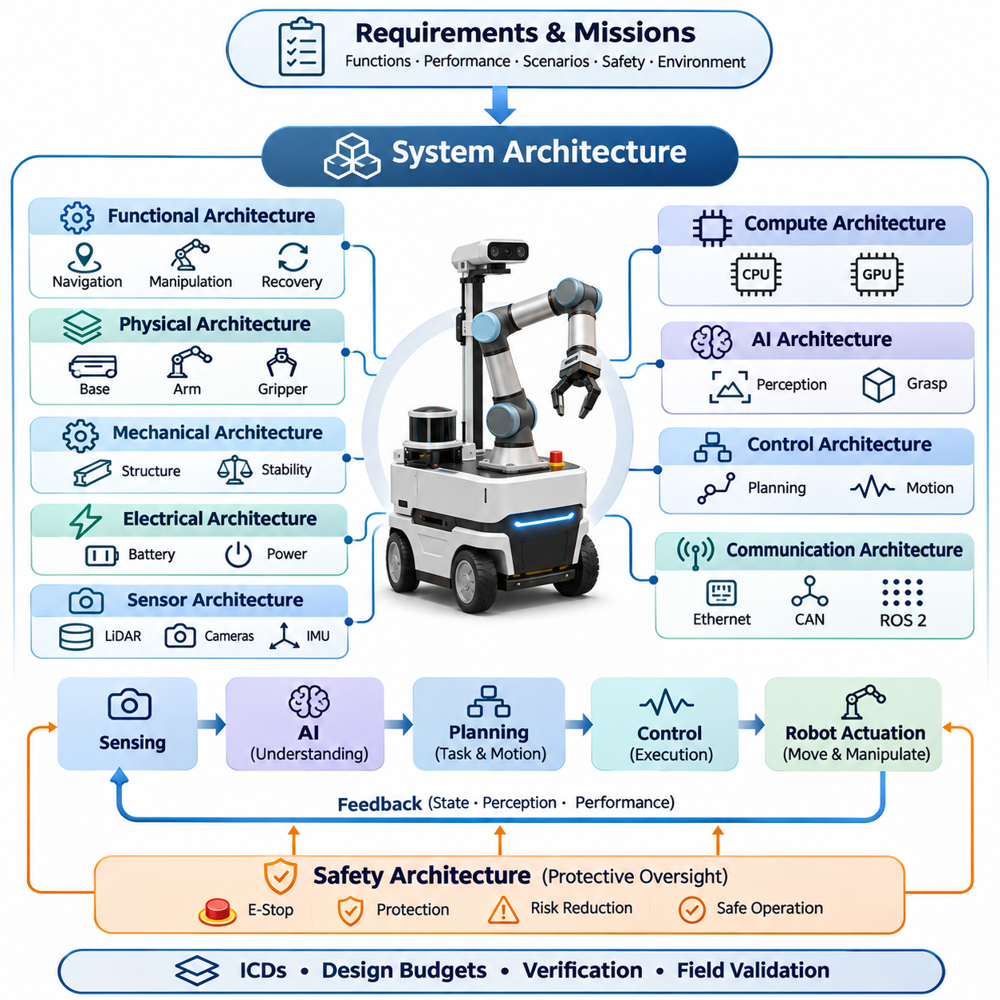{width="7.268055555555556in" height="7.268055555555556in"}

System architecture provides the fundamental engineering framework for designing, developing, integrating, and deploying a mobile manipulator. Unlike conventional industrial robots or standalone Autonomous Mobile Robots (AMRs), a mobile manipulator combines autonomous mobility, robotic manipulation, environmental perception, artificial intelligence, and intelligent decision-making within a unified system architecture. These capabilities must operate as a coordinated system to accomplish complex physical tasks.

The system architecture translates product requirements into a structured engineering solution. Functional requirements, performance targets, operational scenarios, safety constraints, and environmental conditions established during the requirements engineering phase become inputs to architectural development. Each requirement must be allocated to appropriate subsystems, establishing clear relationships between expected product capabilities and technical implementation.

A mobile manipulator architecture can be organized into multiple engineering domains, including functional, physical, mechanical, electrical, sensor, computing, AI, control, communication, and safety architectures. Although each domain addresses specific technical responsibilities, their design must be coordinated through common system-level requirements and interfaces. Independent optimization without system-level coordination can introduce integration problems.

Functional architecture defines what the mobile manipulator must accomplish independently of specific hardware implementations. Major functions include autonomous navigation, localization, environmental perception, object recognition, grasp planning, manipulation, mission execution, energy management, and fault recovery. Functional decomposition divides complex operational capabilities into manageable engineering functions with clearly defined responsibilities and dependencies.

Physical architecture establishes how functional capabilities are implemented through actual hardware and software components. A typical mobile manipulator incorporates a mobile base, robotic arm, end effector, battery system, motor controllers, environmental sensors, onboard computing platforms, communication devices, and safety equipment. Physical component selection must consider performance, compatibility, reliability, maintainability, and future scalability.

Mechanical architecture defines the structural relationships between the mobile platform, robotic manipulator, end effector, and supporting components. Structural rigidity, payload distribution, center of gravity, vibration, workspace accessibility, and dynamic stability directly influence operational performance. Particular attention must be given to changes in mass distribution and reaction forces when the robotic arm extends, accelerates, or manipulates heavy objects.

Electrical architecture provides reliable power distribution and electrical connectivity across the entire robotic system. Battery management systems, power distribution units, DC/DC converters, motor drives, protective circuits, and wiring harnesses support electrical operation. Power consumption, peak current demand, grounding, electromagnetic compatibility, thermal management, and electrical protection must be evaluated under representative operating conditions.

Sensor architecture enables the mobile manipulator to acquire information about its surroundings, internal state, and physical interactions. LiDAR, RGB cameras, depth cameras, inertial measurement units, wheel encoders, joint encoders, and force-torque sensors provide complementary measurements. Sensor placement, calibration, synchronization, coverage, measurement uncertainty, and environmental robustness determine the quality of information available to downstream subsystems.

Compute architecture distributes computational workloads across embedded controllers, central processing units, graphics processing units, and dedicated safety controllers. Autonomous navigation, visual perception, AI inference, trajectory generation, and system monitoring impose different computational requirements. Processing resources must be allocated according to workload characteristics, latency constraints, thermal limitations, energy consumption, and operational priorities.

Artificial intelligence architecture transforms sensory information into actionable environmental understanding and intelligent behavior. Object detection, semantic segmentation, pose estimation, grasp detection, and vision-language models can support increasingly complex manipulation tasks. AI components must interact with conventional planning and control systems through defined interfaces while providing confidence information and mechanisms for handling uncertain predictions.

Control architecture coordinates physical motion across the mobile base and robotic manipulator. Hierarchical control structures generally separate mission-level decisions, task execution, motion planning, trajectory generation, and low-level actuator control. Coordinated mobility and manipulation require consistent reference frames, synchronized state information, collision avoidance, and consideration of platform stability during simultaneous or sequential movement.

Communication architecture establishes dependable information exchange between distributed hardware and software components. Industrial Ethernet, CAN, EtherCAT, wireless networking, and ROS 2 communication mechanisms may support different operational requirements. Communication interfaces must address bandwidth, latency, message priority, synchronization, cybersecurity, and fault handling. Critical control functions should remain available during external network interruptions.

Safety architecture establishes protective mechanisms that reduce risks associated with autonomous movement, robotic manipulation, human interaction, and equipment failure. Emergency stopping, protective stopping, speed monitoring, collision prevention, and safety-related control functions must be integrated according to identified hazards. Safety functions must achieve the required performance independently of non-safety-rated AI or mission management components where necessary.

Interface Control Documents (ICDs) establish formal agreements between engineering subsystems. These documents define mechanical mounting specifications, electrical connections, communication protocols, software interfaces, coordinate systems, timing requirements, and error-handling behaviors. Standardized interfaces enable parallel development, component replacement, systematic integration, and controlled architectural modifications throughout the product lifecycle.

Architecture development also requires system-level engineering budgets covering mass, power, computational resources, communication bandwidth, response latency, manufacturing costs, and operational performance. Architectural alternatives must be evaluated through feasibility analysis, simulation, prototyping, and structured design reviews. Maintaining requirement traceability and configuration control establishes a reliable foundation for integration, verification, field validation, and commercialization.

## 02 Functional Architecture

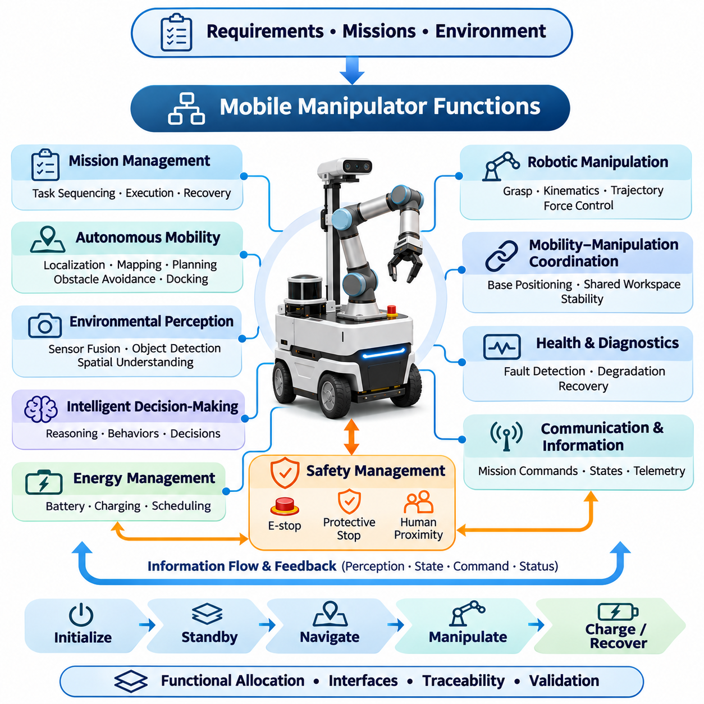{width="7.268055555555556in" height="7.268055555555556in"}

Functional architecture defines the operational capabilities, behavioral relationships, and information flows required for a mobile manipulator to accomplish its intended missions. Unlike physical architecture, which focuses on hardware and software components, functional architecture describes what the system must perform independently of specific implementation technologies. It establishes a logical foundation for subsequent engineering development and system integration.

Functional architecture development begins with the analysis of product requirements, operational scenarios, customer expectations, and environmental constraints. These inputs are transformed into a structured collection of system functions that collectively satisfy the intended operational objectives. Each function must have clearly defined responsibilities, input information, output information, execution conditions, and relationships with other system functions.

Functional decomposition divides complex system capabilities into smaller and more manageable functional elements. At the highest level, a mobile manipulator performs autonomous physical tasks within a defined operational environment. This capability can be decomposed into mission management, autonomous mobility, environmental perception, object manipulation, intelligent decision-making, energy management, safety monitoring, and system diagnostics.

Mission management functions coordinate the overall execution of operational objectives. A mission may involve receiving a transportation request, navigating toward a designated workstation, identifying a target object, performing robotic manipulation, and delivering the object to another location. Mission management determines task sequences, allocates operational resources, monitors execution status, and initiates appropriate recovery procedures when exceptions occur.

Autonomous mobility functions enable the mobile manipulator to travel safely and efficiently throughout its operating environment. Localization, mapping, global path planning, local trajectory planning, obstacle avoidance, velocity control, and precise docking represent essential mobility capabilities. These functions must coordinate with manipulation requirements to ensure that the mobile platform reaches positions suitable for subsequent robotic operations.

Environmental perception functions acquire and interpret information about the surrounding physical environment. Sensor data acquisition, preprocessing, synchronization, sensor fusion, object recognition, obstacle detection, and spatial reconstruction contribute to environmental understanding. Perception functions must provide timely and sufficiently accurate information while communicating measurement uncertainty and identifying degraded sensing conditions.

Robotic manipulation functions enable physical interaction with objects, equipment, and surrounding infrastructure. These functions include object localization, grasp candidate generation, inverse kinematics, motion planning, trajectory execution, force regulation, and grasp verification. Manipulation functions must consider object characteristics, workspace limitations, collision constraints, payload conditions, and the stability of the mobile platform.

Intelligent decision-making functions transform mission objectives and environmental information into appropriate operational actions. Rule-based reasoning, behavior trees, optimization algorithms, machine learning models, and robot agents may contribute to decision-making capabilities. Functional architecture should remain independent of particular algorithms while defining decision inputs, execution constraints, confidence requirements, and acceptable operational outcomes.

Coordination between mobility and manipulation represents a distinctive requirement of mobile manipulator functional architecture. The system must determine whether navigation and manipulation should occur sequentially or simultaneously according to operational constraints. Coordination functions manage base positioning, manipulator configuration, shared workspace accessibility, motion dependencies, collision risks, and dynamic stability throughout mission execution.

Energy management functions maintain sufficient electrical energy to support continuous robotic operation. Battery state monitoring, energy consumption estimation, remaining operating time prediction, charging management, and energy-aware mission scheduling contribute to operational availability. These functions interact with mission management to determine whether tasks can be completed or charging operations must be initiated before further execution.

Safety management functions continuously evaluate operational conditions and initiate protective responses when unacceptable risks are detected. Emergency stopping, protective stopping, speed restriction, human proximity monitoring, stability supervision, and fault detection contribute to risk reduction. Safety-related functions must be distinguished from ordinary operational functions and implemented with integrity appropriate to the required safety performance.

System health monitoring and diagnostic functions evaluate the operational condition of mechanical, electrical, computing, sensing, and software resources. Abnormal temperature, excessive actuator loading, communication interruptions, sensor degradation, and computational failures must be detected and classified. Diagnostic information supports fault isolation, maintenance planning, controlled degradation, and appropriate recovery or shutdown decisions.

Communication and information management functions support data exchange among internal subsystems, fleet management platforms, external equipment, and human operators. Mission commands, sensor measurements, operational states, diagnostic messages, and execution results must be transferred through defined functional interfaces. Information flows should specify data ownership, update frequency, timing constraints, validity conditions, and communication failure responses.

Functional architecture must describe operational behavior across different system states, including initialization, standby, autonomous operation, manipulation, charging, maintenance, degraded operation, and emergency shutdown. State transitions must define triggering conditions, prerequisites, permitted actions, and recovery criteria. Abnormal operational scenarios should receive the same systematic engineering attention as normal mission execution.

Functional allocation establishes relationships between logical system functions and the physical or software components responsible for their implementation. Computationally intensive perception functions may be assigned to onboard AI computing resources, while time-critical actuator control and safety-related functions may require dedicated controllers. Allocation decisions must consider latency, resource availability, reliability, cost, and safety requirements.

Functional architecture validation ensures that all required capabilities are represented, functional dependencies are consistent, and operational scenarios can be completed without unresolved responsibilities. Requirement traceability matrices, functional flow analysis, interface definitions, simulation, and structured design reviews support this evaluation. A validated functional architecture establishes the foundation for physical architecture development and subsequent system verification.

## 03 Physical Architecture

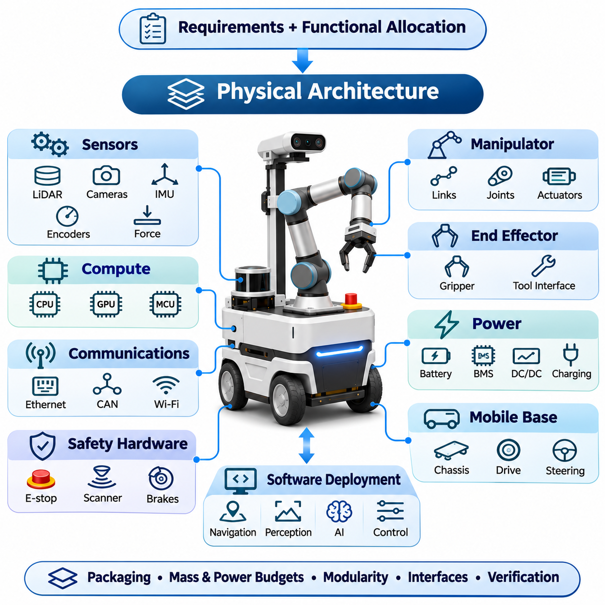{width="7.268055555555556in" height="7.268055555555556in"}

Physical architecture defines the tangible hardware and deployed software components through which the functional capabilities of a mobile manipulator are implemented. It translates logical system functions into an integrated engineering platform consisting of mechanical structures, electrical equipment, sensors, computing resources, actuators, and communication devices. Its primary objective is to establish a feasible and coordinated system configuration.

The development of physical architecture begins with functional architecture, product requirements, operational scenarios, and system-level performance targets. Each logical function must be allocated to one or more physical or software components capable of satisfying its operational requirements. This allocation establishes relationships between system capabilities and implementation resources while identifying technical dependencies and integration constraints.

The mobile base constitutes the primary physical foundation of the mobile manipulator. It integrates the chassis, propulsion system, steering mechanism, braking equipment, suspension components, and structural mounting interfaces. Different mobility configurations, including differential drive, omnidirectional drive, and independent steering systems, may be selected according to maneuverability, payload capacity, positioning accuracy, and environmental conditions.

The robotic manipulator represents the primary physical subsystem responsible for object interaction and manipulation. Its architecture includes mechanical links, joints, actuators, transmission mechanisms, position sensors, and dedicated control equipment. Manipulator selection must consider degrees of freedom, reachability, payload capacity, repeatability, operating speed, structural mass, and compatibility with the mobile platform.

The end effector establishes the physical interface between the robotic manipulator and the target object or working environment. Mechanical grippers, vacuum grippers, dexterous robotic hands, inspection instruments, and specialized process tools may be integrated according to application requirements. Modular tool interfaces and automatic tool-changing mechanisms can improve operational flexibility while reducing hardware replacement and maintenance complexity.

The electrical power subsystem supplies energy to the mobile base, robotic manipulator, computing platforms, sensors, communication equipment, and auxiliary devices. Its physical configuration typically includes battery modules, protective devices, power distribution units, DC/DC converters, charging interfaces, and battery management systems. Electrical equipment must be arranged to support reliable operation, thermal management, and safe maintenance.

Sensor components must be physically distributed to support environmental perception, localization, manipulation, and safety monitoring. LiDAR sensors, RGB cameras, depth cameras, inertial measurement units, wheel encoders, joint encoders, and force-torque sensors provide complementary information. Their mounting locations must account for viewing angles, occlusion, vibration, environmental exposure, calibration stability, and accessibility.

The onboard computing subsystem provides physical processing resources for autonomous navigation, artificial intelligence, motion planning, mission management, and diagnostic functions. Embedded computers, central processing units, graphics processing units, microcontrollers, and dedicated safety controllers may be distributed throughout the system. Computing equipment placement must consider cooling, electrical supply, connectivity, and serviceability.

The physical communication infrastructure connects distributed sensors, controllers, computing platforms, and external systems. Ethernet switches, industrial communication interfaces, CAN transceivers, wireless communication modules, antennas, connectors, and wiring harnesses establish the required connectivity. Network equipment and cable routing must support communication reliability, electromagnetic compatibility, and controlled fault isolation.

Safety-related hardware constitutes an essential part of the physical architecture. Emergency stop switches, safety laser scanners, safety controllers, protective bumpers, braking mechanisms, and safety-rated drive interfaces may be incorporated according to risk assessment results. Their physical arrangement must provide appropriate protective coverage, operator accessibility, reliable signal transmission, and the required safety performance.

Physical integration requires careful management of spatial relationships between the mobile platform, manipulator, sensors, computing equipment, and electrical components. Component placement influences center of gravity, stability, sensor visibility, maintenance accessibility, cable routing, and heat dissipation. Three-dimensional computer-aided design models support the evaluation of packaging constraints and potential mechanical interference.

Software deployment architecture establishes relationships between physical computing devices and executable software components. Navigation software, perception algorithms, AI inference models, manipulation controllers, middleware, and mission management applications must be assigned to suitable computing resources. Deployment decisions should consider computational capacity, execution frequency, communication overhead, fault containment, and real-time requirements.

Modularity and interface standardization contribute to the scalability and maintainability of physical architecture. Replaceable sensor modules, computing units, battery assemblies, manipulators, and end effectors allow the system to support multiple product configurations. Standardized mechanical, electrical, and communication interfaces reduce integration complexity and enable component upgrades without requiring extensive system redesign.

Physical architecture development must establish engineering budgets for component mass, payload, electrical power, thermal dissipation, spatial volume, computational resources, and manufacturing costs. These budgets provide quantitative constraints for subsystem development and component selection. Design margins should account for manufacturing tolerances, operational uncertainty, component replacement, and potential future system expansion.

The physical architecture must also support manufacturing, assembly, inspection, transportation, and field maintenance throughout the product lifecycle. Accessible fasteners, replaceable modules, standardized connectors, protected cable routes, and clearly defined assembly interfaces improve production efficiency and serviceability. Architectural decisions should consider component availability, supplier dependencies, spare parts, and long-term product support.

Physical architecture verification evaluates whether the selected components and their integration satisfy allocated functional, performance, environmental, and safety requirements. Engineering analysis, digital simulations, prototype integration, interface testing, and structured design reviews provide supporting evidence. The resulting architecture baseline becomes the foundation for detailed subsystem design, hardware development, and system validation.

## 04 Mechanical Architecture

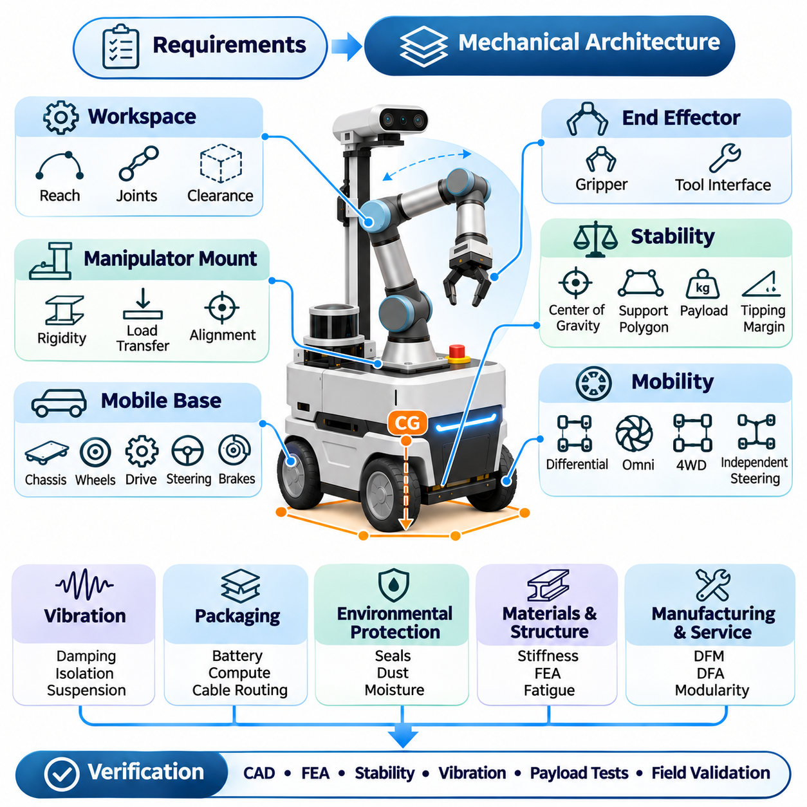{width="7.268055555555556in" height="7.268055555555556in"}

Mechanical architecture defines the structural configuration, mechanical relationships, and physical integration principles of a mobile manipulator. It establishes how the mobile base, robotic arm, end effector, propulsion system, sensor mounts, and supporting structures operate as an integrated mechanical system. Its primary objective is to achieve structural integrity, dynamic stability, operational precision, reliability, and maintainability.

Mechanical architecture development begins with product requirements, functional architecture, physical architecture, and operational constraints. Payload capacity, manipulator reach, positioning accuracy, travel speed, operating environment, and expected service life establish the primary mechanical design conditions. These requirements must be translated into measurable engineering parameters that guide structural configuration and component selection.

The mobile base provides the structural foundation for the entire robotic system. Its mechanical architecture integrates the chassis, wheel assemblies, propulsion mechanisms, steering systems, braking components, and supporting structures. The chassis must withstand static and dynamic loads generated during navigation, acceleration, braking, manipulation, and transportation while maintaining sufficient rigidity for precise robotic operations.

The selection of mobility mechanisms significantly influences overall mechanical performance. Differential drive, omnidirectional drive, four-wheel drive, and independent steering configurations provide different combinations of maneuverability, traction, positioning accuracy, and mechanical complexity. The selected configuration must satisfy operational requirements associated with narrow passages, floor conditions, turning capability, and precise docking.

Structural integration between the mobile base and robotic manipulator requires careful consideration of mounting rigidity, load transmission, and mechanical alignment. Manipulator mounting structures must withstand reaction forces and moments generated during arm movement and object handling. Excessive structural deformation can reduce positional accuracy, introduce vibration, and negatively affect perception and manipulation performance.

Center of gravity management represents a critical aspect of mobile manipulator mechanical architecture. Unlike conventional mobile robots, the distribution of mass changes as the robotic arm extends, rotates, and transports objects. Battery placement, manipulator mounting height, payload distribution, and chassis dimensions must be coordinated to maintain stability throughout the intended operating envelope and prevent overturning.

Static and dynamic stability analysis evaluates the relationship between the combined center of gravity, wheel contact points, acceleration forces, and manipulator-generated moments. Stability margins must be established for representative operating scenarios, including extended arm configurations, maximum payload conditions, emergency braking, and inclined surfaces. Mechanical design and motion restrictions should jointly maintain acceptable stability.

Manipulator integration must consider the relationship between robotic arm geometry and the operational workspace of the mobile platform. Joint configurations, mounting positions, reachability, singularities, and mechanical interference influence task execution capabilities. An optimized arrangement should maximize useful manipulation space while minimizing unnecessary platform repositioning, structural complexity, and collision risks.

End effector integration establishes the mechanical connection between the robotic arm and application-specific tools. Grippers, vacuum systems, inspection instruments, and specialized handling mechanisms introduce additional mass, inertia, and operating forces. Mechanical interfaces must provide adequate rigidity, positioning repeatability, secure attachment, and compatibility with manual or automatic tool-changing mechanisms.

Vibration management is essential for maintaining mechanical reliability, sensor accuracy, and manipulation precision. Motor operation, wheel movement, uneven surfaces, gearbox transmission, and rapid manipulator acceleration can generate mechanical disturbances. Structural reinforcement, damping materials, suspension mechanisms, and vibration isolation should be evaluated to reduce undesirable oscillations without compromising positioning stability.

Mechanical packaging determines the spatial arrangement of batteries, computing equipment, sensors, electrical components, and communication infrastructure. Component placement must balance spatial efficiency, structural accessibility, cooling requirements, cable routing, and weight distribution. Modular packaging should provide sufficient installation clearances and simplify component replacement without requiring extensive mechanical disassembly.

Environmental protection must be incorporated according to the intended operational conditions. Industrial dust, moisture, temperature variation, chemical exposure, mechanical impacts, and uneven surfaces can affect structural durability and component reliability. Protective enclosures, sealing mechanisms, corrosion-resistant materials, drainage provisions, and appropriate ingress protection contribute to long-term operational reliability.

Material selection and structural optimization influence system mass, stiffness, durability, manufacturing complexity, and production costs. Steel, aluminum alloys, engineering plastics, and composite materials provide different mechanical characteristics. Finite Element Analysis (FEA), fatigue analysis, and structural simulations support material selection, reinforcement design, weight reduction, and identification of potential structural failure locations.

Mechanical architecture must support manufacturing, assembly, transportation, and maintenance throughout the product lifecycle. Design for Manufacturing (DFM), Design for Assembly (DFA), standardized fastening methods, modular assemblies, and accessible service interfaces reduce production and maintenance complexity. Mechanical tolerances, alignment procedures, and assembly sequences must be established before production release.

Mechanical architecture verification combines engineering calculations, computer-aided design, multibody dynamics simulation, structural analysis, prototype fabrication, and physical testing. Payload tests, stability assessments, vibration measurements, dimensional inspections, and endurance tests provide evidence that allocated requirements are satisfied. The verified mechanical architecture establishes a reliable foundation for detailed hardware development, subsystem integration, and field validation.

## 05 Electrical Architecture

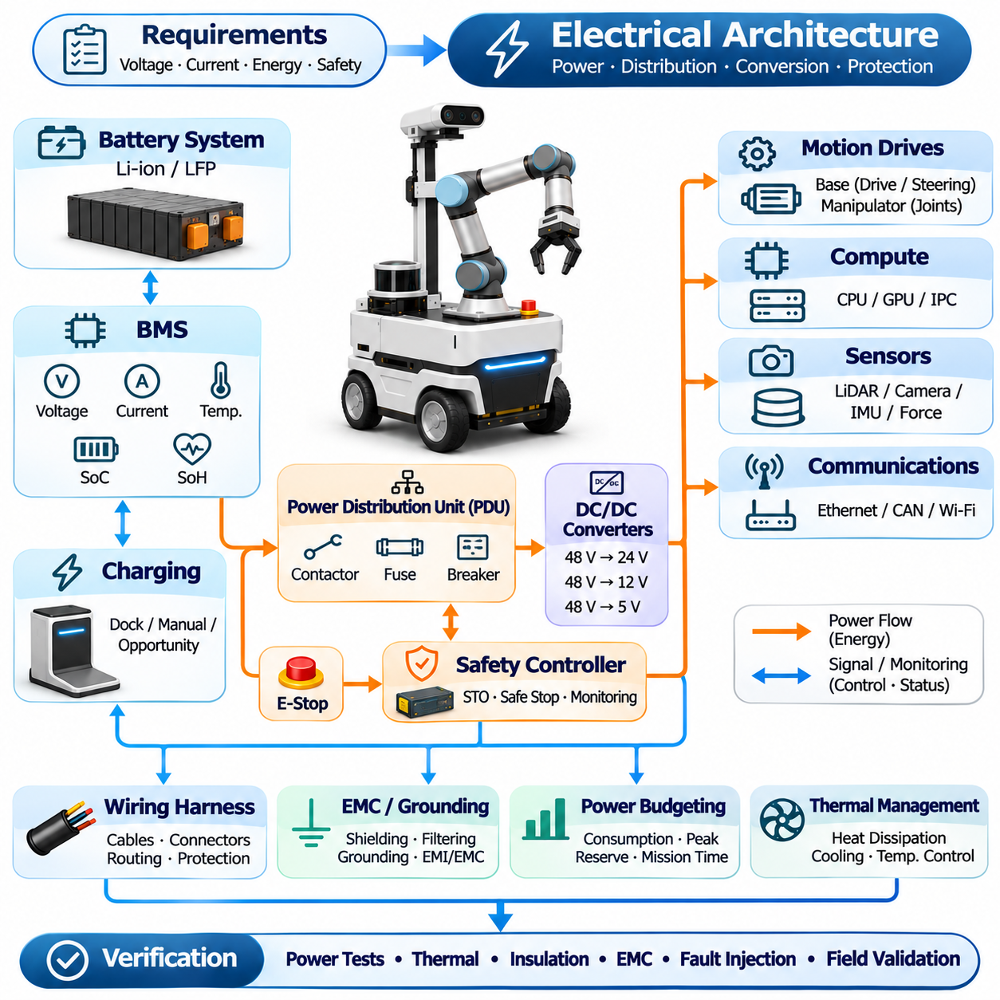{width="7.268055555555556in" height="7.268055555555556in"}

Electrical architecture defines the electrical configuration, power distribution structure, signal connectivity, and protection mechanisms of a mobile manipulator. It integrates the mobile base, robotic manipulator, end effector, sensors, computing platforms, communication equipment, and safety devices into a coordinated electrical system. Its primary objective is to ensure reliable, efficient, safe, and maintainable operation.

Electrical architecture development begins with product requirements, functional architecture, physical architecture, and mechanical design constraints. Operating voltage, maximum current, energy consumption, actuator characteristics, environmental conditions, and safety requirements establish the principal electrical design parameters. These parameters guide component selection, electrical interface definition, and subsystem integration.

The battery system provides the primary electrical energy source for autonomous operation. Lithium-ion and Lithium Iron Phosphate (LFP) batteries offer different combinations of energy density, power capability, thermal stability, and service life. Battery capacity must be determined according to mission duration, propulsion energy consumption, manipulation workloads, computing requirements, charging availability, and operational reserve requirements.

The Battery Management System (BMS) continuously monitors battery voltage, current, temperature, State of Charge (SoC), and State of Health (SoH). It manages cell balancing and supports protection against overcharging, excessive discharge, overcurrent, and abnormal thermal conditions. Battery status information must be communicated to mission management and supervisory controllers to support energy-aware operation.

Power distribution architecture establishes how electrical energy is transferred from the battery system to individual subsystems. Power Distribution Units (PDUs), contactors, relays, fuses, circuit breakers, and distribution terminals provide controlled electrical connectivity. Independent power branches should support fault isolation, maintenance accessibility, and differentiated protection according to subsystem characteristics.

Voltage conversion and regulation are required because mobile manipulators typically incorporate components with different operating voltage requirements. DC/DC converters supply regulated power to embedded controllers, sensors, communication devices, and computing equipment. Voltage domains must be defined according to electrical compatibility, conversion efficiency, transient response, isolation requirements, and maximum load conditions.

The propulsion and manipulation systems represent major electrical loads within the mobile manipulator. Motor drivers, servo amplifiers, steering actuators, robotic joint controllers, and braking mechanisms must be coordinated with the available electrical supply. Peak current demand, simultaneous actuator operation, regenerative energy, acceleration profiles, and emergency braking conditions must be considered during electrical design.

Computing and sensor power architecture must provide stable electrical conditions for reliable data acquisition and processing. Embedded computers, GPU accelerators, cameras, LiDAR sensors, and communication equipment may be sensitive to voltage fluctuations and electrical disturbances. Dedicated regulated power branches, appropriate filtering, and coordinated startup sequences help prevent unexpected resets and operational interruptions.

Electrical protection mechanisms reduce the risks associated with short circuits, overloads, reverse polarity, voltage transients, insulation failures, and abnormal operating conditions. Protective devices must be selected according to operating voltage, current characteristics, fault energy, and equipment limitations. Protection coordination should prevent localized electrical failures from unnecessarily disabling unaffected subsystems.

Safety-related electrical architecture integrates emergency stop circuits, safety controllers, protective sensors, and safety-rated actuator interfaces. Safe Torque Off (STO), contactor monitoring, and controlled stopping mechanisms may be incorporated according to the system risk assessment. Safety-related circuits must achieve the required safety integrity and remain appropriately independent of ordinary computational and communication functions.

Wiring harness architecture establishes the physical electrical connections between distributed system components. Cable sizing, conductor insulation, connector selection, terminal specifications, shielding, and grounding arrangements must satisfy electrical and environmental requirements. Harness routing must accommodate moving joints, mechanical vibration, bending radius limitations, maintenance activities, and potential abrasion.

Electromagnetic Compatibility (EMC) is essential because high-power motor drives, switching converters, wireless communication modules, and sensitive electronic equipment operate within a compact platform. Grounding strategies, cable shielding, electrical segregation, filtering, and enclosure design must minimize conducted and radiated interference. EMC performance should be evaluated under representative operating conditions.

Charging architecture defines the electrical interfaces and control mechanisms required for battery replenishment. Manual charging, automatic docking stations, and opportunity charging may be selected according to operational requirements. Charging systems must coordinate voltage and current limits, connection verification, communication handshakes, electrical protection, and safe transitions between charging and autonomous operation.

Electrical energy budgeting evaluates continuous power consumption, peak electrical demand, conversion losses, auxiliary loads, and thermal dissipation throughout representative missions. Sufficient design margins must accommodate component tolerances, battery degradation, environmental variations, and future subsystem expansion. Power consumption measurements provide essential feedback for architectural optimization.

Electrical architecture must support manufacturing, assembly, inspection, troubleshooting, and maintenance throughout the product lifecycle. Standardized connectors, clearly identified wiring harnesses, accessible protection devices, modular electrical assemblies, and documented connection interfaces improve serviceability. Electrical schematics, power distribution diagrams, and interface specifications must remain under configuration control.

Electrical architecture verification combines circuit analysis, power consumption measurements, thermal testing, insulation testing, electromagnetic compatibility assessments, and fault injection. Representative operating scenarios should include simultaneous navigation and manipulation, charging transitions, peak computational workloads, and abnormal electrical conditions. Verified results establish the foundation for detailed electrical development, system integration, and field validation.

## 06 Sensor Architecture

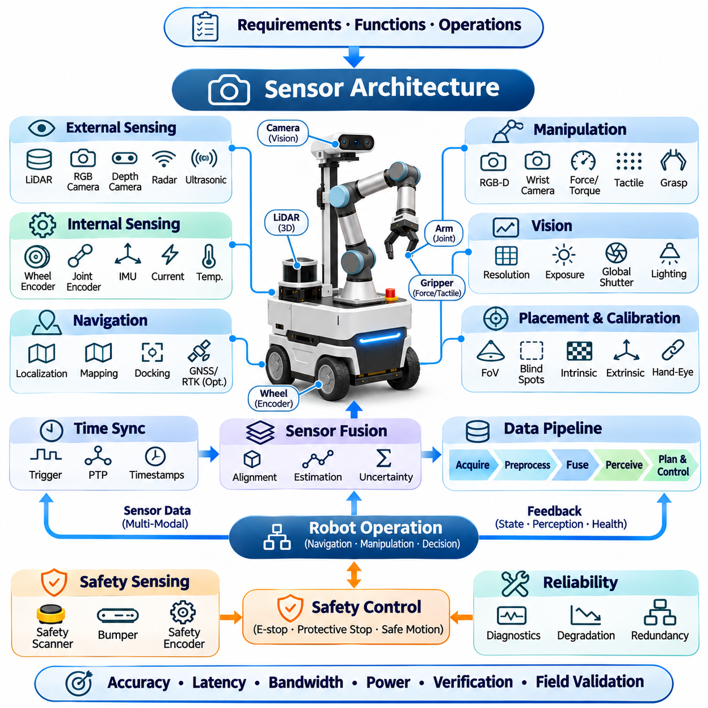{width="7.268055555555556in" height="7.268055555555556in"}

Sensor architecture defines the sensing configuration, measurement principles, data acquisition mechanisms, and integration relationships required for a mobile manipulator to understand its physical environment and internal operating conditions. It establishes a unified framework for autonomous navigation, robotic manipulation, environmental perception, intelligent decision-making, and safety monitoring through coordinated sensing capabilities.

Sensor architecture development begins with product requirements, functional architecture, physical architecture, and operational scenarios. Navigation accuracy, manipulation precision, object recognition performance, environmental conditions, and safety requirements establish the primary sensing requirements. These requirements must be translated into measurable specifications for sensor selection, placement, calibration, and integration.

Exteroceptive sensors acquire information about the external environment surrounding the mobile manipulator. LiDAR sensors, RGB cameras, depth cameras, radar sensors, and ultrasonic sensors provide different combinations of spatial, visual, and proximity information. Sensor selection must consider measurement range, spatial resolution, field of view, environmental robustness, acquisition frequency, and application-specific perception requirements.

Proprioceptive sensors provide information about the internal physical state of the mobile manipulator. Wheel encoders, joint encoders, inertial measurement units, motor current sensors, and temperature sensors support motion estimation, actuator monitoring, and system diagnostics. Accurate internal state measurements are essential for feedback control, dynamic compensation, localization, and reliable coordination between mobility and manipulation.

Navigation sensor architecture supports localization, mapping, obstacle detection, autonomous movement, and precise docking. Two-dimensional and three-dimensional LiDAR, inertial measurement units, wheel encoders, and visual sensors provide complementary measurements for estimating platform position and orientation. Outdoor applications may additionally incorporate Global Navigation Satellite System receivers with Real-Time Kinematic positioning.

Manipulation sensor architecture provides detailed information about target objects, surrounding structures, and physical interactions. RGB-D cameras, stereo cameras, wrist-mounted vision systems, force-torque sensors, and tactile sensors support object detection, six-dimensional pose estimation, grasp planning, and contact monitoring. Sensor configurations must satisfy the spatial accuracy and response requirements of intended manipulation tasks.

Vision sensor architecture must consider image resolution, acquisition frequency, exposure control, shutter characteristics, lens selection, and illumination conditions. Global shutter cameras are particularly useful when motion-induced image distortion must be minimized. Camera placement and optical configurations should provide sufficient visual coverage while reducing occlusion caused by the robotic arm, end effector, or transported objects.

Sensor placement establishes the spatial relationships between individual sensing devices and the mechanical structure of the mobile manipulator. Mounting locations must consider field of view, blind spots, mechanical interference, vibration, environmental exposure, and maintenance accessibility. Overlapping sensing regions can improve environmental coverage and provide complementary measurements when individual sensors experience performance degradation.

Sensor calibration establishes accurate relationships between sensor measurements and system reference coordinate frames. Intrinsic calibration determines internal sensor parameters, while extrinsic calibration determines spatial transformations between sensors, the mobile base, and the robotic arm. Hand-eye calibration is particularly important for translating visual observations into accurate manipulator motions within a shared coordinate system.

Temporal synchronization ensures that measurements acquired from distributed sensors correspond to consistent physical operating states. Hardware triggering, Precision Time Protocol (PTP), synchronized system clocks, and timestamp-based alignment may be employed according to timing requirements. Synchronization errors can reduce localization accuracy, distort spatial reconstruction, and introduce significant errors during dynamic manipulation.

Sensor fusion combines complementary measurements to improve the accuracy, consistency, and robustness of environmental perception and state estimation. Kalman filtering, probabilistic estimation, geometric registration, and deep learning techniques may support different fusion requirements. Fusion mechanisms must account for sensor uncertainty, measurement frequency, spatial alignment, temporal differences, and changing environmental conditions.

Sensor data acquisition architecture defines how measurements are collected, transmitted, processed, and distributed to downstream applications. Communication interfaces must support required bandwidth, acquisition frequency, timestamp precision, and data integrity. Distributed preprocessing and onboard computing resources can reduce communication overhead while preserving information required for perception, planning, and control.

Safety sensor architecture supports the detection of hazardous conditions associated with autonomous movement and robotic manipulation. Safety-rated laser scanners, protective bumpers, safety encoders, and other protective sensing devices may be integrated according to risk assessment results. Safety-related sensing functions must satisfy the required safety performance independently of ordinary AI perception wherever necessary.

Sensor reliability management must address environmental interference, contamination, calibration drift, communication failure, and unexpected measurement degradation. Diagnostic mechanisms should monitor data availability, measurement consistency, sensor temperature, communication status, and confidence indicators. Redundant or complementary sensing capabilities may support controlled operational degradation when individual sensors become unavailable.

Sensor architecture must establish engineering budgets for measurement accuracy, end-to-end latency, communication bandwidth, computational demand, electrical power, and installation space. Modular sensor interfaces and documented calibration procedures improve maintainability, component replacement, and future system expansion. Sensor specifications and configuration parameters must remain traceable to system requirements.

Sensor architecture verification combines calibration tests, measurement accuracy assessments, synchronization analysis, environmental testing, and integrated perception validation. Representative scenarios must include variable illumination, moving objects, sensor occlusion, vibration, and degraded sensing conditions. The verified sensor architecture establishes a reliable foundation for detailed sensor integration, AI development, autonomous navigation, robotic manipulation, and field validation.

## 07 Compute Architecture

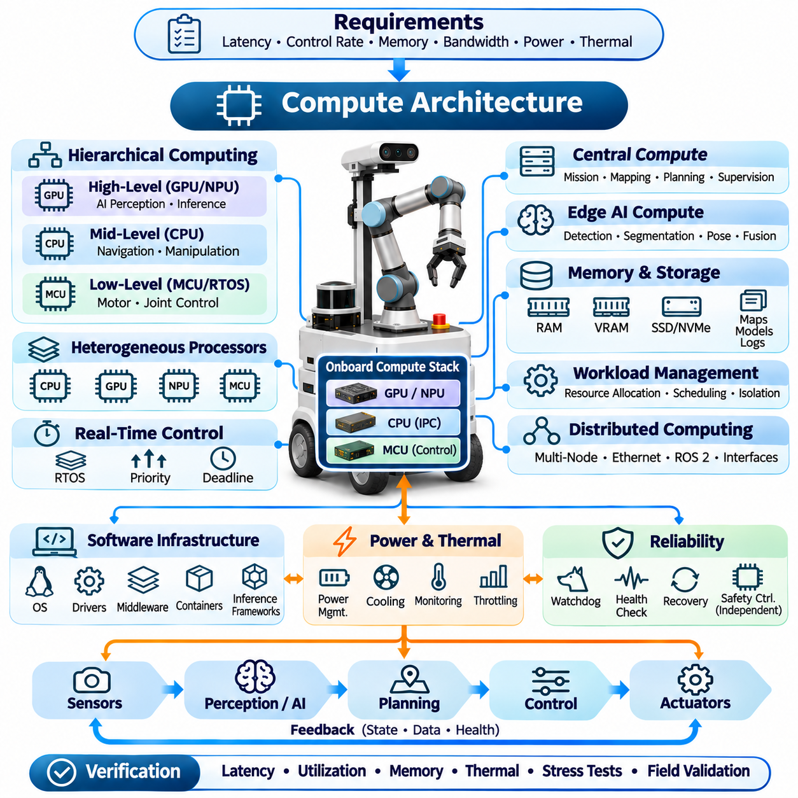{width="7.268055555555556in" height="7.268055555555556in"}

Compute architecture defines the computational resources, processing hierarchy, hardware configurations, and workload allocation mechanisms required for a mobile manipulator. It integrates embedded controllers, central processing units, graphics processing units, memory, storage, and communication interfaces into a coordinated computing environment that supports autonomous navigation, robotic manipulation, artificial intelligence, and system supervision.

Compute architecture development begins with product requirements, functional architecture, sensor architecture, and operational scenarios. Computational demand, inference latency, control frequency, memory requirements, communication bandwidth, electrical power consumption, and thermal limitations establish the principal design parameters. These parameters guide computing platform selection and computational workload distribution.

Hierarchical computing architecture separates computational functions according to their performance requirements and operational responsibilities. Low-level embedded controllers execute deterministic actuator control, intermediate computing platforms manage navigation and manipulation, and high-performance processors execute computationally intensive perception and artificial intelligence workloads. This separation improves scalability, responsiveness, and fault isolation.

Central computing platforms coordinate system-level functions across the mobile manipulator. Mission management, behavior execution, localization, environmental mapping, task planning, and subsystem supervision may operate within a centralized computing environment. The central processor must provide sufficient computational capacity and memory resources to execute concurrent processes while maintaining predictable responsiveness during complex operations.

Edge computing platforms enable computationally intensive processing directly within the mobile manipulator. Embedded GPU modules, dedicated AI accelerators, and high-performance industrial computers support real-time object detection, semantic segmentation, pose estimation, sensor fusion, and intelligent decision-making. Onboard processing reduces dependence on external communication infrastructure and minimizes network-induced latency.

Heterogeneous computing combines different processor architectures to improve computational efficiency and workload specialization. Central Processing Units (CPUs), Graphics Processing Units (GPUs), Neural Processing Units (NPUs), and microcontrollers provide complementary processing capabilities. Computational tasks should be allocated according to execution characteristics, parallelization potential, timing constraints, and overall energy efficiency.

Real-time computing architecture supports functions that must execute within predictable timing constraints. Motor control, steering control, joint trajectory execution, and critical feedback processing require deterministic or bounded execution behavior. Real-Time Operating Systems (RTOS), real-time Linux configurations, dedicated embedded controllers, and prioritized scheduling mechanisms may be employed according to task-specific timing requirements.

Memory architecture determines how computational resources access and manage operational data. System memory, GPU memory, shared memory, cache structures, and memory bandwidth influence the execution performance of AI models and sensor processing pipelines. Memory capacity must accommodate concurrent applications, high-resolution sensor streams, intermediate computational results, and temporary data buffers without excessive resource contention.

Storage architecture supports operating systems, application software, AI models, environmental maps, calibration parameters, diagnostic records, and operational datasets. Solid-State Drives (SSDs) and Non-Volatile Memory Express (NVMe) devices provide suitable storage performance for many robotic applications. Storage capacity, write endurance, data integrity, and recovery mechanisms must be evaluated according to anticipated workloads.

Computational workload management coordinates the execution of navigation, perception, manipulation, communication, and diagnostic processes. Resource allocation, process prioritization, CPU affinity, GPU utilization management, and execution scheduling help prevent computational conflicts. Critical control and monitoring functions must retain sufficient resources even when computationally intensive AI workloads experience unexpected increases in demand.

Distributed computing architecture enables multiple computational nodes to operate collaboratively within the robotic system. Dedicated navigation processors, manipulation controllers, AI inference platforms, and safety controllers may execute specialized functions independently. High-speed communication interfaces and well-defined software interfaces support coordinated operation while reducing dependence on a single general-purpose computing platform.

Software infrastructure establishes the execution environment for computational applications. Operating systems, device drivers, middleware, containerization platforms, AI inference frameworks, and hardware acceleration libraries must be selected according to system requirements. Software compatibility, version management, dependency control, and reproducible deployment contribute to reliable operation and long-term maintainability.

Power consumption and thermal management represent significant constraints in mobile computing architecture. High-performance processors and GPU accelerators generate heat and increase battery energy consumption during intensive workloads. Cooling mechanisms, thermal monitoring, power management policies, and computational throttling strategies must balance processing performance, operational endurance, and hardware reliability.

Computational reliability requires mechanisms for detecting hardware failures, software crashes, resource exhaustion, and degraded processing performance. Watchdog timers, health monitoring, process recovery, and redundant computing arrangements may improve system availability. Safety-critical functions must maintain the required independence and fault tolerance without relying exclusively on general-purpose computing resources.

Compute architecture must support future AI model upgrades, additional sensor integration, and expanded operational capabilities. Modular computing platforms, standardized interfaces, scalable memory configurations, and reserved computational capacity facilitate system evolution. Engineering budgets should establish acceptable limits for processing latency, processor utilization, memory consumption, electrical power, and thermal dissipation.

Compute architecture verification combines hardware benchmarking, real-time performance analysis, resource utilization measurement, thermal testing, and computational stress testing. Representative scenarios must include simultaneous navigation and manipulation, intensive AI inference, high-volume sensor processing, and abnormal workload conditions. Verified results establish a reliable foundation for software integration, AI deployment, system testing, and field validation.

## 08 AI Architecture

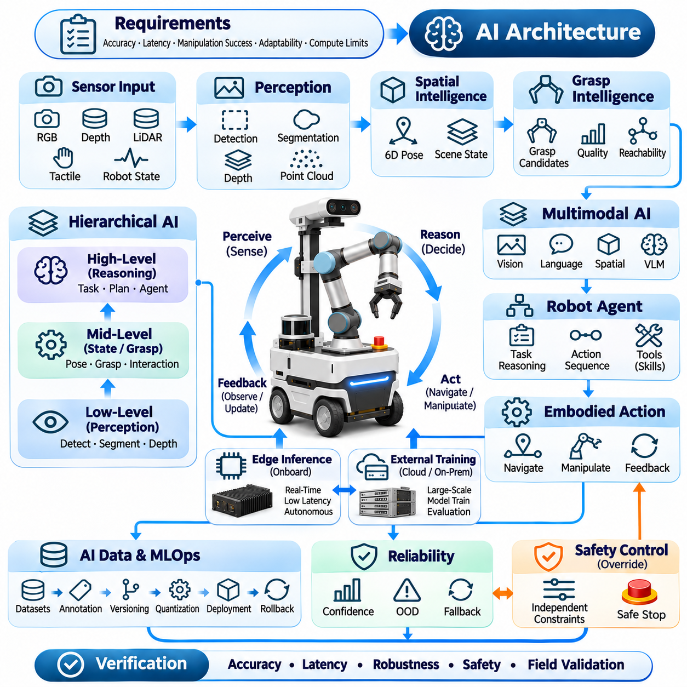{width="7.268055555555556in" height="7.268055555555556in"}

Artificial Intelligence (AI) architecture defines the intelligent processing structure, model organization, data flow, and decision-making mechanisms of a mobile manipulator. It integrates environmental perception, object recognition, pose estimation, grasp intelligence, task reasoning, and adaptive behavior into a coordinated framework that supports autonomous operation and interaction with physical environments.

AI architecture development begins with product requirements, functional architecture, sensor architecture, compute architecture, and operational scenarios. Recognition accuracy, inference latency, manipulation success rates, environmental adaptability, and computational limitations establish the principal design parameters. These requirements guide model selection, processing hierarchy, and AI workload allocation.

Hierarchical AI architecture organizes intelligent functions according to their abstraction levels and operational responsibilities. Low-level perception models interpret sensor measurements, intermediate intelligence modules estimate environmental states and manipulation opportunities, and high-level reasoning systems determine task objectives and behavioral strategies. This separation supports modular development and system scalability.

Perception architecture transforms raw sensor measurements into structured representations of the surrounding environment. Object detection, semantic segmentation, instance segmentation, depth estimation, and point cloud processing provide information about objects, obstacles, and environmental structures. Multiple perception models may operate concurrently to support navigation, manipulation, and environmental understanding.

Object pose estimation architecture determines the spatial position and orientation of target objects within defined coordinate systems. Two-dimensional observations, depth measurements, three-dimensional point clouds, and geometric representations can support six-dimensional pose estimation. Estimated poses must include appropriate confidence information and satisfy the accuracy requirements of downstream manipulation functions.

Grasp intelligence architecture identifies suitable grasping positions, orientations, and interaction strategies for target objects. Learning-based grasp detection, geometric analysis, and grasp quality estimation may be combined according to object characteristics and operational requirements. Candidate grasps must be evaluated against manipulator reachability, collision constraints, and end effector capabilities.

Multimodal AI architecture integrates visual information, spatial measurements, natural language instructions, tactile feedback, and internal robot states. Vision-Language Models (VLMs) and multimodal foundation models may support semantic understanding, object reasoning, and instruction interpretation. Their outputs must be grounded in current environmental observations and validated against physical constraints.

Robot agent architecture coordinates intelligent task interpretation, contextual reasoning, tool utilization, and behavioral decision-making. AI agents may translate high-level mission objectives into structured action sequences while accessing perception services, planning modules, and system resources. Agent-generated actions must remain subject to execution permissions, operational constraints, and independent validation mechanisms.

Embodied AI architecture connects intelligent perception and reasoning with physical action and environmental feedback. The mobile manipulator continuously observes its surroundings, estimates relevant states, selects appropriate actions, and evaluates execution outcomes. This closed-loop interaction enables adaptive behavior while maintaining coordination between autonomous navigation, robotic manipulation, and physical constraints.

AI inference architecture determines where and how trained models execute within the robotic system. Edge computing platforms support latency-sensitive perception and manipulation functions, while external computing infrastructure may support model training, large-scale analysis, and noncritical reasoning. Workload allocation must consider communication reliability, inference performance, energy consumption, and operational autonomy.

AI data architecture establishes the lifecycle of sensor measurements, training datasets, annotation information, inference outputs, and operational feedback. Data quality management, dataset versioning, preprocessing pipelines, and metadata preservation support reproducible model development. Representative operational data must capture environmental variability, object diversity, and relevant failure scenarios.

Model deployment architecture establishes standardized mechanisms for integrating trained AI models into operational robotic software. Model compression, quantization, hardware acceleration, and optimized inference runtimes may improve execution efficiency. Deployment configurations must preserve acceptable model accuracy while satisfying computational resource, memory, latency, and power consumption requirements.

AI reliability architecture addresses uncertain predictions, unfamiliar objects, environmental changes, and degraded sensor measurements. Confidence estimation, uncertainty quantification, out-of-distribution detection, and cross-validation between sensing modalities can support reliable decision-making. When prediction reliability becomes insufficient, the system should initiate appropriate recovery or safe fallback behaviors.

AI safety architecture establishes boundaries between probabilistic intelligence and safety-critical control functions. AI-generated predictions, task recommendations, and motion objectives must be evaluated against independently enforced operational constraints. Safety-rated controllers and protective mechanisms must retain authority over hazardous actions regardless of AI model performance or reasoning outcomes.

AI lifecycle management architecture supports model monitoring, performance evaluation, retraining, controlled deployment, and rollback throughout the product lifecycle. Model registries, configuration management, operational logging, and Machine Learning Operations (MLOps) infrastructure enable systematic improvement. Updated models must undergo regression testing and approval before being released into operational environments.

AI architecture verification combines model benchmarking, integrated inference testing, uncertainty analysis, computational performance measurement, and scenario-based validation. Representative scenarios must include unfamiliar objects, environmental disturbances, perception failures, and complex manipulation tasks. Verified results establish the foundation for detailed AI development, system integration, and field validation.

## 09 Control Architecture

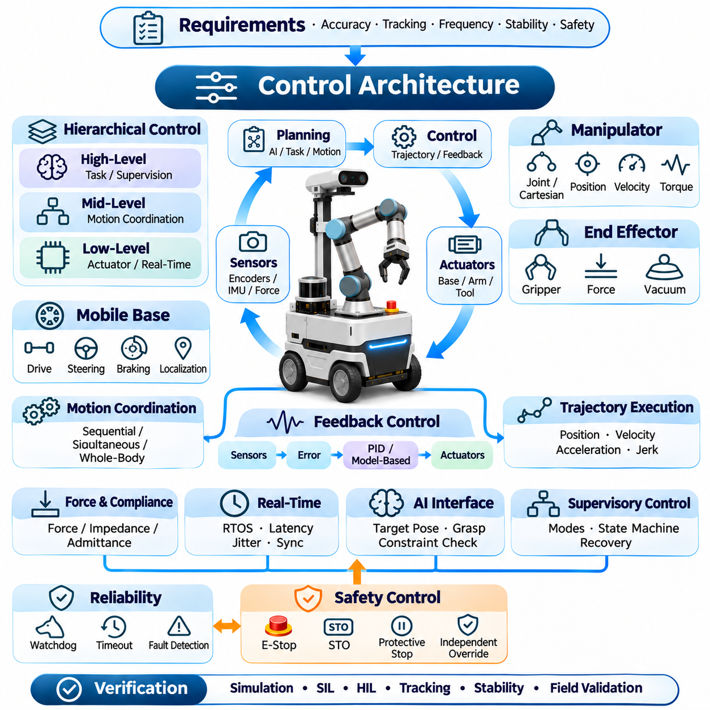{width="7.268055555555556in" height="7.268055555555556in"}

Control architecture defines the control hierarchy, feedback mechanisms, command interfaces, and execution strategies required for a mobile manipulator. It integrates mobile platform control, robotic arm control, end effector control, motion coordination, and system supervision into a unified framework that supports accurate, stable, responsive, and safe physical operation.

Control architecture development begins with product requirements, functional architecture, mechanical architecture, sensor architecture, and compute architecture. Positioning accuracy, trajectory tracking performance, control frequency, response time, dynamic stability, and safety requirements establish the principal design parameters. These parameters guide controller selection and control function allocation.

Hierarchical control architecture organizes control functions according to execution responsibilities and timing requirements. Low-level controllers regulate individual actuators, intermediate controllers coordinate subsystem movements, and high-level controllers manage task execution and operational objectives. This separation improves modularity, deterministic execution, fault isolation, and system scalability.

Mobile platform control architecture manages propulsion, steering, braking, velocity regulation, and trajectory tracking. Differential drive, omnidirectional drive, and independent steering mechanisms require different kinematic models and control strategies. Feedback from wheel encoders, inertial measurement units, and localization systems enables accurate movement and compensation for external disturbances.

Manipulator control architecture regulates robotic joint positions, velocities, accelerations, and torques according to task requirements. Joint-space control and Cartesian-space control provide complementary mechanisms for executing desired movements. Kinematic transformations, dynamic compensation, trajectory interpolation, and actuator feedback support accurate and stable motion throughout the operational workspace.

End effector control architecture manages application-specific tools such as mechanical grippers, vacuum grippers, inspection devices, and specialized handling mechanisms. Position control, force regulation, pressure monitoring, and contact detection support reliable physical interactions. Control interfaces must coordinate tool activation with manipulator movement and task execution conditions.

Closed-loop control architecture continuously evaluates the relationship between commanded objectives and measured system states. Sensor feedback enables controllers to calculate tracking errors and generate corrective commands. Proportional-Integral-Derivative (PID) control, feedforward compensation, model-based control, and adaptive control may be employed according to system dynamics and performance requirements.

Motion coordination architecture establishes the relationship between mobile platform movements and robotic manipulator operations. Sequential coordination allows navigation and manipulation to execute independently, while simultaneous coordination enables combined motion. Whole-body control may optimize mobility and manipulation while considering stability, reachability, and collision constraints.

Trajectory execution architecture converts planned motion paths into time-dependent position, velocity, and acceleration commands. Trajectory generation must consider actuator limitations, joint boundaries, velocity constraints, acceleration profiles, and jerk restrictions. Continuous trajectory monitoring ensures that deviations remain within acceptable limits during autonomous movement and manipulation.

Force and compliance control architecture enables the mobile manipulator to interact with physical objects and environmental structures. Force control, impedance control, and admittance control regulate interaction forces and mechanical responses. These mechanisms are particularly important for assembly, surface inspection, insertion, object handling, and operations involving uncertain contact conditions.

Real-time control architecture ensures that time-sensitive control functions execute within defined timing constraints. Dedicated embedded controllers, real-time operating systems, deterministic communication interfaces, and prioritized execution mechanisms support predictable control behavior. Control latency, execution jitter, synchronization accuracy, and feedback frequency must remain within established performance limits.

AI and control integration establishes controlled interfaces between intelligent decision-making and physical motion execution. AI models may generate target poses, grasp candidates, task objectives, and adaptive motion recommendations. These outputs must be evaluated by motion planning, constraint checking, and execution controllers before physical actions are performed within the permitted operating envelope.

Supervisory control architecture manages operational states, subsystem coordination, mode transitions, and abnormal operating conditions. State machines, behavior trees, and supervisory controllers may organize task execution and recovery procedures. Operational modes such as initialization, autonomous operation, manual control, charging, maintenance, and emergency operation must have explicitly defined transition conditions.

Safety-related control architecture establishes independent protective mechanisms for detecting and preventing hazardous motion. Emergency stop functions, Safe Torque Off (STO), safety-rated speed monitoring, protective stops, and movement restrictions must be selected according to risk assessment results. Safety-related controllers must retain authority over ordinary motion controllers and AI-generated commands.

Control reliability architecture addresses actuator faults, sensor failures, communication interruptions, excessive tracking errors, and unexpected dynamic disturbances. Watchdog mechanisms, command timeouts, state monitoring, and fault detection support controlled responses to abnormal conditions. Recovery strategies must distinguish recoverable execution failures from conditions requiring a protective stop.

Control architecture verification combines mathematical modeling, dynamic simulation, Software-in-the-Loop (SIL) testing, Hardware-in-the-Loop (HIL) testing, and physical experiments. Trajectory tracking accuracy, control stability, response latency, force regulation, and coordinated motion performance must be evaluated. Verified results establish the foundation for detailed controller development, system integration, and field validation.

## 10 Communication Architecture

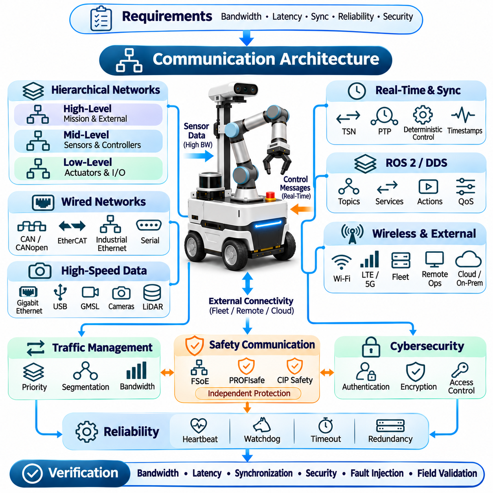{width="7.268055555555556in" height="7.268055555555556in"}

Communication architecture defines the network structure, communication protocols, data exchange mechanisms, and connectivity relationships required for a mobile manipulator. It integrates sensors, embedded controllers, computing platforms, robotic manipulators, safety devices, and external infrastructure into a coordinated communication environment that supports reliable and timely information exchange.

Communication architecture development begins with product requirements, functional architecture, sensor architecture, compute architecture, and control architecture. Data transmission rates, communication latency, synchronization accuracy, network reliability, cybersecurity, and operational coverage establish the principal design parameters. These requirements guide network topology, protocol selection, and interface definition.

Hierarchical communication architecture organizes connectivity according to operational responsibilities and timing requirements. Low-level communication networks connect actuators and embedded controllers, intermediate networks support sensor data exchange and subsystem coordination, and high-level networks provide mission management and external connectivity. This separation improves network scalability and fault isolation.

Internal communication architecture establishes wired connectivity between distributed components within the mobile manipulator. Controller Area Network (CAN), CANopen, EtherCAT, Industrial Ethernet, and serial communication interfaces provide different combinations of transmission performance and deterministic behavior. Protocol selection must consider bandwidth, latency, electrical robustness, and component compatibility.

Industrial Ethernet architecture supports high-bandwidth communication between sensors, computing platforms, and distributed control systems. Gigabit Ethernet and higher-speed Ethernet interfaces enable efficient transmission of high-resolution images, three-dimensional point clouds, and operational data. Network switches, traffic segmentation, and bandwidth allocation must accommodate concurrent communication workloads.

Real-time communication architecture supports control functions that require predictable data transmission and bounded communication delays. EtherCAT, Time-Sensitive Networking (TSN), and other deterministic communication mechanisms may support synchronized actuator control and distributed feedback processing. Communication latency, transmission jitter, packet loss, and synchronization accuracy must be evaluated.

Sensor communication architecture defines how measurements are transmitted from distributed sensing devices to perception and control platforms. Ethernet, USB, GMSL, and serial interfaces provide connectivity for cameras, LiDAR, inertial measurement units, and other sensors. Interface selection must consider data throughput, timestamp integrity, cable limitations, electromagnetic interference, and acquisition frequency.

Middleware communication architecture establishes standardized mechanisms for exchanging information between robotic software components. Robot Operating System 2 (ROS 2) and Data Distribution Service (DDS) support distributed communication through topics, services, and actions at the application layer. Quality of Service (QoS) policies must be configured according to reliability, latency, message freshness, and data delivery requirements.

Time synchronization architecture ensures that distributed sensors, computing platforms, and control systems operate with consistent temporal references. Precision Time Protocol (PTP), hardware synchronization signals, and synchronized system clocks support accurate timestamp generation and coordinated execution. Synchronization requirements must reflect platform motion, manipulation precision, and sensor fusion performance.

Wireless communication architecture enables connectivity between mobile manipulators and external operational infrastructure. Wi-Fi, Long-Term Evolution (LTE), and fifth-generation mobile networks (5G) provide different combinations of coverage, bandwidth, latency, and mobility support. Wireless network selection must consider operational environments, roaming performance, interference, and communication availability.

External communication architecture connects the mobile manipulator to fleet management systems, remote operation platforms, industrial automation infrastructure, and cloud or on-premises servers. Standardized application interfaces, message-oriented communication, and industrial integration protocols support mission assignment, operational monitoring, diagnostic reporting, and coordinated multi-robot operations.

Network traffic management establishes communication priorities according to operational importance and timing sensitivity. Control commands, sensor streams, safety-related messages, diagnostic information, and software updates impose different network requirements. Traffic prioritization, network segmentation, bandwidth reservation, and congestion management help prevent noncritical communication from disrupting essential functions.

Communication cybersecurity architecture protects robotic systems against unauthorized access, malicious commands, data manipulation, and network intrusion. Authentication, encryption, access control, secure communication protocols, and network isolation must be implemented according to cybersecurity requirements. Remote connections and software update mechanisms require controlled permissions and traceable security events.

Communication reliability architecture addresses network congestion, packet loss, connection interruptions, synchronization failures, and degraded transmission performance. Heartbeat messages, communication watchdogs, sequence monitoring, timeout mechanisms, and redundant network paths may improve fault detection and availability. Autonomous functions must support controlled responses when external connectivity becomes unavailable.

Safety-related communication architecture establishes dependable information exchange between safety controllers, protective sensors, and safety-rated actuators. Safety communication protocols such as Functional Safety over EtherCAT (FSoE), PROFIsafe, and CIP Safety may be selected according to system requirements. Ordinary communication failures must not compromise independently implemented protective functions or required safety integrity.

Communication architecture verification combines network performance testing, bandwidth measurement, latency analysis, synchronization assessment, cybersecurity evaluation, and communication fault injection. Representative scenarios must include simultaneous sensor streaming, coordinated motion, wireless roaming, and network interruptions. Verified results establish the foundation for subsystem integration, system testing, and field validation.

## 11 Safety Architecture

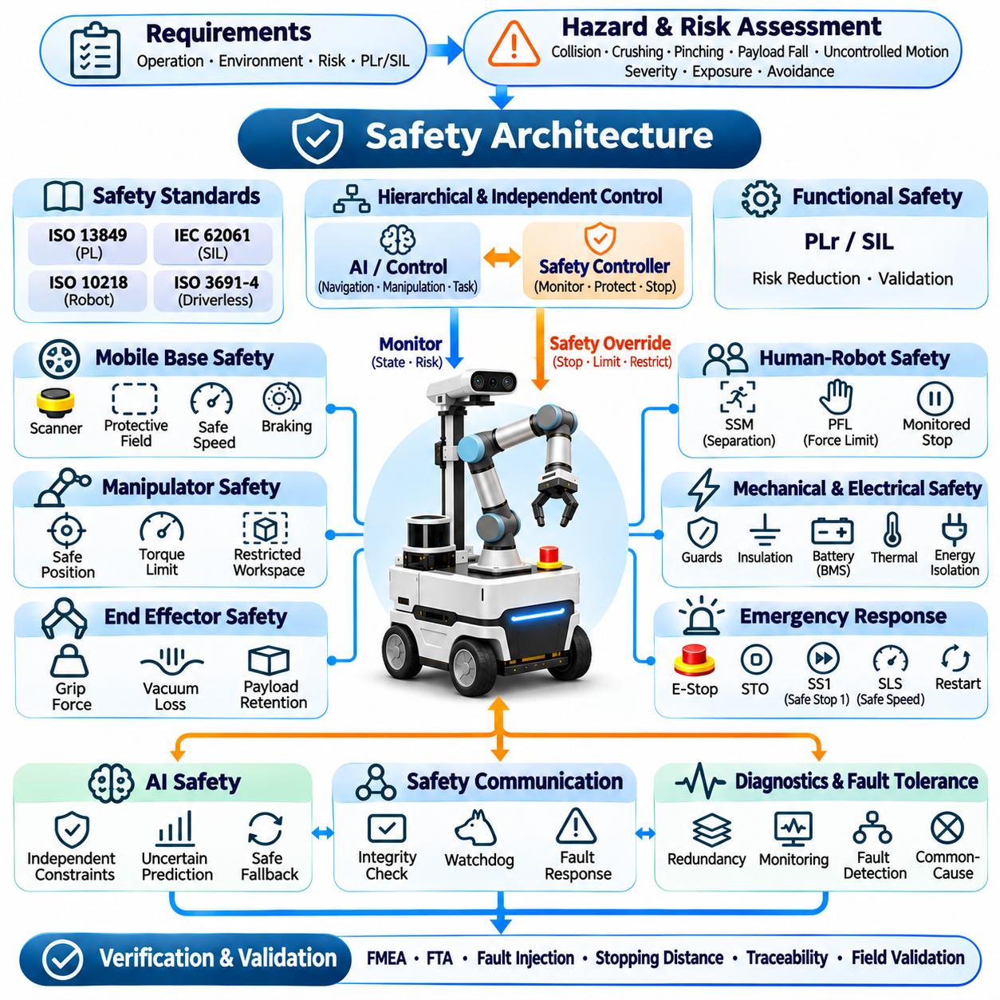{width="7.268055555555556in" height="7.268055555555556in"}

Safety architecture defines the protective mechanisms, safety-related control functions, monitoring structures, and risk mitigation strategies required for a mobile manipulator. It integrates mechanical safety, electrical safety, functional safety, operational safety, and human-robot interaction safety into a unified framework that protects personnel, equipment, and surrounding environments throughout the product lifecycle.

Safety architecture development begins with product requirements, operational scenarios, functional architecture, mechanical architecture, and control architecture. Potential hazards must be identified throughout transportation, autonomous navigation, robotic manipulation, charging, maintenance, and abnormal operation. Risk assessment establishes the required protective measures and corresponding safety performance targets.

Hazard identification addresses risks associated with mobile platform movement, robotic arm operation, end effector activation, electrical energy, and unintended system behavior. Collision, crushing, pinching, mechanical instability, falling payloads, and uncontrolled motion represent significant hazards. Risk evaluation must consider injury severity, exposure frequency, and the possibility of avoiding hazardous situations.

Functional safety architecture establishes safety-related functions that detect hazardous conditions and initiate appropriate protective responses. International standards such as ISO 13849, IEC 62061, ISO 10218, and ISO 3691-4 provide relevant engineering frameworks where applicable. Required Performance Levels (PLr) or Safety Integrity Levels (SIL) must be determined through applicable risk assessment methodologies.

Hierarchical safety architecture separates ordinary operational control from safety-related monitoring and protective control functions. Dedicated safety controllers, safety-rated sensors, and validated protective circuits provide independent or appropriately isolated safety mechanisms. Safety-related functions must retain authority over navigation, manipulation, task execution, and AI-generated commands during hazardous conditions.

Mobile platform safety architecture addresses collisions, unintended movement, excessive speed, braking failures, and platform instability. Safety laser scanners, protective fields, emergency stop devices, and safety-rated speed monitoring support risk reduction during autonomous navigation. Protective field dimensions must consider travel direction, operating velocity, braking distance, payload conditions, and system response time.

Manipulator safety architecture establishes protective mechanisms for robotic joint movement, workspace boundaries, interaction forces, and unintended contact. Safe position monitoring, speed limitation, torque monitoring, and restricted workspace definition may reduce manipulation-related hazards. Safety constraints must account for the combined movement of the mobile platform, robotic arm, and attached equipment.

End effector safety architecture addresses hazards associated with grippers, vacuum systems, inspection tools, and specialized manipulation devices. Unintended tool activation, excessive gripping force, loss of vacuum pressure, and accidental payload release must be considered. Protective mechanisms should maintain or safely release handled objects according to the application-specific risk assessment and failure conditions.

Human-robot interaction safety architecture establishes operational safeguards for environments shared by humans and robotic systems. Speed and Separation Monitoring (SSM), Power and Force Limiting (PFL), and safety-rated monitored stops may support collaborative operation where applicable. Human detection, protective separation distances, and interaction constraints must be validated under representative operating conditions.

Mechanical and electrical safety architecture addresses structural integrity, platform stability, electrical insulation, battery protection, thermal hazards, and energy isolation. Mechanical guards, protective enclosures, overcurrent protection, grounding, and battery management functions contribute to risk reduction. Protective measures must remain effective during normal operation, foreseeable misuse, and maintenance activities.

Emergency response architecture establishes controlled procedures for emergency stopping, protective stopping, hazardous energy isolation, and fault recovery. Safe Torque Off (STO), Safe Stop 1 (SS1), and Safely Limited Speed (SLS) may support application-specific safety functions. Stop categories, braking behavior, payload retention, and restart conditions must be defined according to identified hazards and operational requirements.

AI safety architecture establishes clear boundaries between probabilistic intelligence and safety-critical execution. AI-based perception, object recognition, task reasoning, and adaptive behavior must not bypass required protective functions. Uncertain predictions, invalid commands, and unexpected model behavior should trigger predefined responses, while independently validated safety mechanisms retain control over hazardous actions.

Safety communication architecture ensures dependable information exchange between safety-rated sensors, controllers, and actuators. Certified safety communication protocols, message integrity checks, sequence monitoring, and communication watchdogs may support required safety integrity. Communication interruptions, corrupted messages, and synchronization failures must result in predefined responses consistent with the safety design.

Fault tolerance and diagnostic architecture addresses component failures, sensor degradation, actuator abnormalities, wiring faults, and unexpected communication interruptions. Redundancy, diagnostic coverage, cross-monitoring, and fault detection mechanisms must be selected according to required safety performance. Common-cause failures and systematic design faults must also be considered when evaluating protective system reliability.

Safety verification and validation combine Failure Mode and Effects Analysis (FMEA), Fault Tree Analysis (FTA), safety function testing, fault injection, stopping distance measurement, and representative operational experiments. Safety requirements, implementation evidence, test results, residual risks, and corrective actions must remain traceable. Validated results establish the foundation for regulatory compliance, field deployment, and lifecycle safety management.

## 12 Interface Control Documents

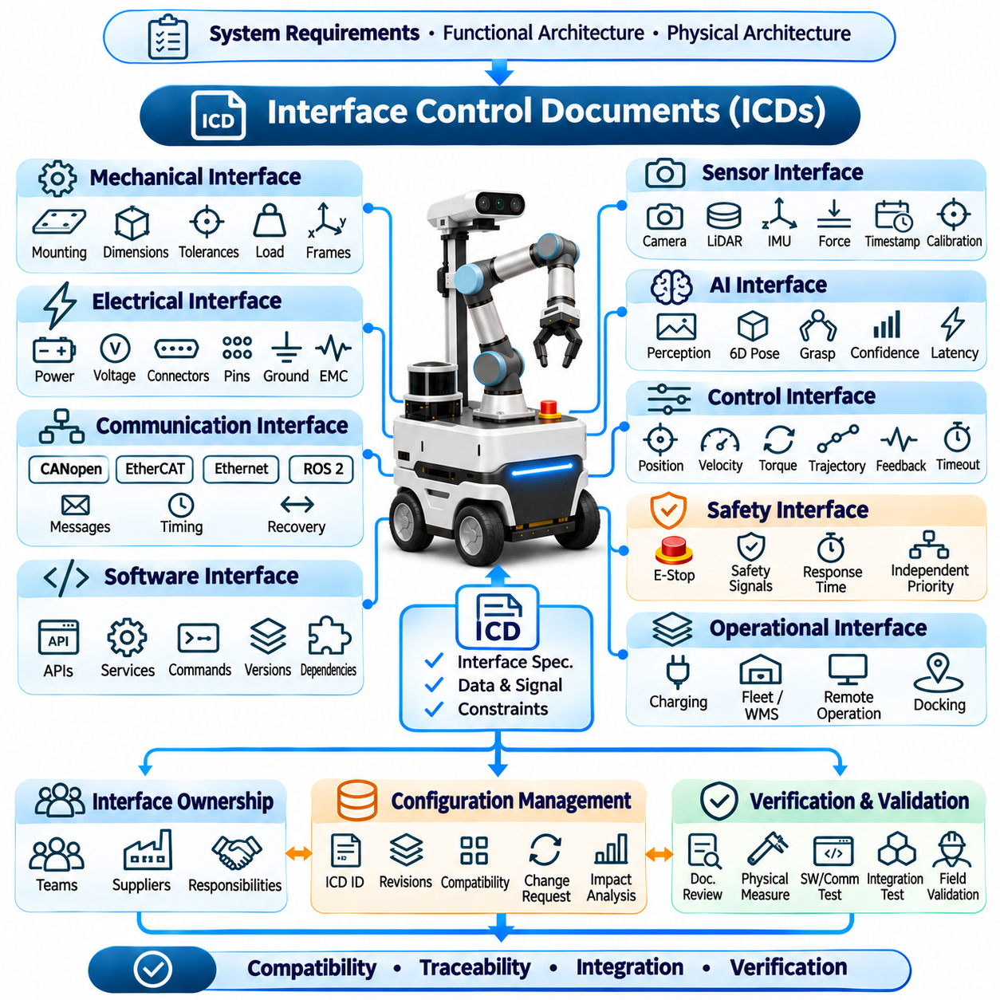{width="7.268055555555556in" height="7.268055555555556in"}

Interface Control Documents (ICDs) establish formal specifications for the interactions between hardware, software, electrical, mechanical, communication, and safety subsystems within a mobile manipulator. They define interface responsibilities, technical characteristics, operational constraints, and integration conditions to ensure consistent development across multiple engineering disciplines and participating organizations.

Interface Control Document development begins with system requirements, functional architecture, physical architecture, and subsystem design specifications. Each interface must be identified according to its purpose, participating components, information exchange requirements, and physical dependencies. Interface definitions establish a common technical baseline for independent subsystem development and subsequent system integration.

Mechanical interface specifications define the physical relationships between the mobile platform, robotic manipulator, end effector, sensor assemblies, and auxiliary equipment. Mounting dimensions, fastening mechanisms, geometric tolerances, coordinate references, load capacities, and structural requirements must be documented. These specifications ensure mechanical compatibility, structural integrity, and repeatable assembly.

Electrical interface specifications define power distribution connections, operating voltages, current limitations, connector types, pin assignments, grounding arrangements, and electrical protection requirements. Power consumption profiles, transient loads, insulation requirements, and electromagnetic compatibility constraints must also be documented. Consistent electrical interfaces reduce integration errors and electrical failure risks.

Communication interface specifications establish network configurations, communication protocols, addressing schemes, message structures, transmission frequencies, and timing requirements. Interfaces based on CANopen, EtherCAT, Ethernet, ROS 2, and other communication technologies must include appropriate implementation parameters. Communication error handling and connection recovery mechanisms must also be defined.

Software interface specifications describe interactions between navigation software, manipulation software, perception modules, task planners, fleet management systems, and supervisory controllers. Application Programming Interfaces (APIs), data structures, service definitions, command formats, and execution conditions must be documented. Version compatibility and software dependencies require systematic configuration management.

Sensor interface specifications define measurement formats, acquisition frequencies, timestamp conventions, coordinate systems, calibration parameters, and data quality indicators. Camera images, LiDAR point clouds, inertial measurements, force measurements, and position feedback must follow consistent interface definitions. Sensor validity conditions and abnormal measurement indicators must also be explicitly specified.

AI interface specifications establish the exchange of information between perception models, object pose estimation modules, grasp detection systems, robot agents, and execution controllers. Input dimensions, preprocessing requirements, output formats, confidence values, inference latency, and model compatibility must be documented. Downstream systems must clearly interpret prediction uncertainty and invalid inference results.

Control interface specifications define command structures, feedback information, execution frequencies, operational limits, and synchronization requirements between distributed controllers. Position, velocity, acceleration, torque, and trajectory commands must include consistent units and coordinate references. Command acknowledgment, timeout conditions, and abnormal execution responses must be explicitly defined.

Safety interface specifications establish communication and physical connections between safety controllers, protective sensors, emergency stop devices, motor drives, and robotic subsystems. Safety signal definitions, protective function priorities, response times, fault detection requirements, and restart conditions must be documented. Ordinary operational interfaces must not override or compromise required safety functions.

Operational interface specifications define interactions between the mobile manipulator and external systems such as charging stations, industrial equipment, warehouse management systems, and remote operation platforms. Mission commands, docking sequences, equipment interlocks, operational states, and completion acknowledgments must be standardized. Interface failures must trigger predefined recovery or protective responses.

Interface ownership establishes clear responsibilities for organizations, engineering teams, subsystem suppliers, and integration personnel. Each interface must have designated owners responsible for specification development, implementation, verification, and change approval. Responsibility boundaries must distinguish technical interface compatibility from subsystem ownership, intellectual property rights, and contractual obligations.

Interface configuration management ensures that approved specifications remain consistent throughout system development and product lifecycle management. Document identifiers, revision histories, compatibility matrices, engineering change requests, and approval records support controlled modifications. Proposed interface changes must undergo impact analysis to evaluate dependencies, integration risks, and verification requirements.

Interface verification and validation combine document reviews, compatibility assessments, physical measurements, software interface testing, communication testing, and subsystem integration experiments. Normal operation, boundary conditions, invalid commands, communication interruptions, and component failures must be evaluated. Verified Interface Control Documents establish the technical baseline for hardware development, AI development, manipulation development, system testing, and field validation.

## 13 Design Review Process

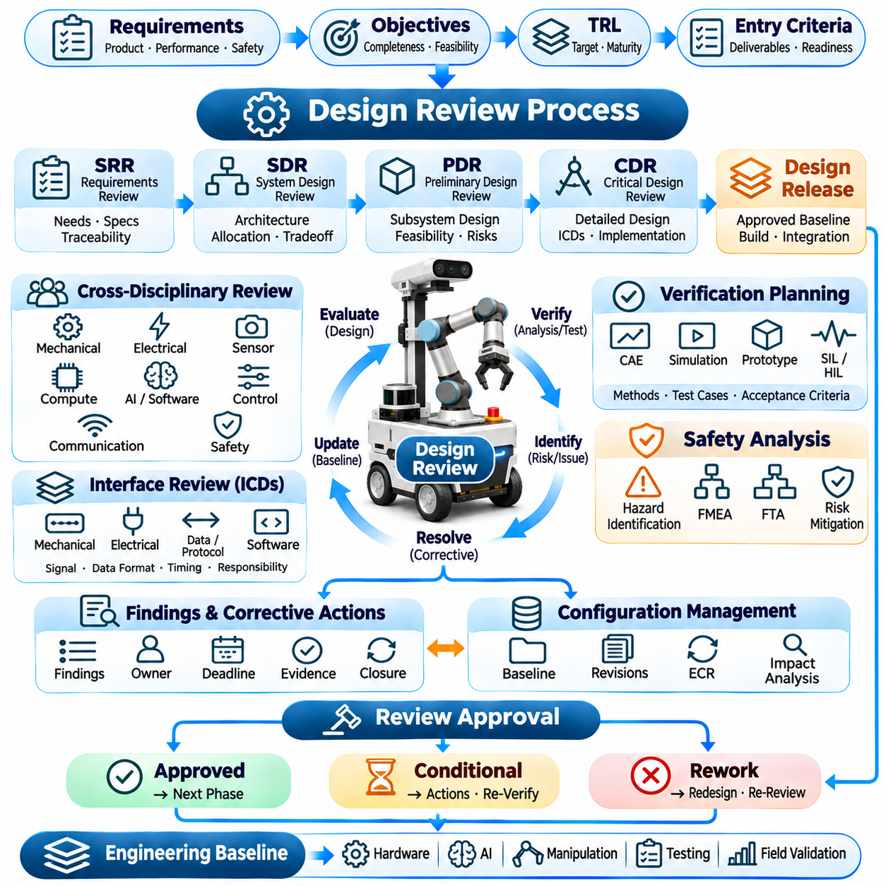{width="7.268055555555556in" height="7.268055555555556in"}

The design review process establishes a systematic engineering mechanism for evaluating the technical completeness, feasibility, consistency, and maturity of a mobile manipulator design. It ensures that system architecture, subsystem specifications, interface definitions, safety mechanisms, and implementation strategies satisfy established requirements before progressing to subsequent development phases.

Design review planning begins with the definition of review objectives, evaluation criteria, required deliverables, participating engineering disciplines, and approval responsibilities. Review activities must align with project milestones, development maturity, technical risks, and Technology Readiness Level (TRL) objectives. Each review should establish measurable entry criteria and exit criteria for development progression.

System Requirements Review (SRR) evaluates whether product requirements, customer expectations, operational scenarios, performance targets, and safety requirements are sufficiently complete and consistent. Requirements must be measurable, technically feasible, and traceable to their originating needs. Unresolved requirements and conflicting specifications must be addressed before establishing the system design baseline.

System Design Review (SDR) evaluates the overall architecture and allocation of functional responsibilities across mechanical, electrical, sensor, computing, AI, control, communication, and safety subsystems. Architectural decisions must demonstrate consistency with product requirements and operational constraints. Alternative design approaches should be assessed against performance, cost, complexity, and integration risks.

Preliminary Design Review (PDR) evaluates whether the proposed subsystem architectures and preliminary engineering solutions provide a feasible implementation pathway. Mechanical layouts, electrical configurations, computing resources, sensor arrangements, control strategies, and interface specifications must demonstrate sufficient maturity. Remaining technical uncertainties require documented mitigation plans and development actions.

Critical Design Review (CDR) determines whether detailed engineering specifications have reached sufficient maturity to support fabrication, software implementation, and subsystem integration. Engineering drawings, electrical schematics, component selections, software architecture, and Interface Control Documents (ICDs) must be reviewed. Outstanding design issues must be resolved or formally accepted before design release.

Multidisciplinary design review evaluates interactions and dependencies between engineering domains rather than assessing each subsystem independently. Mechanical dimensions may affect sensor visibility, electrical power limitations may constrain computing performance, and manipulator movement may influence platform stability. Cross-functional evaluation helps identify integration problems before physical prototype development.

AI and software design reviews evaluate model architecture, data requirements, inference performance, software modularity, computational resource allocation, and integration readiness. Particular attention must be given to prediction uncertainty, operational limitations, model compatibility, and abnormal execution behavior. Proposed intelligent functions must remain consistent with control and safety architecture requirements.

Safety design review evaluates hazard identification, risk assessment results, protective functions, emergency response mechanisms, and applicable regulatory requirements. Failure Mode and Effects Analysis (FMEA), Fault Tree Analysis (FTA), and functional safety assessments may support technical evaluation. Safety-related design decisions must demonstrate adequate risk reduction and traceability to identified hazards.

Interface design review evaluates the compatibility of mechanical, electrical, software, communication, sensor, AI, control, and safety interfaces. Interface Control Documents must establish consistent physical dimensions, signal definitions, data formats, timing requirements, and responsibility boundaries. Unresolved interface inconsistencies must be corrected before dependent subsystem implementation progresses.

Design verification planning establishes how engineering decisions and technical specifications will be evaluated against defined requirements. Mathematical analysis, Computer-Aided Engineering (CAE), simulation, prototype testing, and subsystem integration experiments provide complementary evaluation mechanisms. Verification methods and acceptance criteria must be established before implementation and testing activities begin.

Design review findings must be documented through formal review records, technical issue descriptions, risk classifications, corrective actions, responsible personnel, and completion deadlines. Each finding should include sufficient technical evidence to support resolution and subsequent verification. Critical findings must remain visible until corrective actions have been completed and their effectiveness confirmed.

Design configuration management ensures that reviewed and approved engineering deliverables remain consistent throughout the development lifecycle. Design baselines, document revisions, engineering change requests, and approval histories provide traceable control over modifications. Significant changes affecting performance, interfaces, safety, or manufacturing feasibility may require additional design reviews and verification activities.

Design review approval establishes a formal decision regarding readiness to enter the next development phase. Approval decisions may include unconditional approval, conditional approval, or rejection according to technical maturity and unresolved risks. Conditional approval must specify outstanding actions, implementation restrictions, accountable personnel, and required closure dates to prevent uncontrolled development progression.

The design review framework should be adapted to project scale, development complexity, organizational responsibilities, and commercialization objectives. Although specific review gates may vary between organizations, systematic evaluation, documented evidence, requirement traceability, and controlled approval remain essential. Completed design reviews establish the engineering baseline for hardware development, AI development, manipulation development, system testing, and field validation.
