**Volume 05. Mobile Manipulator Projects and Development Manual**


# Chapter 03. Hardware Development

##  

## 01 Hardware Development Process

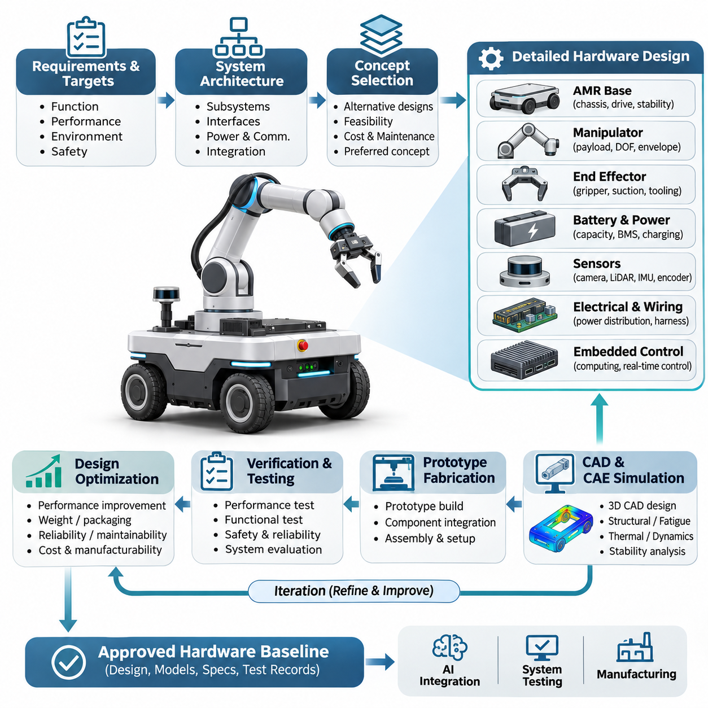{width="7.268055555555556in" height="7.268055555555556in"}

Hardware development is a systematic engineering process that transforms product requirements and system architecture into a functional, reliable, and manufacturable physical platform. In mobile manipulator development, this process encompasses mechanical structures, autonomous mobile robot (AMR) platforms, robotic arms, end effectors, power systems, sensors, embedded controllers, and electrical interfaces.

The hardware development process begins with the analysis of functional, performance, environmental, and safety requirements. Engineers establish quantitative engineering targets for payload capacity, mobility, positioning accuracy, manipulation reach, operating duration, structural strength, and environmental resistance. These requirements provide the foundation for subsequent hardware design and verification activities.

System architecture defines how individual hardware components interact to achieve the intended operational objectives. The development team establishes physical boundaries, subsystem responsibilities, communication interfaces, power distribution requirements, and mechanical integration constraints. Architectural decisions must consider the interdependencies between mobility, manipulation, perception, computation, and safety functions.

Conceptual design translates system requirements into alternative hardware configurations. Engineers evaluate different drivetrain architectures, robotic manipulators, structural materials, battery technologies, sensor configurations, and computing platforms. Technical feasibility, development complexity, component availability, manufacturing costs, and long-term maintenance requirements influence the selection of the preferred concept.

AMR base development represents a fundamental engineering activity because the mobile platform supports the entire robotic system. Chassis dimensions, wheel configurations, suspension mechanisms, motor capacity, braking performance, and ground clearance must be established according to operational scenarios. Vehicle stability must be evaluated under changing payload distributions and dynamic manipulator movements.

Manipulator selection requires careful consideration of payload capacity, degrees of freedom, working envelope, repeatability, operating speed, and installation requirements. Engineers must evaluate how the robotic arm influences the overall center of gravity, structural loading, electrical consumption, and mobile platform stability. Manipulator performance must be assessed within the integrated system rather than independently.

End effector development addresses the physical interaction between the robot and its surrounding environment. Grippers, suction mechanisms, specialized tooling, and inspection devices must be designed according to object characteristics and operational requirements. Mechanical compatibility, gripping forces, tool-changing capabilities, sensor integration, and failure recovery mechanisms should be considered during development.

Battery system design determines the energy capacity, operational endurance, and electrical reliability of the mobile manipulator. Engineers analyze the combined power consumption of drive motors, robotic joints, computing devices, sensors, and auxiliary equipment. Battery management systems, charging mechanisms, electrical protection, thermal management, and emergency power isolation must be incorporated into the design.

Sensor integration requires coordination between mechanical installation, electrical connectivity, communication interfaces, and perception software. Cameras, LiDAR devices, inertial measurement units, encoders, and force-torque sensors must be positioned to provide appropriate environmental coverage. Mounting rigidity, vibration isolation, calibration accessibility, synchronization, and electromagnetic interference must also be evaluated.

Electrical system development establishes the infrastructure necessary to distribute power and exchange information between hardware components. Engineers design power distribution circuits, motor control interfaces, protection mechanisms, grounding architectures, and communication networks. Electrical hardware must accommodate transient loads, operating voltage variations, thermal constraints, and safety-related shutdown requirements.

Wiring harness development ensures reliable electrical connectivity throughout the robotic platform. Cable routing must accommodate moving joints, steering mechanisms, structural assemblies, and maintenance procedures without introducing excessive mechanical stress. Connector selection, shielding, cable separation, bending radius, strain relief, and protective coverings contribute to long-term operational reliability.

Embedded system development integrates computing hardware, microcontrollers, communication interfaces, and real-time control resources. The hardware architecture must support deterministic control, sensor acquisition, actuator communication, and system diagnostics. Processing capacity, memory bandwidth, thermal dissipation, communication latency, and hardware compatibility with AI software must be evaluated throughout development.

Computer-aided design (CAD) provides a common engineering environment for transforming conceptual configurations into detailed mechanical models. Engineers develop individual components, assemblies, mounting structures, and installation interfaces while verifying dimensional compatibility. Digital assembly models support interference detection, packaging optimization, tolerance analysis, maintenance accessibility, and manufacturing documentation.

Computer-aided engineering (CAE) and simulation enable the evaluation of hardware performance before physical fabrication. Structural analysis, fatigue assessment, thermal simulation, multibody dynamics, and stability analysis help identify potential engineering weaknesses. Simulation results guide material selection, structural reinforcement, component positioning, and design modifications while reducing unnecessary prototype iterations.

Prototype fabrication converts verified digital designs into physical engineering samples. Development teams assemble mechanical components, electrical systems, sensors, computing devices, and robotic manipulators in controlled stages. Initial prototypes establish technical feasibility, expose integration challenges, and provide measurable evidence for evaluating assumptions established during conceptual and detailed design.

Hardware verification combines component-level testing, subsystem evaluation, and integrated system assessment. Engineers measure structural deformation, electrical consumption, actuator performance, thermal behavior, communication reliability, and operational stability. Design failures and unexpected interactions must be documented, investigated, and resolved through controlled engineering changes and subsequent verification activities.

Design optimization improves hardware performance while balancing manufacturing costs, system weight, energy efficiency, reliability, and serviceability. Engineering teams refine component specifications, mechanical structures, electrical layouts, and assembly procedures using simulation and experimental evidence. Configuration management ensures that design revisions remain traceable to requirements, test results, and approved engineering decisions.

The hardware development process concludes with the establishment of a controlled design baseline supported by verified engineering documentation, approved component specifications, manufacturing drawings, and test records. This baseline connects hardware development with AI integration, manipulation development, system testing, field validation, manufacturing, and quality assurance throughout the mobile manipulator product lifecycle.

하드웨어 개발(Hardware Development)은 제품 요구사항(Product Requirements)과 시스템 아키텍처(System Architecture)를 기능적이고 신뢰성이 높으며 제조 가능한 물리적 플랫폼(Physical Platform)으로 변환하는 체계적인 엔지니어링 프로세스이다. 모바일 매니퓰레이터(Mobile Manipulator) 개발에서 이러한 프로세스는 기계 구조물, 자율 이동 로봇(AMR, Autonomous Mobile Robot) 플랫폼, 로봇 팔(Robot Arm), 엔드 이펙터(End Effector), 전력 시스템, 센서, 임베디드 제어기(Embedded Controller) 및 전기적 인터페이스를 포함한다.

하드웨어 개발 프로세스(Hardware Development Process)는 기능적, 성능적, 환경적 및 안전 요구사항에 대한 분석으로부터 시작된다. 엔지니어는 적재 용량(Payload Capacity), 이동성(Mobility), 위치 결정 정확도(Positioning Accuracy), 조작 도달 범위(Manipulation Reach), 운용 시간(Operating Duration), 구조적 강도(Structural Strength) 및 환경 내구성(Environmental Resistance)에 대한 정량적인 엔지니어링 목표를 설정한다. 이러한 요구사항은 이후의 하드웨어 설계 및 검증 활동을 위한 기반을 제공한다.

시스템 아키텍처(System Architecture)는 개별 하드웨어 구성 요소가 의도된 운용 목표를 달성하기 위해 어떻게 상호작용하는지를 정의한다. 개발팀은 물리적 경계(Physical Boundary), 하위 시스템의 책임 범위, 통신 인터페이스(Communication Interface), 전력 분배 요구사항(Power Distribution Requirements) 및 기계적 통합 제약조건을 설정한다. 아키텍처 설계 의사결정은 이동(Mobility), 조작(Manipulation), 인지(Perception), 연산(Computation) 및 안전(Safety) 기능 사이의 상호 의존성을 고려해야 한다.

개념 설계(Conceptual Design)는 시스템 요구사항을 다양한 하드웨어 구성 대안으로 변환하는 과정이다. 엔지니어는 다양한 구동계 아키텍처(Drivetrain Architecture), 로봇 매니퓰레이터(Robotic Manipulator), 구조 재료(Structural Material), 배터리 기술(Battery Technology), 센서 구성(Sensor Configuration) 및 컴퓨팅 플랫폼(Computing Platform)을 평가한다. 기술적 타당성(Technical Feasibility), 개발 복잡성, 부품 가용성, 제조 비용 및 장기적인 유지보수 요구사항은 최적의 설계 개념을 선정하는 데 영향을 미친다.

AMR 베이스 개발(AMR Base Development)은 이동 플랫폼(Mobile Platform)이 전체 로봇 시스템을 지지하기 때문에 핵심적인 엔지니어링 활동에 해당한다. 섀시 치수(Chassis Dimension), 휠 구성(Wheel Configuration), 서스펜션 메커니즘(Suspension Mechanism), 모터 용량(Motor Capacity), 제동 성능(Braking Performance) 및 최저 지상고(Ground Clearance)는 운용 시나리오에 따라 결정되어야 한다. 적재 하중 분포의 변화와 매니퓰레이터의 동적 움직임에 따른 차량 안정성(Vehicle Stability)도 평가해야 한다.

매니퓰레이터 선정(Manipulator Selection)은 적재 용량(Payload Capacity), 자유도(Degrees of Freedom), 작업 영역(Working Envelope), 반복 정밀도(Repeatability), 동작 속도(Operating Speed) 및 설치 요구사항에 대한 신중한 검토를 필요로 한다. 엔지니어는 로봇 팔이 전체 시스템의 무게중심(Center of Gravity), 구조적 하중(Structural Loading), 전력 소비량(Power Consumption) 및 이동 플랫폼의 안정성에 미치는 영향을 평가해야 한다. 매니퓰레이터의 성능은 독립적인 구성 요소가 아닌 통합 시스템(Integrated System)의 관점에서 평가되어야 한다.

엔드 이펙터 개발(End Effector Development)은 로봇과 주변 환경 사이의 물리적 상호작용(Physical Interaction)을 다룬다. 그리퍼(Gripper), 진공 흡착 메커니즘(Suction Mechanism), 특수 작업 도구(Specialized Tooling) 및 검사 장치(Inspection Device)는 대상 물체의 특성과 운용 요구사항에 따라 설계되어야 한다. 개발 과정에서는 기계적 호환성(Mechanical Compatibility), 파지력(Gripping Force), 도구 교환 기능(Tool-Changing Capability), 센서 통합(Sensor Integration) 및 장애 복구 메커니즘(Failure Recovery Mechanism)을 고려해야 한다.

배터리 시스템 설계(Battery System Design)는 모바일 매니퓰레이터의 에너지 용량(Energy Capacity), 운용 지속 시간(Operational Endurance) 및 전기적 신뢰성(Electrical Reliability)을 결정한다. 엔지니어는 구동 모터(Drive Motor), 로봇 관절(Robotic Joint), 컴퓨팅 장치, 센서 및 보조 장비의 전체 전력 소비량을 분석한다. 배터리 관리 시스템(BMS, Battery Management System), 충전 메커니즘(Charging Mechanism), 전기적 보호(Electrical Protection), 열 관리(Thermal Management) 및 비상 전원 차단(Emergency Power Isolation)이 설계에 포함되어야 한다.

센서 통합(Sensor Integration)은 기계적 설치, 전기적 연결, 통신 인터페이스 및 인지 소프트웨어(Perception Software) 사이의 긴밀한 협력을 필요로 한다. 카메라(Camera), 라이다(LiDAR), 관성 측정 장치(IMU, Inertial Measurement Unit), 엔코더(Encoder) 및 힘·토크 센서(Force-Torque Sensor)는 적절한 환경 감지 범위를 제공하도록 배치되어야 한다. 장착 강성(Mounting Rigidity), 진동 절연(Vibration Isolation), 보정 접근성(Calibration Accessibility), 동기화(Synchronization) 및 전자기 간섭(EMI, Electromagnetic Interference)도 평가해야 한다.

전기 시스템 개발(Electrical System Development)은 하드웨어 구성 요소 사이에서 전력을 분배하고 정보를 교환하는 데 필요한 기반 구조를 구축한다. 엔지니어는 전력 분배 회로(Power Distribution Circuit), 모터 제어 인터페이스(Motor Control Interface), 보호 메커니즘(Protection Mechanism), 접지 아키텍처(Grounding Architecture) 및 통신 네트워크(Communication Network)를 설계한다. 전기 하드웨어는 과도 부하(Transient Load), 동작 전압 변동(Operating Voltage Variation), 열적 제약조건(Thermal Constraint) 및 안전 관련 시스템 정지 요구사항을 수용해야 한다.

와이어링 하네스 개발(Wiring Harness Development)은 로봇 플랫폼 전체에서 신뢰성 높은 전기적 연결(Electrical Connectivity)을 보장한다. 케이블 경로 설계(Cable Routing)는 과도한 기계적 응력을 발생시키지 않으면서 움직이는 관절, 조향 메커니즘(Steering Mechanism), 구조 조립체(Structural Assembly) 및 유지보수 절차를 수용해야 한다. 커넥터 선정(Connector Selection), 차폐(Shielding), 케이블 분리(Cable Separation), 굽힘 반경(Bending Radius), 응력 완화(Strain Relief) 및 보호 피복(Protective Covering)은 장기적인 운용 신뢰성에 기여한다.

임베디드 시스템 개발(Embedded System Development)은 컴퓨팅 하드웨어, 마이크로컨트롤러(Microcontroller), 통신 인터페이스 및 실시간 제어 자원(Real-Time Control Resource)을 통합하는 과정이다. 하드웨어 아키텍처는 결정론적 제어(Deterministic Control), 센서 데이터 수집(Sensor Acquisition), 액추에이터 통신(Actuator Communication) 및 시스템 진단(System Diagnostics)을 지원해야 한다. 연산 처리 용량(Processing Capacity), 메모리 대역폭(Memory Bandwidth), 열 방출(Thermal Dissipation), 통신 지연시간(Communication Latency) 및 AI 소프트웨어와의 하드웨어 호환성은 전체 개발 과정에서 평가되어야 한다.

컴퓨터 지원 설계(CAD, Computer-Aided Design)는 개념적 하드웨어 구성을 상세한 기계 모델(Mechanical Model)로 변환하기 위한 공통 엔지니어링 환경을 제공한다. 엔지니어는 치수 호환성(Dimensional Compatibility)을 검증하면서 개별 부품, 조립체(Assembly), 장착 구조물(Mounting Structure) 및 설치 인터페이스(Installation Interface)를 개발한다. 디지털 조립 모델(Digital Assembly Model)은 간섭 검출(Interference Detection), 패키징 최적화(Packaging Optimization), 공차 분석(Tolerance Analysis), 유지보수 접근성(Maintenance Accessibility) 및 제조 문서화(Manufacturing Documentation)를 지원한다.

컴퓨터 지원 공학(CAE, Computer-Aided Engineering)과 시뮬레이션(Simulation)은 실제 물리적 제작에 앞서 하드웨어 성능을 평가할 수 있도록 한다. 구조 해석(Structural Analysis), 피로 평가(Fatigue Assessment), 열 시뮬레이션(Thermal Simulation), 다물체 동역학(Multibody Dynamics) 및 안정성 분석(Stability Analysis)은 잠재적인 엔지니어링 취약점을 식별하는 데 도움을 준다. 시뮬레이션 결과는 불필요한 시제품 제작 반복을 줄이면서 재료 선정(Material Selection), 구조 보강(Structural Reinforcement), 구성 요소 배치 및 설계 변경을 지원한다.

시제품 제작(Prototype Fabrication)은 검증된 디지털 설계를 물리적인 엔지니어링 샘플(Engineering Sample)로 변환하는 과정이다. 개발팀은 체계적으로 관리되는 단계에 따라 기계 부품, 전기 시스템, 센서, 컴퓨팅 장치 및 로봇 매니퓰레이터를 조립한다. 초기 시제품(Initial Prototype)은 기술적 타당성을 입증하고 시스템 통합 과정에서 발생하는 문제를 드러내며, 개념 설계(Conceptual Design) 및 상세 설계(Detailed Design) 단계에서 수립된 가정을 평가하기 위한 정량적 증거를 제공한다.

하드웨어 검증(Hardware Verification)은 구성 요소 수준의 시험(Component-Level Testing), 하위 시스템 평가(Subsystem Evaluation) 및 통합 시스템 평가(Integrated System Assessment)를 결합한다. 엔지니어는 구조적 변형(Structural Deformation), 전력 소비량, 액추에이터 성능(Actuator Performance), 열적 거동(Thermal Behavior), 통신 신뢰성(Communication Reliability) 및 운용 안정성(Operational Stability)을 측정한다. 설계 결함과 예상하지 못한 상호작용은 문서화하고 원인을 조사하며, 체계적으로 관리되는 엔지니어링 변경(Engineering Change)과 후속 검증 활동을 통해 해결해야 한다.

설계 최적화(Design Optimization)는 제조 비용(Manufacturing Cost), 시스템 중량(System Weight), 에너지 효율성(Energy Efficiency), 신뢰성(Reliability) 및 정비성(Serviceability) 사이의 균형을 유지하면서 하드웨어 성능을 향상시키는 과정이다. 엔지니어링팀은 시뮬레이션과 실험적 증거를 활용하여 부품 사양(Component Specification), 기계 구조물, 전기적 배치(Electrical Layout) 및 조립 절차(Assembly Procedure)를 개선한다. 형상 관리(Configuration Management)는 설계 개정 사항이 요구사항, 시험 결과 및 승인된 엔지니어링 의사결정에 대해 추적성을 유지하도록 보장한다.

하드웨어 개발 프로세스는 검증된 엔지니어링 문서(Engineering Documentation), 승인된 부품 사양, 제조 도면(Manufacturing Drawing) 및 시험 기록(Test Record)을 기반으로 체계적으로 관리되는 설계 기준선(Design Baseline)을 수립함으로써 마무리된다. 이러한 설계 기준선은 모바일 매니퓰레이터의 전체 제품 수명주기(Product Lifecycle)에 걸쳐 하드웨어 개발을 AI 통합(AI Integration), 조작 기술 개발(Manipulation Development), 시스템 시험(System Testing), 현장 검증(Field Validation), 제조(Manufacturing) 및 품질 보증(Quality Assurance)과 연결한다.

##  

## 02 AMR Base Development

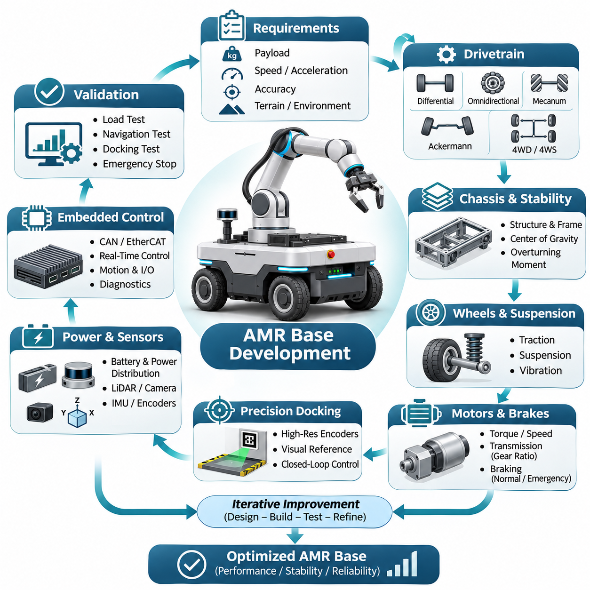{width="7.268055555555556in" height="7.268055555555556in"}

Autonomous Mobile Robot (AMR) base development is a fundamental engineering process that establishes the mobility, structural integrity, electrical infrastructure, and operational stability of a mobile manipulator. Unlike conventional AMRs designed primarily for transportation, mobile manipulator platforms must support robotic arms, end effectors, perception systems, and computing resources while maintaining precise positioning and safe operation.

The development process begins with the identification of operational requirements and environmental constraints. Engineers establish target specifications for payload capacity, maximum velocity, acceleration, turning radius, positioning accuracy, operating duration, floor conditions, and obstacle traversal capability. These requirements determine the physical dimensions, mechanical configuration, drivetrain architecture, and electrical capacity of the AMR base.

Payload analysis must consider the combined mass of the robotic manipulator, end effector, handled objects, computing devices, sensors, batteries, and auxiliary equipment. Engineers must distinguish between static loading and dynamic loading generated during acceleration, braking, turning, and manipulation. Appropriate structural margins should accommodate variations in payload distribution and unexpected operational disturbances.

Drivetrain architecture selection significantly influences mobility characteristics and manipulation flexibility. Differential drive, omnidirectional drive, mecanum wheels, Ackermann steering, and independent steering and driving configurations provide different operational capabilities. The selection process must balance maneuverability, mechanical complexity, positioning precision, energy efficiency, maintenance requirements, and manufacturing costs.

Four-wheel drive and four-wheel steering architectures provide additional maneuverability for mobile manipulators operating within confined industrial environments. Independently controlled steering and traction units can enable lateral movement, diagonal translation, and rotation around a predefined center. However, these configurations require accurate steering calibration, coordinated wheel control, robust mechanical integration, and reliable communication interfaces.

Chassis development establishes the primary structural foundation of the AMR base. Engineers must design the frame to withstand static payloads, dynamic forces, manipulator reaction moments, and repeated operational loads. Structural materials, reinforcement members, mounting interfaces, and fastening methods should be selected according to strength, stiffness, fatigue resistance, manufacturing feasibility, and overall weight requirements.

Center of gravity management is particularly important because robotic arm movements continuously change the mass distribution of the integrated platform. Extended manipulator configurations can generate significant overturning moments, especially when handling heavy objects. Engineers must evaluate stability across representative arm configurations, payload conditions, acceleration profiles, floor inclinations, and emergency braking scenarios.

Wheel and suspension system development determines traction performance, vibration characteristics, and maintaining contact with the operating surface. Wheel diameter, tire material, tread geometry, suspension stiffness, and damping characteristics should reflect the expected environmental conditions. Excessive vibration and platform deformation can negatively influence sensor measurements, localization accuracy, and end effector positioning.

Motor and transmission selection requires quantitative analysis of traction forces, rolling resistance, acceleration requirements, gradient resistance, and drivetrain efficiency. Engineers must evaluate continuous torque, peak torque, rotational speed, reduction ratios, and thermal limitations. Motor controllers should provide sufficient control resolution and support coordinated movement without introducing excessive positioning errors or mechanical oscillations.

Braking system development must address normal deceleration, emergency stopping, stationary holding, and unexpected power interruptions. Depending on the application, electromagnetic brakes, mechanical brakes, regenerative braking, or combinations of these technologies may be employed. Braking performance must be verified under maximum payload conditions while considering stopping distance, directional stability, and manipulator-induced load transfer.

Precision positioning represents a critical requirement for AMR platforms supporting industrial manipulation. Navigation accuracy alone may be insufficient for tasks requiring millimeter-level alignment between the robotic arm and external equipment. Fine positioning mechanisms, high-resolution encoders, local reference sensors, visual docking, and closed-loop motion control can improve alignment accuracy at designated workstations.

The electrical architecture of the AMR base must support both mobility and manipulation workloads. Battery capacity, power distribution, motor controllers, voltage converters, protection devices, and charging interfaces must accommodate simultaneous subsystem operation. Engineers should evaluate peak current demands, regenerative energy, voltage fluctuations, electrical isolation, thermal dissipation, and power consumption across representative operating cycles.

Sensor integration provides the physical foundation for localization, navigation, environmental perception, and collision avoidance. LiDAR devices, cameras, ultrasonic sensors, inertial measurement units, and wheel encoders require suitable mounting locations and communication interfaces. Sensor coverage, structural rigidity, calibration stability, environmental protection, and time synchronization must be considered during mechanical and electrical development.

Embedded controllers coordinate drivetrain operation, steering mechanisms, braking systems, sensor acquisition, and communication with higher-level computing platforms. Real-time control functions must remain predictable under varying computational workloads. Communication architectures based on CAN, CANopen, EtherCAT, or industrial Ethernet may be selected according to control frequency, synchronization requirements, fault management, and hardware compatibility.

AMR base validation requires structural testing, drivetrain characterization, positioning assessment, energy consumption measurement, and safety-related functional testing. Prototype evaluation should include straight-line travel, curved trajectories, repeated docking, maximum payload transportation, manipulator operation, and emergency stopping. Test results support iterative design improvements and establish the verified hardware baseline for subsequent system integration and manufacturing.

자율 이동 로봇(AMR, Autonomous Mobile Robot) 베이스 개발은 모바일 매니퓰레이터(Mobile Manipulator)의 이동성(Mobility), 구조적 건전성(Structural Integrity), 전기적 기반 구조(Electrical Infrastructure) 및 운용 안정성(Operational Stability)을 확립하는 핵심적인 엔지니어링 프로세스이다. 주로 운송 목적으로 설계되는 일반적인 AMR과 달리 모바일 매니퓰레이터 플랫폼은 정밀한 위치 결정과 안전한 운용을 유지하면서 로봇 팔(Robot Arm), 엔드 이펙터(End Effector), 인지 시스템(Perception System) 및 컴퓨팅 자원(Computing Resource)을 지원해야 한다.

개발 프로세스는 운용 요구사항(Operational Requirements)과 환경적 제약조건(Environmental Constraints)을 식별하는 것으로부터 시작된다. 엔지니어는 적재 용량(Payload Capacity), 최대 속도(Maximum Velocity), 가속도(Acceleration), 회전 반경(Turning Radius), 위치 결정 정확도(Positioning Accuracy), 운용 시간(Operating Duration), 바닥 상태(Floor Condition) 및 장애물 극복 능력(Obstacle Traversal Capability)에 대한 목표 사양을 설정한다. 이러한 요구사항은 AMR 베이스의 물리적 치수, 기계적 구성, 구동계 아키텍처(Drivetrain Architecture) 및 전기적 용량을 결정한다.

적재 하중 분석(Payload Analysis)은 로봇 매니퓰레이터, 엔드 이펙터, 취급 대상 물체, 컴퓨팅 장치, 센서, 배터리 및 보조 장비의 전체 질량을 고려해야 한다. 엔지니어는 정적 하중(Static Loading)과 가속, 제동, 회전 및 조작 과정에서 발생하는 동적 하중(Dynamic Loading)을 구분해야 한다. 적절한 구조적 안전 여유(Structural Margin)를 확보하여 적재 하중 분포의 변화와 예상하지 못한 운용 외란(Operational Disturbance)을 수용할 수 있도록 설계해야 한다.

구동계 아키텍처 선정(Drivetrain Architecture Selection)은 이동 특성(Mobility Characteristics)과 조작 유연성(Manipulation Flexibility)에 상당한 영향을 미친다. 차동 구동(Differential Drive), 전방향 구동(Omnidirectional Drive), 메카넘 휠(Mecanum Wheel), 애커먼 조향(Ackermann Steering) 및 독립 조향·구동 구성(Independent Steering and Driving Configuration)은 서로 다른 운용 능력을 제공한다. 선정 과정에서는 기동성(Maneuverability), 기계적 복잡성, 위치 결정 정밀도, 에너지 효율성, 유지보수 요구사항 및 제조 비용 사이의 균형을 고려해야 한다.

4륜 구동(4WD, Four-Wheel Drive)과 4륜 조향(4WS, Four-Wheel Steering) 아키텍처는 제한된 산업 환경에서 운용되는 모바일 매니퓰레이터에 향상된 기동성을 제공한다. 독립적으로 제어되는 조향 및 구동 장치(Steering and Traction Unit)는 측면 이동(Lateral Movement), 대각선 이동(Diagonal Translation) 및 사전에 정의된 중심점을 기준으로 하는 회전 운동을 가능하게 한다. 그러나 이러한 구성은 정밀한 조향 보정(Steering Calibration), 협조 휠 제어(Coordinated Wheel Control), 견고한 기계적 통합 및 신뢰성 높은 통신 인터페이스를 필요로 한다.

섀시 개발(Chassis Development)은 AMR 베이스의 핵심적인 구조적 기반을 확립하는 과정이다. 엔지니어는 정적 적재 하중, 동적 힘(Dynamic Force), 매니퓰레이터 반력 모멘트(Manipulator Reaction Moment) 및 반복적인 운용 하중(Operational Load)을 견딜 수 있도록 프레임을 설계해야 한다. 구조 재료(Structural Material), 보강 부재(Reinforcement Member), 장착 인터페이스(Mounting Interface) 및 체결 방식(Fastening Method)은 강도(Strength), 강성(Stiffness), 피로 저항성(Fatigue Resistance), 제조 가능성 및 전체 중량 요구사항에 따라 선정되어야 한다.

무게중심 관리(Center of Gravity Management)는 로봇 팔의 움직임이 통합 플랫폼의 질량 분포(Mass Distribution)를 지속적으로 변화시키기 때문에 특히 중요하다. 매니퓰레이터를 길게 확장한 자세에서는 상당한 전복 모멘트(Overturning Moment)가 발생할 수 있으며, 특히 무거운 물체를 취급할 때 이러한 위험이 증가한다. 엔지니어는 대표적인 로봇 팔 자세, 적재 하중 조건, 가속도 프로파일(Acceleration Profile), 바닥 경사도(Floor Inclination) 및 비상 제동 시나리오(Emergency Braking Scenario)에 따른 안정성을 평가해야 한다.

휠 및 서스펜션 시스템 개발(Wheel and Suspension System Development)은 접지 성능(Traction Performance), 진동 특성(Vibration Characteristics) 및 주행 표면과의 접촉 유지 능력을 결정한다. 휠 직경(Wheel Diameter), 타이어 재료(Tire Material), 트레드 형상(Tread Geometry), 서스펜션 강성(Suspension Stiffness) 및 감쇠 특성(Damping Characteristics)은 예상되는 운용 환경을 반영해야 한다. 과도한 진동과 플랫폼 변형(Platform Deformation)은 센서 측정값, 위치 추정 정확도(Localization Accuracy) 및 엔드 이펙터의 위치 결정에 부정적인 영향을 미칠 수 있다.

모터 및 동력 전달 장치 선정(Motor and Transmission Selection)은 구동력(Traction Force), 구름 저항(Rolling Resistance), 가속도 요구사항, 경사 저항(Gradient Resistance) 및 구동계 효율(Drivetrain Efficiency)에 대한 정량적 분석을 필요로 한다. 엔지니어는 연속 토크(Continuous Torque), 최대 토크(Peak Torque), 회전 속도(Rotational Speed), 감속비(Reduction Ratio) 및 열적 한계(Thermal Limitation)를 평가해야 한다. 모터 제어기(Motor Controller)는 충분한 제어 분해능(Control Resolution)을 제공하고 과도한 위치 결정 오차나 기계적 진동을 발생시키지 않으면서 협조 운동(Coordinated Movement)을 지원해야 한다.

제동 시스템 개발(Braking System Development)은 정상 감속(Normal Deceleration), 비상 정지(Emergency Stopping), 정지 상태 유지(Stationary Holding) 및 예기치 않은 전원 차단(Power Interruption)에 대응해야 한다. 적용 분야에 따라 전자기 브레이크(Electromagnetic Brake), 기계식 브레이크(Mechanical Brake), 회생 제동(Regenerative Braking) 또는 이러한 기술의 조합을 적용할 수 있다. 제동 성능(Braking Performance)은 정지 거리(Stopping Distance), 방향 안정성(Directional Stability) 및 매니퓰레이터에 의해 발생하는 하중 이동(Load Transfer)을 고려하면서 최대 적재 하중 조건에서 검증되어야 한다.

정밀 위치 결정(Precision Positioning)은 산업용 조작 작업을 지원하는 AMR 플랫폼의 핵심 요구사항이다. 로봇 팔과 외부 장비 사이에서 밀리미터 수준의 정렬(Millimeter-Level Alignment)이 요구되는 작업에서는 일반적인 자율주행 정확도(Navigation Accuracy)만으로 충분하지 않을 수 있다. 미세 위치 결정 메커니즘(Fine Positioning Mechanism), 고분해능 엔코더(High-Resolution Encoder), 국부 기준 센서(Local Reference Sensor), 비전 기반 도킹(Visual Docking) 및 폐루프 모션 제어(Closed-Loop Motion Control)는 지정된 작업 위치(Workstation)에서 정렬 정확도(Alignment Accuracy)를 향상시킬 수 있다.

AMR 베이스의 전기 아키텍처(Electrical Architecture)는 이동 및 조작 작업 부하(Workload)를 모두 지원해야 한다. 배터리 용량(Battery Capacity), 전력 분배(Power Distribution), 모터 제어기, 전압 변환기(Voltage Converter), 보호 장치(Protection Device) 및 충전 인터페이스(Charging Interface)는 여러 하위 시스템의 동시 운용을 수용할 수 있어야 한다. 엔지니어는 대표적인 운용 사이클(Operating Cycle)에서 최대 전류 요구량(Peak Current Demand), 회생 에너지(Regenerative Energy), 전압 변동(Voltage Fluctuation), 전기적 절연(Electrical Isolation), 열 방출(Thermal Dissipation) 및 전력 소비량(Power Consumption)을 평가해야 한다.

센서 통합(Sensor Integration)은 위치 추정(Localization), 자율주행(Navigation), 환경 인지(Environmental Perception) 및 충돌 회피(Collision Avoidance)를 위한 물리적 기반을 제공한다. 라이다(LiDAR), 카메라(Camera), 초음파 센서(Ultrasonic Sensor), 관성 측정 장치(IMU, Inertial Measurement Unit) 및 휠 엔코더(Wheel Encoder)는 적절한 장착 위치와 통신 인터페이스를 필요로 한다. 센서 감지 범위(Sensor Coverage), 구조적 강성(Structural Rigidity), 보정 안정성(Calibration Stability), 환경적 보호(Environmental Protection) 및 시간 동기화(Time Synchronization)는 기계 및 전기 시스템 개발 과정에서 고려되어야 한다.

임베디드 제어기(Embedded Controller)는 구동계 작동, 조향 메커니즘(Steering Mechanism), 제동 시스템, 센서 데이터 수집(Sensor Acquisition) 및 상위 컴퓨팅 플랫폼(Higher-Level Computing Platform)과의 통신을 조정한다. 실시간 제어 기능(Real-Time Control Function)은 변화하는 연산 부하에서도 예측 가능한 동작 특성을 유지해야 한다. CAN(Controller Area Network), CANopen, EtherCAT 또는 산업용 이더넷(Industrial Ethernet) 기반의 통신 아키텍처는 제어 주파수(Control Frequency), 동기화 요구사항(Synchronization Requirements), 장애 관리(Fault Management) 및 하드웨어 호환성(Hardware Compatibility)에 따라 선정될 수 있다.

AMR 베이스 검증(AMR Base Validation)은 구조 시험(Structural Testing), 구동계 특성 분석(Drivetrain Characterization), 위치 결정 성능 평가(Positioning Assessment), 에너지 소비량 측정(Energy Consumption Measurement) 및 안전 관련 기능 시험(Safety-Related Functional Testing)을 필요로 한다. 시제품 평가(Prototype Evaluation)는 직선 주행(Straight-Line Travel), 곡선 궤적(Curved Trajectory), 반복 도킹(Repeated Docking), 최대 적재 하중 운송, 매니퓰레이터 작동 및 비상 정지를 포함해야 한다. 시험 결과는 반복적인 설계 개선(Iterative Design Improvement)을 지원하며, 이후의 시스템 통합(System Integration)과 제조(Manufacturing)를 위한 검증된 하드웨어 기준선(Hardware Baseline)을 확립한다.

##  

## 03 Manipulator Selection

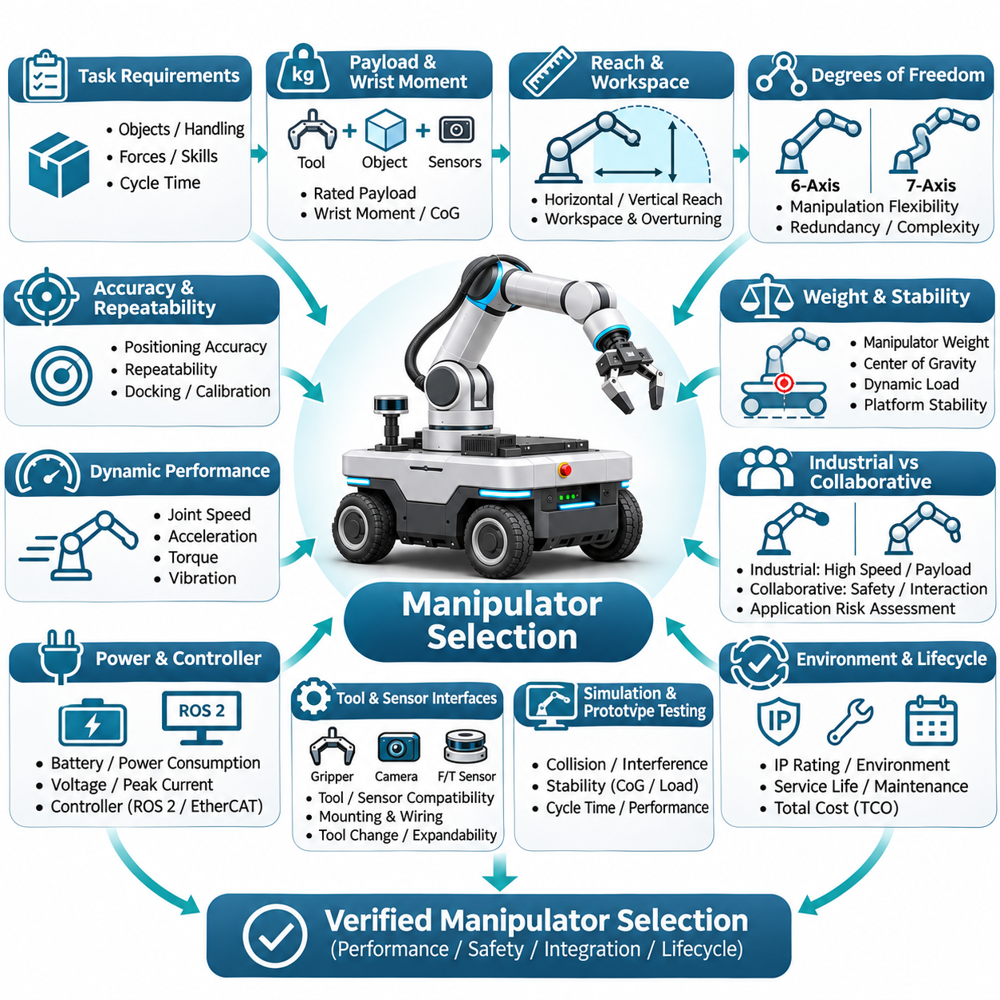{width="7.268055555555556in" height="7.268055555555556in"}

Manipulator selection is a critical engineering activity in mobile manipulator development because the robotic arm directly determines manipulation capability, operational flexibility, system stability, and overall productivity. Unlike stationary industrial robotic systems, mobile manipulators must integrate robotic arms within platforms characterized by limited installation space, variable positioning conditions, restricted energy resources, and dynamic structural constraints.

The selection process begins with the analysis of operational scenarios and manipulation requirements. Engineers identify target objects, handling procedures, required manipulation forces, working distances, positioning tolerances, cycle times, and environmental conditions. These operational requirements must be translated into measurable manipulator specifications that support both current application objectives and anticipated future expansion.

Payload capacity represents one of the fundamental criteria for manipulator selection. The rated payload must accommodate the combined mass of the end effector, handled objects, additional sensors, adapters, and auxiliary tooling. Engineers must also evaluate permissible wrist moments, payload center of gravity, and dynamic loading because nominal payload ratings alone may not adequately represent practical manipulation capabilities.

Manipulator reach determines the accessible working area surrounding the mobile platform. Engineers must evaluate maximum horizontal reach, vertical reach, minimum operating distance, and workspace geometry relative to the AMR base. Excessive reach can increase structural loading and overturning moments, while insufficient reach may require additional mobile platform movements and reduce overall operational efficiency.

The number of degrees of freedom influences manipulation flexibility, orientation control, obstacle avoidance, and accessibility within constrained environments. Six-axis manipulators generally provide sufficient flexibility for conventional industrial applications, while seven-axis configurations introduce kinematic redundancy that can improve motion planning. Additional degrees of freedom may increase mechanical complexity, computational requirements, and acquisition costs.

Positioning accuracy and repeatability must be evaluated according to task-specific requirements. Repeatability describes the ability of a manipulator to return consistently to a previously commanded position, whereas absolute accuracy represents the deviation between commanded and actual positions. Mobile manipulation introduces additional positioning uncertainties originating from AMR localization errors, structural deformation, docking deviations, and calibration errors.

Manipulator weight and mounting configuration significantly influence the mechanical architecture of the AMR base. Heavy robotic arms increase structural loading, traction requirements, and energy consumption while potentially reducing platform stability. Engineers must evaluate the combined center of gravity across representative manipulator configurations and ensure that static and dynamic loads remain within the structural limitations of the mobile platform.

Dynamic performance determines how effectively the manipulator executes industrial tasks under changing operating conditions. Joint velocity, acceleration, torque capability, settling time, and vibration characteristics influence manipulation cycle time and positioning quality. Aggressive motion profiles may improve productivity but can generate reaction forces that affect AMR stability, sensor measurements, and the accuracy of subsequent manipulation operations.

The selection between industrial robots and collaborative robots requires careful consideration of performance and safety requirements. Conventional industrial manipulators generally provide higher speeds and payload capacities, whereas collaborative manipulators may incorporate force sensing, collision detection, and configurable safety functions. However, collaborative operation must be validated through application-specific risk assessment of the complete integrated robotic system.

Electrical compatibility is an essential consideration because mobile manipulators typically operate using battery-powered electrical architectures. Manipulator voltage requirements, controller power consumption, peak current demands, and regenerative energy characteristics must be evaluated. Industrial robot controllers requiring alternating current may introduce additional inverter requirements, conversion losses, thermal loads, and installation complexity.

Controller architecture and communication compatibility determine how effectively the manipulator integrates with higher-level robotic software. Engineers should evaluate support for ROS 2, industrial Ethernet, EtherCAT, manufacturer-specific application programming interfaces, and external motion control. Access to joint states, diagnostic information, safety signals, and trajectory execution capabilities is essential for coordinated mobile manipulation.

Sensor and end effector compatibility must be considered throughout the selection process. Wrist-mounted cameras, force-torque sensors, tactile sensors, tool changers, and specialized grippers introduce additional mechanical, electrical, and communication requirements. Standardized mounting interfaces and accessible wiring routes can simplify equipment integration while improving maintainability, calibration procedures, and future application flexibility.

Environmental resistance and operational reliability influence long-term manipulator performance in industrial environments. Engineers must evaluate ingress protection ratings, operating temperature ranges, humidity tolerance, vibration resistance, contamination exposure, and maintenance intervals. Component service life, spare parts availability, manufacturer support, and controller lifecycle policies should also be incorporated into the total cost of ownership analysis.

Simulation-based evaluation and prototype testing provide practical evidence for comparing manipulator candidates. Digital models enable workspace analysis, collision detection, kinematic evaluation, and preliminary stability assessment before physical integration. Prototype testing should verify manipulation accuracy, cycle time, power consumption, docking tolerance, payload handling, communication reliability, and stability under representative operating conditions.

The manipulator selection process concludes with a documented engineering decision supported by quantitative requirements, comparative assessments, simulation results, and experimental evidence. A weighted evaluation framework can balance payload, reach, accuracy, safety, integration complexity, reliability, and lifecycle costs. The selected manipulator must establish a verified hardware baseline for subsequent mechanical integration, perception development, motion planning, and system validation.

매니퓰레이터 선정(Manipulator Selection)은 로봇 팔(Robot Arm)이 조작 능력(Manipulation Capability), 운용 유연성(Operational Flexibility), 시스템 안정성(System Stability) 및 전체 생산성(Productivity)을 직접적으로 결정하기 때문에 모바일 매니퓰레이터(Mobile Manipulator) 개발에서 핵심적인 엔지니어링 활동이다. 고정형 산업용 로봇 시스템(Stationary Industrial Robotic System)과 달리 모바일 매니퓰레이터는 제한된 설치 공간, 가변적인 위치 결정 조건, 제한된 에너지 자원 및 동적 구조 제약조건(Dynamic Structural Constraint)을 가진 플랫폼에 로봇 팔을 통합해야 한다.

선정 프로세스(Selection Process)는 운용 시나리오(Operational Scenario)와 조작 요구사항(Manipulation Requirements)에 대한 분석으로부터 시작된다. 엔지니어는 대상 물체(Target Object), 취급 절차(Handling Procedure), 요구 조작력(Manipulation Force), 작업 거리(Working Distance), 위치 결정 공차(Positioning Tolerance), 사이클 타임(Cycle Time) 및 환경 조건을 식별한다. 이러한 운용 요구사항은 현재의 적용 목표와 향후 예상되는 확장성을 모두 지원할 수 있는 정량적인 매니퓰레이터 사양(Manipulator Specification)으로 변환되어야 한다.

가반하중(Payload Capacity)은 매니퓰레이터 선정을 위한 가장 기본적인 평가 기준 중 하나이다. 정격 가반하중(Rated Payload)은 엔드 이펙터(End Effector), 취급 대상 물체, 추가 센서, 어댑터(Adapter) 및 보조 작업 도구(Auxiliary Tooling)의 전체 질량을 수용해야 한다. 명목상의 가반하중 사양만으로는 실제 조작 능력을 충분히 나타내지 못할 수 있으므로 엔지니어는 허용 손목 모멘트(Permissible Wrist Moment), 적재물의 무게중심(Payload Center of Gravity) 및 동적 하중(Dynamic Loading)도 평가해야 한다.

매니퓰레이터 도달 거리(Manipulator Reach)는 이동 플랫폼(Mobile Platform) 주변에서 접근 가능한 작업 영역을 결정한다. 엔지니어는 AMR 베이스(AMR Base)를 기준으로 최대 수평 도달 거리(Maximum Horizontal Reach), 수직 도달 거리(Vertical Reach), 최소 작업 거리(Minimum Operating Distance) 및 작업 공간 형상(Workspace Geometry)을 평가해야 한다. 과도한 도달 거리는 구조적 하중(Structural Loading)과 전복 모멘트(Overturning Moment)를 증가시킬 수 있으며, 불충분한 도달 거리는 이동 플랫폼의 추가적인 이동을 요구하여 전체 운용 효율성(Operational Efficiency)을 저하시킬 수 있다.

자유도(DOF, Degrees of Freedom)의 수는 제한된 환경에서의 조작 유연성(Manipulation Flexibility), 자세 제어(Orientation Control), 장애물 회피(Obstacle Avoidance) 및 접근성(Accessibility)에 영향을 미친다. 6축 매니퓰레이터(Six-Axis Manipulator)는 일반적으로 기존 산업용 애플리케이션에 충분한 유연성을 제공하는 반면, 7축 구성(Seven-Axis Configuration)은 모션 계획(Motion Planning)을 개선할 수 있는 기구학적 여유 자유도(Kinematic Redundancy)를 제공한다. 추가적인 자유도는 기계적 복잡성, 연산 요구사항(Computational Requirements) 및 도입 비용(Acquisition Cost)을 증가시킬 수 있다.

위치 결정 정확도(Positioning Accuracy)와 반복 정밀도(Repeatability)는 작업별 요구사항(Task-Specific Requirements)에 따라 평가되어야 한다. 반복 정밀도는 매니퓰레이터가 이전에 명령된 위치로 일관되게 복귀할 수 있는 능력을 의미하며, 절대 정확도(Absolute Accuracy)는 명령된 위치와 실제 위치 사이의 편차를 나타낸다. 모바일 조작(Mobile Manipulation)에서는 AMR 위치 추정 오차(Localization Error), 구조적 변형(Structural Deformation), 도킹 편차(Docking Deviation) 및 보정 오차(Calibration Error)에서 발생하는 추가적인 위치 결정 불확실성(Positioning Uncertainty)이 존재한다.

매니퓰레이터 중량(Manipulator Weight)과 장착 구성(Mounting Configuration)은 AMR 베이스의 기계 아키텍처(Mechanical Architecture)에 상당한 영향을 미친다. 무거운 로봇 팔은 구조적 하중, 구동력 요구사항(Traction Requirements) 및 에너지 소비량(Energy Consumption)을 증가시키며, 플랫폼 안정성을 저하시킬 수 있다. 엔지니어는 대표적인 매니퓰레이터 자세에서 통합 시스템의 무게중심(Combined Center of Gravity)을 평가하고 정적 하중(Static Load)과 동적 하중(Dynamic Load)이 이동 플랫폼의 구조적 한계(Structural Limitation) 이내에 유지되도록 해야 한다.

동적 성능(Dynamic Performance)은 변화하는 운용 조건에서 매니퓰레이터가 산업용 작업을 얼마나 효과적으로 수행할 수 있는지를 결정한다. 관절 속도(Joint Velocity), 가속도(Acceleration), 토크 성능(Torque Capability), 정착 시간(Settling Time) 및 진동 특성(Vibration Characteristics)은 조작 사이클 타임(Manipulation Cycle Time)과 위치 결정 품질(Positioning Quality)에 영향을 미친다. 공격적인 모션 프로파일(Aggressive Motion Profile)은 생산성을 향상시킬 수 있지만 AMR 안정성, 센서 측정값 및 후속 조작 작업의 정확도에 영향을 미치는 반력(Reaction Force)을 발생시킬 수 있다.

산업용 로봇(Industrial Robot)과 협동 로봇(Collaborative Robot) 사이의 선정은 성능 및 안전 요구사항에 대한 신중한 검토를 필요로 한다. 일반적인 산업용 매니퓰레이터는 상대적으로 높은 동작 속도와 가반하중을 제공하는 반면, 협동 매니퓰레이터(Collaborative Manipulator)는 힘 감지(Force Sensing), 충돌 감지(Collision Detection) 및 구성 가능한 안전 기능(Configurable Safety Function)을 포함할 수 있다. 그러나 협동 운용(Collaborative Operation)은 전체 통합 로봇 시스템에 대한 적용 분야별 위험성 평가(Application-Specific Risk Assessment)를 통해 검증되어야 한다.

전기적 호환성(Electrical Compatibility)은 모바일 매니퓰레이터가 일반적으로 배터리 기반 전기 아키텍처(Battery-Powered Electrical Architecture)를 사용하기 때문에 필수적인 고려사항이다. 매니퓰레이터의 요구 전압(Voltage Requirements), 제어기 전력 소비량(Controller Power Consumption), 최대 전류 요구량(Peak Current Demand) 및 회생 에너지 특성(Regenerative Energy Characteristics)을 평가해야 한다. 교류 전원(AC, Alternating Current)을 필요로 하는 산업용 로봇 제어기는 추가적인 인버터(Inverter) 요구사항, 전력 변환 손실(Conversion Loss), 열 부하(Thermal Load) 및 설치 복잡성을 발생시킬 수 있다.

제어기 아키텍처(Controller Architecture)와 통신 호환성(Communication Compatibility)은 매니퓰레이터가 상위 로봇 소프트웨어(Higher-Level Robotic Software)와 얼마나 효과적으로 통합될 수 있는지를 결정한다. 엔지니어는 로봇 운영체제(ROS 2, Robot Operating System 2), 산업용 이더넷(Industrial Ethernet), EtherCAT, 제조사별 애플리케이션 프로그래밍 인터페이스(API, Application Programming Interface) 및 외부 모션 제어(External Motion Control)에 대한 지원 여부를 평가해야 한다. 관절 상태(Joint State), 진단 정보(Diagnostic Information), 안전 신호(Safety Signal) 및 궤적 실행 기능(Trajectory Execution Capability)에 대한 접근은 협조적 모바일 조작(Coordinated Mobile Manipulation)을 위해 필수적이다.

센서 및 엔드 이펙터 호환성(Sensor and End Effector Compatibility)은 전체 선정 과정에서 고려되어야 한다. 손목 장착형 카메라(Wrist-Mounted Camera), 힘·토크 센서(Force-Torque Sensor), 촉각 센서(Tactile Sensor), 도구 교환 장치(Tool Changer) 및 특수 그리퍼(Specialized Gripper)는 추가적인 기계적, 전기적 및 통신 요구사항을 발생시킨다. 표준화된 장착 인터페이스(Standardized Mounting Interface)와 접근 가능한 배선 경로(Wiring Route)는 장비 통합을 단순화하는 동시에 유지보수성(Maintainability), 보정 절차(Calibration Procedure) 및 향후 적용 유연성(Application Flexibility)을 향상시킬 수 있다.

환경 내구성(Environmental Resistance)과 운용 신뢰성(Operational Reliability)은 산업 환경에서 매니퓰레이터의 장기적인 성능에 영향을 미친다. 엔지니어는 방진·방수 보호 등급(IP Rating, Ingress Protection Rating), 동작 온도 범위(Operating Temperature Range), 습도 내성(Humidity Tolerance), 진동 저항성(Vibration Resistance), 오염 물질 노출(Contamination Exposure) 및 유지보수 주기(Maintenance Interval)를 평가해야 한다. 구성 요소의 사용 수명(Component Service Life), 예비 부품 가용성(Spare Parts Availability), 제조사의 기술 지원(Manufacturer Support) 및 제어기 수명주기 정책(Controller Lifecycle Policy)도 총소유비용(TCO, Total Cost of Ownership) 분석에 포함되어야 한다.

시뮬레이션 기반 평가(Simulation-Based Evaluation)와 시제품 시험(Prototype Testing)은 매니퓰레이터 후보들을 비교하기 위한 실질적인 증거를 제공한다. 디지털 모델(Digital Model)은 물리적 통합 이전에 작업 공간 분석(Workspace Analysis), 충돌 감지(Collision Detection), 기구학적 평가(Kinematic Evaluation) 및 예비 안정성 평가(Preliminary Stability Assessment)를 가능하게 한다. 시제품 시험에서는 대표적인 운용 조건에서 조작 정확도(Manipulation Accuracy), 사이클 타임, 전력 소비량, 도킹 허용오차(Docking Tolerance), 적재물 취급(Payload Handling), 통신 신뢰성(Communication Reliability) 및 안정성을 검증해야 한다.

매니퓰레이터 선정 프로세스는 정량적 요구사항(Quantitative Requirements), 비교 평가(Comparative Assessment), 시뮬레이션 결과 및 실험적 증거(Experimental Evidence)를 기반으로 문서화된 엔지니어링 의사결정(Engineering Decision)을 수립함으로써 마무리된다. 가중치 기반 평가 프레임워크(Weighted Evaluation Framework)는 가반하중, 도달 거리, 정확도, 안전성, 통합 복잡성(Integration Complexity), 신뢰성 및 수명주기 비용(Lifecycle Cost) 사이의 균형을 유지할 수 있도록 한다. 최종 선정된 매니퓰레이터는 이후의 기계적 통합(Mechanical Integration), 인지 기술 개발(Perception Development), 모션 계획(Motion Planning) 및 시스템 검증(System Validation)을 위한 검증된 하드웨어 기준선(Hardware Baseline)을 확립해야 한다.

##  

## 04 End Effector Development

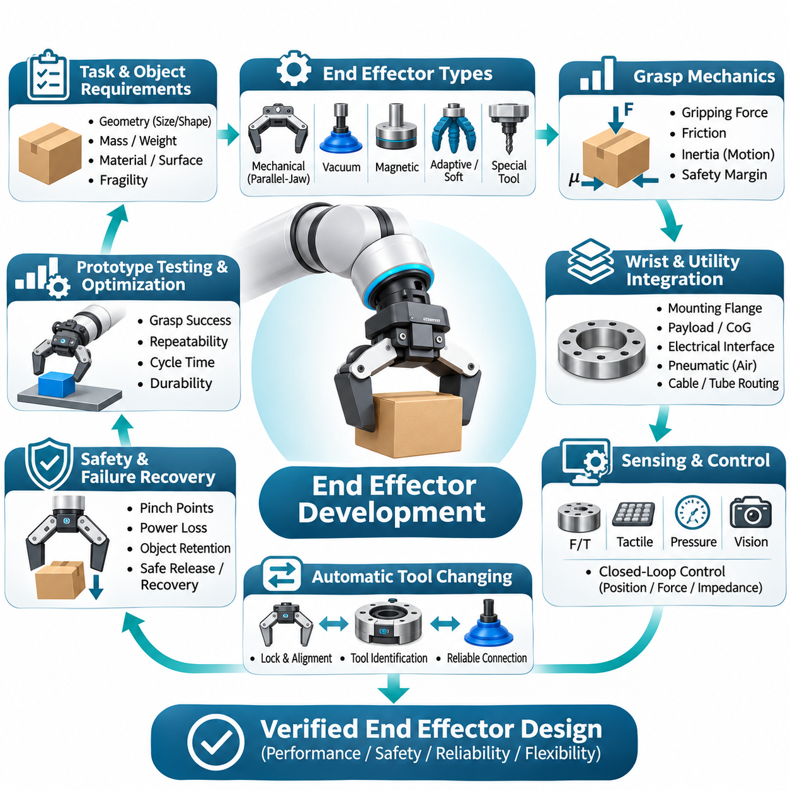{width="7.268055555555556in" height="7.268055555555556in"}

End effector development is a specialized engineering process that establishes the physical interaction between a mobile manipulator and its surrounding environment. The end effector serves as the operational interface through which robotic systems perform grasping, transportation, assembly, inspection, and material handling. Its design directly influences manipulation reliability, operational flexibility, task execution accuracy, and overall system productivity.

The development process begins with the analysis of target objects and application-specific requirements. Engineers evaluate object geometry, dimensions, weight, material properties, surface characteristics, fragility, and accessibility. Additional considerations include required gripping forces, manipulation speed, positioning tolerances, environmental conditions, and acceptable failure rates. These requirements establish the foundation for end effector design and technology selection.

End effector architecture selection depends on the physical characteristics of the intended manipulation tasks. Mechanical grippers, vacuum grippers, magnetic grippers, adaptive grippers, soft robotic grippers, and specialized industrial tools provide different operational capabilities. Engineers must balance gripping reliability, mechanical complexity, energy consumption, object compatibility, integration requirements, and long-term maintenance costs when selecting an appropriate architecture.

Mechanical gripper development focuses on generating controlled gripping forces through electrically, pneumatically, or hydraulically actuated mechanisms. Parallel-jaw grippers, angular grippers, and multi-finger configurations provide different contact geometries and manipulation capabilities. Finger dimensions, gripping surfaces, actuator transmission mechanisms, and structural materials must be optimized to accommodate object variations while preventing excessive deformation or damage.

Vacuum gripper development is particularly relevant to logistics, warehouse automation, packaging, and industrial material handling. Engineers must evaluate suction cup geometry, vacuum pressure, effective contact area, surface permeability, and air leakage characteristics. Vacuum generation systems, pressure sensors, filtration devices, and object retention mechanisms should provide reliable operation under changing orientations, acceleration profiles, and surface conditions.

Gripping force analysis establishes the mechanical requirements necessary to maintain stable object retention throughout manipulation activities. Engineers must consider gravitational forces, friction coefficients, inertial loads, external disturbances, and object contact geometry. Insufficient gripping force can result in object slippage, whereas excessive gripping force may damage delicate materials. Appropriate force margins should reflect operational uncertainties and dynamic loading conditions.

Adaptive and compliant end effectors improve manipulation flexibility when object shapes, orientations, and dimensions vary significantly. Passive compliance mechanisms, underactuated fingers, elastic materials, and active force control enable grippers to accommodate geometric uncertainties. These technologies are particularly useful for unstructured industrial environments where precise object positioning and standardized contact conditions cannot always be guaranteed.

Mechanical integration requires compatibility between the end effector and the manipulator wrist interface. Engineers must evaluate mounting flange dimensions, fastening arrangements, structural rigidity, tool mass, center of gravity, and allowable wrist moments. The combined weight of the end effector and handled object must remain within the manipulator\'s approved payload and dynamic load limits throughout its intended operating envelope.

Electrical and pneumatic integration establishes the infrastructure necessary to operate end effector actuators, sensors, and auxiliary mechanisms. Power supply specifications, communication interfaces, signal routing, pneumatic pressure, and connector arrangements must be compatible with the manipulator and AMR architecture. Cable and tubing routes should accommodate repeated joint movements without excessive bending, twisting, abrasion, or interference.

Sensor integration enables intelligent end effectors to detect contact conditions, measure gripping forces, and monitor object retention. Force-torque sensors, tactile sensors, proximity sensors, pressure sensors, encoders, and wrist-mounted cameras provide complementary information about manipulation activities. Sensor positioning, calibration stability, measurement resolution, sampling frequency, and communication latency must support reliable closed-loop control.

End effector control systems coordinate actuator movements, gripping force regulation, sensor feedback, and operational diagnostics. Position control, force control, impedance control, and hybrid control strategies may be implemented according to application requirements. Higher-level manipulation software must exchange commands and status information with the end effector while monitoring grasp completion, object presence, and abnormal operating conditions.

Automatic tool-changing mechanisms extend mobile manipulator functionality by enabling a single robotic platform to perform multiple industrial tasks. Tool changers must provide repeatable mechanical alignment, secure locking, reliable electrical connectivity, and pneumatic connections where necessary. Tool identification and locking confirmation mechanisms should prevent operation with incompatible or improperly attached tools and support controlled recovery procedures.

Safety-oriented end effector development must address crushing hazards, pinch points, sharp edges, excessive contact forces, and unintended object release. Engineers must evaluate the consequences of power interruptions, actuator failures, vacuum loss, communication faults, and emergency stops. Object retention mechanisms and safe release strategies should be selected through application-specific risk assessment of the integrated mobile manipulator.

Prototype testing and design optimization provide experimental evidence of end effector performance under representative operating conditions. Engineers should evaluate gripping success rates, positioning repeatability, object retention, cycle time, energy consumption, wear characteristics, and long-duration reliability. Testing should include variations in object geometry, surface properties, payload distribution, environmental conditions, and manipulator acceleration to identify operational limitations.

The end effector development process concludes with a verified hardware configuration supported by mechanical drawings, electrical specifications, control interfaces, calibration procedures, and test records. The approved design baseline establishes traceability between application requirements and measured performance while supporting subsequent perception integration, grasp planning, manipulation validation, manufacturing, maintenance, and lifecycle management.

엔드 이펙터 개발(End Effector Development)은 모바일 매니퓰레이터(Mobile Manipulator)와 주변 환경 사이의 물리적 상호작용(Physical Interaction)을 구현하는 전문적인 엔지니어링 프로세스이다. 엔드 이펙터는 로봇 시스템이 파지(Grasping), 운송(Transportation), 조립(Assembly), 검사(Inspection) 및 자재 취급(Material Handling)을 수행하는 작업 인터페이스(Operational Interface)의 역할을 한다. 엔드 이펙터의 설계는 조작 신뢰성(Manipulation Reliability), 운용 유연성(Operational Flexibility), 작업 수행 정확도(Task Execution Accuracy) 및 전체 시스템 생산성(System Productivity)에 직접적인 영향을 미친다.

개발 프로세스는 대상 물체(Target Object)와 적용 분야별 요구사항(Application-Specific Requirements)에 대한 분석으로부터 시작된다. 엔지니어는 물체의 기하학적 형상(Object Geometry), 치수(Dimension), 중량(Weight), 재료 특성(Material Property), 표면 특성(Surface Characteristic), 파손 취약성(Fragility) 및 접근성(Accessibility)을 평가한다. 추가적인 고려사항에는 요구 파지력(Required Gripping Force), 조작 속도(Manipulation Speed), 위치 결정 공차(Positioning Tolerance), 환경 조건(Environmental Condition) 및 허용 실패율(Acceptable Failure Rate)이 포함된다. 이러한 요구사항은 엔드 이펙터 설계 및 기술 선정(Technology Selection)을 위한 기반을 확립한다.

엔드 이펙터 아키텍처 선정(End Effector Architecture Selection)은 목표 조작 작업의 물리적 특성에 따라 결정된다. 기계식 그리퍼(Mechanical Gripper), 진공 그리퍼(Vacuum Gripper), 자기식 그리퍼(Magnetic Gripper), 적응형 그리퍼(Adaptive Gripper), 소프트 로봇 그리퍼(Soft Robotic Gripper) 및 특수 산업용 도구(Specialized Industrial Tool)는 서로 다른 운용 능력을 제공한다. 엔지니어는 적절한 아키텍처를 선정할 때 파지 신뢰성(Gripping Reliability), 기계적 복잡성(Mechanical Complexity), 에너지 소비량(Energy Consumption), 물체 호환성(Object Compatibility), 통합 요구사항(Integration Requirements) 및 장기적인 유지보수 비용 사이의 균형을 고려해야 한다.

기계식 그리퍼 개발(Mechanical Gripper Development)은 전기식(Electric), 공압식(Pneumatic) 또는 유압식(Hydraulic) 구동 메커니즘을 통해 제어된 파지력을 생성하는 데 중점을 둔다. 평행형 그리퍼(Parallel-Jaw Gripper), 각도형 그리퍼(Angular Gripper) 및 다중 손가락 구성(Multi-Finger Configuration)은 서로 다른 접촉 형상(Contact Geometry)과 조작 능력을 제공한다. 손가락 치수(Finger Dimension), 파지 표면(Gripping Surface), 액추에이터 동력 전달 메커니즘(Actuator Transmission Mechanism) 및 구조 재료(Structural Material)는 과도한 변형이나 손상을 방지하면서 다양한 물체를 수용할 수 있도록 최적화되어야 한다.

진공 그리퍼 개발(Vacuum Gripper Development)은 물류(Logistics), 창고 자동화(Warehouse Automation), 포장(Packaging) 및 산업용 자재 취급(Industrial Material Handling) 분야에서 특히 중요하다. 엔지니어는 흡착 컵 형상(Suction Cup Geometry), 진공 압력(Vacuum Pressure), 유효 접촉 면적(Effective Contact Area), 표면 투과성(Surface Permeability) 및 공기 누설 특성(Air Leakage Characteristic)을 평가해야 한다. 진공 생성 시스템(Vacuum Generation System), 압력 센서(Pressure Sensor), 여과 장치(Filtration Device) 및 물체 유지 메커니즘(Object Retention Mechanism)은 변화하는 자세, 가속도 프로파일(Acceleration Profile) 및 표면 조건에서도 신뢰성 높은 작동을 제공해야 한다.

파지력 분석(Gripping Force Analysis)은 조작 활동 전반에 걸쳐 안정적인 물체 유지를 보장하는 데 필요한 기계적 요구사항을 확립한다. 엔지니어는 중력(Gravity), 마찰 계수(Friction Coefficient), 관성 하중(Inertial Load), 외부 외란(External Disturbance) 및 물체 접촉 형상(Object Contact Geometry)을 고려해야 한다. 불충분한 파지력은 물체 미끄러짐(Object Slippage)을 발생시킬 수 있는 반면, 과도한 파지력은 손상되기 쉬운 재료를 파손시킬 수 있다. 적절한 힘의 안전 여유(Force Margin)는 운용 불확실성(Operational Uncertainty)과 동적 하중 조건(Dynamic Loading Condition)을 반영해야 한다.

적응형 및 순응형 엔드 이펙터(Adaptive and Compliant End Effector)는 물체의 형상, 자세 및 치수가 크게 달라지는 환경에서 조작 유연성(Manipulation Flexibility)을 향상시킨다. 수동 순응 메커니즘(Passive Compliance Mechanism), 부족 구동형 손가락(Underactuated Finger), 탄성 재료(Elastic Material) 및 능동 힘 제어(Active Force Control)는 그리퍼가 기하학적 불확실성(Geometric Uncertainty)에 적응할 수 있도록 한다. 이러한 기술은 정밀한 물체 위치 결정과 표준화된 접촉 조건을 항상 보장할 수 없는 비정형 산업 환경(Unstructured Industrial Environment)에서 특히 유용하다.

기계적 통합(Mechanical Integration)은 엔드 이펙터와 매니퓰레이터 손목 인터페이스(Manipulator Wrist Interface) 사이의 호환성을 필요로 한다. 엔지니어는 장착 플랜지 치수(Mounting Flange Dimension), 체결 구성(Fastening Arrangement), 구조적 강성(Structural Rigidity), 도구 질량(Tool Mass), 무게중심(Center of Gravity) 및 허용 손목 모멘트(Allowable Wrist Moment)를 평가해야 한다. 엔드 이펙터와 취급 대상 물체의 합산 중량은 의도된 전체 작업 영역(Operating Envelope)에서 매니퓰레이터의 승인된 가반하중(Payload Capacity) 및 동적 하중 한계(Dynamic Load Limit) 이내로 유지되어야 한다.

전기 및 공압 통합(Electrical and Pneumatic Integration)은 엔드 이펙터 액추에이터(Actuator), 센서 및 보조 메커니즘(Auxiliary Mechanism)을 작동시키는 데 필요한 기반 구조를 확립한다. 전원 공급 사양(Power Supply Specification), 통신 인터페이스(Communication Interface), 신호 배선(Signal Routing), 공압 압력(Pneumatic Pressure) 및 커넥터 구성(Connector Arrangement)은 매니퓰레이터 및 AMR 아키텍처와 호환되어야 한다. 케이블 및 튜브 배치 경로(Cable and Tubing Route)는 과도한 굽힘(Bending), 비틀림(Twisting), 마모(Abrasion) 또는 간섭(Interference) 없이 반복적인 관절 움직임을 수용할 수 있도록 설계되어야 한다.

센서 통합(Sensor Integration)은 지능형 엔드 이펙터(Intelligent End Effector)가 접촉 상태(Contact Condition)를 감지하고 파지력을 측정하며 물체 유지 상태(Object Retention)를 모니터링할 수 있도록 한다. 힘·토크 센서(Force-Torque Sensor), 촉각 센서(Tactile Sensor), 근접 센서(Proximity Sensor), 압력 센서(Pressure Sensor), 엔코더(Encoder) 및 손목 장착형 카메라(Wrist-Mounted Camera)는 조작 활동에 관한 상호 보완적인 정보를 제공한다. 센서 배치(Sensor Positioning), 보정 안정성(Calibration Stability), 측정 분해능(Measurement Resolution), 샘플링 주파수(Sampling Frequency) 및 통신 지연시간(Communication Latency)은 신뢰성 높은 폐루프 제어(Closed-Loop Control)를 지원해야 한다.

엔드 이펙터 제어 시스템(End Effector Control System)은 액추에이터 움직임(Actuator Movement), 파지력 조절(Gripping Force Regulation), 센서 피드백(Sensor Feedback) 및 운용 진단(Operational Diagnostics)을 조정한다. 위치 제어(Position Control), 힘 제어(Force Control), 임피던스 제어(Impedance Control) 및 하이브리드 제어 전략(Hybrid Control Strategy)은 적용 분야의 요구사항에 따라 구현될 수 있다. 상위 수준의 조작 소프트웨어(Higher-Level Manipulation Software)는 파지 완료(Grasp Completion), 물체 존재 여부(Object Presence) 및 비정상 운용 상태(Abnormal Operating Condition)를 모니터링하면서 엔드 이펙터와 명령 및 상태 정보를 교환해야 한다.

자동 도구 교환 메커니즘(Automatic Tool-Changing Mechanism)은 단일 로봇 플랫폼이 다양한 산업용 작업을 수행할 수 있도록 모바일 매니퓰레이터의 기능을 확장한다. 도구 교환 장치(Tool Changer)는 반복 정밀도가 높은 기계적 정렬(Mechanical Alignment), 안전한 잠금(Secure Locking), 신뢰성 높은 전기적 연결(Electrical Connectivity) 및 필요한 경우 공압 연결(Pneumatic Connection)을 제공해야 한다. 도구 식별(Tool Identification) 및 잠금 확인 메커니즘(Locking Confirmation Mechanism)은 호환되지 않거나 올바르게 장착되지 않은 도구의 작동을 방지하고 체계적인 복구 절차(Controlled Recovery Procedure)를 지원해야 한다.

안전 중심의 엔드 이펙터 개발(Safety-Oriented End Effector Development)은 압착 위험(Crushing Hazard), 끼임 지점(Pinch Point), 날카로운 모서리(Sharp Edge), 과도한 접촉력(Excessive Contact Force) 및 의도하지 않은 물체 해제(Unintended Object Release)에 대응해야 한다. 엔지니어는 전원 차단(Power Interruption), 액추에이터 고장(Actuator Failure), 진공 손실(Vacuum Loss), 통신 장애(Communication Fault) 및 비상 정지(Emergency Stop)로 인해 발생할 수 있는 결과를 평가해야 한다. 물체 유지 메커니즘(Object Retention Mechanism)과 안전한 해제 전략(Safe Release Strategy)은 통합 모바일 매니퓰레이터에 대한 적용 분야별 위험성 평가(Application-Specific Risk Assessment)를 통해 선정되어야 한다.

시제품 시험(Prototype Testing)과 설계 최적화(Design Optimization)는 대표적인 운용 조건에서 엔드 이펙터의 성능에 대한 실험적 증거(Experimental Evidence)를 제공한다. 엔지니어는 파지 성공률(Gripping Success Rate), 위치 결정 반복 정밀도(Positioning Repeatability), 물체 유지 성능(Object Retention), 사이클 타임(Cycle Time), 에너지 소비량(Energy Consumption), 마모 특성(Wear Characteristic) 및 장시간 운용 신뢰성(Long-Duration Reliability)을 평가해야 한다. 시험에는 운용 한계(Operational Limitation)를 식별하기 위해 물체의 기하학적 형상, 표면 특성, 적재 하중 분포(Payload Distribution), 환경 조건 및 매니퓰레이터 가속도의 변화가 포함되어야 한다.

엔드 이펙터 개발 프로세스는 기계 도면(Mechanical Drawing), 전기적 사양(Electrical Specification), 제어 인터페이스(Control Interface), 보정 절차(Calibration Procedure) 및 시험 기록(Test Record)을 기반으로 검증된 하드웨어 구성(Verified Hardware Configuration)을 확립함으로써 마무리된다. 승인된 설계 기준선(Approved Design Baseline)은 적용 분야의 요구사항과 측정된 성능 사이의 추적성(Traceability)을 확보하는 동시에 이후의 인지 시스템 통합(Perception Integration), 파지 계획(Grasp Planning), 조작 검증(Manipulation Validation), 제조(Manufacturing), 유지보수(Maintenance) 및 수명주기 관리(Lifecycle Management)를 지원한다.

##  

## 05 Battery System Design

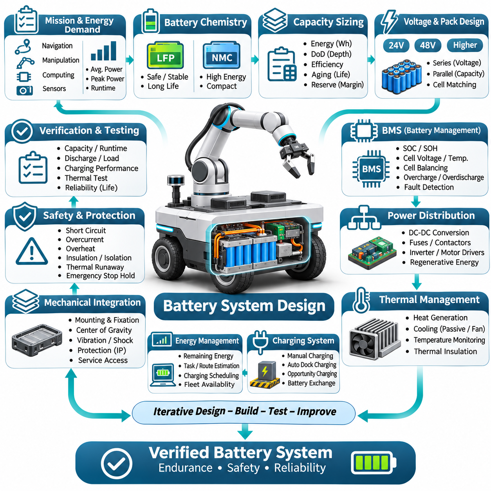{width="7.268055555555556in" height="7.268055555555556in"}

Battery system design is a fundamental engineering activity in mobile manipulator development because electrical energy availability directly determines operational endurance, mobility performance, manipulation capability, and system reliability. Unlike conventional stationary robotic systems, mobile manipulators must independently supply electrical energy to drive motors, robotic arms, computing platforms, sensors, and auxiliary equipment throughout their operating cycles.

The design process begins with the analysis of system-level energy requirements and representative operational scenarios. Engineers evaluate average power consumption, peak power demand, operating duration, charging frequency, and simultaneous subsystem utilization. Energy consumption during navigation, manipulation, perception, computing, idle operation, and standby conditions should be characterized to establish realistic battery capacity requirements.

Battery chemistry selection significantly influences energy density, power density, thermal stability, lifecycle performance, and system safety. Lithium iron phosphate (LFP) batteries provide favorable thermal stability and long cycle life, while nickel manganese cobalt (NMC) batteries generally offer higher energy density. The selection process must balance operational requirements, installation volume, battery weight, acquisition costs, and environmental conditions.

Battery capacity determination requires quantitative analysis of the energy consumed throughout representative mission profiles. The required capacity must account for discharge efficiency, allowable depth of discharge, auxiliary power consumption, battery aging, and operational reserve. Selecting a battery solely according to nominal energy consumption may result in insufficient endurance under demanding workloads or degraded battery conditions.

System voltage selection influences electrical distribution efficiency, conductor dimensions, motor controller compatibility, and power conversion requirements. Mobile manipulators may employ 24 V, 48 V, or higher-voltage electrical architectures depending on their power requirements. Increasing system voltage can reduce current for equivalent power, but insulation requirements, electrical protection, component compatibility, and maintenance safety must also be evaluated.

Battery pack architecture defines the series and parallel arrangement of individual cells or modules required to achieve target voltage, capacity, and current capabilities. Engineers must consider cell matching, internal resistance, connection reliability, mechanical packaging, and thermal uniformity. Manufacturing tolerances and differences in cell degradation can influence overall battery performance and should be addressed through appropriate pack engineering.

The Battery Management System (BMS) monitors and protects the battery pack throughout charging, discharging, and standby operation. Essential functions include cell voltage monitoring, temperature measurement, current sensing, cell balancing, overcharge protection, overdischarge protection, and fault detection. State of Charge (SOC) and State of Health (SOH) estimation provide operational information for energy management and predictive maintenance.

Power distribution architecture must accommodate the different electrical requirements of mobility, manipulation, perception, and computing subsystems. DC-to-DC converters, inverters, contactors, fuses, distribution modules, and protection circuits establish controlled energy delivery. Engineers must evaluate simultaneous peak loads, startup currents, voltage fluctuations, regenerative energy, conversion efficiency, and electrical fault propagation between interconnected subsystems.

Battery thermal management is necessary to maintain safe and reliable operation under varying environmental and electrical loading conditions. Heat generated by internal resistance, high discharge currents, charging activities, and surrounding electronic equipment must be appropriately managed. Passive cooling, forced-air cooling, thermal insulation, and temperature monitoring may be implemented according to battery chemistry and operating requirements.

Charging system development establishes the infrastructure required to restore battery energy while minimizing operational downtime. Manual charging, automatic docking-based charging, opportunity charging, and battery exchange systems provide different operational advantages. Charger specifications, charging current, voltage regulation, communication protocols, connector durability, and charging station alignment must be compatible with the selected battery architecture.

Energy management software coordinates battery utilization with navigation, manipulation, task scheduling, and fleet management functions. Remaining energy estimates should account for expected mission duration, payload conditions, travel distance, and manipulation workloads. Intelligent charging strategies can improve fleet availability by scheduling charging activities before energy reserves become insufficient while minimizing unnecessary charging cycles.

Mechanical integration of the battery pack directly influences chassis packaging, structural loading, center of gravity, and maintenance accessibility. Battery mounting structures must withstand operational vibration, mechanical shock, acceleration, braking, and representative collision loads. Appropriate environmental protection, cable routing, ventilation, structural reinforcement, and service access should be incorporated without compromising the stability of the mobile platform.

Battery safety engineering must address short circuits, excessive currents, overheating, overcharging, insulation failures, mechanical damage, and thermal runaway. Protective devices, electrical isolation, controlled disconnect mechanisms, and fault monitoring should be implemented according to the system risk assessment. Emergency stopping and power isolation strategies must also consider manipulator holding requirements and the consequences of sudden energy loss.

Battery system verification requires capacity testing, discharge characterization, charging validation, thermal assessment, communication testing, and safety-related functional evaluation. Prototype testing should reproduce representative navigation and manipulation cycles, simultaneous peak loads, environmental variations, and repeated charging activities. Long-duration testing provides evidence of capacity degradation, energy efficiency, and operational reliability.

The battery system design process concludes with a verified hardware baseline supported by electrical schematics, battery specifications, mechanical drawings, BMS interfaces, charging procedures, and test records. The final configuration must balance operational endurance, electrical performance, system safety, maintainability, and lifecycle costs while supporting subsequent hardware integration, field validation, manufacturing, and product lifecycle management.

배터리 시스템 설계(Battery System Design)는 전기 에너지 가용성(Electrical Energy Availability)이 운용 지속 시간(Operational Endurance), 이동 성능(Mobility Performance), 조작 능력(Manipulation Capability) 및 시스템 신뢰성(System Reliability)을 직접적으로 결정하기 때문에 모바일 매니퓰레이터(Mobile Manipulator) 개발에서 핵심적인 엔지니어링 활동이다. 일반적인 고정형 로봇 시스템(Stationary Robotic System)과 달리 모바일 매니퓰레이터는 전체 운용 사이클(Operating Cycle) 동안 구동 모터(Drive Motor), 로봇 팔(Robot Arm), 컴퓨팅 플랫폼(Computing Platform), 센서 및 보조 장비(Auxiliary Equipment)에 독립적으로 전기 에너지를 공급해야 한다.

설계 프로세스는 시스템 수준의 에너지 요구사항(System-Level Energy Requirements)과 대표적인 운용 시나리오(Operational Scenario)에 대한 분석으로부터 시작된다. 엔지니어는 평균 전력 소비량(Average Power Consumption), 최대 전력 요구량(Peak Power Demand), 운용 시간(Operating Duration), 충전 빈도(Charging Frequency) 및 하위 시스템의 동시 사용률(Simultaneous Subsystem Utilization)을 평가한다. 현실적인 배터리 용량 요구사항(Battery Capacity Requirements)을 확립하기 위해 자율주행(Navigation), 조작(Manipulation), 인지(Perception), 연산(Computing), 유휴 운용(Idle Operation) 및 대기 상태(Standby Condition)에서의 에너지 소비 특성을 분석해야 한다.

배터리 화학적 조성 선정(Battery Chemistry Selection)은 에너지 밀도(Energy Density), 출력 밀도(Power Density), 열적 안정성(Thermal Stability), 수명주기 성능(Lifecycle Performance) 및 시스템 안전성(System Safety)에 상당한 영향을 미친다. 리튬인산철 배터리(LFP, Lithium Iron Phosphate Battery)는 우수한 열적 안정성과 긴 충·방전 사이클 수명(Cycle Life)을 제공하는 반면, 니켈·망간·코발트 배터리(NMC, Nickel Manganese Cobalt Battery)는 일반적으로 더 높은 에너지 밀도를 제공한다. 선정 과정에서는 운용 요구사항, 설치 공간(Installation Volume), 배터리 중량(Battery Weight), 도입 비용(Acquisition Cost) 및 환경 조건 사이의 균형을 고려해야 한다.

배터리 용량 결정(Battery Capacity Determination)은 대표적인 임무 프로파일(Mission Profile) 전반에 걸쳐 소비되는 에너지에 대한 정량적 분석을 필요로 한다. 요구 용량은 방전 효율(Discharge Efficiency), 허용 방전 심도(DOD, Depth of Discharge), 보조 장비 전력 소비량(Auxiliary Power Consumption), 배터리 노화(Battery Aging) 및 운용 예비 용량(Operational Reserve)을 고려해야 한다. 명목상의 에너지 소비량만을 기준으로 배터리를 선정할 경우 높은 작업 부하(Workload) 또는 배터리 성능 저하 조건에서 충분한 운용 지속 시간을 확보하지 못할 수 있다.

시스템 전압 선정(System Voltage Selection)은 전력 분배 효율(Electrical Distribution Efficiency), 전기 도체 치수(Conductor Dimension), 모터 제어기 호환성(Motor Controller Compatibility) 및 전력 변환 요구사항(Power Conversion Requirements)에 영향을 미친다. 모바일 매니퓰레이터는 전력 요구사항에 따라 24V, 48V 또는 그 이상의 고전압 전기 아키텍처(Higher-Voltage Electrical Architecture)를 채택할 수 있다. 시스템 전압을 증가시키면 동일한 전력에서 전류를 감소시킬 수 있지만, 절연 요구사항(Insulation Requirements), 전기적 보호(Electrical Protection), 구성 요소 호환성(Component Compatibility) 및 유지보수 안전성(Maintenance Safety)도 함께 평가해야 한다.

배터리 팩 아키텍처(Battery Pack Architecture)는 목표 전압, 용량 및 전류 공급 능력을 달성하기 위해 필요한 개별 배터리 셀(Battery Cell) 또는 모듈(Module)의 직렬 및 병렬 구성(Series and Parallel Arrangement)을 정의한다. 엔지니어는 셀 특성 매칭(Cell Matching), 내부 저항(Internal Resistance), 연결 신뢰성(Connection Reliability), 기계적 패키징(Mechanical Packaging) 및 열적 균일성(Thermal Uniformity)을 고려해야 한다. 제조 공차(Manufacturing Tolerance)와 개별 셀의 성능 저하 차이는 전체 배터리 성능에 영향을 미칠 수 있으므로 적절한 배터리 팩 엔지니어링(Battery Pack Engineering)을 통해 해결해야 한다.

배터리 관리 시스템(BMS, Battery Management System)은 충전(Charging), 방전(Discharging) 및 대기 운용(Standby Operation) 전반에 걸쳐 배터리 팩을 모니터링하고 보호한다. 핵심 기능에는 셀 전압 모니터링(Cell Voltage Monitoring), 온도 측정(Temperature Measurement), 전류 감지(Current Sensing), 셀 밸런싱(Cell Balancing), 과충전 보호(Overcharge Protection), 과방전 보호(Overdischarge Protection) 및 고장 감지(Fault Detection)가 포함된다. 충전 상태(SOC, State of Charge)와 배터리 건전성 상태(SOH, State of Health) 추정은 에너지 관리(Energy Management) 및 예지 정비(Predictive Maintenance)를 위한 운용 정보를 제공한다.

전력 분배 아키텍처(Power Distribution Architecture)는 이동, 조작, 인지 및 컴퓨팅 하위 시스템의 서로 다른 전기적 요구사항을 수용해야 한다. 직류-직류 전압 변환기(DC-to-DC Converter), 인버터(Inverter), 전자 접촉기(Contactor), 퓨즈(Fuse), 전력 분배 모듈(Distribution Module) 및 보호 회로(Protection Circuit)는 제어된 에너지 공급 체계를 확립한다. 엔지니어는 동시 최대 부하(Simultaneous Peak Load), 기동 전류(Startup Current), 전압 변동(Voltage Fluctuation), 회생 에너지(Regenerative Energy), 변환 효율(Conversion Efficiency) 및 상호 연결된 하위 시스템 사이의 전기적 고장 전파(Electrical Fault Propagation)를 평가해야 한다.

배터리 열 관리(Battery Thermal Management)는 변화하는 환경 조건과 전기적 부하 조건에서 안전하고 신뢰성 높은 운용을 유지하기 위해 필요하다. 내부 저항(Internal Resistance), 높은 방전 전류(Discharge Current), 충전 활동 및 주변 전자 장비(Electronic Equipment)에서 발생하는 열은 적절하게 관리되어야 한다. 배터리의 화학적 조성과 운용 요구사항에 따라 수동 냉각(Passive Cooling), 강제 공랭(Forced-Air Cooling), 열 절연(Thermal Insulation) 및 온도 모니터링(Temperature Monitoring) 기술을 적용할 수 있다.

충전 시스템 개발(Charging System Development)은 운용 중단 시간(Operational Downtime)을 최소화하면서 배터리 에너지를 보충하는 데 필요한 기반 구조를 확립한다. 수동 충전(Manual Charging), 자동 도킹 기반 충전(Automatic Docking-Based Charging), 기회 충전(Opportunity Charging) 및 배터리 교환 시스템(Battery Exchange System)은 서로 다른 운용상의 이점을 제공한다. 충전기 사양(Charger Specification), 충전 전류(Charging Current), 전압 조정(Voltage Regulation), 통신 프로토콜(Communication Protocol), 커넥터 내구성(Connector Durability) 및 충전 스테이션 정렬(Charging Station Alignment)은 선정된 배터리 아키텍처와 호환되어야 한다.

에너지 관리 소프트웨어(Energy Management Software)는 배터리 사용을 자율주행, 조작, 작업 스케줄링(Task Scheduling) 및 플릿 관리(Fleet Management) 기능과 연계하여 조정한다. 잔여 에너지 추정(Remaining Energy Estimation)은 예상 임무 수행 시간(Mission Duration), 적재 하중 조건(Payload Condition), 이동 거리(Travel Distance) 및 조작 작업 부하(Manipulation Workload)를 고려해야 한다. 지능형 충전 전략(Intelligent Charging Strategy)은 에너지 예비 용량이 부족해지기 전에 충전 작업을 계획하고 불필요한 충전 사이클(Charging Cycle)을 최소화함으로써 플릿 가용성(Fleet Availability)을 향상시킬 수 있다.

배터리 팩의 기계적 통합(Mechanical Integration)은 섀시 패키징(Chassis Packaging), 구조적 하중(Structural Loading), 무게중심(Center of Gravity) 및 유지보수 접근성(Maintenance Accessibility)에 직접적인 영향을 미친다. 배터리 장착 구조물(Battery Mounting Structure)은 운용 진동(Operational Vibration), 기계적 충격(Mechanical Shock), 가속(Acceleration), 제동(Braking) 및 대표적인 충돌 하중(Collision Load)을 견딜 수 있어야 한다. 이동 플랫폼의 안정성을 저하시키지 않으면서 적절한 환경적 보호(Environmental Protection), 케이블 경로 설계(Cable Routing), 환기(Ventilation), 구조 보강(Structural Reinforcement) 및 정비 접근성(Service Access)을 확보해야 한다.

배터리 안전 엔지니어링(Battery Safety Engineering)은 단락(Short Circuit), 과전류(Excessive Current), 과열(Overheating), 과충전(Overcharging), 절연 고장(Insulation Failure), 기계적 손상(Mechanical Damage) 및 열폭주(Thermal Runaway)에 대응해야 한다. 보호 장치(Protective Device), 전기적 절연(Electrical Isolation), 제어된 전원 차단 메커니즘(Controlled Disconnect Mechanism) 및 고장 모니터링(Fault Monitoring)은 시스템 위험성 평가(System Risk Assessment)에 따라 구현되어야 한다. 비상 정지(Emergency Stopping) 및 전원 차단 전략(Power Isolation Strategy)은 매니퓰레이터의 자세 유지 요구사항(Manipulator Holding Requirements)과 갑작스러운 에너지 공급 중단으로 인해 발생할 수 있는 결과도 고려해야 한다.

배터리 시스템 검증(Battery System Verification)은 용량 시험(Capacity Testing), 방전 특성 분석(Discharge Characterization), 충전 검증(Charging Validation), 열적 평가(Thermal Assessment), 통신 시험(Communication Testing) 및 안전 관련 기능 평가(Safety-Related Functional Evaluation)를 필요로 한다. 시제품 시험(Prototype Testing)은 대표적인 자율주행 및 조작 사이클(Navigation and Manipulation Cycle), 동시 최대 부하, 환경 조건 변화(Environmental Variation) 및 반복적인 충전 활동을 재현해야 한다. 장시간 시험(Long-Duration Testing)은 배터리 용량 저하(Capacity Degradation), 에너지 효율성(Energy Efficiency) 및 운용 신뢰성(Operational Reliability)에 대한 실험적 증거를 제공한다.

배터리 시스템 설계 프로세스는 전기 회로도(Electrical Schematic), 배터리 사양(Battery Specification), 기계 도면(Mechanical Drawing), 배터리 관리 시스템 인터페이스(BMS Interface), 충전 절차(Charging Procedure) 및 시험 기록(Test Record)을 기반으로 검증된 하드웨어 기준선(Verified Hardware Baseline)을 확립함으로써 마무리된다. 최종 시스템 구성(Final Configuration)은 운용 지속 시간, 전기적 성능(Electrical Performance), 시스템 안전성, 유지보수성(Maintainability) 및 수명주기 비용(Lifecycle Cost) 사이의 균형을 유지하는 동시에 이후의 하드웨어 통합(Hardware Integration), 현장 검증(Field Validation), 제조(Manufacturing) 및 제품 수명주기 관리(PLM, Product Lifecycle Management)를 지원해야 한다.

##  

## 06 Sensor Integration

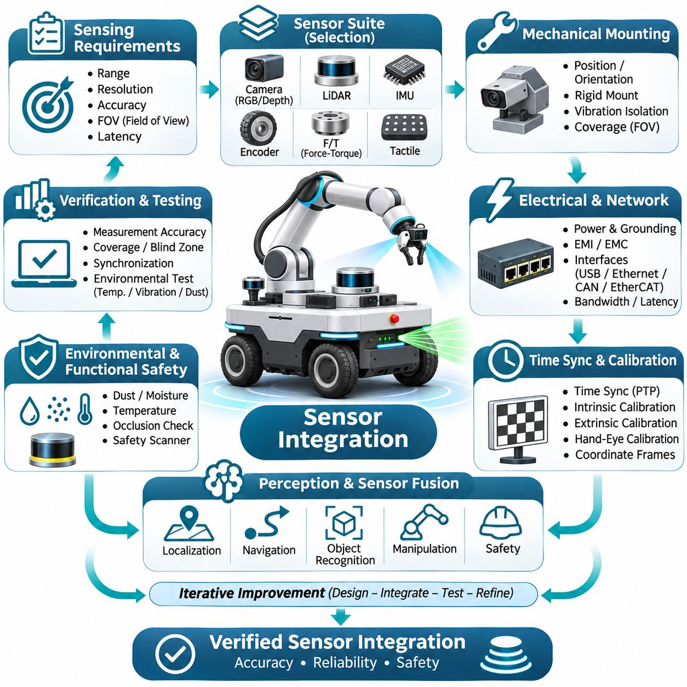{width="7.268055555555556in" height="7.268055555555556in"}

Sensor integration is a fundamental engineering activity that establishes the physical sensing capabilities of a mobile manipulator. The integrated sensor architecture must support environmental perception, localization, autonomous navigation, object recognition, manipulation, and operational safety. Effective integration requires coordinated mechanical, electrical, communication, and software development across the entire robotic platform.

The integration process begins with the identification of application-specific sensing requirements and operational scenarios. Engineers establish quantitative targets for detection range, spatial resolution, measurement accuracy, field of view, sampling frequency, and response latency. Sensor requirements must reflect environmental conditions, target object characteristics, manipulation tolerances, and safety-related operational constraints.

Sensor selection requires careful evaluation of complementary sensing technologies, including cameras, depth cameras, LiDAR, ultrasonic sensors, inertial measurement units, encoders, force-torque sensors, and tactile sensors. Each sensing technology provides distinct measurement capabilities and operational limitations. An appropriate sensor configuration should balance perception performance, reliability, integration complexity, energy consumption, and hardware costs.

Mechanical sensor integration determines measurement stability, environmental coverage, and calibration reliability. Engineers must establish mounting positions, installation orientations, structural rigidity, and mechanical reference points according to system requirements. Sensor mounting structures should minimize deformation, vibration, and accidental displacement while maintaining accessibility for inspection, calibration, replacement, and maintenance activities.

Camera integration supports object detection, pose estimation, visual navigation, inspection, and manipulation planning. Engineers must evaluate image resolution, frame rate, lens characteristics, exposure control, shutter technology, and illumination requirements. Fixed cameras provide environmental coverage, while wrist-mounted cameras enable close-range perception and precise observation of target objects during manipulation tasks.

LiDAR integration provides spatial measurements for environmental mapping, localization, obstacle detection, and autonomous navigation. Sensor installation height, scanning geometry, detection range, angular resolution, and blind zones must be evaluated against the physical configuration of the mobile platform. Robotic arm movements, structural components, and transported objects should not create unacceptable limitations in environmental coverage.

Proprioceptive sensor integration enables the robotic system to measure its internal motion and physical configuration. Wheel encoders, joint encoders, steering angle sensors, and inertial measurement units provide information about platform displacement, orientation, acceleration, and joint positions. Mechanical alignment, measurement resolution, sensor drift, and sampling frequency influence state estimation and motion control performance.

Force-torque and tactile sensor integration enables the mobile manipulator to obtain physical feedback during interaction with objects and external surfaces. Sensor selection must consider measurement range, overload tolerance, sensitivity, mechanical stiffness, and communication latency. Accurate contact measurements support gripping force regulation, compliant manipulation, slip detection, and controlled assembly operations.

Electrical sensor integration establishes reliable power delivery and signal transmission between sensing devices and embedded computing platforms. Engineers must evaluate supply voltage, current consumption, connector compatibility, grounding arrangements, cable shielding, and electromagnetic interference. Electrical protection and appropriate cable separation help maintain measurement reliability during simultaneous motor and actuator operation.

Communication architecture and bandwidth management are essential when numerous sensing devices operate concurrently. USB, Ethernet, GigE Vision, CAN, EtherCAT, and serial communication interfaces provide different performance characteristics. Network topology, data throughput, packet loss, transmission latency, and processing overhead must be evaluated to prevent communication bottlenecks and maintain predictable sensor data availability.

Time synchronization ensures that measurements acquired from different sensors correspond to consistent physical events. Hardware triggering, Precision Time Protocol (PTP), synchronized clocks, and timestamp management can reduce temporal discrepancies between cameras, LiDAR, inertial sensors, and encoders. Synchronization accuracy directly influences sensor fusion, motion estimation, three-dimensional reconstruction, and dynamic object tracking.

Sensor calibration establishes the geometric and measurement relationships necessary for accurate robotic operation. Intrinsic calibration, extrinsic calibration, hand-eye calibration, and coordinate frame registration must be performed according to the integrated hardware configuration. Calibration parameters should remain traceable to individual sensors, mounting configurations, environmental conditions, and approved hardware revisions.

Environmental protection and operational robustness must be incorporated into sensor integration throughout hardware development. Dust, moisture, temperature variations, mechanical shock, vibration, ambient illumination, and surface contamination can degrade measurement quality. Protective enclosures, optical windows, suitable mounting materials, thermal management, and cleaning accessibility should address representative operating conditions.

Safety-related sensor integration requires particular attention to detection coverage, fault monitoring, response times, and system-level risk assessment. Safety-rated laser scanners and protective sensing devices must be distinguished from conventional perception sensors. Protective field configurations and stopping behavior should account for platform velocity, payload conditions, manipulator movement, and potential human presence.

Sensor data integration connects physical sensing devices with embedded controllers, perception software, artificial intelligence models, and higher-level robotic applications. Standardized data formats, coordinate frame definitions, timestamps, diagnostic messages, and interface specifications facilitate consistent system integration. Sensor fusion algorithms can combine complementary measurements to improve environmental understanding and operational robustness.

Sensor integration verification requires measurement accuracy testing, coverage assessment, calibration validation, communication testing, synchronization measurement, and environmental evaluation. Prototype testing should reproduce representative navigation and manipulation scenarios, including changing lighting conditions, sensor occlusion, vibration, dynamic obstacles, and simultaneous subsystem operation. Identified limitations must guide iterative engineering improvements.

The sensor integration process concludes with a verified hardware configuration supported by sensor specifications, installation drawings, electrical schematics, calibration records, communication interfaces, and test results. The approved design baseline maintains traceability between sensing requirements and measured performance while supporting AI development, manipulation control, system validation, manufacturing, and long-term maintenance.

센서 통합(Sensor Integration)은 모바일 매니퓰레이터(Mobile Manipulator)의 물리적 감지 능력(Physical Sensing Capability)을 확립하는 핵심적인 엔지니어링 활동이다. 통합 센서 아키텍처(Integrated Sensor Architecture)는 환경 인지(Environmental Perception), 위치 추정(Localization), 자율주행(Autonomous Navigation), 물체 인식(Object Recognition), 조작(Manipulation) 및 운용 안전성(Operational Safety)을 지원해야 한다. 효과적인 센서 통합을 위해서는 전체 로봇 플랫폼에 걸쳐 기계적, 전기적, 통신 및 소프트웨어 개발이 유기적으로 연계되어야 한다.

센서 통합 프로세스는 적용 분야별 감지 요구사항(Application-Specific Sensing Requirements)과 운용 시나리오(Operational Scenario)를 식별하는 것으로부터 시작된다. 엔지니어는 감지 범위(Detection Range), 공간 분해능(Spatial Resolution), 측정 정확도(Measurement Accuracy), 시야각(FOV, Field of View), 샘플링 주파수(Sampling Frequency) 및 응답 지연시간(Response Latency)에 대한 정량적 목표를 설정한다. 센서 요구사항은 환경 조건(Environmental Condition), 대상 물체의 특성(Target Object Characteristics), 조작 허용오차(Manipulation Tolerance) 및 안전 관련 운용 제약조건(Safety-Related Operational Constraint)을 반영해야 한다.

센서 선정(Sensor Selection)은 카메라(Camera), 깊이 카메라(Depth Camera), 라이다(LiDAR), 초음파 센서(Ultrasonic Sensor), 관성 측정 장치(IMU, Inertial Measurement Unit), 엔코더(Encoder), 힘·토크 센서(Force-Torque Sensor) 및 촉각 센서(Tactile Sensor)를 포함한 상호 보완적인 감지 기술에 대한 신중한 평가를 필요로 한다. 각각의 감지 기술(Sensing Technology)은 서로 다른 측정 능력과 운용 한계(Operational Limitation)를 가진다. 적절한 센서 구성(Sensor Configuration)은 인지 성능(Perception Performance), 신뢰성(Reliability), 통합 복잡성(Integration Complexity), 에너지 소비량(Energy Consumption) 및 하드웨어 비용 사이의 균형을 유지해야 한다.

기계적 센서 통합(Mechanical Sensor Integration)은 측정 안정성(Measurement Stability), 환경 감지 범위(Environmental Coverage) 및 보정 신뢰성(Calibration Reliability)을 결정한다. 엔지니어는 시스템 요구사항에 따라 장착 위치(Mounting Position), 설치 방향(Installation Orientation), 구조적 강성(Structural Rigidity) 및 기계적 기준점(Mechanical Reference Point)을 설정해야 한다. 센서 장착 구조물(Sensor Mounting Structure)은 검사(Inspection), 보정(Calibration), 교체(Replacement) 및 유지보수(Maintenance)를 위한 접근성을 유지하면서 변형(Deformation), 진동(Vibration) 및 의도하지 않은 위치 변경(Accidental Displacement)을 최소화해야 한다.

카메라 통합(Camera Integration)은 물체 검출(Object Detection), 자세 추정(Pose Estimation), 비전 기반 자율주행(Visual Navigation), 검사(Inspection) 및 조작 계획(Manipulation Planning)을 지원한다. 엔지니어는 영상 해상도(Image Resolution), 프레임 속도(Frame Rate), 렌즈 특성(Lens Characteristic), 노출 제어(Exposure Control), 셔터 기술(Shutter Technology) 및 조명 요구사항(Illumination Requirements)을 평가해야 한다. 고정형 카메라(Fixed Camera)는 주변 환경의 감지 범위를 제공하는 반면, 손목 장착형 카메라(Wrist-Mounted Camera)는 조작 작업 과정에서 근거리 인지(Close-Range Perception)와 대상 물체의 정밀 관측(Precise Observation)을 가능하게 한다.

라이다 통합(LiDAR Integration)은 환경 지도 생성(Environmental Mapping), 위치 추정(Localization), 장애물 감지(Obstacle Detection) 및 자율주행(Autonomous Navigation)을 위한 공간 측정 데이터(Spatial Measurement Data)를 제공한다. 센서 설치 높이(Installation Height), 스캔 형상(Scanning Geometry), 감지 거리(Detection Range), 각도 분해능(Angular Resolution) 및 사각지대(Blind Zone)는 이동 플랫폼의 물리적 구성(Physical Configuration)을 기준으로 평가되어야 한다. 로봇 팔의 움직임, 구조적 구성 요소 및 운송 중인 물체는 환경 감지 범위에 허용할 수 없는 수준의 제약을 발생시키지 않아야 한다.

고유수용 센서 통합(Proprioceptive Sensor Integration)은 로봇 시스템이 자체적인 움직임과 물리적 구성을 측정할 수 있도록 한다. 휠 엔코더(Wheel Encoder), 관절 엔코더(Joint Encoder), 조향각 센서(Steering Angle Sensor) 및 관성 측정 장치(IMU)는 플랫폼 변위(Platform Displacement), 방향 자세(Orientation), 가속도(Acceleration) 및 관절 위치(Joint Position)에 관한 정보를 제공한다. 기계적 정렬(Mechanical Alignment), 측정 분해능(Measurement Resolution), 센서 드리프트(Sensor Drift) 및 샘플링 주파수는 상태 추정(State Estimation)과 모션 제어(Motion Control) 성능에 영향을 미친다.

힘·토크 및 촉각 센서 통합(Force-Torque and Tactile Sensor Integration)은 모바일 매니퓰레이터가 물체 및 외부 표면과 상호작용하는 과정에서 물리적 피드백(Physical Feedback)을 획득할 수 있도록 한다. 센서 선정 과정에서는 측정 범위(Measurement Range), 과부하 허용치(Overload Tolerance), 감도(Sensitivity), 기계적 강성(Mechanical Stiffness) 및 통신 지연시간(Communication Latency)을 고려해야 한다. 정확한 접촉 측정(Contact Measurement)은 파지력 조절(Gripping Force Regulation), 순응형 조작(Compliant Manipulation), 미끄러짐 감지(Slip Detection) 및 제어된 조립 작업(Controlled Assembly Operation)을 지원한다.

전기적 센서 통합(Electrical Sensor Integration)은 감지 장치와 임베디드 컴퓨팅 플랫폼(Embedded Computing Platform) 사이에서 신뢰성 높은 전력 공급(Power Delivery) 및 신호 전송(Signal Transmission) 체계를 확립한다. 엔지니어는 공급 전압(Supply Voltage), 전류 소비량(Current Consumption), 커넥터 호환성(Connector Compatibility), 접지 구성(Grounding Arrangement), 케이블 차폐(Cable Shielding) 및 전자기 간섭(EMI, Electromagnetic Interference)을 평가해야 한다. 전기적 보호(Electrical Protection)와 적절한 케이블 분리(Cable Separation)는 모터와 액추에이터가 동시에 작동하는 상황에서도 측정 신뢰성(Measurement Reliability)을 유지하는 데 기여한다.

통신 아키텍처(Communication Architecture)와 대역폭 관리(Bandwidth Management)는 다수의 감지 장치가 동시에 작동할 때 필수적인 요소이다. USB, 이더넷(Ethernet), GigE Vision, CAN, EtherCAT 및 직렬 통신 인터페이스(Serial Communication Interface)는 서로 다른 성능 특성을 제공한다. 통신 병목 현상(Communication Bottleneck)을 방지하고 예측 가능한 센서 데이터 가용성(Sensor Data Availability)을 유지하기 위해 네트워크 토폴로지(Network Topology), 데이터 처리량(Data Throughput), 패킷 손실(Packet Loss), 전송 지연시간(Transmission Latency) 및 처리 오버헤드(Processing Overhead)를 평가해야 한다.

시간 동기화(Time Synchronization)는 서로 다른 센서에서 획득한 측정값이 시간적으로 일치하는 물리적 사건(Physical Event)에 대응하도록 보장한다. 하드웨어 트리거(Hardware Triggering), 정밀 시간 프로토콜(PTP, Precision Time Protocol), 동기화된 클록(Synchronized Clock) 및 타임스탬프 관리(Timestamp Management)는 카메라, 라이다, 관성 센서(Inertial Sensor) 및 엔코더 사이의 시간적 불일치(Temporal Discrepancy)를 감소시킬 수 있다. 동기화 정확도(Synchronization Accuracy)는 센서 융합(Sensor Fusion), 움직임 추정(Motion Estimation), 3차원 재구성(3D Reconstruction) 및 동적 물체 추적(Dynamic Object Tracking)에 직접적인 영향을 미친다.

센서 보정(Sensor Calibration)은 정확한 로봇 운용에 필요한 기하학적 관계(Geometric Relationship)와 측정 관계(Measurement Relationship)를 확립한다. 내부 파라미터 보정(Intrinsic Calibration), 외부 파라미터 보정(Extrinsic Calibration), 손-눈 보정(Hand-Eye Calibration) 및 좌표계 정합(Coordinate Frame Registration)은 통합된 하드웨어 구성에 따라 수행되어야 한다. 보정 파라미터(Calibration Parameter)는 개별 센서, 장착 구성(Mounting Configuration), 환경 조건 및 승인된 하드웨어 개정 사항(Approved Hardware Revision)에 대한 추적성(Traceability)을 유지해야 한다.

환경적 보호(Environmental Protection)와 운용 강건성(Operational Robustness)은 전체 하드웨어 개발 과정의 센서 통합에 반영되어야 한다. 먼지(Dust), 수분(Moisture), 온도 변화(Temperature Variation), 기계적 충격(Mechanical Shock), 진동(Vibration), 주변 조명(Ambient Illumination) 및 표면 오염(Surface Contamination)은 측정 품질(Measurement Quality)을 저하시킬 수 있다. 보호 하우징(Protective Enclosure), 광학 윈도우(Optical Window), 적절한 장착 재료(Mounting Material), 열 관리(Thermal Management) 및 청소 접근성(Cleaning Accessibility)은 대표적인 운용 환경에 대응할 수 있도록 설계되어야 한다.

안전 관련 센서 통합(Safety-Related Sensor Integration)은 감지 범위(Detection Coverage), 고장 모니터링(Fault Monitoring), 응답 시간(Response Time) 및 시스템 수준의 위험성 평가(System-Level Risk Assessment)에 대한 특별한 주의를 필요로 한다. 안전 등급 레이저 스캐너(Safety-Rated Laser Scanner)와 보호용 감지 장치(Protective Sensing Device)는 일반적인 인지 센서(Conventional Perception Sensor)와 명확하게 구분되어야 한다. 보호 영역 구성(Protective Field Configuration)과 정지 동작(Stopping Behavior)은 플랫폼 속도(Platform Velocity), 적재 하중 조건(Payload Condition), 매니퓰레이터의 움직임 및 사람의 접근 가능성을 고려해야 한다.

센서 데이터 통합(Sensor Data Integration)은 물리적 감지 장치를 임베디드 제어기(Embedded Controller), 인지 소프트웨어(Perception Software), 인공지능 모델(AI Model) 및 상위 수준의 로봇 애플리케이션(Higher-Level Robotic Application)과 연결한다. 표준화된 데이터 형식(Standardized Data Format), 좌표계 정의(Coordinate Frame Definition), 타임스탬프(Timestamp), 진단 메시지(Diagnostic Message) 및 인터페이스 사양(Interface Specification)은 일관된 시스템 통합을 지원한다. 센서 융합 알고리즘(Sensor Fusion Algorithm)은 상호 보완적인 측정 데이터를 결합하여 환경 이해(Environmental Understanding)와 운용 강건성을 향상시킬 수 있다.

센서 통합 검증(Sensor Integration Verification)은 측정 정확도 시험(Measurement Accuracy Testing), 감지 범위 평가(Coverage Assessment), 보정 검증(Calibration Validation), 통신 시험(Communication Testing), 동기화 측정(Synchronization Measurement) 및 환경 평가(Environmental Evaluation)를 필요로 한다. 시제품 시험(Prototype Testing)은 변화하는 조명 조건, 센서 가림 현상(Sensor Occlusion), 진동, 동적 장애물(Dynamic Obstacle) 및 하위 시스템의 동시 작동(Simultaneous Subsystem Operation)을 포함한 대표적인 자율주행 및 조작 시나리오를 재현해야 한다. 식별된 기술적 한계는 반복적인 엔지니어링 개선(Iterative Engineering Improvement)의 기반으로 활용되어야 한다.

센서 통합 프로세스는 센서 사양(Sensor Specification), 설치 도면(Installation Drawing), 전기 회로도(Electrical Schematic), 보정 기록(Calibration Record), 통신 인터페이스(Communication Interface) 및 시험 결과(Test Result)를 기반으로 검증된 하드웨어 구성(Verified Hardware Configuration)을 확립함으로써 마무리된다. 승인된 설계 기준선(Approved Design Baseline)은 감지 요구사항과 측정된 성능 사이의 추적성을 유지하는 동시에 이후의 인공지능 개발(AI Development), 조작 제어(Manipulation Control), 시스템 검증(System Validation), 제조(Manufacturing) 및 장기적인 유지보수(Long-Term Maintenance)를 지원한다.

##  

## 07 Electrical System Design

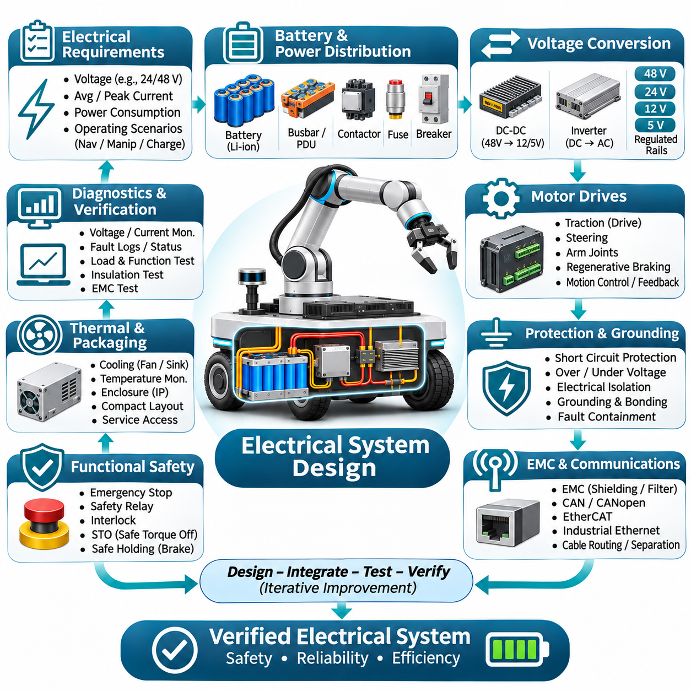{width="7.268055555555556in" height="7.268055555555556in"}

Electrical system design is a fundamental engineering activity that establishes the power distribution, electrical connectivity, control infrastructure, and operational reliability of a mobile manipulator. The electrical architecture must support the simultaneous operation of mobility systems, robotic arms, end effectors, perception sensors, embedded controllers, computing platforms, and safety-related equipment under varying operating conditions.

The design process begins with the analysis of system-level electrical requirements and subsystem power specifications. Engineers establish quantitative requirements for operating voltage, average current, peak current, power consumption, electrical protection, communication interfaces, and environmental resistance. These requirements must reflect representative navigation, manipulation, charging, standby, and emergency operating scenarios.

Electrical architecture development defines the relationships between energy storage, power conversion, power distribution, actuator control, computing resources, and peripheral devices. High-power circuits supplying drive motors and robotic manipulators should be appropriately separated from sensitive electronic circuits supporting perception and communication. Architectural decisions must consider electrical efficiency, scalability, fault isolation, and maintenance accessibility.

Power distribution system design establishes reliable electrical energy delivery from the battery pack to individual subsystems. Distribution modules, busbars, contactors, circuit breakers, fuses, and power connectors must accommodate continuous and transient electrical loads. Engineers must evaluate conductor current ratings, voltage drops, connection resistance, short-circuit conditions, and thermal characteristics throughout the distribution network.

Voltage conversion enables electrical compatibility between components operating at different voltage levels. DC-to-DC converters can supply lower-voltage electronic devices, sensors, and embedded controllers from the primary battery system, while inverters may supply alternating current to industrial robot controllers. Conversion efficiency, voltage regulation, transient response, electrical isolation, and thermal dissipation influence converter selection.

Motor drive integration requires coordinated electrical design for traction motors, steering actuators, robotic joints, and auxiliary mechanisms. Engineers must evaluate rated current, peak current, motor controller specifications, regenerative braking characteristics, and feedback interfaces. Simultaneous actuator operation and rapid acceleration or deceleration can generate electrical disturbances that must be accommodated without compromising system stability.

Electrical protection mechanisms prevent component damage and reduce operational hazards associated with excessive currents, short circuits, reverse polarity, overvoltage, undervoltage, and insulation failures. Protection devices must be selected according to circuit characteristics, available fault currents, operating conditions, and isolation requirements. Coordinated protection helps prevent localized electrical failures from propagating throughout the system.

Grounding and bonding architecture provides electrical reference stability, electromagnetic compatibility, and appropriate protection against electrical faults. Engineers must distinguish between power return paths, signal reference connections, chassis bonding, and protective grounding functions. Improper grounding configurations can introduce ground loops, measurement errors, communication disturbances, and unintended electrical current paths.

Electromagnetic compatibility (EMC) is particularly important because mobile manipulators combine high-power switching electronics with sensitive perception and control devices. Motor controllers, inverters, and power converters can generate conducted and radiated electromagnetic interference. Appropriate shielding, filtering, grounding, cable separation, and component placement help maintain reliable communication and sensor measurement quality.

Electrical communication interfaces connect motor controllers, battery management systems, safety controllers, sensors, and higher-level computing platforms. CAN, CANopen, EtherCAT, industrial Ethernet, and serial communication interfaces may be selected according to subsystem requirements. Physical network topology, termination resistance, electrical isolation, communication redundancy, and fault detection must be considered during integration.

Safety-related electrical architecture establishes the hardware infrastructure required to implement protective functions and controlled stopping behavior. Emergency stop circuits, safety controllers, safety relays, interlocks, and Safe Torque Off (STO) interfaces must be integrated according to application-specific risk assessments. Electrical safety functions must also consider gravitational loads, mechanical braking, and unintended object release.

Electrical thermal management addresses heat generated by power converters, motor controllers, contactors, conductors, and computing equipment. Engineers must evaluate power losses, component temperature limits, airflow characteristics, enclosure design, and environmental temperature variations. Appropriate cooling mechanisms and temperature monitoring help prevent excessive thermal stress, premature component degradation, and unexpected system shutdowns.

Electrical packaging and component placement must support mechanical integration, wiring harness development, assembly efficiency, and long-term serviceability. Electrical enclosures should provide suitable environmental protection, ventilation, connector accessibility, and physical separation between incompatible circuits. Component arrangements must also accommodate structural vibration, mechanical shock, maintenance procedures, and potential hardware configuration changes.

Electrical system diagnostics enable continuous monitoring of voltage levels, current consumption, component temperatures, communication status, and protection circuit conditions. Embedded controllers can collect diagnostic information and communicate abnormal operating states to higher-level management software. Structured fault codes, event logging, and subsystem health monitoring support troubleshooting and predictive maintenance.

Electrical system verification requires circuit inspection, voltage and current measurements, load testing, insulation assessment, communication validation, and electromagnetic compatibility evaluation. Prototype testing should reproduce representative motion cycles, simultaneous subsystem operation, peak power demand, charging transitions, and controlled fault conditions. Verification results must support corrective engineering changes and subsequent regression testing.

The electrical system design process concludes with a verified hardware baseline supported by electrical schematics, power distribution specifications, component lists, interface definitions, protection strategies, and test records. The approved electrical configuration establishes traceability between system requirements and verified performance while supporting wiring harness development, embedded system integration, manufacturing, and lifecycle management.

전기 시스템 설계(Electrical System Design)는 모바일 매니퓰레이터(Mobile Manipulator)의 전력 분배(Power Distribution), 전기적 연결성(Electrical Connectivity), 제어 인프라(Control Infrastructure) 및 운용 신뢰성(Operational Reliability)을 확립하는 핵심적인 엔지니어링 활동이다. 전기 아키텍처(Electrical Architecture)는 변화하는 운용 조건에서 이동 시스템(Mobility System), 로봇 팔(Robot Arm), 엔드 이펙터(End Effector), 인지 센서(Perception Sensor), 임베디드 제어기(Embedded Controller), 컴퓨팅 플랫폼(Computing Platform) 및 안전 관련 장비(Safety-Related Equipment)의 동시 작동을 지원해야 한다.

설계 프로세스는 시스템 수준의 전기적 요구사항(System-Level Electrical Requirements)과 하위 시스템의 전력 사양(Subsystem Power Specification)에 대한 분석으로부터 시작된다. 엔지니어는 동작 전압(Operating Voltage), 평균 전류(Average Current), 최대 전류(Peak Current), 전력 소비량(Power Consumption), 전기적 보호(Electrical Protection), 통신 인터페이스(Communication Interface) 및 내환경성(Environmental Resistance)에 대한 정량적 요구사항을 확립한다. 이러한 요구사항은 대표적인 자율주행(Navigation), 조작(Manipulation), 충전(Charging), 대기(Standby) 및 비상 운용 시나리오(Emergency Operating Scenario)를 반영해야 한다.

전기 아키텍처 개발(Electrical Architecture Development)은 에너지 저장(Energy Storage), 전력 변환(Power Conversion), 전력 분배(Power Distribution), 액추에이터 제어(Actuator Control), 컴퓨팅 자원(Computing Resource) 및 주변 장치(Peripheral Device) 사이의 관계를 정의한다. 구동 모터(Drive Motor)와 로봇 매니퓰레이터(Robotic Manipulator)에 전력을 공급하는 고전력 회로(High-Power Circuit)는 인지 및 통신을 지원하는 민감한 전자 회로(Sensitive Electronic Circuit)와 적절하게 분리되어야 한다. 아키텍처 설계 과정에서는 전기적 효율성(Electrical Efficiency), 확장성(Scalability), 고장 격리(Fault Isolation) 및 유지보수 접근성(Maintenance Accessibility)을 고려해야 한다.

전력 분배 시스템 설계(Power Distribution System Design)는 배터리 팩(Battery Pack)에서 개별 하위 시스템으로 신뢰성 높은 전기 에너지를 공급하는 체계를 확립한다. 전력 분배 모듈(Distribution Module), 버스바(Busbar), 전자 접촉기(Contactor), 회로 차단기(Circuit Breaker), 퓨즈(Fuse) 및 전원 커넥터(Power Connector)는 연속 및 과도 전기 부하(Continuous and Transient Electrical Load)를 수용할 수 있어야 한다. 엔지니어는 전체 전력 분배 네트워크에서 도체 허용 전류(Conductor Current Rating), 전압 강하(Voltage Drop), 접속 저항(Connection Resistance), 단락 조건(Short-Circuit Condition) 및 열적 특성(Thermal Characteristic)을 평가해야 한다.

전압 변환(Voltage Conversion)은 서로 다른 전압 수준에서 작동하는 구성 요소 사이의 전기적 호환성(Electrical Compatibility)을 확보한다. 직류-직류 변환기(DC-to-DC Converter)는 주 배터리 시스템(Primary Battery System)으로부터 저전압 전자 장치(Low-Voltage Electronic Device), 센서 및 임베디드 제어기에 전력을 공급할 수 있으며, 인버터(Inverter)는 산업용 로봇 제어기(Industrial Robot Controller)에 교류 전력을 공급할 수 있다. 변환 효율(Conversion Efficiency), 전압 조정(Voltage Regulation), 과도 응답(Transient Response), 전기적 절연(Electrical Isolation) 및 방열 특성(Thermal Dissipation)은 전력 변환 장치의 선정에 영향을 미친다.

모터 구동 시스템 통합(Motor Drive Integration)은 주행 모터(Traction Motor), 조향 액추에이터(Steering Actuator), 로봇 관절(Robotic Joint) 및 보조 메커니즘(Auxiliary Mechanism)에 대한 유기적인 전기 설계를 필요로 한다. 엔지니어는 정격 전류(Rated Current), 최대 전류(Peak Current), 모터 제어기 사양(Motor Controller Specification), 회생 제동 특성(Regenerative Braking Characteristic) 및 피드백 인터페이스(Feedback Interface)를 평가해야 한다. 액추에이터의 동시 작동과 급격한 가속 또는 감속은 전기적 외란(Electrical Disturbance)을 발생시킬 수 있으므로 시스템 안정성(System Stability)을 저하시키지 않도록 설계해야 한다.

전기적 보호 메커니즘(Electrical Protection Mechanism)은 과전류(Excessive Current), 단락(Short Circuit), 역극성(Reverse Polarity), 과전압(Overvoltage), 저전압(Undervoltage) 및 절연 고장(Insulation Failure)으로 인한 구성 요소 손상을 방지하고 운용 위험(Operational Hazard)을 감소시킨다. 보호 장치(Protection Device)는 회로 특성(Circuit Characteristic), 예상 고장 전류(Available Fault Current), 운용 조건 및 절연 요구사항(Isolation Requirements)에 따라 선정되어야 한다. 보호 협조(Coordinated Protection)는 국부적인 전기적 고장(Localized Electrical Failure)이 전체 시스템으로 전파되는 것을 방지하는 데 기여한다.

접지 및 본딩 아키텍처(Grounding and Bonding Architecture)는 전기적 기준 전위의 안정성(Electrical Reference Stability), 전자기 적합성(EMC, Electromagnetic Compatibility) 및 전기적 고장에 대한 적절한 보호 기능을 제공한다. 엔지니어는 전력 귀환 경로(Power Return Path), 신호 기준 전위 연결(Signal Reference Connection), 섀시 본딩(Chassis Bonding) 및 보호 접지 기능(Protective Grounding Function)을 구분해야 한다. 부적절한 접지 구성(Grounding Configuration)은 접지 루프(Ground Loop), 측정 오차(Measurement Error), 통신 장애(Communication Disturbance) 및 의도하지 않은 전류 경로(Unintended Electrical Current Path)를 발생시킬 수 있다.

전자기 적합성(EMC, Electromagnetic Compatibility)은 모바일 매니퓰레이터가 고전력 스위칭 전자 장치(High-Power Switching Electronics)와 민감한 인지 및 제어 장치를 결합하기 때문에 특히 중요하다. 모터 제어기(Motor Controller), 인버터 및 전력 변환기(Power Converter)는 전도성 및 방사성 전자기 간섭(Conducted and Radiated Electromagnetic Interference)을 발생시킬 수 있다. 적절한 차폐(Shielding), 필터링(Filtering), 접지(Grounding), 케이블 분리(Cable Separation) 및 구성 요소 배치(Component Placement)는 신뢰성 높은 통신과 센서 측정 품질(Sensor Measurement Quality)을 유지하는 데 기여한다.

전기적 통신 인터페이스(Electrical Communication Interface)는 모터 제어기, 배터리 관리 시스템(BMS, Battery Management System), 안전 제어기(Safety Controller), 센서 및 상위 수준의 컴퓨팅 플랫폼(Higher-Level Computing Platform)을 연결한다. CAN, CANopen, EtherCAT, 산업용 이더넷(Industrial Ethernet) 및 직렬 통신 인터페이스(Serial Communication Interface)는 하위 시스템의 요구사항에 따라 선정될 수 있다. 통합 과정에서는 물리적 네트워크 토폴로지(Physical Network Topology), 종단 저항(Termination Resistance), 전기적 절연(Electrical Isolation), 통신 이중화(Communication Redundancy) 및 고장 감지(Fault Detection)를 고려해야 한다.

안전 관련 전기 아키텍처(Safety-Related Electrical Architecture)는 보호 기능(Protective Function)과 제어된 정지 동작(Controlled Stopping Behavior)을 구현하는 데 필요한 하드웨어 인프라(Hardware Infrastructure)를 확립한다. 비상 정지 회로(Emergency Stop Circuit), 안전 제어기, 안전 릴레이(Safety Relay), 인터록(Interlock) 및 안전 토크 차단(STO, Safe Torque Off) 인터페이스는 적용 분야별 위험성 평가(Application-Specific Risk Assessment)에 따라 통합되어야 한다. 전기적 안전 기능(Electrical Safety Function)은 중력 하중(Gravitational Load), 기계적 제동(Mechanical Braking) 및 의도하지 않은 물체 해제(Unintended Object Release)도 고려해야 한다.

전기 시스템 열 관리(Electrical Thermal Management)는 전력 변환기, 모터 제어기, 전자 접촉기, 전기 도체(Conductor) 및 컴퓨팅 장비(Computing Equipment)에서 발생하는 열에 대응한다. 엔지니어는 전력 손실(Power Loss), 구성 요소의 온도 한계(Component Temperature Limit), 공기 흐름 특성(Airflow Characteristic), 하우징 설계(Enclosure Design) 및 환경 온도 변화(Environmental Temperature Variation)를 평가해야 한다. 적절한 냉각 메커니즘(Cooling Mechanism)과 온도 모니터링(Temperature Monitoring)은 과도한 열적 응력(Thermal Stress), 구성 요소의 조기 성능 저하(Premature Component Degradation) 및 예기치 않은 시스템 정지(System Shutdown)를 방지하는 데 기여한다.

전기 시스템 패키징 및 구성 요소 배치(Electrical Packaging and Component Placement)는 기계적 통합(Mechanical Integration), 와이어링 하네스 개발(Wiring Harness Development), 조립 효율성(Assembly Efficiency) 및 장기적인 정비성(Long-Term Serviceability)을 지원해야 한다. 전장 하우징(Electrical Enclosure)은 적절한 환경적 보호(Environmental Protection), 환기(Ventilation), 커넥터 접근성(Connector Accessibility) 및 상호 간섭 가능성이 있는 회로 사이의 물리적 분리(Physical Separation)를 제공해야 한다. 구성 요소의 배치는 구조적 진동(Structural Vibration), 기계적 충격(Mechanical Shock), 유지보수 절차(Maintenance Procedure) 및 잠재적인 하드웨어 구성 변경(Hardware Configuration Change)도 수용할 수 있어야 한다.

전기 시스템 진단(Electrical System Diagnostics)은 전압 수준(Voltage Level), 전류 소비량(Current Consumption), 구성 요소 온도(Component Temperature), 통신 상태(Communication Status) 및 보호 회로 상태(Protection Circuit Condition)를 지속적으로 모니터링할 수 있도록 한다. 임베디드 제어기는 진단 정보(Diagnostic Information)를 수집하고 비정상 운용 상태(Abnormal Operating State)를 상위 수준의 관리 소프트웨어(Higher-Level Management Software)에 전달할 수 있다. 체계화된 고장 코드(Structured Fault Code), 이벤트 로깅(Event Logging) 및 하위 시스템 상태 모니터링(Subsystem Health Monitoring)은 고장 원인 분석(Troubleshooting)과 예지 정비(Predictive Maintenance)를 지원한다.

전기 시스템 검증(Electrical System Verification)은 회로 검사(Circuit Inspection), 전압 및 전류 측정(Voltage and Current Measurement), 부하 시험(Load Testing), 절연 평가(Insulation Assessment), 통신 검증(Communication Validation) 및 전자기 적합성 평가(EMC Evaluation)를 필요로 한다. 시제품 시험(Prototype Testing)은 대표적인 동작 사이클(Motion Cycle), 하위 시스템의 동시 작동(Simultaneous Subsystem Operation), 최대 전력 요구량(Peak Power Demand), 충전 상태 전환(Charging Transition) 및 제어된 고장 조건(Controlled Fault Condition)을 재현해야 한다. 검증 결과(Verification Result)는 설계 결함을 시정하기 위한 엔지니어링 변경(Corrective Engineering Change)과 후속 회귀 시험(Regression Testing)을 지원해야 한다.

전기 시스템 설계 프로세스는 전기 회로도(Electrical Schematic), 전력 분배 사양(Power Distribution Specification), 구성 요소 목록(Component List), 인터페이스 정의(Interface Definition), 보호 전략(Protection Strategy) 및 시험 기록(Test Record)을 기반으로 검증된 하드웨어 기준선(Verified Hardware Baseline)을 확립함으로써 마무리된다. 승인된 전기 시스템 구성(Approved Electrical Configuration)은 시스템 요구사항과 검증된 성능 사이의 추적성(Traceability)을 확보하는 동시에 이후의 와이어링 하네스 개발(Wiring Harness Development), 임베디드 시스템 통합(Embedded System Integration), 제조(Manufacturing) 및 수명주기 관리(Lifecycle Management)를 지원한다.

##  

## 08 Wiring Harness Design

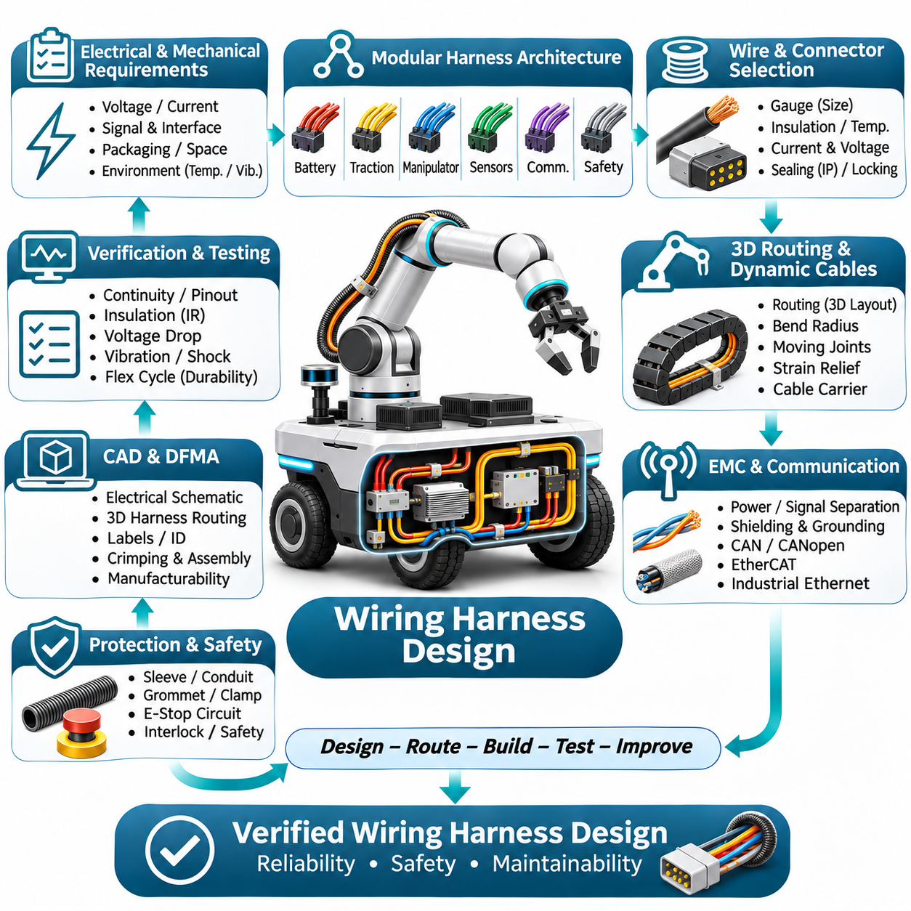{width="7.268055555555556in" height="7.268055555555556in"}

Wiring harness design is a fundamental engineering activity that establishes reliable electrical connectivity between the distributed subsystems of a mobile manipulator. The wiring harness integrates power distribution circuits, communication networks, sensor interfaces, motor controllers, safety devices, and embedded computing platforms. Its design directly influences electrical reliability, system maintainability, assembly efficiency, and operational safety.

The design process begins with the analysis of electrical architecture, subsystem interfaces, mechanical packaging, and environmental requirements. Engineers identify electrical connection points, operating voltages, current requirements, signal characteristics, connector specifications, and physical routing constraints. These requirements establish the foundation for developing a coordinated wiring harness architecture.

Wiring harness architecture defines the organization of electrical circuits into functional harness assemblies and distribution branches. A mobile manipulator may incorporate battery harnesses, traction motor harnesses, manipulator harnesses, sensor harnesses, communication harnesses, and safety harnesses. Modular partitioning facilitates subsystem integration, manufacturing, fault isolation, maintenance, and future hardware upgrades.

Wire selection requires careful evaluation of conductor cross-sectional area, current-carrying capacity, insulation characteristics, operating temperature, and mechanical flexibility. Engineers must consider continuous current, peak current, voltage drop, conductor heating, and thermal derating within bundled harnesses. Appropriate wire specifications help prevent electrical losses, insulation degradation, and premature component failures.

Connector and terminal selection determines the reliability of electrical interfaces between interconnected hardware components. Connector specifications must consider rated voltage, current capacity, contact resistance, environmental sealing, vibration resistance, mating cycles, and mechanical retention. Connector keying, secondary locking mechanisms, and terminal position assurance features help prevent incorrect assembly and accidental disconnection.

Three-dimensional harness routing establishes the physical pathways connecting electrical components throughout the mobile platform and robotic manipulator. Engineers must evaluate available packaging space, structural interference, minimum bending radius, mounting locations, and accessibility. Routing configurations should avoid sharp edges, excessive heat sources, moving mechanisms, and areas exposed to mechanical damage.

Dynamic wiring harness design is particularly important for robotic joints, steering mechanisms, rotating assemblies, and movable end effectors. Repeated bending, torsional loading, and mechanical friction can gradually damage conductors and insulation materials. High-flexibility cables, cable carriers, controlled bending geometries, strain relief mechanisms, and service loops should accommodate the complete range of robotic motion.

Electromagnetic compatibility must be incorporated into harness design to prevent interference between high-power electrical circuits and sensitive communication or perception devices. Motor power cables, inverter outputs, and switching power circuits should be appropriately separated from sensor and signal lines. Twisted-pair conductors, shielded cables, filtering, and suitable shield termination improve electromagnetic robustness.

Communication harness development establishes the physical transmission infrastructure for CAN, CANopen, EtherCAT, industrial Ethernet, and other communication interfaces. Cable impedance, characteristic termination, maximum transmission distance, shielding effectiveness, and network topology must satisfy interface specifications. Incorrect harness configurations can introduce signal reflections, intermittent communication failures, and data transmission errors.

Harness protection and mechanical retention are essential for maintaining electrical reliability under industrial operating conditions. Protective sleeves, corrugated conduits, abrasion-resistant coverings, grommets, cable clamps, and mounting brackets reduce exposure to vibration, friction, contamination, and mechanical impact. Retention systems must distribute mechanical loads without introducing excessive compression or localized stress.

Safety-related wiring harnesses connect emergency stop devices, safety controllers, protective sensors, interlocks, and actuator safety interfaces. Engineers must consider circuit separation, fault detection, electrical protection, connector integrity, and potential common-cause failures. Safety-related circuits should be designed and verified according to the required safety functions and application-specific risk assessment.

Computer-Aided Design (CAD) tools enable coordinated development of electrical schematics, connector definitions, three-dimensional harness routes, and manufacturing drawings. Digital harness models facilitate interference analysis, wire length estimation, branch positioning, and installation feasibility assessment. Integration between electrical and mechanical CAD environments reduces configuration inconsistencies and costly prototype modifications.

Design for Manufacturing and Assembly (DFMA) ensures that wiring harnesses can be produced and installed consistently across prototype and production platforms. Wire cutting, stripping, crimping, splicing, terminal insertion, connector assembly, and protective covering processes must be defined. Standardized components, circuit identification, labeling conventions, and assembly fixtures improve manufacturing repeatability and quality.

Wiring harness verification requires continuity testing, pin-to-pin connectivity inspection, insulation resistance measurement, voltage drop assessment, and mechanical durability evaluation. Prototype testing should reproduce vibration, repeated joint movements, steering cycles, temperature variations, and simultaneous electrical loading. Identified failures must guide corrective design modifications and subsequent regression testing.

The wiring harness design process concludes with a verified engineering baseline supported by electrical schematics, three-dimensional routing models, connector specifications, wire lists, harness drawings, bills of materials, assembly instructions, and test records. The approved configuration establishes design traceability while supporting embedded system integration, prototype fabrication, manufacturing, field validation, and lifecycle maintenance.

와이어링 하네스 설계(Wiring Harness Design)는 모바일 매니퓰레이터(Mobile Manipulator)의 분산된 하위 시스템(Distributed Subsystem) 사이에서 신뢰성 높은 전기적 연결성(Electrical Connectivity)을 확립하는 핵심적인 엔지니어링 활동이다. 와이어링 하네스는 전력 분배 회로(Power Distribution Circuit), 통신 네트워크(Communication Network), 센서 인터페이스(Sensor Interface), 모터 제어기(Motor Controller), 안전 장치(Safety Device) 및 임베디드 컴퓨팅 플랫폼(Embedded Computing Platform)을 통합한다. 이러한 설계는 전기적 신뢰성(Electrical Reliability), 시스템 유지보수성(System Maintainability), 조립 효율성(Assembly Efficiency) 및 운용 안전성(Operational Safety)에 직접적인 영향을 미친다.

설계 프로세스는 전기 아키텍처(Electrical Architecture), 하위 시스템 인터페이스(Subsystem Interface), 기계적 패키징(Mechanical Packaging) 및 환경 요구사항(Environmental Requirements)에 대한 분석으로부터 시작된다. 엔지니어는 전기적 연결 지점(Electrical Connection Point), 동작 전압(Operating Voltage), 전류 요구사항(Current Requirements), 신호 특성(Signal Characteristic), 커넥터 사양(Connector Specification) 및 물리적 경로 제약조건(Physical Routing Constraint)을 식별한다. 이러한 요구사항은 유기적으로 통합된 와이어링 하네스 아키텍처(Wiring Harness Architecture)를 개발하기 위한 기반을 확립한다.

와이어링 하네스 아키텍처(Wiring Harness Architecture)는 전기 회로(Electrical Circuit)를 기능별 하네스 어셈블리(Functional Harness Assembly)와 분배 분기(Distribution Branch)로 구성하는 체계를 정의한다. 모바일 매니퓰레이터는 배터리 하네스(Battery Harness), 주행 모터 하네스(Traction Motor Harness), 매니퓰레이터 하네스(Manipulator Harness), 센서 하네스(Sensor Harness), 통신 하네스(Communication Harness) 및 안전 하네스(Safety Harness)를 포함할 수 있다. 모듈 단위의 분할 구성(Modular Partitioning)은 하위 시스템 통합(Subsystem Integration), 제조(Manufacturing), 고장 격리(Fault Isolation), 유지보수(Maintenance) 및 향후 하드웨어 업그레이드(Hardware Upgrade)를 용이하게 한다.

전선 선정(Wire Selection)은 도체 단면적(Conductor Cross-Sectional Area), 허용 전류(Current-Carrying Capacity), 절연 특성(Insulation Characteristic), 동작 온도(Operating Temperature) 및 기계적 유연성(Mechanical Flexibility)에 대한 신중한 평가를 필요로 한다. 엔지니어는 연속 전류(Continuous Current), 최대 전류(Peak Current), 전압 강하(Voltage Drop), 도체 발열(Conductor Heating) 및 하네스 번들 내부의 열적 허용 전류 감소(Thermal Derating)를 고려해야 한다. 적절한 전선 사양(Wire Specification)은 전기적 손실(Electrical Loss), 절연 성능 저하(Insulation Degradation) 및 구성 요소의 조기 고장(Premature Component Failure)을 방지하는 데 기여한다.

커넥터 및 터미널 선정(Connector and Terminal Selection)은 상호 연결된 하드웨어 구성 요소 사이의 전기 인터페이스(Electrical Interface) 신뢰성을 결정한다. 커넥터 사양은 정격 전압(Rated Voltage), 전류 용량(Current Capacity), 접촉 저항(Contact Resistance), 환경 밀봉 성능(Environmental Sealing), 내진동성(Vibration Resistance), 체결 및 분리 사이클(Mating Cycle), 기계적 유지력(Mechanical Retention)을 고려해야 한다. 커넥터 오체결 방지 구조(Connector Keying), 이차 잠금 메커니즘(Secondary Locking Mechanism) 및 터미널 위치 보증 기능(TPA, Terminal Position Assurance)은 잘못된 조립과 의도하지 않은 연결 해제(Accidental Disconnection)를 방지하는 데 기여한다.

3차원 하네스 경로 설계(3D Harness Routing)는 이동 플랫폼(Mobile Platform)과 로봇 매니퓰레이터 전반에 걸쳐 전기적 구성 요소를 연결하는 물리적 경로(Physical Pathway)를 확립한다. 엔지니어는 사용 가능한 패키징 공간(Packaging Space), 구조적 간섭(Structural Interference), 최소 굽힘 반경(Minimum Bending Radius), 장착 위치(Mounting Location) 및 접근성(Accessibility)을 평가해야 한다. 하네스 경로 구성(Routing Configuration)은 날카로운 모서리(Sharp Edge), 과도한 열원(Excessive Heat Source), 움직이는 기구부(Moving Mechanism) 및 기계적 손상(Mechanical Damage)에 노출될 수 있는 영역을 피하도록 설계되어야 한다.

동적 와이어링 하네스 설계(Dynamic Wiring Harness Design)는 로봇 관절(Robotic Joint), 조향 메커니즘(Steering Mechanism), 회전 어셈블리(Rotating Assembly) 및 가동형 엔드 이펙터(Movable End Effector)에서 특히 중요하다. 반복적인 굽힘(Repeated Bending), 비틀림 하중(Torsional Loading) 및 기계적 마찰(Mechanical Friction)은 도체와 절연 재료(Insulation Material)를 점진적으로 손상시킬 수 있다. 고유연성 케이블(High-Flexibility Cable), 케이블 캐리어(Cable Carrier), 제어된 굽힘 형상(Controlled Bending Geometry), 응력 완화 메커니즘(Strain Relief Mechanism) 및 여유 배선 루프(Service Loop)는 로봇의 전체 동작 범위(Range of Motion)를 수용할 수 있어야 한다.

전자기 적합성(EMC, Electromagnetic Compatibility)은 고전력 전기 회로(High-Power Electrical Circuit)와 민감한 통신 또는 인지 장치(Perception Device) 사이의 간섭을 방지하기 위해 하네스 설계에 반영되어야 한다. 모터 전원 케이블(Motor Power Cable), 인버터 출력(Inverter Output) 및 스위칭 전력 회로(Switching Power Circuit)는 센서 및 신호 배선(Signal Line)과 적절하게 분리되어야 한다. 트위스트 페어 도체(Twisted-Pair Conductor), 차폐 케이블(Shielded Cable), 필터링(Filtering) 및 적절한 차폐 종단 처리(Shield Termination)는 전자기적 강건성(Electromagnetic Robustness)을 향상시킨다.

통신 하네스 개발(Communication Harness Development)은 CAN, CANopen, EtherCAT, 산업용 이더넷(Industrial Ethernet) 및 기타 통신 인터페이스(Communication Interface)를 위한 물리적 전송 인프라(Physical Transmission Infrastructure)를 확립한다. 케이블 임피던스(Cable Impedance), 특성 임피던스에 맞는 종단 처리(Characteristic Termination), 최대 전송 거리(Maximum Transmission Distance), 차폐 효과(Shielding Effectiveness) 및 네트워크 토폴로지(Network Topology)는 인터페이스 사양(Interface Specification)을 충족해야 한다. 부적절한 하네스 구성은 신호 반사(Signal Reflection), 간헐적 통신 장애(Intermittent Communication Failure) 및 데이터 전송 오류(Data Transmission Error)를 발생시킬 수 있다.

하네스 보호 및 기계적 고정(Harness Protection and Mechanical Retention)은 산업용 운용 조건(Industrial Operating Condition)에서 전기적 신뢰성을 유지하기 위한 필수적인 요소이다. 보호 슬리브(Protective Sleeve), 주름형 보호 튜브(Corrugated Conduit), 내마모성 피복(Abrasion-Resistant Covering), 그로밋(Grommet), 케이블 클램프(Cable Clamp) 및 장착 브래킷(Mounting Bracket)은 진동(Vibration), 마찰(Friction), 오염(Contamination) 및 기계적 충격(Mechanical Impact)에 대한 노출을 감소시킨다. 고정 시스템(Retention System)은 과도한 압축(Excessive Compression)이나 국부 응력(Localized Stress)을 발생시키지 않으면서 기계적 하중(Mechanical Load)을 분산해야 한다.

안전 관련 와이어링 하네스(Safety-Related Wiring Harness)는 비상 정지 장치(Emergency Stop Device), 안전 제어기(Safety Controller), 보호 센서(Protective Sensor), 인터록(Interlock) 및 액추에이터 안전 인터페이스(Actuator Safety Interface)를 연결한다. 엔지니어는 회로 분리(Circuit Separation), 고장 감지(Fault Detection), 전기적 보호(Electrical Protection), 커넥터 건전성(Connector Integrity) 및 잠재적인 공통 원인 고장(CCF, Common-Cause Failure)을 고려해야 한다. 안전 관련 회로(Safety-Related Circuit)는 요구되는 안전 기능(Safety Function)과 적용 분야별 위험성 평가(Application-Specific Risk Assessment)에 따라 설계되고 검증되어야 한다.

컴퓨터 지원 설계(CAD, Computer-Aided Design) 도구는 전기 회로도(Electrical Schematic), 커넥터 정의(Connector Definition), 3차원 하네스 경로(3D Harness Route) 및 제조 도면(Manufacturing Drawing)의 유기적인 개발을 가능하게 한다. 디지털 하네스 모델(Digital Harness Model)은 간섭 분석(Interference Analysis), 전선 길이 산정(Wire Length Estimation), 분기 위치 설정(Branch Positioning) 및 설치 가능성 평가(Installation Feasibility Assessment)를 지원한다. 전기 CAD(Electrical CAD)와 기계 CAD(Mechanical CAD) 환경 사이의 통합은 설계 구성의 불일치(Configuration Inconsistency)와 높은 비용을 수반하는 시제품 수정(Prototype Modification)을 감소시킨다.

제조 및 조립을 고려한 설계(DFMA, Design for Manufacturing and Assembly)는 와이어링 하네스가 시제품 및 양산 플랫폼(Prototype and Production Platform)에서 일관되게 생산되고 설치될 수 있도록 한다. 전선 절단(Wire Cutting), 피복 제거(Stripping), 압착(Crimping), 전선 분기 접속(Splicing), 터미널 삽입(Terminal Insertion), 커넥터 조립(Connector Assembly) 및 보호 피복 적용(Protective Covering) 공정이 정의되어야 한다. 표준화된 구성 요소(Standardized Component), 회로 식별(Circuit Identification), 라벨링 규칙(Labeling Convention) 및 조립 지그(Assembly Fixture)는 제조 반복성(Manufacturing Repeatability)과 품질(Quality)을 향상시킨다.

와이어링 하네스 검증(Wiring Harness Verification)은 도통 시험(Continuity Testing), 핀 간 연결 검사(Pin-to-Pin Connectivity Inspection), 절연 저항 측정(Insulation Resistance Measurement), 전압 강하 평가(Voltage Drop Assessment) 및 기계적 내구성 평가(Mechanical Durability Evaluation)를 필요로 한다. 시제품 시험(Prototype Testing)은 진동, 반복적인 관절 움직임(Repeated Joint Movement), 조향 사이클(Steering Cycle), 온도 변화(Temperature Variation) 및 동시 전기 부하(Simultaneous Electrical Loading)를 재현해야 한다. 식별된 고장(Failure)은 결함 시정을 위한 설계 변경(Corrective Design Modification)과 후속 회귀 시험(Regression Testing)의 기반으로 활용되어야 한다.

와이어링 하네스 설계 프로세스는 전기 회로도(Electrical Schematic), 3차원 경로 모델(3D Routing Model), 커넥터 사양(Connector Specification), 전선 목록(Wire List), 하네스 도면(Harness Drawing), 자재 명세서(BOM, Bill of Materials), 조립 작업 지침서(Assembly Instruction) 및 시험 기록(Test Record)을 기반으로 검증된 엔지니어링 기준선(Verified Engineering Baseline)을 확립함으로써 마무리된다. 승인된 설계 구성(Approved Configuration)은 설계 추적성(Design Traceability)을 확보하는 동시에 이후의 임베디드 시스템 통합(Embedded System Integration), 시제품 제작(Prototype Fabrication), 제조(Manufacturing), 현장 검증(Field Validation) 및 수명주기 유지보수(Lifecycle Maintenance)를 지원한다.

##  

## 09 Embedded System Development

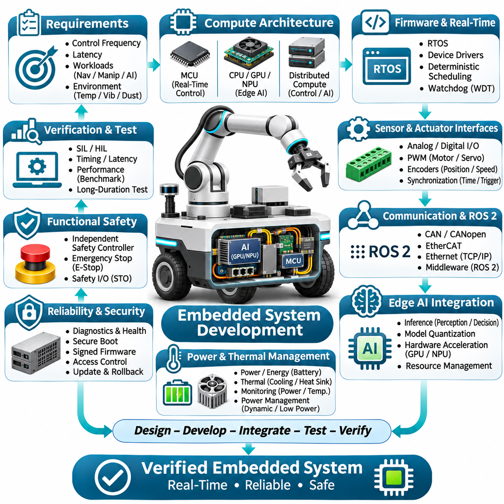{width="7.268055555555556in" height="7.268055555555556in"}

Embedded system development establishes the computational and control infrastructure required for reliable mobile manipulator operation. Embedded systems connect physical hardware with higher-level software applications by executing real-time control, sensor acquisition, actuator coordination, communication, and diagnostic functions. Their development directly influences system responsiveness, operational stability, energy efficiency, and safety.

The development process begins with the analysis of functional requirements, computational workloads, control frequencies, communication latency, and environmental constraints. Engineers must determine the processing resources required for autonomous navigation, manipulation control, sensor processing, artificial intelligence inference, and system monitoring. These requirements establish the foundation for embedded hardware and software selection.

Embedded computing architecture typically incorporates microcontrollers, industrial computers, system-on-module platforms, and specialized processing accelerators. Microcontrollers support deterministic low-level control, while high-performance computing platforms execute perception, localization, motion planning, and artificial intelligence workloads. Distributed computing architectures enable efficient workload allocation and functional separation.

Processor selection requires careful evaluation of computational performance, memory capacity, hardware acceleration, power consumption, thermal characteristics, and peripheral interfaces. Central processing units, graphics processing units, and neural processing units provide different computational capabilities. Hardware selection must balance application performance, energy efficiency, component availability, and long-term product support.

Real-time embedded control is essential for coordinating traction motors, steering actuators, robotic joints, and auxiliary mechanisms. Control algorithms must execute within defined timing constraints to maintain stable and predictable physical behavior. Real-time operating systems, deterministic scheduling mechanisms, interrupt management, and prioritized execution support reliable control under varying computational workloads.

Embedded firmware development establishes the low-level software functions required to operate physical hardware components. Device drivers, peripheral initialization, communication handlers, actuator interfaces, and hardware monitoring functions must be implemented according to system requirements. Modular firmware architecture facilitates hardware abstraction, software reuse, functional verification, and future hardware upgrades.

Sensor and actuator interfacing enables embedded controllers to acquire measurement data and transmit control commands efficiently. Analog inputs, digital inputs and outputs, pulse-width modulation, encoder interfaces, and industrial communication protocols support diverse hardware configurations. Interface development must address signal accuracy, sampling frequency, synchronization, electrical compatibility, and fault detection.

Embedded communication architecture connects distributed controllers, motor drives, battery management systems, perception devices, and supervisory computing platforms. CAN, CANopen, EtherCAT, Ethernet, and serial communication interfaces may be employed according to application requirements. Communication software must manage message prioritization, transmission latency, data integrity, timeout detection, and recovery mechanisms.

Edge artificial intelligence integration enables mobile manipulators to execute perception and decision-making workloads directly on embedded computing platforms. Hardware acceleration, model quantization, inference optimization, and efficient memory management reduce computational latency and energy consumption. AI workloads must be coordinated with control and safety-related functions to prevent resource contention and performance degradation.

Embedded software architecture should provide structured separation between hardware abstraction, device drivers, middleware, control algorithms, and application-level services. Frameworks such as ROS 2 can facilitate communication between distributed robotic software components. Clearly defined interfaces, standardized data structures, and modular software components improve system scalability, maintainability, and development efficiency.

Power and thermal management are critical because embedded computing platforms operate within limited battery capacity and constrained mechanical packaging. Engineers must evaluate processor utilization, power consumption, heat generation, cooling effectiveness, and environmental temperature variations. Dynamic power management and thermal monitoring can improve operational endurance while maintaining required computational performance.

Embedded system reliability requires mechanisms for detecting abnormal operating conditions and recovering from recoverable hardware or software failures. Watchdog timers, heartbeat monitoring, memory protection, communication diagnostics, and controlled restart procedures support operational robustness. Critical failures must trigger predefined protective responses rather than uncontrolled changes in robotic behavior.

Embedded cybersecurity protects robotic controllers, communication interfaces, firmware, and operational data against unauthorized access and malicious modification. Secure boot, authenticated communication, access control, signed firmware, and protected credential storage should be incorporated according to system security requirements. Software update mechanisms must support integrity verification and controlled rollback procedures.

Safety-related embedded system development requires separation between conventional computing functions and safety-critical control mechanisms. Safety controllers, emergency stop interfaces, protective monitoring, and actuator shutdown functions must operate according to application-specific risk assessments. Artificial intelligence processing or general-purpose software failures must not compromise independently implemented safety functions.

Embedded system verification requires firmware testing, interface validation, timing analysis, computational performance benchmarking, and reliability assessment. Software-in-the-Loop and Hardware-in-the-Loop testing enable controlled evaluation of representative operating scenarios and fault conditions. Long-duration prototype testing should assess computational stability, response latency, thermal behavior, and recovery performance.

The embedded system development process concludes with a verified hardware and software baseline supported by processor specifications, circuit documentation, firmware source code, interface definitions, configuration records, and test results. The approved configuration establishes traceability between system requirements and verified performance while supporting subsequent AI development, system integration, manufacturing, and lifecycle maintenance.

임베디드 시스템 개발(Embedded System Development)은 모바일 매니퓰레이터(Mobile Manipulator)의 신뢰성 높은 운용에 필요한 연산 및 제어 인프라(Computational and Control Infrastructure)를 확립한다. 임베디드 시스템(Embedded System)은 실시간 제어(Real-Time Control), 센서 데이터 획득(Sensor Acquisition), 액추에이터 조정(Actuator Coordination), 통신(Communication) 및 진단 기능(Diagnostic Function)을 실행함으로써 물리적 하드웨어와 상위 수준의 소프트웨어 애플리케이션(Higher-Level Software Application)을 연결한다. 이러한 개발은 시스템 응답성(System Responsiveness), 운용 안정성(Operational Stability), 에너지 효율성(Energy Efficiency) 및 안전성(Safety)에 직접적인 영향을 미친다.

개발 프로세스는 기능적 요구사항(Functional Requirements), 연산 작업 부하(Computational Workload), 제어 주파수(Control Frequency), 통신 지연시간(Communication Latency) 및 환경적 제약조건(Environmental Constraint)에 대한 분석으로부터 시작된다. 엔지니어는 자율주행(Autonomous Navigation), 조작 제어(Manipulation Control), 센서 데이터 처리(Sensor Processing), 인공지능 추론(AI Inference) 및 시스템 모니터링(System Monitoring)에 필요한 연산 자원(Processing Resource)을 결정해야 한다. 이러한 요구사항은 임베디드 하드웨어 및 소프트웨어 선정(Embedded Hardware and Software Selection)을 위한 기반을 확립한다.

임베디드 컴퓨팅 아키텍처(Embedded Computing Architecture)는 일반적으로 마이크로컨트롤러(MCU, Microcontroller), 산업용 컴퓨터(Industrial Computer), 시스템 온 모듈(SoM, System-on-Module) 플랫폼 및 특수 연산 가속기(Specialized Processing Accelerator)를 포함한다. 마이크로컨트롤러는 결정론적 저수준 제어(Deterministic Low-Level Control)를 지원하는 반면, 고성능 컴퓨팅 플랫폼(High-Performance Computing Platform)은 인지(Perception), 위치 추정(Localization), 모션 계획(Motion Planning) 및 인공지능 작업 부하(AI Workload)를 처리한다. 분산 컴퓨팅 아키텍처(Distributed Computing Architecture)는 효율적인 작업 부하 할당(Workload Allocation) 및 기능적 분리(Functional Separation)를 가능하게 한다.

프로세서 선정(Processor Selection)은 연산 성능(Computational Performance), 메모리 용량(Memory Capacity), 하드웨어 가속(Hardware Acceleration), 전력 소비량(Power Consumption), 열적 특성(Thermal Characteristic) 및 주변 장치 인터페이스(Peripheral Interface)에 대한 신중한 평가를 필요로 한다. 중앙 처리 장치(CPU, Central Processing Unit), 그래픽 처리 장치(GPU, Graphics Processing Unit) 및 신경망 처리 장치(NPU, Neural Processing Unit)는 서로 다른 연산 능력(Computational Capability)을 제공한다. 하드웨어 선정(Hardware Selection)은 애플리케이션 성능(Application Performance), 에너지 효율성, 구성 요소 가용성(Component Availability) 및 장기적인 제품 지원(Long-Term Product Support) 사이의 균형을 유지해야 한다.

실시간 임베디드 제어(Real-Time Embedded Control)는 주행 모터(Traction Motor), 조향 액추에이터(Steering Actuator), 로봇 관절(Robotic Joint) 및 보조 메커니즘(Auxiliary Mechanism)을 조정하는 데 필수적이다. 제어 알고리즘(Control Algorithm)은 안정적이고 예측 가능한 물리적 동작(Physical Behavior)을 유지하기 위해 정의된 시간 제약조건(Timing Constraint) 내에서 실행되어야 한다. 실시간 운영체제(RTOS, Real-Time Operating System), 결정론적 스케줄링 메커니즘(Deterministic Scheduling Mechanism), 인터럽트 관리(Interrupt Management) 및 우선순위 기반 실행(Prioritized Execution)은 변화하는 연산 작업 부하에서도 신뢰성 높은 제어를 지원한다.

임베디드 펌웨어 개발(Embedded Firmware Development)은 물리적 하드웨어 구성 요소를 작동시키는 데 필요한 저수준 소프트웨어 기능(Low-Level Software Function)을 확립한다. 장치 드라이버(Device Driver), 주변 장치 초기화(Peripheral Initialization), 통신 처리기(Communication Handler), 액추에이터 인터페이스(Actuator Interface) 및 하드웨어 모니터링 기능(Hardware Monitoring Function)은 시스템 요구사항에 따라 구현되어야 한다. 모듈형 펌웨어 아키텍처(Modular Firmware Architecture)는 하드웨어 추상화(Hardware Abstraction), 소프트웨어 재사용(Software Reuse), 기능 검증(Functional Verification) 및 향후 하드웨어 업그레이드(Hardware Upgrade)를 용이하게 한다.

센서 및 액추에이터 인터페이스 구현(Sensor and Actuator Interfacing)은 임베디드 제어기(Embedded Controller)가 측정 데이터(Measurement Data)를 획득하고 제어 명령(Control Command)을 효율적으로 전송할 수 있도록 한다. 아날로그 입력(Analog Input), 디지털 입출력(Digital Input and Output), 펄스 폭 변조(PWM, Pulse-Width Modulation), 엔코더 인터페이스(Encoder Interface) 및 산업용 통신 프로토콜(Industrial Communication Protocol)은 다양한 하드웨어 구성을 지원한다. 인터페이스 개발(Interface Development)은 신호 정확도(Signal Accuracy), 샘플링 주파수(Sampling Frequency), 동기화(Synchronization), 전기적 호환성(Electrical Compatibility) 및 고장 감지(Fault Detection)를 고려해야 한다.

임베디드 통신 아키텍처(Embedded Communication Architecture)는 분산 제어기(Distributed Controller), 모터 드라이브(Motor Drive), 배터리 관리 시스템(BMS, Battery Management System), 인지 장치(Perception Device) 및 상위 감독 컴퓨팅 플랫폼(Supervisory Computing Platform)을 연결한다. CAN, CANopen, EtherCAT, 이더넷(Ethernet) 및 직렬 통신 인터페이스(Serial Communication Interface)는 애플리케이션 요구사항에 따라 적용될 수 있다. 통신 소프트웨어(Communication Software)는 메시지 우선순위 관리(Message Prioritization), 전송 지연시간(Transmission Latency), 데이터 무결성(Data Integrity), 타임아웃 감지(Timeout Detection) 및 복구 메커니즘(Recovery Mechanism)을 관리해야 한다.

엣지 인공지능 통합(Edge AI Integration)은 모바일 매니퓰레이터가 인지 및 의사결정 작업 부하(Perception and Decision-Making Workload)를 임베디드 컴퓨팅 플랫폼에서 직접 처리할 수 있도록 한다. 하드웨어 가속(Hardware Acceleration), 모델 양자화(Model Quantization), 추론 최적화(Inference Optimization) 및 효율적인 메모리 관리(Memory Management)는 연산 지연시간(Computational Latency)과 에너지 소비량(Energy Consumption)을 감소시킨다. 인공지능 작업 부하는 자원 경합(Resource Contention)과 성능 저하(Performance Degradation)를 방지하기 위해 제어 및 안전 관련 기능(Safety-Related Function)과 유기적으로 조정되어야 한다.

임베디드 소프트웨어 아키텍처(Embedded Software Architecture)는 하드웨어 추상화(Hardware Abstraction), 장치 드라이버(Device Driver), 미들웨어(Middleware), 제어 알고리즘(Control Algorithm) 및 애플리케이션 수준 서비스(Application-Level Service) 사이의 체계적인 분리를 제공해야 한다. ROS 2(Robot Operating System 2)와 같은 프레임워크(Framework)는 분산된 로봇 소프트웨어 구성 요소(Distributed Robotic Software Component) 사이의 통신을 용이하게 한다. 명확하게 정의된 인터페이스(Interface), 표준화된 데이터 구조(Standardized Data Structure) 및 모듈형 소프트웨어 구성 요소(Modular Software Component)는 시스템 확장성(System Scalability), 유지보수성(Maintainability) 및 개발 효율성(Development Efficiency)을 향상시킨다.

전력 및 열 관리(Power and Thermal Management)는 임베디드 컴퓨팅 플랫폼이 제한된 배터리 용량(Battery Capacity)과 기계적 패키징 공간(Mechanical Packaging Space) 내에서 작동하기 때문에 매우 중요하다. 엔지니어는 프로세서 사용률(Processor Utilization), 전력 소비량(Power Consumption), 발열량(Heat Generation), 냉각 효과(Cooling Effectiveness) 및 환경 온도 변화(Environmental Temperature Variation)를 평가해야 한다. 동적 전력 관리(Dynamic Power Management)와 열 모니터링(Thermal Monitoring)은 요구되는 연산 성능을 유지하면서 운용 지속 시간(Operational Endurance)을 향상시킬 수 있다.

임베디드 시스템 신뢰성(Embedded System Reliability)은 비정상 운용 조건(Abnormal Operating Condition)을 감지하고 복구 가능한 하드웨어 또는 소프트웨어 고장(Hardware or Software Failure)으로부터 복구하기 위한 메커니즘을 필요로 한다. 워치독 타이머(Watchdog Timer), 하트비트 모니터링(Heartbeat Monitoring), 메모리 보호(Memory Protection), 통신 진단(Communication Diagnostics) 및 제어된 재시작 절차(Controlled Restart Procedure)는 운용 강건성(Operational Robustness)을 지원한다. 치명적인 고장(Critical Failure)이 발생하면 제어되지 않은 로봇 동작 변화가 아니라 사전에 정의된 보호 응답(Predefined Protective Response)이 실행되어야 한다.

임베디드 사이버 보안(Embedded Cybersecurity)은 무단 접근(Unauthorized Access)과 악의적인 변경(Malicious Modification)으로부터 로봇 제어기(Robotic Controller), 통신 인터페이스, 펌웨어(Firmware) 및 운용 데이터(Operational Data)를 보호한다. 보안 부팅(Secure Boot), 인증된 통신(Authenticated Communication), 접근 제어(Access Control), 디지털 서명된 펌웨어(Signed Firmware) 및 보호된 인증 정보 저장(Protected Credential Storage)은 시스템 보안 요구사항(System Security Requirements)에 따라 적용되어야 한다. 소프트웨어 업데이트 메커니즘(Software Update Mechanism)은 무결성 검증(Integrity Verification)과 제어된 롤백 절차(Controlled Rollback Procedure)를 지원해야 한다.

안전 관련 임베디드 시스템 개발(Safety-Related Embedded System Development)은 일반적인 컴퓨팅 기능(Conventional Computing Function)과 안전 필수 제어 메커니즘(Safety-Critical Control Mechanism) 사이의 분리를 필요로 한다. 안전 제어기(Safety Controller), 비상 정지 인터페이스(Emergency Stop Interface), 보호 모니터링(Protective Monitoring) 및 액추에이터 작동 차단 기능(Actuator Shutdown Function)은 적용 분야별 위험성 평가(Application-Specific Risk Assessment)에 따라 작동해야 한다. 인공지능 연산 또는 범용 소프트웨어(General-Purpose Software)의 고장이 독립적으로 구현된 안전 기능(Independently Implemented Safety Function)을 저해해서는 안 된다.

임베디드 시스템 검증(Embedded System Verification)은 펌웨어 시험(Firmware Testing), 인터페이스 검증(Interface Validation), 타이밍 분석(Timing Analysis), 연산 성능 벤치마킹(Computational Performance Benchmarking) 및 신뢰성 평가(Reliability Assessment)를 필요로 한다. 소프트웨어 인 더 루프(SIL, Software-in-the-Loop) 및 하드웨어 인 더 루프(HIL, Hardware-in-the-Loop) 시험은 대표적인 운용 시나리오(Operational Scenario)와 고장 조건(Fault Condition)에 대한 통제된 평가를 가능하게 한다. 장시간 시제품 시험(Long-Duration Prototype Testing)은 연산 안정성(Computational Stability), 응답 지연시간(Response Latency), 열적 거동(Thermal Behavior) 및 복구 성능(Recovery Performance)을 평가해야 한다.

임베디드 시스템 개발 프로세스는 프로세서 사양(Processor Specification), 회로 설계 문서(Circuit Documentation), 펌웨어 소스 코드(Firmware Source Code), 인터페이스 정의(Interface Definition), 구성 기록(Configuration Record) 및 시험 결과(Test Result)를 기반으로 검증된 하드웨어 및 소프트웨어 기준선(Verified Hardware and Software Baseline)을 확립함으로써 마무리된다. 승인된 시스템 구성(Approved Configuration)은 시스템 요구사항과 검증된 성능 사이의 추적성(Traceability)을 확보하는 동시에 이후의 인공지능 개발(AI Development), 시스템 통합(System Integration), 제조(Manufacturing) 및 수명주기 유지보수(Lifecycle Maintenance)를 지원한다.

##  

## 10 CAD Design

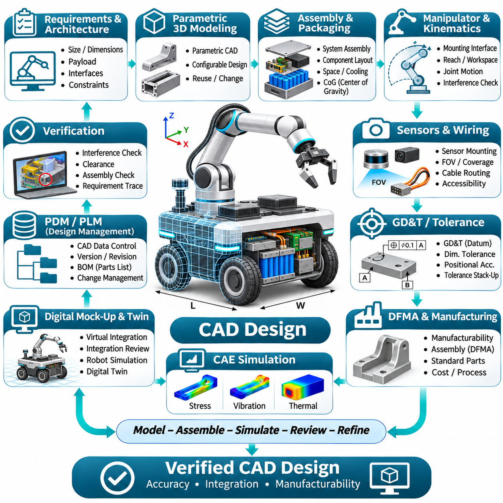{width="7.268055555555556in" height="7.268055555555556in"}

Computer-Aided Design (CAD) is a fundamental engineering activity that establishes the digital representation of a mobile manipulator throughout its hardware development lifecycle. CAD models define mechanical structures, component geometries, assembly relationships, installation interfaces, and physical packaging constraints. These digital representations support coordinated development, engineering analysis, prototype fabrication, and manufacturing preparation.

The CAD design process begins with the analysis of system requirements, mechanical architecture, hardware specifications, and operational constraints. Engineers establish platform dimensions, payload requirements, manipulator installation positions, sensor mounting locations, and maintenance accessibility. These requirements provide the foundation for geometric modeling, component development, and assembly configuration.

Parametric three-dimensional modeling enables engineers to define component geometries using dimensions, geometric constraints, mathematical relationships, and configurable design parameters. Structural frames, mounting brackets, protective enclosures, mechanical interfaces, and customized components can be systematically developed and modified. Parametric modeling improves design flexibility, geometric consistency, and engineering change efficiency.

Assembly-level CAD design establishes the spatial and functional relationships between the autonomous mobile robot base, robotic manipulator, battery system, drive mechanisms, sensors, and electronic equipment. Assembly models allow engineers to evaluate component positioning, mechanical compatibility, installation procedures, and structural relationships before physical prototypes are manufactured.

Mechanical packaging design optimizes the arrangement of hardware components within the available installation volume. Engineers must consider component dimensions, weight distribution, center of gravity, cooling requirements, electrical connectivity, and maintenance accessibility. Effective packaging reduces unnecessary platform dimensions while preserving operational stability, structural integrity, and opportunities for future expansion.

Manipulator integration requires precise geometric definition of the robot mounting interface, installation orientation, working envelope, and structural attachment points. CAD models enable engineers to evaluate relationships between manipulator reachability, platform dimensions, payload distribution, and surrounding structures. The integrated geometry should support representative manipulation tasks without introducing unacceptable mechanical interference.

Kinematic representation within CAD environments enables the evaluation of steering mechanisms, suspension systems, robotic joints, and movable assemblies. Joint constraints, rotational limits, translational movements, and mechanical relationships can be defined to reproduce representative hardware configurations. Motion studies help identify geometric interference, insufficient clearance, restricted movement, and potential assembly conflicts.

Sensor and electrical component integration requires coordinated modeling of mounting structures, optical fields of view, connector orientations, and cable routing pathways. Engineers must evaluate potential sensor occlusion caused by structural components, robotic arm movements, and transported objects. Accurate geometric representations support sensor positioning, electrical packaging, calibration accessibility, and wiring harness development.

Structural design within CAD environments establishes load-bearing components capable of supporting operational forces and mechanical constraints. Engineers develop chassis frames, reinforcement structures, manipulator mounting plates, and equipment support mechanisms according to anticipated loading conditions. Material properties, component thickness, connection geometry, and structural arrangements provide essential inputs for subsequent engineering analysis.

Geometric Dimensioning and Tolerancing (GD&T) defines the dimensional accuracy and geometric relationships required for reliable component manufacturing and assembly. Engineers must establish appropriate datums, dimensional tolerances, positional accuracy, flatness, perpendicularity, and other geometric requirements. Tolerance stack-up analysis helps evaluate accumulated manufacturing variations across interconnected mechanical interfaces.

Design for Manufacturing and Assembly (DFMA) should be incorporated throughout the CAD development process. Component geometries must reflect available manufacturing technologies, material characteristics, machining accessibility, fabrication constraints, and assembly requirements. Standardized fasteners, simplified structures, reduced component counts, and accessible installation interfaces improve production efficiency and minimize manufacturing complexity.

CAD integration with Computer-Aided Engineering (CAE) enables geometric models to serve as the foundation for structural, thermal, vibration, and dynamic simulation. Engineers can evaluate stress distribution, mechanical deformation, natural frequencies, thermal behavior, and stability under representative operating conditions. Simulation results support iterative geometric modifications before physical prototype development.

Digital mock-up development enables multidisciplinary engineering teams to evaluate the complete mobile manipulator configuration within a shared virtual environment. Mechanical, electrical, embedded system, and robotics engineers can identify integration conflicts and coordinate design changes before fabrication. Digital mock-ups also provide geometric foundations for robotic simulation, virtual commissioning, and digital twin development.

CAD data management establishes controlled procedures for component identification, revision management, assembly configuration, and engineering change tracking. Product Data Management (PDM) and Product Lifecycle Management (PLM) systems facilitate the organization and distribution of approved engineering information. Controlled design baselines reduce configuration inconsistencies and maintain traceability throughout product development.

CAD design verification requires dimensional inspection, assembly compatibility assessment, interference detection, motion envelope evaluation, and manufacturing feasibility reviews. Multidisciplinary design reviews should assess structural arrangements, electrical packaging, component accessibility, safety clearances, and maintenance procedures. Identified deficiencies must be resolved through controlled engineering changes before design release.

The CAD design process concludes with an approved engineering baseline supported by three-dimensional component models, assembly models, manufacturing drawings, material specifications, tolerance definitions, and bills of materials. The verified digital configuration establishes traceability between mechanical requirements and physical design while supporting CAE analysis, prototype fabrication, design optimization, manufacturing, and lifecycle management.

컴퓨터 지원 설계(CAD, Computer-Aided Design)는 모바일 매니퓰레이터(Mobile Manipulator)의 전체 하드웨어 개발 수명주기(Hardware Development Lifecycle)에 걸쳐 디지털 표현 모델(Digital Representation)을 확립하는 핵심적인 엔지니어링 활동이다. CAD 모델은 기계적 구조(Mechanical Structure), 구성 요소 형상(Component Geometry), 조립 관계(Assembly Relationship), 설치 인터페이스(Installation Interface) 및 물리적 패키징 제약조건(Physical Packaging Constraint)을 정의한다. 이러한 디지털 표현 모델은 유기적인 개발, 엔지니어링 해석(Engineering Analysis), 시제품 제작(Prototype Fabrication) 및 제조 준비(Manufacturing Preparation)를 지원한다.

CAD 설계 프로세스는 시스템 요구사항(System Requirements), 기계적 아키텍처(Mechanical Architecture), 하드웨어 사양(Hardware Specification) 및 운용 제약조건(Operational Constraint)에 대한 분석으로부터 시작된다. 엔지니어는 플랫폼 치수(Platform Dimension), 적재 하중 요구사항(Payload Requirements), 매니퓰레이터 설치 위치(Manipulator Installation Position), 센서 장착 위치(Sensor Mounting Location) 및 유지보수 접근성(Maintenance Accessibility)을 확립한다. 이러한 요구사항은 기하학적 모델링(Geometric Modeling), 구성 요소 개발(Component Development) 및 조립 구성(Assembly Configuration)을 위한 기반을 제공한다.

파라메트릭 3차원 모델링(Parametric 3D Modeling)은 엔지니어가 치수(Dimension), 기하학적 구속조건(Geometric Constraint), 수학적 관계(Mathematical Relationship) 및 구성 가능한 설계 파라미터(Configurable Design Parameter)를 사용하여 구성 요소의 형상을 정의할 수 있도록 한다. 구조 프레임(Structural Frame), 장착 브래킷(Mounting Bracket), 보호 하우징(Protective Enclosure), 기계적 인터페이스(Mechanical Interface) 및 맞춤형 구성 요소(Customized Component)를 체계적으로 개발하고 수정할 수 있다. 파라메트릭 모델링은 설계 유연성(Design Flexibility), 기하학적 일관성(Geometric Consistency) 및 엔지니어링 변경 효율성(Engineering Change Efficiency)을 향상시킨다.

어셈블리 수준의 CAD 설계(Assembly-Level CAD Design)는 자율 이동 로봇 베이스(AMR Base, Autonomous Mobile Robot Base), 로봇 매니퓰레이터(Robotic Manipulator), 배터리 시스템(Battery System), 구동 메커니즘(Drive Mechanism), 센서(Sensor) 및 전자 장비(Electronic Equipment) 사이의 공간적 및 기능적 관계(Spatial and Functional Relationship)를 확립한다. 어셈블리 모델(Assembly Model)은 물리적 시제품이 제작되기 전에 구성 요소 배치(Component Positioning), 기계적 호환성(Mechanical Compatibility), 설치 절차(Installation Procedure) 및 구조적 관계(Structural Relationship)를 평가할 수 있도록 한다.

기계적 패키징 설계(Mechanical Packaging Design)는 사용 가능한 설치 공간(Installation Volume) 내에서 하드웨어 구성 요소의 배치를 최적화한다. 엔지니어는 구성 요소 치수(Component Dimension), 중량 분포(Weight Distribution), 무게중심(Center of Gravity), 냉각 요구사항(Cooling Requirements), 전기적 연결성(Electrical Connectivity) 및 유지보수 접근성을 고려해야 한다. 효과적인 패키징 설계는 운용 안정성(Operational Stability), 구조적 건전성(Structural Integrity) 및 향후 확장 가능성(Future Expansion Capability)을 유지하면서 불필요한 플랫폼 크기를 감소시킨다.

매니퓰레이터 통합(Manipulator Integration)은 로봇 장착 인터페이스(Robot Mounting Interface), 설치 방향(Installation Orientation), 작업 영역(Working Envelope) 및 구조적 체결 지점(Structural Attachment Point)에 대한 정밀한 기하학적 정의(Geometric Definition)를 필요로 한다. CAD 모델은 엔지니어가 매니퓰레이터 도달 가능성(Manipulator Reachability), 플랫폼 치수, 적재 하중 분포(Payload Distribution) 및 주변 구조물(Surrounding Structure) 사이의 관계를 평가할 수 있도록 한다. 통합된 기하학적 구조(Integrated Geometry)는 허용할 수 없는 기계적 간섭(Mechanical Interference)을 발생시키지 않으면서 대표적인 조작 작업을 지원해야 한다.

CAD 환경에서의 기구학적 표현(Kinematic Representation)은 조향 메커니즘(Steering Mechanism), 현가 시스템(Suspension System), 로봇 관절(Robotic Joint) 및 가동형 어셈블리(Movable Assembly)에 대한 평가를 가능하게 한다. 관절 구속조건(Joint Constraint), 회전 한계(Rotational Limit), 병진 운동(Translational Movement) 및 기계적 관계(Mechanical Relationship)를 정의하여 대표적인 하드웨어 구성을 재현할 수 있다. 모션 분석(Motion Study)은 기하학적 간섭(Geometric Interference), 불충분한 여유 공간(Insufficient Clearance), 제한된 움직임(Restricted Movement) 및 잠재적인 조립 충돌(Assembly Conflict)을 식별하는 데 기여한다.

센서 및 전기 구성 요소 통합(Sensor and Electrical Component Integration)은 장착 구조물(Mounting Structure), 광학적 시야각(Optical Field of View), 커넥터 방향(Connector Orientation) 및 케이블 경로(Cable Routing Pathway)에 대한 유기적인 모델링을 필요로 한다. 엔지니어는 구조적 구성 요소, 로봇 팔의 움직임 및 운송 중인 물체로 인해 발생할 수 있는 센서 가림 현상(Sensor Occlusion)을 평가해야 한다. 정확한 기하학적 표현(Geometric Representation)은 센서 배치(Sensor Positioning), 전기 시스템 패키징(Electrical Packaging), 보정 접근성(Calibration Accessibility) 및 와이어링 하네스 개발(Wiring Harness Development)을 지원한다.

CAD 환경에서의 구조 설계(Structural Design)는 운용 중 발생하는 힘(Operational Force)과 기계적 제약조건(Mechanical Constraint)을 수용할 수 있는 하중 지지 구성 요소(Load-Bearing Component)를 확립한다. 엔지니어는 예상 하중 조건(Anticipated Loading Condition)에 따라 섀시 프레임(Chassis Frame), 보강 구조물(Reinforcement Structure), 매니퓰레이터 장착 플레이트(Manipulator Mounting Plate) 및 장비 지지 메커니즘(Equipment Support Mechanism)을 개발한다. 재료 물성(Material Property), 구성 요소 두께(Component Thickness), 연결부 형상(Connection Geometry) 및 구조적 배치(Structural Arrangement)는 후속 엔지니어링 해석을 위한 핵심 입력 정보를 제공한다.

기하 치수 및 공차(GD&T, Geometric Dimensioning and Tolerancing)는 신뢰성 높은 구성 요소 제조 및 조립에 필요한 치수 정확도(Dimensional Accuracy)와 기하학적 관계(Geometric Relationship)를 정의한다. 엔지니어는 적절한 데이텀(Datum), 치수 공차(Dimensional Tolerance), 위치 정확도(Positional Accuracy), 평면도(Flatness), 직각도(Perpendicularity) 및 기타 기하학적 요구사항(Geometric Requirements)을 설정해야 한다. 공차 누적 분석(Tolerance Stack-Up Analysis)은 상호 연결된 기계적 인터페이스 전반에서 발생하는 누적 제조 편차(Accumulated Manufacturing Variation)를 평가하는 데 기여한다.

제조 및 조립을 고려한 설계(DFMA, Design for Manufacturing and Assembly)는 전체 CAD 개발 프로세스에 걸쳐 반영되어야 한다. 구성 요소의 형상은 사용 가능한 제조 기술(Manufacturing Technology), 재료 특성(Material Characteristic), 기계 가공 접근성(Machining Accessibility), 제작 제약조건(Fabrication Constraint) 및 조립 요구사항(Assembly Requirements)을 반영해야 한다. 표준화된 체결 부품(Standardized Fastener), 단순화된 구조(Simplified Structure), 구성 요소 수량 감소(Reduced Component Count) 및 접근성이 높은 설치 인터페이스(Accessible Installation Interface)는 생산 효율성(Production Efficiency)을 향상시키고 제조 복잡성(Manufacturing Complexity)을 최소화한다.

CAD와 컴퓨터 지원 엔지니어링(CAE, Computer-Aided Engineering)의 통합은 기하학적 모델(Geometric Model)이 구조(Structural), 열(Thermal), 진동(Vibration) 및 동역학 시뮬레이션(Dynamic Simulation)의 기반으로 활용될 수 있도록 한다. 엔지니어는 대표적인 운용 조건에서 응력 분포(Stress Distribution), 기계적 변형(Mechanical Deformation), 고유 진동수(Natural Frequency), 열적 거동(Thermal Behavior) 및 안정성(Stability)을 평가할 수 있다. 시뮬레이션 결과(Simulation Result)는 물리적 시제품 개발 이전에 반복적인 형상 수정(Iterative Geometric Modification)을 지원한다.

디지털 목업 개발(DMU, Digital Mock-Up Development)은 다분야 엔지니어링 팀(Multidisciplinary Engineering Team)이 공유 가상 환경(Shared Virtual Environment) 내에서 전체 모바일 매니퓰레이터의 구성을 평가할 수 있도록 한다. 기계(Mechanical), 전기(Electrical), 임베디드 시스템(Embedded System) 및 로보틱스(Robotics) 엔지니어는 실제 제작 이전에 통합 충돌(Integration Conflict)을 식별하고 설계 변경(Design Change)을 조정할 수 있다. 디지털 목업은 로봇 시뮬레이션(Robotic Simulation), 가상 시운전(Virtual Commissioning) 및 디지털 트윈 개발(Digital Twin Development)을 위한 기하학적 기반(Geometric Foundation)도 제공한다.

CAD 데이터 관리(CAD Data Management)는 구성 요소 식별(Component Identification), 개정 관리(Revision Management), 어셈블리 구성(Assembly Configuration) 및 엔지니어링 변경 추적(Engineering Change Tracking)을 위한 통제된 절차를 확립한다. 제품 데이터 관리(PDM, Product Data Management) 및 제품 수명주기 관리(PLM, Product Lifecycle Management) 시스템은 승인된 엔지니어링 정보(Approved Engineering Information)의 체계적인 구성과 배포를 용이하게 한다. 통제된 설계 기준선(Controlled Design Baseline)은 구성 불일치(Configuration Inconsistency)를 감소시키고 전체 제품 개발 과정에서 추적성(Traceability)을 유지한다.

CAD 설계 검증(CAD Design Verification)은 치수 검사(Dimensional Inspection), 조립 호환성 평가(Assembly Compatibility Assessment), 간섭 검출(Interference Detection), 동작 영역 평가(Motion Envelope Evaluation) 및 제조 타당성 검토(Manufacturing Feasibility Review)를 필요로 한다. 다분야 설계 검토(Multidisciplinary Design Review)는 구조적 배치, 전기 시스템 패키징, 구성 요소 접근성(Component Accessibility), 안전 여유 공간(Safety Clearance) 및 유지보수 절차(Maintenance Procedure)를 평가해야 한다. 식별된 설계 결함(Design Deficiency)은 설계 출도(Design Release) 이전에 통제된 엔지니어링 변경(Controlled Engineering Change)을 통해 해결되어야 한다.

CAD 설계 프로세스는 3차원 구성 요소 모델(3D Component Model), 어셈블리 모델(Assembly Model), 제조 도면(Manufacturing Drawing), 재료 사양(Material Specification), 공차 정의(Tolerance Definition) 및 자재 명세서(BOM, Bill of Materials)를 기반으로 승인된 엔지니어링 기준선(Approved Engineering Baseline)을 확립함으로써 마무리된다. 검증된 디지털 구성(Verified Digital Configuration)은 기계적 요구사항(Mechanical Requirements)과 물리적 설계(Physical Design) 사이의 추적성을 확보하는 동시에 이후의 CAE 해석(CAE Analysis), 시제품 제작(Prototype Fabrication), 설계 최적화(Design Optimization), 제조(Manufacturing) 및 수명주기 관리(Lifecycle Management)를 지원한다.

##  

## 11 CAE and Simulation

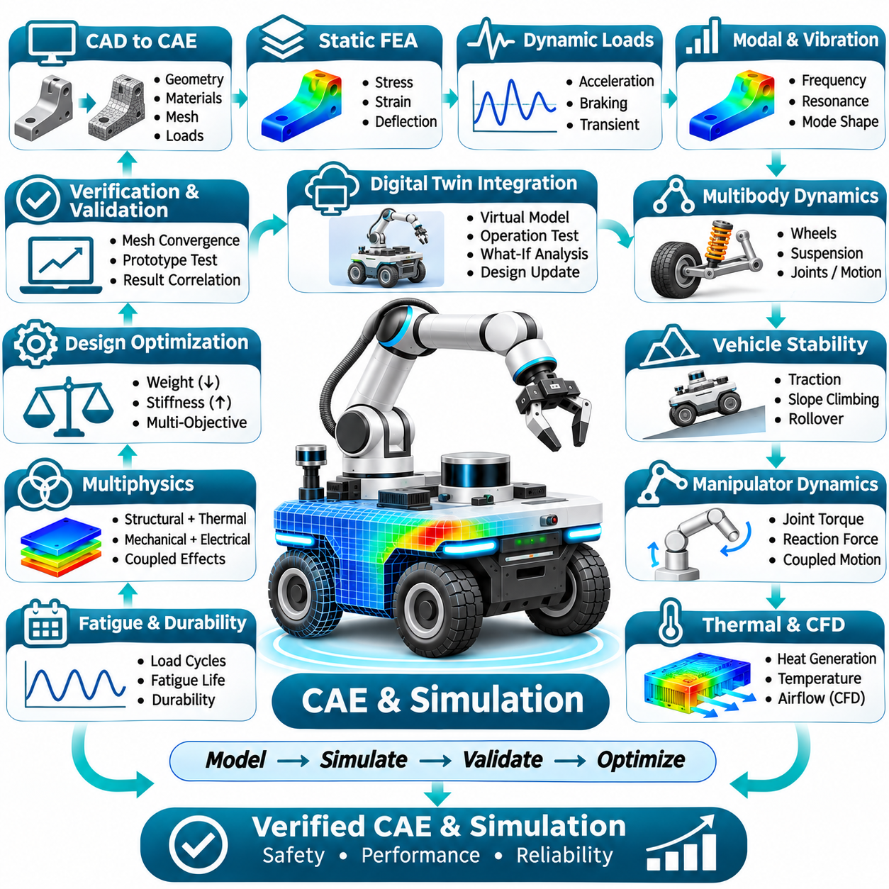{width="7.268055555555556in" height="7.268055555555556in"}

Computer-Aided Engineering (CAE) and simulation provide a systematic approach to evaluating the physical performance of mobile manipulators before prototype fabrication. Engineering simulations enable developers to investigate structural integrity, mechanical deformation, dynamic behavior, thermal characteristics, and operational stability. These capabilities reduce development risks, physical testing requirements, and engineering modification costs.

The CAE development process begins with the transformation of Computer-Aided Design (CAD) models into computational representations suitable for engineering analysis. Geometric simplification, material assignment, mesh generation, boundary condition definition, and load specification establish the foundation for numerical simulation. Model accuracy and computational efficiency must be balanced according to analysis objectives.

Finite Element Analysis (FEA) enables engineers to evaluate stress distribution, strain, displacement, and structural deformation within mechanical components. Chassis frames, manipulator mounting structures, suspension components, and equipment support brackets must withstand anticipated operational loads. Structural simulation helps identify stress concentrations, insufficient stiffness, excessive deformation, and potential mechanical failure.

Static structural analysis evaluates mechanical behavior under stationary or slowly changing loading conditions. Representative load cases include battery weight, manipulator mass, transported payloads, and forces generated during robotic manipulation. Engineers must assess structural deformation, stress levels, mounting interface stiffness, and safety factors to determine whether the proposed design satisfies mechanical requirements.

Dynamic structural analysis investigates mechanical responses generated by acceleration, deceleration, emergency braking, manipulator motion, and external disturbances. Transient forces and inertial effects can introduce significant loads that are not represented by static calculations. Dynamic simulation enables engineers to evaluate structural responses under realistic operating scenarios and identify potential mechanical weaknesses.

Modal and vibration analysis determine the natural frequencies, vibration modes, and dynamic characteristics of mechanical structures. Mobile manipulators may experience excitation from traction motors, wheel rotation, uneven surfaces, and robotic joint movements. Engineers must identify potential resonance conditions that could degrade positioning accuracy, sensor measurements, structural durability, and manipulation performance.

Multibody Dynamics (MBD) simulation enables the analysis of interconnected mechanical components, including wheels, steering mechanisms, suspension systems, robotic joints, and movable assemblies. Computational models represent mass properties, inertial characteristics, joint constraints, actuator forces, and mechanical interactions. These simulations support motion analysis, actuator sizing, load prediction, and mechanical configuration evaluation.

Vehicle dynamics simulation evaluates the mobility characteristics and operational stability of autonomous mobile robot platforms. Engineers investigate acceleration performance, braking behavior, steering response, wheel traction, weight transfer, and slope traversal capabilities. Simulation scenarios should incorporate representative payload distributions and manipulator configurations to assess potential wheel unloading and rollover risks.

Manipulator dynamics simulation evaluates joint torques, reaction forces, acceleration profiles, and mechanical loads generated during robotic operations. Manipulator movements produce dynamic forces that propagate through mounting interfaces and supporting mobile platforms. Coupled simulation of the mobile base and robotic manipulator helps determine structural requirements, permissible motion profiles, and stable operating conditions.

Thermal simulation evaluates heat generation, heat transfer, and temperature distribution within mechanical and electrical assemblies. Battery systems, motor controllers, embedded computing platforms, and power electronics generate heat during continuous operation. Computational Fluid Dynamics (CFD) and thermal analysis support cooling system development, ventilation optimization, and component temperature assessment.

Fatigue and durability analysis investigate the long-term effects of repeated mechanical loading on structural components and connection interfaces. Mobile manipulators may experience continuous vibration, repeated acceleration, steering cycles, and manipulation loads throughout their operational lifetimes. Representative load histories and material fatigue properties support service life estimation and structural durability improvement.

Multiphysics simulation integrates interacting physical phenomena within a unified computational environment. Mechanical deformation, electromagnetic effects, thermal behavior, and electrical power losses can influence individual hardware components and overall system performance. Coupled simulation enables engineers to investigate interactions that would otherwise remain undetected through isolated engineering analyses.

Simulation-based design optimization enables engineers to explore alternative component geometries, material selections, structural configurations, and mechanical parameters. Parametric studies, sensitivity analysis, topology optimization, and multi-objective optimization support systematic engineering improvement. Optimization objectives may include weight reduction, structural stiffness, thermal efficiency, durability, and manufacturing feasibility.

Simulation model verification and validation are essential for establishing confidence in numerical engineering results. Mesh convergence studies, analytical comparisons, sensitivity assessments, and experimental measurements help determine computational accuracy and model limitations. Physical prototype testing should provide representative data for calibrating simulation parameters and validating predicted mechanical behavior.

Integration between CAE environments and robotic simulation platforms enables engineering models to support broader system development activities. Validated mass properties, joint characteristics, collision geometries, and mechanical constraints can be transferred into robotic simulation and digital twin environments. These models support virtual testing, control algorithm development, and evaluation of hardware and software interactions.

The CAE and simulation process concludes with a verified engineering analysis baseline supported by computational models, material definitions, loading conditions, simulation parameters, validation records, and engineering recommendations. Documented results establish traceability between hardware requirements and predicted physical performance while supporting prototype fabrication, design optimization, physical testing, and manufacturing preparation.

컴퓨터 지원 엔지니어링(CAE, Computer-Aided Engineering)과 시뮬레이션(Simulation)은 시제품 제작(Prototype Fabrication) 이전에 모바일 매니퓰레이터(Mobile Manipulator)의 물리적 성능(Physical Performance)을 평가하기 위한 체계적인 접근 방법을 제공한다. 엔지니어링 시뮬레이션(Engineering Simulation)은 개발자가 구조적 건전성(Structural Integrity), 기계적 변형(Mechanical Deformation), 동적 거동(Dynamic Behavior), 열적 특성(Thermal Characteristic) 및 운용 안정성(Operational Stability)을 분석할 수 있도록 한다. 이러한 기능은 개발 위험(Development Risk), 물리적 시험 요구사항(Physical Testing Requirements) 및 엔지니어링 변경 비용(Engineering Modification Cost)을 감소시킨다.

CAE 개발 프로세스는 컴퓨터 지원 설계(CAD, Computer-Aided Design) 모델을 엔지니어링 해석(Engineering Analysis)에 적합한 연산 모델(Computational Representation)로 변환하는 과정으로부터 시작된다. 형상 단순화(Geometric Simplification), 재료 할당(Material Assignment), 메시 생성(Mesh Generation), 경계 조건 정의(Boundary Condition Definition) 및 하중 지정(Load Specification)은 수치 시뮬레이션(Numerical Simulation)을 위한 기반을 확립한다. 모델 정확도(Model Accuracy)와 연산 효율성(Computational Efficiency)은 해석 목적(Analysis Objective)에 따라 적절한 균형을 유지해야 한다.

유한 요소 해석(FEA, Finite Element Analysis)은 엔지니어가 기계적 구성 요소 내부의 응력 분포(Stress Distribution), 변형률(Strain), 변위(Displacement) 및 구조적 변형(Structural Deformation)을 평가할 수 있도록 한다. 섀시 프레임(Chassis Frame), 매니퓰레이터 장착 구조물(Manipulator Mounting Structure), 현가 시스템 구성 요소(Suspension Component) 및 장비 지지 브래킷(Equipment Support Bracket)은 예상되는 운용 하중(Operational Load)을 견딜 수 있어야 한다. 구조 시뮬레이션(Structural Simulation)은 응력 집중(Stress Concentration), 불충분한 강성(Insufficient Stiffness), 과도한 변형(Excessive Deformation) 및 잠재적인 기계적 파손(Mechanical Failure)을 식별하는 데 기여한다.

정적 구조 해석(Static Structural Analysis)은 정지 상태 또는 느리게 변화하는 하중 조건(Loading Condition)에서의 기계적 거동(Mechanical Behavior)을 평가한다. 대표적인 하중 조건(Load Case)에는 배터리 중량(Battery Weight), 매니퓰레이터 질량(Manipulator Mass), 운송 적재 하중(Transported Payload) 및 로봇 조작 과정에서 발생하는 힘이 포함된다. 엔지니어는 제안된 설계가 기계적 요구사항(Mechanical Requirements)을 충족하는지 판단하기 위해 구조적 변형(Structural Deformation), 응력 수준(Stress Level), 장착 인터페이스 강성(Mounting Interface Stiffness) 및 안전계수(Safety Factor)를 평가해야 한다.

동적 구조 해석(Dynamic Structural Analysis)은 가속(Acceleration), 감속(Deceleration), 비상 제동(Emergency Braking), 매니퓰레이터 움직임(Manipulator Motion) 및 외부 교란(External Disturbance)에 의해 발생하는 기계적 응답(Mechanical Response)을 분석한다. 과도 하중(Transient Force)과 관성 효과(Inertial Effect)는 정적 계산(Static Calculation)으로 표현되지 않는 상당한 하중을 발생시킬 수 있다. 동적 시뮬레이션(Dynamic Simulation)은 엔지니어가 실제와 유사한 운용 시나리오(Operational Scenario)에서 구조적 응답(Structural Response)을 평가하고 잠재적인 기계적 취약점(Mechanical Weakness)을 식별할 수 있도록 한다.

모드 및 진동 해석(Modal and Vibration Analysis)은 기계적 구조물의 고유 진동수(Natural Frequency), 진동 모드(Vibration Mode) 및 동적 특성(Dynamic Characteristic)을 결정한다. 모바일 매니퓰레이터는 주행 모터(Traction Motor), 휠 회전(Wheel Rotation), 불균일한 노면(Uneven Surface) 및 로봇 관절 움직임(Robotic Joint Movement)에 의해 가진(Excitation)을 경험할 수 있다. 엔지니어는 위치 결정 정확도(Positioning Accuracy), 센서 측정(Sensor Measurement), 구조적 내구성(Structural Durability) 및 조작 성능(Manipulation Performance)을 저하시킬 수 있는 잠재적인 공진 조건(Resonance Condition)을 식별해야 한다.

다물체 동역학(MBD, Multibody Dynamics) 시뮬레이션은 휠(Wheel), 조향 메커니즘(Steering Mechanism), 현가 시스템(Suspension System), 로봇 관절(Robotic Joint) 및 가동형 어셈블리(Movable Assembly)를 포함하는 상호 연결된 기계적 구성 요소의 해석을 가능하게 한다. 연산 모델(Computational Model)은 질량 특성(Mass Property), 관성 특성(Inertial Characteristic), 관절 구속조건(Joint Constraint), 액추에이터 작용력(Actuator Force) 및 기계적 상호작용(Mechanical Interaction)을 표현한다. 이러한 시뮬레이션은 모션 해석(Motion Analysis), 액추에이터 용량 선정(Actuator Sizing), 하중 예측(Load Prediction) 및 기계적 구성 평가(Mechanical Configuration Evaluation)를 지원한다.

차량 동역학 시뮬레이션(Vehicle Dynamics Simulation)은 자율 이동 로봇(AMR, Autonomous Mobile Robot) 플랫폼의 이동 특성(Mobility Characteristic)과 운용 안정성을 평가한다. 엔지니어는 가속 성능(Acceleration Performance), 제동 거동(Braking Behavior), 조향 응답(Steering Response), 휠 구동력(Wheel Traction), 하중 이동(Weight Transfer) 및 경사로 주행 능력(Slope Traversal Capability)을 분석한다. 시뮬레이션 시나리오는 잠재적인 휠 하중 감소(Wheel Unloading)와 전복 위험(Rollover Risk)을 평가하기 위해 대표적인 적재 하중 분포(Payload Distribution) 및 매니퓰레이터 구성(Manipulator Configuration)을 반영해야 한다.

매니퓰레이터 동역학 시뮬레이션(Manipulator Dynamics Simulation)은 로봇 작업(Robotic Operation) 중 발생하는 관절 토크(Joint Torque), 반력(Reaction Force), 가속도 프로파일(Acceleration Profile) 및 기계적 하중(Mechanical Load)을 평가한다. 매니퓰레이터의 움직임은 장착 인터페이스(Mounting Interface)와 이를 지지하는 이동 플랫폼(Mobile Platform)을 통해 전달되는 동적 하중(Dynamic Force)을 발생시킨다. 이동 베이스와 로봇 매니퓰레이터의 연성 시뮬레이션(Coupled Simulation)은 구조적 요구사항(Structural Requirements), 허용 가능한 모션 프로파일(Permissible Motion Profile) 및 안정적인 운용 조건(Stable Operating Condition)을 결정하는 데 기여한다.

열 시뮬레이션(Thermal Simulation)은 기계 및 전기 어셈블리 내부의 발열(Heat Generation), 열전달(Heat Transfer) 및 온도 분포(Temperature Distribution)를 평가한다. 배터리 시스템(Battery System), 모터 제어기(Motor Controller), 임베디드 컴퓨팅 플랫폼(Embedded Computing Platform) 및 전력 전자 장치(Power Electronics)는 연속 운용(Continuous Operation) 과정에서 열을 발생시킨다. 전산 유체 역학(CFD, Computational Fluid Dynamics) 및 열 해석(Thermal Analysis)은 냉각 시스템 개발(Cooling System Development), 환기 최적화(Ventilation Optimization) 및 구성 요소 온도 평가(Component Temperature Assessment)를 지원한다.

피로 및 내구성 해석(Fatigue and Durability Analysis)은 반복적인 기계적 하중(Repeated Mechanical Loading)이 구조적 구성 요소와 연결 인터페이스(Connection Interface)에 미치는 장기적인 영향을 분석한다. 모바일 매니퓰레이터는 전체 운용 수명(Operational Lifetime)에 걸쳐 지속적인 진동(Continuous Vibration), 반복 가속(Repeated Acceleration), 조향 사이클(Steering Cycle) 및 조작 하중(Manipulation Load)을 경험할 수 있다. 대표적인 하중 이력(Load History)과 재료 피로 특성(Material Fatigue Property)은 사용 수명 예측(Service Life Estimation) 및 구조적 내구성 향상(Structural Durability Improvement)을 지원한다.

다중 물리 시뮬레이션(Multiphysics Simulation)은 상호작용하는 물리적 현상(Physical Phenomenon)을 통합된 연산 환경(Unified Computational Environment) 내에서 결합한다. 기계적 변형(Mechanical Deformation), 전자기적 효과(Electromagnetic Effect), 열적 거동(Thermal Behavior) 및 전력 손실(Electrical Power Loss)은 개별 하드웨어 구성 요소와 전체 시스템 성능(System Performance)에 영향을 미칠 수 있다. 연성 시뮬레이션(Coupled Simulation)은 엔지니어가 독립적인 엔지니어링 해석(Isolated Engineering Analysis)만으로는 발견하기 어려운 상호작용(Interaction)을 분석할 수 있도록 한다.

시뮬레이션 기반 설계 최적화(Simulation-Based Design Optimization)는 엔지니어가 대안적인 구성 요소 형상(Component Geometry), 재료 선정(Material Selection), 구조적 구성(Structural Configuration) 및 기계적 파라미터(Mechanical Parameter)를 탐색할 수 있도록 한다. 파라메트릭 연구(Parametric Study), 민감도 분석(Sensitivity Analysis), 위상 최적화(Topology Optimization) 및 다목적 최적화(Multi-Objective Optimization)는 체계적인 엔지니어링 개선(Systematic Engineering Improvement)을 지원한다. 최적화 목적(Optimization Objective)에는 중량 감소(Weight Reduction), 구조적 강성(Structural Stiffness), 열 효율성(Thermal Efficiency), 내구성(Durability) 및 제조 타당성(Manufacturing Feasibility)이 포함될 수 있다.

시뮬레이션 모델 검증 및 유효성 확인(Simulation Model Verification and Validation)은 수치적 엔지니어링 해석 결과(Numerical Engineering Result)에 대한 신뢰성을 확보하기 위해 필수적이다. 메시 수렴성 연구(Mesh Convergence Study), 해석적 비교(Analytical Comparison), 민감도 평가(Sensitivity Assessment) 및 실험적 측정(Experimental Measurement)은 연산 정확도(Computational Accuracy)와 모델의 한계(Model Limitation)를 판단하는 데 기여한다. 물리적 시제품 시험(Physical Prototype Testing)은 시뮬레이션 파라미터 보정(Simulation Parameter Calibration)과 예측된 기계적 거동(Predicted Mechanical Behavior)의 유효성 확인에 필요한 대표적인 데이터를 제공해야 한다.

CAE 환경과 로봇 시뮬레이션 플랫폼(Robotic Simulation Platform) 사이의 통합은 엔지니어링 모델(Engineering Model)이 더욱 광범위한 시스템 개발 활동(System Development Activity)을 지원할 수 있도록 한다. 검증된 질량 특성(Validated Mass Property), 관절 특성(Joint Characteristic), 충돌 형상(Collision Geometry) 및 기계적 구속조건(Mechanical Constraint)은 로봇 시뮬레이션 및 디지털 트윈 환경(Digital Twin Environment)으로 이전될 수 있다. 이러한 모델은 가상 시험(Virtual Testing), 제어 알고리즘 개발(Control Algorithm Development) 및 하드웨어와 소프트웨어 사이의 상호작용 평가(Interaction Evaluation)를 지원한다.

CAE 및 시뮬레이션 프로세스는 연산 모델(Computational Model), 재료 정의(Material Definition), 하중 조건(Loading Condition), 시뮬레이션 파라미터(Simulation Parameter), 유효성 확인 기록(Validation Record) 및 엔지니어링 권고사항(Engineering Recommendation)을 기반으로 검증된 엔지니어링 해석 기준선(Verified Engineering Analysis Baseline)을 확립함으로써 마무리된다. 문서화된 해석 결과(Documented Result)는 하드웨어 요구사항(Hardware Requirements)과 예측된 물리적 성능(Predicted Physical Performance) 사이의 추적성(Traceability)을 확보하는 동시에 이후의 시제품 제작(Prototype Fabrication), 설계 최적화(Design Optimization), 물리적 시험(Physical Testing) 및 제조 준비(Manufacturing Preparation)를 지원한다.

##  

## 12 Prototype Fabrication

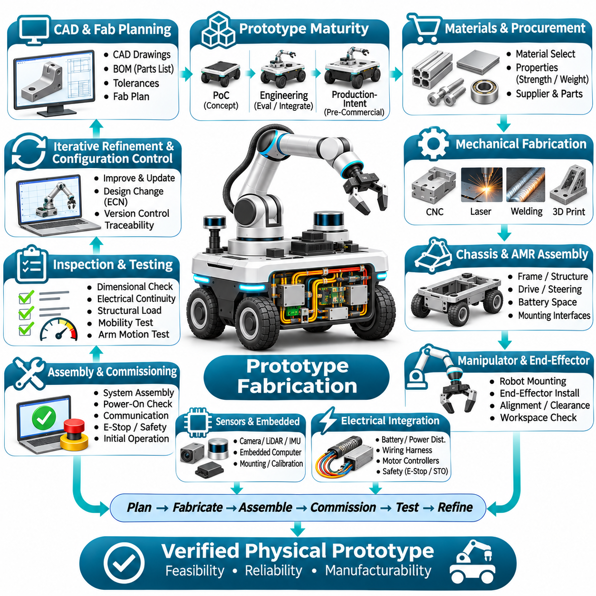{width="7.268055555555556in" height="7.268055555555556in"}

Prototype fabrication transforms verified engineering designs into physical hardware configurations that enable practical evaluation of mobile manipulator systems. This development stage connects digital modeling, engineering simulation, component manufacturing, and multidisciplinary system integration. Physical prototypes provide essential evidence for assessing design feasibility, mechanical performance, functional compatibility, and operational reliability.

The prototype fabrication process begins with the review of approved CAD models, manufacturing drawings, material specifications, bills of materials, and engineering analysis results. Engineers must identify critical components, manufacturing tolerances, procurement requirements, assembly sequences, and inspection criteria. Fabrication planning establishes a controlled transition from digital engineering models to physical implementation.

Prototype development can involve multiple levels of physical implementation according to engineering objectives and technological maturity. Proof-of-concept prototypes demonstrate fundamental operating principles, while engineering prototypes support detailed performance evaluation and subsystem integration. Production-intent prototypes incorporate representative materials, manufacturing processes, and assembly configurations intended for subsequent commercialization.

Material selection and procurement establish the physical foundation for prototype manufacturing. Engineers must evaluate material strength, stiffness, weight, corrosion resistance, thermal characteristics, processing requirements, and supplier availability. Purchased components, including drive units, robotic manipulators, batteries, sensors, and electronic controllers, must satisfy approved engineering specifications and mechanical interface requirements.

Mechanical fabrication encompasses machining, laser cutting, sheet metal bending, welding, casting, and additive manufacturing according to component geometry and material characteristics. Structural frames, mounting plates, protective enclosures, and customized brackets must be manufactured within specified dimensional tolerances. Appropriate fabrication methods should balance structural performance, manufacturing accuracy, development time, and prototype cost.

Additive manufacturing enables rapid production of customized mechanical components, installation fixtures, sensor brackets, protective housings, and geometric verification models. Three-dimensional printing supports iterative design improvements without requiring expensive production tooling. However, printed components intended for load-bearing applications must be evaluated for material properties, directional strength, dimensional stability, and environmental durability.

Chassis and mobile platform fabrication establishes the primary load-bearing structure of the mobile manipulator. Frame assemblies must accommodate battery systems, traction drives, steering mechanisms, electronic equipment, and manipulator mounting interfaces. Structural alignment, mounting accuracy, ground clearance, weight distribution, and overall dimensional consistency must be verified during fabrication and mechanical assembly.

Manipulator and end-effector installation requires precise alignment between robotic components and their supporting mechanical structures. Mounting interfaces, fastener specifications, structural reinforcement, cable routing, and service accessibility must be evaluated during assembly. Engineers should verify mechanical clearances, working envelopes, joint movement restrictions, and potential interference throughout representative operating configurations.

Electrical system fabrication includes the installation of battery systems, power distribution units, motor controllers, embedded computing platforms, safety devices, and wiring harnesses. Assembly procedures must address electrical insulation, connector integrity, grounding, circuit protection, cable retention, and electromagnetic compatibility. Electrical inspections should precede initial system energization to minimize equipment damage and safety risks.

Sensor installation and embedded hardware integration establish the physical infrastructure required for autonomous operation and robotic control. Cameras, LiDAR sensors, inertial measurement units, encoders, and other perception devices must be installed according to approved geometric configurations. Mounting rigidity, sensor orientation, vibration isolation, electrical connectivity, and calibration accessibility influence subsequent system performance.

Prototype assembly requires coordinated execution of mechanical, electrical, electronic, and embedded system integration activities. Assembly sequences should minimize unnecessary disassembly, installation conflicts, component damage, and configuration inconsistencies. Controlled fastening procedures, dimensional measurements, electrical inspections, and assembly records help maintain engineering traceability throughout the fabrication process.

Initial prototype commissioning establishes the basic operational readiness of the integrated hardware system. Engineers must progressively verify power distribution, communication interfaces, embedded controllers, actuator responses, sensor outputs, and protective functions. Controlled commissioning procedures should prioritize low-energy operating conditions, restricted motion, emergency stop verification, and systematic fault identification.

Prototype inspection and testing evaluate whether fabricated hardware satisfies approved engineering requirements and initial performance expectations. Dimensional inspections, electrical continuity tests, structural load assessments, mobility tests, and manipulator motion evaluations provide essential verification data. Measured performance should be compared with CAD specifications and CAE predictions to identify discrepancies requiring further investigation.

Iterative prototype refinement transforms identified fabrication defects, integration conflicts, and performance limitations into controlled engineering improvements. Engineers must investigate root causes, update design documentation, implement corrective modifications, and repeat relevant verification activities. Systematic prototype iteration helps improve mechanical reliability, manufacturing feasibility, assembly efficiency, and operational robustness.

Prototype fabrication management requires effective coordination of procurement schedules, manufacturing resources, engineering personnel, development budgets, and technical documentation. Component identification, revision control, supplier quality records, fabrication deviations, and assembly histories should be maintained throughout development. Configuration management ensures that measured prototype performance corresponds to an identifiable hardware baseline.

The prototype fabrication process concludes with an inspected and documented physical hardware baseline supported by manufacturing records, assembly documentation, configuration information, commissioning results, and identified improvement requirements. The completed prototype provides a practical foundation for design optimization, artificial intelligence integration, manipulation development, system testing, field validation, and manufacturing preparation.

시제품 제작(Prototype Fabrication)은 검증된 엔지니어링 설계(Verified Engineering Design)를 모바일 매니퓰레이터 시스템(Mobile Manipulator System)의 실질적인 평가가 가능한 물리적 하드웨어 구성(Physical Hardware Configuration)으로 변환하는 과정이다. 이러한 개발 단계는 디지털 모델링(Digital Modeling), 엔지니어링 시뮬레이션(Engineering Simulation), 구성 요소 제조(Component Manufacturing) 및 다분야 시스템 통합(Multidisciplinary System Integration)을 연결한다. 물리적 시제품(Physical Prototype)은 설계 타당성(Design Feasibility), 기계적 성능(Mechanical Performance), 기능적 호환성(Functional Compatibility) 및 운용 신뢰성(Operational Reliability)을 평가하기 위한 핵심적인 근거를 제공한다.

시제품 제작 프로세스는 승인된 CAD 모델(Approved CAD Model), 제조 도면(Manufacturing Drawing), 재료 사양(Material Specification), 자재 명세서(BOM, Bill of Materials) 및 엔지니어링 해석 결과(Engineering Analysis Result)에 대한 검토로부터 시작된다. 엔지니어는 핵심 구성 요소(Critical Component), 제조 공차(Manufacturing Tolerance), 조달 요구사항(Procurement Requirements), 조립 순서(Assembly Sequence) 및 검사 기준(Inspection Criteria)을 식별해야 한다. 제작 계획(Fabrication Planning)은 디지털 엔지니어링 모델(Digital Engineering Model)에서 물리적 구현(Physical Implementation)으로의 통제된 전환을 확립한다.

시제품 개발(Prototype Development)은 엔지니어링 목표(Engineering Objective)와 기술 성숙도(Technological Maturity)에 따라 여러 수준의 물리적 구현을 포함할 수 있다. 개념 검증 시제품(PoC Prototype, Proof-of-Concept Prototype)은 기본적인 작동 원리(Fundamental Operating Principle)를 입증하는 반면, 엔지니어링 시제품(Engineering Prototype)은 상세 성능 평가(Detailed Performance Evaluation)와 하위 시스템 통합(Subsystem Integration)을 지원한다. 양산 지향 시제품(Production-Intent Prototype)은 향후 상용화(Commercialization)를 목적으로 실제 양산을 대표하는 재료, 제조 공정(Manufacturing Process) 및 조립 구성(Assembly Configuration)을 반영한다.

재료 선정 및 조달(Material Selection and Procurement)은 시제품 제조(Prototype Manufacturing)를 위한 물리적 기반을 확립한다. 엔지니어는 재료 강도(Material Strength), 강성(Stiffness), 중량(Weight), 내식성(Corrosion Resistance), 열적 특성(Thermal Characteristic), 가공 요구사항(Processing Requirements) 및 공급업체의 공급 가능성(Supplier Availability)을 평가해야 한다. 구동 유닛(Drive Unit), 로봇 매니퓰레이터(Robotic Manipulator), 배터리(Battery), 센서(Sensor) 및 전자 제어기(Electronic Controller)를 포함한 구매 구성 요소(Purchased Component)는 승인된 엔지니어링 사양(Approved Engineering Specification)과 기계적 인터페이스 요구사항(Mechanical Interface Requirements)을 충족해야 한다.

기계적 제작(Mechanical Fabrication)은 구성 요소의 형상(Component Geometry)과 재료 특성(Material Characteristic)에 따라 기계 가공(Machining), 레이저 절단(Laser Cutting), 판금 절곡(Sheet Metal Bending), 용접(Welding), 주조(Casting) 및 적층 제조(Additive Manufacturing)를 포함한다. 구조 프레임(Structural Frame), 장착 플레이트(Mounting Plate), 보호 하우징(Protective Enclosure) 및 맞춤형 브래킷(Customized Bracket)은 지정된 치수 공차(Dimensional Tolerance) 범위 내에서 제조되어야 한다. 적절한 제작 방법(Fabrication Method)은 구조적 성능(Structural Performance), 제조 정확도(Manufacturing Accuracy), 개발 기간(Development Time) 및 시제품 비용(Prototype Cost) 사이의 균형을 유지해야 한다.

적층 제조(Additive Manufacturing)는 맞춤형 기계 구성 요소(Customized Mechanical Component), 설치 지그(Installation Fixture), 센서 브래킷(Sensor Bracket), 보호 하우징(Protective Housing) 및 형상 검증 모델(Geometric Verification Model)의 신속한 제작을 가능하게 한다. 3차원 프린팅(3D Printing)은 고가의 생산용 공구 및 금형(Production Tooling) 없이 반복적인 설계 개선(Iterative Design Improvement)을 지원한다. 그러나 하중 지지 용도(Load-Bearing Application)로 사용되는 적층 제조 구성 요소는 재료 물성(Material Property), 방향별 강도(Directional Strength), 치수 안정성(Dimensional Stability) 및 환경 내구성(Environmental Durability)에 대한 평가가 이루어져야 한다.

섀시 및 이동 플랫폼 제작(Chassis and Mobile Platform Fabrication)은 모바일 매니퓰레이터의 주요 하중 지지 구조(Primary Load-Bearing Structure)를 확립한다. 프레임 어셈블리(Frame Assembly)는 배터리 시스템(Battery System), 주행 구동 장치(Traction Drive), 조향 메커니즘(Steering Mechanism), 전자 장비(Electronic Equipment) 및 매니퓰레이터 장착 인터페이스(Manipulator Mounting Interface)를 수용할 수 있어야 한다. 구조적 정렬(Structural Alignment), 장착 정확도(Mounting Accuracy), 최저 지상고(Ground Clearance), 중량 분포(Weight Distribution) 및 전체적인 치수 일관성(Dimensional Consistency)은 제작 및 기계적 조립(Mechanical Assembly) 과정에서 검증되어야 한다.

매니퓰레이터 및 엔드 이펙터 설치(Manipulator and End-Effector Installation)는 로봇 구성 요소(Robotic Component)와 이를 지지하는 기계적 구조물(Mechanical Structure) 사이의 정밀한 정렬(Precise Alignment)을 필요로 한다. 장착 인터페이스(Mounting Interface), 체결 부품 사양(Fastener Specification), 구조적 보강(Structural Reinforcement), 케이블 경로(Cable Routing) 및 정비 접근성(Service Accessibility)은 조립 과정에서 평가되어야 한다. 엔지니어는 대표적인 운용 구성(Operational Configuration) 전반에 걸쳐 기계적 여유 공간(Mechanical Clearance), 작업 영역(Working Envelope), 관절 움직임 제한(Joint Movement Restriction) 및 잠재적인 간섭(Potential Interference)을 검증해야 한다.

전기 시스템 제작(Electrical System Fabrication)은 배터리 시스템, 전력 분배 장치(PDU, Power Distribution Unit), 모터 제어기(Motor Controller), 임베디드 컴퓨팅 플랫폼(Embedded Computing Platform), 안전 장치(Safety Device) 및 와이어링 하네스(Wiring Harness)의 설치를 포함한다. 조립 절차(Assembly Procedure)는 전기적 절연(Electrical Insulation), 커넥터 건전성(Connector Integrity), 접지(Grounding), 회로 보호(Circuit Protection), 케이블 고정(Cable Retention) 및 전자기 적합성(EMC, Electromagnetic Compatibility)을 고려해야 한다. 전기적 검사(Electrical Inspection)는 장비 손상(Equipment Damage)과 안전 위험(Safety Risk)을 최소화하기 위해 최초 시스템 전원 인가(Initial System Energization) 이전에 수행되어야 한다.

센서 설치 및 임베디드 하드웨어 통합(Sensor Installation and Embedded Hardware Integration)은 자율 운용(Autonomous Operation)과 로봇 제어(Robotic Control)에 필요한 물리적 인프라(Physical Infrastructure)를 확립한다. 카메라(Camera), 라이다 센서(LiDAR Sensor), 관성 측정 장치(IMU, Inertial Measurement Unit), 엔코더(Encoder) 및 기타 인지 장치(Perception Device)는 승인된 기하학적 구성(Approved Geometric Configuration)에 따라 설치되어야 한다. 장착 강성(Mounting Rigidity), 센서 방향(Sensor Orientation), 진동 절연(Vibration Isolation), 전기적 연결성(Electrical Connectivity) 및 보정 접근성(Calibration Accessibility)은 이후의 시스템 성능(System Performance)에 영향을 미친다.

시제품 조립(Prototype Assembly)은 기계(Mechanical), 전기(Electrical), 전자(Electronic) 및 임베디드 시스템 통합(Embedded System Integration) 활동의 유기적인 수행을 필요로 한다. 조립 순서(Assembly Sequence)는 불필요한 분해(Unnecessary Disassembly), 설치 간섭(Installation Conflict), 구성 요소 손상(Component Damage) 및 구성 불일치(Configuration Inconsistency)를 최소화하도록 설계되어야 한다. 통제된 체결 절차(Controlled Fastening Procedure), 치수 측정(Dimensional Measurement), 전기적 검사 및 조립 기록(Assembly Record)은 전체 제작 프로세스에 걸쳐 엔지니어링 추적성(Engineering Traceability)을 유지하는 데 기여한다.

초기 시제품 시운전(Initial Prototype Commissioning)은 통합된 하드웨어 시스템(Integrated Hardware System)의 기본적인 운용 준비 상태(Operational Readiness)를 확립한다. 엔지니어는 전력 분배(Power Distribution), 통신 인터페이스(Communication Interface), 임베디드 제어기(Embedded Controller), 액추에이터 응답(Actuator Response), 센서 출력(Sensor Output) 및 보호 기능(Protective Function)을 단계적으로 검증해야 한다. 통제된 시운전 절차(Controlled Commissioning Procedure)는 저에너지 운용 조건(Low-Energy Operating Condition), 제한된 움직임(Restricted Motion), 비상 정지 검증(Emergency Stop Verification) 및 체계적인 고장 식별(Systematic Fault Identification)을 우선적으로 고려해야 한다.

시제품 검사 및 시험(Prototype Inspection and Testing)은 제작된 하드웨어(Fabricated Hardware)가 승인된 엔지니어링 요구사항(Approved Engineering Requirements)과 초기 성능 기대치(Initial Performance Expectation)를 충족하는지 평가한다. 치수 검사(Dimensional Inspection), 전기적 도통 시험(Electrical Continuity Test), 구조적 하중 평가(Structural Load Assessment), 이동 성능 시험(Mobility Test) 및 매니퓰레이터 동작 평가(Manipulator Motion Evaluation)는 핵심적인 검증 데이터(Verification Data)를 제공한다. 측정된 성능(Measured Performance)은 추가적인 조사가 필요한 불일치(Discrepancy)를 식별하기 위해 CAD 사양(CAD Specification) 및 CAE 예측 결과(CAE Prediction)와 비교되어야 한다.

반복적인 시제품 개선(Iterative Prototype Refinement)은 식별된 제작 결함(Fabrication Defect), 통합 충돌(Integration Conflict) 및 성능 한계(Performance Limitation)를 통제된 엔지니어링 개선(Controlled Engineering Improvement)으로 전환한다. 엔지니어는 근본 원인(Root Cause)을 조사하고, 설계 문서(Design Documentation)를 업데이트하며, 시정 목적의 변경(Corrective Modification)을 구현하고, 관련 검증 활동(Verification Activity)을 반복적으로 수행해야 한다. 체계적인 시제품 반복 개발(Systematic Prototype Iteration)은 기계적 신뢰성(Mechanical Reliability), 제조 타당성(Manufacturing Feasibility), 조립 효율성(Assembly Efficiency) 및 운용 강건성(Operational Robustness)을 향상시키는 데 기여한다.

시제품 제작 관리(Prototype Fabrication Management)는 조달 일정(Procurement Schedule), 제조 자원(Manufacturing Resource), 엔지니어링 인력(Engineering Personnel), 개발 예산(Development Budget) 및 기술 문서(Technical Documentation)의 효과적인 조정을 필요로 한다. 구성 요소 식별(Component Identification), 개정 관리(Revision Control), 공급업체 품질 기록(Supplier Quality Record), 제작 편차(Fabrication Deviation) 및 조립 이력(Assembly History)은 전체 개발 과정에 걸쳐 유지되어야 한다. 형상 관리(Configuration Management)는 측정된 시제품 성능(Measured Prototype Performance)이 식별 가능한 하드웨어 기준선(Identifiable Hardware Baseline)에 대응하도록 보장한다.

시제품 제작 프로세스는 제조 기록(Manufacturing Record), 조립 문서(Assembly Documentation), 형상 정보(Configuration Information), 시운전 결과(Commissioning Result) 및 식별된 개선 요구사항(Identified Improvement Requirements)을 기반으로 검사 및 문서화가 완료된 물리적 하드웨어 기준선(Inspected and Documented Physical Hardware Baseline)을 확립함으로써 마무리된다. 완성된 시제품(Completed Prototype)은 이후의 설계 최적화(Design Optimization), 인공지능 통합(AI Integration), 조작 기술 개발(Manipulation Development), 시스템 시험(System Testing), 현장 검증(Field Validation) 및 제조 준비(Manufacturing Preparation)를 위한 실질적인 기반을 제공한다.

##  

## 13 Design Optimization

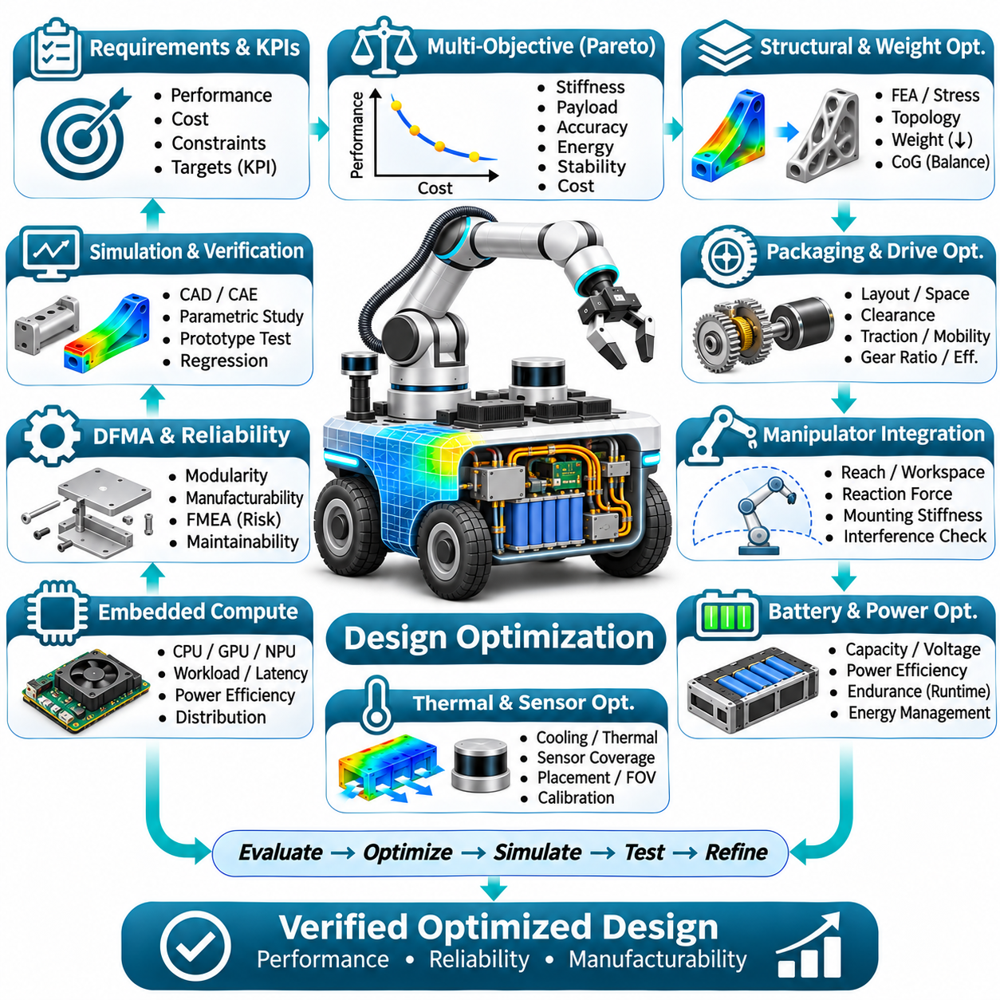{width="7.268055555555556in" height="7.268055555555556in"}

Design optimization is a systematic engineering process that improves the physical configuration, functional performance, reliability, and manufacturing efficiency of mobile manipulators. It transforms findings from hardware development, engineering simulation, prototype fabrication, and experimental testing into measurable design improvements. Optimization establishes a balance between technical performance, development cost, and operational requirements.

The design optimization process begins with the evaluation of existing hardware configurations against established system requirements and performance indicators. Engineers identify structural weaknesses, excessive component weight, energy losses, thermal limitations, mechanical interference, and manufacturing difficulties. These findings establish optimization objectives, design constraints, and measurable improvement targets.

Multi-objective optimization addresses the competing engineering requirements associated with mobile manipulator development. Structural stiffness, payload capacity, positioning accuracy, energy efficiency, operational stability, manufacturing cost, and maintenance accessibility must be considered simultaneously. Pareto-optimal solutions help engineers evaluate design alternatives without disproportionately sacrificing essential system capabilities.

Structural optimization improves the mechanical performance of chassis frames, manipulator mounting structures, reinforcement members, and equipment support assemblies. Finite Element Analysis (FEA), topology optimization, and parametric modeling enable engineers to identify inefficient material distribution. Optimized structures should reduce unnecessary mass while maintaining required strength, stiffness, and durability.

Weight optimization directly influences mobility performance, battery consumption, payload capacity, and transportation efficiency. Engineers evaluate material alternatives, component thickness, structural arrangements, and opportunities for functional integration. Weight reduction must be coordinated with center-of-gravity management and structural requirements to avoid compromising platform stability or manipulation accuracy.

Mechanical packaging optimization improves the spatial arrangement of batteries, drive units, embedded computers, sensors, electrical components, and robotic manipulators. Engineers must balance installation volume, service accessibility, cable routing, cooling pathways, and mechanical clearances. Effective packaging reduces unused space and supports compact configurations without introducing integration or maintenance difficulties.

Drive system optimization focuses on improving traction efficiency, steering responsiveness, actuator performance, and mechanical power transmission. Motor specifications, gear ratios, wheel dimensions, drivetrain losses, and control characteristics should be evaluated under representative operating conditions. Appropriate configuration refinement reduces energy consumption while maintaining required mobility and load-handling capabilities.

Manipulator integration optimization evaluates mounting positions, working envelopes, joint configurations, end-effector characteristics, and mechanical interactions with the mobile platform. Engineers must consider reachability, payload distribution, mounting stiffness, and reaction forces generated during robotic operations. Optimized configurations improve task execution while reducing mechanical interference and instability.

Battery and power system optimization improves operational endurance through efficient energy storage, electrical distribution, and component selection. Battery capacity, voltage architecture, power conversion efficiency, conductor dimensions, and peak load requirements must be evaluated collectively. Representative mission profiles help determine appropriate energy reserves without introducing excessive battery weight or system cost.

Thermal optimization addresses heat generation and dissipation within battery assemblies, motor controllers, embedded computing platforms, and electrical enclosures. Engineers can evaluate heat sink geometries, cooling fan configurations, ventilation pathways, and component placement through thermal simulation. Improved thermal management supports computational performance, component reliability, and extended operational lifetimes.

Sensor integration optimization improves perception coverage, measurement accuracy, environmental robustness, and calibration stability. Sensor mounting positions, installation orientations, vibration isolation, and potential occlusion must be evaluated across representative operating scenarios. Optimized sensor configurations reduce coverage gaps and unnecessary hardware redundancy while maintaining required perception capabilities.

Embedded hardware optimization balances computational performance, power consumption, communication bandwidth, memory capacity, and thermal limitations. Engineers evaluate processor architectures, hardware accelerators, distributed computing arrangements, and workload allocation strategies. Optimized computing configurations must satisfy real-time control requirements and support anticipated artificial intelligence workloads.

Manufacturing and assembly optimization improves hardware producibility through component standardization, simplified geometries, modular construction, and accessible mechanical interfaces. Design for Manufacturing and Assembly (DFMA) principles help reduce machining operations, assembly complexity, specialized tooling, and production variability. These improvements contribute to lower manufacturing costs and consistent product quality.

Reliability and maintainability optimization addresses potential failure mechanisms, component degradation, inspection accessibility, and replacement procedures. Failure Mode and Effects Analysis (FMEA), durability testing, and maintenance evaluations help engineers prioritize corrective improvements. Modular assemblies, standardized connectors, diagnostic interfaces, and accessible service points reduce operational downtime.

Simulation-driven optimization and experimental verification establish a continuous feedback mechanism between virtual engineering models and physical hardware. Parametric studies, sensitivity analysis, design of experiments, and prototype measurements enable systematic evaluation of alternative configurations. Proposed modifications must undergo appropriate regression testing to confirm improvements without introducing new deficiencies.

The design optimization process concludes with an approved hardware baseline supported by updated CAD models, CAE results, revised specifications, manufacturing documentation, and comparative test records. Documented improvements establish traceability between initial requirements and optimized performance while providing a reliable foundation for AI development, manipulation integration, system testing, and subsequent manufacturing.

설계 최적화(Design Optimization)는 모바일 매니퓰레이터(Mobile Manipulator)의 물리적 구성(Physical Configuration), 기능적 성능(Functional Performance), 신뢰성(Reliability) 및 제조 효율성(Manufacturing Efficiency)을 향상시키기 위한 체계적인 엔지니어링 프로세스이다. 설계 최적화는 하드웨어 개발(Hardware Development), 엔지니어링 시뮬레이션(Engineering Simulation), 시제품 제작(Prototype Fabrication) 및 실험적 시험(Experimental Testing)에서 도출된 결과를 정량적으로 측정 가능한 설계 개선(Measurable Design Improvement)으로 전환한다. 최적화는 기술적 성능(Technical Performance), 개발 비용(Development Cost) 및 운용 요구사항(Operational Requirements) 사이의 균형을 확립한다.

설계 최적화 프로세스는 기존 하드웨어 구성(Existing Hardware Configuration)을 확립된 시스템 요구사항(System Requirements) 및 성능 지표(Performance Indicator)에 따라 평가하는 과정으로부터 시작된다. 엔지니어는 구조적 취약점(Structural Weakness), 과도한 구성 요소 중량(Excessive Component Weight), 에너지 손실(Energy Loss), 열적 한계(Thermal Limitation), 기계적 간섭(Mechanical Interference) 및 제조상의 어려움(Manufacturing Difficulty)을 식별한다. 이러한 분석 결과는 최적화 목적(Optimization Objective), 설계 제약조건(Design Constraint) 및 정량적으로 측정 가능한 개선 목표(Measurable Improvement Target)를 확립한다.

다목적 최적화(Multi-Objective Optimization)는 모바일 매니퓰레이터 개발과 관련하여 상충하는 엔지니어링 요구사항(Competing Engineering Requirements)을 다룬다. 구조적 강성(Structural Stiffness), 적재 하중 용량(Payload Capacity), 위치 결정 정확도(Positioning Accuracy), 에너지 효율성(Energy Efficiency), 운용 안정성(Operational Stability), 제조 비용(Manufacturing Cost) 및 유지보수 접근성(Maintenance Accessibility)이 동시에 고려되어야 한다. 파레토 최적해(Pareto-Optimal Solution)는 엔지니어가 필수적인 시스템 기능(System Capability)을 과도하게 희생하지 않으면서 대안적인 설계(Design Alternative)를 평가할 수 있도록 한다.

구조 최적화(Structural Optimization)는 섀시 프레임(Chassis Frame), 매니퓰레이터 장착 구조물(Manipulator Mounting Structure), 보강 부재(Reinforcement Member) 및 장비 지지 어셈블리(Equipment Support Assembly)의 기계적 성능(Mechanical Performance)을 향상시킨다. 유한 요소 해석(FEA, Finite Element Analysis), 위상 최적화(Topology Optimization) 및 파라메트릭 모델링(Parametric Modeling)은 엔지니어가 비효율적인 재료 분포(Inefficient Material Distribution)를 식별할 수 있도록 한다. 최적화된 구조(Optimized Structure)는 요구되는 강도(Strength), 강성(Stiffness) 및 내구성(Durability)을 유지하면서 불필요한 질량(Unnecessary Mass)을 감소시켜야 한다.

중량 최적화(Weight Optimization)는 이동 성능(Mobility Performance), 배터리 에너지 소비량(Battery Consumption), 적재 하중 용량(Payload Capacity) 및 운송 효율성(Transportation Efficiency)에 직접적인 영향을 미친다. 엔지니어는 대체 재료(Material Alternative), 구성 요소 두께(Component Thickness), 구조적 배치(Structural Arrangement) 및 기능 통합(Functional Integration)의 가능성을 평가한다. 중량 감소(Weight Reduction)는 플랫폼 안정성(Platform Stability)이나 조작 정확도(Manipulation Accuracy)를 저하시키지 않도록 무게중심 관리(Center-of-Gravity Management) 및 구조적 요구사항(Structural Requirements)과 유기적으로 조정되어야 한다.

기계적 패키징 최적화(Mechanical Packaging Optimization)는 배터리(Battery), 구동 유닛(Drive Unit), 임베디드 컴퓨터(Embedded Computer), 센서(Sensor), 전기 구성 요소(Electrical Component) 및 로봇 매니퓰레이터(Robotic Manipulator)의 공간적 배치(Spatial Arrangement)를 개선한다. 엔지니어는 설치 공간(Installation Volume), 정비 접근성(Service Accessibility), 케이블 경로(Cable Routing), 냉각 경로(Cooling Pathway) 및 기계적 여유 공간(Mechanical Clearance) 사이의 균형을 유지해야 한다. 효과적인 패키징은 미활용 공간(Unused Space)을 감소시키고 통합 또는 유지보수상의 어려움을 발생시키지 않으면서 소형화된 구성(Compact Configuration)을 지원한다.

구동 시스템 최적화(Drive System Optimization)는 주행 구동 효율성(Traction Efficiency), 조향 응답성(Steering Responsiveness), 액추에이터 성능(Actuator Performance) 및 기계적 동력 전달(Mechanical Power Transmission)을 향상시키는 데 중점을 둔다. 모터 사양(Motor Specification), 기어비(Gear Ratio), 휠 치수(Wheel Dimension), 구동계 손실(Drivetrain Loss) 및 제어 특성(Control Characteristic)은 대표적인 운용 조건(Representative Operating Condition)에서 평가되어야 한다. 적절한 구성 개선(Configuration Refinement)은 요구되는 이동 성능과 하중 처리 능력(Load-Handling Capability)을 유지하면서 에너지 소비량(Energy Consumption)을 감소시킨다.

매니퓰레이터 통합 최적화(Manipulator Integration Optimization)는 장착 위치(Mounting Position), 작업 영역(Working Envelope), 관절 구성(Joint Configuration), 엔드 이펙터 특성(End-Effector Characteristic) 및 이동 플랫폼(Mobile Platform)과의 기계적 상호작용(Mechanical Interaction)을 평가한다. 엔지니어는 도달 가능성(Reachability), 적재 하중 분포(Payload Distribution), 장착 강성(Mounting Stiffness) 및 로봇 작업(Robotic Operation) 중 발생하는 반력(Reaction Force)을 고려해야 한다. 최적화된 구성(Optimized Configuration)은 기계적 간섭과 불안정성(Instability)을 감소시키면서 작업 수행 능력(Task Execution)을 향상시킨다.

배터리 및 전력 시스템 최적화(Battery and Power System Optimization)는 효율적인 에너지 저장(Energy Storage), 전력 분배(Electrical Distribution) 및 구성 요소 선정(Component Selection)을 통해 운용 지속 시간(Operational Endurance)을 향상시킨다. 배터리 용량(Battery Capacity), 전압 아키텍처(Voltage Architecture), 전력 변환 효율(Power Conversion Efficiency), 도체 치수(Conductor Dimension) 및 최대 부하 요구사항(Peak Load Requirements)은 종합적으로 평가되어야 한다. 대표적인 임무 프로파일(Representative Mission Profile)은 과도한 배터리 중량이나 시스템 비용(System Cost)을 발생시키지 않으면서 적절한 예비 에너지 용량(Energy Reserve)을 결정하는 데 기여한다.

열 최적화(Thermal Optimization)는 배터리 어셈블리(Battery Assembly), 모터 제어기(Motor Controller), 임베디드 컴퓨팅 플랫폼(Embedded Computing Platform) 및 전기 장비 하우징(Electrical Enclosure) 내부의 발열(Heat Generation)과 방열(Heat Dissipation)을 다룬다. 엔지니어는 열 시뮬레이션(Thermal Simulation)을 통해 방열판 형상(Heat Sink Geometry), 냉각 팬 구성(Cooling Fan Configuration), 환기 경로(Ventilation Pathway) 및 구성 요소 배치(Component Placement)를 평가할 수 있다. 개선된 열 관리(Thermal Management)는 연산 성능(Computational Performance), 구성 요소 신뢰성(Component Reliability) 및 운용 수명 연장(Extended Operational Lifetime)을 지원한다.

센서 통합 최적화(Sensor Integration Optimization)는 인지 범위(Perception Coverage), 측정 정확도(Measurement Accuracy), 환경적 강건성(Environmental Robustness) 및 보정 안정성(Calibration Stability)을 향상시킨다. 센서 장착 위치(Sensor Mounting Position), 설치 방향(Installation Orientation), 진동 절연(Vibration Isolation) 및 잠재적인 가림 현상(Potential Occlusion)은 대표적인 운용 시나리오(Operational Scenario) 전반에 걸쳐 평가되어야 한다. 최적화된 센서 구성(Optimized Sensor Configuration)은 요구되는 인지 능력(Perception Capability)을 유지하면서 인지 사각지대(Coverage Gap)와 불필요한 하드웨어 중복성(Unnecessary Hardware Redundancy)을 감소시킨다.

임베디드 하드웨어 최적화(Embedded Hardware Optimization)는 연산 성능(Computational Performance), 전력 소비량(Power Consumption), 통신 대역폭(Communication Bandwidth), 메모리 용량(Memory Capacity) 및 열적 한계(Thermal Limitation) 사이의 균형을 유지한다. 엔지니어는 프로세서 아키텍처(Processor Architecture), 하드웨어 가속기(Hardware Accelerator), 분산 컴퓨팅 구성(Distributed Computing Arrangement) 및 작업 부하 할당 전략(Workload Allocation Strategy)을 평가한다. 최적화된 컴퓨팅 구성(Optimized Computing Configuration)은 실시간 제어 요구사항(Real-Time Control Requirements)을 충족하고 예상되는 인공지능 작업 부하(Anticipated AI Workload)를 지원해야 한다.

제조 및 조립 최적화(Manufacturing and Assembly Optimization)는 구성 요소 표준화(Component Standardization), 단순화된 형상(Simplified Geometry), 모듈형 구조(Modular Construction) 및 접근성이 높은 기계적 인터페이스(Accessible Mechanical Interface)를 통해 하드웨어의 생산성(Producibility)을 향상시킨다. 제조 및 조립을 고려한 설계(DFMA, Design for Manufacturing and Assembly) 원칙은 기계 가공 공정(Machining Operation), 조립 복잡성(Assembly Complexity), 특수 공구 및 금형(Specialized Tooling), 생산 편차(Production Variability)를 감소시키는 데 기여한다. 이러한 개선은 제조 비용 절감(Manufacturing Cost Reduction)과 일관된 제품 품질(Consistent Product Quality) 확보에 기여한다.

신뢰성 및 유지보수성 최적화(Reliability and Maintainability Optimization)는 잠재적인 고장 메커니즘(Potential Failure Mechanism), 구성 요소 성능 저하(Component Degradation), 검사 접근성(Inspection Accessibility) 및 교체 절차(Replacement Procedure)를 다룬다. 고장 형태 및 영향 분석(FMEA, Failure Mode and Effects Analysis), 내구성 시험(Durability Testing) 및 유지보수 평가(Maintenance Evaluation)는 엔지니어가 시정 목적의 개선 사항(Corrective Improvement)에 대한 우선순위를 설정할 수 있도록 한다. 모듈형 어셈블리(Modular Assembly), 표준화된 커넥터(Standardized Connector), 진단 인터페이스(Diagnostic Interface) 및 접근성이 높은 정비 지점(Accessible Service Point)은 운용 중단 시간(Operational Downtime)을 감소시킨다.

시뮬레이션 기반 최적화 및 실험적 검증(Simulation-Driven Optimization and Experimental Verification)은 가상 엔지니어링 모델(Virtual Engineering Model)과 물리적 하드웨어(Physical Hardware) 사이의 지속적인 피드백 메커니즘(Continuous Feedback Mechanism)을 확립한다. 파라메트릭 연구(Parametric Study), 민감도 분석(Sensitivity Analysis), 실험계획법(DoE, Design of Experiments) 및 시제품 측정(Prototype Measurement)은 대안적인 구성(Alternative Configuration)에 대한 체계적인 평가를 가능하게 한다. 제안된 설계 변경(Proposed Modification)은 새로운 설계 결함(New Design Deficiency)을 발생시키지 않으면서 성능이 개선되었음을 확인하기 위해 적절한 회귀 시험(Regression Testing)을 거쳐야 한다.

설계 최적화 프로세스는 업데이트된 CAD 모델(Updated CAD Model), CAE 해석 결과(CAE Result), 개정된 사양(Revised Specification), 제조 문서(Manufacturing Documentation) 및 비교 시험 기록(Comparative Test Record)을 기반으로 승인된 하드웨어 기준선(Approved Hardware Baseline)을 확립함으로써 마무리된다. 문서화된 개선 사항(Documented Improvement)은 초기 요구사항(Initial Requirements)과 최적화된 성능(Optimized Performance) 사이의 추적성(Traceability)을 확보하는 동시에 이후의 인공지능 개발(AI Development), 조작 시스템 통합(Manipulation Integration), 시스템 시험(System Testing) 및 후속 제조(Subsequent Manufacturing)를 위한 신뢰성 높은 기반을 제공한다.
