**Volume 05. Mobile Manipulator Projects and Development Manual**

# Chapter 03. Hardware Development

## 01 Hardware Development Process

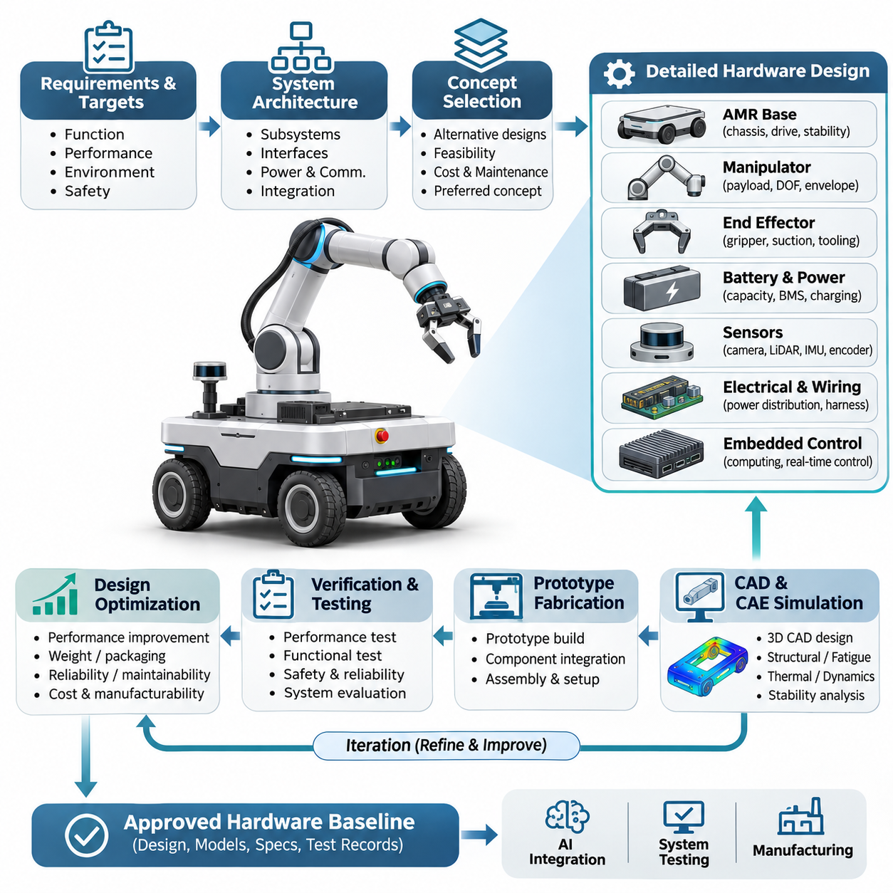{width="7.268055555555556in" height="7.268055555555556in"}

Hardware development is a systematic engineering process that transforms product requirements and system architecture into a functional, reliable, and manufacturable physical platform. In mobile manipulator development, this process encompasses mechanical structures, autonomous mobile robot (AMR) platforms, robotic arms, end effectors, power systems, sensors, embedded controllers, and electrical interfaces.

The hardware development process begins with the analysis of functional, performance, environmental, and safety requirements. Engineers establish quantitative engineering targets for payload capacity, mobility, positioning accuracy, manipulation reach, operating duration, structural strength, and environmental resistance. These requirements provide the foundation for subsequent hardware design and verification activities.

System architecture defines how individual hardware components interact to achieve the intended operational objectives. The development team establishes physical boundaries, subsystem responsibilities, communication interfaces, power distribution requirements, and mechanical integration constraints. Architectural decisions must consider the interdependencies between mobility, manipulation, perception, computation, and safety functions.

Conceptual design translates system requirements into alternative hardware configurations. Engineers evaluate different drivetrain architectures, robotic manipulators, structural materials, battery technologies, sensor configurations, and computing platforms. Technical feasibility, development complexity, component availability, manufacturing costs, and long-term maintenance requirements influence the selection of the preferred concept.

AMR base development represents a fundamental engineering activity because the mobile platform supports the entire robotic system. Chassis dimensions, wheel configurations, suspension mechanisms, motor capacity, braking performance, and ground clearance must be established according to operational scenarios. Vehicle stability must be evaluated under changing payload distributions and dynamic manipulator movements.

Manipulator selection requires careful consideration of payload capacity, degrees of freedom, working envelope, repeatability, operating speed, and installation requirements. Engineers must evaluate how the robotic arm influences the overall center of gravity, structural loading, electrical consumption, and mobile platform stability. Manipulator performance must be assessed within the integrated system rather than independently.

End effector development addresses the physical interaction between the robot and its surrounding environment. Grippers, suction mechanisms, specialized tooling, and inspection devices must be designed according to object characteristics and operational requirements. Mechanical compatibility, gripping forces, tool-changing capabilities, sensor integration, and failure recovery mechanisms should be considered during development.

Battery system design determines the energy capacity, operational endurance, and electrical reliability of the mobile manipulator. Engineers analyze the combined power consumption of drive motors, robotic joints, computing devices, sensors, and auxiliary equipment. Battery management systems, charging mechanisms, electrical protection, thermal management, and emergency power isolation must be incorporated into the design.

Sensor integration requires coordination between mechanical installation, electrical connectivity, communication interfaces, and perception software. Cameras, LiDAR devices, inertial measurement units, encoders, and force-torque sensors must be positioned to provide appropriate environmental coverage. Mounting rigidity, vibration isolation, calibration accessibility, synchronization, and electromagnetic interference must also be evaluated.

Electrical system development establishes the infrastructure necessary to distribute power and exchange information between hardware components. Engineers design power distribution circuits, motor control interfaces, protection mechanisms, grounding architectures, and communication networks. Electrical hardware must accommodate transient loads, operating voltage variations, thermal constraints, and safety-related shutdown requirements.

Wiring harness development ensures reliable electrical connectivity throughout the robotic platform. Cable routing must accommodate moving joints, steering mechanisms, structural assemblies, and maintenance procedures without introducing excessive mechanical stress. Connector selection, shielding, cable separation, bending radius, strain relief, and protective coverings contribute to long-term operational reliability.

Embedded system development integrates computing hardware, microcontrollers, communication interfaces, and real-time control resources. The hardware architecture must support deterministic control, sensor acquisition, actuator communication, and system diagnostics. Processing capacity, memory bandwidth, thermal dissipation, communication latency, and hardware compatibility with AI software must be evaluated throughout development.

Computer-aided design (CAD) provides a common engineering environment for transforming conceptual configurations into detailed mechanical models. Engineers develop individual components, assemblies, mounting structures, and installation interfaces while verifying dimensional compatibility. Digital assembly models support interference detection, packaging optimization, tolerance analysis, maintenance accessibility, and manufacturing documentation.

Computer-aided engineering (CAE) and simulation enable the evaluation of hardware performance before physical fabrication. Structural analysis, fatigue assessment, thermal simulation, multibody dynamics, and stability analysis help identify potential engineering weaknesses. Simulation results guide material selection, structural reinforcement, component positioning, and design modifications while reducing unnecessary prototype iterations.

Prototype fabrication converts verified digital designs into physical engineering samples. Development teams assemble mechanical components, electrical systems, sensors, computing devices, and robotic manipulators in controlled stages. Initial prototypes establish technical feasibility, expose integration challenges, and provide measurable evidence for evaluating assumptions established during conceptual and detailed design.

Hardware verification combines component-level testing, subsystem evaluation, and integrated system assessment. Engineers measure structural deformation, electrical consumption, actuator performance, thermal behavior, communication reliability, and operational stability. Design failures and unexpected interactions must be documented, investigated, and resolved through controlled engineering changes and subsequent verification activities.

Design optimization improves hardware performance while balancing manufacturing costs, system weight, energy efficiency, reliability, and serviceability. Engineering teams refine component specifications, mechanical structures, electrical layouts, and assembly procedures using simulation and experimental evidence. Configuration management ensures that design revisions remain traceable to requirements, test results, and approved engineering decisions.

The hardware development process concludes with the establishment of a controlled design baseline supported by verified engineering documentation, approved component specifications, manufacturing drawings, and test records. This baseline connects hardware development with AI integration, manipulation development, system testing, field validation, manufacturing, and quality assurance throughout the mobile manipulator product lifecycle.

## 02 AMR Base Development

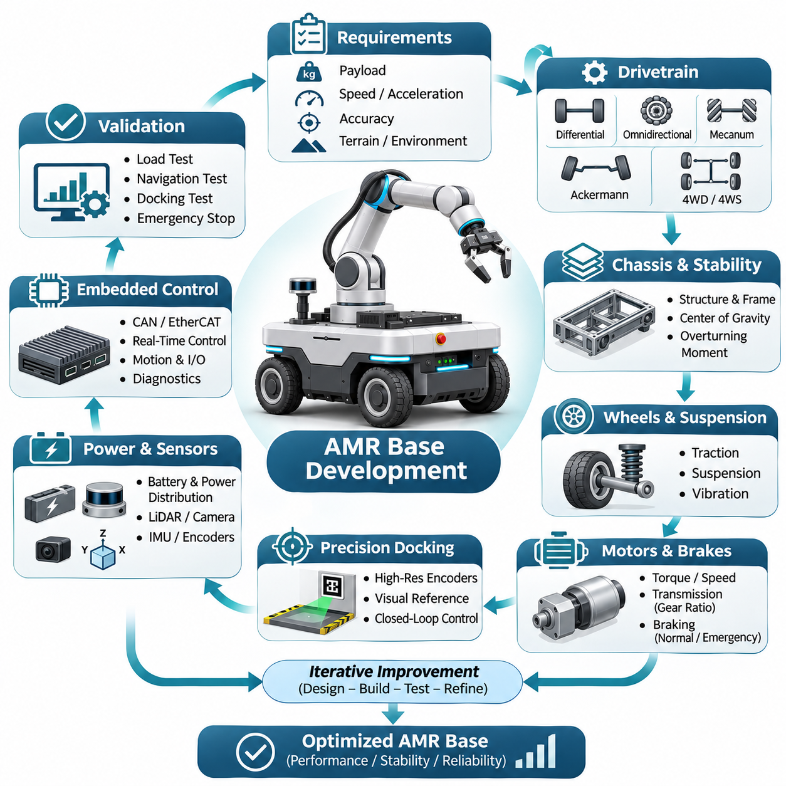{width="7.268055555555556in" height="7.268055555555556in"}

Autonomous Mobile Robot (AMR) base development is a fundamental engineering process that establishes the mobility, structural integrity, electrical infrastructure, and operational stability of a mobile manipulator. Unlike conventional AMRs designed primarily for transportation, mobile manipulator platforms must support robotic arms, end effectors, perception systems, and computing resources while maintaining precise positioning and safe operation.

The development process begins with the identification of operational requirements and environmental constraints. Engineers establish target specifications for payload capacity, maximum velocity, acceleration, turning radius, positioning accuracy, operating duration, floor conditions, and obstacle traversal capability. These requirements determine the physical dimensions, mechanical configuration, drivetrain architecture, and electrical capacity of the AMR base.

Payload analysis must consider the combined mass of the robotic manipulator, end effector, handled objects, computing devices, sensors, batteries, and auxiliary equipment. Engineers must distinguish between static loading and dynamic loading generated during acceleration, braking, turning, and manipulation. Appropriate structural margins should accommodate variations in payload distribution and unexpected operational disturbances.

Drivetrain architecture selection significantly influences mobility characteristics and manipulation flexibility. Differential drive, omnidirectional drive, mecanum wheels, Ackermann steering, and independent steering and driving configurations provide different operational capabilities. The selection process must balance maneuverability, mechanical complexity, positioning precision, energy efficiency, maintenance requirements, and manufacturing costs.

Four-wheel drive and four-wheel steering architectures provide additional maneuverability for mobile manipulators operating within confined industrial environments. Independently controlled steering and traction units can enable lateral movement, diagonal translation, and rotation around a predefined center. However, these configurations require accurate steering calibration, coordinated wheel control, robust mechanical integration, and reliable communication interfaces.

Chassis development establishes the primary structural foundation of the AMR base. Engineers must design the frame to withstand static payloads, dynamic forces, manipulator reaction moments, and repeated operational loads. Structural materials, reinforcement members, mounting interfaces, and fastening methods should be selected according to strength, stiffness, fatigue resistance, manufacturing feasibility, and overall weight requirements.

Center of gravity management is particularly important because robotic arm movements continuously change the mass distribution of the integrated platform. Extended manipulator configurations can generate significant overturning moments, especially when handling heavy objects. Engineers must evaluate stability across representative arm configurations, payload conditions, acceleration profiles, floor inclinations, and emergency braking scenarios.

Wheel and suspension system development determines traction performance, vibration characteristics, and maintaining contact with the operating surface. Wheel diameter, tire material, tread geometry, suspension stiffness, and damping characteristics should reflect the expected environmental conditions. Excessive vibration and platform deformation can negatively influence sensor measurements, localization accuracy, and end effector positioning.

Motor and transmission selection requires quantitative analysis of traction forces, rolling resistance, acceleration requirements, gradient resistance, and drivetrain efficiency. Engineers must evaluate continuous torque, peak torque, rotational speed, reduction ratios, and thermal limitations. Motor controllers should provide sufficient control resolution and support coordinated movement without introducing excessive positioning errors or mechanical oscillations.

Braking system development must address normal deceleration, emergency stopping, stationary holding, and unexpected power interruptions. Depending on the application, electromagnetic brakes, mechanical brakes, regenerative braking, or combinations of these technologies may be employed. Braking performance must be verified under maximum payload conditions while considering stopping distance, directional stability, and manipulator-induced load transfer.

Precision positioning represents a critical requirement for AMR platforms supporting industrial manipulation. Navigation accuracy alone may be insufficient for tasks requiring millimeter-level alignment between the robotic arm and external equipment. Fine positioning mechanisms, high-resolution encoders, local reference sensors, visual docking, and closed-loop motion control can improve alignment accuracy at designated workstations.

The electrical architecture of the AMR base must support both mobility and manipulation workloads. Battery capacity, power distribution, motor controllers, voltage converters, protection devices, and charging interfaces must accommodate simultaneous subsystem operation. Engineers should evaluate peak current demands, regenerative energy, voltage fluctuations, electrical isolation, thermal dissipation, and power consumption across representative operating cycles.

Sensor integration provides the physical foundation for localization, navigation, environmental perception, and collision avoidance. LiDAR devices, cameras, ultrasonic sensors, inertial measurement units, and wheel encoders require suitable mounting locations and communication interfaces. Sensor coverage, structural rigidity, calibration stability, environmental protection, and time synchronization must be considered during mechanical and electrical development.

Embedded controllers coordinate drivetrain operation, steering mechanisms, braking systems, sensor acquisition, and communication with higher-level computing platforms. Real-time control functions must remain predictable under varying computational workloads. Communication architectures based on CAN, CANopen, EtherCAT, or industrial Ethernet may be selected according to control frequency, synchronization requirements, fault management, and hardware compatibility.

AMR base validation requires structural testing, drivetrain characterization, positioning assessment, energy consumption measurement, and safety-related functional testing. Prototype evaluation should include straight-line travel, curved trajectories, repeated docking, maximum payload transportation, manipulator operation, and emergency stopping. Test results support iterative design improvements and establish the verified hardware baseline for subsequent system integration and manufacturing.

## 03 Manipulator Selection

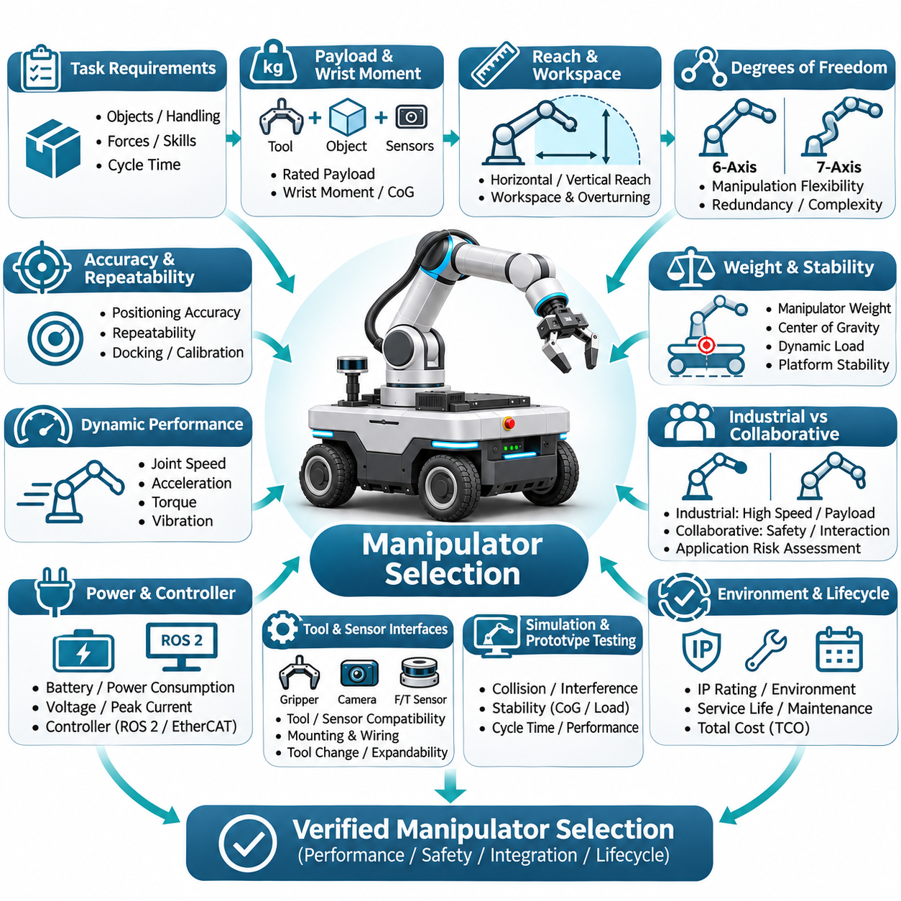{width="7.268055555555556in" height="7.268055555555556in"}

Manipulator selection is a critical engineering activity in mobile manipulator development because the robotic arm directly determines manipulation capability, operational flexibility, system stability, and overall productivity. Unlike stationary industrial robotic systems, mobile manipulators must integrate robotic arms within platforms characterized by limited installation space, variable positioning conditions, restricted energy resources, and dynamic structural constraints.

The selection process begins with the analysis of operational scenarios and manipulation requirements. Engineers identify target objects, handling procedures, required manipulation forces, working distances, positioning tolerances, cycle times, and environmental conditions. These operational requirements must be translated into measurable manipulator specifications that support both current application objectives and anticipated future expansion.

Payload capacity represents one of the fundamental criteria for manipulator selection. The rated payload must accommodate the combined mass of the end effector, handled objects, additional sensors, adapters, and auxiliary tooling. Engineers must also evaluate permissible wrist moments, payload center of gravity, and dynamic loading because nominal payload ratings alone may not adequately represent practical manipulation capabilities.

Manipulator reach determines the accessible working area surrounding the mobile platform. Engineers must evaluate maximum horizontal reach, vertical reach, minimum operating distance, and workspace geometry relative to the AMR base. Excessive reach can increase structural loading and overturning moments, while insufficient reach may require additional mobile platform movements and reduce overall operational efficiency.

The number of degrees of freedom influences manipulation flexibility, orientation control, obstacle avoidance, and accessibility within constrained environments. Six-axis manipulators generally provide sufficient flexibility for conventional industrial applications, while seven-axis configurations introduce kinematic redundancy that can improve motion planning. Additional degrees of freedom may increase mechanical complexity, computational requirements, and acquisition costs.

Positioning accuracy and repeatability must be evaluated according to task-specific requirements. Repeatability describes the ability of a manipulator to return consistently to a previously commanded position, whereas absolute accuracy represents the deviation between commanded and actual positions. Mobile manipulation introduces additional positioning uncertainties originating from AMR localization errors, structural deformation, docking deviations, and calibration errors.

Manipulator weight and mounting configuration significantly influence the mechanical architecture of the AMR base. Heavy robotic arms increase structural loading, traction requirements, and energy consumption while potentially reducing platform stability. Engineers must evaluate the combined center of gravity across representative manipulator configurations and ensure that static and dynamic loads remain within the structural limitations of the mobile platform.

Dynamic performance determines how effectively the manipulator executes industrial tasks under changing operating conditions. Joint velocity, acceleration, torque capability, settling time, and vibration characteristics influence manipulation cycle time and positioning quality. Aggressive motion profiles may improve productivity but can generate reaction forces that affect AMR stability, sensor measurements, and the accuracy of subsequent manipulation operations.

The selection between industrial robots and collaborative robots requires careful consideration of performance and safety requirements. Conventional industrial manipulators generally provide higher speeds and payload capacities, whereas collaborative manipulators may incorporate force sensing, collision detection, and configurable safety functions. However, collaborative operation must be validated through application-specific risk assessment of the complete integrated robotic system.

Electrical compatibility is an essential consideration because mobile manipulators typically operate using battery-powered electrical architectures. Manipulator voltage requirements, controller power consumption, peak current demands, and regenerative energy characteristics must be evaluated. Industrial robot controllers requiring alternating current may introduce additional inverter requirements, conversion losses, thermal loads, and installation complexity.

Controller architecture and communication compatibility determine how effectively the manipulator integrates with higher-level robotic software. Engineers should evaluate support for ROS 2, industrial Ethernet, EtherCAT, manufacturer-specific application programming interfaces, and external motion control. Access to joint states, diagnostic information, safety signals, and trajectory execution capabilities is essential for coordinated mobile manipulation.

Sensor and end effector compatibility must be considered throughout the selection process. Wrist-mounted cameras, force-torque sensors, tactile sensors, tool changers, and specialized grippers introduce additional mechanical, electrical, and communication requirements. Standardized mounting interfaces and accessible wiring routes can simplify equipment integration while improving maintainability, calibration procedures, and future application flexibility.

Environmental resistance and operational reliability influence long-term manipulator performance in industrial environments. Engineers must evaluate ingress protection ratings, operating temperature ranges, humidity tolerance, vibration resistance, contamination exposure, and maintenance intervals. Component service life, spare parts availability, manufacturer support, and controller lifecycle policies should also be incorporated into the total cost of ownership analysis.

Simulation-based evaluation and prototype testing provide practical evidence for comparing manipulator candidates. Digital models enable workspace analysis, collision detection, kinematic evaluation, and preliminary stability assessment before physical integration. Prototype testing should verify manipulation accuracy, cycle time, power consumption, docking tolerance, payload handling, communication reliability, and stability under representative operating conditions.

The manipulator selection process concludes with a documented engineering decision supported by quantitative requirements, comparative assessments, simulation results, and experimental evidence. A weighted evaluation framework can balance payload, reach, accuracy, safety, integration complexity, reliability, and lifecycle costs. The selected manipulator must establish a verified hardware baseline for subsequent mechanical integration, perception development, motion planning, and system validation.

## 04 End Effector Development

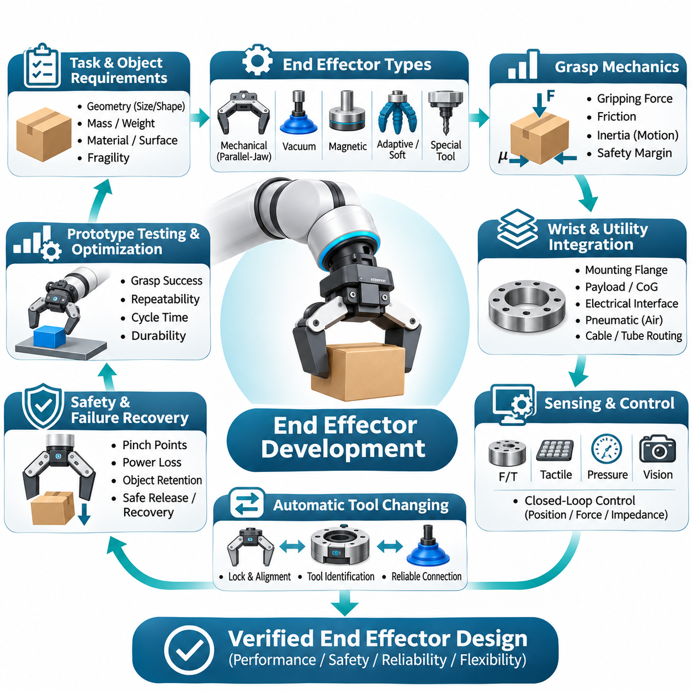{width="7.268055555555556in" height="7.268055555555556in"}

End effector development is a specialized engineering process that establishes the physical interaction between a mobile manipulator and its surrounding environment. The end effector serves as the operational interface through which robotic systems perform grasping, transportation, assembly, inspection, and material handling. Its design directly influences manipulation reliability, operational flexibility, task execution accuracy, and overall system productivity.

The development process begins with the analysis of target objects and application-specific requirements. Engineers evaluate object geometry, dimensions, weight, material properties, surface characteristics, fragility, and accessibility. Additional considerations include required gripping forces, manipulation speed, positioning tolerances, environmental conditions, and acceptable failure rates. These requirements establish the foundation for end effector design and technology selection.

End effector architecture selection depends on the physical characteristics of the intended manipulation tasks. Mechanical grippers, vacuum grippers, magnetic grippers, adaptive grippers, soft robotic grippers, and specialized industrial tools provide different operational capabilities. Engineers must balance gripping reliability, mechanical complexity, energy consumption, object compatibility, integration requirements, and long-term maintenance costs when selecting an appropriate architecture.

Mechanical gripper development focuses on generating controlled gripping forces through electrically, pneumatically, or hydraulically actuated mechanisms. Parallel-jaw grippers, angular grippers, and multi-finger configurations provide different contact geometries and manipulation capabilities. Finger dimensions, gripping surfaces, actuator transmission mechanisms, and structural materials must be optimized to accommodate object variations while preventing excessive deformation or damage.

Vacuum gripper development is particularly relevant to logistics, warehouse automation, packaging, and industrial material handling. Engineers must evaluate suction cup geometry, vacuum pressure, effective contact area, surface permeability, and air leakage characteristics. Vacuum generation systems, pressure sensors, filtration devices, and object retention mechanisms should provide reliable operation under changing orientations, acceleration profiles, and surface conditions.

Gripping force analysis establishes the mechanical requirements necessary to maintain stable object retention throughout manipulation activities. Engineers must consider gravitational forces, friction coefficients, inertial loads, external disturbances, and object contact geometry. Insufficient gripping force can result in object slippage, whereas excessive gripping force may damage delicate materials. Appropriate force margins should reflect operational uncertainties and dynamic loading conditions.

Adaptive and compliant end effectors improve manipulation flexibility when object shapes, orientations, and dimensions vary significantly. Passive compliance mechanisms, underactuated fingers, elastic materials, and active force control enable grippers to accommodate geometric uncertainties. These technologies are particularly useful for unstructured industrial environments where precise object positioning and standardized contact conditions cannot always be guaranteed.

Mechanical integration requires compatibility between the end effector and the manipulator wrist interface. Engineers must evaluate mounting flange dimensions, fastening arrangements, structural rigidity, tool mass, center of gravity, and allowable wrist moments. The combined weight of the end effector and handled object must remain within the manipulator\'s approved payload and dynamic load limits throughout its intended operating envelope.

Electrical and pneumatic integration establishes the infrastructure necessary to operate end effector actuators, sensors, and auxiliary mechanisms. Power supply specifications, communication interfaces, signal routing, pneumatic pressure, and connector arrangements must be compatible with the manipulator and AMR architecture. Cable and tubing routes should accommodate repeated joint movements without excessive bending, twisting, abrasion, or interference.

Sensor integration enables intelligent end effectors to detect contact conditions, measure gripping forces, and monitor object retention. Force-torque sensors, tactile sensors, proximity sensors, pressure sensors, encoders, and wrist-mounted cameras provide complementary information about manipulation activities. Sensor positioning, calibration stability, measurement resolution, sampling frequency, and communication latency must support reliable closed-loop control.

End effector control systems coordinate actuator movements, gripping force regulation, sensor feedback, and operational diagnostics. Position control, force control, impedance control, and hybrid control strategies may be implemented according to application requirements. Higher-level manipulation software must exchange commands and status information with the end effector while monitoring grasp completion, object presence, and abnormal operating conditions.

Automatic tool-changing mechanisms extend mobile manipulator functionality by enabling a single robotic platform to perform multiple industrial tasks. Tool changers must provide repeatable mechanical alignment, secure locking, reliable electrical connectivity, and pneumatic connections where necessary. Tool identification and locking confirmation mechanisms should prevent operation with incompatible or improperly attached tools and support controlled recovery procedures.

Safety-oriented end effector development must address crushing hazards, pinch points, sharp edges, excessive contact forces, and unintended object release. Engineers must evaluate the consequences of power interruptions, actuator failures, vacuum loss, communication faults, and emergency stops. Object retention mechanisms and safe release strategies should be selected through application-specific risk assessment of the integrated mobile manipulator.

Prototype testing and design optimization provide experimental evidence of end effector performance under representative operating conditions. Engineers should evaluate gripping success rates, positioning repeatability, object retention, cycle time, energy consumption, wear characteristics, and long-duration reliability. Testing should include variations in object geometry, surface properties, payload distribution, environmental conditions, and manipulator acceleration to identify operational limitations.

The end effector development process concludes with a verified hardware configuration supported by mechanical drawings, electrical specifications, control interfaces, calibration procedures, and test records. The approved design baseline establishes traceability between application requirements and measured performance while supporting subsequent perception integration, grasp planning, manipulation validation, manufacturing, maintenance, and lifecycle management.

## 05 Battery System Design

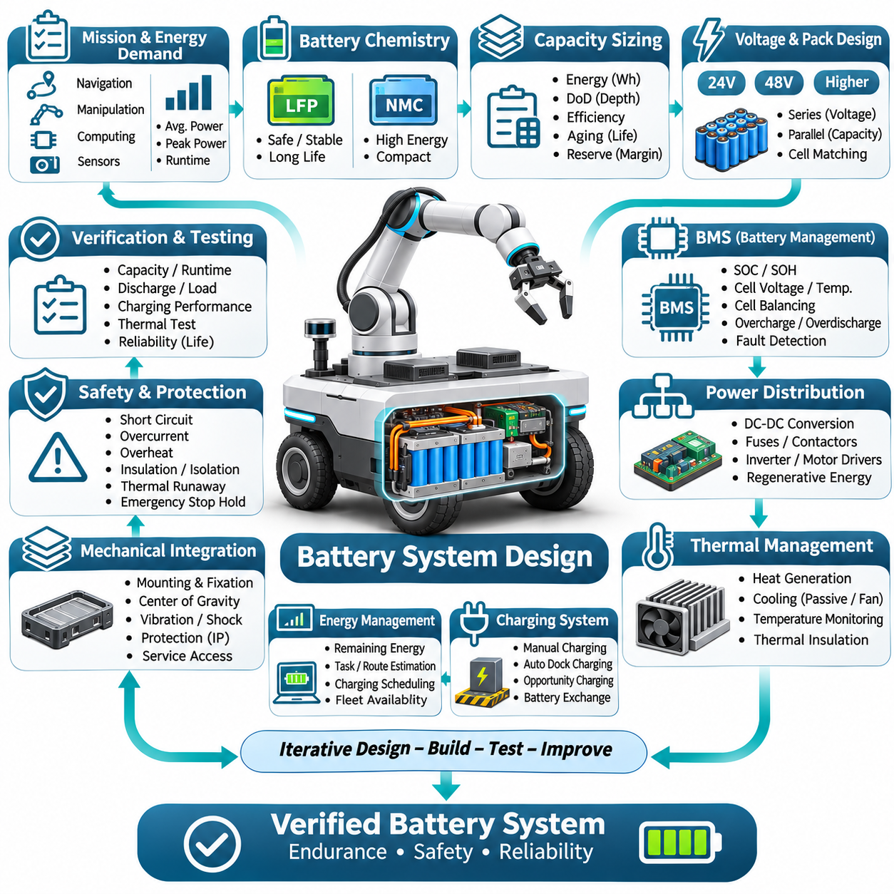{width="7.268055555555556in" height="7.268055555555556in"}

Battery system design is a fundamental engineering activity in mobile manipulator development because electrical energy availability directly determines operational endurance, mobility performance, manipulation capability, and system reliability. Unlike conventional stationary robotic systems, mobile manipulators must independently supply electrical energy to drive motors, robotic arms, computing platforms, sensors, and auxiliary equipment throughout their operating cycles.

The design process begins with the analysis of system-level energy requirements and representative operational scenarios. Engineers evaluate average power consumption, peak power demand, operating duration, charging frequency, and simultaneous subsystem utilization. Energy consumption during navigation, manipulation, perception, computing, idle operation, and standby conditions should be characterized to establish realistic battery capacity requirements.

Battery chemistry selection significantly influences energy density, power density, thermal stability, lifecycle performance, and system safety. Lithium iron phosphate (LFP) batteries provide favorable thermal stability and long cycle life, while nickel manganese cobalt (NMC) batteries generally offer higher energy density. The selection process must balance operational requirements, installation volume, battery weight, acquisition costs, and environmental conditions.

Battery capacity determination requires quantitative analysis of the energy consumed throughout representative mission profiles. The required capacity must account for discharge efficiency, allowable depth of discharge, auxiliary power consumption, battery aging, and operational reserve. Selecting a battery solely according to nominal energy consumption may result in insufficient endurance under demanding workloads or degraded battery conditions.

System voltage selection influences electrical distribution efficiency, conductor dimensions, motor controller compatibility, and power conversion requirements. Mobile manipulators may employ 24 V, 48 V, or higher-voltage electrical architectures depending on their power requirements. Increasing system voltage can reduce current for equivalent power, but insulation requirements, electrical protection, component compatibility, and maintenance safety must also be evaluated.

Battery pack architecture defines the series and parallel arrangement of individual cells or modules required to achieve target voltage, capacity, and current capabilities. Engineers must consider cell matching, internal resistance, connection reliability, mechanical packaging, and thermal uniformity. Manufacturing tolerances and differences in cell degradation can influence overall battery performance and should be addressed through appropriate pack engineering.

The Battery Management System (BMS) monitors and protects the battery pack throughout charging, discharging, and standby operation. Essential functions include cell voltage monitoring, temperature measurement, current sensing, cell balancing, overcharge protection, overdischarge protection, and fault detection. State of Charge (SOC) and State of Health (SOH) estimation provide operational information for energy management and predictive maintenance.

Power distribution architecture must accommodate the different electrical requirements of mobility, manipulation, perception, and computing subsystems. DC-to-DC converters, inverters, contactors, fuses, distribution modules, and protection circuits establish controlled energy delivery. Engineers must evaluate simultaneous peak loads, startup currents, voltage fluctuations, regenerative energy, conversion efficiency, and electrical fault propagation between interconnected subsystems.

Battery thermal management is necessary to maintain safe and reliable operation under varying environmental and electrical loading conditions. Heat generated by internal resistance, high discharge currents, charging activities, and surrounding electronic equipment must be appropriately managed. Passive cooling, forced-air cooling, thermal insulation, and temperature monitoring may be implemented according to battery chemistry and operating requirements.

Charging system development establishes the infrastructure required to restore battery energy while minimizing operational downtime. Manual charging, automatic docking-based charging, opportunity charging, and battery exchange systems provide different operational advantages. Charger specifications, charging current, voltage regulation, communication protocols, connector durability, and charging station alignment must be compatible with the selected battery architecture.

Energy management software coordinates battery utilization with navigation, manipulation, task scheduling, and fleet management functions. Remaining energy estimates should account for expected mission duration, payload conditions, travel distance, and manipulation workloads. Intelligent charging strategies can improve fleet availability by scheduling charging activities before energy reserves become insufficient while minimizing unnecessary charging cycles.

Mechanical integration of the battery pack directly influences chassis packaging, structural loading, center of gravity, and maintenance accessibility. Battery mounting structures must withstand operational vibration, mechanical shock, acceleration, braking, and representative collision loads. Appropriate environmental protection, cable routing, ventilation, structural reinforcement, and service access should be incorporated without compromising the stability of the mobile platform.

Battery safety engineering must address short circuits, excessive currents, overheating, overcharging, insulation failures, mechanical damage, and thermal runaway. Protective devices, electrical isolation, controlled disconnect mechanisms, and fault monitoring should be implemented according to the system risk assessment. Emergency stopping and power isolation strategies must also consider manipulator holding requirements and the consequences of sudden energy loss.

Battery system verification requires capacity testing, discharge characterization, charging validation, thermal assessment, communication testing, and safety-related functional evaluation. Prototype testing should reproduce representative navigation and manipulation cycles, simultaneous peak loads, environmental variations, and repeated charging activities. Long-duration testing provides evidence of capacity degradation, energy efficiency, and operational reliability.

The battery system design process concludes with a verified hardware baseline supported by electrical schematics, battery specifications, mechanical drawings, BMS interfaces, charging procedures, and test records. The final configuration must balance operational endurance, electrical performance, system safety, maintainability, and lifecycle costs while supporting subsequent hardware integration, field validation, manufacturing, and product lifecycle management.

## 06 Sensor Integration

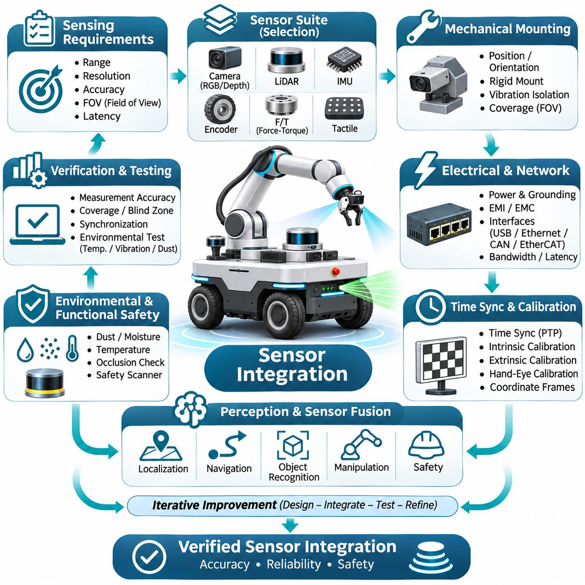{width="7.268055555555556in" height="7.268055555555556in"}

Sensor integration is a fundamental engineering activity that establishes the physical sensing capabilities of a mobile manipulator. The integrated sensor architecture must support environmental perception, localization, autonomous navigation, object recognition, manipulation, and operational safety. Effective integration requires coordinated mechanical, electrical, communication, and software development across the entire robotic platform.

The integration process begins with the identification of application-specific sensing requirements and operational scenarios. Engineers establish quantitative targets for detection range, spatial resolution, measurement accuracy, field of view, sampling frequency, and response latency. Sensor requirements must reflect environmental conditions, target object characteristics, manipulation tolerances, and safety-related operational constraints.

Sensor selection requires careful evaluation of complementary sensing technologies, including cameras, depth cameras, LiDAR, ultrasonic sensors, inertial measurement units, encoders, force-torque sensors, and tactile sensors. Each sensing technology provides distinct measurement capabilities and operational limitations. An appropriate sensor configuration should balance perception performance, reliability, integration complexity, energy consumption, and hardware costs.

Mechanical sensor integration determines measurement stability, environmental coverage, and calibration reliability. Engineers must establish mounting positions, installation orientations, structural rigidity, and mechanical reference points according to system requirements. Sensor mounting structures should minimize deformation, vibration, and accidental displacement while maintaining accessibility for inspection, calibration, replacement, and maintenance activities.

Camera integration supports object detection, pose estimation, visual navigation, inspection, and manipulation planning. Engineers must evaluate image resolution, frame rate, lens characteristics, exposure control, shutter technology, and illumination requirements. Fixed cameras provide environmental coverage, while wrist-mounted cameras enable close-range perception and precise observation of target objects during manipulation tasks.

LiDAR integration provides spatial measurements for environmental mapping, localization, obstacle detection, and autonomous navigation. Sensor installation height, scanning geometry, detection range, angular resolution, and blind zones must be evaluated against the physical configuration of the mobile platform. Robotic arm movements, structural components, and transported objects should not create unacceptable limitations in environmental coverage.

Proprioceptive sensor integration enables the robotic system to measure its internal motion and physical configuration. Wheel encoders, joint encoders, steering angle sensors, and inertial measurement units provide information about platform displacement, orientation, acceleration, and joint positions. Mechanical alignment, measurement resolution, sensor drift, and sampling frequency influence state estimation and motion control performance.

Force-torque and tactile sensor integration enables the mobile manipulator to obtain physical feedback during interaction with objects and external surfaces. Sensor selection must consider measurement range, overload tolerance, sensitivity, mechanical stiffness, and communication latency. Accurate contact measurements support gripping force regulation, compliant manipulation, slip detection, and controlled assembly operations.

Electrical sensor integration establishes reliable power delivery and signal transmission between sensing devices and embedded computing platforms. Engineers must evaluate supply voltage, current consumption, connector compatibility, grounding arrangements, cable shielding, and electromagnetic interference. Electrical protection and appropriate cable separation help maintain measurement reliability during simultaneous motor and actuator operation.

Communication architecture and bandwidth management are essential when numerous sensing devices operate concurrently. USB, Ethernet, GigE Vision, CAN, EtherCAT, and serial communication interfaces provide different performance characteristics. Network topology, data throughput, packet loss, transmission latency, and processing overhead must be evaluated to prevent communication bottlenecks and maintain predictable sensor data availability.

Time synchronization ensures that measurements acquired from different sensors correspond to consistent physical events. Hardware triggering, Precision Time Protocol (PTP), synchronized clocks, and timestamp management can reduce temporal discrepancies between cameras, LiDAR, inertial sensors, and encoders. Synchronization accuracy directly influences sensor fusion, motion estimation, three-dimensional reconstruction, and dynamic object tracking.

Sensor calibration establishes the geometric and measurement relationships necessary for accurate robotic operation. Intrinsic calibration, extrinsic calibration, hand-eye calibration, and coordinate frame registration must be performed according to the integrated hardware configuration. Calibration parameters should remain traceable to individual sensors, mounting configurations, environmental conditions, and approved hardware revisions.

Environmental protection and operational robustness must be incorporated into sensor integration throughout hardware development. Dust, moisture, temperature variations, mechanical shock, vibration, ambient illumination, and surface contamination can degrade measurement quality. Protective enclosures, optical windows, suitable mounting materials, thermal management, and cleaning accessibility should address representative operating conditions.

Safety-related sensor integration requires particular attention to detection coverage, fault monitoring, response times, and system-level risk assessment. Safety-rated laser scanners and protective sensing devices must be distinguished from conventional perception sensors. Protective field configurations and stopping behavior should account for platform velocity, payload conditions, manipulator movement, and potential human presence.

Sensor data integration connects physical sensing devices with embedded controllers, perception software, artificial intelligence models, and higher-level robotic applications. Standardized data formats, coordinate frame definitions, timestamps, diagnostic messages, and interface specifications facilitate consistent system integration. Sensor fusion algorithms can combine complementary measurements to improve environmental understanding and operational robustness.

Sensor integration verification requires measurement accuracy testing, coverage assessment, calibration validation, communication testing, synchronization measurement, and environmental evaluation. Prototype testing should reproduce representative navigation and manipulation scenarios, including changing lighting conditions, sensor occlusion, vibration, dynamic obstacles, and simultaneous subsystem operation. Identified limitations must guide iterative engineering improvements.

The sensor integration process concludes with a verified hardware configuration supported by sensor specifications, installation drawings, electrical schematics, calibration records, communication interfaces, and test results. The approved design baseline maintains traceability between sensing requirements and measured performance while supporting AI development, manipulation control, system validation, manufacturing, and long-term maintenance.

## 07 Electrical System Design

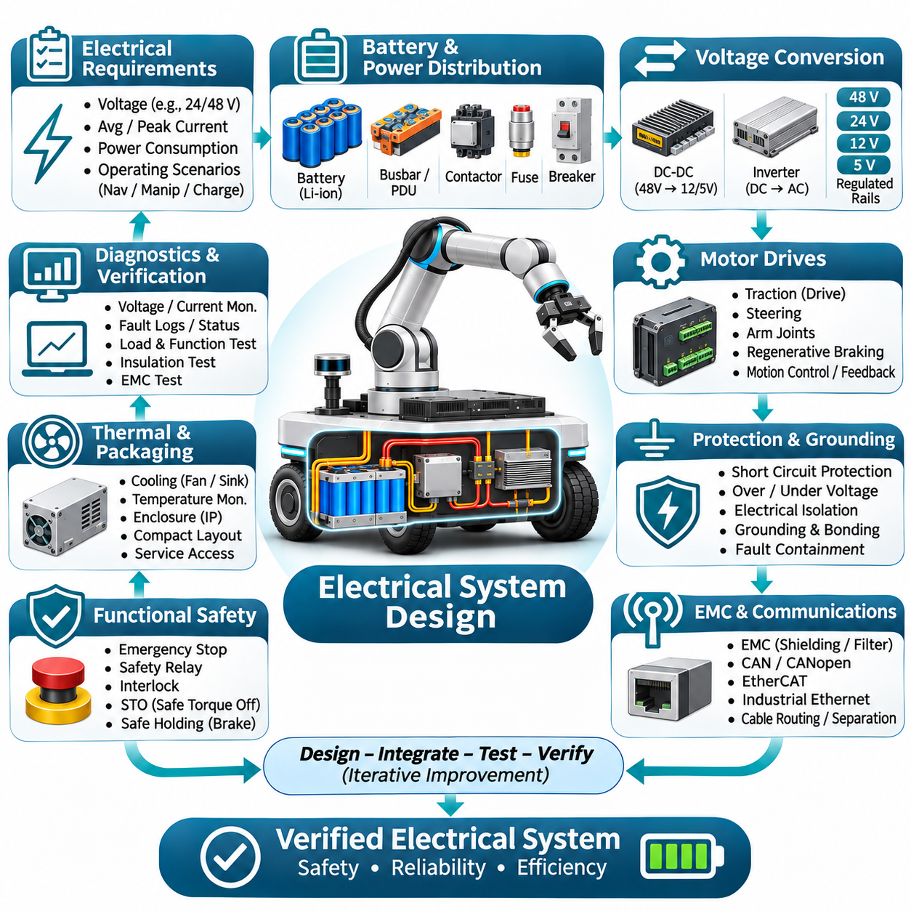{width="7.268055555555556in" height="7.268055555555556in"}

Electrical system design is a fundamental engineering activity that establishes the power distribution, electrical connectivity, control infrastructure, and operational reliability of a mobile manipulator. The electrical architecture must support the simultaneous operation of mobility systems, robotic arms, end effectors, perception sensors, embedded controllers, computing platforms, and safety-related equipment under varying operating conditions.

The design process begins with the analysis of system-level electrical requirements and subsystem power specifications. Engineers establish quantitative requirements for operating voltage, average current, peak current, power consumption, electrical protection, communication interfaces, and environmental resistance. These requirements must reflect representative navigation, manipulation, charging, standby, and emergency operating scenarios.

Electrical architecture development defines the relationships between energy storage, power conversion, power distribution, actuator control, computing resources, and peripheral devices. High-power circuits supplying drive motors and robotic manipulators should be appropriately separated from sensitive electronic circuits supporting perception and communication. Architectural decisions must consider electrical efficiency, scalability, fault isolation, and maintenance accessibility.

Power distribution system design establishes reliable electrical energy delivery from the battery pack to individual subsystems. Distribution modules, busbars, contactors, circuit breakers, fuses, and power connectors must accommodate continuous and transient electrical loads. Engineers must evaluate conductor current ratings, voltage drops, connection resistance, short-circuit conditions, and thermal characteristics throughout the distribution network.

Voltage conversion enables electrical compatibility between components operating at different voltage levels. DC-to-DC converters can supply lower-voltage electronic devices, sensors, and embedded controllers from the primary battery system, while inverters may supply alternating current to industrial robot controllers. Conversion efficiency, voltage regulation, transient response, electrical isolation, and thermal dissipation influence converter selection.

Motor drive integration requires coordinated electrical design for traction motors, steering actuators, robotic joints, and auxiliary mechanisms. Engineers must evaluate rated current, peak current, motor controller specifications, regenerative braking characteristics, and feedback interfaces. Simultaneous actuator operation and rapid acceleration or deceleration can generate electrical disturbances that must be accommodated without compromising system stability.

Electrical protection mechanisms prevent component damage and reduce operational hazards associated with excessive currents, short circuits, reverse polarity, overvoltage, undervoltage, and insulation failures. Protection devices must be selected according to circuit characteristics, available fault currents, operating conditions, and isolation requirements. Coordinated protection helps prevent localized electrical failures from propagating throughout the system.

Grounding and bonding architecture provides electrical reference stability, electromagnetic compatibility, and appropriate protection against electrical faults. Engineers must distinguish between power return paths, signal reference connections, chassis bonding, and protective grounding functions. Improper grounding configurations can introduce ground loops, measurement errors, communication disturbances, and unintended electrical current paths.

Electromagnetic compatibility (EMC) is particularly important because mobile manipulators combine high-power switching electronics with sensitive perception and control devices. Motor controllers, inverters, and power converters can generate conducted and radiated electromagnetic interference. Appropriate shielding, filtering, grounding, cable separation, and component placement help maintain reliable communication and sensor measurement quality.

Electrical communication interfaces connect motor controllers, battery management systems, safety controllers, sensors, and higher-level computing platforms. CAN, CANopen, EtherCAT, industrial Ethernet, and serial communication interfaces may be selected according to subsystem requirements. Physical network topology, termination resistance, electrical isolation, communication redundancy, and fault detection must be considered during integration.

Safety-related electrical architecture establishes the hardware infrastructure required to implement protective functions and controlled stopping behavior. Emergency stop circuits, safety controllers, safety relays, interlocks, and Safe Torque Off (STO) interfaces must be integrated according to application-specific risk assessments. Electrical safety functions must also consider gravitational loads, mechanical braking, and unintended object release.

Electrical thermal management addresses heat generated by power converters, motor controllers, contactors, conductors, and computing equipment. Engineers must evaluate power losses, component temperature limits, airflow characteristics, enclosure design, and environmental temperature variations. Appropriate cooling mechanisms and temperature monitoring help prevent excessive thermal stress, premature component degradation, and unexpected system shutdowns.

Electrical packaging and component placement must support mechanical integration, wiring harness development, assembly efficiency, and long-term serviceability. Electrical enclosures should provide suitable environmental protection, ventilation, connector accessibility, and physical separation between incompatible circuits. Component arrangements must also accommodate structural vibration, mechanical shock, maintenance procedures, and potential hardware configuration changes.

Electrical system diagnostics enable continuous monitoring of voltage levels, current consumption, component temperatures, communication status, and protection circuit conditions. Embedded controllers can collect diagnostic information and communicate abnormal operating states to higher-level management software. Structured fault codes, event logging, and subsystem health monitoring support troubleshooting and predictive maintenance.

Electrical system verification requires circuit inspection, voltage and current measurements, load testing, insulation assessment, communication validation, and electromagnetic compatibility evaluation. Prototype testing should reproduce representative motion cycles, simultaneous subsystem operation, peak power demand, charging transitions, and controlled fault conditions. Verification results must support corrective engineering changes and subsequent regression testing.

The electrical system design process concludes with a verified hardware baseline supported by electrical schematics, power distribution specifications, component lists, interface definitions, protection strategies, and test records. The approved electrical configuration establishes traceability between system requirements and verified performance while supporting wiring harness development, embedded system integration, manufacturing, and lifecycle management.

## 08 Wiring Harness Design

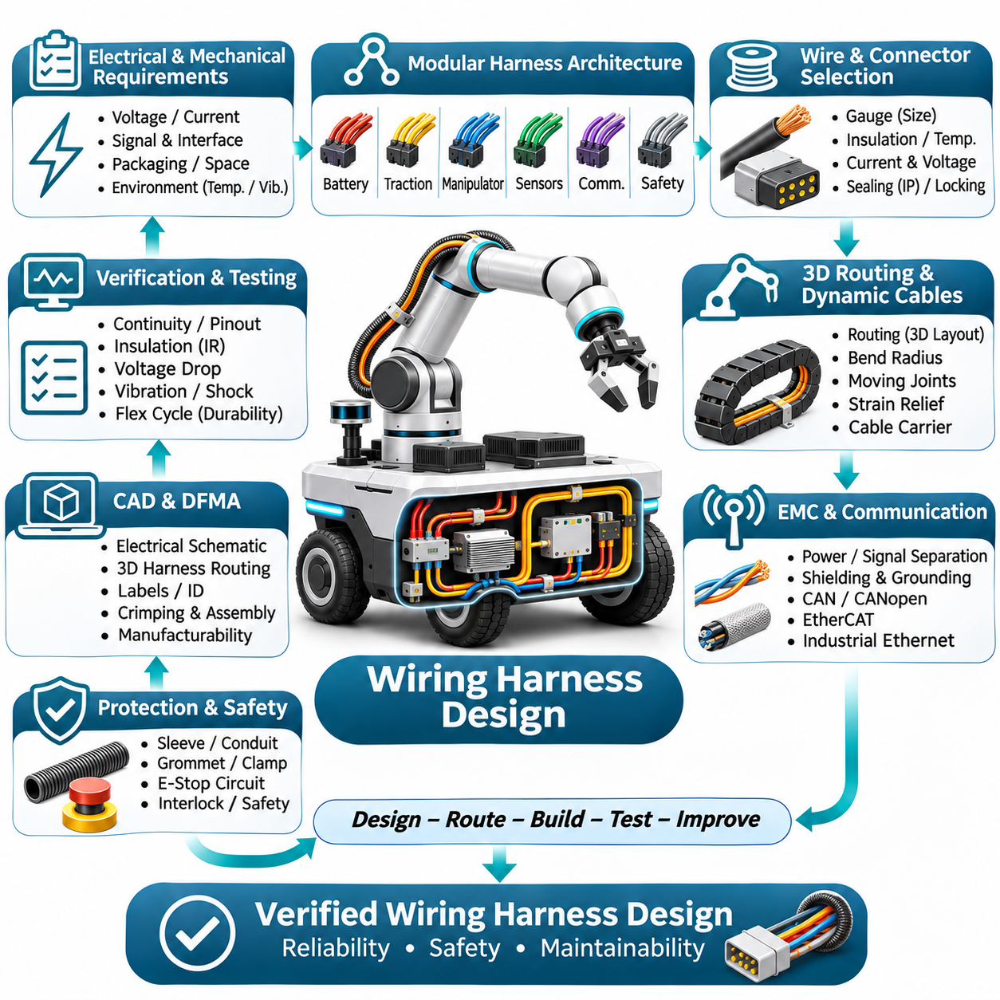{width="7.268055555555556in" height="7.268055555555556in"}

Wiring harness design is a fundamental engineering activity that establishes reliable electrical connectivity between the distributed subsystems of a mobile manipulator. The wiring harness integrates power distribution circuits, communication networks, sensor interfaces, motor controllers, safety devices, and embedded computing platforms. Its design directly influences electrical reliability, system maintainability, assembly efficiency, and operational safety.

The design process begins with the analysis of electrical architecture, subsystem interfaces, mechanical packaging, and environmental requirements. Engineers identify electrical connection points, operating voltages, current requirements, signal characteristics, connector specifications, and physical routing constraints. These requirements establish the foundation for developing a coordinated wiring harness architecture.

Wiring harness architecture defines the organization of electrical circuits into functional harness assemblies and distribution branches. A mobile manipulator may incorporate battery harnesses, traction motor harnesses, manipulator harnesses, sensor harnesses, communication harnesses, and safety harnesses. Modular partitioning facilitates subsystem integration, manufacturing, fault isolation, maintenance, and future hardware upgrades.

Wire selection requires careful evaluation of conductor cross-sectional area, current-carrying capacity, insulation characteristics, operating temperature, and mechanical flexibility. Engineers must consider continuous current, peak current, voltage drop, conductor heating, and thermal derating within bundled harnesses. Appropriate wire specifications help prevent electrical losses, insulation degradation, and premature component failures.

Connector and terminal selection determines the reliability of electrical interfaces between interconnected hardware components. Connector specifications must consider rated voltage, current capacity, contact resistance, environmental sealing, vibration resistance, mating cycles, and mechanical retention. Connector keying, secondary locking mechanisms, and terminal position assurance features help prevent incorrect assembly and accidental disconnection.

Three-dimensional harness routing establishes the physical pathways connecting electrical components throughout the mobile platform and robotic manipulator. Engineers must evaluate available packaging space, structural interference, minimum bending radius, mounting locations, and accessibility. Routing configurations should avoid sharp edges, excessive heat sources, moving mechanisms, and areas exposed to mechanical damage.

Dynamic wiring harness design is particularly important for robotic joints, steering mechanisms, rotating assemblies, and movable end effectors. Repeated bending, torsional loading, and mechanical friction can gradually damage conductors and insulation materials. High-flexibility cables, cable carriers, controlled bending geometries, strain relief mechanisms, and service loops should accommodate the complete range of robotic motion.

Electromagnetic compatibility must be incorporated into harness design to prevent interference between high-power electrical circuits and sensitive communication or perception devices. Motor power cables, inverter outputs, and switching power circuits should be appropriately separated from sensor and signal lines. Twisted-pair conductors, shielded cables, filtering, and suitable shield termination improve electromagnetic robustness.

Communication harness development establishes the physical transmission infrastructure for CAN, CANopen, EtherCAT, industrial Ethernet, and other communication interfaces. Cable impedance, characteristic termination, maximum transmission distance, shielding effectiveness, and network topology must satisfy interface specifications. Incorrect harness configurations can introduce signal reflections, intermittent communication failures, and data transmission errors.

Harness protection and mechanical retention are essential for maintaining electrical reliability under industrial operating conditions. Protective sleeves, corrugated conduits, abrasion-resistant coverings, grommets, cable clamps, and mounting brackets reduce exposure to vibration, friction, contamination, and mechanical impact. Retention systems must distribute mechanical loads without introducing excessive compression or localized stress.

Safety-related wiring harnesses connect emergency stop devices, safety controllers, protective sensors, interlocks, and actuator safety interfaces. Engineers must consider circuit separation, fault detection, electrical protection, connector integrity, and potential common-cause failures. Safety-related circuits should be designed and verified according to the required safety functions and application-specific risk assessment.

Computer-Aided Design (CAD) tools enable coordinated development of electrical schematics, connector definitions, three-dimensional harness routes, and manufacturing drawings. Digital harness models facilitate interference analysis, wire length estimation, branch positioning, and installation feasibility assessment. Integration between electrical and mechanical CAD environments reduces configuration inconsistencies and costly prototype modifications.

Design for Manufacturing and Assembly (DFMA) ensures that wiring harnesses can be produced and installed consistently across prototype and production platforms. Wire cutting, stripping, crimping, splicing, terminal insertion, connector assembly, and protective covering processes must be defined. Standardized components, circuit identification, labeling conventions, and assembly fixtures improve manufacturing repeatability and quality.

Wiring harness verification requires continuity testing, pin-to-pin connectivity inspection, insulation resistance measurement, voltage drop assessment, and mechanical durability evaluation. Prototype testing should reproduce vibration, repeated joint movements, steering cycles, temperature variations, and simultaneous electrical loading. Identified failures must guide corrective design modifications and subsequent regression testing.

The wiring harness design process concludes with a verified engineering baseline supported by electrical schematics, three-dimensional routing models, connector specifications, wire lists, harness drawings, bills of materials, assembly instructions, and test records. The approved configuration establishes design traceability while supporting embedded system integration, prototype fabrication, manufacturing, field validation, and lifecycle maintenance.

## 09 Embedded System Development

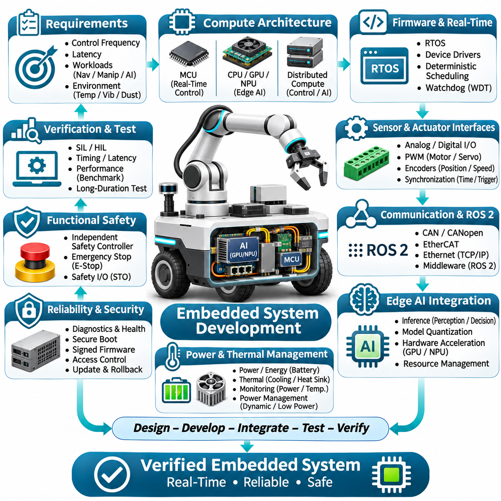{width="7.268055555555556in" height="7.268055555555556in"}

Embedded system development establishes the computational and control infrastructure required for reliable mobile manipulator operation. Embedded systems connect physical hardware with higher-level software applications by executing real-time control, sensor acquisition, actuator coordination, communication, and diagnostic functions. Their development directly influences system responsiveness, operational stability, energy efficiency, and safety.

The development process begins with the analysis of functional requirements, computational workloads, control frequencies, communication latency, and environmental constraints. Engineers must determine the processing resources required for autonomous navigation, manipulation control, sensor processing, artificial intelligence inference, and system monitoring. These requirements establish the foundation for embedded hardware and software selection.

Embedded computing architecture typically incorporates microcontrollers, industrial computers, system-on-module platforms, and specialized processing accelerators. Microcontrollers support deterministic low-level control, while high-performance computing platforms execute perception, localization, motion planning, and artificial intelligence workloads. Distributed computing architectures enable efficient workload allocation and functional separation.

Processor selection requires careful evaluation of computational performance, memory capacity, hardware acceleration, power consumption, thermal characteristics, and peripheral interfaces. Central processing units, graphics processing units, and neural processing units provide different computational capabilities. Hardware selection must balance application performance, energy efficiency, component availability, and long-term product support.

Real-time embedded control is essential for coordinating traction motors, steering actuators, robotic joints, and auxiliary mechanisms. Control algorithms must execute within defined timing constraints to maintain stable and predictable physical behavior. Real-time operating systems, deterministic scheduling mechanisms, interrupt management, and prioritized execution support reliable control under varying computational workloads.

Embedded firmware development establishes the low-level software functions required to operate physical hardware components. Device drivers, peripheral initialization, communication handlers, actuator interfaces, and hardware monitoring functions must be implemented according to system requirements. Modular firmware architecture facilitates hardware abstraction, software reuse, functional verification, and future hardware upgrades.

Sensor and actuator interfacing enables embedded controllers to acquire measurement data and transmit control commands efficiently. Analog inputs, digital inputs and outputs, pulse-width modulation, encoder interfaces, and industrial communication protocols support diverse hardware configurations. Interface development must address signal accuracy, sampling frequency, synchronization, electrical compatibility, and fault detection.

Embedded communication architecture connects distributed controllers, motor drives, battery management systems, perception devices, and supervisory computing platforms. CAN, CANopen, EtherCAT, Ethernet, and serial communication interfaces may be employed according to application requirements. Communication software must manage message prioritization, transmission latency, data integrity, timeout detection, and recovery mechanisms.

Edge artificial intelligence integration enables mobile manipulators to execute perception and decision-making workloads directly on embedded computing platforms. Hardware acceleration, model quantization, inference optimization, and efficient memory management reduce computational latency and energy consumption. AI workloads must be coordinated with control and safety-related functions to prevent resource contention and performance degradation.

Embedded software architecture should provide structured separation between hardware abstraction, device drivers, middleware, control algorithms, and application-level services. Frameworks such as ROS 2 can facilitate communication between distributed robotic software components. Clearly defined interfaces, standardized data structures, and modular software components improve system scalability, maintainability, and development efficiency.

Power and thermal management are critical because embedded computing platforms operate within limited battery capacity and constrained mechanical packaging. Engineers must evaluate processor utilization, power consumption, heat generation, cooling effectiveness, and environmental temperature variations. Dynamic power management and thermal monitoring can improve operational endurance while maintaining required computational performance.

Embedded system reliability requires mechanisms for detecting abnormal operating conditions and recovering from recoverable hardware or software failures. Watchdog timers, heartbeat monitoring, memory protection, communication diagnostics, and controlled restart procedures support operational robustness. Critical failures must trigger predefined protective responses rather than uncontrolled changes in robotic behavior.

Embedded cybersecurity protects robotic controllers, communication interfaces, firmware, and operational data against unauthorized access and malicious modification. Secure boot, authenticated communication, access control, signed firmware, and protected credential storage should be incorporated according to system security requirements. Software update mechanisms must support integrity verification and controlled rollback procedures.

Safety-related embedded system development requires separation between conventional computing functions and safety-critical control mechanisms. Safety controllers, emergency stop interfaces, protective monitoring, and actuator shutdown functions must operate according to application-specific risk assessments. Artificial intelligence processing or general-purpose software failures must not compromise independently implemented safety functions.

Embedded system verification requires firmware testing, interface validation, timing analysis, computational performance benchmarking, and reliability assessment. Software-in-the-Loop and Hardware-in-the-Loop testing enable controlled evaluation of representative operating scenarios and fault conditions. Long-duration prototype testing should assess computational stability, response latency, thermal behavior, and recovery performance.

The embedded system development process concludes with a verified hardware and software baseline supported by processor specifications, circuit documentation, firmware source code, interface definitions, configuration records, and test results. The approved configuration establishes traceability between system requirements and verified performance while supporting subsequent AI development, system integration, manufacturing, and lifecycle maintenance.

## 10 CAD Design

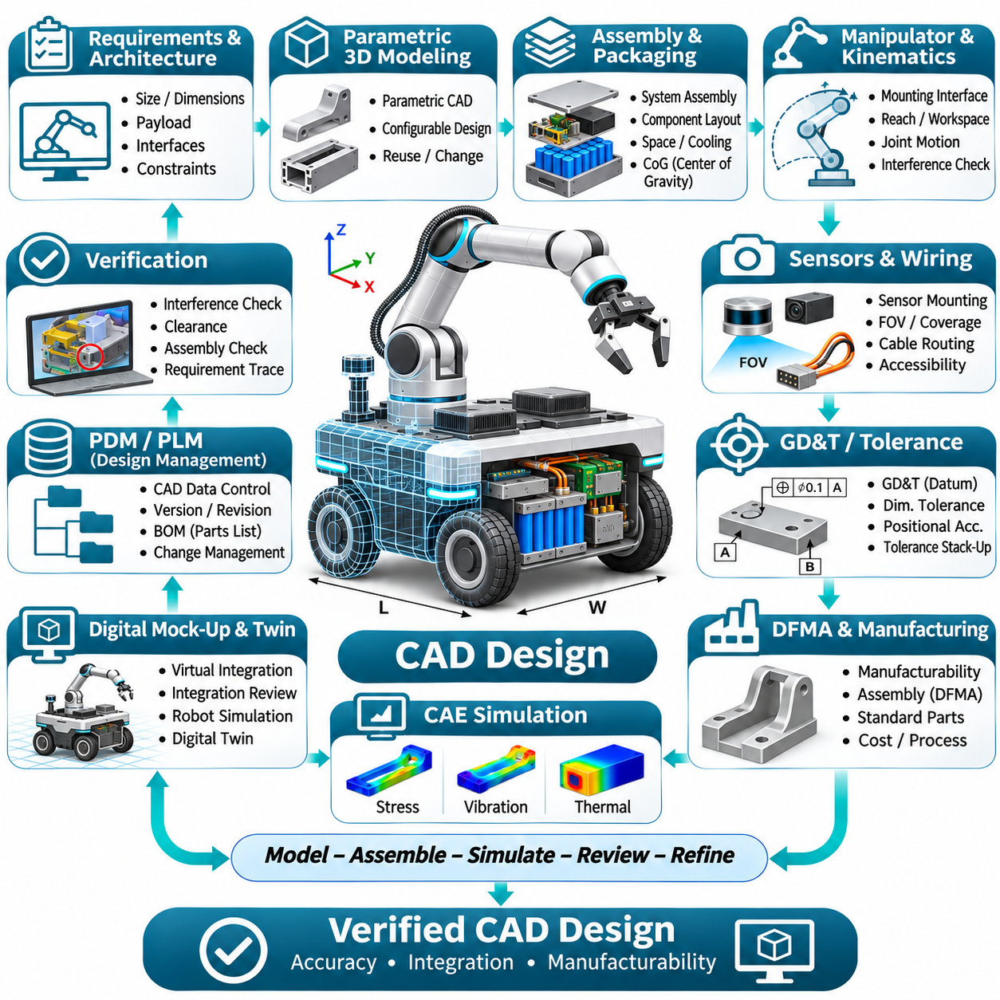{width="7.268055555555556in" height="7.268055555555556in"}

Computer-Aided Design (CAD) is a fundamental engineering activity that establishes the digital representation of a mobile manipulator throughout its hardware development lifecycle. CAD models define mechanical structures, component geometries, assembly relationships, installation interfaces, and physical packaging constraints. These digital representations support coordinated development, engineering analysis, prototype fabrication, and manufacturing preparation.

The CAD design process begins with the analysis of system requirements, mechanical architecture, hardware specifications, and operational constraints. Engineers establish platform dimensions, payload requirements, manipulator installation positions, sensor mounting locations, and maintenance accessibility. These requirements provide the foundation for geometric modeling, component development, and assembly configuration.

Parametric three-dimensional modeling enables engineers to define component geometries using dimensions, geometric constraints, mathematical relationships, and configurable design parameters. Structural frames, mounting brackets, protective enclosures, mechanical interfaces, and customized components can be systematically developed and modified. Parametric modeling improves design flexibility, geometric consistency, and engineering change efficiency.

Assembly-level CAD design establishes the spatial and functional relationships between the autonomous mobile robot base, robotic manipulator, battery system, drive mechanisms, sensors, and electronic equipment. Assembly models allow engineers to evaluate component positioning, mechanical compatibility, installation procedures, and structural relationships before physical prototypes are manufactured.

Mechanical packaging design optimizes the arrangement of hardware components within the available installation volume. Engineers must consider component dimensions, weight distribution, center of gravity, cooling requirements, electrical connectivity, and maintenance accessibility. Effective packaging reduces unnecessary platform dimensions while preserving operational stability, structural integrity, and opportunities for future expansion.

Manipulator integration requires precise geometric definition of the robot mounting interface, installation orientation, working envelope, and structural attachment points. CAD models enable engineers to evaluate relationships between manipulator reachability, platform dimensions, payload distribution, and surrounding structures. The integrated geometry should support representative manipulation tasks without introducing unacceptable mechanical interference.

Kinematic representation within CAD environments enables the evaluation of steering mechanisms, suspension systems, robotic joints, and movable assemblies. Joint constraints, rotational limits, translational movements, and mechanical relationships can be defined to reproduce representative hardware configurations. Motion studies help identify geometric interference, insufficient clearance, restricted movement, and potential assembly conflicts.

Sensor and electrical component integration requires coordinated modeling of mounting structures, optical fields of view, connector orientations, and cable routing pathways. Engineers must evaluate potential sensor occlusion caused by structural components, robotic arm movements, and transported objects. Accurate geometric representations support sensor positioning, electrical packaging, calibration accessibility, and wiring harness development.

Structural design within CAD environments establishes load-bearing components capable of supporting operational forces and mechanical constraints. Engineers develop chassis frames, reinforcement structures, manipulator mounting plates, and equipment support mechanisms according to anticipated loading conditions. Material properties, component thickness, connection geometry, and structural arrangements provide essential inputs for subsequent engineering analysis.

Geometric Dimensioning and Tolerancing (GD&T) defines the dimensional accuracy and geometric relationships required for reliable component manufacturing and assembly. Engineers must establish appropriate datums, dimensional tolerances, positional accuracy, flatness, perpendicularity, and other geometric requirements. Tolerance stack-up analysis helps evaluate accumulated manufacturing variations across interconnected mechanical interfaces.

Design for Manufacturing and Assembly (DFMA) should be incorporated throughout the CAD development process. Component geometries must reflect available manufacturing technologies, material characteristics, machining accessibility, fabrication constraints, and assembly requirements. Standardized fasteners, simplified structures, reduced component counts, and accessible installation interfaces improve production efficiency and minimize manufacturing complexity.

CAD integration with Computer-Aided Engineering (CAE) enables geometric models to serve as the foundation for structural, thermal, vibration, and dynamic simulation. Engineers can evaluate stress distribution, mechanical deformation, natural frequencies, thermal behavior, and stability under representative operating conditions. Simulation results support iterative geometric modifications before physical prototype development.

Digital mock-up development enables multidisciplinary engineering teams to evaluate the complete mobile manipulator configuration within a shared virtual environment. Mechanical, electrical, embedded system, and robotics engineers can identify integration conflicts and coordinate design changes before fabrication. Digital mock-ups also provide geometric foundations for robotic simulation, virtual commissioning, and digital twin development.

CAD data management establishes controlled procedures for component identification, revision management, assembly configuration, and engineering change tracking. Product Data Management (PDM) and Product Lifecycle Management (PLM) systems facilitate the organization and distribution of approved engineering information. Controlled design baselines reduce configuration inconsistencies and maintain traceability throughout product development.

CAD design verification requires dimensional inspection, assembly compatibility assessment, interference detection, motion envelope evaluation, and manufacturing feasibility reviews. Multidisciplinary design reviews should assess structural arrangements, electrical packaging, component accessibility, safety clearances, and maintenance procedures. Identified deficiencies must be resolved through controlled engineering changes before design release.

The CAD design process concludes with an approved engineering baseline supported by three-dimensional component models, assembly models, manufacturing drawings, material specifications, tolerance definitions, and bills of materials. The verified digital configuration establishes traceability between mechanical requirements and physical design while supporting CAE analysis, prototype fabrication, design optimization, manufacturing, and lifecycle management.

## 11 CAE and Simulation

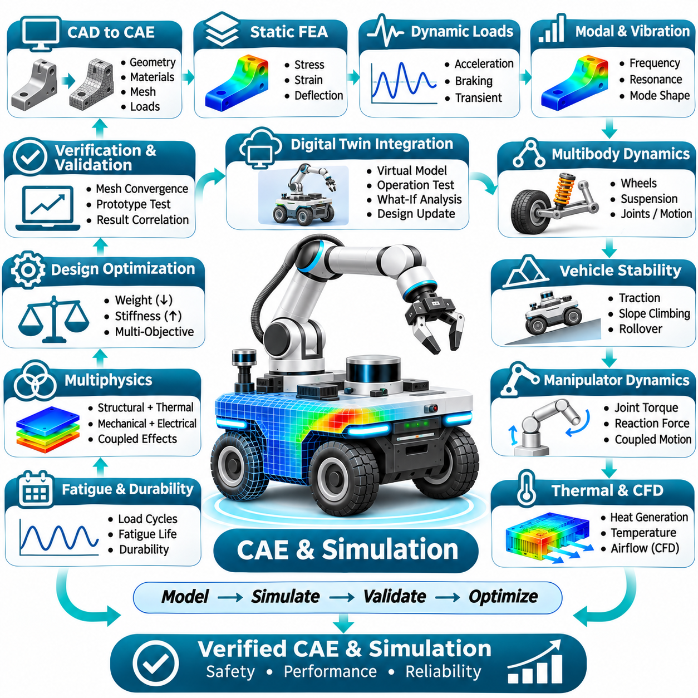{width="7.268055555555556in" height="7.268055555555556in"}

Computer-Aided Engineering (CAE) and simulation provide a systematic approach to evaluating the physical performance of mobile manipulators before prototype fabrication. Engineering simulations enable developers to investigate structural integrity, mechanical deformation, dynamic behavior, thermal characteristics, and operational stability. These capabilities reduce development risks, physical testing requirements, and engineering modification costs.

The CAE development process begins with the transformation of Computer-Aided Design (CAD) models into computational representations suitable for engineering analysis. Geometric simplification, material assignment, mesh generation, boundary condition definition, and load specification establish the foundation for numerical simulation. Model accuracy and computational efficiency must be balanced according to analysis objectives.

Finite Element Analysis (FEA) enables engineers to evaluate stress distribution, strain, displacement, and structural deformation within mechanical components. Chassis frames, manipulator mounting structures, suspension components, and equipment support brackets must withstand anticipated operational loads. Structural simulation helps identify stress concentrations, insufficient stiffness, excessive deformation, and potential mechanical failure.

Static structural analysis evaluates mechanical behavior under stationary or slowly changing loading conditions. Representative load cases include battery weight, manipulator mass, transported payloads, and forces generated during robotic manipulation. Engineers must assess structural deformation, stress levels, mounting interface stiffness, and safety factors to determine whether the proposed design satisfies mechanical requirements.

Dynamic structural analysis investigates mechanical responses generated by acceleration, deceleration, emergency braking, manipulator motion, and external disturbances. Transient forces and inertial effects can introduce significant loads that are not represented by static calculations. Dynamic simulation enables engineers to evaluate structural responses under realistic operating scenarios and identify potential mechanical weaknesses.

Modal and vibration analysis determine the natural frequencies, vibration modes, and dynamic characteristics of mechanical structures. Mobile manipulators may experience excitation from traction motors, wheel rotation, uneven surfaces, and robotic joint movements. Engineers must identify potential resonance conditions that could degrade positioning accuracy, sensor measurements, structural durability, and manipulation performance.

Multibody Dynamics (MBD) simulation enables the analysis of interconnected mechanical components, including wheels, steering mechanisms, suspension systems, robotic joints, and movable assemblies. Computational models represent mass properties, inertial characteristics, joint constraints, actuator forces, and mechanical interactions. These simulations support motion analysis, actuator sizing, load prediction, and mechanical configuration evaluation.

Vehicle dynamics simulation evaluates the mobility characteristics and operational stability of autonomous mobile robot platforms. Engineers investigate acceleration performance, braking behavior, steering response, wheel traction, weight transfer, and slope traversal capabilities. Simulation scenarios should incorporate representative payload distributions and manipulator configurations to assess potential wheel unloading and rollover risks.

Manipulator dynamics simulation evaluates joint torques, reaction forces, acceleration profiles, and mechanical loads generated during robotic operations. Manipulator movements produce dynamic forces that propagate through mounting interfaces and supporting mobile platforms. Coupled simulation of the mobile base and robotic manipulator helps determine structural requirements, permissible motion profiles, and stable operating conditions.

Thermal simulation evaluates heat generation, heat transfer, and temperature distribution within mechanical and electrical assemblies. Battery systems, motor controllers, embedded computing platforms, and power electronics generate heat during continuous operation. Computational Fluid Dynamics (CFD) and thermal analysis support cooling system development, ventilation optimization, and component temperature assessment.

Fatigue and durability analysis investigate the long-term effects of repeated mechanical loading on structural components and connection interfaces. Mobile manipulators may experience continuous vibration, repeated acceleration, steering cycles, and manipulation loads throughout their operational lifetimes. Representative load histories and material fatigue properties support service life estimation and structural durability improvement.

Multiphysics simulation integrates interacting physical phenomena within a unified computational environment. Mechanical deformation, electromagnetic effects, thermal behavior, and electrical power losses can influence individual hardware components and overall system performance. Coupled simulation enables engineers to investigate interactions that would otherwise remain undetected through isolated engineering analyses.

Simulation-based design optimization enables engineers to explore alternative component geometries, material selections, structural configurations, and mechanical parameters. Parametric studies, sensitivity analysis, topology optimization, and multi-objective optimization support systematic engineering improvement. Optimization objectives may include weight reduction, structural stiffness, thermal efficiency, durability, and manufacturing feasibility.

Simulation model verification and validation are essential for establishing confidence in numerical engineering results. Mesh convergence studies, analytical comparisons, sensitivity assessments, and experimental measurements help determine computational accuracy and model limitations. Physical prototype testing should provide representative data for calibrating simulation parameters and validating predicted mechanical behavior.

Integration between CAE environments and robotic simulation platforms enables engineering models to support broader system development activities. Validated mass properties, joint characteristics, collision geometries, and mechanical constraints can be transferred into robotic simulation and digital twin environments. These models support virtual testing, control algorithm development, and evaluation of hardware and software interactions.

The CAE and simulation process concludes with a verified engineering analysis baseline supported by computational models, material definitions, loading conditions, simulation parameters, validation records, and engineering recommendations. Documented results establish traceability between hardware requirements and predicted physical performance while supporting prototype fabrication, design optimization, physical testing, and manufacturing preparation.

## 12 Prototype Fabrication

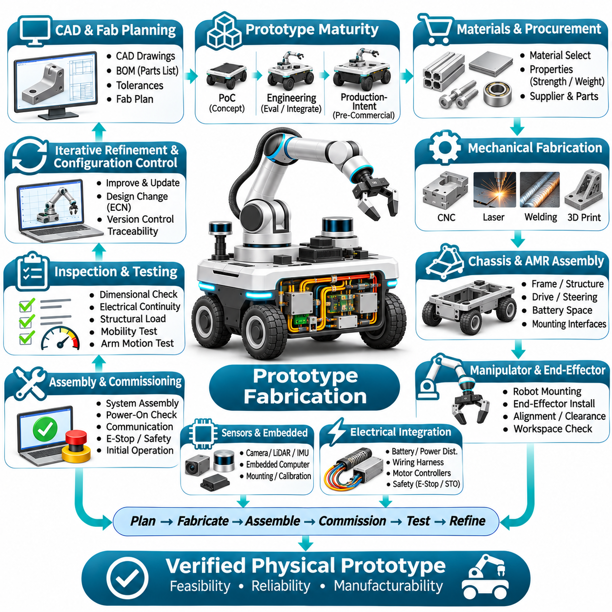{width="7.268055555555556in" height="7.268055555555556in"}

Prototype fabrication transforms verified engineering designs into physical hardware configurations that enable practical evaluation of mobile manipulator systems. This development stage connects digital modeling, engineering simulation, component manufacturing, and multidisciplinary system integration. Physical prototypes provide essential evidence for assessing design feasibility, mechanical performance, functional compatibility, and operational reliability.

The prototype fabrication process begins with the review of approved CAD models, manufacturing drawings, material specifications, bills of materials, and engineering analysis results. Engineers must identify critical components, manufacturing tolerances, procurement requirements, assembly sequences, and inspection criteria. Fabrication planning establishes a controlled transition from digital engineering models to physical implementation.

Prototype development can involve multiple levels of physical implementation according to engineering objectives and technological maturity. Proof-of-concept prototypes demonstrate fundamental operating principles, while engineering prototypes support detailed performance evaluation and subsystem integration. Production-intent prototypes incorporate representative materials, manufacturing processes, and assembly configurations intended for subsequent commercialization.

Material selection and procurement establish the physical foundation for prototype manufacturing. Engineers must evaluate material strength, stiffness, weight, corrosion resistance, thermal characteristics, processing requirements, and supplier availability. Purchased components, including drive units, robotic manipulators, batteries, sensors, and electronic controllers, must satisfy approved engineering specifications and mechanical interface requirements.

Mechanical fabrication encompasses machining, laser cutting, sheet metal bending, welding, casting, and additive manufacturing according to component geometry and material characteristics. Structural frames, mounting plates, protective enclosures, and customized brackets must be manufactured within specified dimensional tolerances. Appropriate fabrication methods should balance structural performance, manufacturing accuracy, development time, and prototype cost.

Additive manufacturing enables rapid production of customized mechanical components, installation fixtures, sensor brackets, protective housings, and geometric verification models. Three-dimensional printing supports iterative design improvements without requiring expensive production tooling. However, printed components intended for load-bearing applications must be evaluated for material properties, directional strength, dimensional stability, and environmental durability.

Chassis and mobile platform fabrication establishes the primary load-bearing structure of the mobile manipulator. Frame assemblies must accommodate battery systems, traction drives, steering mechanisms, electronic equipment, and manipulator mounting interfaces. Structural alignment, mounting accuracy, ground clearance, weight distribution, and overall dimensional consistency must be verified during fabrication and mechanical assembly.

Manipulator and end-effector installation requires precise alignment between robotic components and their supporting mechanical structures. Mounting interfaces, fastener specifications, structural reinforcement, cable routing, and service accessibility must be evaluated during assembly. Engineers should verify mechanical clearances, working envelopes, joint movement restrictions, and potential interference throughout representative operating configurations.

Electrical system fabrication includes the installation of battery systems, power distribution units, motor controllers, embedded computing platforms, safety devices, and wiring harnesses. Assembly procedures must address electrical insulation, connector integrity, grounding, circuit protection, cable retention, and electromagnetic compatibility. Electrical inspections should precede initial system energization to minimize equipment damage and safety risks.

Sensor installation and embedded hardware integration establish the physical infrastructure required for autonomous operation and robotic control. Cameras, LiDAR sensors, inertial measurement units, encoders, and other perception devices must be installed according to approved geometric configurations. Mounting rigidity, sensor orientation, vibration isolation, electrical connectivity, and calibration accessibility influence subsequent system performance.

Prototype assembly requires coordinated execution of mechanical, electrical, electronic, and embedded system integration activities. Assembly sequences should minimize unnecessary disassembly, installation conflicts, component damage, and configuration inconsistencies. Controlled fastening procedures, dimensional measurements, electrical inspections, and assembly records help maintain engineering traceability throughout the fabrication process.

Initial prototype commissioning establishes the basic operational readiness of the integrated hardware system. Engineers must progressively verify power distribution, communication interfaces, embedded controllers, actuator responses, sensor outputs, and protective functions. Controlled commissioning procedures should prioritize low-energy operating conditions, restricted motion, emergency stop verification, and systematic fault identification.

Prototype inspection and testing evaluate whether fabricated hardware satisfies approved engineering requirements and initial performance expectations. Dimensional inspections, electrical continuity tests, structural load assessments, mobility tests, and manipulator motion evaluations provide essential verification data. Measured performance should be compared with CAD specifications and CAE predictions to identify discrepancies requiring further investigation.

Iterative prototype refinement transforms identified fabrication defects, integration conflicts, and performance limitations into controlled engineering improvements. Engineers must investigate root causes, update design documentation, implement corrective modifications, and repeat relevant verification activities. Systematic prototype iteration helps improve mechanical reliability, manufacturing feasibility, assembly efficiency, and operational robustness.

Prototype fabrication management requires effective coordination of procurement schedules, manufacturing resources, engineering personnel, development budgets, and technical documentation. Component identification, revision control, supplier quality records, fabrication deviations, and assembly histories should be maintained throughout development. Configuration management ensures that measured prototype performance corresponds to an identifiable hardware baseline.

The prototype fabrication process concludes with an inspected and documented physical hardware baseline supported by manufacturing records, assembly documentation, configuration information, commissioning results, and identified improvement requirements. The completed prototype provides a practical foundation for design optimization, artificial intelligence integration, manipulation development, system testing, field validation, and manufacturing preparation.

## 13 Design Optimization

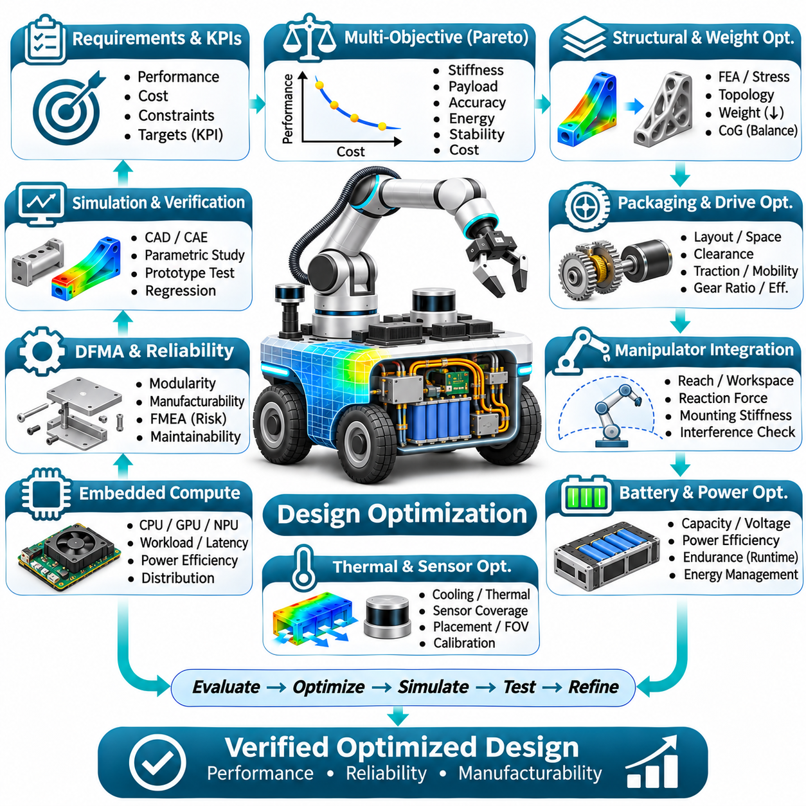{width="7.268055555555556in" height="7.268055555555556in"}

Design optimization is a systematic engineering process that improves the physical configuration, functional performance, reliability, and manufacturing efficiency of mobile manipulators. It transforms findings from hardware development, engineering simulation, prototype fabrication, and experimental testing into measurable design improvements. Optimization establishes a balance between technical performance, development cost, and operational requirements.

The design optimization process begins with the evaluation of existing hardware configurations against established system requirements and performance indicators. Engineers identify structural weaknesses, excessive component weight, energy losses, thermal limitations, mechanical interference, and manufacturing difficulties. These findings establish optimization objectives, design constraints, and measurable improvement targets.

Multi-objective optimization addresses the competing engineering requirements associated with mobile manipulator development. Structural stiffness, payload capacity, positioning accuracy, energy efficiency, operational stability, manufacturing cost, and maintenance accessibility must be considered simultaneously. Pareto-optimal solutions help engineers evaluate design alternatives without disproportionately sacrificing essential system capabilities.

Structural optimization improves the mechanical performance of chassis frames, manipulator mounting structures, reinforcement members, and equipment support assemblies. Finite Element Analysis (FEA), topology optimization, and parametric modeling enable engineers to identify inefficient material distribution. Optimized structures should reduce unnecessary mass while maintaining required strength, stiffness, and durability.

Weight optimization directly influences mobility performance, battery consumption, payload capacity, and transportation efficiency. Engineers evaluate material alternatives, component thickness, structural arrangements, and opportunities for functional integration. Weight reduction must be coordinated with center-of-gravity management and structural requirements to avoid compromising platform stability or manipulation accuracy.

Mechanical packaging optimization improves the spatial arrangement of batteries, drive units, embedded computers, sensors, electrical components, and robotic manipulators. Engineers must balance installation volume, service accessibility, cable routing, cooling pathways, and mechanical clearances. Effective packaging reduces unused space and supports compact configurations without introducing integration or maintenance difficulties.

Drive system optimization focuses on improving traction efficiency, steering responsiveness, actuator performance, and mechanical power transmission. Motor specifications, gear ratios, wheel dimensions, drivetrain losses, and control characteristics should be evaluated under representative operating conditions. Appropriate configuration refinement reduces energy consumption while maintaining required mobility and load-handling capabilities.

Manipulator integration optimization evaluates mounting positions, working envelopes, joint configurations, end-effector characteristics, and mechanical interactions with the mobile platform. Engineers must consider reachability, payload distribution, mounting stiffness, and reaction forces generated during robotic operations. Optimized configurations improve task execution while reducing mechanical interference and instability.

Battery and power system optimization improves operational endurance through efficient energy storage, electrical distribution, and component selection. Battery capacity, voltage architecture, power conversion efficiency, conductor dimensions, and peak load requirements must be evaluated collectively. Representative mission profiles help determine appropriate energy reserves without introducing excessive battery weight or system cost.

Thermal optimization addresses heat generation and dissipation within battery assemblies, motor controllers, embedded computing platforms, and electrical enclosures. Engineers can evaluate heat sink geometries, cooling fan configurations, ventilation pathways, and component placement through thermal simulation. Improved thermal management supports computational performance, component reliability, and extended operational lifetimes.

Sensor integration optimization improves perception coverage, measurement accuracy, environmental robustness, and calibration stability. Sensor mounting positions, installation orientations, vibration isolation, and potential occlusion must be evaluated across representative operating scenarios. Optimized sensor configurations reduce coverage gaps and unnecessary hardware redundancy while maintaining required perception capabilities.

Embedded hardware optimization balances computational performance, power consumption, communication bandwidth, memory capacity, and thermal limitations. Engineers evaluate processor architectures, hardware accelerators, distributed computing arrangements, and workload allocation strategies. Optimized computing configurations must satisfy real-time control requirements and support anticipated artificial intelligence workloads.

Manufacturing and assembly optimization improves hardware producibility through component standardization, simplified geometries, modular construction, and accessible mechanical interfaces. Design for Manufacturing and Assembly (DFMA) principles help reduce machining operations, assembly complexity, specialized tooling, and production variability. These improvements contribute to lower manufacturing costs and consistent product quality.

Reliability and maintainability optimization addresses potential failure mechanisms, component degradation, inspection accessibility, and replacement procedures. Failure Mode and Effects Analysis (FMEA), durability testing, and maintenance evaluations help engineers prioritize corrective improvements. Modular assemblies, standardized connectors, diagnostic interfaces, and accessible service points reduce operational downtime.

Simulation-driven optimization and experimental verification establish a continuous feedback mechanism between virtual engineering models and physical hardware. Parametric studies, sensitivity analysis, design of experiments, and prototype measurements enable systematic evaluation of alternative configurations. Proposed modifications must undergo appropriate regression testing to confirm improvements without introducing new deficiencies.

The design optimization process concludes with an approved hardware baseline supported by updated CAD models, CAE results, revised specifications, manufacturing documentation, and comparative test records. Documented improvements establish traceability between initial requirements and optimized performance while providing a reliable foundation for AI development, manipulation integration, system testing, and subsequent manufacturing.
