**Volume 05. Mobile Manipulator Projects and Development Manual**

# Chapter 04. AI Development

## 01 AI Development Overview

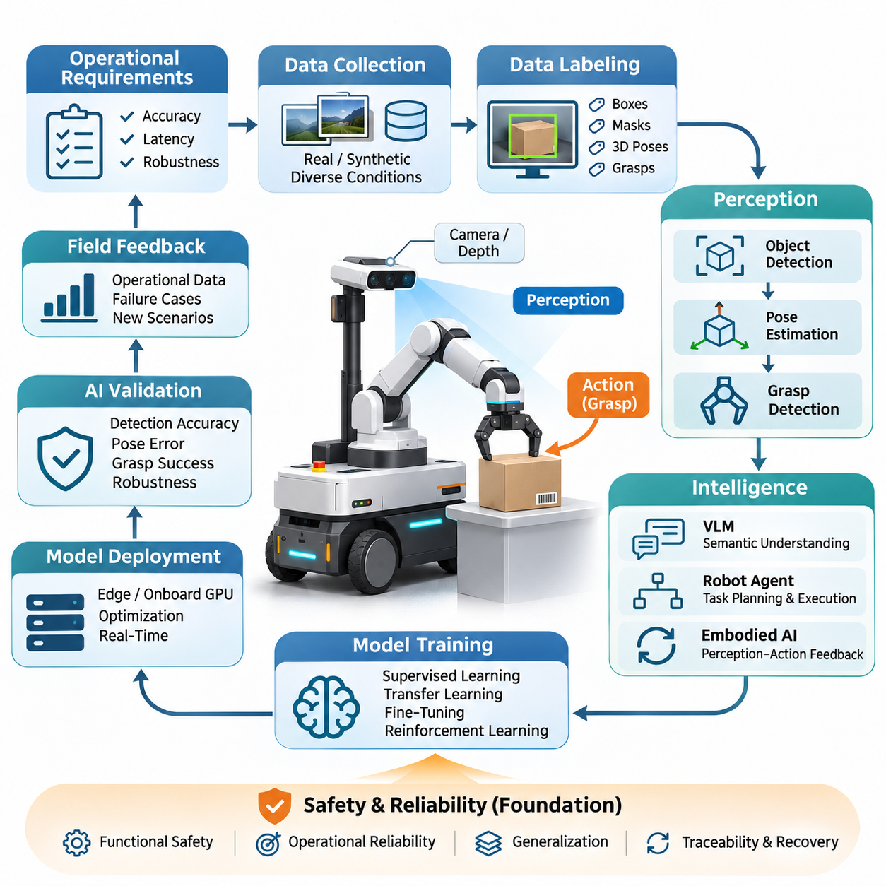{width="7.268055555555556in" height="7.268055555555556in"}

AI development for a mobile manipulator is a systematic engineering process that transforms operational requirements into intelligent perception, decision-making, and interaction capabilities. Unlike conventional software development, AI development must account for changing environments, physical objects, sensor uncertainty, and real-time robotic operations. The objective is to build AI capabilities that enable a mobile manipulator to perceive its surroundings, recognize objects, estimate spatial relationships, plan manipulation tasks, and execute actions reliably.

The AI development process begins with translating system-level requirements into measurable AI capabilities. These requirements define what the robot must recognize, estimate, understand, and decide under different operating conditions. For example, a warehouse mobile manipulator may need to identify packages, estimate their positions and orientations, detect graspable regions, and distinguish between accessible and obstructed objects. Each capability should have measurable performance targets, including accuracy, latency, robustness, and operational reliability.

Data engineering is a fundamental part of AI development because model performance depends heavily on the quality and representativeness of training data. Mobile manipulators operate in environments where lighting, object appearance, camera viewpoints, background conditions, and object arrangements can change continuously. Data collection should therefore cover realistic operating conditions, including normal operations, unusual situations, partial occlusions, and potential failure cases. Both real-world and synthetic datasets can contribute to building sufficiently diverse training resources.

Data labeling establishes the ground truth required for supervised learning and quantitative evaluation. Depending on the AI task, annotations may include object bounding boxes, semantic categories, segmentation masks, keypoints, three-dimensional coordinates, object orientations, and grasp configurations. Labeling quality must be controlled through consistent annotation guidelines, automated validation, and human review. Incorrect or inconsistent labels can introduce systematic errors that remain difficult to identify during model training and deployment.

The perception subsystem provides the visual understanding required for robotic manipulation. Object detection models identify relevant objects and determine their image-space locations, while pose estimation models calculate spatial positions and orientations. Grasp detection models identify candidate contact regions and suitable grasp configurations. These capabilities should operate as an integrated perception pipeline rather than independent algorithms. Their outputs must be compatible with the robot coordinate system, sensor calibration, and manipulation planning interfaces.

Vision-Language Models (VLMs) extend conventional visual perception by connecting image understanding with natural-language instructions and semantic reasoning. A mobile manipulator can use VLM capabilities to interpret instructions such as identifying a particular package, locating a specified component, or describing the condition of an object. However, language-based reasoning should not replace deterministic geometric estimation or safety-critical control. A practical architecture combines semantic understanding from VLMs with verified perception, motion planning, and execution mechanisms.

Robot agents provide a higher-level decision-making capability by coordinating perception, reasoning, planning, and tool execution. An AI agent may interpret a task, determine which information is missing, request additional observations, select an appropriate manipulation procedure, and monitor execution results. In a mobile manipulation system, agents should interact with established robotic interfaces rather than directly controlling safety-critical hardware without appropriate constraints. Their decisions must remain observable, traceable, and recoverable when unexpected conditions occur.

Embodied AI connects intelligence with physical interaction through continuous perception-action feedback. Instead of treating the robot as a system that simply receives commands and executes predefined motions, embodied intelligence allows it to adapt its behavior according to environmental observations and physical outcomes. This includes recognizing unsuccessful grasps, responding to object displacement, adjusting manipulation strategies, and recovering from unexpected interactions. Successful embodied AI development requires coordination between perception, learning, motion planning, force control, and the physical characteristics of the robot.

Model training converts collected and labeled datasets into deployable AI models. Training strategies may include supervised learning, transfer learning, fine-tuning of pretrained models, and reinforcement learning where appropriate. Dataset partitioning, hyperparameter optimization, regularization, and repeatable experiment management are essential for obtaining reliable results. Training should consider not only average model accuracy but also generalization to previously unseen objects, environments, and operating conditions. Model versions and training configurations should be maintained for reproducibility.

Model deployment transfers trained AI models from development environments to the computing platforms installed on the mobile manipulator. Deployment engineering must consider hardware capabilities, GPU acceleration, memory consumption, inference latency, communication overhead, and power limitations. Models may require optimization through quantization, pruning, graph optimization, or hardware-specific inference engines. The deployed implementation must preserve sufficient accuracy while meeting the real-time processing requirements of perception and manipulation tasks.

AI validation determines whether the developed models satisfy their intended operational requirements. Evaluation should combine standard machine learning metrics with system-level performance measurements. Detection accuracy, pose estimation error, grasp success rate, inference latency, and robustness under environmental variations provide complementary information about model quality. Validation should also examine failure conditions, uncertainty, degraded sensor inputs, and interactions with other robotic subsystems. A model that performs well on a static benchmark is not necessarily reliable during continuous physical operation.

AI development should therefore follow an iterative lifecycle in which operational requirements, data collection, annotation, model development, training, deployment, and validation continuously inform one another. Field observations and operational failures should be converted into additional training data and improvements to model architecture or system integration. This feedback process enables the AI subsystem to evolve as the mobile manipulator encounters new objects, environments, and tasks. Ultimately, the objective is not simply to develop high-performing machine learning models, but to deliver dependable AI capabilities that contribute directly to the safety, productivity, and commercial value of the complete robotic system.

## 02 Data Collection

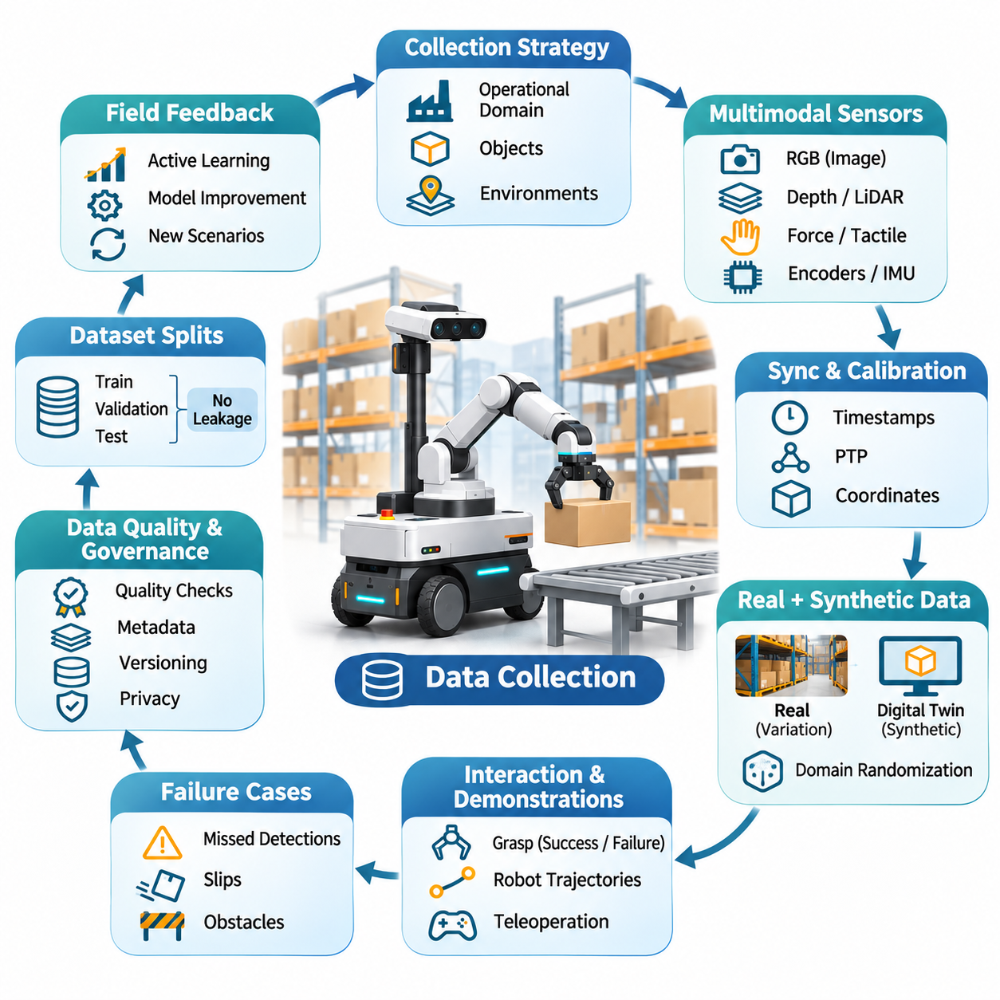{width="7.268055555555556in" height="7.268055555555556in"}

Data collection is the foundation of AI development for mobile manipulators because the quality, diversity, and representativeness of collected data directly influence the reliability of intelligent robotic systems. Unlike conventional AI applications that process static digital information, mobile manipulators must interpret dynamic physical environments. Data collection must therefore capture both environmental characteristics and the physical interactions between the robot and surrounding objects.

The data collection process begins with identifying the information required by each AI capability. Object detection requires images containing target objects under diverse visual conditions, while pose estimation requires spatial information describing object positions and orientations. Grasp detection requires information about object geometry, contact regions, and successful or unsuccessful grasp configurations. Robot agents and embodied AI additionally require task sequences, robot states, environmental observations, and action outcomes.

A comprehensive data collection strategy should be established according to the operational design domain of the mobile manipulator. The strategy defines applicable environments, object categories, working conditions, sensor configurations, and expected manipulation scenarios. For industrial applications, data should represent manufacturing facilities, warehouse environments, storage racks, workstations, and transportation areas. Environmental variations should be systematically incorporated to reduce the risk of developing models that perform reliably only under controlled laboratory conditions.

Multimodal data collection enables mobile manipulators to understand their environments through complementary sensing technologies. RGB cameras provide visual appearance and texture information, while depth cameras and three-dimensional LiDAR sensors provide spatial geometry and distance measurements. Force-torque sensors, tactile sensors, joint encoders, and inertial measurement units provide information about physical interaction and robot configuration. Combining these data sources improves environmental understanding and supports the development of integrated perception and manipulation capabilities.

Sensor synchronization is essential when collecting multimodal data from mobile robotic systems. Measurements acquired at different timestamps may describe inconsistent environmental or robot states, particularly when the mobile platform or manipulator is moving. Hardware triggering, Precision Time Protocol (PTP), and timestamp-based synchronization can improve temporal alignment. Sensor calibration and coordinate transformation information must also be recorded to ensure that measurements from multiple devices can be accurately associated within a common spatial reference frame.

Real-world data collection should be conducted under conditions that reflect the intended operational environment. Images and sensor measurements should capture variations in illumination, viewing angles, object distances, surface materials, background complexity, and occlusion. Data should also include moving objects, human activity, and changes in object arrangements. Collecting information across different operating periods and physical locations helps reduce environmental bias and improves the generalization capabilities of developed AI models.

Synthetic data generation provides an effective means of expanding datasets when real-world data acquisition is expensive, time-consuming, or operationally restricted. Simulation environments and digital twins can generate images, depth maps, point clouds, object poses, and manipulation trajectories with corresponding ground truth. Domain randomization can introduce variations in lighting, textures, object geometry, and camera configurations. Synthetic data should complement real-world observations, with validation conducted to identify and reduce the simulation-to-reality gap.

Manipulation-oriented data collection must capture not only object appearance but also the physical consequences of robotic actions. During grasping experiments, the system should record end-effector positions, joint configurations, gripper opening distances, applied forces, object displacement, and task outcomes. Successful and unsuccessful manipulation attempts provide valuable information for developing grasp detection and learning-based manipulation models. These records help identify relationships between perception accuracy, grasp geometry, physical contact, and execution reliability.

Demonstration-based data collection supports robot learning by capturing examples of desired task execution. Human operators may provide demonstrations through teleoperation, lead-through teaching, motion capture, or other suitable control interfaces. Recorded demonstrations should include environmental observations, robot trajectories, control commands, and task completion results. Such data can support imitation learning, vision-language-action models, and embodied AI systems that acquire manipulation skills from representative examples.

Failure-oriented data collection is particularly important for improving the reliability of mobile manipulators. Operational failures may include missed detections, incorrect pose estimates, unsuccessful grasps, object slippage, unexpected obstacles, and incomplete task execution. These conditions should be recorded together with relevant sensor measurements, system states, and diagnostic information. Including challenging and negative examples allows developers to investigate failure mechanisms, improve model robustness, and establish more effective uncertainty-handling and recovery strategies.

Data quality management should be integrated into the collection process rather than performed exclusively after acquisition. Corrupted images, missing timestamps, invalid depth measurements, calibration inconsistencies, and duplicated samples can reduce dataset effectiveness. Automated quality inspection mechanisms should identify these problems before data enters the annotation and training pipelines. Dataset coverage should also be periodically examined to identify underrepresented object categories, environmental conditions, and manipulation scenarios.

Collected data must be organized within a structured and scalable data management architecture. Each sample should be associated with metadata describing acquisition time, sensor configuration, calibration version, environmental conditions, robot configuration, and operational scenario. Dataset version control enables developers to reproduce training experiments and trace performance changes to specific data modifications. Access control, encryption, privacy protection, and retention policies should also be established according to operational requirements and applicable regulations.

Dataset partitioning should be planned during data collection to prevent information leakage between training, validation, and testing datasets. Consecutive video frames, repeated manipulation sequences, and observations of identical physical objects can introduce unintended correlations when randomly distributed across datasets. Partitioning by acquisition session, object instance, or operational environment provides more meaningful evaluations of model generalization. Independent test datasets should represent realistic conditions without being repeatedly used for model optimization.

Data collection should ultimately operate as a continuous feedback mechanism throughout the mobile manipulator development lifecycle. Information acquired during prototype testing, field validation, and commercial operations should reveal weaknesses in existing models and guide subsequent acquisition campaigns. Active learning and uncertainty-based sampling can prioritize informative observations while reducing unnecessary collection and annotation costs. By establishing a systematic data collection infrastructure, developers can continuously improve AI performance, operational reliability, and the adaptability of mobile manipulators across diverse industrial environments.

## 03 Data Labeling

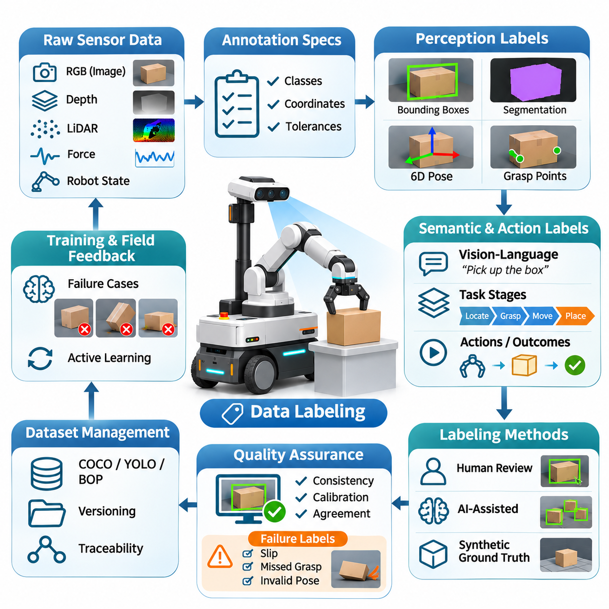{width="7.268055555555556in" height="7.268055555555556in"}

Data labeling is an essential engineering process in the AI development lifecycle of mobile manipulators because it transforms raw sensor observations into structured information suitable for model training and evaluation. Unlike conventional image recognition applications, mobile manipulation requires annotations that describe visual appearance, spatial geometry, object orientation, physical interactions, and operational outcomes. The quality of these annotations directly influences robotic intelligence.

The data labeling process begins with defining annotation requirements according to the intended AI capabilities. Object detection, pose estimation, grasp detection, vision-language understanding, and embodied AI require different forms of supervision. Developers should establish an annotation specification that defines object categories, coordinate conventions, labeling formats, acceptable tolerances, and quality acceptance criteria before initiating large-scale annotation activities.

Object detection labeling typically involves identifying target objects within images and assigning categorical labels and bounding boxes. Annotators must consistently distinguish between object instances, including those that are partially occluded, overlapping, or located near image boundaries. Labeling policies should establish whether annotations represent visible regions or estimated complete object extents. Consistent annotation practices improve detection accuracy and reduce ambiguity during model training.

Semantic and instance segmentation provide more detailed annotations by identifying object regions at the pixel level. Semantic segmentation assigns category labels to pixels, while instance segmentation distinguishes individual objects belonging to the same category. These annotations are particularly valuable for mobile manipulators operating in cluttered environments because accurate object boundaries support grasp planning, surface identification, and collision-aware manipulation.

Pose estimation labeling requires geometric information describing the position and orientation of objects within a defined coordinate system. Six-dimensional pose annotations typically represent three translational and three rotational degrees of freedom. Ground truth can be obtained through calibrated measurement systems, fiducial markers, motion capture, CAD model registration, or simulation. Object symmetry, coordinate conventions, measurement uncertainty, and calibration accuracy must be carefully considered.

Grasp detection labeling focuses on identifying suitable configurations through which a robotic gripper can establish stable contact with an object. Annotations may include grasp center positions, approach directions, gripper orientations, opening widths, contact points, and grasp quality scores. Labeling should consider object geometry, material properties, gripper characteristics, accessibility, and physical stability. Experimental grasp outcomes provide valuable evidence for verifying candidate grasp annotations.

Multimodal data labeling associates information obtained from different sensing technologies within a unified representation. RGB images, depth maps, point clouds, tactile measurements, force-torque signals, and robot joint states may describe complementary aspects of the same event. Accurate temporal synchronization and spatial calibration are necessary to maintain consistency across these annotations, particularly when the mobile platform, manipulator, or target object is moving.

Labeling for Vision-Language Models requires semantic descriptions that connect visual observations with natural-language instructions. Annotations may describe object attributes, spatial relationships, functional properties, environmental conditions, and manipulation objectives. Language descriptions should remain consistent with observable evidence rather than introducing unsupported assumptions. Diverse linguistic expressions can improve the ability of models to interpret instructions across different operational situations.

Robot agent and embodied AI datasets require annotations that represent sequential behavior and physical interaction. Recorded task demonstrations may be divided into meaningful stages, such as object localization, approach, grasping, transportation, placement, and verification. Each stage can be associated with observations, actions, robot states, and execution outcomes. Such annotations support task reasoning, imitation learning, action prediction, and feedback-driven behavior adaptation.

Manual annotation provides human supervision for interpreting complex scenes, ambiguous object boundaries, and unusual operational conditions. However, large-scale manual labeling can become expensive and time-consuming. Semi-automated annotation techniques use existing AI models, object tracking, segmentation algorithms, or geometric processing to generate preliminary labels. Human reviewers then correct inaccurate predictions and resolve uncertain cases before the annotations are accepted for training.

Synthetic data labeling enables annotation information to be generated automatically within simulation environments and digital twins. Virtual environments provide direct access to object identities, segmentation masks, spatial coordinates, orientations, contact conditions, and robot configurations. This capability reduces manual annotation costs and supports large-scale dataset generation. Nevertheless, synthetic ground truth must be validated against real-world conditions to identify modeling assumptions and domain discrepancies.

Annotation quality assurance should incorporate automated inspection and systematic human review. Automated validation can identify missing labels, invalid bounding boxes, inconsistent category assignments, coordinate errors, and corrupted annotation files. Human reviewers should evaluate ambiguous scenes and geometric accuracy through representative sampling or independent verification. Inter-annotator agreement provides an additional measure of consistency when multiple annotators interpret similar operational scenarios.

Failure-oriented labeling is particularly important for developing reliable mobile manipulation systems. Negative examples may include inaccessible objects, invalid grasp configurations, unsuccessful grasp attempts, object slippage, incorrect localization, and incomplete task execution. These cases should be distinguished from missing or uncertain annotations. Explicitly labeling failure conditions supports uncertainty estimation, failure prediction, error recovery, and the development of more robust perception and manipulation models.

Annotation management requires structured storage, version control, and traceability throughout the AI development lifecycle. Each annotation should be associated with the corresponding sensor data, labeling specification, calibration information, annotation method, and quality review status. Standardized formats such as COCO, YOLO, and BOP may support different perception tasks, while custom schemas may be necessary for multimodal robotic trajectories and physical interaction records.

Data labeling should ultimately function as a continuous improvement mechanism rather than a one-time preparation activity. Model evaluation, prototype testing, and field validation can reveal annotation errors, insufficient category coverage, and previously unrecognized failure conditions. Active learning can prioritize uncertain or informative samples for additional annotation. A systematic labeling infrastructure enables developers to improve model accuracy, reduce development costs, maintain reproducibility, and strengthen the operational reliability of mobile manipulators.

## 04 Object Detection Models

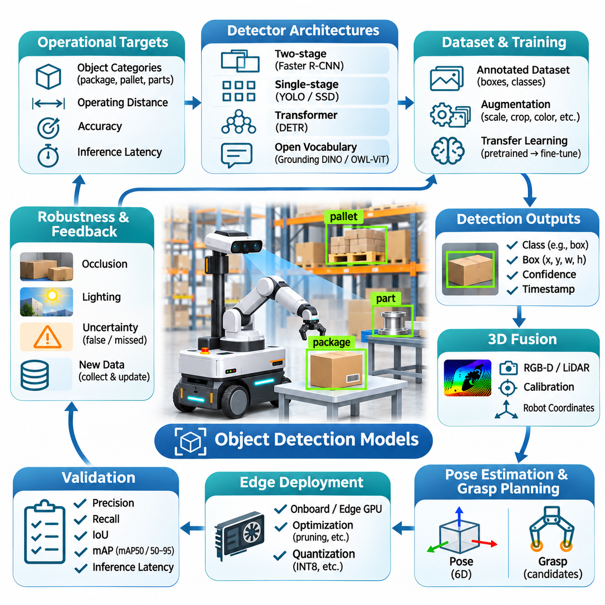{width="7.268055555555556in" height="7.268055555555556in"}

Object detection models constitute a fundamental component of the artificial intelligence architecture of mobile manipulators. Their primary function is to identify relevant objects within sensor observations and determine their locations in the surrounding environment. Unlike conventional image recognition systems, object detection for mobile manipulation must provide actionable information that supports robotic navigation, pose estimation, grasp planning, and autonomous task execution.

Object detection development begins with defining target object categories and operational requirements according to the intended robotic application. A warehouse mobile manipulator may need to detect packages, containers, pallets, and storage locations, while an industrial mobile manipulator may recognize mechanical components, assembly parts, and manufacturing tools. Detection requirements should specify object dimensions, operating distances, environmental conditions, accuracy targets, and permissible inference latency.

Modern object detection architectures can generally be classified into two-stage, single-stage, and transformer-based detectors. Two-stage detectors, such as Faster R-CNN, generate candidate object regions before performing classification and bounding box refinement. Single-stage detectors, including the YOLO and SSD families, predict object categories and locations directly. Transformer-based detectors, such as DETR and its variants, utilize attention mechanisms and object queries to formulate object detection as a set prediction problem.

Single-stage object detection models are particularly suitable for mobile manipulators because they can provide an effective balance between detection accuracy and computational efficiency. YOLO-based architectures are widely applicable to real-time robotic perception, where continuous environmental observations must be processed within limited computational resources. Model selection should consider inference speed, detection accuracy, network size, memory consumption, energy efficiency, and compatibility with embedded computing platforms.

Transformer-based object detection models offer alternative approaches to visual perception by incorporating attention mechanisms that capture relationships between image regions. Architectures such as DETR and Deformable DETR can support detection in complex environments containing multiple objects and challenging spatial arrangements. However, their practical advantages depend on model architecture, training data, computational requirements, and deployment optimization. Performance should therefore be evaluated under representative robotic operating conditions.

Open-vocabulary object detection extends conventional detection capabilities by enabling models to identify objects through natural-language descriptions rather than exclusively relying on predefined categories. Models such as Grounding DINO and OWL-ViT can support flexible object identification in environments containing unfamiliar objects. These capabilities are particularly relevant to mobile manipulators that execute natural-language instructions, although their predictions require additional verification before physical manipulation.

Training object detection models requires representative datasets containing appropriately annotated objects under diverse environmental conditions. Training samples should include variations in object size, orientation, illumination, background complexity, viewing distance, and partial occlusion. Data augmentation techniques such as image scaling, cropping, color transformation, and geometric modification can improve model generalization when they preserve the semantic and physical validity of the original observations.

Object detection performance can be improved through transfer learning and fine-tuning of pretrained neural networks. Models pretrained on large-scale datasets provide reusable visual representations that can reduce training time and improve performance when application-specific datasets are limited. Fine-tuning adapts these representations to target industrial environments and object categories. Training configurations, dataset versions, model checkpoints, and experiment results should be systematically managed to ensure reproducibility.

Object detection in three-dimensional environments requires integration between visual predictions and spatial sensor measurements. RGB-D cameras, stereo cameras, and LiDAR sensors can provide depth information associated with detected object regions. Camera calibration and coordinate transformations enable these observations to be represented within the robot coordinate system. However, two-dimensional bounding boxes alone do not establish precise three-dimensional object poses or guarantee that an object can be safely grasped.

Object detection models should be integrated with downstream pose estimation and grasp detection modules through clearly defined interfaces. Detection outputs may include category identifiers, bounding boxes, confidence scores, timestamps, and associated spatial observations. These outputs allow subsequent algorithms to identify relevant object regions, estimate object positions and orientations, and generate candidate grasp configurations. Accurate interface definitions reduce integration errors and improve overall manipulation reliability.

Performance evaluation should incorporate standard object detection metrics, including precision, recall, intersection over union (IoU), and mean average precision (mAP). Metrics such as mAP50 and mAP50--95 provide complementary information about detection quality at different localization thresholds. However, robotic applications also require evaluation of missed detections, false positives, inference latency, detection stability, and the practical consequences of localization errors during manipulation.

Deployment engineering ensures that trained object detection models operate efficiently on the computing hardware installed within mobile manipulators. Embedded GPU platforms and edge AI accelerators can support real-time inference through optimized execution environments. Model conversion, graph optimization, mixed-precision inference, and quantization may reduce computational overhead. Optimized models must be reevaluated to confirm that deployment does not introduce unacceptable reductions in accuracy or operational reliability.

Robustness and uncertainty management are essential because mobile manipulators frequently encounter unfamiliar objects, reflective surfaces, poor illumination, and unexpected environmental changes. Confidence scores should be interpreted cautiously rather than treated as guarantees of prediction correctness. When detection results are uncertain, the robot may acquire additional observations, adjust its camera viewpoint, request operator assistance, or suspend manipulation until sufficient information becomes available.

Object detection development should ultimately follow an iterative engineering lifecycle that connects data collection, annotation, architecture selection, training, deployment, and operational validation. Detection failures identified during prototype testing and field operations should guide additional data acquisition and model refinement. The objective is not merely to maximize benchmark accuracy, but to establish a reliable perception capability that improves manipulation success, operational productivity, adaptability, and the safety of the complete mobile robotic system.

## 05 Pose Estimation Models

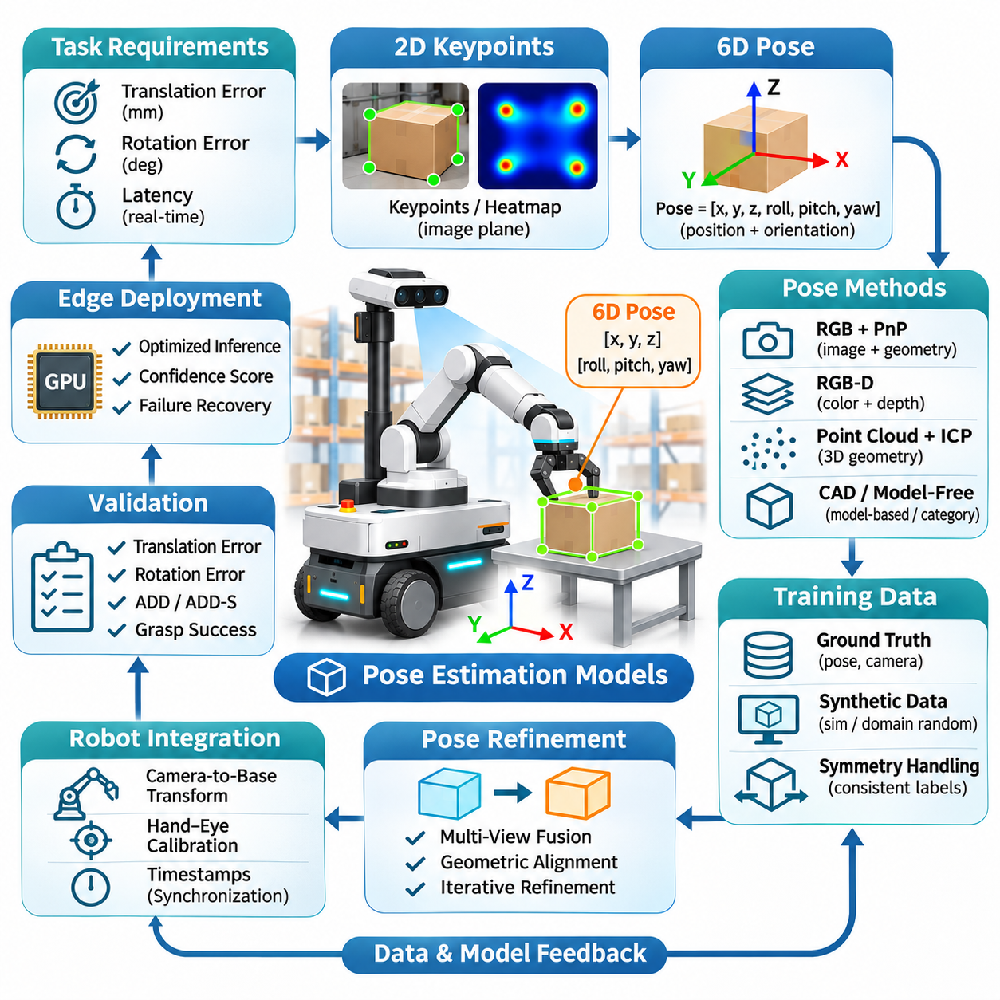{width="7.268055555555556in" height="7.268055555555556in"}

Pose estimation models are essential components of mobile manipulator AI systems because they determine the spatial position and orientation of objects required for physical interaction. While object detection identifies relevant objects within sensor observations, pose estimation provides the geometric information necessary for precise manipulation. Accurate pose estimation enables robotic systems to perform object grasping, transportation, alignment, placement, and assembly operations.

Pose estimation development begins with defining geometric accuracy requirements according to the intended manipulation tasks. Warehouse picking may tolerate relatively large positional deviations, whereas precision assembly and component insertion require significantly higher accuracy. Developers should establish measurable requirements for translation error, rotation error, estimation latency, operating distance, and robustness under environmental variations before selecting model architectures.

Two-dimensional pose estimation determines the locations of meaningful object features within an image coordinate system. Keypoint detection models typically predict feature coordinates using heatmaps, coordinate regression, or transformer-based representations. These features may correspond to object corners, mechanical interfaces, or predefined geometric landmarks. When combined with camera calibration and known object geometry, two-dimensional keypoints can support three-dimensional pose reconstruction.

Six-dimensional object pose estimation determines an object\'s position and orientation in three-dimensional space. The pose consists of three translational degrees of freedom and three rotational degrees of freedom. Rotational information may be represented through rotation matrices, quaternions, or other mathematical representations. Consistent coordinate conventions and transformation definitions are essential for integrating estimated poses with robot kinematics and manipulation planning.

RGB-based pose estimation models infer object geometry and orientation from conventional color images. These approaches may employ convolutional neural networks, vision transformers, keypoint detection, or dense correspondence estimation. Perspective-n-Point algorithms can recover spatial poses from corresponding two-dimensional image features and known three-dimensional object points. However, monocular estimation remains sensitive to occlusion, ambiguous geometry, and scale uncertainty.

RGB-D-based pose estimation integrates visual appearance with depth measurements to improve spatial understanding. Architectures such as DenseFusion and FoundationPose illustrate different approaches to combining visual and geometric information for object pose estimation. Depth observations provide additional spatial constraints that can improve translation and orientation accuracy. Nevertheless, reflective surfaces, transparent materials, and invalid depth measurements remain important challenges.

Point cloud-based pose estimation utilizes three-dimensional geometric observations obtained from depth cameras, stereo vision, or LiDAR sensors. Neural architectures such as PointNet and PointNet++ can extract geometric features from irregular spatial measurements. Registration techniques, including Iterative Closest Point, can further refine estimated poses by aligning observed surfaces with reference geometry. Performance depends on point density, measurement quality, and object visibility.

Model-based pose estimation uses known object geometry, typically represented by CAD models or reference meshes, to establish correspondences between observed and expected object structures. This approach is particularly useful in industrial environments where component geometry is available before deployment. Category-level and model-free approaches extend pose estimation to previously unseen object instances, although generalization and geometric accuracy require careful application-specific validation.

Pose estimation model training requires accurately annotated datasets containing object positions, orientations, camera parameters, and relevant geometric information. Ground truth can be acquired through calibrated measurement systems, fiducial markers, motion capture, or synthetic environments. Training datasets should represent variations in object geometry, viewing direction, illumination, distance, and occlusion. Rotational symmetry must be considered to avoid inconsistent supervision.

Synthetic data generation provides substantial opportunities for developing pose estimation models because virtual environments can produce precise geometric annotations automatically. Digital twins and rendering engines enable systematic variation of object positions, orientations, textures, backgrounds, and camera viewpoints. Domain randomization and photorealistic rendering can improve dataset diversity, while real-world validation remains necessary to assess simulation-to-reality discrepancies.

Pose refinement improves initial pose predictions through additional geometric optimization or learned correction mechanisms. Refinement algorithms may minimize discrepancies between observed depth measurements, projected object features, and reference geometry. Iterative refinement can improve precision when initial estimates are sufficiently accurate. Multi-view observations acquired through mobile platform movement or manipulator-mounted cameras can provide additional constraints for resolving ambiguous poses.

Coordinate transformation and temporal synchronization are critical for integrating pose estimation models into mobile manipulators. Object poses estimated within the camera coordinate system must be transformed into the appropriate robot base, manipulator, or world coordinate system. Hand-eye calibration, robot kinematics, and accurate timestamps enable these transformations. Calibration errors and platform motion must be considered because they directly affect end-effector positioning accuracy.

Pose estimation performance should be evaluated using translation error, rotation error, average distance metrics such as ADD and ADD-S, and task-specific manipulation outcomes. Symmetry-aware evaluation prevents geometrically equivalent orientations from being incorrectly classified as failures. Validation should also consider inference latency, temporal stability, uncertainty, and performance under partial occlusion. Benchmark accuracy alone cannot establish reliable physical manipulation performance.

Deployment engineering must ensure that pose estimation models satisfy the computational constraints of mobile robotic platforms. Model optimization, mixed-precision inference, hardware acceleration, and region-of-interest processing can improve runtime efficiency. The perception pipeline should communicate estimated poses together with confidence information, timestamps, and coordinate frame identifiers. Uncertain or inconsistent predictions should trigger additional observations or controlled recovery procedures.

Pose estimation development should ultimately follow an iterative lifecycle connecting data collection, annotation, model training, geometric calibration, deployment, and operational validation. Failures observed during grasping, alignment, and placement should guide subsequent model improvements and dataset expansion. The objective is to establish a dependable spatial perception capability that reduces manipulation errors, improves task success rates, and supports reliable autonomous operation across diverse industrial environments.

## 06 Grasp Detection Models

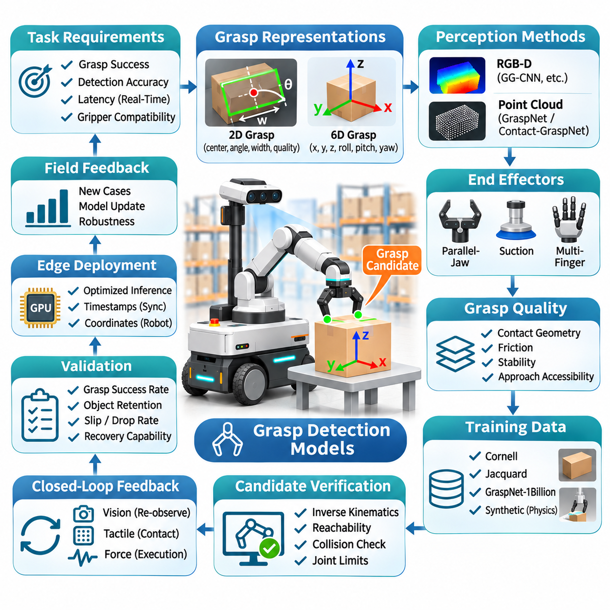{width="7.268055555555556in" height="7.268055555555556in"}

Grasp detection models are essential components of mobile manipulator AI systems because they identify suitable configurations for establishing stable physical contact between robotic grippers and target objects. While object detection identifies relevant objects and pose estimation determines their spatial positions and orientations, grasp detection predicts how objects can be physically grasped. These predictions provide essential inputs for autonomous manipulation.

Grasp detection development begins with defining functional and performance requirements according to the intended manipulation tasks. Industrial component handling, warehouse picking, and service robotics may require different grasping strategies and gripper configurations. Developers should establish measurable requirements for grasp success rate, detection accuracy, prediction latency, object coverage, environmental robustness, and compatibility with end-effector hardware.

Two-dimensional grasp detection models predict grasp configurations within an image coordinate system. A typical representation includes the grasp center, gripper orientation, opening width, and grasp quality score. Neural network architectures can generate grasp rectangles or pixel-level grasp quality maps directly from RGB or depth images. These approaches are particularly useful for structured picking environments where objects can be approached from a predefined direction.

Six-dimensional grasp detection extends conventional planar grasp prediction by identifying gripper positions and orientations within three-dimensional space. A grasp configuration includes three translational and three rotational degrees of freedom, together with gripper-specific parameters. This representation enables mobile manipulators to approach objects from multiple directions and supports manipulation in cluttered environments with limited accessibility.

RGB-D-based grasp detection combines visual appearance with depth measurements to identify suitable grasp regions. Architectures such as Generative Grasping Convolutional Neural Networks (GG-CNN) can generate dense grasp predictions from depth images, while other approaches incorporate RGB features to improve semantic understanding. Accurate depth measurements and camera calibration are necessary for transforming predicted grasp configurations into executable robotic actions.

Point cloud-based grasp detection models analyze three-dimensional object geometry to identify candidate grasp configurations. Architectures such as GraspNet and Contact-GraspNet demonstrate approaches to generating spatial grasp candidates from observed point clouds. These methods can support manipulation of previously unseen objects without requiring complete object models. Their reliability depends on point cloud quality, surface visibility, and geometric feature extraction.

Grasp detection models must account for the mechanical characteristics of the selected end effector. Parallel-jaw grippers require suitable opposing contact surfaces, while suction grippers require accessible surfaces capable of maintaining a vacuum seal. Multifinger robotic hands introduce additional contact configurations and control requirements. Consequently, grasp representations and training datasets should reflect the physical constraints of the intended gripping mechanism.

Grasp quality estimation evaluates the potential stability and effectiveness of predicted grasp configurations. Relevant factors include contact geometry, friction, object mass distribution, gripper opening width, approach accessibility, and resistance to external disturbances. Learning-based models can estimate grasp quality from geometric observations and experimental outcomes. However, predicted quality scores should not be interpreted as guarantees of physical grasp success.

Training grasp detection models requires representative datasets containing object observations, candidate grasp configurations, and corresponding quality or success labels. Public datasets such as the Cornell Grasping Dataset, Jacquard, and GraspNet-1Billion provide useful resources for initial model development. Application-specific datasets should additionally represent the actual objects, grippers, sensor configurations, and operating conditions expected during deployment.

Synthetic data generation enables developers to produce large numbers of grasp configurations using simulation environments and digital twins. Physics engines can evaluate candidate grasps under different object geometries, friction coefficients, mass distributions, and contact conditions. Domain randomization can further improve dataset diversity. Nevertheless, simulated grasp outcomes require physical validation because contact dynamics and material properties may differ from reality.

Grasp candidate generation should be integrated with geometric verification and robotic motion planning. Although a grasp detection model may predict a high-quality configuration, the corresponding position may be outside the manipulator workspace or obstructed by surrounding objects. Inverse kinematics, collision checking, reachability analysis, and joint limit verification should therefore evaluate predicted grasp candidates before physical execution.

Closed-loop grasp detection improves manipulation reliability by continuously updating grasp predictions using new sensor observations. As the manipulator approaches an object, changes in viewpoint may reveal previously occluded surfaces or unexpected object displacement. Visual feedback, tactile measurements, and force-torque sensing can support grasp adjustment and execution verification. These capabilities reduce dependence on a single initial prediction.

Grasp detection performance should be evaluated using both model-level metrics and physical manipulation outcomes. Grasp rectangle accuracy, orientation error, spatial localization error, and candidate prediction latency provide information about model performance. Physical grasp success rate, object retention rate, failure recovery rate, and task completion time provide complementary evidence of operational reliability under representative working conditions.

Deployment engineering must ensure that grasp detection models operate within the computational and temporal constraints of mobile robotic platforms. Hardware acceleration, mixed-precision inference, and optimized point cloud processing can improve runtime efficiency. Model outputs should include grasp parameters, confidence information, timestamps, and coordinate frame identifiers to support reliable integration with perception and manipulation subsystems.

Grasp detection development should ultimately follow an iterative engineering lifecycle connecting data collection, labeling, model training, deployment, physical experimentation, and operational validation. Failed grasp attempts should be recorded and analyzed to identify weaknesses in perception, geometric reasoning, or contact prediction. The objective is to establish a dependable grasp detection capability that improves manipulation success, adaptability, productivity, and operational reliability.

## 07 VLM Development

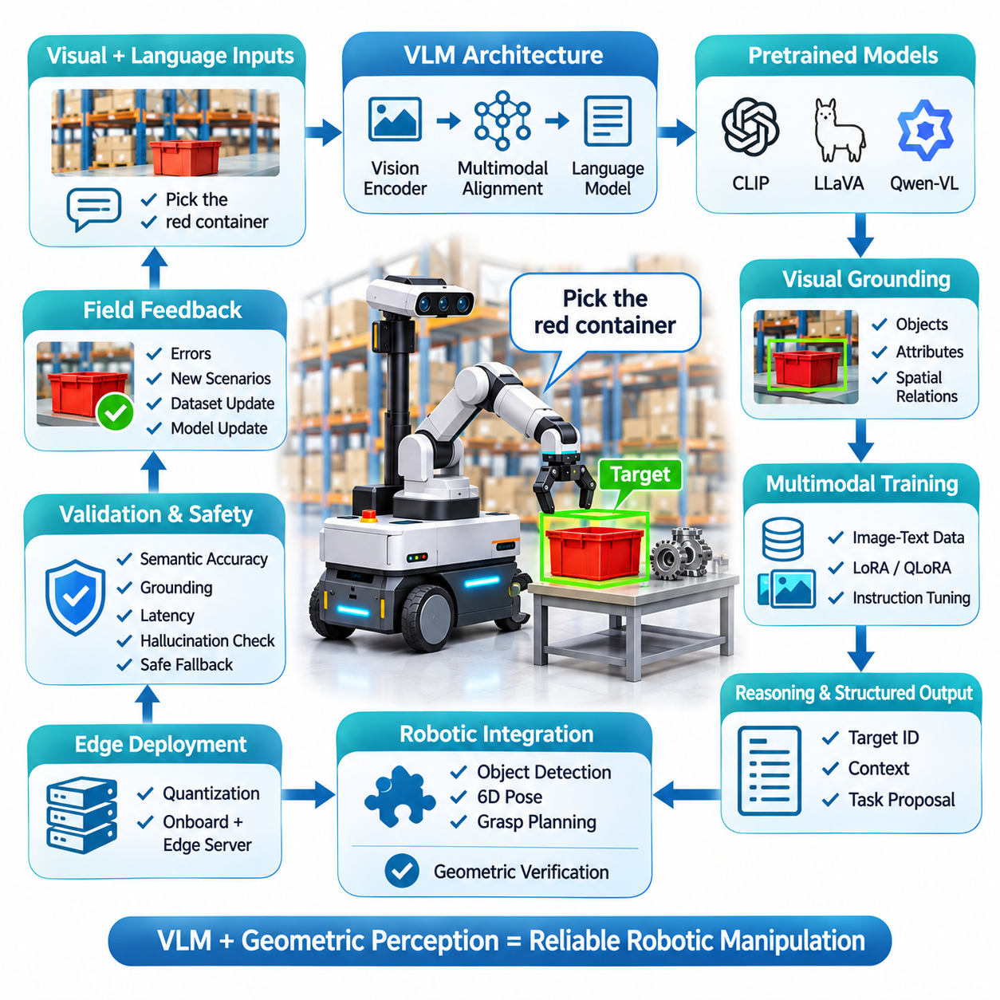{width="7.268055555555556in" height="7.268055555555556in"}

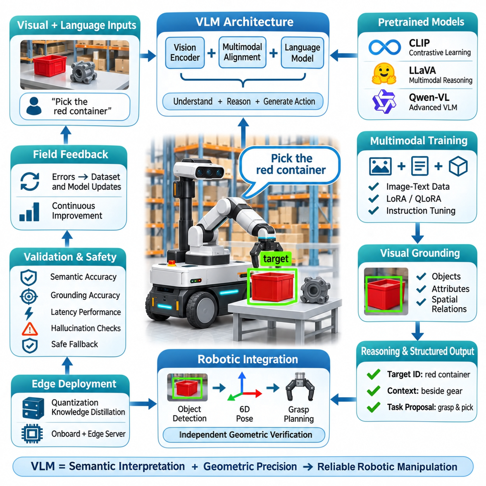{width="7.268055555555556in" height="7.268055555555556in"}

Vision-language models (VLMs) extend the artificial intelligence capabilities of mobile manipulators by integrating visual perception with natural language understanding. Unlike conventional perception models designed for predefined recognition tasks, VLMs can interpret visual observations in relation to linguistic instructions. This capability enables robotic systems to understand object descriptions, environmental contexts, spatial relationships, and task objectives.

VLM development begins with defining functional requirements according to the intended robotic applications. A mobile manipulator operating in a warehouse may need to identify objects from verbal descriptions, while an industrial robot may need to interpret assembly instructions or inspection results. Development requirements should specify semantic understanding accuracy, spatial grounding capability, response latency, computational constraints, and operational reliability.

The fundamental architecture of a vision-language model typically integrates a visual encoder, a multimodal alignment mechanism, and a language model. The visual encoder extracts features from images or video frames, while the alignment mechanism connects visual representations with linguistic representations. The language model processes these integrated features to generate contextual descriptions, answer questions, or interpret task-related instructions.

Pretrained vision-language architectures provide reusable foundations for developing robotic perception capabilities. Models such as CLIP establish relationships between images and textual descriptions through contrastive learning, while architectures such as LLaVA and Qwen-VL support more interactive multimodal reasoning. Model selection should consider visual understanding, language capabilities, spatial reasoning, computational efficiency, and deployment compatibility.

Visual grounding is a particularly important capability because mobile manipulators must associate linguistic expressions with specific physical objects and environmental regions. Instructions such as selecting a red container beside a mechanical component require the model to interpret object attributes and spatial relationships. Grounding mechanisms connect these semantic descriptions with image regions, bounding boxes, or other spatial representations.

Vision-language models should be integrated with specialized object detection, pose estimation, and grasp detection models rather than treated as complete replacements for geometric perception systems. A VLM can identify the intended manipulation target and interpret contextual requirements, while dedicated perception models provide precise spatial information. This complementary architecture combines semantic flexibility with the geometric accuracy required for physical manipulation.

Training vision-language models requires multimodal datasets containing images, textual descriptions, object annotations, spatial relationships, and task-related instructions. Application-specific datasets should represent actual industrial environments, equipment configurations, object categories, and operational scenarios. Data quality is particularly important because incorrect visual descriptions or ambiguous instructions can introduce persistent semantic reasoning errors.

Transfer learning and parameter-efficient fine-tuning can adapt pretrained vision-language models to specialized robotic applications without requiring complete model retraining. Techniques such as Low-Rank Adaptation (LoRA) and Quantized Low-Rank Adaptation (QLoRA) reduce the number of trainable parameters and associated computational requirements. Fine-tuning should preserve general multimodal capabilities while improving domain-specific understanding.

Instruction tuning improves the ability of vision-language models to interpret task-oriented commands and produce structured responses suitable for robotic systems. Training examples may include object selection, environmental interpretation, inspection procedures, and manipulation instructions. Structured output representations can communicate target identifiers, contextual constraints, and proposed actions to downstream robotic planning modules.

Multimodal reasoning enables mobile manipulators to interpret relationships among objects, environmental conditions, and operational objectives. A VLM may recognize that an object is obstructed, identify an appropriate storage location, or interpret the visible status of industrial equipment. However, semantic reasoning outputs must be verified through sensor measurements and geometric analysis before they are converted into executable robotic actions.

Temporal visual understanding extends VLM capabilities beyond individual images by incorporating sequential observations acquired during robot movement and manipulation. Video-based models and multimodal memory mechanisms can support object state monitoring, environmental change detection, and task progress assessment. Temporal information is particularly valuable when mobile manipulators operate in dynamic environments containing moving objects and human workers.

Deployment engineering must address the computational requirements of vision-language models operating within mobile robotic platforms. Model quantization, knowledge distillation, hardware acceleration, and visual token reduction can improve inference efficiency. Hybrid architectures may distribute computationally intensive reasoning across edge servers while maintaining essential perception, motion control, and safety functions within the onboard computing system.

VLM performance evaluation should incorporate semantic accuracy, visual grounding accuracy, instruction interpretation, spatial reasoning, inference latency, and task completion outcomes. Validation datasets should include unfamiliar objects, ambiguous commands, complex backgrounds, and unexpected environmental conditions. Conventional multimodal benchmarks should be supplemented with physical robotic experiments that measure actual operational effectiveness.

Hallucination and uncertainty management are essential because vision-language models may generate plausible but incorrect descriptions, object relationships, or action proposals. Robotic architectures should incorporate independent verification mechanisms, structured response validation, confidence assessment, and controlled fallback procedures. Unverified VLM outputs must not directly override deterministic motion constraints or independent safety systems.

VLM development should ultimately follow an iterative engineering lifecycle connecting multimodal data collection, model selection, fine-tuning, system integration, deployment, and operational validation. Semantic interpretation failures and unsuccessful robotic tasks should guide subsequent model improvements. The objective is to establish reliable multimodal intelligence that connects human instructions with environmental perception and autonomous physical manipulation.

## 08 Robot Agents

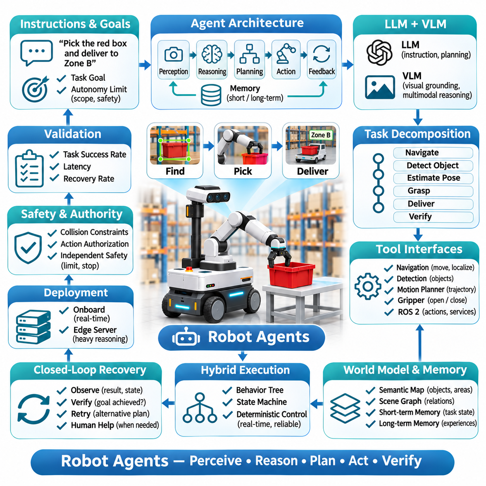{width="7.268055555555556in" height="7.268055555555556in"}

Robot agents represent an advanced architectural approach to developing autonomous intelligence for mobile manipulators. Unlike conventional AI models that perform isolated perception or prediction tasks, robot agents integrate environmental understanding, reasoning, decision-making, task planning, and action execution. These capabilities enable mobile manipulators to interpret operational objectives and coordinate physical activities within complex and dynamic environments.

Robot agent development begins with defining the functional scope, operational responsibilities, and permissible level of autonomy. A mobile manipulator agent may receive natural language instructions, identify target objects, navigate toward designated locations, execute manipulation tasks, and verify operational results. Development requirements should establish task completion criteria, decision-making latency, recovery capabilities, and operational safety constraints.

The fundamental architecture of a robot agent typically incorporates perception, reasoning, planning, memory, action execution, and feedback mechanisms. Perception modules acquire information about the physical environment, while reasoning modules interpret observations and determine appropriate responses. Planning modules organize activities into executable sequences, and feedback mechanisms enable the agent to evaluate execution results and update subsequent decisions.

Large language models and vision-language models provide powerful foundations for developing intelligent robot agents. Large language models can interpret instructions, decompose complex objectives, and generate structured task plans, while vision-language models connect linguistic information with visual observations. Their integration enables mobile manipulators to reason about object identities, spatial relationships, environmental conditions, and manipulation requirements.

Task decomposition converts high-level operational objectives into smaller activities that can be executed through available robotic capabilities. An instruction to retrieve and deliver a component may involve navigation, object identification, pose estimation, grasp planning, manipulation, and delivery verification. Each activity should include clearly defined execution conditions, required resources, expected outcomes, and failure recovery procedures.

Robot agents should interact with dedicated robotic functions through structured tool interfaces. Available tools may include navigation services, object detection models, pose estimation algorithms, grasp detection models, motion planners, and gripper controllers. Interface definitions should specify input parameters, output representations, execution constraints, and error conditions to ensure reliable communication between intelligent reasoning and physical execution systems.

Hybrid agent architectures combine learning-based reasoning with deterministic robotic planning and control mechanisms. Language models may generate high-level task strategies, while finite-state machines, behavior trees, and structured planners manage execution sequences. This separation enables intelligent agents to adapt to changing circumstances without compromising the predictability, timing requirements, and operational constraints of established robotic control systems.

Environmental representation is essential for maintaining consistency between agent reasoning and physical reality. Robot agents may utilize semantic maps, scene graphs, object databases, occupancy maps, and real-time sensor observations to represent their surroundings. Environmental representations should be continuously updated to reflect object displacement, accessibility changes, human activities, and variations in the operational configuration.

Memory mechanisms enable robot agents to retain relevant information across multiple observations and operational activities. Short-term memory maintains current task states, recent sensor observations, and intermediate execution results, while long-term memory may store object information, operational procedures, and previous experiences. Memory retrieval should prioritize relevant, validated information and prevent outdated observations from influencing current decisions.

Closed-loop agent execution allows mobile manipulators to evaluate the consequences of their actions and adapt subsequent behavior. After completing a navigation or manipulation activity, the agent should verify whether the expected physical state has been achieved. Unexpected observations, unsuccessful grasps, or incomplete operations may trigger additional perception, alternative planning, controlled retries, or requests for human intervention.

Robot agent development may incorporate supervised learning, instruction tuning, imitation learning, and reinforcement learning to improve task reasoning and behavioral adaptation. Training datasets can contain natural language instructions, environmental observations, action sequences, tool invocation records, and execution outcomes. Simulation environments and digital twins provide controlled conditions for generating and evaluating diverse agent interaction scenarios.

Integration with robotic middleware enables intelligent agents to access distributed perception, navigation, manipulation, and control capabilities. ROS 2 actions, services, and communication interfaces can provide structured mechanisms for invoking robotic functions and monitoring execution states. Agent integration should address asynchronous execution, timeout management, communication failures, resource ownership, and synchronization between mobile platform and manipulator activities.

Deployment engineering must establish an appropriate distribution of agent computation between onboard hardware, edge servers, and external computing infrastructure. Computationally intensive reasoning may operate on higher-performance platforms, while essential perception and control functions remain onboard. Communication interruptions, inference delays, and external service failures must not prevent the robot from maintaining a safe physical state.

Safety and authority management are fundamental because robot agents can initiate actions that directly affect physical environments. Agent-generated plans must be evaluated against predefined operational boundaries, collision constraints, workspace limitations, and authorization policies. Independent safety systems should retain authority over physical execution, while uncertain decisions and prohibited actions must trigger appropriate prevention or recovery mechanisms.

Robot agent performance should be evaluated through instruction interpretation accuracy, task planning success, tool invocation reliability, physical task completion, decision latency, and recovery effectiveness. Testing should include ambiguous instructions, unexpected obstacles, unavailable resources, and environmental changes. Iterative development should use execution records and failure analysis to improve agent reliability, adaptability, and industrial operational effectiveness.

## 09 Embodied AI

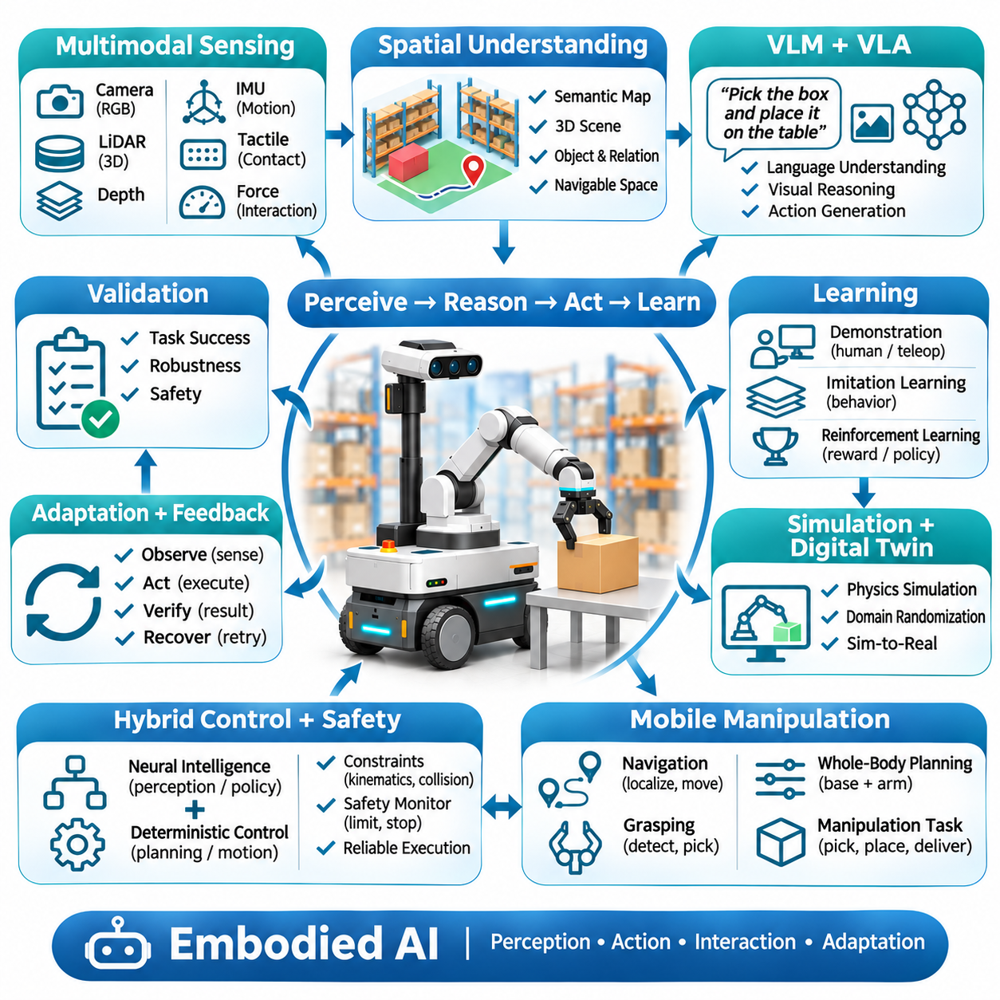{width="7.268055555555556in" height="7.268055555555556in"}

Embodied artificial intelligence (Embodied AI) represents an approach to developing intelligent robotic systems through continuous interaction with the physical environment. Unlike conventional AI systems that primarily process abstract information, embodied intelligence connects perception, reasoning, decision-making, and physical action. For mobile manipulators, this approach establishes the foundation for adaptive autonomous operation in complex environments.

Embodied AI development begins with defining the physical capabilities, environmental conditions, and operational objectives of the target robotic system. Mobile manipulators must integrate autonomous mobility with manipulation capabilities while responding to environmental changes and physical constraints. Development requirements should address perceptual accuracy, behavioral adaptability, manipulation effectiveness, operational autonomy, and safety.

The perception-action loop constitutes a fundamental mechanism of embodied intelligence. Robots acquire environmental observations through sensors, interpret the available information, select appropriate actions, and execute physical movements. These actions modify the relationship between the robot and its environment, generating new observations that influence subsequent decisions. Continuous feedback enables adaptive behavior and error correction.

Multimodal perception provides embodied AI systems with comprehensive information about their physical surroundings. Cameras, LiDAR sensors, depth sensors, inertial measurement units, tactile sensors, and force-torque sensors provide complementary observations. Sensor fusion enables mobile manipulators to integrate visual, geometric, spatial, and physical interaction information into representations that support intelligent decision-making.

Spatial understanding enables embodied AI systems to interpret environmental geometry, object relationships, navigable regions, and manipulation opportunities. Semantic maps, three-dimensional scene representations, occupancy maps, and object-level information can support spatial reasoning. These representations should incorporate both static environmental structures and dynamic changes caused by human activities, object movements, and robotic interactions.

Vision-language models contribute to embodied intelligence by connecting visual observations with natural language instructions and semantic reasoning. A mobile manipulator can interpret task objectives, identify relevant objects, and understand contextual relationships within its surroundings. However, linguistic and visual reasoning must be integrated with geometric verification and physical feasibility analysis before initiating robotic actions.

Vision-language-action models extend multimodal intelligence by connecting visual observations and linguistic instructions with robotic action generation. These models can learn relationships between perceived environmental states, task objectives, and executable behaviors. Their development requires representative datasets containing synchronized observations, instructions, and action trajectories, together with mechanisms for enforcing physical and operational constraints.

Learning from demonstration provides an effective approach to developing embodied robotic behavior through examples of successful physical interactions. Human demonstrations may be collected through teleoperation, motion capture, kinesthetic teaching, or remote robotic interfaces. Imitation learning enables robots to reproduce demonstrated behaviors and generalize them to related tasks, although unfamiliar operating conditions require additional validation.

Reinforcement learning enables embodied AI systems to improve behavioral policies through interactions with physical or simulated environments. Reward functions can represent task completion, grasp stability, movement efficiency, and other desired outcomes. Training should account for physical constraints, undesirable behaviors, and exploration risks. Simulation-based training can reduce the cost and potential hazards associated with direct physical experimentation.

Simulation environments and digital twins play important roles in embodied AI development by providing controlled representations of robotic systems and operational environments. Physics-based simulation enables developers to evaluate navigation, manipulation, contact dynamics, and coordinated behavior across diverse scenarios. Domain randomization and system identification can help reduce discrepancies between simulated and physical environments.

The integration of mobile platforms and robotic manipulators introduces additional challenges for embodied intelligence. Changes in mobile base position affect manipulator reachability, object visibility, and available grasp configurations. Coordinated planning must consider platform localization, manipulator kinematics, collision constraints, and task requirements. Whole-body planning can improve the effectiveness of coordinated mobility and manipulation.

Embodied AI architectures should integrate learned intelligence with established robotic planning and control mechanisms. Neural models may provide perception, semantic reasoning, and action proposals, while deterministic controllers enforce motion constraints and execution requirements. This hybrid approach supports intelligent adaptation without relying exclusively on probabilistic predictions for safety-critical physical operations.

Continuous adaptation enables embodied AI systems to respond to unfamiliar objects, environmental disturbances, and unexpected execution outcomes. Feedback from visual observations, tactile measurements, and force-torque sensors can support online behavioral adjustments. Operational experiences should be recorded for subsequent model refinement, while uncontrolled model updates during safety-critical operations should be prevented.

Embodied AI performance should be evaluated through physical task completion, manipulation success rates, environmental adaptability, recovery effectiveness, execution efficiency, and operational reliability. Validation should include previously unseen objects, changing environmental configurations, sensor degradation, and dynamic obstacles. Model-level benchmarks must be complemented by integrated robotic experiments under representative operating conditions.

Embodied AI development should ultimately follow an iterative engineering lifecycle connecting data collection, model training, simulation, hardware integration, physical experimentation, deployment, and field validation. Deployment must preserve independent safety mechanisms and reliable control functions. The objective is to establish adaptive physical intelligence that improves the autonomy, productivity, robustness, and operational reliability of mobile manipulators.

## 10 Model Training

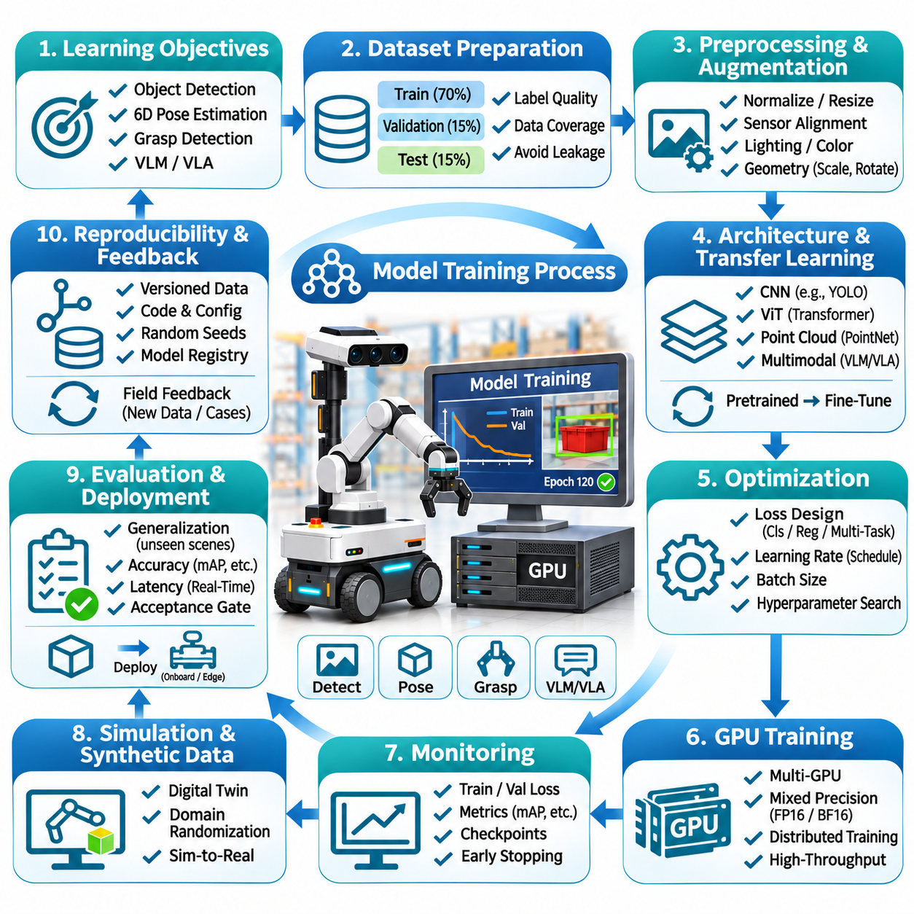{width="7.268055555555556in" height="7.268055555555556in"}

Model training is a fundamental engineering process in mobile manipulator AI development because it transforms collected and annotated data into operational intelligence. Trained models support object detection, pose estimation, grasp detection, multimodal reasoning, and autonomous behavioral adaptation. The training process must establish an appropriate balance between predictive accuracy, computational efficiency, generalization capability, and operational reliability.

Model training begins with defining learning objectives according to the functional requirements of individual AI modules. Object detection models require accurate classification and localization, while pose estimation models require precise geometric predictions. Grasp detection models must identify physically feasible grasp configurations. Training objectives should therefore reflect the intended robotic functions and their measurable performance requirements.

Dataset preparation establishes the foundation for reliable model training. Collected data should be inspected for annotation errors, missing information, duplicate samples, class imbalance, and environmental coverage. Training, validation, and test datasets must be independently organized to prevent data leakage. For robotic applications, partitioning by object instance, acquisition session, or operating environment can provide more meaningful generalization assessments.

Data preprocessing converts heterogeneous sensor observations into representations suitable for neural network training. Image resizing, normalization, point cloud filtering, coordinate transformation, and temporal synchronization may be required depending on model architecture. Preprocessing configurations must remain consistent between training and deployment because discrepancies can significantly reduce performance during physical robotic operations.

Data augmentation improves model generalization by introducing controlled variations into training samples. Visual augmentation may include changes in illumination, color, scale, orientation, and background appearance. Geometric augmentation can modify spatial observations and object configurations. However, augmentation procedures must preserve accurate annotations, physical relationships, and the geometric validity required for robotic manipulation tasks.

Model architecture selection should consider the relationship between learning objectives, dataset characteristics, computational resources, and deployment requirements. Convolutional neural networks, vision transformers, point cloud networks, and multimodal architectures provide different capabilities. Lightweight models may be preferable for real-time onboard inference, while larger architectures may support computationally intensive reasoning and perception tasks.

Transfer learning enables developers to utilize pretrained neural networks rather than training every model from randomly initialized parameters. Pretrained models provide reusable feature representations that can reduce training costs and improve performance when application-specific data is limited. Fine-tuning strategies should consider domain differences, dataset size, layer freezing, learning rates, and the potential loss of previously acquired capabilities.

Loss function design determines how neural networks evaluate prediction errors and update their internal parameters. Object detection may combine classification and bounding box regression losses, while pose estimation may incorporate translation, rotation, and geometric consistency losses. Multitask learning requires appropriate loss weighting to prevent individual objectives from dominating the optimization process or degrading complementary model capabilities.

Hyperparameter optimization is essential for achieving stable and effective model training. Learning rate, batch size, optimizer selection, weight decay, training duration, and learning rate scheduling influence convergence and generalization. Systematic experimentation should identify suitable configurations using validation results. Independent test datasets must remain excluded from hyperparameter selection to preserve objective final performance evaluation.

High-performance computing infrastructure enables efficient training of computationally demanding robotic AI models. Multiple GPUs, distributed data parallelism, mixed-precision training, and optimized data loading can improve training throughput. Resource planning should account for GPU memory capacity, storage bandwidth, communication overhead, and energy consumption. Hardware utilization must be monitored to identify computational bottlenecks.

Training monitoring enables developers to identify convergence problems, overfitting, numerical instability, and unexpected performance degradation. Training loss, validation loss, task-specific metrics, gradient behavior, and learning rate changes should be recorded throughout experimentation. Model checkpointing and early stopping can prevent unnecessary computation and preserve suitable model states for subsequent evaluation and deployment.

Simulation-based training and synthetic data generation expand learning opportunities for mobile manipulation systems. Virtual environments can generate accurately annotated observations, object poses, grasp configurations, and robotic action trajectories. Domain randomization and physics-based simulation can improve environmental diversity, while real-world experiments remain necessary to evaluate simulation-to-reality transfer and physical interaction accuracy.

Multimodal and behavioral model training introduces additional requirements beyond conventional supervised perception learning. Vision-language models require aligned visual and linguistic information, while vision-language-action models require synchronized observations and action trajectories. Imitation learning and reinforcement learning can further support behavioral adaptation, provided that training objectives incorporate physical feasibility and operational constraints.

Experiment management and reproducibility are essential for maintaining engineering traceability throughout the model training lifecycle. Dataset versions, source code revisions, hyperparameter configurations, random seeds, software dependencies, hardware environments, and model checkpoints should be systematically documented. Model registries enable controlled comparison, identification, and promotion of trained models across development and deployment stages.

Model training should ultimately follow an iterative engineering lifecycle connecting dataset preparation, architecture selection, optimization, performance evaluation, deployment, and operational feedback. Trained models must satisfy both computational requirements and application-specific acceptance criteria before physical deployment. The objective is to establish dependable AI capabilities that improve mobile manipulator accuracy, adaptability, productivity, and operational reliability.

## 11 Model Deployment

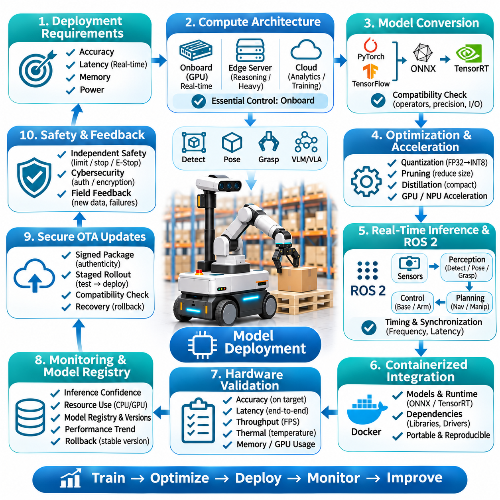{width="7.268055555555556in" height="7.268055555555556in"}

Model deployment is the engineering process of transferring trained AI models from development environments into operational mobile manipulator systems. Unlike experimental model evaluation, deployment requires integration with physical hardware, robotic middleware, and real-time execution environments. Deployed models must satisfy accuracy, inference latency, computational efficiency, resource availability, and operational reliability requirements.

Deployment planning begins with defining the operational requirements and computational constraints of individual AI modules. Object detection, pose estimation, grasp detection, and multimodal reasoning models may require different processing frequencies and hardware resources. Deployment specifications should establish acceptable inference latency, memory consumption, processing throughput, power consumption, and environmental operating conditions.

Computational architecture selection determines how AI inference workloads are distributed across mobile manipulator systems. Onboard computing platforms provide low-latency processing for perception and manipulation, while edge servers may support computationally intensive reasoning and optimization. Cloud infrastructure can provide centralized analytical capabilities, although essential robotic functions should remain available during network interruptions.

Model conversion enables trained neural networks to operate within production-oriented inference environments. Models developed using PyTorch or TensorFlow can be converted into standardized or hardware-specific representations such as ONNX and TensorRT. Conversion procedures must verify operator compatibility, numerical precision, input dimensions, and output consistency to prevent unexpected performance degradation between development and deployment environments.

Model optimization improves inference efficiency by reducing computational complexity and memory requirements. Techniques such as quantization, pruning, knowledge distillation, and computational graph optimization can accelerate neural network execution. Optimization strategies must preserve task-specific performance because reductions in detection accuracy, pose estimation precision, or grasp reliability may directly affect physical robotic operations.

Hardware acceleration plays an important role in achieving real-time AI performance within mobile manipulators. Embedded GPUs, neural processing units, and dedicated AI accelerators provide different levels of computational capability and energy efficiency. Hardware selection should consider model compatibility, memory bandwidth, thermal characteristics, power limitations, and concurrent execution requirements across multiple robotic subsystems.

Real-time inference management ensures that AI predictions are generated within the timing constraints of robotic operations. Perception processing, sensor synchronization, inference scheduling, and communication latency contribute to end-to-end response time. Deployment architectures should prioritize time-sensitive workloads and prevent computationally intensive AI models from interfering with essential navigation, manipulation, and control functions.

Integration with robotic middleware enables deployed AI models to exchange information with distributed robotic subsystems. ROS 2 topics, services, and actions can support communication between perception modules, motion planners, navigation systems, and manipulator controllers. Interface definitions should establish message structures, coordinate conventions, timestamps, execution frequencies, and error-handling mechanisms.

Containerization provides a standardized approach to packaging AI models, inference engines, software dependencies, and execution configurations. Container-based deployment can improve portability, reproducibility, and software maintenance across heterogeneous computing platforms. However, developers must validate hardware access, GPU acceleration, communication interfaces, and execution overhead under representative operational conditions.

Deployment validation must evaluate AI performance on the actual target hardware rather than relying exclusively on development workstation benchmarks. Numerical consistency, inference latency, memory consumption, GPU utilization, thermal behavior, and sustained processing throughput should be measured. Integrated robotic experiments must also verify that optimized models maintain sufficient accuracy during navigation and manipulation activities.

Operational monitoring enables developers to identify performance degradation, inference failures, resource limitations, and environmental distribution shifts after deployment. Monitoring systems should record inference confidence, processing latency, computational utilization, sensor availability, and task execution outcomes. Operational data can provide valuable feedback for diagnosing failures and improving subsequent model versions.

Model version management establishes traceability between deployed models, training datasets, optimization configurations, and software releases. Model registries should maintain version histories, validation results, hardware compatibility information, and deployment approval records. Controlled release procedures and rollback mechanisms enable mobile manipulator systems to recover from unsuccessful updates without unnecessarily interrupting industrial operations.

Over-the-air model updates enable distributed mobile manipulator fleets to receive improved AI capabilities without requiring extensive manual intervention. Update procedures should incorporate authentication, integrity verification, compatibility assessment, staged rollout, and recovery mechanisms. Model updates must be evaluated before production activation and should not interrupt safety-critical navigation or manipulation activities.

Deployment safety and cybersecurity must be incorporated into the overall AI system architecture. AI-generated predictions and action proposals should be evaluated against predefined operational constraints before physical execution. Independent safety systems must retain authority over hazardous movements. Secure communication, digitally signed model packages, access control, and protected execution environments help reduce deployment-related security risks.

Model deployment should ultimately operate within a continuous engineering lifecycle connecting model training, optimization, hardware integration, operational monitoring, maintenance, and field validation. Feedback collected from deployed systems should support subsequent dataset improvements and model refinement. The objective is to establish scalable, maintainable, computationally efficient, and operationally reliable AI capabilities for industrial mobile manipulators.

## 12 AI Validation

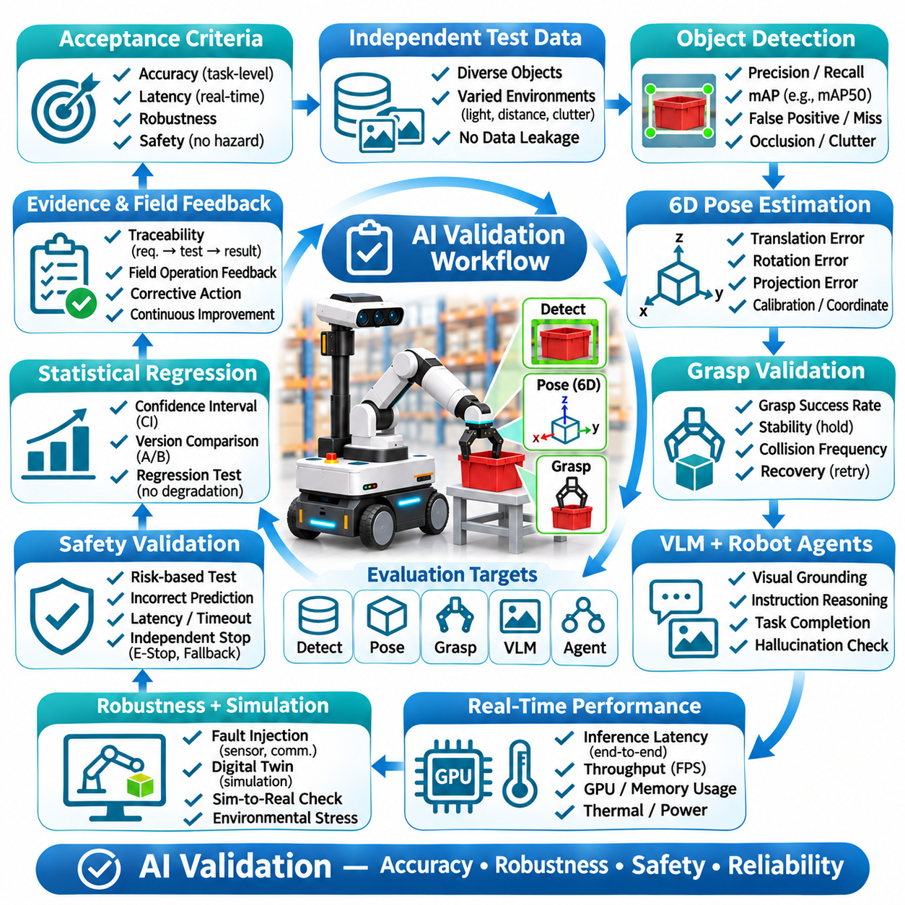{width="7.268055555555556in" height="7.268055555555556in"}

AI validation is a systematic engineering process that determines whether artificial intelligence models satisfy the functional, performance, and operational requirements of mobile manipulators. Unlike conventional model benchmarking, AI validation must consider the interaction between model predictions and physical robotic behavior. Its objective is to establish reliable evidence that developed AI capabilities are suitable for their intended applications.

AI validation begins with defining measurable acceptance criteria derived from system requirements and operational objectives. Object detection, pose estimation, grasp detection, vision-language models, and robot agents require different evaluation methodologies. Validation specifications should establish acceptable accuracy, inference latency, robustness, failure recovery capabilities, and operational limitations before testing begins.

Independent validation datasets are essential for assessing model generalization under representative operating conditions. Evaluation samples should include diverse object categories, environmental configurations, illumination conditions, observation distances, and sensor characteristics. Data leakage between training and evaluation datasets must be prevented to ensure that measured performance reflects capabilities beyond previously learned examples.

Object detection validation evaluates the ability of AI models to identify and localize relevant objects within operational environments. Precision, recall, mean average precision, false positive rates, and missed detection rates provide quantitative performance indicators. Evaluation should also address partial occlusion, reflective surfaces, cluttered scenes, small objects, and variations in camera perspectives encountered during robotic operations.

Pose estimation validation determines whether predicted object positions and orientations satisfy the geometric requirements of robotic manipulation. Translation error, rotation error, projection error, and average distance metrics can quantify prediction accuracy. Evaluation must consider sensor calibration uncertainty, object symmetry, coordinate transformation accuracy, and the propagation of estimation errors into physical manipulation.

Grasp detection validation assesses whether predicted grasp configurations result in successful and stable physical interactions. Evaluation criteria may include grasp success rate, object retention, collision frequency, grasp stability, and recovery effectiveness. Physical experiments should consider variations in object geometry, material properties, friction characteristics, payload distribution, and gripper positioning accuracy.

Vision-language model validation must evaluate semantic understanding, instruction interpretation, visual grounding, and contextual reasoning capabilities. Evaluation scenarios should include ambiguous commands, unfamiliar objects, complex spatial relationships, and incomplete environmental information. Particular attention must be given to hallucinated observations and unsupported predictions that could lead to inappropriate robotic actions.

Robot agent and embodied AI validation requires evaluating complete perception-action loops rather than isolated model predictions. Task decomposition, planning accuracy, tool invocation reliability, behavioral adaptability, and physical task completion should be assessed through representative scenarios. Validation must determine whether intelligent agents recognize unsuccessful operations and initiate appropriate recovery procedures.

Computational performance validation determines whether deployed AI models satisfy the real-time requirements of mobile manipulator systems. Inference latency, processing throughput, memory consumption, GPU utilization, power consumption, and thermal stability should be measured on target computing platforms. Evaluation must also consider concurrent execution and worst-case response times across multiple robotic subsystems.

Robustness validation evaluates AI behavior under environmental disturbances, sensor degradation, communication interruptions, and unexpected operating conditions. Stress testing and controlled fault injection can reveal weaknesses that remain undetected during conventional performance evaluation. Models should demonstrate predictable degradation characteristics and support appropriate fallback mechanisms when reliable predictions become unavailable.

Simulation-based validation provides controlled environments for evaluating AI capabilities across diverse operational scenarios. Digital twins and physics-based simulation enable repeatable experiments involving environmental variations, object configurations, and robotic interactions. However, simulation results must be complemented by physical experiments because simulated environments cannot fully reproduce real-world uncertainties.

Safety-oriented AI validation evaluates whether model failures can generate hazardous robotic behavior. Incorrect predictions, excessive inference delays, uncertain decisions, and invalid action proposals should be examined through risk-based testing. Independent safety mechanisms must prevent hazardous execution, and AI validation must not be treated as a substitute for system-level functional safety verification.

Statistical evaluation and regression testing establish confidence in AI performance across model versions and operating conditions. Repeated experiments, confidence intervals, performance distributions, and worst-case measurements provide more meaningful evidence than average accuracy alone. Automated regression tests should identify whether model updates introduce unacceptable performance degradation or compromise previously validated capabilities.

Validation documentation must establish traceability between AI requirements, model versions, datasets, test configurations, evaluation metrics, and acceptance decisions. Identified failures should be documented together with root causes, corrective actions, and subsequent verification results. Deployment approval should depend on documented evidence rather than isolated demonstrations or favorable experimental outcomes.

AI validation should ultimately operate as a continuous engineering process connecting data collection, model training, deployment, integrated testing, and operational feedback. Field observations and newly identified failure scenarios should support subsequent validation cycles. The objective is to establish dependable AI capabilities that consistently satisfy accuracy, adaptability, safety, and industrial operational reliability requirements.
