# Chapter 04. AI Development

## 01 AI Development Overview

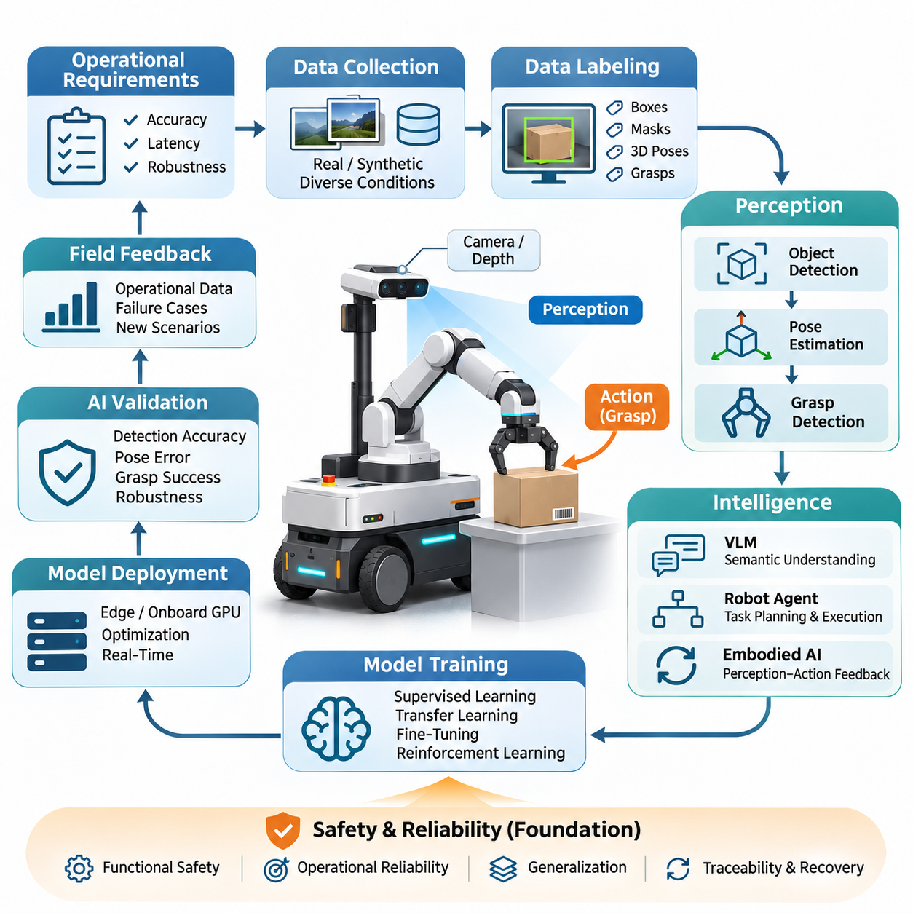{width="7.268055555555556in" height="7.268055555555556in"}

모바일 매니퓰레이터(Mobile Manipulator)의 인공지능 개발(AI Development)은 운영 요구사항(Operational Requirements)을 지능형 인지(Intelligent Perception), 의사결정(Decision-Making) 및 상호작용(Interaction) 능력으로 전환하는 체계적인 엔지니어링 프로세스(Engineering Process)이다. 기존의 소프트웨어 개발(Software Development)과 달리 인공지능 개발에서는 변화하는 환경, 물리적 객체, 센서 불확실성(Sensor Uncertainty), 실시간 로봇 운영(Real-Time Robotic Operations)을 고려해야 한다. 개발의 목적은 모바일 매니퓰레이터가 주변 환경을 인식하고, 객체를 식별하며, 공간적 관계(Spatial Relationships)를 추정하고, 매니퓰레이션 작업(Manipulation Tasks)을 계획하며, 신뢰성 있게 행동을 실행할 수 있는 인공지능 역량을 구축하는 것이다.

인공지능 개발 프로세스(AI Development Process)는 시스템 수준 요구사항(System-Level Requirements)을 측정 가능한 인공지능 역량(AI Capabilities)으로 전환하는 것에서 시작된다. 이러한 요구사항은 다양한 운영 조건에서 로봇이 무엇을 인식하고, 추정하며, 이해하고, 판단해야 하는지를 정의한다. 예를 들어, 물류창고의 모바일 매니퓰레이터는 포장물을 식별하고, 위치와 방향(Position and Orientation)을 추정하며, 파지가 가능한 영역(Graspable Regions)을 탐지하고, 접근 가능한 객체와 장애물에 의해 가려진 객체를 구분해야 한다. 각각의 역량에는 정확도(Accuracy), 지연시간(Latency), 강건성(Robustness), 운영 신뢰성(Operational Reliability) 등을 포함하는 측정 가능한 성능 목표가 설정되어야 한다.

데이터 엔지니어링(Data Engineering)은 모델 성능이 학습 데이터(Training Data)의 품질과 대표성에 크게 의존하기 때문에 인공지능 개발의 핵심적인 구성 요소이다. 모바일 매니퓰레이터는 조명(Lighting), 객체 외관(Object Appearance), 카메라 시점(Camera Viewpoints), 배경 조건(Background Conditions), 객체 배치(Object Arrangements)가 지속적으로 변화하는 환경에서 운영된다. 따라서 데이터 수집(Data Collection)은 정상적인 운영 상황뿐만 아니라 비정상적인 상황, 부분 가림(Partial Occlusion), 잠재적인 실패 사례(Failure Cases)를 포함하는 실제적인 운영 조건을 포괄해야 한다. 실제 환경 데이터세트(Real-World Datasets)와 합성 데이터세트(Synthetic Datasets)는 모두 충분히 다양화된 학습 자원을 구축하는 데 기여할 수 있다.

데이터 라벨링(Data Labeling)은 지도학습(Supervised Learning)과 정량적 평가(Quantitative Evaluation)에 필요한 정답 데이터(Ground Truth)를 구축하는 과정이다. 인공지능 작업의 유형에 따라 주석 정보(Annotations)는 객체 경계 상자(Bounding Boxes), 의미적 범주(Semantic Categories), 분할 마스크(Segmentation Masks), 특징점(Keypoints), 3차원 좌표(Three-Dimensional Coordinates), 객체 방향(Object Orientations), 파지 구성(Grasp Configurations) 등을 포함할 수 있다. 라벨링 품질(Labeling Quality)은 일관된 주석 작성 지침(Annotation Guidelines), 자동화된 검증(Automated Validation), 작업자의 검토(Human Review)를 통해 관리되어야 한다. 부정확하거나 일관성이 부족한 라벨은 모델 학습과 배포 과정에서 식별하기 어려운 체계적 오류(Systematic Errors)를 발생시킬 수 있다.

인지 하위 시스템(Perception Subsystem)은 로봇 매니퓰레이션에 필요한 시각적 이해(Visual Understanding) 기능을 제공한다. 객체 탐지 모델(Object Detection Models)은 관련 객체를 식별하고 영상 공간(Image Space)에서의 위치를 결정하며, 자세 추정 모델(Pose Estimation Models)은 공간상의 위치와 방향을 계산한다. 파지 탐지 모델(Grasp Detection Models)은 후보 접촉 영역(Candidate Contact Regions)과 적절한 파지 구성(Grasp Configurations)을 식별한다. 이러한 역량은 독립적인 알고리즘이 아니라 통합 인지 파이프라인(Integrated Perception Pipeline)으로 운영되어야 한다. 각 모델의 출력은 로봇 좌표계(Robot Coordinate System), 센서 보정(Sensor Calibration), 매니퓰레이션 계획 인터페이스(Manipulation Planning Interfaces)와 호환되어야 한다.

시각-언어 모델(Vision-Language Models, VLMs)은 영상 이해(Image Understanding)를 자연어 명령(Natural-Language Instructions) 및 의미적 추론(Semantic Reasoning)과 연결하여 기존의 시각 인지(Visual Perception) 능력을 확장한다. 모바일 매니퓰레이터는 시각-언어 모델의 역량을 활용하여 특정 포장물을 식별하거나, 지정된 부품의 위치를 찾거나, 객체의 상태를 설명하는 등의 명령을 해석할 수 있다. 그러나 언어 기반 추론(Language-Based Reasoning)이 결정론적 기하학 추정(Deterministic Geometric Estimation)이나 안전 필수 제어(Safety-Critical Control)를 대체해서는 안 된다. 실용적인 아키텍처(Practical Architecture)는 시각-언어 모델의 의미적 이해(Semantic Understanding)를 검증된 인지, 모션 계획(Motion Planning), 실행 메커니즘(Execution Mechanisms)과 결합한다.

로봇 에이전트(Robot Agents)는 인지(Perception), 추론(Reasoning), 계획(Planning), 도구 실행(Tool Execution)을 조율함으로써 상위 수준의 의사결정 능력을 제공한다. 인공지능 에이전트(AI Agent)는 작업을 해석하고, 부족한 정보를 판단하며, 추가적인 관측(Additional Observations)을 요청하고, 적절한 매니퓰레이션 절차를 선택하며, 실행 결과를 모니터링할 수 있다. 모바일 매니퓰레이션 시스템(Mobile Manipulation System)에서 에이전트는 적절한 제약조건 없이 안전 필수 하드웨어(Safety-Critical Hardware)를 직접 제어하기보다는 사전에 구축된 로봇 인터페이스(Robotic Interfaces)를 통해 상호작용해야 한다. 예상하지 못한 상황이 발생하더라도 에이전트의 의사결정은 관측 가능성(Observability), 추적 가능성(Traceability), 복구 가능성(Recoverability)을 유지해야 한다.

체화 인공지능(Embodied AI)은 지속적인 인지-행동 피드백(Perception-Action Feedback)을 통해 지능과 물리적 상호작용(Physical Interaction)을 연결한다. 로봇을 단순히 명령을 수신하고 사전에 정의된 동작을 실행하는 시스템으로 간주하는 대신, 체화 지능(Embodied Intelligence)은 환경 관측(Environmental Observations)과 물리적 행동 결과(Physical Outcomes)에 따라 로봇의 행동을 적응적으로 변화시킬 수 있도록 한다. 여기에는 파지 실패(Grasp Failure)를 인식하고, 객체 변위(Object Displacement)에 대응하며, 매니퓰레이션 전략(Manipulation Strategies)을 조정하고, 예상하지 못한 상호작용으로부터 복구하는 과정이 포함된다. 성공적인 체화 인공지능 개발을 위해서는 인지, 학습(Learning), 모션 계획, 힘 제어(Force Control), 로봇의 물리적 특성(Physical Characteristics) 사이의 유기적인 연계가 필요하다.

모델 학습(Model Training)은 수집되고 라벨링된 데이터세트를 배포 가능한 인공지능 모델(Deployable AI Models)로 전환하는 과정이다. 학습 전략(Training Strategies)에는 지도학습(Supervised Learning), 전이학습(Transfer Learning), 사전학습 모델의 미세조정(Fine-Tuning of Pretrained Models), 필요한 경우 강화학습(Reinforcement Learning) 등이 포함될 수 있다. 데이터세트 분할(Dataset Partitioning), 하이퍼파라미터 최적화(Hyperparameter Optimization), 정규화(Regularization), 반복 가능한 실험 관리(Repeatable Experiment Management)는 신뢰성 있는 결과를 확보하는 데 필수적이다. 학습 과정에서는 모델의 평균 정확도뿐만 아니라 이전에 접하지 못한 객체, 환경 및 운영 조건에 대한 일반화 성능(Generalization Performance)도 고려해야 한다. 재현성(Reproducibility)을 확보하기 위해 모델 버전(Model Versions)과 학습 구성(Training Configurations)을 체계적으로 관리해야 한다.

모델 배포(Model Deployment)는 학습된 인공지능 모델을 개발 환경(Development Environment)에서 모바일 매니퓰레이터에 탑재된 컴퓨팅 플랫폼(Computing Platform)으로 이전하는 과정이다. 배포 엔지니어링(Deployment Engineering)은 하드웨어 성능(Hardware Capabilities), GPU 가속(GPU Acceleration), 메모리 사용량(Memory Consumption), 추론 지연시간(Inference Latency), 통신 오버헤드(Communication Overhead), 전력 제한(Power Limitations)을 고려해야 한다. 모델은 양자화(Quantization), 가지치기(Pruning), 그래프 최적화(Graph Optimization), 하드웨어 특화 추론 엔진(Hardware-Specific Inference Engines)을 통해 최적화될 수 있다. 배포된 모델의 구현체는 인지 및 매니퓰레이션 작업의 실시간 처리 요구사항(Real-Time Processing Requirements)을 충족하면서 충분한 정확도를 유지해야 한다.

인공지능 검증(AI Validation)은 개발된 모델이 의도된 운영 요구사항을 충족하는지를 판단하는 과정이다. 평가(Evaluation)는 표준 머신러닝 평가 지표(Machine Learning Metrics)와 시스템 수준 성능 측정(System-Level Performance Measurements)을 결합해야 한다. 객체 탐지 정확도(Detection Accuracy), 자세 추정 오차(Pose Estimation Error), 파지 성공률(Grasp Success Rate), 추론 지연시간(Inference Latency), 환경 변화에 대한 강건성(Robustness)은 모델 품질에 대한 상호 보완적인 정보를 제공한다. 검증 과정에서는 실패 조건(Failure Conditions), 불확실성(Uncertainty), 품질이 저하된 센서 입력(Degraded Sensor Inputs), 다른 로봇 하위 시스템과의 상호작용도 평가해야 한다. 정적인 벤치마크(Static Benchmark)에서 우수한 성능을 나타내는 모델이 지속적인 물리적 운영 환경에서도 반드시 높은 신뢰성을 보장하는 것은 아니다.

따라서 인공지능 개발은 운영 요구사항, 데이터 수집, 데이터 주석, 모델 개발, 학습, 배포 및 검증이 지속적으로 상호 영향을 주는 반복적 수명주기(Iterative Lifecycle)를 따라야 한다. 현장 관측 결과(Field Observations)와 운영 실패 사례(Operational Failures)는 추가적인 학습 데이터와 모델 아키텍처(Model Architecture) 또는 시스템 통합(System Integration)의 개선 요소로 전환되어야 한다. 이러한 피드백 프로세스(Feedback Process)는 모바일 매니퓰레이터가 새로운 객체, 환경 및 작업을 접함에 따라 인공지능 하위 시스템(AI Subsystem)이 지속적으로 발전할 수 있도록 한다. 궁극적인 목표는 단순히 높은 성능의 머신러닝 모델(Machine Learning Models)을 개발하는 것이 아니라, 전체 로봇 시스템의 안전성(Safety), 생산성(Productivity), 상업적 가치(Commercial Value)에 직접적으로 기여하는 신뢰성 높은 인공지능 역량을 제공하는 것이다.

## 02 Data Collection

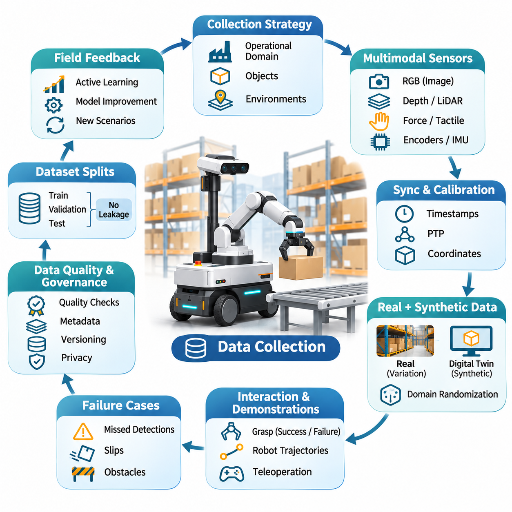{width="7.268055555555556in" height="7.268055555555556in"}

데이터 수집(Data Collection)은 수집된 데이터의 품질(Quality), 다양성(Diversity), 대표성(Representativeness)이 지능형 로봇 시스템(Intelligent Robotic Systems)의 신뢰성에 직접적인 영향을 미치기 때문에 모바일 매니퓰레이터(Mobile Manipulator)의 인공지능 개발(AI Development)을 위한 기반이 된다. 정적인 디지털 정보를 처리하는 기존의 인공지능 응용 시스템과 달리 모바일 매니퓰레이터는 동적인 물리적 환경(Dynamic Physical Environment)을 해석해야 한다. 따라서 데이터 수집은 환경적 특성(Environmental Characteristics)뿐만 아니라 로봇과 주변 객체 사이에서 발생하는 물리적 상호작용(Physical Interaction)도 포함해야 한다.

데이터 수집 프로세스(Data Collection Process)는 각각의 인공지능 역량(AI Capabilities)에 필요한 정보를 식별하는 것에서 시작된다. 객체 탐지(Object Detection)는 다양한 시각적 조건에서 대상 객체가 포함된 영상을 필요로 하며, 자세 추정(Pose Estimation)은 객체의 위치와 방향을 설명하는 공간 정보(Spatial Information)를 필요로 한다. 파지 탐지(Grasp Detection)는 객체의 기하학적 형상(Object Geometry), 접촉 영역(Contact Regions), 성공 및 실패한 파지 구성(Grasp Configurations)에 대한 정보를 필요로 한다. 로봇 에이전트(Robot Agents)와 체화 인공지능(Embodied AI)은 추가적으로 작업 시퀀스(Task Sequences), 로봇 상태(Robot States), 환경 관측(Environmental Observations), 행동 결과(Action Outcomes)를 필요로 한다.

종합적인 데이터 수집 전략(Data Collection Strategy)은 모바일 매니퓰레이터의 운영 설계 영역(Operational Design Domain, ODD)에 따라 수립되어야 한다. 이러한 전략은 적용 가능한 환경, 객체 범주(Object Categories), 작업 조건(Working Conditions), 센서 구성(Sensor Configurations), 예상되는 매니퓰레이션 시나리오(Manipulation Scenarios)를 정의한다. 산업 응용 분야(Industrial Applications)의 경우 데이터는 제조 시설, 물류창고 환경, 보관 선반, 작업 스테이션 및 운송 구역을 대표할 수 있어야 한다. 통제된 실험실 환경에서만 신뢰성 있게 작동하는 모델이 개발될 위험을 줄이기 위해 환경적 변화(Environmental Variations)를 체계적으로 반영해야 한다.

멀티모달 데이터 수집(Multimodal Data Collection)은 상호 보완적인 센싱 기술(Sensing Technologies)을 통해 모바일 매니퓰레이터가 주변 환경을 이해할 수 있도록 한다. RGB 카메라(RGB Camera)는 시각적 외관(Visual Appearance)과 질감 정보(Texture Information)를 제공하며, 깊이 카메라(Depth Camera)와 3차원 라이다 센서(3D LiDAR Sensor)는 공간 기하학 정보(Spatial Geometry)와 거리 측정값(Distance Measurements)을 제공한다. 힘-토크 센서(Force-Torque Sensor), 촉각 센서(Tactile Sensor), 관절 엔코더(Joint Encoder), 관성 측정 장치(Inertial Measurement Unit, IMU)는 물리적 상호작용과 로봇 구성(Robot Configuration)에 대한 정보를 제공한다. 이러한 데이터 소스를 결합하면 환경 이해 능력이 향상되며 통합 인지 및 매니퓰레이션 역량(Integrated Perception and Manipulation Capabilities)의 개발을 지원할 수 있다.

센서 동기화(Sensor Synchronization)는 모바일 로봇 시스템에서 멀티모달 데이터를 수집할 때 필수적이다. 서로 다른 타임스탬프(Timestamps)에서 획득된 측정값은 특히 모바일 플랫폼이나 매니퓰레이터가 움직이는 상황에서 서로 일치하지 않는 환경 상태 또는 로봇 상태를 나타낼 수 있다. 하드웨어 트리거링(Hardware Triggering), 정밀 시간 프로토콜(Precision Time Protocol, PTP), 타임스탬프 기반 동기화(Timestamp-Based Synchronization)는 시간적 정렬(Temporal Alignment)의 정확도를 향상시킬 수 있다. 또한 여러 장치에서 획득한 측정값을 공통 공간 기준 좌표계(Common Spatial Reference Frame) 내에서 정확하게 연계할 수 있도록 센서 보정(Sensor Calibration) 및 좌표 변환(Coordinate Transformation) 정보도 함께 기록해야 한다.

실제 환경 데이터 수집(Real-World Data Collection)은 의도된 운영 환경(Operational Environment)을 반영하는 조건에서 수행되어야 한다. 영상과 센서 측정값은 조명(Illumination), 관측 각도(Viewing Angles), 객체 거리(Object Distances), 표면 재질(Surface Materials), 배경 복잡도(Background Complexity), 가림 현상(Occlusion)의 다양한 변화를 포함해야 한다. 또한 움직이는 객체, 사람의 활동(Human Activity), 객체 배치(Object Arrangements)의 변화도 데이터에 포함되어야 한다. 서로 다른 운영 시간대와 물리적 장소에서 정보를 수집하면 환경적 편향(Environmental Bias)을 감소시키고 개발된 인공지능 모델의 일반화 능력(Generalization Capabilities)을 향상시킬 수 있다.

합성 데이터 생성(Synthetic Data Generation)은 실제 환경 데이터 획득에 많은 비용과 시간이 소요되거나 운영상의 제약이 존재하는 경우 데이터세트를 확장하는 효과적인 수단을 제공한다. 시뮬레이션 환경(Simulation Environment)과 디지털 트윈(Digital Twin)은 이에 대응하는 정답 데이터(Ground Truth)와 함께 영상, 깊이 맵(Depth Maps), 포인트 클라우드(Point Clouds), 객체 자세(Object Poses), 매니퓰레이션 궤적(Manipulation Trajectories)을 생성할 수 있다. 도메인 무작위화(Domain Randomization)는 조명, 질감, 객체 형상, 카메라 구성에 다양한 변화를 적용할 수 있다. 합성 데이터는 실제 환경에서 획득한 관측 데이터를 보완해야 하며, 시뮬레이션과 현실 사이의 격차(Simulation-to-Reality Gap)를 식별하고 감소시키기 위한 검증이 수행되어야 한다.

매니퓰레이션 중심 데이터 수집(Manipulation-Oriented Data Collection)은 객체의 시각적 외관뿐만 아니라 로봇 행동에 따른 물리적 결과(Physical Consequences)도 포함해야 한다. 파지 실험(Grasping Experiments) 중에는 엔드 이펙터 위치(End-Effector Positions), 관절 구성(Joint Configurations), 그리퍼 개방 거리(Gripper Opening Distances), 인가 힘(Applied Forces), 객체 변위(Object Displacement), 작업 결과(Task Outcomes)를 기록해야 한다. 성공 및 실패한 매니퓰레이션 시도는 파지 탐지 모델과 학습 기반 매니퓰레이션 모델(Learning-Based Manipulation Models)을 개발하는 데 유용한 정보를 제공한다. 이러한 기록은 인지 정확도(Perception Accuracy), 파지 기하학(Grasp Geometry), 물리적 접촉(Physical Contact), 실행 신뢰성(Execution Reliability) 사이의 관계를 식별하는 데 도움이 된다.

시연 기반 데이터 수집(Demonstration-Based Data Collection)은 바람직한 작업 실행 사례를 기록함으로써 로봇 학습(Robot Learning)을 지원한다. 작업자는 원격 조작(Teleoperation), 직접 유도 교시(Lead-Through Teaching), 모션 캡처(Motion Capture) 또는 기타 적절한 제어 인터페이스(Control Interfaces)를 통해 작업 시연을 제공할 수 있다. 기록된 시연 데이터(Demonstration Data)는 환경 관측, 로봇 궤적(Robot Trajectories), 제어 명령(Control Commands), 작업 완료 결과(Task Completion Results)를 포함해야 한다. 이러한 데이터는 모방학습(Imitation Learning), 시각-언어-행동 모델(Vision-Language-Action Models, VLA), 대표적인 사례로부터 매니퓰레이션 기술을 습득하는 체화 인공지능 시스템의 개발을 지원할 수 있다.

실패 중심 데이터 수집(Failure-Oriented Data Collection)은 모바일 매니퓰레이터의 신뢰성을 향상시키는 데 특히 중요하다. 운영 실패(Operational Failures)에는 미탐지(Missed Detections), 부정확한 자세 추정(Incorrect Pose Estimates), 파지 실패(Unsuccessful Grasps), 객체 미끄러짐(Object Slippage), 예상하지 못한 장애물(Unexpected Obstacles), 불완전한 작업 실행(Incomplete Task Execution) 등이 포함될 수 있다. 이러한 조건은 관련 센서 측정값, 시스템 상태(System States), 진단 정보(Diagnostic Information)와 함께 기록되어야 한다. 난도가 높은 사례와 부정적 사례(Negative Examples)를 포함하면 개발자는 실패 메커니즘(Failure Mechanisms)을 조사하고, 모델 강건성(Model Robustness)을 향상시키며, 더욱 효과적인 불확실성 처리(Uncertainty Handling) 및 복구 전략(Recovery Strategies)을 수립할 수 있다.

데이터 품질 관리(Data Quality Management)는 데이터 획득 이후에만 수행되는 것이 아니라 수집 프로세스 자체에 통합되어야 한다. 손상된 영상(Corrupted Images), 누락된 타임스탬프(Missing Timestamps), 유효하지 않은 깊이 측정값(Invalid Depth Measurements), 보정 불일치(Calibration Inconsistencies), 중복 샘플(Duplicated Samples)은 데이터세트의 효과를 저하시킬 수 있다. 자동화된 품질 검사 메커니즘(Automated Quality Inspection Mechanisms)은 데이터가 주석 및 학습 파이프라인(Annotation and Training Pipelines)에 입력되기 전에 이러한 문제를 식별해야 한다. 또한 데이터세트 포괄 범위(Dataset Coverage)를 주기적으로 검토하여 충분히 반영되지 않은 객체 범주, 환경 조건 및 매니퓰레이션 시나리오를 식별해야 한다.

수집된 데이터는 구조화되고 확장 가능한 데이터 관리 아키텍처(Data Management Architecture) 내에서 체계적으로 구성되어야 한다. 각각의 데이터 샘플(Data Sample)은 획득 시간(Acquisition Time), 센서 구성, 보정 버전(Calibration Version), 환경 조건, 로봇 구성, 운영 시나리오를 설명하는 메타데이터(Metadata)와 연계되어야 한다. 데이터세트 버전 관리(Dataset Version Control)는 개발자가 학습 실험을 재현하고 성능 변화를 특정 데이터 변경 사항까지 추적할 수 있도록 한다. 또한 운영 요구사항과 적용 가능한 규제에 따라 접근 제어(Access Control), 암호화(Encryption), 개인정보 보호(Privacy Protection), 데이터 보존 정책(Data Retention Policies)이 수립되어야 한다.

데이터세트 분할(Dataset Partitioning)은 학습 데이터세트(Training Dataset), 검증 데이터세트(Validation Dataset), 테스트 데이터세트(Test Dataset) 사이의 정보 누출(Information Leakage)을 방지하기 위해 데이터 수집 단계에서부터 계획되어야 한다. 연속적인 비디오 프레임(Consecutive Video Frames), 반복적인 매니퓰레이션 시퀀스, 동일한 물리적 객체에 대한 관측 데이터가 여러 데이터세트에 무작위로 분배되면 의도하지 않은 상관관계(Unintended Correlations)가 발생할 수 있다. 데이터 획득 세션(Acquisition Session), 개별 객체(Object Instance), 운영 환경을 기준으로 데이터를 분할하면 모델 일반화 성능을 더욱 의미 있게 평가할 수 있다. 독립적인 테스트 데이터세트(Independent Test Dataset)는 실제적인 운영 조건을 대표해야 하며, 모델 최적화 과정에서 반복적으로 사용되지 않아야 한다.

궁극적으로 데이터 수집은 모바일 매니퓰레이터의 전체 개발 수명주기(Development Lifecycle)에 걸쳐 지속적인 피드백 메커니즘(Continuous Feedback Mechanism)으로 운영되어야 한다. 프로토타입 테스트(Prototype Testing), 현장 검증(Field Validation), 상업적 운영(Commercial Operations) 과정에서 획득한 정보는 기존 모델의 취약점을 파악하고 후속 데이터 수집 활동을 계획하는 데 활용되어야 한다. 능동학습(Active Learning)과 불확실성 기반 샘플링(Uncertainty-Based Sampling)은 정보 가치가 높은 관측 데이터의 수집을 우선시하면서 불필요한 데이터 수집 및 주석 작성 비용을 절감할 수 있다. 체계적인 데이터 수집 인프라(Data Collection Infrastructure)를 구축함으로써 개발자는 다양한 산업 환경에서 모바일 매니퓰레이터의 인공지능 성능(AI Performance), 운영 신뢰성(Operational Reliability), 적응성(Adaptability)을 지속적으로 향상시킬 수 있다.

## 03 Data Labeling

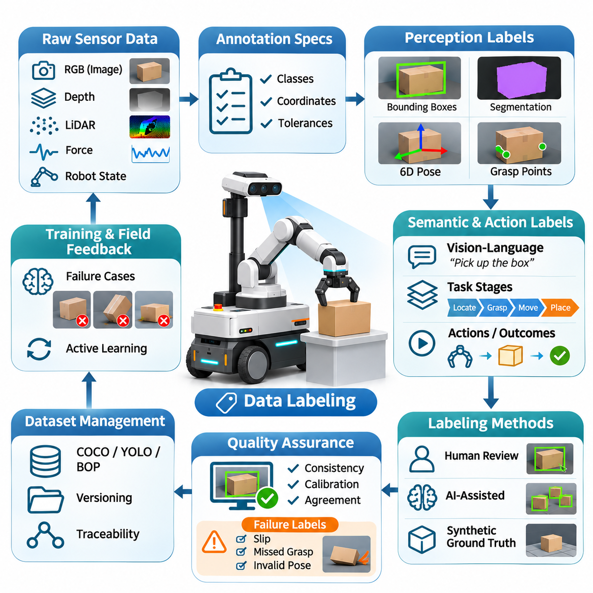{width="7.268055555555556in" height="7.268055555555556in"}

데이터 라벨링(Data Labeling)은 원시 센서 관측 데이터(Raw Sensor Observations)를 모델 학습(Model Training)과 평가(Evaluation)에 적합한 구조화된 정보(Structured Information)로 변환하기 때문에 모바일 매니퓰레이터(Mobile Manipulator)의 인공지능 개발 수명주기(AI Development Lifecycle)에서 필수적인 엔지니어링 프로세스이다. 기존의 영상 인식 응용 시스템(Image Recognition Applications)과 달리 모바일 매니퓰레이션은 시각적 외관(Visual Appearance), 공간 기하학(Spatial Geometry), 객체 방향(Object Orientation), 물리적 상호작용(Physical Interaction), 운영 결과(Operational Outcomes)를 설명하는 주석 정보(Annotations)를 필요로 한다. 이러한 주석 정보의 품질은 로봇 지능(Robotic Intelligence)에 직접적인 영향을 미친다.

데이터 라벨링 프로세스(Data Labeling Process)는 의도된 인공지능 역량(AI Capabilities)에 따라 주석 요구사항(Annotation Requirements)을 정의하는 것에서 시작된다. 객체 탐지(Object Detection), 자세 추정(Pose Estimation), 파지 탐지(Grasp Detection), 시각-언어 이해(Vision-Language Understanding), 체화 인공지능(Embodied AI)은 서로 다른 형태의 지도 정보(Supervision)를 필요로 한다. 개발자는 대규모 주석 작성 작업을 시작하기 전에 객체 범주(Object Categories), 좌표계 규약(Coordinate Conventions), 라벨링 형식(Labeling Formats), 허용 오차(Acceptable Tolerances), 품질 승인 기준(Quality Acceptance Criteria)을 정의하는 주석 명세서(Annotation Specification)를 수립해야 한다.

객체 탐지 라벨링(Object Detection Labeling)은 일반적으로 영상 내의 대상 객체를 식별하고 범주 라벨(Category Labels)과 경계 상자(Bounding Boxes)를 할당하는 과정으로 구성된다. 주석 작업자(Annotators)는 부분적으로 가려지거나 서로 중첩되거나 영상 경계(Image Boundaries) 부근에 위치한 객체를 포함하여 개별 객체 인스턴스(Object Instances)를 일관성 있게 구분해야 한다. 라벨링 정책(Labeling Policies)은 주석 정보가 실제로 보이는 영역(Visible Regions)을 나타내는지 또는 추정된 전체 객체 영역(Estimated Complete Object Extents)을 나타내는지를 정의해야 한다. 일관된 주석 작성 방식은 객체 탐지 정확도(Detection Accuracy)를 향상시키고 모델 학습 과정에서 발생하는 모호성(Ambiguity)을 감소시킨다.

의미론적 분할(Semantic Segmentation)과 인스턴스 분할(Instance Segmentation)은 픽셀 수준(Pixel Level)에서 객체 영역을 식별함으로써 더욱 상세한 주석 정보를 제공한다. 의미론적 분할은 각각의 픽셀에 범주 라벨을 할당하는 반면, 인스턴스 분할은 동일한 범주에 속하는 개별 객체를 구분한다. 이러한 주석 정보는 복잡하게 배치된 환경(Cluttered Environments)에서 작동하는 모바일 매니퓰레이터에 특히 유용하다. 정확한 객체 경계(Object Boundaries)는 파지 계획(Grasp Planning), 표면 식별(Surface Identification), 충돌 인지형 매니퓰레이션(Collision-Aware Manipulation)을 지원하기 때문이다.

자세 추정 라벨링(Pose Estimation Labeling)은 정의된 좌표계(Coordinate System) 내에서 객체의 위치(Position)와 방향(Orientation)을 설명하는 기하학적 정보(Geometric Information)를 필요로 한다. 6차원 자세 주석(6D Pose Annotations)은 일반적으로 3개의 병진 자유도(Translational Degrees of Freedom)와 3개의 회전 자유도(Rotational Degrees of Freedom)를 나타낸다. 정답 데이터(Ground Truth)는 보정된 측정 시스템(Calibrated Measurement Systems), 기준 마커(Fiducial Markers), 모션 캡처(Motion Capture), CAD 모델 정합(CAD Model Registration), 시뮬레이션(Simulation)을 통해 획득할 수 있다. 객체 대칭성(Object Symmetry), 좌표계 규약, 측정 불확실성(Measurement Uncertainty), 보정 정확도(Calibration Accuracy)를 신중하게 고려해야 한다.

파지 탐지 라벨링(Grasp Detection Labeling)은 로봇 그리퍼(Robotic Gripper)가 객체와 안정적인 접촉(Stable Contact)을 형성할 수 있는 적절한 파지 구성(Grasp Configurations)을 식별하는 데 중점을 둔다. 주석 정보에는 파지 중심 위치(Grasp Center Positions), 접근 방향(Approach Directions), 그리퍼 방향(Gripper Orientations), 개방 폭(Opening Widths), 접촉점(Contact Points), 파지 품질 점수(Grasp Quality Scores) 등이 포함될 수 있다. 라벨링 과정에서는 객체의 기하학적 형상(Object Geometry), 재료 특성(Material Properties), 그리퍼 특성(Gripper Characteristics), 접근 가능성(Accessibility), 물리적 안정성(Physical Stability)을 고려해야 한다. 실험적인 파지 결과(Experimental Grasp Outcomes)는 후보 파지 주석(Candidate Grasp Annotations)을 검증하기 위한 중요한 근거를 제공한다.

멀티모달 데이터 라벨링(Multimodal Data Labeling)은 서로 다른 센싱 기술(Sensing Technologies)에서 획득한 정보를 통합된 표현 체계(Unified Representation) 내에서 연계하는 과정이다. RGB 영상(RGB Images), 깊이 맵(Depth Maps), 포인트 클라우드(Point Clouds), 촉각 측정값(Tactile Measurements), 힘-토크 신호(Force-Torque Signals), 로봇 관절 상태(Robot Joint States)는 동일한 사건의 상호 보완적인 측면을 설명할 수 있다. 이러한 주석 정보 간의 일관성을 유지하기 위해서는 정확한 시간 동기화(Temporal Synchronization)와 공간 보정(Spatial Calibration)이 필요하며, 특히 모바일 플랫폼(Mobile Platform), 매니퓰레이터(Manipulator), 대상 객체(Target Object)가 움직이는 상황에서는 더욱 중요하다.

시각-언어 모델(Vision-Language Models, VLMs)을 위한 라벨링은 시각적 관측(Visual Observations)과 자연어 명령(Natural-Language Instructions)을 연결하는 의미적 설명(Semantic Descriptions)을 필요로 한다. 주석 정보는 객체 속성(Object Attributes), 공간적 관계(Spatial Relationships), 기능적 특성(Functional Properties), 환경 조건(Environmental Conditions), 매니퓰레이션 목표(Manipulation Objectives)를 설명할 수 있다. 언어적 설명(Language Descriptions)은 근거가 부족한 가정을 포함하기보다는 실제로 관측 가능한 증거(Observable Evidence)와 일치해야 한다. 다양한 언어적 표현(Linguistic Expressions)은 서로 다른 운영 상황에서 모델이 명령을 해석하는 능력을 향상시킬 수 있다.

로봇 에이전트(Robot Agents)와 체화 인공지능(Embodied AI)을 위한 데이터세트(Datasets)는 순차적 행동(Sequential Behavior)과 물리적 상호작용을 표현하는 주석 정보를 필요로 한다. 기록된 작업 시연(Task Demonstrations)은 객체 위치 추정(Object Localization), 접근(Approach), 파지(Grasping), 운반(Transportation), 배치(Placement), 검증(Verification)과 같은 의미 있는 단계로 구분될 수 있다. 각각의 단계는 관측 정보(Observations), 행동(Actions), 로봇 상태(Robot States), 실행 결과(Execution Outcomes)와 연계될 수 있다. 이러한 주석 정보는 작업 추론(Task Reasoning), 모방학습(Imitation Learning), 행동 예측(Action Prediction), 피드백 기반 행동 적응(Feedback-Driven Behavior Adaptation)을 지원한다.

수동 주석 작성(Manual Annotation)은 복잡한 장면(Complex Scenes), 모호한 객체 경계(Ambiguous Object Boundaries), 비정상적인 운영 조건(Unusual Operational Conditions)을 해석하기 위한 사람의 지도(Human Supervision)를 제공한다. 그러나 대규모 수동 라벨링은 많은 비용과 시간이 소요될 수 있다. 반자동 주석 작성 기술(Semi-Automated Annotation Techniques)은 기존의 인공지능 모델(AI Models), 객체 추적(Object Tracking), 분할 알고리즘(Segmentation Algorithms), 기하학적 처리(Geometric Processing)를 활용하여 예비 라벨(Preliminary Labels)을 생성한다. 이후 검토 작업자(Human Reviewers)는 주석 정보가 학습용으로 승인되기 전에 부정확한 예측 결과를 수정하고 불확실한 사례(Uncertain Cases)를 해결한다.

합성 데이터 라벨링(Synthetic Data Labeling)은 시뮬레이션 환경(Simulation Environments)과 디지털 트윈(Digital Twins) 내에서 주석 정보를 자동으로 생성할 수 있도록 한다. 가상 환경(Virtual Environments)은 객체 식별 정보(Object Identities), 분할 마스크(Segmentation Masks), 공간 좌표(Spatial Coordinates), 방향(Orientations), 접촉 조건(Contact Conditions), 로봇 구성(Robot Configurations)에 직접 접근할 수 있는 기능을 제공한다. 이러한 역량은 수동 주석 작성 비용을 절감하고 대규모 데이터세트 생성(Large-Scale Dataset Generation)을 지원한다. 그럼에도 불구하고 모델링 가정(Modeling Assumptions)과 도메인 간 불일치(Domain Discrepancies)를 식별하기 위해 합성 정답 데이터(Synthetic Ground Truth)를 실제 환경 조건과 비교하여 검증해야 한다.

주석 품질 보증(Annotation Quality Assurance)은 자동화된 검사(Automated Inspection)와 체계적인 작업자 검토(Systematic Human Review)를 포함해야 한다. 자동화된 검증(Automated Validation)은 누락된 라벨(Missing Labels), 유효하지 않은 경계 상자(Invalid Bounding Boxes), 일관성이 부족한 범주 할당(Inconsistent Category Assignments), 좌표 오류(Coordinate Errors), 손상된 주석 파일(Corrupted Annotation Files)을 식별할 수 있다. 검토 작업자는 대표 샘플링(Representative Sampling)이나 독립적 검증(Independent Verification)을 통해 모호한 장면과 기하학적 정확도(Geometric Accuracy)를 평가해야 한다. 주석 작업자 간 일치도(Inter-Annotator Agreement)는 여러 작업자가 유사한 운영 시나리오를 해석할 때 일관성을 평가하기 위한 추가적인 측정 지표를 제공한다.

실패 중심 라벨링(Failure-Oriented Labeling)은 신뢰성 높은 모바일 매니퓰레이션 시스템(Mobile Manipulation System)을 개발하는 데 특히 중요하다. 부정적 사례(Negative Examples)에는 접근할 수 없는 객체(Inaccessible Objects), 유효하지 않은 파지 구성(Invalid Grasp Configurations), 실패한 파지 시도(Unsuccessful Grasp Attempts), 객체 미끄러짐(Object Slippage), 부정확한 위치 추정(Incorrect Localization), 불완전한 작업 실행(Incomplete Task Execution) 등이 포함될 수 있다. 이러한 사례는 누락되거나 불확실한 주석 정보와 명확하게 구분되어야 한다. 실패 조건(Failure Conditions)을 명시적으로 라벨링하면 불확실성 추정(Uncertainty Estimation), 실패 예측(Failure Prediction), 오류 복구(Error Recovery), 더욱 강건한 인지 및 매니퓰레이션 모델(Robust Perception and Manipulation Models)의 개발을 지원할 수 있다.

주석 관리(Annotation Management)는 인공지능 개발 수명주기 전반에 걸쳐 구조화된 저장소(Structured Storage), 버전 관리(Version Control), 추적 가능성(Traceability)을 필요로 한다. 각각의 주석 정보는 대응하는 센서 데이터(Sensor Data), 라벨링 명세(Labeling Specification), 보정 정보(Calibration Information), 주석 작성 방법(Annotation Method), 품질 검토 상태(Quality Review Status)와 연계되어야 한다. COCO, YOLO, BOP와 같은 표준화된 형식(Standardized Formats)은 서로 다른 인지 작업(Perception Tasks)을 지원할 수 있으며, 멀티모달 로봇 궤적(Multimodal Robotic Trajectories)과 물리적 상호작용 기록(Physical Interaction Records)을 관리하기 위해서는 사용자 정의 스키마(Custom Schemas)가 필요할 수 있다.

궁극적으로 데이터 라벨링은 일회성 준비 작업(One-Time Preparation Activity)이 아니라 지속적인 개선 메커니즘(Continuous Improvement Mechanism)으로 기능해야 한다. 모델 평가(Model Evaluation), 프로토타입 테스트(Prototype Testing), 현장 검증(Field Validation)은 주석 오류(Annotation Errors), 불충분한 범주 포괄 범위(Insufficient Category Coverage), 이전에 인식하지 못한 실패 조건을 식별할 수 있다. 능동학습(Active Learning)은 불확실성이 높거나 정보 가치가 높은 샘플(Informative Samples)에 대한 추가적인 주석 작업을 우선적으로 수행할 수 있도록 한다. 체계적인 라벨링 인프라(Labeling Infrastructure)를 구축함으로써 개발자는 모델 정확도(Model Accuracy)를 향상시키고, 개발 비용(Development Costs)을 절감하며, 재현성(Reproducibility)을 유지하고, 모바일 매니퓰레이터의 운영 신뢰성(Operational Reliability)을 강화할 수 있다.

## 04 Object Detection Models

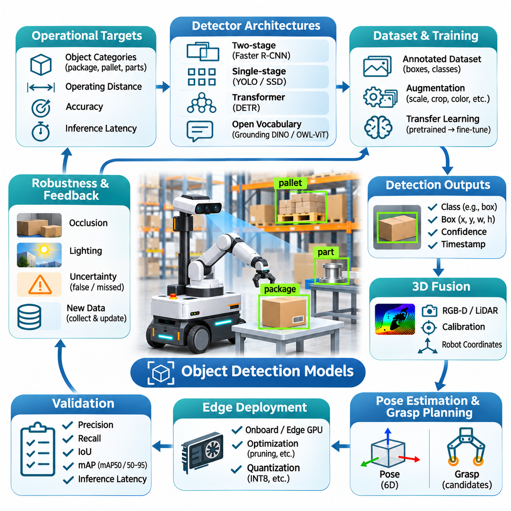{width="7.268055555555556in" height="7.268055555555556in"}

객체 탐지 모델(Object Detection Models)은 모바일 매니퓰레이터(Mobile Manipulator)의 인공지능 아키텍처(AI Architecture)를 구성하는 핵심 요소이다. 주요 기능은 센서 관측 데이터(Sensor Observations)에서 관련 객체를 식별하고 주변 환경 내에서 해당 객체의 위치를 결정하는 것이다. 기존의 영상 인식 시스템(Image Recognition Systems)과 달리 모바일 매니퓰레이션을 위한 객체 탐지(Object Detection)는 로봇 내비게이션(Robot Navigation), 자세 추정(Pose Estimation), 파지 계획(Grasp Planning), 자율 작업 실행(Autonomous Task Execution)을 지원하는 실행 가능한 정보(Actionable Information)를 제공해야 한다.

객체 탐지 개발(Object Detection Development)은 의도된 로봇 응용 분야(Robotic Applications)에 따라 대상 객체 범주(Target Object Categories)와 운영 요구사항(Operational Requirements)을 정의하는 것에서 시작된다. 물류창고의 모바일 매니퓰레이터는 포장물, 컨테이너, 팔레트, 보관 위치를 탐지해야 하며, 산업용 모바일 매니퓰레이터는 기계 부품(Mechanical Components), 조립 부품(Assembly Parts), 제조 도구(Manufacturing Tools)를 인식해야 할 수 있다. 객체 탐지 요구사항(Detection Requirements)은 객체 크기(Object Dimensions), 작동 거리(Operating Distances), 환경 조건(Environmental Conditions), 정확도 목표(Accuracy Targets), 허용 가능한 추론 지연시간(Permissible Inference Latency)을 명시해야 한다.

현대적인 객체 탐지 아키텍처(Object Detection Architectures)는 일반적으로 2단계 탐지기(Two-Stage Detectors), 단일 단계 탐지기(Single-Stage Detectors), 트랜스포머 기반 탐지기(Transformer-Based Detectors)로 분류할 수 있다. Faster R-CNN과 같은 2단계 탐지기는 분류(Classification)와 경계 상자 정제(Bounding Box Refinement)를 수행하기 전에 후보 객체 영역(Candidate Object Regions)을 생성한다. YOLO와 SSD 계열을 포함하는 단일 단계 탐지기는 객체 범주와 위치를 직접 예측한다. DETR 및 다양한 파생 모델과 같은 트랜스포머 기반 탐지기는 어텐션 메커니즘(Attention Mechanisms)과 객체 쿼리(Object Queries)를 활용하여 객체 탐지를 집합 예측 문제(Set Prediction Problem)로 구성한다.

단일 단계 객체 탐지 모델(Single-Stage Object Detection Models)은 탐지 정확도(Detection Accuracy)와 계산 효율성(Computational Efficiency) 사이에서 효과적인 균형을 제공할 수 있기 때문에 모바일 매니퓰레이터에 특히 적합하다. YOLO 기반 아키텍처(YOLO-Based Architectures)는 제한된 컴퓨팅 자원(Computational Resources) 내에서 지속적인 환경 관측 데이터를 처리해야 하는 실시간 로봇 인지(Real-Time Robotic Perception)에 폭넓게 적용할 수 있다. 모델 선정(Model Selection) 과정에서는 추론 속도(Inference Speed), 탐지 정확도, 네트워크 크기(Network Size), 메모리 사용량(Memory Consumption), 에너지 효율성(Energy Efficiency), 임베디드 컴퓨팅 플랫폼(Embedded Computing Platforms)과의 호환성을 고려해야 한다.

트랜스포머 기반 객체 탐지 모델(Transformer-Based Object Detection Models)은 영상 영역(Image Regions) 사이의 관계를 파악하는 어텐션 메커니즘을 도입함으로써 시각 인지(Visual Perception)에 대한 대안적인 접근 방식을 제공한다. DETR과 Deformable DETR 같은 아키텍처는 다수의 객체와 복잡한 공간 배치(Spatial Arrangements)가 포함된 환경에서 객체 탐지를 지원할 수 있다. 그러나 이러한 모델의 실질적인 장점은 모델 아키텍처(Model Architecture), 학습 데이터(Training Data), 계산 요구사항(Computational Requirements), 배포 최적화(Deployment Optimization)에 따라 달라진다. 따라서 모델 성능은 실제 로봇 운영 환경을 대표하는 조건에서 평가되어야 한다.

개방형 어휘 객체 탐지(Open-Vocabulary Object Detection)는 사전에 정의된 범주(Predefined Categories)에만 의존하는 대신 자연어 설명(Natural-Language Descriptions)을 통해 객체를 식별할 수 있도록 기존 객체 탐지 역량을 확장한다. Grounding DINO와 OWL-ViT 같은 모델은 익숙하지 않은 객체(Unfamiliar Objects)가 포함된 환경에서 유연한 객체 식별(Flexible Object Identification)을 지원할 수 있다. 이러한 역량은 자연어 명령(Natural-Language Instructions)을 실행하는 모바일 매니퓰레이터에 특히 중요하다. 다만 물리적 매니퓰레이션(Physical Manipulation)을 수행하기 전에 해당 모델의 예측 결과에 대한 추가적인 검증(Additional Verification)이 필요하다.

객체 탐지 모델 학습(Object Detection Model Training)은 다양한 환경 조건에서 적절하게 주석이 작성된 객체를 포함하는 대표성 있는 데이터세트(Representative Datasets)를 필요로 한다. 학습 샘플(Training Samples)은 객체 크기(Object Size), 방향(Orientation), 조명(Illumination), 배경 복잡도(Background Complexity), 관측 거리(Viewing Distance), 부분 가림(Partial Occlusion)의 다양한 변화를 포함해야 한다. 영상 크기 조정(Image Scaling), 잘라내기(Cropping), 색상 변환(Color Transformation), 기하학적 변형(Geometric Modification)과 같은 데이터 증강 기술(Data Augmentation Techniques)은 원본 관측 데이터의 의미적 및 물리적 유효성(Semantic and Physical Validity)을 유지하는 경우 모델의 일반화 성능(Model Generalization)을 향상시킬 수 있다.

객체 탐지 성능(Object Detection Performance)은 전이학습(Transfer Learning)과 사전학습 신경망의 미세조정(Fine-Tuning of Pretrained Neural Networks)을 통해 향상될 수 있다. 대규모 데이터세트(Large-Scale Datasets)를 기반으로 사전학습된 모델은 재사용 가능한 시각적 표현(Reusable Visual Representations)을 제공하므로 응용 분야에 특화된 데이터세트(Application-Specific Datasets)가 제한적인 경우 학습 시간을 단축하고 성능을 향상시킬 수 있다. 미세조정(Fine-Tuning)은 이러한 표현을 대상 산업 환경과 객체 범주에 적응시키는 과정이다. 재현성(Reproducibility)을 확보하기 위해 학습 구성(Training Configurations), 데이터세트 버전(Dataset Versions), 모델 체크포인트(Model Checkpoints), 실험 결과(Experiment Results)를 체계적으로 관리해야 한다.

3차원 환경에서의 객체 탐지(Object Detection in Three-Dimensional Environments)는 시각적 예측(Visual Predictions)과 공간 센서 측정값(Spatial Sensor Measurements)의 통합을 필요로 한다. RGB-D 카메라(RGB-D Cameras), 스테레오 카메라(Stereo Cameras), 라이다 센서(LiDAR Sensors)는 탐지된 객체 영역과 관련된 깊이 정보(Depth Information)를 제공할 수 있다. 카메라 보정(Camera Calibration)과 좌표 변환(Coordinate Transformations)을 통해 이러한 관측 정보를 로봇 좌표계(Robot Coordinate System) 내에서 표현할 수 있다. 그러나 2차원 경계 상자(2D Bounding Boxes)만으로는 정밀한 3차원 객체 자세(3D Object Poses)를 결정하거나 해당 객체를 안전하게 파지할 수 있다는 것을 보장할 수 없다.

객체 탐지 모델은 명확하게 정의된 인터페이스(Interfaces)를 통해 후속 자세 추정 모듈(Pose Estimation Modules) 및 파지 탐지 모듈(Grasp Detection Modules)과 통합되어야 한다. 객체 탐지 출력(Detection Outputs)에는 범주 식별자(Category Identifiers), 경계 상자(Bounding Boxes), 신뢰도 점수(Confidence Scores), 타임스탬프(Timestamps), 관련 공간 관측 정보(Spatial Observations)가 포함될 수 있다. 이러한 출력 정보는 후속 알고리즘이 관련 객체 영역을 식별하고, 객체의 위치와 방향을 추정하며, 후보 파지 구성(Candidate Grasp Configurations)을 생성할 수 있도록 한다. 정확한 인터페이스 정의(Interface Definitions)는 시스템 통합 오류(Integration Errors)를 감소시키고 전체 매니퓰레이션 신뢰성(Manipulation Reliability)을 향상시킨다.

성능 평가(Performance Evaluation)는 정밀도(Precision), 재현율(Recall), 교집합 대 합집합 비율(Intersection over Union, IoU), 평균 정밀도 평균(Mean Average Precision, mAP)을 포함하는 표준 객체 탐지 평가 지표(Standard Object Detection Metrics)를 활용해야 한다. mAP50 및 mAP50--95와 같은 평가 지표는 서로 다른 위치 추정 임계값(Localization Thresholds)에서 객체 탐지 품질에 대한 상호 보완적인 정보를 제공한다. 그러나 로봇 응용 분야에서는 미탐지(Missed Detections), 오탐지(False Positives), 추론 지연시간(Inference Latency), 탐지 안정성(Detection Stability), 매니퓰레이션 과정에서 발생하는 위치 추정 오류(Localization Errors)의 실질적인 영향도 평가해야 한다.

배포 엔지니어링(Deployment Engineering)은 학습된 객체 탐지 모델이 모바일 매니퓰레이터에 탑재된 컴퓨팅 하드웨어(Computing Hardware)에서 효율적으로 작동하도록 보장하는 과정이다. 임베디드 GPU 플랫폼(Embedded GPU Platforms)과 엣지 인공지능 가속기(Edge AI Accelerators)는 최적화된 실행 환경(Optimized Execution Environments)을 통해 실시간 추론(Real-Time Inference)을 지원할 수 있다. 모델 변환(Model Conversion), 그래프 최적화(Graph Optimization), 혼합 정밀도 추론(Mixed-Precision Inference), 양자화(Quantization)는 계산 오버헤드(Computational Overhead)를 감소시킬 수 있다. 최적화된 모델(Optimized Models)은 배포 과정에서 허용할 수 없는 정확도 또는 운영 신뢰성의 저하가 발생하지 않았는지 확인하기 위해 재평가되어야 한다.

강건성(Robustness)과 불확실성 관리(Uncertainty Management)는 모바일 매니퓰레이터가 익숙하지 않은 객체, 반사 표면(Reflective Surfaces), 열악한 조명(Poor Illumination), 예상하지 못한 환경 변화(Unexpected Environmental Changes)에 빈번하게 직면하기 때문에 필수적이다. 신뢰도 점수(Confidence Scores)는 예측의 정확성(Prediction Correctness)을 보장하는 수단으로 간주하기보다는 신중하게 해석해야 한다. 객체 탐지 결과가 불확실한 경우 로봇은 추가적인 관측(Additional Observations)을 수행하거나, 카메라 시점(Camera Viewpoint)을 조정하거나, 운영자의 지원(Operator Assistance)을 요청하거나, 충분한 정보가 확보될 때까지 매니퓰레이션 작업을 중단할 수 있다.

궁극적으로 객체 탐지 개발은 데이터 수집(Data Collection), 주석 작성(Annotation), 아키텍처 선정(Architecture Selection), 모델 학습(Model Training), 모델 배포(Model Deployment), 운영 검증(Operational Validation)을 연결하는 반복적 엔지니어링 수명주기(Iterative Engineering Lifecycle)를 따라야 한다. 프로토타입 테스트(Prototype Testing)와 현장 운영(Field Operations) 과정에서 식별된 객체 탐지 실패(Detection Failures)는 추가적인 데이터 획득(Data Acquisition)과 모델 개선(Model Refinement)을 위한 지침으로 활용되어야 한다. 개발의 목적은 단순히 벤치마크 정확도(Benchmark Accuracy)를 극대화하는 것이 아니라, 전체 모바일 로봇 시스템(Mobile Robotic System)의 매니퓰레이션 성공률(Manipulation Success Rate), 운영 생산성(Operational Productivity), 적응성(Adaptability), 안전성(Safety)을 향상시키는 신뢰성 높은 인지 역량(Reliable Perception Capability)을 구축하는 것이다.

## 05 Pose Estimation Models

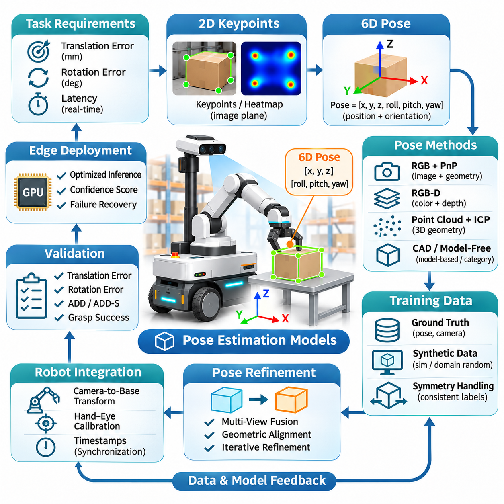{width="7.268055555555556in" height="7.268055555555556in"}

자세 추정 모델(Pose Estimation Models)은 물리적 상호작용(Physical Interaction)에 필요한 객체의 공간적 위치(Spatial Position)와 방향(Orientation)을 결정하기 때문에 모바일 매니퓰레이터(Mobile Manipulator)의 인공지능 시스템(AI Systems)을 구성하는 핵심 요소이다. 객체 탐지(Object Detection)가 센서 관측 데이터(Sensor Observations)에서 관련 객체를 식별하는 반면, 자세 추정(Pose Estimation)은 정밀 매니퓰레이션(Precise Manipulation)에 필요한 기하학적 정보(Geometric Information)를 제공한다. 정확한 자세 추정은 로봇 시스템이 객체 파지(Object Grasping), 운반(Transportation), 정렬(Alignment), 배치(Placement), 조립(Assembly) 작업을 수행할 수 있도록 한다.

자세 추정 개발(Pose Estimation Development)은 의도된 매니퓰레이션 작업(Manipulation Tasks)에 따라 기하학적 정확도 요구사항(Geometric Accuracy Requirements)을 정의하는 것에서 시작된다. 물류창고 피킹(Warehouse Picking)은 비교적 큰 위치 편차(Positional Deviations)를 허용할 수 있는 반면, 정밀 조립(Precision Assembly)과 부품 삽입(Component Insertion)은 훨씬 높은 정확도를 요구한다. 개발자는 모델 아키텍처(Model Architectures)를 선정하기 전에 병진 오차(Translation Error), 회전 오차(Rotation Error), 추정 지연시간(Estimation Latency), 작동 거리(Operating Distance), 환경 변화(Environmental Variations)에 대한 강건성(Robustness)과 관련된 측정 가능한 요구사항(Measurable Requirements)을 수립해야 한다.

2차원 자세 추정(Two-Dimensional Pose Estimation)은 영상 좌표계(Image Coordinate System) 내에서 의미 있는 객체 특징(Object Features)의 위치를 결정한다. 특징점 탐지 모델(Keypoint Detection Models)은 일반적으로 히트맵(Heatmaps), 좌표 회귀(Coordinate Regression), 트랜스포머 기반 표현(Transformer-Based Representations)을 활용하여 특징 좌표(Feature Coordinates)를 예측한다. 이러한 특징은 객체 모서리(Object Corners), 기계적 인터페이스(Mechanical Interfaces), 사전에 정의된 기하학적 기준점(Geometric Landmarks)에 해당할 수 있다. 2차원 특징점(2D Keypoints)은 카메라 보정(Camera Calibration) 및 알려진 객체 기하학(Known Object Geometry)과 결합될 경우 3차원 자세 재구성(3D Pose Reconstruction)을 지원할 수 있다.

6차원 객체 자세 추정(Six-Dimensional Object Pose Estimation, 6D Pose Estimation)은 3차원 공간(Three-Dimensional Space) 내에서 객체의 위치와 방향을 결정한다. 자세(Pose)는 3개의 병진 자유도(Translational Degrees of Freedom)와 3개의 회전 자유도(Rotational Degrees of Freedom)로 구성된다. 회전 정보(Rotational Information)는 회전 행렬(Rotation Matrices), 쿼터니언(Quaternions) 또는 기타 수학적 표현(Mathematical Representations)을 통해 나타낼 수 있다. 추정된 자세(Estimated Poses)를 로봇 기구학(Robot Kinematics) 및 매니퓰레이션 계획(Manipulation Planning)과 통합하기 위해서는 일관된 좌표계 규약(Coordinate Conventions)과 좌표 변환 정의(Transformation Definitions)가 필수적이다.

RGB 기반 자세 추정 모델(RGB-Based Pose Estimation Models)은 일반적인 컬러 영상(Color Images)으로부터 객체의 기하학적 형상과 방향을 추론한다. 이러한 접근 방식은 합성곱 신경망(Convolutional Neural Networks, CNNs), 비전 트랜스포머(Vision Transformers, ViTs), 특징점 탐지(Keypoint Detection), 밀집 대응 관계 추정(Dense Correspondence Estimation)을 활용할 수 있다. Perspective-n-Point(PnP) 알고리즘은 대응하는 2차원 영상 특징(2D Image Features)과 알려진 3차원 객체 좌표점(3D Object Points)을 이용하여 공간적 자세(Spatial Poses)를 복원할 수 있다. 그러나 단안 자세 추정(Monocular Pose Estimation)은 가림 현상(Occlusion), 모호한 기하학적 형상(Ambiguous Geometry), 크기 척도 불확실성(Scale Uncertainty)에 여전히 민감하다.

RGB-D 기반 자세 추정(RGB-D-Based Pose Estimation)은 시각적 외관(Visual Appearance)과 깊이 측정값(Depth Measurements)을 통합하여 공간 이해 능력(Spatial Understanding)을 향상시킨다. DenseFusion과 FoundationPose 같은 아키텍처는 객체 자세 추정을 위해 시각 정보(Visual Information)와 기하학적 정보(Geometric Information)를 결합하는 서로 다른 접근 방식을 보여준다. 깊이 관측 정보(Depth Observations)는 병진 및 방향 추정 정확도(Translation and Orientation Accuracy)를 향상시킬 수 있는 추가적인 공간 제약조건(Spatial Constraints)을 제공한다. 그럼에도 불구하고 반사 표면(Reflective Surfaces), 투명 재질(Transparent Materials), 유효하지 않은 깊이 측정값(Invalid Depth Measurements)은 여전히 중요한 기술적 과제로 남아 있다.

포인트 클라우드 기반 자세 추정(Point Cloud-Based Pose Estimation)은 깊이 카메라(Depth Cameras), 스테레오 비전(Stereo Vision), 라이다 센서(LiDAR Sensors)에서 획득한 3차원 기하학적 관측 정보(3D Geometric Observations)를 활용한다. PointNet과 PointNet++ 같은 신경망 아키텍처(Neural Architectures)는 불규칙한 공간 측정 데이터(Irregular Spatial Measurements)로부터 기하학적 특징(Geometric Features)을 추출할 수 있다. 반복 최근접점(Iterative Closest Point, ICP)을 포함하는 정합 기술(Registration Techniques)은 관측된 표면을 기준 형상(Reference Geometry)과 정렬함으로써 추정된 자세를 추가적으로 정제할 수 있다. 이러한 접근 방식의 성능은 포인트 밀도(Point Density), 측정 품질(Measurement Quality), 객체 가시성(Object Visibility)에 따라 달라진다.

모델 기반 자세 추정(Model-Based Pose Estimation)은 일반적으로 CAD 모델(CAD Models)이나 기준 메시(Reference Meshes)로 표현되는 알려진 객체의 기하학적 형상을 활용하여 관측된 객체 구조와 예상되는 객체 구조(Expected Object Structures) 사이의 대응 관계(Correspondences)를 구축한다. 이러한 접근 방식은 시스템 배포 이전에 부품의 기하학적 형상(Component Geometry)을 확보할 수 있는 산업 환경(Industrial Environments)에서 특히 유용하다. 범주 수준 자세 추정(Category-Level Pose Estimation)과 모델 비의존적 접근 방식(Model-Free Approaches)은 이전에 관측하지 못한 객체 인스턴스(Unseen Object Instances)까지 자세 추정의 적용 범위를 확장한다. 다만 일반화 성능(Generalization)과 기하학적 정확도(Geometric Accuracy)는 응용 분야에 특화된 신중한 검증을 필요로 한다.

자세 추정 모델 학습(Pose Estimation Model Training)은 객체의 위치, 방향, 카메라 매개변수(Camera Parameters), 관련 기하학적 정보를 포함하는 정확하게 주석이 작성된 데이터세트(Annotated Datasets)를 필요로 한다. 정답 데이터(Ground Truth)는 보정된 측정 시스템(Calibrated Measurement Systems), 기준 마커(Fiducial Markers), 모션 캡처(Motion Capture), 합성 환경(Synthetic Environments)을 통해 획득할 수 있다. 학습 데이터세트(Training Datasets)는 객체 형상(Object Geometry), 관측 방향(Viewing Direction), 조명(Illumination), 거리(Distance), 가림 현상의 다양한 변화를 반영해야 한다. 또한 일관되지 않은 지도 정보(Inconsistent Supervision)가 발생하지 않도록 회전 대칭성(Rotational Symmetry)을 고려해야 한다.

합성 데이터 생성(Synthetic Data Generation)은 가상 환경(Virtual Environments)에서 정밀한 기하학적 주석(Geometric Annotations)을 자동으로 생성할 수 있기 때문에 자세 추정 모델의 개발에 상당한 기회를 제공한다. 디지털 트윈(Digital Twins)과 렌더링 엔진(Rendering Engines)은 객체 위치, 방향, 질감(Textures), 배경(Backgrounds), 카메라 시점(Camera Viewpoints)을 체계적으로 변화시킬 수 있도록 한다. 도메인 무작위화(Domain Randomization)와 사실적 렌더링(Photorealistic Rendering)은 데이터세트 다양성(Dataset Diversity)을 향상시킬 수 있다. 그러나 시뮬레이션과 현실 사이의 불일치(Simulation-to-Reality Discrepancies)를 평가하기 위해서는 실제 환경 검증(Real-World Validation)이 여전히 필요하다.

자세 정제(Pose Refinement)는 추가적인 기하학적 최적화(Geometric Optimization) 또는 학습 기반 보정 메커니즘(Learned Correction Mechanisms)을 통해 초기 자세 예측(Initial Pose Predictions)을 개선하는 과정이다. 정제 알고리즘(Refinement Algorithms)은 관측된 깊이 측정값, 투영된 객체 특징(Projected Object Features), 기준 형상 사이의 불일치(Discrepancies)를 최소화할 수 있다. 반복적 정제(Iterative Refinement)는 초기 추정값(Initial Estimates)이 충분히 정확할 경우 자세 추정의 정밀도(Precision)를 향상시킬 수 있다. 모바일 플랫폼의 이동(Mobile Platform Movement) 또는 매니퓰레이터에 장착된 카메라(Manipulator-Mounted Cameras)를 통해 획득한 다중 시점 관측(Multi-View Observations)은 모호한 자세(Ambiguous Poses)를 해결하기 위한 추가적인 제약조건을 제공할 수 있다.

좌표 변환(Coordinate Transformation)과 시간 동기화(Temporal Synchronization)는 자세 추정 모델을 모바일 매니퓰레이터에 통합하는 데 매우 중요하다. 카메라 좌표계(Camera Coordinate System) 내에서 추정된 객체 자세(Object Poses)는 적절한 로봇 베이스 좌표계(Robot Base Coordinate System), 매니퓰레이터 좌표계(Manipulator Coordinate System), 월드 좌표계(World Coordinate System)로 변환되어야 한다. 핸드-아이 보정(Hand-Eye Calibration), 로봇 기구학(Robot Kinematics), 정확한 타임스탬프(Accurate Timestamps)는 이러한 좌표 변환을 가능하게 한다. 보정 오차(Calibration Errors)와 모바일 플랫폼의 움직임(Platform Motion)은 엔드 이펙터 위치 결정 정확도(End-Effector Positioning Accuracy)에 직접적인 영향을 미치기 때문에 반드시 고려되어야 한다.

자세 추정 성능(Pose Estimation Performance)은 병진 오차, 회전 오차, ADD 및 ADD-S와 같은 평균 거리 평가 지표(Average Distance Metrics), 작업별 매니퓰레이션 결과(Task-Specific Manipulation Outcomes)를 활용하여 평가되어야 한다. 대칭성 인지 평가(Symmetry-Aware Evaluation)는 기하학적으로 동등한 방향(Geometrically Equivalent Orientations)이 실패 사례로 잘못 분류되는 것을 방지한다. 검증(Validation) 과정에서는 추론 지연시간(Inference Latency), 시간적 안정성(Temporal Stability), 불확실성(Uncertainty), 부분 가림(Partial Occlusion) 조건에서의 성능도 고려해야 한다. 벤치마크 정확도(Benchmark Accuracy)만으로는 신뢰성 높은 물리적 매니퓰레이션 성능(Physical Manipulation Performance)을 입증할 수 없다.

배포 엔지니어링(Deployment Engineering)은 자세 추정 모델이 모바일 로봇 플랫폼(Mobile Robotic Platforms)의 계산 자원 제약조건(Computational Constraints)을 충족하도록 보장해야 한다. 모델 최적화(Model Optimization), 혼합 정밀도 추론(Mixed-Precision Inference), 하드웨어 가속(Hardware Acceleration), 관심 영역 처리(Region-of-Interest Processing, ROI Processing)는 실행 효율성(Runtime Efficiency)을 향상시킬 수 있다. 인지 파이프라인(Perception Pipeline)은 추정된 자세와 함께 신뢰도 정보(Confidence Information), 타임스탬프(Timestamps), 좌표 프레임 식별자(Coordinate Frame Identifiers)를 전달해야 한다. 불확실하거나 일관되지 않은 예측(Uncertain or Inconsistent Predictions)은 추가적인 관측(Additional Observations) 또는 통제된 복구 절차(Controlled Recovery Procedures)를 실행하도록 해야 한다.

궁극적으로 자세 추정 개발은 데이터 수집(Data Collection), 주석 작성(Annotation), 모델 학습(Model Training), 기하학적 보정(Geometric Calibration), 모델 배포(Model Deployment), 운영 검증(Operational Validation)을 연결하는 반복적 수명주기(Iterative Lifecycle)를 따라야 한다. 파지(Grasping), 정렬(Alignment), 배치(Placement) 과정에서 관측된 실패 사례(Failure Cases)는 후속 모델 개선(Model Improvements)과 데이터세트 확장(Dataset Expansion)을 위한 지침으로 활용되어야 한다. 개발의 목적은 매니퓰레이션 오류(Manipulation Errors)를 감소시키고, 작업 성공률(Task Success Rates)을 향상시키며, 다양한 산업 환경에서 신뢰성 높은 자율 운영(Autonomous Operation)을 지원하는 안정적인 공간 인지 역량(Dependable Spatial Perception Capability)을 구축하는 것이다.

## 06 Grasp Detection Models

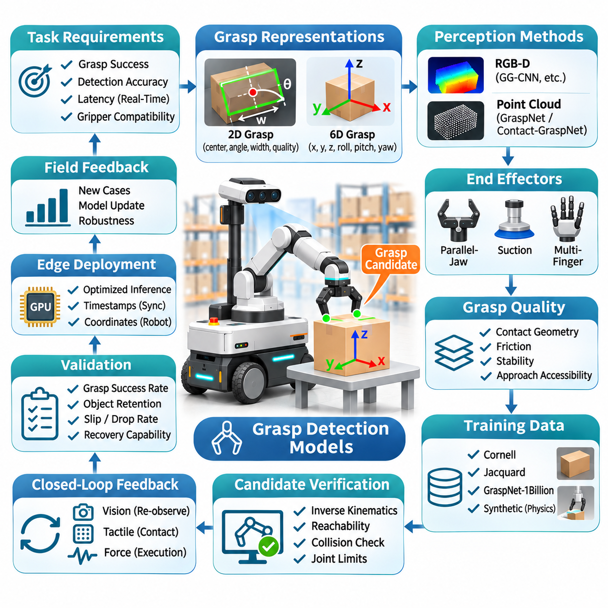{width="7.268055555555556in" height="7.268055555555556in"}

파지 탐지 모델(Grasp Detection Models)은 로봇 그리퍼(Robotic Gripper)와 대상 객체(Target Objects) 사이에서 안정적인 물리적 접촉(Stable Physical Contact)을 형성하기 위한 적절한 파지 구성(Grasp Configurations)을 식별하기 때문에 모바일 매니퓰레이터(Mobile Manipulator)의 인공지능 시스템(AI Systems)을 구성하는 핵심 요소이다. 객체 탐지(Object Detection)가 관련 객체를 식별하고 자세 추정(Pose Estimation)이 객체의 공간적 위치와 방향을 결정하는 반면, 파지 탐지(Grasp Detection)는 객체를 물리적으로 파지할 수 있는 방법을 예측한다. 이러한 예측 결과는 자율 매니퓰레이션(Autonomous Manipulation)을 위한 필수적인 입력 정보를 제공한다.

파지 탐지 개발(Grasp Detection Development)은 의도된 매니퓰레이션 작업(Manipulation Tasks)에 따라 기능 요구사항(Functional Requirements)과 성능 요구사항(Performance Requirements)을 정의하는 것에서 시작된다. 산업용 부품 취급(Industrial Component Handling), 물류창고 피킹(Warehouse Picking), 서비스 로보틱스(Service Robotics)는 서로 다른 파지 전략(Grasping Strategies)과 그리퍼 구성(Gripper Configurations)을 필요로 할 수 있다. 개발자는 파지 성공률(Grasp Success Rate), 탐지 정확도(Detection Accuracy), 예측 지연시간(Prediction Latency), 객체 포괄 범위(Object Coverage), 환경적 강건성(Environmental Robustness), 엔드 이펙터 하드웨어(End-Effector Hardware)와의 호환성에 대한 측정 가능한 요구사항을 수립해야 한다.

2차원 파지 탐지 모델(Two-Dimensional Grasp Detection Models)은 영상 좌표계(Image Coordinate System) 내에서 파지 구성을 예측한다. 일반적인 표현 방식(Representation)은 파지 중심(Grasp Center), 그리퍼 방향(Gripper Orientation), 개방 폭(Opening Width), 파지 품질 점수(Grasp Quality Score)를 포함한다. 신경망 아키텍처(Neural Network Architectures)는 RGB 영상 또는 깊이 영상(Depth Images)으로부터 파지 사각형(Grasp Rectangles)이나 픽셀 수준의 파지 품질 맵(Pixel-Level Grasp Quality Maps)을 직접 생성할 수 있다. 이러한 접근 방식은 사전에 정의된 방향에서 객체에 접근할 수 있는 구조화된 피킹 환경(Structured Picking Environments)에서 특히 유용하다.

6차원 파지 탐지(Six-Dimensional Grasp Detection, 6D Grasp Detection)는 3차원 공간(Three-Dimensional Space) 내에서 그리퍼의 위치와 방향을 식별함으로써 기존의 평면 파지 예측(Planar Grasp Prediction)을 확장한다. 파지 구성은 그리퍼 고유 매개변수(Gripper-Specific Parameters)와 함께 3개의 병진 자유도(Translational Degrees of Freedom) 및 3개의 회전 자유도(Rotational Degrees of Freedom)를 포함한다. 이러한 표현 방식은 모바일 매니퓰레이터가 다양한 방향에서 객체에 접근할 수 있도록 하며, 접근 가능성(Accessibility)이 제한된 복잡한 객체 배치 환경(Cluttered Environments)에서의 매니퓰레이션을 지원한다.

RGB-D 기반 파지 탐지(RGB-D-Based Grasp Detection)는 적절한 파지 영역(Grasp Regions)을 식별하기 위해 시각적 외관(Visual Appearance)과 깊이 측정값(Depth Measurements)을 결합한다. 생성형 파지 합성곱 신경망(Generative Grasping Convolutional Neural Networks, GG-CNN)과 같은 아키텍처는 깊이 영상으로부터 밀집 파지 예측(Dense Grasp Predictions)을 생성할 수 있으며, 다른 접근 방식에서는 의미적 이해(Semantic Understanding)를 향상시키기 위해 RGB 특징(RGB Features)을 통합한다. 예측된 파지 구성을 실행 가능한 로봇 행동(Executable Robotic Actions)으로 변환하기 위해서는 정확한 깊이 측정값과 카메라 보정(Camera Calibration)이 필요하다.

포인트 클라우드 기반 파지 탐지 모델(Point Cloud-Based Grasp Detection Models)은 후보 파지 구성(Candidate Grasp Configurations)을 식별하기 위해 3차원 객체 기하학(3D Object Geometry)을 분석한다. GraspNet과 Contact-GraspNet 같은 아키텍처는 관측된 포인트 클라우드(Observed Point Clouds)로부터 공간적 파지 후보(Spatial Grasp Candidates)를 생성하는 접근 방식을 보여준다. 이러한 방법은 완전한 객체 모델(Complete Object Models)을 요구하지 않으면서 이전에 관측하지 못한 객체(Unseen Objects)의 매니퓰레이션을 지원할 수 있다. 신뢰성은 포인트 클라우드 품질(Point Cloud Quality), 표면 가시성(Surface Visibility), 기하학적 특징 추출(Geometric Feature Extraction)에 따라 달라진다.

파지 탐지 모델은 선정된 엔드 이펙터(End Effector)의 기계적 특성(Mechanical Characteristics)을 고려해야 한다. 평행 조 그리퍼(Parallel-Jaw Gripper)는 적절한 대향 접촉 표면(Opposing Contact Surfaces)을 필요로 하는 반면, 흡착 그리퍼(Suction Gripper)는 진공 밀폐(Vacuum Seal)를 유지할 수 있는 접근 가능한 표면(Accessible Surfaces)을 필요로 한다. 다지형 로봇 핸드(Multifinger Robotic Hand)는 추가적인 접촉 구성(Contact Configurations)과 제어 요구사항(Control Requirements)을 발생시킨다. 따라서 파지 표현(Grasp Representations)과 학습 데이터세트(Training Datasets)는 의도된 파지 메커니즘(Gripping Mechanism)의 물리적 제약조건(Physical Constraints)을 반영해야 한다.

파지 품질 추정(Grasp Quality Estimation)은 예측된 파지 구성의 잠재적인 안정성(Stability)과 유효성(Effectiveness)을 평가한다. 관련 요소에는 접촉 기하학(Contact Geometry), 마찰(Friction), 객체 질량 분포(Object Mass Distribution), 그리퍼 개방 폭(Gripper Opening Width), 접근 가능성(Approach Accessibility), 외부 교란에 대한 저항성(Resistance to External Disturbances)이 포함된다. 학습 기반 모델(Learning-Based Models)은 기하학적 관측 정보(Geometric Observations)와 실험 결과(Experimental Outcomes)로부터 파지 품질을 추정할 수 있다. 그러나 예측된 품질 점수(Predicted Quality Scores)를 물리적 파지 성공(Physical Grasp Success)을 보장하는 지표로 해석해서는 안 된다.

파지 탐지 모델 학습(Grasp Detection Model Training)은 객체 관측 정보(Object Observations), 후보 파지 구성, 이에 대응하는 품질 또는 성공 라벨(Quality or Success Labels)을 포함하는 대표성 있는 데이터세트(Representative Datasets)를 필요로 한다. Cornell Grasping Dataset, Jacquard, GraspNet-1Billion과 같은 공개 데이터세트(Public Datasets)는 초기 모델 개발(Initial Model Development)을 위한 유용한 자원을 제공한다. 응용 분야에 특화된 데이터세트(Application-Specific Datasets)는 추가적으로 실제 배포 과정에서 사용될 객체, 그리퍼, 센서 구성(Sensor Configurations), 예상 운영 조건(Operating Conditions)을 반영해야 한다.

합성 데이터 생성(Synthetic Data Generation)은 개발자가 시뮬레이션 환경(Simulation Environments)과 디지털 트윈(Digital Twins)을 활용하여 대규모 파지 구성을 생성할 수 있도록 한다. 물리 엔진(Physics Engines)은 다양한 객체 형상(Object Geometries), 마찰 계수(Friction Coefficients), 질량 분포(Mass Distributions), 접촉 조건(Contact Conditions)에서 후보 파지를 평가할 수 있다. 도메인 무작위화(Domain Randomization)는 데이터세트 다양성(Dataset Diversity)을 추가적으로 향상시킬 수 있다. 그럼에도 불구하고 접촉 동역학(Contact Dynamics)과 재료 특성(Material Properties)이 실제 환경과 다를 수 있기 때문에 시뮬레이션 기반 파지 결과(Simulated Grasp Outcomes)는 물리적 검증(Physical Validation)을 필요로 한다.

파지 후보 생성(Grasp Candidate Generation)은 기하학적 검증(Geometric Verification) 및 로봇 모션 계획(Robotic Motion Planning)과 통합되어야 한다. 파지 탐지 모델이 높은 품질의 파지 구성을 예측하더라도 해당 위치가 매니퓰레이터 작업 공간(Manipulator Workspace)을 벗어나거나 주변 객체에 의해 접근이 차단될 수 있다. 따라서 물리적 실행(Physical Execution) 이전에 역기구학(Inverse Kinematics, IK), 충돌 검사(Collision Checking), 도달 가능성 분석(Reachability Analysis), 관절 한계 검증(Joint Limit Verification)을 통해 예측된 파지 후보를 평가해야 한다.

폐루프 파지 탐지(Closed-Loop Grasp Detection)는 새로운 센서 관측 정보를 활용하여 파지 예측을 지속적으로 갱신함으로써 매니퓰레이션 신뢰성(Manipulation Reliability)을 향상시킨다. 매니퓰레이터가 객체에 접근함에 따라 시점 변화(Viewpoint Changes)는 이전에 가려져 있던 표면(Previously Occluded Surfaces)이나 예상하지 못한 객체 변위(Unexpected Object Displacement)를 발견할 수 있도록 한다. 시각적 피드백(Visual Feedback), 촉각 측정값(Tactile Measurements), 힘-토크 센싱(Force-Torque Sensing)은 파지 조정(Grasp Adjustment)과 실행 검증(Execution Verification)을 지원할 수 있다. 이러한 역량은 단일 초기 예측(Single Initial Prediction)에 대한 의존성을 감소시킨다.

파지 탐지 성능(Grasp Detection Performance)은 모델 수준 평가 지표(Model-Level Metrics)와 물리적 매니퓰레이션 결과(Physical Manipulation Outcomes)를 모두 활용하여 평가되어야 한다. 파지 사각형 정확도(Grasp Rectangle Accuracy), 방향 오차(Orientation Error), 공간적 위치 추정 오차(Spatial Localization Error), 후보 예측 지연시간(Candidate Prediction Latency)은 모델 성능에 대한 정보를 제공한다. 물리적 파지 성공률(Physical Grasp Success Rate), 객체 유지율(Object Retention Rate), 실패 복구율(Failure Recovery Rate), 작업 완료 시간(Task Completion Time)은 대표적인 작업 조건(Representative Working Conditions)에서의 운영 신뢰성(Operational Reliability)에 대한 상호 보완적인 근거를 제공한다.

배포 엔지니어링(Deployment Engineering)은 파지 탐지 모델이 모바일 로봇 플랫폼(Mobile Robotic Platforms)의 계산 및 시간적 제약조건(Computational and Temporal Constraints) 내에서 작동하도록 보장해야 한다. 하드웨어 가속(Hardware Acceleration), 혼합 정밀도 추론(Mixed-Precision Inference), 최적화된 포인트 클라우드 처리(Optimized Point Cloud Processing)는 실행 효율성(Runtime Efficiency)을 향상시킬 수 있다. 인지 하위 시스템(Perception Subsystem) 및 매니퓰레이션 하위 시스템(Manipulation Subsystem)과의 신뢰성 높은 통합을 지원하기 위해 모델 출력(Model Outputs)은 파지 매개변수(Grasp Parameters), 신뢰도 정보(Confidence Information), 타임스탬프(Timestamps), 좌표 프레임 식별자(Coordinate Frame Identifiers)를 포함해야 한다.

궁극적으로 파지 탐지 개발은 데이터 수집(Data Collection), 라벨링(Labeling), 모델 학습(Model Training), 모델 배포(Model Deployment), 물리적 실험(Physical Experimentation), 운영 검증(Operational Validation)을 연결하는 반복적 엔지니어링 수명주기(Iterative Engineering Lifecycle)를 따라야 한다. 실패한 파지 시도(Failed Grasp Attempts)는 인지(Perception), 기하학적 추론(Geometric Reasoning), 접촉 예측(Contact Prediction)의 취약점을 식별하기 위해 체계적으로 기록되고 분석되어야 한다. 개발의 목적은 매니퓰레이션 성공률(Manipulation Success Rate), 적응성(Adaptability), 생산성(Productivity), 운영 신뢰성(Operational Reliability)을 향상시키는 안정적인 파지 탐지 역량(Dependable Grasp Detection Capability)을 구축하는 것이다.

## 07 VLM Development

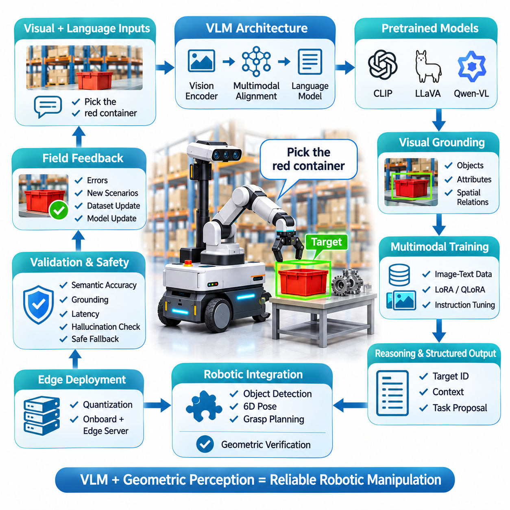{width="7.268055555555556in" height="7.268055555555556in"}

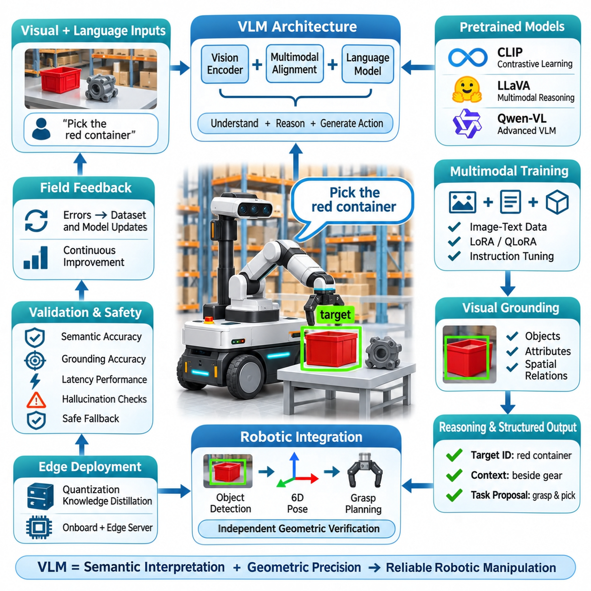{width="7.268055555555556in" height="7.268055555555556in"}

시각-언어 모델(Vision-Language Models, VLMs)은 시각 인지(Visual Perception)와 자연어 이해(Natural Language Understanding)를 통합함으로써 모바일 매니퓰레이터(Mobile Manipulator)의 인공지능 역량(Artificial Intelligence Capabilities)을 확장한다. 사전에 정의된 인식 작업(Recognition Tasks)을 수행하도록 설계된 기존 인지 모델(Perception Models)과 달리 시각-언어 모델은 언어적 명령(Linguistic Instructions)과 연관된 시각적 관측 정보(Visual Observations)를 해석할 수 있다. 이러한 역량은 로봇 시스템이 객체 설명(Object Descriptions), 환경적 맥락(Environmental Contexts), 공간적 관계(Spatial Relationships), 작업 목표(Task Objectives)를 이해할 수 있도록 한다.

시각-언어 모델 개발(VLM Development)은 의도된 로봇 응용 분야(Robotic Applications)에 따라 기능 요구사항(Functional Requirements)을 정의하는 것에서 시작된다. 물류창고에서 운영되는 모바일 매니퓰레이터는 언어적 설명(Verbal Descriptions)을 기반으로 객체를 식별해야 할 수 있으며, 산업용 로봇은 조립 지침(Assembly Instructions)이나 검사 결과(Inspection Results)를 해석해야 할 수 있다. 개발 요구사항(Development Requirements)은 의미적 이해 정확도(Semantic Understanding Accuracy), 공간적 그라운딩 역량(Spatial Grounding Capability), 응답 지연시간(Response Latency), 계산 자원 제약조건(Computational Constraints), 운영 신뢰성(Operational Reliability)을 명시해야 한다.

시각-언어 모델의 기본 아키텍처(Fundamental Architecture)는 일반적으로 시각 인코더(Visual Encoder), 멀티모달 정렬 메커니즘(Multimodal Alignment Mechanism), 언어 모델(Language Model)을 통합한다. 시각 인코더는 이미지 또는 비디오 프레임(Video Frames)으로부터 특징(Features)을 추출하며, 정렬 메커니즘은 시각적 표현(Visual Representations)과 언어적 표현(Linguistic Representations)을 연결한다. 언어 모델은 이러한 통합 특징(Integrated Features)을 처리하여 맥락적 설명(Contextual Descriptions)을 생성하거나, 질문에 응답하거나, 작업 관련 명령(Task-Related Instructions)을 해석한다.

사전학습 시각-언어 아키텍처(Pretrained Vision-Language Architectures)는 로봇 인지 역량(Robotic Perception Capabilities)을 개발하기 위한 재사용 가능한 기반(Reusable Foundations)을 제공한다. CLIP과 같은 모델은 대조 학습(Contrastive Learning)을 통해 이미지와 텍스트 설명(Textual Descriptions) 사이의 관계를 구축하는 반면, LLaVA와 Qwen-VL 같은 아키텍처는 더욱 상호작용적인 멀티모달 추론(Interactive Multimodal Reasoning)을 지원한다. 모델 선정(Model Selection) 과정에서는 시각적 이해(Visual Understanding), 언어 처리 역량(Language Capabilities), 공간적 추론(Spatial Reasoning), 계산 효율성(Computational Efficiency), 배포 호환성(Deployment Compatibility)을 고려해야 한다.

시각적 그라운딩(Visual Grounding)은 모바일 매니퓰레이터가 언어적 표현(Linguistic Expressions)을 특정 물리적 객체(Physical Objects) 및 환경 영역(Environmental Regions)과 연관시켜야 하기 때문에 특히 중요한 역량이다. 기계 부품 옆에 있는 빨간색 컨테이너를 선택하라는 명령과 같은 경우 모델은 객체 속성(Object Attributes)과 공간적 관계(Spatial Relationships)를 해석해야 한다. 그라운딩 메커니즘(Grounding Mechanisms)은 이러한 의미적 설명(Semantic Descriptions)을 영상 영역(Image Regions), 경계 상자(Bounding Boxes) 또는 기타 공간적 표현(Spatial Representations)과 연결한다.

시각-언어 모델은 기하학적 인지 시스템(Geometric Perception Systems)을 완전히 대체하는 기술로 간주하기보다는 특화된 객체 탐지(Object Detection), 자세 추정(Pose Estimation), 파지 탐지(Grasp Detection) 모델과 통합되어야 한다. 시각-언어 모델은 의도된 매니퓰레이션 대상(Manipulation Target)을 식별하고 맥락적 요구사항(Contextual Requirements)을 해석할 수 있으며, 전용 인지 모델(Dedicated Perception Models)은 정밀한 공간 정보(Precise Spatial Information)를 제공한다. 이러한 상호 보완적 아키텍처(Complementary Architecture)는 의미적 유연성(Semantic Flexibility)과 물리적 매니퓰레이션(Physical Manipulation)에 필요한 기하학적 정확도(Geometric Accuracy)를 결합한다.

시각-언어 모델 학습(VLM Training)은 이미지, 텍스트 설명(Textual Descriptions), 객체 주석(Object Annotations), 공간적 관계, 작업 관련 명령을 포함하는 멀티모달 데이터세트(Multimodal Datasets)를 필요로 한다. 응용 분야에 특화된 데이터세트(Application-Specific Datasets)는 실제 산업 환경(Industrial Environments), 장비 구성(Equipment Configurations), 객체 범주(Object Categories), 운영 시나리오(Operational Scenarios)를 반영해야 한다. 부정확한 시각적 설명(Incorrect Visual Descriptions)이나 모호한 명령(Ambiguous Instructions)은 지속적인 의미적 추론 오류(Semantic Reasoning Errors)를 발생시킬 수 있기 때문에 데이터 품질(Data Quality)이 특히 중요하다.

전이학습(Transfer Learning)과 매개변수 효율적 미세조정(Parameter-Efficient Fine-Tuning, PEFT)은 전체 모델 재학습(Complete Model Retraining) 없이 사전학습된 시각-언어 모델을 특화된 로봇 응용 분야에 적응시킬 수 있다. 저랭크 적응(Low-Rank Adaptation, LoRA)과 양자화 저랭크 적응(Quantized Low-Rank Adaptation, QLoRA) 같은 기술은 학습 가능한 매개변수(Trainable Parameters)의 수와 관련 계산 자원 요구사항(Computational Requirements)을 감소시킨다. 미세조정(Fine-Tuning)은 일반적인 멀티모달 역량(General Multimodal Capabilities)을 유지하면서 특정 도메인에 대한 이해(Domain-Specific Understanding)를 향상시켜야 한다.

명령어 튜닝(Instruction Tuning)은 시각-언어 모델이 작업 지향적 명령(Task-Oriented Commands)을 해석하고 로봇 시스템에 적합한 구조화된 응답(Structured Responses)을 생성하는 능력을 향상시킨다. 학습 예제(Training Examples)는 객체 선택(Object Selection), 환경 해석(Environmental Interpretation), 검사 절차(Inspection Procedures), 매니퓰레이션 명령(Manipulation Instructions)을 포함할 수 있다. 구조화된 출력 표현(Structured Output Representations)은 대상 식별자(Target Identifiers), 맥락적 제약조건(Contextual Constraints), 제안된 행동(Proposed Actions)을 후속 로봇 계획 모듈(Downstream Robotic Planning Modules)에 전달할 수 있다.

멀티모달 추론(Multimodal Reasoning)은 모바일 매니퓰레이터가 객체, 환경 조건(Environmental Conditions), 운영 목표(Operational Objectives) 사이의 관계를 해석할 수 있도록 한다. 시각-언어 모델은 객체의 접근 경로가 차단되어 있다는 사실을 인식하거나, 적절한 보관 위치(Storage Location)를 식별하거나, 산업 장비(Industrial Equipment)의 시각적으로 확인 가능한 상태를 해석할 수 있다. 그러나 의미적 추론 출력(Semantic Reasoning Outputs)은 실행 가능한 로봇 행동(Executable Robotic Actions)으로 변환되기 전에 센서 측정값(Sensor Measurements)과 기하학적 분석(Geometric Analysis)을 통해 검증되어야 한다.

시간적 시각 이해(Temporal Visual Understanding)는 로봇 이동(Robot Movement)과 매니퓰레이션 과정에서 획득한 순차적 관측 정보(Sequential Observations)를 통합함으로써 시각-언어 모델의 역량을 개별 이미지 이상으로 확장한다. 비디오 기반 모델(Video-Based Models)과 멀티모달 메모리 메커니즘(Multimodal Memory Mechanisms)은 객체 상태 모니터링(Object State Monitoring), 환경 변화 탐지(Environmental Change Detection), 작업 진행 상황 평가(Task Progress Assessment)를 지원할 수 있다. 시간적 정보(Temporal Information)는 모바일 매니퓰레이터가 이동하는 객체와 작업자가 포함된 동적 환경(Dynamic Environments)에서 운영될 때 특히 유용하다.

배포 엔지니어링(Deployment Engineering)은 모바일 로봇 플랫폼(Mobile Robotic Platforms) 내에서 작동하는 시각-언어 모델의 계산 자원 요구사항(Computational Requirements)을 해결해야 한다. 모델 양자화(Model Quantization), 지식 증류(Knowledge Distillation), 하드웨어 가속(Hardware Acceleration), 시각 토큰 축소(Visual Token Reduction)는 추론 효율성(Inference Efficiency)을 향상시킬 수 있다. 하이브리드 아키텍처(Hybrid Architectures)는 계산 집약적 추론(Computationally Intensive Reasoning)을 엣지 서버(Edge Servers)에 분산시키는 동시에 필수적인 인지(Perception), 모션 제어(Motion Control), 안전 기능(Safety Functions)을 온보드 컴퓨팅 시스템(Onboard Computing System) 내에서 유지할 수 있다.

시각-언어 모델 성능 평가(VLM Performance Evaluation)는 의미적 정확도(Semantic Accuracy), 시각적 그라운딩 정확도(Visual Grounding Accuracy), 명령 해석(Instruction Interpretation), 공간적 추론(Spatial Reasoning), 추론 지연시간(Inference Latency), 작업 완료 결과(Task Completion Outcomes)를 포함해야 한다. 검증 데이터세트(Validation Datasets)는 익숙하지 않은 객체(Unfamiliar Objects), 모호한 명령(Ambiguous Commands), 복잡한 배경(Complex Backgrounds), 예상하지 못한 환경 조건(Unexpected Environmental Conditions)을 포함해야 한다. 기존 멀티모달 벤치마크(Conventional Multimodal Benchmarks)는 실제 운영 유효성(Operational Effectiveness)을 측정하는 물리적 로봇 실험(Physical Robotic Experiments)을 통해 보완되어야 한다.

환각(Hallucination)과 불확실성 관리(Uncertainty Management)는 시각-언어 모델이 그럴듯하지만 부정확한 설명, 객체 관계(Object Relationships), 행동 제안(Action Proposals)을 생성할 수 있기 때문에 필수적이다. 로봇 아키텍처(Robotic Architectures)는 독립적인 검증 메커니즘(Independent Verification Mechanisms), 구조화된 응답 검증(Structured Response Validation), 신뢰도 평가(Confidence Assessment), 통제된 대체 절차(Controlled Fallback Procedures)를 포함해야 한다. 검증되지 않은 시각-언어 모델 출력(Unverified VLM Outputs)이 결정론적 모션 제약조건(Deterministic Motion Constraints)이나 독립적인 안전 시스템(Independent Safety Systems)을 직접 무력화해서는 안 된다.

궁극적으로 시각-언어 모델 개발은 멀티모달 데이터 수집(Multimodal Data Collection), 모델 선정(Model Selection), 미세조정(Fine-Tuning), 시스템 통합(System Integration), 모델 배포(Model Deployment), 운영 검증(Operational Validation)을 연결하는 반복적 엔지니어링 수명주기(Iterative Engineering Lifecycle)를 따라야 한다. 의미적 해석 실패(Semantic Interpretation Failures)와 실패한 로봇 작업(Unsuccessful Robotic Tasks)은 후속 모델 개선(Model Improvements)을 위한 지침으로 활용되어야 한다. 개발의 목적은 인간의 명령(Human Instructions)을 환경 인지(Environmental Perception) 및 자율 물리적 매니퓰레이션(Autonomous Physical Manipulation)과 연결하는 신뢰성 높은 멀티모달 지능(Reliable Multimodal Intelligence)을 구축하는 것이다.

## 08 Robot Agents

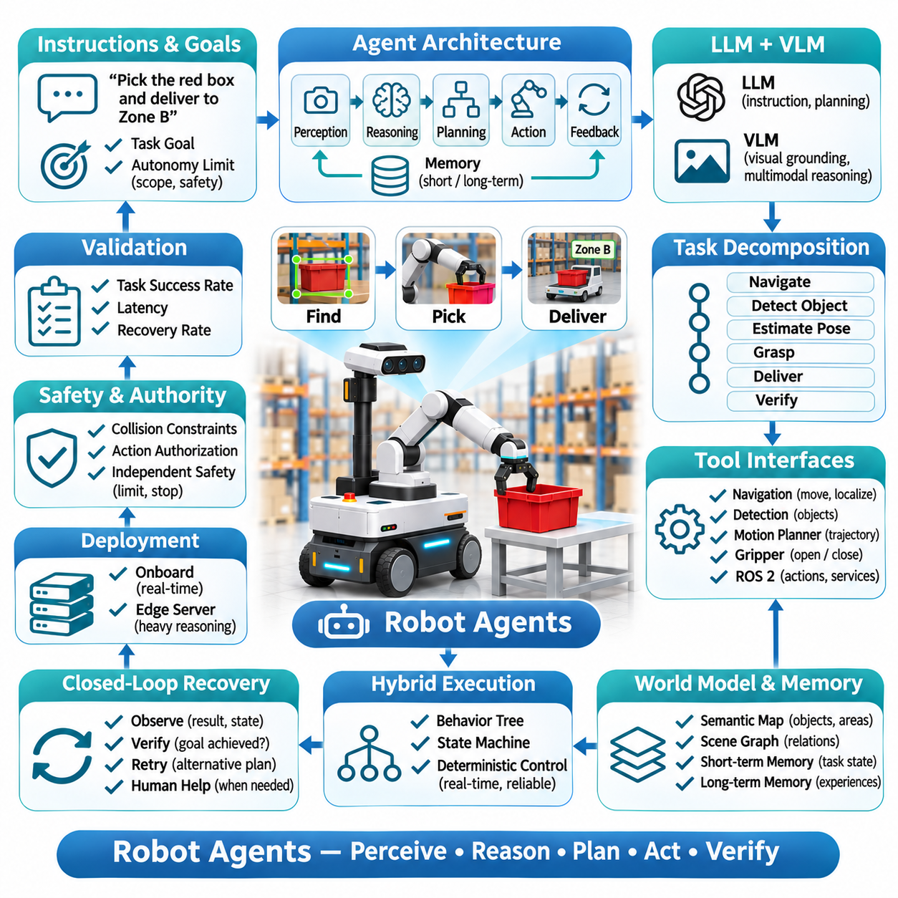{width="7.268055555555556in" height="7.268055555555556in"}

로봇 에이전트(Robot Agents)는 모바일 매니퓰레이터(Mobile Manipulator)의 자율 지능(Autonomous Intelligence)을 개발하기 위한 고도화된 아키텍처 접근 방식(Architectural Approach)이다. 독립적인 인지 또는 예측 작업(Isolated Perception or Prediction Tasks)을 수행하는 기존 인공지능 모델(AI Models)과 달리 로봇 에이전트는 환경 이해(Environmental Understanding), 추론(Reasoning), 의사결정(Decision-Making), 작업 계획(Task Planning), 행동 실행(Action Execution)을 통합한다. 이러한 역량은 모바일 매니퓰레이터가 복잡하고 동적인 환경(Complex and Dynamic Environments) 내에서 운영 목표(Operational Objectives)를 해석하고 물리적 활동(Physical Activities)을 조율할 수 있도록 한다.

로봇 에이전트 개발(Robot Agent Development)은 기능적 범위(Functional Scope), 운영 책임(Operational Responsibilities), 허용 가능한 자율성 수준(Permissible Level of Autonomy)을 정의하는 것에서 시작된다. 모바일 매니퓰레이터 에이전트는 자연어 명령(Natural Language Instructions)을 수신하고, 대상 객체(Target Objects)를 식별하며, 지정된 위치(Designated Locations)로 이동하고, 매니퓰레이션 작업(Manipulation Tasks)을 실행하며, 운영 결과(Operational Results)를 검증할 수 있다. 개발 요구사항(Development Requirements)은 작업 완료 기준(Task Completion Criteria), 의사결정 지연시간(Decision-Making Latency), 복구 역량(Recovery Capabilities), 운영 안전 제약조건(Operational Safety Constraints)을 수립해야 한다.

로봇 에이전트의 기본 아키텍처(Fundamental Architecture)는 일반적으로 인지(Perception), 추론(Reasoning), 계획(Planning), 메모리(Memory), 행동 실행(Action Execution), 피드백 메커니즘(Feedback Mechanisms)을 포함한다. 인지 모듈(Perception Modules)은 물리적 환경(Physical Environment)에 대한 정보를 획득하며, 추론 모듈(Reasoning Modules)은 관측 정보를 해석하고 적절한 대응을 결정한다. 계획 모듈(Planning Modules)은 활동을 실행 가능한 순서(Executable Sequences)로 구성하고, 피드백 메커니즘은 에이전트가 실행 결과(Execution Results)를 평가하고 후속 의사결정(Subsequent Decisions)을 갱신할 수 있도록 한다.

대규모 언어 모델(Large Language Models, LLMs)과 시각-언어 모델(Vision-Language Models, VLMs)은 지능형 로봇 에이전트(Intelligent Robot Agents)를 개발하기 위한 강력한 기반을 제공한다. 대규모 언어 모델은 명령을 해석하고, 복잡한 목표(Complex Objectives)를 분해하며, 구조화된 작업 계획(Structured Task Plans)을 생성할 수 있는 반면, 시각-언어 모델은 언어적 정보(Linguistic Information)를 시각적 관측 정보(Visual Observations)와 연결한다. 이러한 모델의 통합은 모바일 매니퓰레이터가 객체의 정체성(Object Identities), 공간적 관계(Spatial Relationships), 환경 조건(Environmental Conditions), 매니퓰레이션 요구사항(Manipulation Requirements)에 대해 추론할 수 있도록 한다.

작업 분해(Task Decomposition)는 고수준 운영 목표(High-Level Operational Objectives)를 가용한 로봇 역량(Available Robotic Capabilities)을 통해 실행할 수 있는 작은 활동 단위로 변환한다. 특정 부품을 가져와 전달하라는 명령은 내비게이션(Navigation), 객체 식별(Object Identification), 자세 추정(Pose Estimation), 파지 계획(Grasp Planning), 매니퓰레이션(Manipulation), 전달 검증(Delivery Verification)을 포함할 수 있다. 각각의 활동은 명확하게 정의된 실행 조건(Execution Conditions), 필요 자원(Required Resources), 예상 결과(Expected Outcomes), 실패 복구 절차(Failure Recovery Procedures)를 포함해야 한다.

로봇 에이전트는 구조화된 도구 인터페이스(Structured Tool Interfaces)를 통해 전용 로봇 기능(Dedicated Robotic Functions)과 상호작용해야 한다. 가용한 도구(Available Tools)는 내비게이션 서비스(Navigation Services), 객체 탐지 모델(Object Detection Models), 자세 추정 알고리즘(Pose Estimation Algorithms), 파지 탐지 모델(Grasp Detection Models), 모션 계획기(Motion Planners), 그리퍼 제어기(Gripper Controllers)를 포함할 수 있다. 지능형 추론(Intelligent Reasoning)과 물리적 실행 시스템(Physical Execution Systems) 사이의 신뢰성 높은 통신을 보장하기 위해 인터페이스 정의(Interface Definitions)는 입력 매개변수(Input Parameters), 출력 표현(Output Representations), 실행 제약조건(Execution Constraints), 오류 조건(Error Conditions)을 명시해야 한다.

하이브리드 에이전트 아키텍처(Hybrid Agent Architectures)는 학습 기반 추론(Learning-Based Reasoning)과 결정론적 로봇 계획 및 제어 메커니즘(Deterministic Robotic Planning and Control Mechanisms)을 결합한다. 언어 모델(Language Models)은 고수준 작업 전략(High-Level Task Strategies)을 생성할 수 있으며, 유한 상태 기계(Finite-State Machines, FSMs), 행동 트리(Behavior Trees, BTs), 구조화된 계획기(Structured Planners)는 실행 순서(Execution Sequences)를 관리한다. 이러한 기능적 분리(Functional Separation)는 기존 로봇 제어 시스템(Robotic Control Systems)의 예측 가능성(Predictability), 시간적 요구사항(Timing Requirements), 운영 제약조건(Operational Constraints)을 저해하지 않으면서 지능형 에이전트가 변화하는 상황에 적응할 수 있도록 한다.

환경 표현(Environmental Representation)은 에이전트 추론(Agent Reasoning)과 물리적 현실(Physical Reality) 사이의 일관성(Consistency)을 유지하기 위해 필수적이다. 로봇 에이전트는 주변 환경을 표현하기 위해 시맨틱 지도(Semantic Maps), 장면 그래프(Scene Graphs), 객체 데이터베이스(Object Databases), 점유 지도(Occupancy Maps), 실시간 센서 관측 정보(Real-Time Sensor Observations)를 활용할 수 있다. 환경 표현은 객체 변위(Object Displacement), 접근성 변화(Accessibility Changes), 인간 활동(Human Activities), 운영 구성의 변화(Variations in Operational Configuration)를 반영하기 위해 지속적으로 갱신되어야 한다.

메모리 메커니즘(Memory Mechanisms)은 로봇 에이전트가 여러 관측 및 운영 활동에 걸쳐 관련 정보를 유지할 수 있도록 한다. 단기 메모리(Short-Term Memory)는 현재 작업 상태(Current Task States), 최근 센서 관측 정보(Recent Sensor Observations), 중간 실행 결과(Intermediate Execution Results)를 유지하는 반면, 장기 메모리(Long-Term Memory)는 객체 정보(Object Information), 운영 절차(Operational Procedures), 이전 경험(Previous Experiences)을 저장할 수 있다. 메모리 검색(Memory Retrieval)은 관련성이 높고 검증된 정보(Validated Information)를 우선적으로 활용하며, 오래된 관측 정보(Outdated Observations)가 현재 의사결정에 영향을 미치지 않도록 해야 한다.

폐루프 에이전트 실행(Closed-Loop Agent Execution)은 모바일 매니퓰레이터가 자신의 행동에 따른 결과를 평가하고 후속 행동(Subsequent Behavior)을 조정할 수 있도록 한다. 내비게이션 또는 매니퓰레이션 활동을 완료한 이후 에이전트는 예상된 물리적 상태(Expected Physical State)가 달성되었는지 검증해야 한다. 예상하지 못한 관측 결과(Unexpected Observations), 실패한 파지(Unsuccessful Grasps), 불완전한 작업(Incomplete Operations)은 추가적인 인지(Additional Perception), 대안 계획(Alternative Planning), 통제된 재시도(Controlled Retries), 인간 개입 요청(Requests for Human Intervention)을 유발할 수 있다.

로봇 에이전트 개발은 작업 추론(Task Reasoning)과 행동 적응(Behavioral Adaptation)을 향상시키기 위해 지도학습(Supervised Learning), 명령어 튜닝(Instruction Tuning), 모방학습(Imitation Learning), 강화학습(Reinforcement Learning)을 활용할 수 있다. 학습 데이터세트(Training Datasets)는 자연어 명령(Natural Language Instructions), 환경 관측 정보(Environmental Observations), 행동 시퀀스(Action Sequences), 도구 호출 기록(Tool Invocation Records), 실행 결과(Execution Outcomes)를 포함할 수 있다. 시뮬레이션 환경(Simulation Environments)과 디지털 트윈(Digital Twins)은 다양한 에이전트 상호작용 시나리오(Agent Interaction Scenarios)를 생성하고 평가하기 위한 통제된 조건(Controlled Conditions)을 제공한다.

로봇 미들웨어(Robotic Middleware)와의 통합은 지능형 에이전트가 분산된 인지(Distributed Perception), 내비게이션, 매니퓰레이션, 제어 역량(Control Capabilities)에 접근할 수 있도록 한다. ROS 2 액션(Actions), 서비스(Services), 통신 인터페이스(Communication Interfaces)는 로봇 기능을 호출하고 실행 상태(Execution States)를 모니터링하기 위한 구조화된 메커니즘(Structured Mechanisms)을 제공할 수 있다. 에이전트 통합(Agent Integration) 과정에서는 비동기 실행(Asynchronous Execution), 타임아웃 관리(Timeout Management), 통신 실패(Communication Failures), 자원 소유권(Resource Ownership), 모바일 플랫폼과 매니퓰레이터 활동 사이의 동기화(Synchronization)를 고려해야 한다.

배포 엔지니어링(Deployment Engineering)은 온보드 하드웨어(Onboard Hardware), 엣지 서버(Edge Servers), 외부 컴퓨팅 인프라(External Computing Infrastructure) 사이에서 에이전트 연산(Agent Computation)을 적절하게 분산해야 한다. 계산 집약적 추론(Computationally Intensive Reasoning)은 고성능 컴퓨팅 플랫폼(Higher-Performance Platforms)에서 수행될 수 있으며, 필수적인 인지 및 제어 기능(Essential Perception and Control Functions)은 온보드 시스템 내에서 유지되어야 한다. 통신 중단(Communication Interruptions), 추론 지연(Inference Delays), 외부 서비스 장애(External Service Failures)가 로봇의 안전한 물리적 상태(Safe Physical State) 유지에 영향을 미쳐서는 안 된다.

안전 및 권한 관리(Safety and Authority Management)는 로봇 에이전트가 물리적 환경에 직접적인 영향을 미치는 행동을 시작할 수 있기 때문에 필수적이다. 에이전트가 생성한 계획(Agent-Generated Plans)은 사전에 정의된 운영 경계(Operational Boundaries), 충돌 제약조건(Collision Constraints), 작업 공간 제한(Workspace Limitations), 권한 부여 정책(Authorization Policies)에 따라 평가되어야 한다. 독립적인 안전 시스템(Independent Safety Systems)은 물리적 실행에 대한 제어 권한(Authority over Physical Execution)을 유지해야 하며, 불확실한 의사결정(Uncertain Decisions)과 금지된 행동(Prohibited Actions)은 적절한 예방 또는 복구 메커니즘(Prevention or Recovery Mechanisms)을 작동시켜야 한다.

로봇 에이전트 성능(Robot Agent Performance)은 명령 해석 정확도(Instruction Interpretation Accuracy), 작업 계획 성공률(Task Planning Success), 도구 호출 신뢰성(Tool Invocation Reliability), 물리적 작업 완료(Physical Task Completion), 의사결정 지연시간(Decision Latency), 복구 유효성(Recovery Effectiveness)을 통해 평가되어야 한다. 테스트(Testing)는 모호한 명령(Ambiguous Instructions), 예상하지 못한 장애물(Unexpected Obstacles), 사용할 수 없는 자원(Unavailable Resources), 환경 변화(Environmental Changes)를 포함해야 한다. 반복적 개발(Iterative Development)은 실행 기록(Execution Records)과 실패 분석(Failure Analysis)을 활용하여 에이전트 신뢰성(Agent Reliability), 적응성(Adaptability), 산업 운영 유효성(Industrial Operational Effectiveness)을 향상시켜야 한다.

## 09 Embodied AI

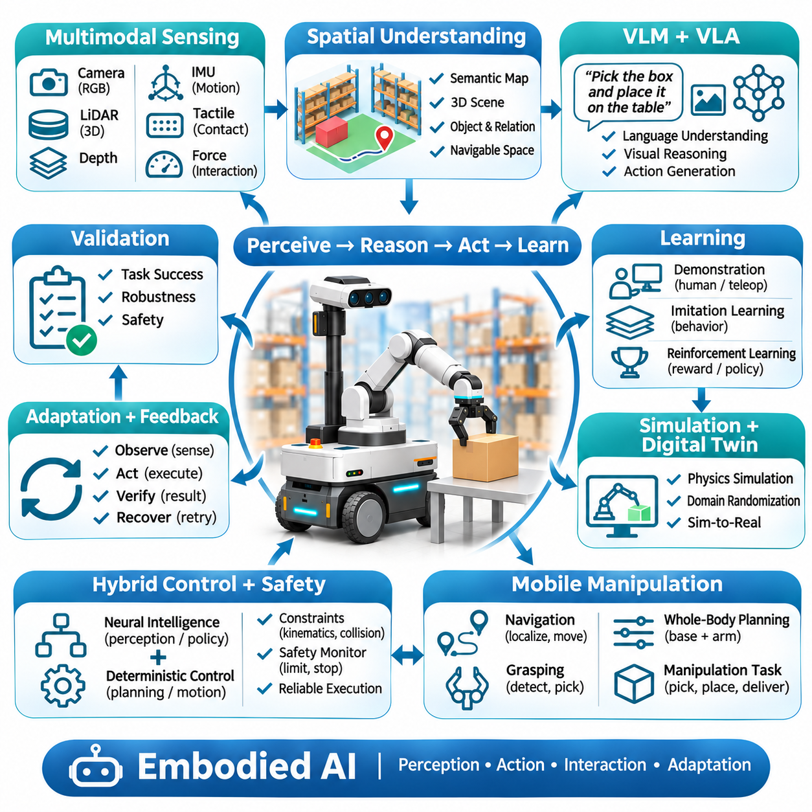{width="7.268055555555556in" height="7.268055555555556in"}

체화 인공지능(Embodied Artificial Intelligence, Embodied AI)은 물리적 환경(Physical Environment)과의 지속적인 상호작용(Continuous Interaction)을 통해 지능형 로봇 시스템(Intelligent Robotic Systems)을 개발하는 접근 방식이다. 주로 추상적 정보(Abstract Information)를 처리하는 기존 인공지능 시스템(AI Systems)과 달리 체화 지능(Embodied Intelligence)은 인지(Perception), 추론(Reasoning), 의사결정(Decision-Making), 물리적 행동(Physical Action)을 연결한다. 모바일 매니퓰레이터(Mobile Manipulator)의 경우 이러한 접근 방식은 복잡한 환경(Complex Environments)에서 적응형 자율 운영(Adaptive Autonomous Operation)을 구현하기 위한 기반을 구축한다.

체화 인공지능 개발(Embodied AI Development)은 대상 로봇 시스템의 물리적 역량(Physical Capabilities), 환경 조건(Environmental Conditions), 운영 목표(Operational Objectives)를 정의하는 것에서 시작된다. 모바일 매니퓰레이터는 환경 변화(Environmental Changes)와 물리적 제약조건(Physical Constraints)에 대응하면서 자율 이동성(Autonomous Mobility)과 매니퓰레이션 역량(Manipulation Capabilities)을 통합해야 한다. 개발 요구사항(Development Requirements)은 인지 정확도(Perceptual Accuracy), 행동 적응성(Behavioral Adaptability), 매니퓰레이션 유효성(Manipulation Effectiveness), 운영 자율성(Operational Autonomy), 안전성(Safety)을 고려해야 한다.

인지-행동 루프(Perception-Action Loop)는 체화 지능을 구성하는 기본적인 메커니즘(Fundamental Mechanism)이다. 로봇은 센서(Sensors)를 통해 환경 관측 정보(Environmental Observations)를 획득하고, 가용한 정보를 해석하며, 적절한 행동을 선택하고, 물리적 움직임(Physical Movements)을 실행한다. 이러한 행동은 로봇과 환경 사이의 관계를 변화시키며, 후속 의사결정(Subsequent Decisions)에 영향을 미치는 새로운 관측 정보를 생성한다. 지속적인 피드백(Continuous Feedback)은 적응형 행동(Adaptive Behavior)과 오류 보정(Error Correction)을 가능하게 한다.

멀티모달 인지(Multimodal Perception)는 체화 인공지능 시스템에 물리적 주변 환경(Physical Surroundings)에 대한 포괄적인 정보를 제공한다. 카메라(Cameras), 라이다 센서(LiDAR Sensors), 깊이 센서(Depth Sensors), 관성 측정 장치(Inertial Measurement Units, IMUs), 촉각 센서(Tactile Sensors), 힘-토크 센서(Force-Torque Sensors)는 상호 보완적인 관측 정보(Complementary Observations)를 제공한다. 센서 융합(Sensor Fusion)은 모바일 매니퓰레이터가 시각적 정보(Visual Information), 기하학적 정보(Geometric Information), 공간적 정보(Spatial Information), 물리적 상호작용 정보(Physical Interaction Information)를 지능형 의사결정(Intelligent Decision-Making)을 지원하는 표현으로 통합할 수 있도록 한다.

공간 이해(Spatial Understanding)는 체화 인공지능 시스템이 환경 기하학(Environmental Geometry), 객체 관계(Object Relationships), 주행 가능 영역(Navigable Regions), 매니퓰레이션 기회(Manipulation Opportunities)를 해석할 수 있도록 한다. 시맨틱 지도(Semantic Maps), 3차원 장면 표현(Three-Dimensional Scene Representations), 점유 지도(Occupancy Maps), 객체 수준 정보(Object-Level Information)는 공간적 추론(Spatial Reasoning)을 지원할 수 있다. 이러한 표현은 정적 환경 구조(Static Environmental Structures)뿐만 아니라 인간 활동(Human Activities), 객체 이동(Object Movements), 로봇 상호작용(Robotic Interactions)으로 인해 발생하는 동적 변화(Dynamic Changes)도 포함해야 한다.

시각-언어 모델(Vision-Language Models, VLMs)은 시각적 관측 정보(Visual Observations)를 자연어 명령(Natural Language Instructions) 및 의미적 추론(Semantic Reasoning)과 연결함으로써 체화 지능에 기여한다. 모바일 매니퓰레이터는 작업 목표(Task Objectives)를 해석하고, 관련 객체(Relevant Objects)를 식별하며, 주변 환경 내의 맥락적 관계(Contextual Relationships)를 이해할 수 있다. 그러나 로봇 행동(Robotic Actions)을 시작하기 전에 언어적 및 시각적 추론(Linguistic and Visual Reasoning)은 기하학적 검증(Geometric Verification) 및 물리적 실행 가능성 분석(Physical Feasibility Analysis)과 통합되어야 한다.

시각-언어-행동 모델(Vision-Language-Action Models, VLAs)은 시각적 관측 정보와 언어적 명령(Linguistic Instructions)을 로봇 행동 생성(Robotic Action Generation)과 연결함으로써 멀티모달 지능(Multimodal Intelligence)을 확장한다. 이러한 모델은 인지된 환경 상태(Perceived Environmental States), 작업 목표(Task Objectives), 실행 가능한 행동(Executable Behaviors) 사이의 관계를 학습할 수 있다. 모델 개발은 동기화된 관측 정보(Synchronized Observations), 명령(Instructions), 행동 궤적(Action Trajectories)을 포함하는 대표성 있는 데이터세트(Representative Datasets)와 함께 물리적 및 운영 제약조건(Physical and Operational Constraints)을 강제하는 메커니즘을 필요로 한다.

시연 기반 학습(Learning from Demonstration, LfD)은 성공적인 물리적 상호작용 사례를 통해 체화 로봇 행동(Embodied Robotic Behavior)을 개발하기 위한 효과적인 접근 방식을 제공한다. 인간의 시연 데이터(Human Demonstrations)는 원격 조작(Teleoperation), 모션 캡처(Motion Capture), 운동 감각 기반 교시(Kinesthetic Teaching), 원격 로봇 인터페이스(Remote Robotic Interfaces)를 통해 수집할 수 있다. 모방학습(Imitation Learning)은 로봇이 시연된 행동(Demonstrated Behaviors)을 재현하고 이를 관련 작업(Related Tasks)으로 일반화(Generalization)할 수 있도록 한다. 다만 익숙하지 않은 운영 조건(Unfamiliar Operating Conditions)에서는 추가적인 검증(Additional Validation)이 필요하다.

강화학습(Reinforcement Learning, RL)은 체화 인공지능 시스템이 물리적 또는 시뮬레이션 환경(Physical or Simulated Environments)과의 상호작용을 통해 행동 정책(Behavioral Policies)을 개선할 수 있도록 한다. 보상 함수(Reward Functions)는 작업 완료(Task Completion), 파지 안정성(Grasp Stability), 이동 효율성(Movement Efficiency), 기타 바람직한 결과(Desired Outcomes)를 표현할 수 있다. 학습 과정에서는 물리적 제약조건, 바람직하지 않은 행동(Undesirable Behaviors), 탐색 위험(Exploration Risks)을 고려해야 한다. 시뮬레이션 기반 학습(Simulation-Based Training)은 직접적인 물리적 실험(Physical Experimentation)과 관련된 비용 및 잠재적 위험(Potential Hazards)을 감소시킬 수 있다.

시뮬레이션 환경(Simulation Environments)과 디지털 트윈(Digital Twins)은 로봇 시스템과 운영 환경(Operational Environments)에 대한 통제된 표현(Controlled Representations)을 제공함으로써 체화 인공지능 개발에서 중요한 역할을 수행한다. 물리 기반 시뮬레이션(Physics-Based Simulation)은 개발자가 다양한 시나리오(Diverse Scenarios)에서 내비게이션(Navigation), 매니퓰레이션(Manipulation), 접촉 동역학(Contact Dynamics), 협조 행동(Coordinated Behavior)을 평가할 수 있도록 한다. 도메인 무작위화(Domain Randomization)와 시스템 식별(System Identification)은 시뮬레이션 환경과 물리적 환경 사이의 불일치(Discrepancies)를 감소시키는 데 기여할 수 있다.

모바일 플랫폼(Mobile Platforms)과 로봇 매니퓰레이터(Robotic Manipulators)의 통합은 체화 지능에 추가적인 기술적 과제(Technical Challenges)를 발생시킨다. 모바일 베이스 위치(Mobile Base Position)의 변화는 매니퓰레이터 도달 가능성(Manipulator Reachability), 객체 가시성(Object Visibility), 가용한 파지 구성(Available Grasp Configurations)에 영향을 미친다. 협조 계획(Coordinated Planning)은 플랫폼 위치 추정(Platform Localization), 매니퓰레이터 기구학(Manipulator Kinematics), 충돌 제약조건(Collision Constraints), 작업 요구사항(Task Requirements)을 고려해야 한다. 전신 계획(Whole-Body Planning)은 이동과 매니퓰레이션 간의 협조 동작(Coordinated Mobility and Manipulation)의 유효성을 향상시킬 수 있다.

체화 인공지능 아키텍처(Embodied AI Architectures)는 학습된 지능(Learned Intelligence)을 기존의 로봇 계획 및 제어 메커니즘(Robotic Planning and Control Mechanisms)과 통합해야 한다. 신경망 모델(Neural Models)은 인지, 의미적 추론, 행동 제안(Action Proposals)을 제공할 수 있으며, 결정론적 제어기(Deterministic Controllers)는 모션 제약조건(Motion Constraints)과 실행 요구사항(Execution Requirements)을 강제한다. 이러한 하이브리드 접근 방식(Hybrid Approach)은 안전 필수 물리적 작업(Safety-Critical Physical Operations)을 확률적 예측(Probabilistic Predictions)에만 의존하지 않으면서 지능형 적응(Intelligent Adaptation)을 지원한다.

지속적인 적응(Continuous Adaptation)은 체화 인공지능 시스템이 익숙하지 않은 객체(Unfamiliar Objects), 환경적 교란(Environmental Disturbances), 예상하지 못한 실행 결과(Unexpected Execution Outcomes)에 대응할 수 있도록 한다. 시각적 관측 정보, 촉각 측정값(Tactile Measurements), 힘-토크 센서에서 제공되는 피드백은 온라인 행동 조정(Online Behavioral Adjustments)을 지원할 수 있다. 운영 경험(Operational Experiences)은 후속 모델 개선(Model Refinement)을 위해 체계적으로 기록되어야 하며, 안전 필수 작업(Safety-Critical Operations)이 진행되는 동안 통제되지 않은 모델 업데이트(Uncontrolled Model Updates)가 발생하지 않도록 해야 한다.

체화 인공지능 성능(Embodied AI Performance)은 물리적 작업 완료(Physical Task Completion), 매니퓰레이션 성공률(Manipulation Success Rates), 환경 적응성(Environmental Adaptability), 복구 유효성(Recovery Effectiveness), 실행 효율성(Execution Efficiency), 운영 신뢰성(Operational Reliability)을 통해 평가되어야 한다. 검증(Validation)은 이전에 관측하지 못한 객체(Previously Unseen Objects), 변화하는 환경 구성(Changing Environmental Configurations), 센서 성능 저하(Sensor Degradation), 동적 장애물(Dynamic Obstacles)을 포함해야 한다. 모델 수준 벤치마크(Model-Level Benchmarks)는 대표적인 운영 조건(Representative Operating Conditions)에서 수행되는 통합 로봇 실험(Integrated Robotic Experiments)을 통해 보완되어야 한다.

궁극적으로 체화 인공지능 개발은 데이터 수집(Data Collection), 모델 학습(Model Training), 시뮬레이션(Simulation), 하드웨어 통합(Hardware Integration), 물리적 실험(Physical Experimentation), 모델 배포(Deployment), 현장 검증(Field Validation)을 연결하는 반복적 엔지니어링 수명주기(Iterative Engineering Lifecycle)를 따라야 한다. 배포 과정에서는 독립적인 안전 메커니즘(Independent Safety Mechanisms)과 신뢰성 높은 제어 기능(Reliable Control Functions)이 유지되어야 한다. 개발의 목적은 모바일 매니퓰레이터의 자율성(Autonomy), 생산성(Productivity), 강건성(Robustness), 운영 신뢰성(Operational Reliability)을 향상시키는 적응형 물리 지능(Adaptive Physical Intelligence)을 구축하는 것이다.

## 10 Model Training

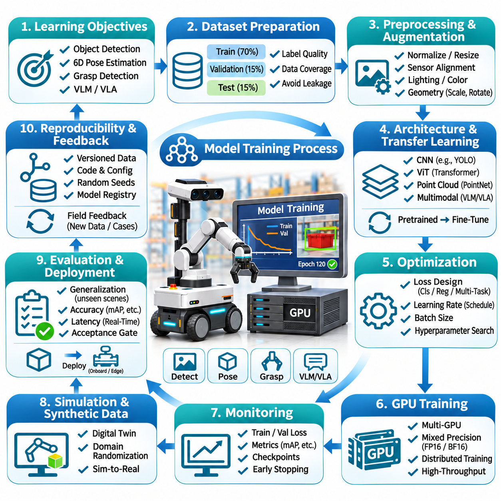{width="7.268055555555556in" height="7.268055555555556in"}

모델 학습(Model Training)은 수집되고 주석이 작성된 데이터를 운영 가능한 지능(Operational Intelligence)으로 변환하기 때문에 모바일 매니퓰레이터(Mobile Manipulator)의 인공지능 개발(AI Development)에서 기본적인 엔지니어링 프로세스(Engineering Process)이다. 학습된 모델(Trained Models)은 객체 탐지(Object Detection), 자세 추정(Pose Estimation), 파지 탐지(Grasp Detection), 멀티모달 추론(Multimodal Reasoning), 자율 행동 적응(Autonomous Behavioral Adaptation)을 지원한다. 학습 과정(Training Process)은 예측 정확도(Predictive Accuracy), 계산 효율성(Computational Efficiency), 일반화 역량(Generalization Capability), 운영 신뢰성(Operational Reliability) 사이에서 적절한 균형을 확보해야 한다.

모델 학습은 개별 인공지능 모듈(AI Modules)의 기능 요구사항(Functional Requirements)에 따라 학습 목표(Learning Objectives)를 정의하는 것에서 시작된다. 객체 탐지 모델(Object Detection Models)은 정확한 분류(Classification)와 위치 추정(Localization)을 요구하는 반면, 자세 추정 모델(Pose Estimation Models)은 정밀한 기하학적 예측(Geometric Predictions)을 필요로 한다. 파지 탐지 모델(Grasp Detection Models)은 물리적으로 실행 가능한 파지 구성(Physically Feasible Grasp Configurations)을 식별해야 한다. 따라서 학습 목표는 의도된 로봇 기능(Robotic Functions)과 측정 가능한 성능 요구사항(Measurable Performance Requirements)을 반영해야 한다.

데이터세트 준비(Dataset Preparation)는 신뢰성 높은 모델 학습을 위한 기반을 구축한다. 수집된 데이터(Collected Data)는 주석 오류(Annotation Errors), 누락된 정보(Missing Information), 중복 샘플(Duplicate Samples), 클래스 불균형(Class Imbalance), 환경 포괄 범위(Environmental Coverage)에 대해 검사되어야 한다. 학습 데이터세트(Training Dataset), 검증 데이터세트(Validation Dataset), 테스트 데이터세트(Test Dataset)는 데이터 누출(Data Leakage)을 방지하기 위해 독립적으로 구성되어야 한다. 로봇 응용 분야(Robotic Applications)에서는 객체 인스턴스(Object Instance), 데이터 획득 세션(Acquisition Session), 운영 환경(Operating Environment)을 기준으로 데이터를 분할함으로써 더욱 의미 있는 일반화 성능 평가(Generalization Assessments)를 수행할 수 있다.

데이터 전처리(Data Preprocessing)는 이기종 센서 관측 정보(Heterogeneous Sensor Observations)를 신경망 학습(Neural Network Training)에 적합한 표현으로 변환한다. 모델 아키텍처(Model Architecture)에 따라 영상 크기 조정(Image Resizing), 정규화(Normalization), 포인트 클라우드 필터링(Point Cloud Filtering), 좌표 변환(Coordinate Transformation), 시간 동기화(Temporal Synchronization)가 필요할 수 있다. 전처리 구성(Preprocessing Configurations)은 학습과 배포(Deployment) 사이에서 일관되게 유지되어야 한다. 이러한 구성의 불일치(Discrepancies)는 실제 물리적 로봇 운영(Physical Robotic Operations) 과정에서 모델 성능을 크게 저하시킬 수 있기 때문이다.

데이터 증강(Data Augmentation)은 학습 샘플(Training Samples)에 통제된 변화(Controlled Variations)를 도입함으로써 모델의 일반화 성능(Model Generalization)을 향상시킨다. 시각적 데이터 증강(Visual Augmentation)은 조명(Illumination), 색상(Color), 크기 척도(Scale), 방향(Orientation), 배경 외관(Background Appearance)의 변화를 포함할 수 있다. 기하학적 데이터 증강(Geometric Augmentation)은 공간 관측 정보(Spatial Observations)와 객체 구성(Object Configurations)을 변경할 수 있다. 그러나 데이터 증강 절차(Augmentation Procedures)는 로봇 매니퓰레이션 작업(Robotic Manipulation Tasks)에 필요한 정확한 주석(Accurate Annotations), 물리적 관계(Physical Relationships), 기하학적 유효성(Geometric Validity)을 유지해야 한다.

모델 아키텍처 선정(Model Architecture Selection)은 학습 목표, 데이터세트 특성(Dataset Characteristics), 계산 자원(Computational Resources), 배포 요구사항(Deployment Requirements) 사이의 관계를 고려해야 한다. 합성곱 신경망(Convolutional Neural Networks, CNNs), 비전 트랜스포머(Vision Transformers, ViTs), 포인트 클라우드 신경망(Point Cloud Networks), 멀티모달 아키텍처(Multimodal Architectures)는 서로 다른 역량을 제공한다. 경량 모델(Lightweight Models)은 실시간 온보드 추론(Real-Time Onboard Inference)에 더욱 적합할 수 있으며, 대규모 아키텍처(Larger Architectures)는 계산 집약적 추론(Computationally Intensive Reasoning) 및 인지 작업(Perception Tasks)을 지원할 수 있다.

전이학습(Transfer Learning)은 개발자가 모든 모델을 무작위로 초기화된 매개변수(Randomly Initialized Parameters)에서부터 학습하는 대신 사전학습 신경망(Pretrained Neural Networks)을 활용할 수 있도록 한다. 사전학습 모델(Pretrained Models)은 재사용 가능한 특징 표현(Reusable Feature Representations)을 제공하므로 응용 분야에 특화된 데이터(Application-Specific Data)가 제한적인 경우 학습 비용(Training Costs)을 절감하고 성능을 향상시킬 수 있다. 미세조정 전략(Fine-Tuning Strategies)은 도메인 차이(Domain Differences), 데이터세트 크기(Dataset Size), 계층 동결(Layer Freezing), 학습률(Learning Rates), 기존에 획득한 역량의 잠재적 손실(Potential Loss of Previously Acquired Capabilities)을 고려해야 한다.

손실 함수 설계(Loss Function Design)는 신경망이 예측 오류(Prediction Errors)를 평가하고 내부 매개변수(Internal Parameters)를 갱신하는 방식을 결정한다. 객체 탐지는 분류 손실(Classification Loss)과 경계 상자 회귀 손실(Bounding Box Regression Loss)을 결합할 수 있으며, 자세 추정은 병진 손실(Translation Loss), 회전 손실(Rotation Loss), 기하학적 일관성 손실(Geometric Consistency Loss)을 포함할 수 있다. 다중 작업 학습(Multitask Learning)은 개별 학습 목표가 최적화 과정(Optimization Process)을 지배하거나 상호 보완적인 모델 역량(Complementary Model Capabilities)을 저하시키는 것을 방지하기 위해 적절한 손실 가중치 설정(Loss Weighting)을 필요로 한다.

하이퍼파라미터 최적화(Hyperparameter Optimization)는 안정적이고 효과적인 모델 학습을 달성하기 위해 필수적이다. 학습률(Learning Rate), 배치 크기(Batch Size), 최적화 알고리즘 선정(Optimizer Selection), 가중치 감쇠(Weight Decay), 학습 기간(Training Duration), 학습률 스케줄링(Learning Rate Scheduling)은 모델의 수렴(Convergence)과 일반화(Generalization)에 영향을 미친다. 체계적인 실험(Systematic Experimentation)은 검증 결과(Validation Results)를 활용하여 적절한 학습 구성을 식별해야 한다. 객관적인 최종 성능 평가(Final Performance Evaluation)를 보장하기 위해 독립적인 테스트 데이터세트는 하이퍼파라미터 선정 과정(Hyperparameter Selection)에서 제외되어야 한다.

고성능 컴퓨팅 인프라(High-Performance Computing Infrastructure, HPC Infrastructure)는 높은 계산 성능을 요구하는 로봇 인공지능 모델(Robotic AI Models)의 효율적인 학습을 가능하게 한다. 다중 그래픽 처리 장치(Multiple GPUs), 분산 데이터 병렬 처리(Distributed Data Parallelism, DDP), 혼합 정밀도 학습(Mixed-Precision Training), 최적화된 데이터 로딩(Optimized Data Loading)은 학습 처리량(Training Throughput)을 향상시킬 수 있다. 자원 계획(Resource Planning)은 GPU 메모리 용량(GPU Memory Capacity), 스토리지 대역폭(Storage Bandwidth), 통신 오버헤드(Communication Overhead), 에너지 소비량(Energy Consumption)을 고려해야 한다. 계산 병목현상(Computational Bottlenecks)을 식별하기 위해 하드웨어 활용률(Hardware Utilization)을 지속적으로 모니터링해야 한다.

학습 모니터링(Training Monitoring)은 개발자가 수렴 문제(Convergence Problems), 과적합(Overfitting), 수치적 불안정성(Numerical Instability), 예상하지 못한 성능 저하(Unexpected Performance Degradation)를 식별할 수 있도록 한다. 학습 손실(Training Loss), 검증 손실(Validation Loss), 작업별 평가 지표(Task-Specific Metrics), 기울기 거동(Gradient Behavior), 학습률 변화(Learning Rate Changes)는 전체 실험 과정에 걸쳐 체계적으로 기록되어야 한다. 모델 체크포인트 저장(Model Checkpointing)과 조기 종료(Early Stopping)는 불필요한 계산을 방지하고 후속 성능 평가와 배포에 적합한 모델 상태(Model States)를 보존할 수 있다.

시뮬레이션 기반 학습(Simulation-Based Training)과 합성 데이터 생성(Synthetic Data Generation)은 모바일 매니퓰레이션 시스템(Mobile Manipulation Systems)의 학습 기회를 확장한다. 가상 환경(Virtual Environments)은 정확한 주석이 작성된 관측 정보(Accurately Annotated Observations), 객체 자세(Object Poses), 파지 구성(Grasp Configurations), 로봇 행동 궤적(Robotic Action Trajectories)을 생성할 수 있다. 도메인 무작위화(Domain Randomization)와 물리 기반 시뮬레이션(Physics-Based Simulation)은 환경 다양성(Environmental Diversity)을 향상시킬 수 있다. 한편 시뮬레이션에서 현실로의 전이(Simulation-to-Reality Transfer, Sim2Real Transfer)와 물리적 상호작용 정확도(Physical Interaction Accuracy)를 평가하기 위해서는 실제 환경 실험(Real-World Experiments)이 여전히 필요하다.

멀티모달 및 행동 모델 학습(Multimodal and Behavioral Model Training)은 기존의 지도학습 기반 인지 학습(Conventional Supervised Perception Learning)을 넘어서는 추가적인 요구사항을 발생시킨다. 시각-언어 모델(Vision-Language Models, VLMs)은 정렬된 시각 및 언어 정보(Aligned Visual and Linguistic Information)를 필요로 하는 반면, 시각-언어-행동 모델(Vision-Language-Action Models, VLAs)은 동기화된 관측 정보(Synchronized Observations)와 행동 궤적(Action Trajectories)을 필요로 한다. 모방학습(Imitation Learning)과 강화학습(Reinforcement Learning)은 학습 목표에 물리적 실행 가능성(Physical Feasibility)과 운영 제약조건(Operational Constraints)이 포함되는 경우 행동 적응성(Behavioral Adaptation)을 추가적으로 지원할 수 있다.

실험 관리(Experiment Management)와 재현성(Reproducibility)은 전체 모델 학습 수명주기(Model Training Lifecycle)에 걸쳐 엔지니어링 추적성(Engineering Traceability)을 유지하기 위해 필수적이다. 데이터세트 버전(Dataset Versions), 소스 코드 개정 이력(Source Code Revisions), 하이퍼파라미터 구성(Hyperparameter Configurations), 난수 시드(Random Seeds), 소프트웨어 의존성(Software Dependencies), 하드웨어 환경(Hardware Environments), 모델 체크포인트(Model Checkpoints)는 체계적으로 문서화되어야 한다. 모델 레지스트리(Model Registries)는 개발 및 배포 단계에 걸쳐 학습된 모델의 통제된 비교(Controlled Comparison), 식별(Identification), 상위 단계 승격(Promotion)을 가능하게 한다.

궁극적으로 모델 학습은 데이터세트 준비(Dataset Preparation), 아키텍처 선정(Architecture Selection), 최적화(Optimization), 성능 평가(Performance Evaluation), 모델 배포(Model Deployment), 운영 피드백(Operational Feedback)을 연결하는 반복적 엔지니어링 수명주기(Iterative Engineering Lifecycle)를 따라야 한다. 학습된 모델은 실제 물리적 환경에 배포되기 전에 계산 자원 요구사항(Computational Requirements)과 응용 분야에 특화된 인수 기준(Application-Specific Acceptance Criteria)을 모두 충족해야 한다. 개발의 목적은 모바일 매니퓰레이터의 정확도(Accuracy), 적응성(Adaptability), 생산성(Productivity), 운영 신뢰성(Operational Reliability)을 향상시키는 안정적인 인공지능 역량(Dependable AI Capabilities)을 구축하는 것이다.

## 11 Model Deployment

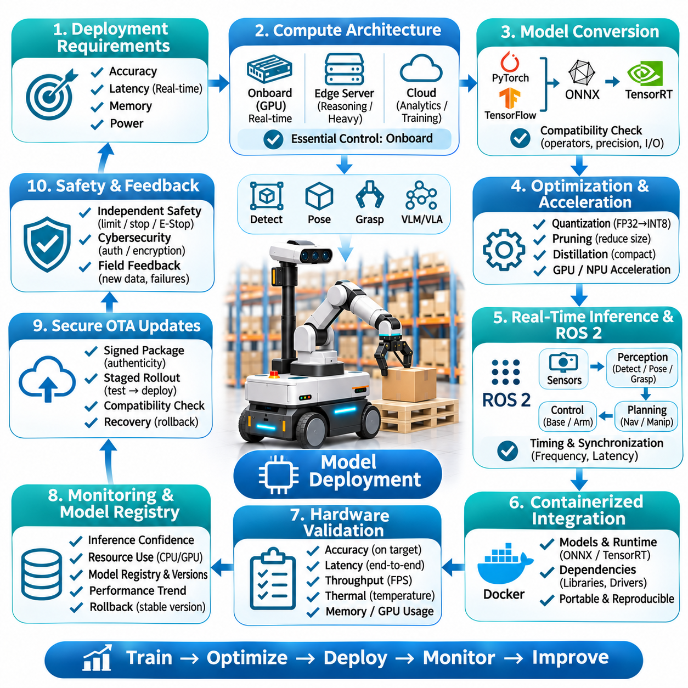{width="7.268055555555556in" height="7.268055555555556in"}

모델 배포(Model Deployment)는 학습된 인공지능 모델(Trained AI Models)을 개발 환경(Development Environments)에서 실제 운영되는 모바일 매니퓰레이터 시스템(Operational Mobile Manipulator Systems)으로 이전하는 엔지니어링 프로세스(Engineering Process)이다. 실험적 모델 평가(Experimental Model Evaluation)와 달리 모델 배포는 물리적 하드웨어(Physical Hardware), 로봇 미들웨어(Robotic Middleware), 실시간 실행 환경(Real-Time Execution Environments)과의 통합을 필요로 한다. 배포된 모델(Deployed Models)은 정확도(Accuracy), 추론 지연시간(Inference Latency), 계산 효율성(Computational Efficiency), 자원 가용성(Resource Availability), 운영 신뢰성(Operational Reliability)에 대한 요구사항을 충족해야 한다.

배포 계획(Deployment Planning)은 개별 인공지능 모듈(AI Modules)의 운영 요구사항(Operational Requirements)과 계산 제약조건(Computational Constraints)을 정의하는 것에서 시작된다. 객체 탐지(Object Detection), 자세 추정(Pose Estimation), 파지 탐지(Grasp Detection), 멀티모달 추론(Multimodal Reasoning) 모델은 서로 다른 처리 주파수(Processing Frequencies)와 하드웨어 자원(Hardware Resources)을 요구할 수 있다. 배포 사양(Deployment Specifications)은 허용 가능한 추론 지연시간, 메모리 소비량(Memory Consumption), 처리량(Processing Throughput), 전력 소비량(Power Consumption), 환경적 운영 조건(Environmental Operating Conditions)을 설정해야 한다.

컴퓨팅 아키텍처 선정(Computational Architecture Selection)은 모바일 매니퓰레이터 시스템 전체에서 인공지능 추론 워크로드(AI Inference Workloads)를 분산하는 방식을 결정한다. 온보드 컴퓨팅 플랫폼(Onboard Computing Platforms)은 인지(Perception) 및 매니퓰레이션(Manipulation)을 위한 저지연 처리(Low-Latency Processing)를 제공하며, 엣지 서버(Edge Servers)는 계산 집약적 추론(Computationally Intensive Reasoning)과 최적화(Optimization)를 지원할 수 있다. 클라우드 인프라(Cloud Infrastructure)는 중앙집중형 분석 역량(Centralized Analytical Capabilities)을 제공할 수 있지만, 네트워크 중단(Network Interruptions) 상황에서도 필수적인 로봇 기능(Essential Robotic Functions)은 유지되어야 한다.

모델 변환(Model Conversion)은 학습된 신경망(Trained Neural Networks)이 실제 운영을 위한 추론 환경(Production-Oriented Inference Environments)에서 동작할 수 있도록 한다. 파이토치(PyTorch) 또는 텐서플로(TensorFlow)를 사용하여 개발된 모델은 ONNX 및 TensorRT와 같은 표준화된 표현(Standardized Representations) 또는 하드웨어 특화 표현(Hardware-Specific Representations)으로 변환될 수 있다. 변환 절차(Conversion Procedures)는 개발 환경과 배포 환경 사이에서 예상하지 못한 성능 저하(Unexpected Performance Degradation)를 방지하기 위해 연산자 호환성(Operator Compatibility), 수치 정밀도(Numerical Precision), 입력 차원(Input Dimensions), 출력 일관성(Output Consistency)을 검증해야 한다.

모델 최적화(Model Optimization)는 계산 복잡도(Computational Complexity)와 메모리 요구사항(Memory Requirements)을 감소시킴으로써 추론 효율성(Inference Efficiency)을 향상시킨다. 양자화(Quantization), 가지치기(Pruning), 지식 증류(Knowledge Distillation), 계산 그래프 최적화(Computational Graph Optimization)와 같은 기술은 신경망 실행(Neural Network Execution)을 가속할 수 있다. 객체 탐지 정확도(Detection Accuracy), 자세 추정 정밀도(Pose Estimation Precision), 파지 신뢰성(Grasp Reliability)의 저하는 실제 물리적 로봇 운영(Physical Robotic Operations)에 직접적인 영향을 미칠 수 있으므로 최적화 전략(Optimization Strategies)은 작업별 성능(Task-Specific Performance)을 유지해야 한다.

하드웨어 가속(Hardware Acceleration)은 모바일 매니퓰레이터에서 실시간 인공지능 성능(Real-Time AI Performance)을 달성하는 데 중요한 역할을 수행한다. 임베디드 그래픽 처리 장치(Embedded GPUs), 신경망 처리 장치(Neural Processing Units, NPUs), 전용 인공지능 가속기(Dedicated AI Accelerators)는 서로 다른 수준의 계산 역량(Computational Capability)과 에너지 효율성(Energy Efficiency)을 제공한다. 하드웨어 선정(Hardware Selection)은 모델 호환성(Model Compatibility), 메모리 대역폭(Memory Bandwidth), 열적 특성(Thermal Characteristics), 전력 제한(Power Limitations), 다수의 로봇 하위 시스템(Robotic Subsystems)에 걸친 동시 실행 요구사항(Concurrent Execution Requirements)을 고려해야 한다.

실시간 추론 관리(Real-Time Inference Management)는 로봇 운영의 시간 제약조건(Timing Constraints) 내에서 인공지능 예측(AI Predictions)이 생성되도록 보장한다. 인지 처리(Perception Processing), 센서 동기화(Sensor Synchronization), 추론 스케줄링(Inference Scheduling), 통신 지연시간(Communication Latency)은 종단 간 응답시간(End-to-End Response Time)에 영향을 미친다. 배포 아키텍처(Deployment Architectures)는 시간 민감형 워크로드(Time-Sensitive Workloads)에 우선순위를 부여하고, 계산 집약적 인공지능 모델(Computationally Intensive AI Models)이 필수적인 내비게이션(Navigation), 매니퓰레이션, 제어 기능(Control Functions)을 방해하지 않도록 해야 한다.

로봇 미들웨어와의 통합(Robotic Middleware Integration)은 배포된 인공지능 모델이 분산된 로봇 하위 시스템(Distributed Robotic Subsystems)과 정보를 교환할 수 있도록 한다. ROS 2 토픽(Topics), 서비스(Services), 액션(Actions)은 인지 모듈(Perception Modules), 모션 계획기(Motion Planners), 내비게이션 시스템(Navigation Systems), 매니퓰레이터 제어기(Manipulator Controllers) 사이의 통신을 지원할 수 있다. 인터페이스 정의(Interface Definitions)는 메시지 구조(Message Structures), 좌표 규약(Coordinate Conventions), 타임스탬프(Timestamps), 실행 주파수(Execution Frequencies), 오류 처리 메커니즘(Error-Handling Mechanisms)을 규정해야 한다.

컨테이너화(Containerization)는 인공지능 모델, 추론 엔진(Inference Engines), 소프트웨어 의존성(Software Dependencies), 실행 구성(Execution Configurations)을 패키징하기 위한 표준화된 접근 방식(Standardized Approach)을 제공한다. 컨테이너 기반 배포(Container-Based Deployment)는 이기종 컴퓨팅 플랫폼(Heterogeneous Computing Platforms)에 걸쳐 이식성(Portability), 재현성(Reproducibility), 소프트웨어 유지보수성(Software Maintainability)을 향상시킬 수 있다. 그러나 개발자는 대표적인 운영 조건(Representative Operational Conditions)에서 하드웨어 접근(Hardware Access), GPU 가속(GPU Acceleration), 통신 인터페이스(Communication Interfaces), 실행 오버헤드(Execution Overhead)를 검증해야 한다.

배포 검증(Deployment Validation)은 개발용 워크스테이션 벤치마크(Development Workstation Benchmarks)에만 의존하지 않고 실제 대상 하드웨어(Target Hardware)에서 인공지능 성능(AI Performance)을 평가해야 한다. 수치적 일관성(Numerical Consistency), 추론 지연시간, 메모리 소비량, GPU 활용률(GPU Utilization), 열적 거동(Thermal Behavior), 지속 처리량(Sustained Processing Throughput)이 측정되어야 한다. 또한 통합 로봇 실험(Integrated Robotic Experiments)을 통해 최적화된 모델(Optimized Models)이 내비게이션 및 매니퓰레이션 활동 중에도 충분한 정확도를 유지하는지 검증해야 한다.

운영 모니터링(Operational Monitoring)은 개발자가 배포 이후 발생하는 성능 저하(Performance Degradation), 추론 실패(Inference Failures), 자원 제한(Resource Limitations), 환경적 데이터 분포 변화(Environmental Distribution Shifts)를 식별할 수 있도록 한다. 모니터링 시스템(Monitoring Systems)은 추론 신뢰도(Inference Confidence), 처리 지연시간(Processing Latency), 계산 자원 활용률(Computational Utilization), 센서 가용성(Sensor Availability), 작업 실행 결과(Task Execution Outcomes)를 기록해야 한다. 운영 데이터(Operational Data)는 장애 원인 진단(Failure Diagnosis)과 후속 모델 버전(Subsequent Model Versions)의 개선을 위한 유용한 피드백(Feedback)을 제공할 수 있다.

모델 버전 관리(Model Version Management)는 배포된 모델, 학습 데이터세트(Training Datasets), 최적화 구성(Optimization Configurations), 소프트웨어 릴리스(Software Releases) 사이의 추적성(Traceability)을 확보한다. 모델 레지스트리(Model Registries)는 버전 이력(Version Histories), 검증 결과(Validation Results), 하드웨어 호환성 정보(Hardware Compatibility Information), 배포 승인 기록(Deployment Approval Records)을 유지해야 한다. 통제된 릴리스 절차(Controlled Release Procedures)와 롤백 메커니즘(Rollback Mechanisms)은 모바일 매니퓰레이터 시스템이 산업 운영(Industrial Operations)을 불필요하게 중단하지 않으면서 실패한 업데이트(Unsuccessful Updates)로부터 복구할 수 있도록 한다.

무선 모델 업데이트(Over-the-Air Model Updates, OTA Model Updates)는 분산된 모바일 매니퓰레이터 플릿(Mobile Manipulator Fleets)이 광범위한 수동 개입(Manual Intervention) 없이 개선된 인공지능 역량(Improved AI Capabilities)을 제공받을 수 있도록 한다. 업데이트 절차(Update Procedures)는 인증(Authentication), 무결성 검증(Integrity Verification), 호환성 평가(Compatibility Assessment), 단계적 배포(Staged Rollout), 복구 메커니즘(Recovery Mechanisms)을 포함해야 한다. 모델 업데이트(Model Updates)는 실제 운영 환경에서 활성화(Production Activation)되기 전에 평가되어야 하며, 안전 필수 내비게이션 및 매니퓰레이션 활동(Safety-Critical Navigation or Manipulation Activities)을 중단시켜서는 안 된다.

배포 안전성(Deployment Safety)과 사이버보안(Cybersecurity)은 전체 인공지능 시스템 아키텍처(AI System Architecture)에 통합되어야 한다. 인공지능이 생성한 예측 및 행동 제안(AI-Generated Predictions and Action Proposals)은 물리적 실행(Physical Execution) 이전에 사전에 정의된 운영 제약조건(Predefined Operational Constraints)에 따라 평가되어야 한다. 독립적인 안전 시스템(Independent Safety Systems)은 위험한 움직임(Hazardous Movements)에 대한 제어 권한(Authority)을 유지해야 한다. 보안 통신(Secure Communication), 디지털 서명된 모델 패키지(Digitally Signed Model Packages), 접근 제어(Access Control), 보호된 실행 환경(Protected Execution Environments)은 배포 관련 보안 위험(Deployment-Related Security Risks)을 감소시키는 데 기여한다.

궁극적으로 모델 배포는 모델 학습(Model Training), 최적화(Optimization), 하드웨어 통합(Hardware Integration), 운영 모니터링(Operational Monitoring), 유지보수(Maintenance), 현장 검증(Field Validation)을 연결하는 지속적 엔지니어링 수명주기(Continuous Engineering Lifecycle) 내에서 수행되어야 한다. 배포된 시스템에서 수집된 피드백은 후속 데이터세트 개선(Dataset Improvements)과 모델 개선(Model Refinement)을 지원해야 한다. 개발의 목적은 산업용 모바일 매니퓰레이터(Industrial Mobile Manipulators)를 위한 확장성(Scalability), 유지보수성(Maintainability), 계산 효율성(Computational Efficiency), 운영 신뢰성(Operational Reliability)을 갖춘 인공지능 역량(AI Capabilities)을 구축하는 것이다.

## 12 AI Validation

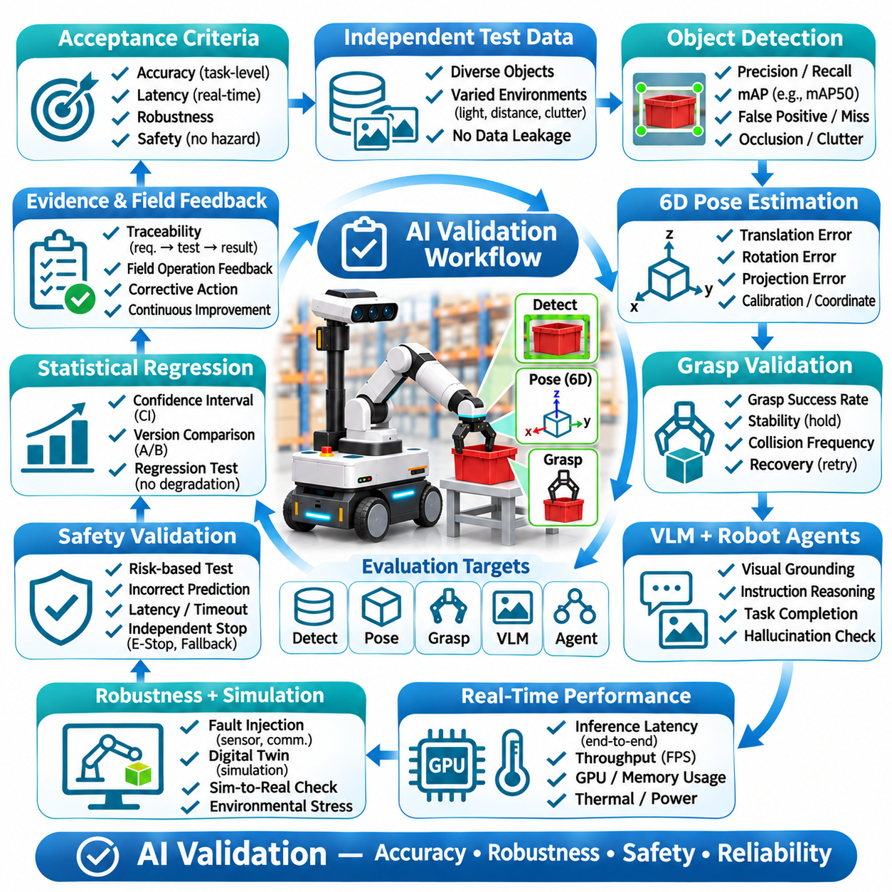{width="7.268055555555556in" height="7.268055555555556in"}

인공지능 검증(AI Validation)은 인공지능 모델(Artificial Intelligence Models)이 모바일 매니퓰레이터(Mobile Manipulator)의 기능적 요구사항(Functional Requirements), 성능 요구사항(Performance Requirements), 운영 요구사항(Operational Requirements)을 충족하는지를 판단하는 체계적인 엔지니어링 프로세스(Systematic Engineering Process)이다. 기존의 모델 벤치마킹(Model Benchmarking)과 달리 인공지능 검증은 모델 예측(Model Predictions)과 물리적 로봇 행동(Physical Robotic Behavior) 사이의 상호작용을 고려해야 한다. 검증의 목적은 개발된 인공지능 역량(AI Capabilities)이 의도된 응용 분야(Intended Applications)에 적합하다는 신뢰성 높은 증거(Reliable Evidence)를 확보하는 것이다.

인공지능 검증은 시스템 요구사항(System Requirements)과 운영 목표(Operational Objectives)에서 도출된 측정 가능한 인수 기준(Measurable Acceptance Criteria)을 정의하는 것에서 시작된다. 객체 탐지(Object Detection), 자세 추정(Pose Estimation), 파지 탐지(Grasp Detection), 시각-언어 모델(Vision-Language Models, VLMs), 로봇 에이전트(Robot Agents)는 서로 다른 평가 방법론(Evaluation Methodologies)을 필요로 한다. 검증 사양(Validation Specifications)은 테스트를 시작하기 전에 허용 가능한 정확도(Accuracy), 추론 지연시간(Inference Latency), 강건성(Robustness), 실패 복구 역량(Failure Recovery Capabilities), 운영 제한사항(Operational Limitations)을 설정해야 한다.

독립적인 검증 데이터세트(Independent Validation Datasets)는 대표적인 운영 조건(Representative Operating Conditions)에서 모델의 일반화 성능(Model Generalization)을 평가하기 위해 필수적이다. 평가 샘플(Evaluation Samples)은 다양한 객체 범주(Object Categories), 환경 구성(Environmental Configurations), 조명 조건(Illumination Conditions), 관측 거리(Observation Distances), 센서 특성(Sensor Characteristics)을 포함해야 한다. 측정된 성능(Measured Performance)이 이전에 학습된 사례(Previously Learned Examples)를 넘어서는 모델 역량을 반영하도록 학습 데이터세트(Training Datasets)와 평가 데이터세트(Evaluation Datasets) 사이의 데이터 누출(Data Leakage)을 방지해야 한다.

객체 탐지 검증(Object Detection Validation)은 인공지능 모델이 운영 환경(Operational Environments) 내에서 관련 객체(Relevant Objects)를 식별하고 위치를 추정하는 역량을 평가한다. 정밀도(Precision), 재현율(Recall), 평균 정밀도 평균(Mean Average Precision, mAP), 오탐지율(False Positive Rates), 미탐지율(Missed Detection Rates)은 정량적 성능 지표(Quantitative Performance Indicators)를 제공한다. 또한 평가 과정에서는 실제 로봇 운영(Robotic Operations) 중에 발생할 수 있는 부분 가림(Partial Occlusion), 반사 표면(Reflective Surfaces), 복잡한 장면(Cluttered Scenes), 소형 객체(Small Objects), 카메라 관측 시점의 변화(Variations in Camera Perspectives)를 고려해야 한다.

자세 추정 검증(Pose Estimation Validation)은 예측된 객체 위치(Predicted Object Positions)와 방향(Orientations)이 로봇 매니퓰레이션(Robotic Manipulation)의 기하학적 요구사항(Geometric Requirements)을 충족하는지를 판단한다. 병진 오차(Translation Error), 회전 오차(Rotation Error), 투영 오차(Projection Error), 평균 거리 평가 지표(Average Distance Metrics)는 예측 정확도(Prediction Accuracy)를 정량화할 수 있다. 평가 과정에서는 센서 보정 불확실성(Sensor Calibration Uncertainty), 객체 대칭성(Object Symmetry), 좌표 변환 정확도(Coordinate Transformation Accuracy), 물리적 매니퓰레이션에 대한 추정 오차의 전파(Propagation of Estimation Errors)를 고려해야 한다.

파지 탐지 검증(Grasp Detection Validation)은 예측된 파지 구성(Predicted Grasp Configurations)이 성공적이고 안정적인 물리적 상호작용(Physical Interactions)으로 이어지는지를 평가한다. 평가 기준(Evaluation Criteria)은 파지 성공률(Grasp Success Rate), 객체 유지 능력(Object Retention), 충돌 빈도(Collision Frequency), 파지 안정성(Grasp Stability), 복구 유효성(Recovery Effectiveness)을 포함할 수 있다. 물리적 실험(Physical Experiments)은 객체 기하학(Object Geometry), 재료 특성(Material Properties), 마찰 특성(Friction Characteristics), 적재 하중 분포(Payload Distribution), 그리퍼 위치 정밀도(Gripper Positioning Accuracy)의 변화를 고려해야 한다.

시각-언어 모델 검증(Vision-Language Model Validation)은 의미적 이해(Semantic Understanding), 명령 해석(Instruction Interpretation), 시각적 그라운딩(Visual Grounding), 맥락적 추론 역량(Contextual Reasoning Capabilities)을 평가해야 한다. 평가 시나리오(Evaluation Scenarios)는 모호한 명령(Ambiguous Commands), 익숙하지 않은 객체(Unfamiliar Objects), 복잡한 공간적 관계(Complex Spatial Relationships), 불완전한 환경 정보(Incomplete Environmental Information)를 포함해야 한다. 특히 부적절한 로봇 행동(Inappropriate Robotic Actions)으로 이어질 수 있는 환각에 의한 관측 정보(Hallucinated Observations)와 근거 없는 예측(Unsupported Predictions)에 대해 각별한 주의를 기울여야 한다.

로봇 에이전트 및 체화 인공지능 검증(Robot Agent and Embodied AI Validation)은 독립적인 모델 예측(Isolated Model Predictions)이 아니라 완전한 인지-행동 루프(Perception-Action Loops)를 평가해야 한다. 작업 분해(Task Decomposition), 계획 정확도(Planning Accuracy), 도구 호출 신뢰성(Tool Invocation Reliability), 행동 적응성(Behavioral Adaptability), 물리적 작업 완료(Physical Task Completion)는 대표적인 시나리오(Representative Scenarios)를 통해 평가되어야 한다. 검증 과정에서는 지능형 에이전트(Intelligent Agents)가 실패한 작업(Unsuccessful Operations)을 인식하고 적절한 복구 절차(Recovery Procedures)를 시작할 수 있는지를 판단해야 한다.

계산 성능 검증(Computational Performance Validation)은 배포된 인공지능 모델(Deployed AI Models)이 모바일 매니퓰레이터 시스템의 실시간 요구사항(Real-Time Requirements)을 충족하는지를 판단한다. 추론 지연시간(Inference Latency), 처리량(Processing Throughput), 메모리 소비량(Memory Consumption), GPU 활용률(GPU Utilization), 전력 소비량(Power Consumption), 열적 안정성(Thermal Stability)은 대상 컴퓨팅 플랫폼(Target Computing Platforms)에서 측정되어야 한다. 또한 평가 과정에서는 다수의 로봇 하위 시스템(Robotic Subsystems)에 걸친 동시 실행(Concurrent Execution)과 최악 조건 응답시간(Worst-Case Response Times)을 고려해야 한다.

강건성 검증(Robustness Validation)은 환경적 교란(Environmental Disturbances), 센서 성능 저하(Sensor Degradation), 통신 중단(Communication Interruptions), 예상하지 못한 운영 조건(Unexpected Operating Conditions)에서 인공지능의 행동을 평가한다. 스트레스 테스트(Stress Testing)와 통제된 결함 주입(Controlled Fault Injection)은 기존의 성능 평가(Conventional Performance Evaluation) 과정에서 발견되지 않았던 취약점(Weaknesses)을 식별할 수 있다. 모델은 예측 가능한 성능 저하 특성(Predictable Degradation Characteristics)을 나타내야 하며, 신뢰할 수 있는 예측(Reliable Predictions)이 불가능해지는 경우 적절한 대체 메커니즘(Fallback Mechanisms)을 지원해야 한다.

시뮬레이션 기반 검증(Simulation-Based Validation)은 다양한 운영 시나리오(Operational Scenarios)에 걸쳐 인공지능 역량을 평가하기 위한 통제된 환경(Controlled Environments)을 제공한다. 디지털 트윈(Digital Twins)과 물리 기반 시뮬레이션(Physics-Based Simulation)은 환경 변화(Environmental Variations), 객체 구성(Object Configurations), 로봇 상호작용(Robotic Interactions)을 포함하는 반복 가능한 실험(Repeatable Experiments)을 가능하게 한다. 그러나 시뮬레이션 환경(Simulated Environments)은 실제 환경의 불확실성(Real-World Uncertainties)을 완전히 재현할 수 없으므로 시뮬레이션 결과(Simulation Results)는 물리적 실험(Physical Experiments)을 통해 보완되어야 한다.

안전 중심 인공지능 검증(Safety-Oriented AI Validation)은 모델 실패(Model Failures)가 위험한 로봇 행동(Hazardous Robotic Behavior)을 발생시킬 수 있는지를 평가한다. 잘못된 예측(Incorrect Predictions), 과도한 추론 지연(Excessive Inference Delays), 불확실한 의사결정(Uncertain Decisions), 유효하지 않은 행동 제안(Invalid Action Proposals)은 위험 기반 테스트(Risk-Based Testing)를 통해 검증되어야 한다. 독립적인 안전 메커니즘(Independent Safety Mechanisms)은 위험한 행동 실행(Hazardous Execution)을 방지해야 하며, 인공지능 검증이 시스템 수준의 기능 안전 검증(System-Level Functional Safety Verification)을 대체하는 것으로 간주되어서는 안 된다.

통계적 평가(Statistical Evaluation)와 회귀 테스트(Regression Testing)는 다양한 모델 버전(Model Versions)과 운영 조건(Operating Conditions)에 걸쳐 인공지능 성능에 대한 신뢰성을 확보한다. 반복 실험(Repeated Experiments), 신뢰구간(Confidence Intervals), 성능 분포(Performance Distributions), 최악 조건 측정값(Worst-Case Measurements)은 평균 정확도(Average Accuracy)만을 활용하는 것보다 더욱 의미 있는 증거를 제공한다. 자동화된 회귀 테스트(Automated Regression Tests)는 모델 업데이트(Model Updates)가 허용할 수 없는 성능 저하(Unacceptable Performance Degradation)를 발생시키거나 이전에 검증된 역량(Previously Validated Capabilities)을 저해하는지를 식별해야 한다.

검증 문서화(Validation Documentation)는 인공지능 요구사항(AI Requirements), 모델 버전(Model Versions), 데이터세트(Datasets), 테스트 구성(Test Configurations), 평가 지표(Evaluation Metrics), 인수 결정(Acceptance Decisions) 사이의 추적성(Traceability)을 확보해야 한다. 식별된 실패(Identified Failures)는 근본 원인(Root Causes), 시정 조치(Corrective Actions), 후속 검증 결과(Subsequent Verification Results)와 함께 문서화되어야 한다. 배포 승인(Deployment Approval)은 개별적인 시연(Isolated Demonstrations)이나 유리한 실험 결과(Favorable Experimental Outcomes)가 아니라 문서화된 증거(Documented Evidence)를 기반으로 이루어져야 한다.

궁극적으로 인공지능 검증은 데이터 수집(Data Collection), 모델 학습(Model Training), 모델 배포(Model Deployment), 통합 테스트(Integrated Testing), 운영 피드백(Operational Feedback)을 연결하는 지속적인 엔지니어링 프로세스(Continuous Engineering Process)로 수행되어야 한다. 현장 관측 정보(Field Observations)와 새롭게 식별된 실패 시나리오(Newly Identified Failure Scenarios)는 후속 검증 주기(Subsequent Validation Cycles)를 지원해야 한다. 검증의 목적은 정확도(Accuracy), 적응성(Adaptability), 안전성(Safety), 산업 운영 신뢰성(Industrial Operational Reliability)에 대한 요구사항을 일관되게 충족하는 신뢰성 높은 인공지능 역량(Dependable AI Capabilities)을 구축하는 것이다.
