**Volume 05. Mobile Manipulator Projects and Development Manual**

# Chapter 05. Manipulation Development

## 01 Manipulation System Overview

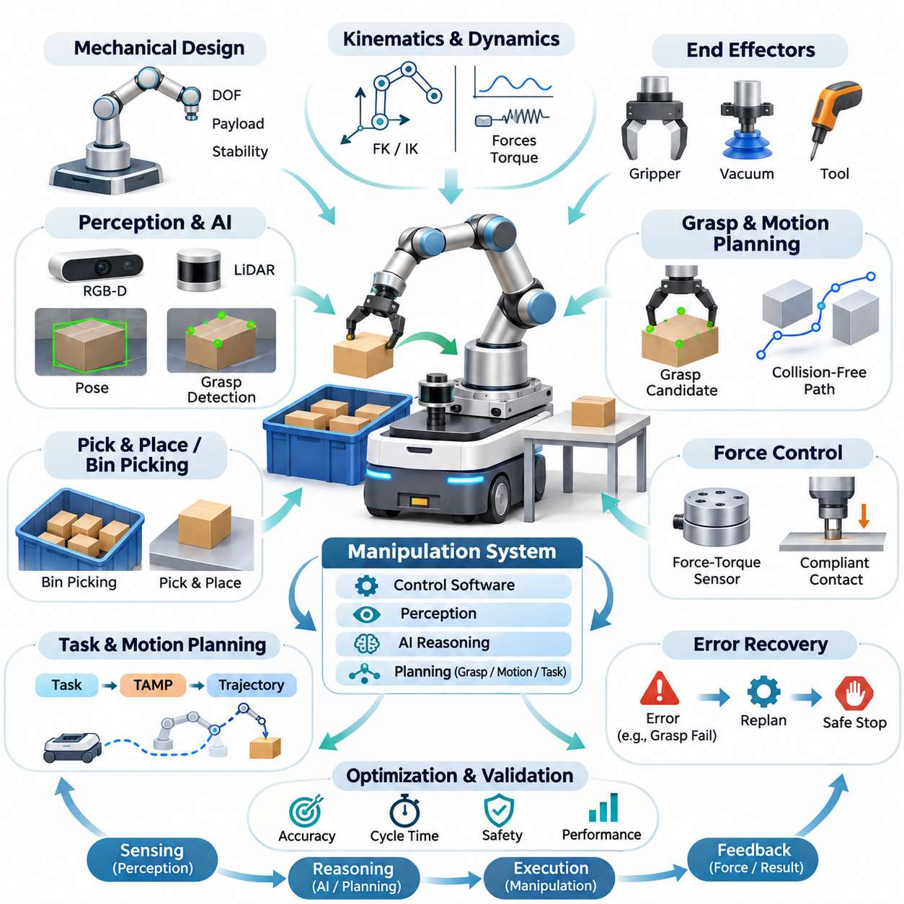{width="7.268055555555556in" height="7.268055555555556in"}

A manipulation system is a fundamental component of a mobile manipulator that enables physical interaction with objects and surrounding environments. While an Autonomous Mobile Robot (AMR) provides mobility, the manipulation system enables grasping, lifting, transporting, positioning, assembling, and operating physical objects. The integration of mobility and manipulation extends robotic capabilities beyond conventional stationary industrial automation.

The architecture of a manipulation system consists of mechanical structures, actuators, sensors, end effectors, control software, perception algorithms, and intelligent decision-making modules. These components must operate as a coordinated system to achieve reliable physical interaction. Manipulation development therefore requires multidisciplinary engineering involving mechanical engineering, control theory, robotics, computer vision, and artificial intelligence.

The mechanical architecture establishes the physical capabilities and limitations of the manipulation system. Robot arm configuration, degrees of freedom (DOF), joint arrangement, link dimensions, payload capacity, reachability, and structural stiffness directly influence operational performance. In mobile applications, engineers must additionally consider weight distribution, mounting position, center of gravity, and dynamic stability during manipulation.

Kinematics provides the mathematical foundation for determining the spatial relationship between robot joints and the end effector. Forward kinematics calculates the position and orientation of the end effector from joint configurations, whereas inverse kinematics determines suitable joint configurations for a desired target pose. Accurate kinematic modeling is essential for trajectory generation, workspace evaluation, and precise object manipulation.

Dynamics modeling describes the relationship between robot motion, applied forces, joint torques, and physical properties. Inertia, gravity, friction, centrifugal forces, and Coriolis effects influence the behavior of robotic manipulators. Mobile manipulation introduces additional dynamic interactions between the robot arm and mobile platform, requiring engineers to evaluate load transfer, structural vibration, and operational stability.

The end effector represents the primary interface between the robotic system and the physical environment. Depending on application requirements, manipulation systems may employ parallel grippers, vacuum grippers, adaptive robotic hands, magnetic grippers, inspection instruments, or specialized industrial tools. End-effector selection must consider object geometry, surface characteristics, material properties, payload, and task requirements.

Perception systems provide the environmental information required for intelligent manipulation. RGB cameras, depth cameras, three-dimensional LiDAR, force-torque sensors, and tactile sensors contribute complementary information about objects and their surroundings. Sensor calibration, temporal synchronization, and coordinate transformations ensure that perception results can be consistently interpreted within the robotic control system.

Artificial intelligence enhances manipulation capabilities by enabling robots to recognize objects, estimate spatial poses, identify grasping opportunities, and adapt to environmental variations. Deep learning models can process complex visual information and generate task-relevant representations. However, AI-generated outputs must be evaluated against mechanical constraints, collision conditions, and safety requirements before physical execution.

Grasp planning determines how a robotic manipulator should approach, contact, and securely hold a target object. Effective grasp planning considers object geometry, surface friction, gripper configuration, accessibility, center of mass, and expected external disturbances. Candidate grasps are evaluated according to stability, reachability, collision risk, and suitability for subsequent manipulation operations.

Motion planning generates feasible trajectories between initial and target robot configurations. The planning process must consider joint limits, environmental obstacles, self-collision, velocity constraints, acceleration limits, and workspace restrictions. In mobile manipulators, motion planning may coordinate the movement of both the mobile base and robotic arm to improve accessibility and operational efficiency.

Pick-and-place operations represent a fundamental application of manipulation systems. A complete operation typically involves object detection, pose estimation, grasp selection, approach trajectory generation, grasp execution, object transportation, placement, and result verification. Industrial implementation requires consistent execution across variations in object position, orientation, environmental conditions, and production schedules.

Bin picking introduces additional complexity because target objects may be randomly distributed, partially occluded, or physically entangled. Manipulation systems must identify accessible objects, estimate their three-dimensional poses, evaluate suitable grasp configurations, and avoid collisions with neighboring objects and container surfaces. Repeated perception and planning may be necessary as the arrangement of remaining objects changes.

Force control enables robotic manipulators to regulate physical interaction with objects and external surfaces. Unlike purely position-based control, force-aware manipulation supports operations involving uncertain contact conditions, including assembly, insertion, polishing, surface inspection, and delicate object handling. Force feedback, impedance control, and compliance mechanisms contribute to stable and controlled interaction.

Task and Motion Planning (TAMP) connects high-level task objectives with physically executable robotic movements. Task planning determines the sequence of actions required to achieve a mission, while motion planning generates feasible trajectories for individual actions. Their integration enables mobile manipulators to perform complex operations while accounting for environmental constraints and changing operational conditions.

Error recovery is essential for maintaining manipulation reliability in practical environments. Failed grasps, inaccurate object localization, unexpected contact, communication interruptions, and planning failures must be detected and classified. Recovery strategies may include renewed perception, alternative grasp selection, trajectory replanning, controlled retreat, or transition to a predefined safe state when autonomous recovery is unavailable.

Performance optimization seeks to improve manipulation accuracy, task success rates, cycle time, energy efficiency, and computational responsiveness. Engineering teams must balance these objectives against mechanical limitations, environmental uncertainty, and operational safety. Manipulation validation then evaluates whether the integrated system satisfies measurable requirements under representative industrial operating conditions.

## 02 Kinematics Development

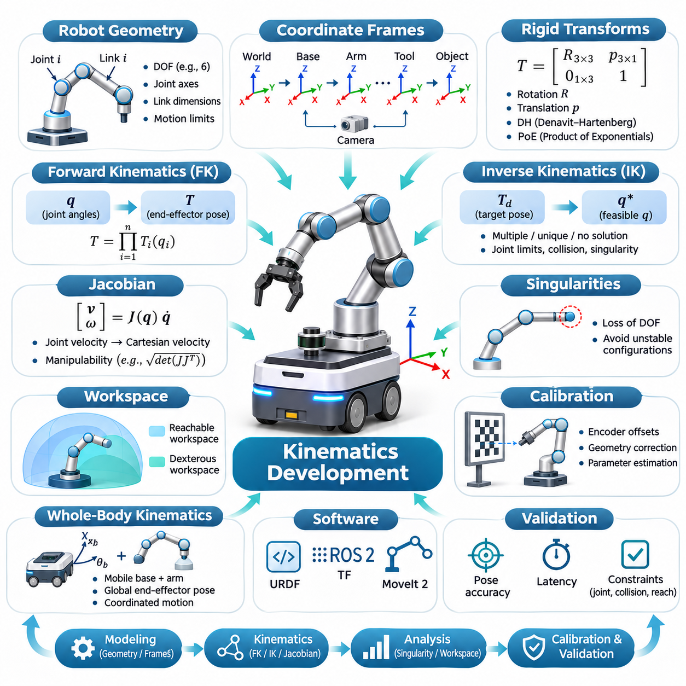{width="7.268055555555556in" height="7.268055555555556in"}

Kinematics development establishes the mathematical and computational foundation for controlling the motion of a robotic manipulator without explicitly considering the forces and torques responsible for that motion. In mobile manipulation systems, kinematics describes the spatial relationships between the mobile platform, robotic arm, sensors, end effector, and target objects. Accurate kinematic models are essential for reliable positioning and coordinated manipulation.

The kinematics development process begins with defining the mechanical configuration of the robotic system. Engineers identify the number of degrees of freedom (DOF), joint types, joint axes, link dimensions, mounting positions, and mechanical movement limits. These physical characteristics determine the mathematical representation of the robot and establish the fundamental constraints governing its movement throughout the operational workspace.

Coordinate frame definition is one of the most important activities in kinematics development. A mobile manipulator typically employs world, map, mobile base, manipulator base, joint, camera, tool, and object coordinate frames. Each coordinate frame represents a specific spatial reference. Consistent transformation relationships between these frames enable perception, localization, navigation, and manipulation modules to exchange spatial information reliably.

Homogeneous transformation matrices provide a mathematical representation of three-dimensional position and orientation. By combining rotation matrices and translation vectors, engineers can describe spatial relationships between consecutive robotic links and coordinate frames. Sequential multiplication of transformation matrices determines the overall spatial configuration of the manipulator relative to its base or another reference coordinate system.

The Denavit-Hartenberg (DH) convention is widely used to represent the geometric relationships between consecutive robot joints. Four parameters describe link length, link twist, link offset, and joint angle. Alternative approaches, such as the Product of Exponentials (PoE) formulation, provide additional flexibility for representing complex robotic structures. The selected modeling method must be consistent throughout development and validation.

Forward kinematics calculates the position and orientation of the robot end effector from known joint configurations. Joint encoder measurements are processed through the mathematical model to determine the corresponding Cartesian pose. Forward kinematics supports real-time monitoring, visualization, collision detection, workspace analysis, and verification of whether the manipulator has reached its commanded physical configuration.

Inverse kinematics determines the joint configurations required to achieve a specified end-effector position and orientation. Unlike forward kinematics, inverse kinematics may produce multiple solutions, a unique solution, or no feasible solution. Practical implementations must evaluate candidate configurations against joint limits, collision constraints, singularity conditions, and the accessibility requirements of the intended manipulation task.

Analytical inverse kinematics provides closed-form mathematical solutions for compatible manipulator configurations, offering predictable computation times and high numerical efficiency. Numerical inverse kinematics employs iterative optimization techniques to minimize position and orientation errors. Jacobian-based methods, damped least squares, and constrained optimization are particularly useful when analytical solutions are unavailable or task constraints are complex.

The Jacobian matrix relates joint velocities to the linear and angular velocities of the end effector. This differential kinematic relationship enables Cartesian motion control, velocity transformation, and manipulability analysis. Engineers use Jacobian-based calculations to identify configurations where particular movement directions become difficult to achieve and to support stable motion generation near kinematic singularities.

Kinematic singularities occur when the manipulator loses the ability to generate motion in one or more Cartesian directions. Near singular configurations, relatively small Cartesian movements may require excessive joint velocities. Development teams must identify these configurations through mathematical analysis and simulation, incorporating singularity avoidance, velocity limitations, and alternative configuration selection into the control architecture.

Workspace analysis determines the spatial regions that the robotic manipulator can physically reach. The reachable workspace describes attainable end-effector positions, whereas the dexterous workspace describes positions supporting all required orientations. Engineers evaluate these regions against operational scenarios, object locations, equipment geometry, and accessibility requirements to optimize manipulator mounting and mobile platform positioning.

Mobile manipulation introduces additional kinematic relationships because the robotic arm is mounted on a moving platform. The global end-effector pose depends on both the mobile base position and the manipulator joint configuration. Whole-body kinematics integrates these motion capabilities into a unified representation, enabling coordinated positioning while accounting for mobile base steering constraints and manipulator movement limitations.

Kinematic calibration improves positioning accuracy by identifying differences between nominal mathematical models and actual mechanical structures. Manufacturing tolerances, joint encoder offsets, assembly deviations, and tool mounting errors can introduce systematic positioning inaccuracies. External measurement equipment, calibration targets, and optimization algorithms help estimate geometric parameters and improve the accuracy of the implemented kinematic model.

Software implementation translates mathematical kinematic models into computational modules that support real-time robotic operations. Robot descriptions such as the Unified Robot Description Format (URDF), ROS 2 transformation libraries, and MoveIt 2 provide practical development infrastructure. Engineers must maintain consistent coordinate conventions, measurement units, joint definitions, tool configurations, and model versions across integrated software components.

Kinematics validation requires systematic comparison between calculated and experimentally measured robot positions and orientations. Forward and inverse kinematics accuracy, transformation consistency, workspace coverage, singularity handling, computational latency, and joint-limit compliance should be evaluated under representative operating conditions. Validated kinematic models establish the foundation for dynamics modeling, grasp planning, motion planning, and reliable industrial manipulation.

## 03 Dynamics Modeling

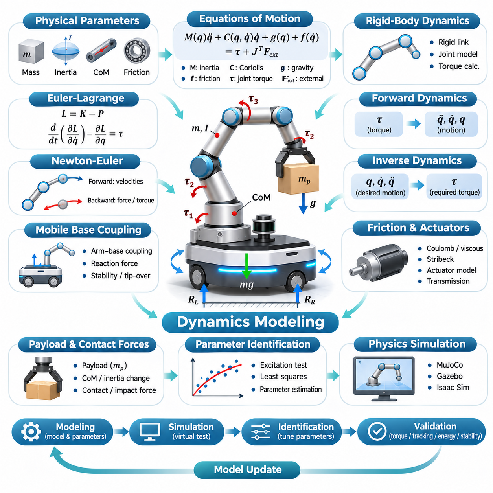{width="7.268055555555556in" height="7.268055555555556in"}

Dynamics modeling establishes the mathematical foundation for understanding how forces, torques, mass distribution, and physical interactions influence the motion of robotic manipulators. Unlike kinematics, which describes motion through geometric relationships, dynamics explains the physical mechanisms responsible for generating motion. Accurate dynamic models are essential for developing stable, efficient, and reliable mobile manipulation systems.

The dynamics development process begins with identifying the physical properties of individual robotic components. Link mass, center of mass, inertia tensors, actuator characteristics, transmission ratios, joint friction, and mechanical stiffness must be defined. These parameters can be obtained from Computer-Aided Design (CAD) models, manufacturer specifications, physical measurements, and experimental system identification.

Rigid-body dynamics provides a fundamental modeling approach for robotic manipulators. Each manipulator link is represented as a rigid body with defined mass and inertial properties connected through mechanical joints. Although this representation simplifies structural behavior, it provides a practical foundation for calculating joint torques, predicting motion responses, evaluating actuator requirements, and developing real-time control algorithms.

The equations of motion describe the relationship between joint positions, velocities, accelerations, and applied torques. A conventional manipulator dynamics model incorporates an inertia matrix, Coriolis and centrifugal terms, gravitational forces, friction effects, and external interaction forces. These mathematical components collectively represent the physical behavior of the robotic system during static and dynamic operations.

The Euler-Lagrange formulation derives robotic equations of motion using the kinetic and potential energy of the mechanical system. The Lagrangian represents the difference between these energy components, allowing generalized forces and joint motion relationships to be calculated systematically. This formulation is particularly useful for theoretical analysis, controller development, and understanding dynamic coupling between multiple robotic joints.

The Newton-Euler formulation describes manipulator dynamics through the relationships between forces, moments, linear accelerations, and angular accelerations. Recursive Newton-Euler algorithms propagate motion information forward through the robotic structure and calculate required forces and torques backward toward the base. This computationally efficient approach is widely applicable to real-time inverse dynamics and model-based robotic control.

Forward dynamics calculates the resulting joint accelerations when applied forces, actuator torques, and current robot states are known. Numerical integration then determines subsequent joint velocities and positions over time. Forward dynamics is particularly important for robotic simulation, virtual prototyping, controller evaluation, disturbance analysis, and predicting mechanical behavior under different operating conditions.

Inverse dynamics determines the actuator torques required to achieve specified joint positions, velocities, and accelerations. Engineers utilize inverse dynamics to develop feedforward compensation, estimate actuator loading, and improve trajectory tracking performance. Accurate torque prediction also supports motor selection, transmission design, thermal evaluation, and the identification of operating conditions that could exceed mechanical limitations.

Friction modeling represents mechanical resistance originating from bearings, gears, transmission components, and other moving interfaces. Coulomb friction, viscous friction, static friction, and the Stribeck effect describe different aspects of frictional behavior. Appropriate friction compensation improves low-speed movement, positioning accuracy, energy efficiency, and the consistency of manipulation tasks involving delicate physical interactions.

Mobile manipulators introduce dynamic coupling between the robotic arm and the mobile platform. Arm acceleration generates reaction forces and moments that influence platform stability, wheel loading, and positioning accuracy. Simultaneous platform and arm movement further increases dynamic complexity, requiring integrated mechanical models that account for vehicle motion, ground contact, suspension characteristics, and manipulator configuration.

Payload dynamics significantly affects manipulation performance because grasped objects modify the effective mass, center of mass, and inertia of the robotic system. An extended arm carrying a heavy object may generate substantial overturning moments and actuator loads. Dynamic models must incorporate payload variations and support adaptive compensation to maintain stability, trajectory accuracy, and compliance with mechanical operating limits.

External force modeling describes physical interactions between the manipulator and its environment. Contact forces, frictional constraints, reaction moments, and impact loads influence operations such as grasping, assembly, insertion, and surface inspection. Force-torque sensors and dynamic observers can provide feedback for estimating external disturbances, supporting compliant manipulation and improving contact stability under uncertain conditions.

Dynamic parameter identification improves model accuracy by comparing theoretical predictions with experimentally measured robotic behavior. Engineers execute predefined excitation trajectories while collecting joint positions, velocities, accelerations, and torque measurements. Parameter estimation techniques, including least squares and numerical optimization, identify inertial properties, friction coefficients, and other characteristics that influence system dynamics.

Physics-based simulation provides a controlled environment for evaluating dynamic models before physical implementation. Platforms such as MuJoCo, Gazebo, and NVIDIA Isaac Sim support rigid-body dynamics, actuator modeling, collision interactions, and contact simulation. Engineers must calibrate simulation parameters against physical measurements to reduce the simulation-to-reality gap and improve the reliability of virtual development results.

Dynamics validation requires systematic comparison between predicted and measured joint responses, actuator torques, energy consumption, and platform stability. Testing should encompass representative payloads, movement speeds, acceleration profiles, and external interaction conditions. Validated dynamic models provide the engineering foundation for motion planning, force control, performance optimization, and reliable industrial mobile manipulation.

## 04 Grasp Planning

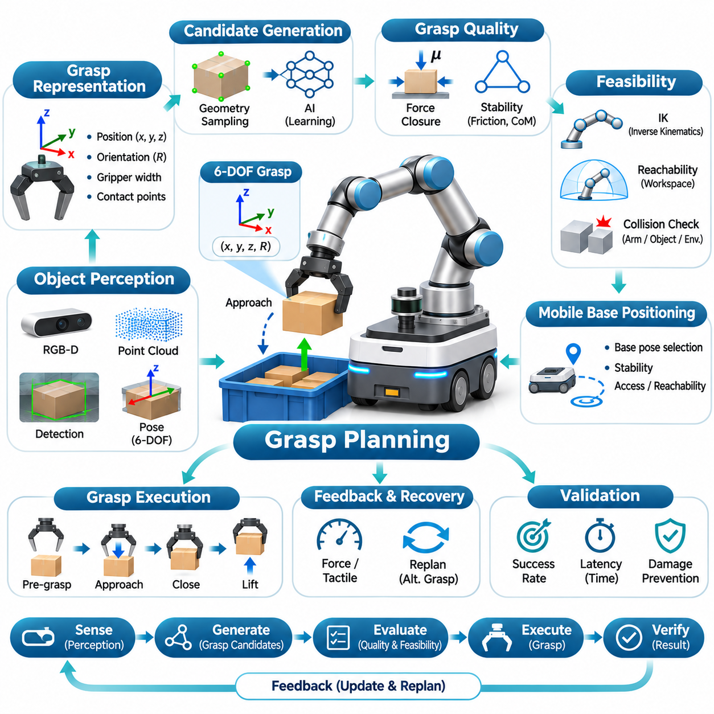{width="7.268055555555556in" height="7.268055555555556in"}

Grasp planning is a fundamental process in robotic manipulation that determines how a robot should approach, contact, and securely hold a target object to accomplish a physical task. In mobile manipulation systems, grasp planning must consider not only object characteristics and gripper capabilities but also mobile platform positioning, environmental constraints, manipulator reachability, and the requirements of subsequent operations.

The grasp planning development process begins with defining operational requirements and target object characteristics. Object dimensions, geometry, mass, material properties, surface conditions, fragility, and expected orientation influence the selection of grasping strategies. Engineers must also establish measurable requirements for grasp success rates, positioning accuracy, execution time, allowable contact forces, and object damage prevention.

Object perception provides the environmental information necessary for generating feasible grasp configurations. RGB cameras, depth cameras, and three-dimensional point clouds enable the system to identify target objects and estimate their spatial positions and orientations. Accurate sensor calibration and coordinate transformations are essential for converting perception results into actionable grasp targets within the manipulator coordinate system.

Grasp representation describes the geometric and physical parameters associated with a potential grasp. A typical grasp representation includes the three-dimensional gripping position, gripper orientation, finger opening width, approach direction, and expected contact points. Six-degree-of-freedom (6-DOF) grasp representations provide additional flexibility for manipulating objects positioned in complex or unstructured environments.

Analytical grasp planning utilizes mathematical models of object geometry, contact mechanics, friction, and force equilibrium to determine stable grasp configurations. Force closure evaluates whether contact forces can resist arbitrary external disturbances within the assumed contact model, while form closure examines whether geometric constraints prevent object movement. These approaches provide physically interpretable criteria for grasp evaluation.

Learning-based grasp planning employs artificial intelligence to generate and evaluate grasp candidates directly from sensory observations. Deep neural networks can predict grasp positions, orientations, contact regions, and grasp quality scores from RGB images, depth maps, or point clouds. Training datasets may incorporate simulated grasping experiences, physical experiments, human demonstrations, and automatically generated annotations.

Grasp candidate generation identifies multiple potential configurations rather than relying exclusively on a single predicted grasp. Candidate configurations may be generated through geometric sampling, surface normal analysis, neural network inference, or optimization algorithms. Maintaining alternative grasp candidates improves operational flexibility when preferred configurations are inaccessible, unstable, or obstructed by surrounding objects.

Grasp quality evaluation determines the suitability of each candidate for physical execution. Evaluation criteria include contact stability, frictional resistance, center-of-mass alignment, gripper compatibility, collision risk, and expected resistance to external disturbances. Additional application-specific criteria may consider placement orientation, object deformation, transportation stability, and the accessibility of subsequent manipulation operations.

Kinematic feasibility analysis ensures that candidate grasps can be physically achieved by the robotic manipulator. Inverse kinematics calculates suitable joint configurations for the desired grasp pose, while joint limits, singularity conditions, and workspace restrictions eliminate unsuitable candidates. Mobile manipulators may reposition their mobile platforms to improve grasp accessibility and achieve more favorable arm configurations.

Collision-aware grasp planning evaluates potential interactions between the robotic arm, gripper, target object, neighboring objects, and surrounding equipment. Three-dimensional environmental representations support collision checking during approach, grasp execution, and object removal. Appropriate clearance margins must account for perception uncertainty, calibration errors, mechanical tolerances, and unexpected environmental changes.

Grasp execution requires coordinated control of the manipulator and end effector throughout the physical interaction process. A typical sequence includes movement toward a pre-grasp pose, controlled approach, gripper closure, contact verification, and object lifting. Force-torque sensors, tactile sensors, actuator current measurements, and gripper position feedback can provide complementary information for detecting successful physical contact.

Robust grasp planning addresses uncertainties associated with object localization, surface friction, material properties, and environmental disturbances. Probabilistic evaluation, uncertainty-aware optimization, and closed-loop visual feedback can improve grasp reliability. When initial execution conditions differ from predicted conditions, the system may update object pose estimates, adjust gripping forces, or select alternative grasp configurations.

Mobile grasp planning extends conventional grasp generation by incorporating the position and orientation of the mobile platform into the planning process. Base positioning must consider manipulator reachability, platform stability, navigation constraints, and available operational space. Coordinated base and arm configuration selection can improve grasp success while reducing unnecessary movement, energy consumption, and execution time.

Grasp planning software integrates perception, grasp generation, candidate evaluation, inverse kinematics, collision detection, and motion planning into a coordinated execution pipeline. Development frameworks such as ROS 2 and MoveIt 2 provide infrastructure for exchanging geometric information and executing planned trajectories. Modular software design supports independent algorithm evaluation, component replacement, and systematic debugging.

Grasp failure detection and recovery are essential for reliable industrial manipulation. Failures may result from inaccurate pose estimation, insufficient gripping force, object slippage, unexpected collisions, or inaccessible grasp configurations. Recovery mechanisms should classify failure conditions and determine whether renewed perception, alternative grasp selection, controlled repositioning, or safe mission termination is appropriate.

Grasp planning validation requires systematic testing across representative object geometries, materials, weights, orientations, and environmental conditions. Key performance indicators include first-attempt grasp success rate, overall grasp success rate, planning latency, execution time, object damage rate, and recovery effectiveness. Validated grasp planning establishes the foundation for reliable pick-and-place, bin picking, and autonomous industrial manipulation.

## 05 Motion Planning

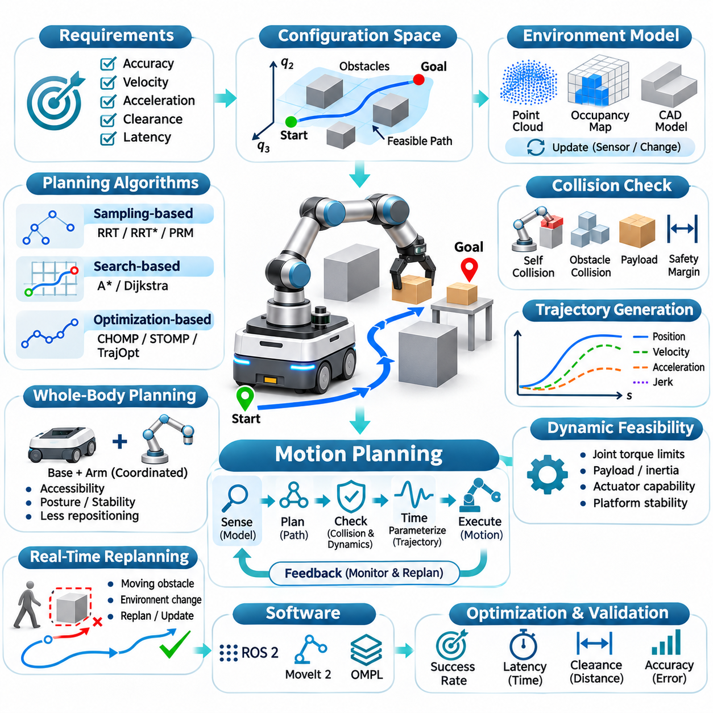{width="7.268055555555556in" height="7.268055555555556in"}

Motion planning is a fundamental capability of robotic manipulation systems that determines feasible movements between initial and desired robot configurations while satisfying physical, environmental, and operational constraints. In mobile manipulation, motion planning must consider the robotic arm and mobile platform as interconnected systems, enabling coordinated movements that support accurate, efficient, and reliable physical task execution.

The motion planning development process begins with defining operational requirements, environmental characteristics, and mechanical limitations. Engineers must establish target positioning accuracy, trajectory execution time, allowable velocities, acceleration limits, collision clearance, and computational latency. These requirements provide measurable engineering objectives for algorithm selection, software implementation, and subsequent system validation.

Configuration space provides a mathematical representation of the possible configurations of a robotic system. Each dimension typically corresponds to an independent joint variable or mobile platform coordinate. Environmental obstacles, mechanical limitations, and collision conditions establish restricted regions within this space. Motion planning identifies continuous paths through feasible regions that connect initial and target configurations.

Environmental modeling provides the spatial information required for collision-aware motion planning. Three-dimensional point clouds, occupancy maps, geometric primitives, and Computer-Aided Design (CAD) models can represent the surrounding environment. These representations must be updated according to sensor observations, object movement, and operational changes to maintain consistency between the internal planning environment and physical reality.

Sampling-based motion planning algorithms explore configuration spaces by generating and evaluating candidate configurations. Rapidly-exploring Random Trees (RRT), RRT-Connect, RRT\\\*, and Probabilistic Roadmaps (PRM) are widely used for high-dimensional robotic systems. These algorithms support complex obstacle avoidance, although planning efficiency and path quality depend on sampling strategies, environmental complexity, and computational resources.

Search-based motion planning approaches represent possible movements through structured graphs or discretized configuration spaces. Algorithms such as A\\\* and Dijkstra\'s algorithm identify feasible paths according to predefined cost functions. Although discretization becomes computationally expensive for high-dimensional manipulators, search-based approaches remain useful for mobile navigation, structured workspaces, and hierarchical planning architectures.

Optimization-based motion planning generates or improves trajectories by minimizing mathematical objective functions while satisfying operational constraints. Optimization criteria may include path length, execution time, energy consumption, trajectory smoothness, and obstacle clearance. Algorithms such as CHOMP, STOMP, and TrajOpt provide practical approaches for improving manipulation trajectories within complex environments.

Collision detection evaluates whether planned robot configurations and intermediate movements create undesirable physical contact. Collision models must represent manipulator links, end effectors, attached payloads, mobile platforms, and surrounding equipment. Both self-collision and environmental collision must be considered, while appropriate safety margins account for localization errors, perception uncertainty, and mechanical tolerances.

Trajectory generation converts geometric paths into time-dependent motion commands that satisfy velocity, acceleration, jerk, and actuator limitations. Time parameterization determines when the robot should reach each configuration along a planned path. Smooth trajectory generation reduces mechanical vibration, sudden load transfer, actuator stress, and the probability of object displacement during transportation and precision manipulation.

Dynamic feasibility analysis extends geometric motion planning by considering the forces and torques required to execute planned trajectories. Joint torque limits, actuator capabilities, payload characteristics, inertia, and mobile platform stability influence execution feasibility. Incorporating dynamic constraints helps prevent excessive actuator loading, unstable movements, and potential tipping conditions during demanding manipulation operations.

Whole-body motion planning coordinates the mobile platform and robotic arm within an integrated planning framework. Instead of treating navigation and manipulation as entirely independent processes, whole-body planning evaluates combined system configurations. This approach can improve workspace accessibility, avoid unfavorable arm postures, reduce unnecessary platform repositioning, and support manipulation in spatially constrained environments.

Real-time motion replanning enables robotic systems to respond to unexpected environmental changes during task execution. Moving obstacles, displaced objects, localization errors, and changes in operational conditions may invalidate previously generated trajectories. The planning system must evaluate updated observations and determine whether to modify the current trajectory, initiate a new planning process, or request a controlled stop.

Motion planning software integrates robot descriptions, environmental representations, kinematics solvers, collision detection libraries, planning algorithms, and trajectory controllers. Development frameworks such as ROS 2, MoveIt 2, and the Open Motion Planning Library (OMPL) provide reusable infrastructure. Modular interfaces facilitate algorithm comparison, parameter adjustment, simulation testing, and integration with higher-level task planning.

Motion planning performance optimization focuses on reducing computational latency while improving trajectory quality and execution reliability. Parallel collision checking, efficient spatial indexing, adaptive sampling, and reuse of previously validated planning results can reduce processing requirements. Engineers must balance computational efficiency against planning completeness, environmental complexity, and available onboard resources.

Motion planning validation requires systematic testing in simulation and representative physical environments. Key performance indicators include planning success rate, planning latency, trajectory execution time, positioning accuracy, minimum obstacle clearance, and dynamic constraint compliance. Validated motion planning provides the engineering foundation for reliable pick-and-place operations, bin picking, force-controlled interaction, and autonomous mobile manipulation.

## 06 Pick and Place

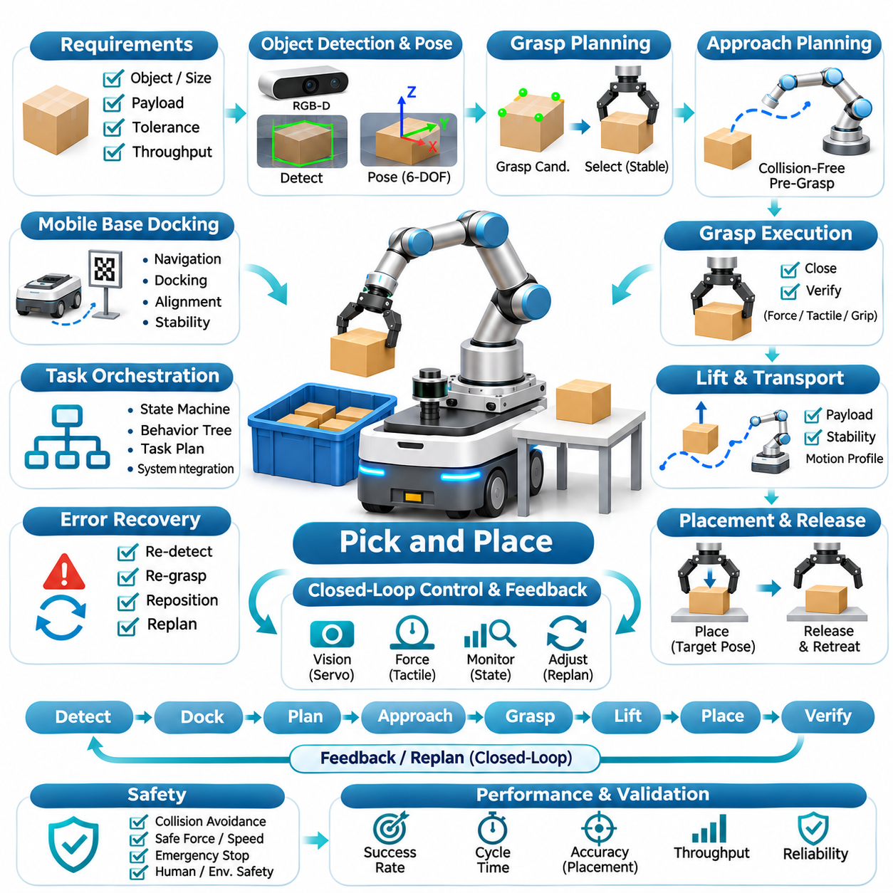{width="7.268055555555556in" height="7.268055555555556in"}

Pick-and-place is a fundamental robotic manipulation operation that involves acquiring a target object from an initial location and transferring it to a designated destination. In mobile manipulation systems, pick-and-place operations combine autonomous navigation, environmental perception, grasp planning, motion planning, and physical interaction to support flexible automation across warehouses, factories, hospitals, and logistics facilities.

The pick-and-place development process begins with defining operational scenarios and measurable performance requirements. Engineers must identify target object characteristics, picking locations, placement destinations, payload requirements, positioning tolerances, and expected throughput. These requirements influence manipulator selection, end-effector configuration, sensor architecture, control strategies, and software integration.

Object detection and pose estimation provide the spatial information required to initiate picking operations. RGB cameras, depth cameras, and three-dimensional vision systems identify target objects and estimate their positions and orientations. Accurate coordinate transformations between camera, mobile base, manipulator, and tool frames are essential for translating perception results into executable manipulation commands.

Mobile platform positioning establishes a suitable operational location before the robotic arm begins manipulation. The autonomous mobile robot must approach the workstation while considering navigation constraints, manipulator reachability, environmental obstacles, and platform stability. Precision docking and local visual alignment can compensate for localization errors and improve the repeatability of picking and placement operations.

Grasp planning determines suitable contact locations, gripper orientations, approach directions, and gripping forces for acquiring target objects. Multiple grasp candidates may be evaluated according to object geometry, surface characteristics, center of mass, collision risk, and subsequent placement requirements. The selected grasp must support both successful object acquisition and stable transportation throughout the manipulation sequence.

The pre-grasp approach establishes an intermediate manipulator configuration that enables controlled movement toward the target object. Motion planning algorithms generate trajectories that satisfy joint limitations, environmental constraints, and collision avoidance requirements. During the final approach, visual feedback or proximity sensing may refine the end-effector position to compensate for residual perception and calibration errors.

Grasp execution involves closing or activating the end effector to establish secure physical contact with the target object. Parallel grippers, vacuum grippers, adaptive robotic hands, and specialized gripping mechanisms require different control strategies. Gripper position feedback, vacuum pressure, tactile measurements, and force-torque information can be utilized to verify whether object acquisition has been completed successfully.

Object lifting and transportation require coordinated trajectory generation that maintains grasp stability while respecting mechanical and dynamic limitations. Excessive acceleration, abrupt directional changes, and unfavorable arm configurations may cause object slippage or platform instability. Engineers must establish payload-dependent motion profiles that consider gripping force, actuator torque, inertia, and the combined center of gravity.

Placement planning determines the target position and orientation of an object at its intended destination. Depending on application requirements, placement may involve conveyor loading, shelf replenishment, packaging, palletizing, or precision component positioning. The planning system must consider available space, destination geometry, neighboring objects, placement tolerances, and the accessibility of the end effector during object release.

Controlled object release represents an important stage of the pick-and-place sequence. The manipulator must establish appropriate support conditions before releasing the object to prevent unintended movement, dropping, or damage. Force feedback, visual inspection, and gripper state monitoring can verify successful placement. A collision-free retreat trajectory then enables the manipulator to return to a suitable operational configuration.

Closed-loop pick-and-place control improves execution reliability by continuously incorporating sensory feedback into manipulation decisions. Visual servoing can correct positioning errors, while force and tactile feedback can detect unexpected contact or object movement. Closed-loop approaches are particularly valuable in mobile environments where equipment positions, surface conditions, and object arrangements may vary between successive operations.

Task orchestration coordinates the complete pick-and-place workflow through state machines, behavior trees, or task planning frameworks. Each operational stage must define entry conditions, completion criteria, timeout limits, and failure responses. Integration with warehouse management systems, manufacturing execution systems, and fleet management platforms enables autonomous mission assignment, inventory tracking, and coordinated material handling.

Error recovery mechanisms address failures such as inaccurate object detection, unsuccessful grasping, object slippage, blocked trajectories, and incorrect placement. Recovery strategies may include renewed perception, alternative grasp selection, mobile platform repositioning, trajectory replanning, or controlled mission termination. Retry limits and structured diagnostic records help prevent repeated failures and support systematic engineering improvements.

Safety engineering must address collision hazards, dropped objects, crushing risks, unexpected platform movement, and excessive contact forces throughout the pick-and-place process. Risk assessment determines the appropriate protective measures, including safety-rated monitoring, restricted operating zones, speed limitations, and protective stops. Safety functions must remain effective independently of ordinary perception and planning algorithms.

Performance optimization focuses on improving picking accuracy, placement repeatability, task success rates, throughput, and energy efficiency. Parallel perception processing, efficient trajectory generation, optimized grasp selection, and reduced platform repositioning can shorten operational cycle times. Development teams must balance productivity improvements against grasp reliability, equipment durability, computational requirements, and operational safety.

Pick-and-place validation requires systematic testing across representative object types, payloads, orientations, workstation configurations, and environmental conditions. Key performance indicators include first-attempt picking success rate, placement accuracy, average cycle time, hourly throughput, object damage rate, and recovery effectiveness. Validated pick-and-place capabilities establish the foundation for scalable industrial mobile manipulation and autonomous material handling.

## 07 Bin Picking

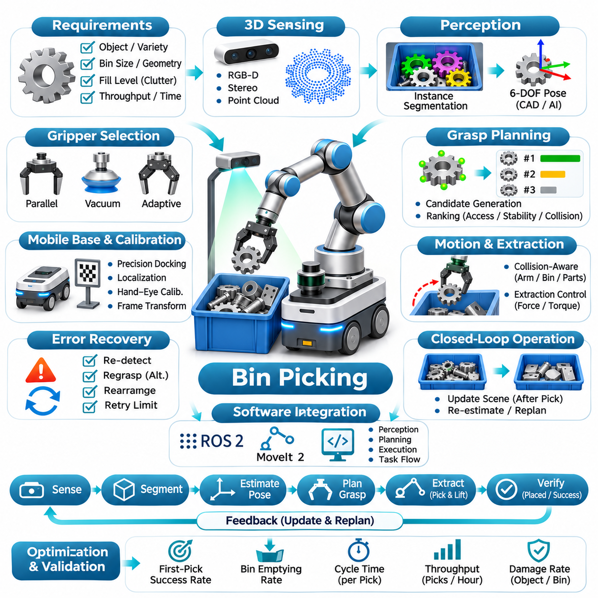{width="7.268055555555556in" height="7.268055555555556in"}

Bin picking is a robotic manipulation operation that involves identifying, acquiring, and removing individual objects from containers containing randomly arranged or partially organized items. In mobile manipulation systems, bin picking combines autonomous navigation, three-dimensional perception, object pose estimation, grasp planning, motion planning, and adaptive control to automate material handling in complex industrial environments.

The bin picking development process begins with defining target object characteristics, container dimensions, loading conditions, operational environments, and production requirements. Engineers must establish measurable objectives for picking success rates, processing throughput, object damage prevention, positioning accuracy, and recovery effectiveness. These requirements influence hardware selection, perception architecture, and manipulation strategies.

Three-dimensional perception is a fundamental component of bin picking systems because objects frequently overlap, occlude one another, and appear in unpredictable orientations. RGB-D cameras, stereo vision systems, structured light sensors, and industrial three-dimensional scanners provide geometric information about the bin contents. Sensor placement and illumination must be optimized to minimize blind spots, reflections, and measurement uncertainty.

Object detection and instance segmentation enable robotic systems to distinguish individual objects within densely populated containers. Deep learning models can identify object categories, visible boundaries, and accessible surfaces despite partial occlusion. Instance segmentation is particularly valuable when multiple identical components are present because it enables the perception system to distinguish neighboring objects and generate independent manipulation targets.

Six-degree-of-freedom object pose estimation determines the three-dimensional position and orientation of each detected object. Model-based approaches utilize CAD geometry and point cloud registration, while learning-based approaches estimate object poses directly from sensory observations. Hybrid methods combining geometric refinement and neural network predictions can improve pose accuracy under challenging lighting, occlusion, and clutter conditions.

Grasp candidate generation identifies accessible contact regions and feasible gripper configurations for individual objects within the container. Candidate grasps must consider object geometry, surface properties, available clearance, neighboring objects, and gripper dimensions. Learning-based grasp detection and geometric analysis can generate multiple alternatives that improve picking flexibility when individual object poses cannot be estimated reliably.

Grasp ranking evaluates potential grasp candidates according to their expected execution feasibility and acquisition reliability. Evaluation criteria may include grasp quality, object accessibility, collision probability, approach direction, and extraction difficulty. Selecting the most accessible object rather than the nearest object can improve picking success and reduce unnecessary manipulation movements within densely packed containers.

Collision-aware motion planning is particularly important because the robotic arm and gripper must operate within restricted container boundaries. Collision models must represent bin walls, neighboring objects, manipulator links, and end-effector geometry. Approach and extraction trajectories should maintain appropriate clearance while accounting for perception uncertainty, calibration errors, and potential movement of surrounding objects.

End-effector selection significantly influences the operational capabilities of bin picking systems. Parallel grippers are suitable for many rigid mechanical components, while vacuum grippers can handle objects with appropriate surface characteristics. Adaptive grippers and specialized tooling may improve accessibility in irregular arrangements. Gripper dimensions, finger geometry, gripping force, and payload capacity must match application requirements.

Mobile bin picking introduces additional challenges associated with platform positioning, localization accuracy, and workstation variability. Precision docking and local visual alignment establish consistent spatial relationships between the mobile manipulator and target containers. Accurate hand-eye calibration and coordinate transformations enable perception results to remain usable across different workstations and repeated mobile platform movements.

Object extraction requires controlled manipulation to remove a selected component without disturbing neighboring objects or damaging the container. Interlocking components, overlapping geometries, and unexpected friction can increase extraction difficulty. Force-torque sensing, compliant control, and adaptive lifting trajectories help detect abnormal resistance and support controlled extraction or safe release when necessary.

Closed-loop perception and manipulation improve bin picking reliability by updating environmental information after each picking operation. Removing one object frequently changes the positions and orientations of remaining components. Repeated scene acquisition, object pose refinement, and grasp candidate regeneration enable the system to adapt to changing container conditions rather than relying exclusively on initial environmental observations.

Error recovery mechanisms address unsuccessful grasps, object slippage, excessive extraction resistance, perception failures, and inaccessible components. Recovery strategies may include alternative grasp selection, renewed scene acquisition, viewpoint adjustment, or controlled rearrangement of objects. Retry limits and failure classification prevent uncontrolled repetition and provide diagnostic information for subsequent engineering improvements.

Software integration connects perception modules, grasp detection algorithms, kinematics solvers, collision detection, trajectory controllers, and task orchestration frameworks. ROS 2 and MoveIt 2 provide reusable infrastructure for implementing modular bin picking applications. Integration with fleet management and manufacturing execution systems supports autonomous container servicing, production scheduling, and material distribution.

Performance optimization focuses on increasing picking throughput while maintaining grasp reliability and operational safety. Parallel perception processing, efficient grasp ranking, adaptive trajectory generation, and optimized object selection can reduce cycle times. Engineers must balance computational latency, manipulation speed, equipment durability, energy consumption, and the accuracy required for dependable industrial operation.

Bin picking validation requires systematic testing across representative object geometries, materials, container configurations, fill levels, and environmental conditions. Key performance indicators include first-attempt picking success rate, bin emptying rate, average cycle time, hourly throughput, object damage rate, and recovery effectiveness. Validated bin picking capabilities establish the foundation for scalable autonomous industrial material handling.

## 08 Force Control

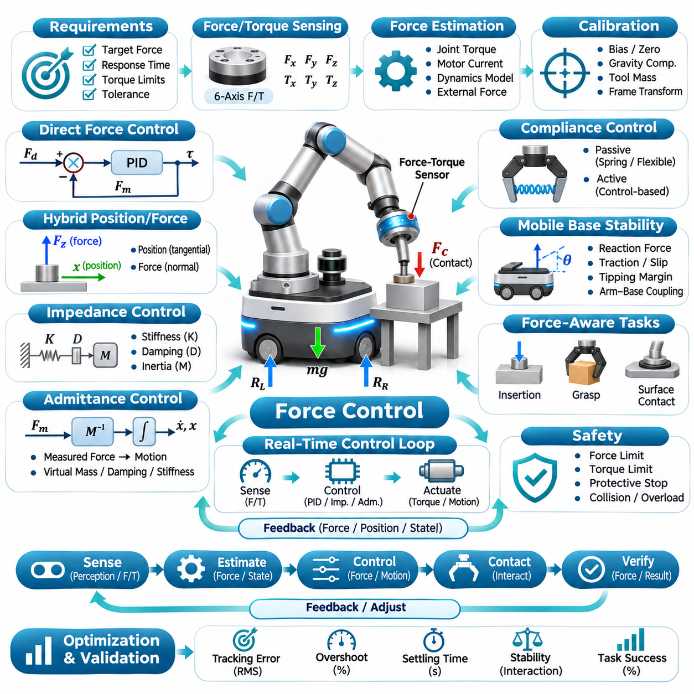{width="7.268055555555556in" height="7.268055555555556in"}

Force control is a fundamental capability of robotic manipulation systems that regulates physical interaction between a robot and its surrounding environment. Unlike conventional position control, which primarily focuses on achieving a desired geometric configuration, force control enables the robot to maintain appropriate contact forces during grasping, assembly, surface inspection, material handling, and precision manipulation.

The force control development process begins with defining operational requirements and physical interaction conditions. Engineers must establish target contact forces, allowable force deviations, response times, torque limitations, positioning tolerances, and environmental stiffness characteristics. These requirements influence sensor selection, actuator configuration, mechanical design, and control architecture.

Force-torque sensors provide essential measurement capabilities for monitoring physical interactions during manipulation. Six-axis force-torque sensors measure three directional forces and three rotational moments, enabling detailed analysis of contact conditions. Sensor selection must consider measurement range, resolution, accuracy, sampling frequency, overload protection, communication latency, and mechanical integration requirements.

Force estimation provides an alternative or complementary approach to direct force measurement. Joint torque sensors, actuator current measurements, and dynamic models can estimate external forces acting on the manipulator. Accurate estimation requires compensation for gravitational effects, friction, inertia, and actuator characteristics. Combining direct measurements with model-based estimation can improve robustness and diagnostic capabilities.

Direct force control regulates the difference between desired and measured contact forces through closed-loop feedback. The controller adjusts actuator torque or motion commands to minimize force tracking errors during physical interaction. Proportional, integral, and derivative control strategies may be applied according to system dynamics, environmental stiffness, measurement noise, and required response characteristics.

Hybrid position and force control enables robotic systems to regulate position and contact force along different spatial directions simultaneously. During surface inspection, for example, the manipulator may maintain a constant perpendicular contact force while following a predefined tangential trajectory. This approach is particularly useful for polishing, assembly, surface processing, and contact-based inspection applications.

Impedance control regulates the dynamic relationship between external forces and manipulator motion by establishing desired stiffness, damping, and inertia characteristics. Rather than directly maintaining a specified contact force, impedance control defines how the robot responds to physical disturbances. Adjustable mechanical behavior enables stable interaction with uncertain environments and reduces excessive contact forces.

Admittance control converts measured external forces into desired position or velocity commands through a virtual dynamic model. This approach is particularly suitable for robotic manipulators equipped with high-performance position controllers but limited direct torque control capabilities. Proper selection of virtual mass, damping, and stiffness parameters is essential for achieving stable and responsive interaction.

Compliance control enables the manipulator to accommodate geometric uncertainties, alignment errors, and unexpected environmental resistance. Passive compliance can be implemented through mechanical springs, flexible structures, or compliant end effectors, while active compliance utilizes sensor feedback and control algorithms. Combining both approaches can improve interaction reliability across diverse industrial manipulation scenarios.

Mobile manipulation introduces additional force control challenges because physical interaction generates reaction forces that affect the mobile platform. Platform stiffness, wheel-ground friction, suspension characteristics, manipulator configuration, and payload distribution influence overall stability. Force control strategies must respect platform movement limitations and prevent unintended displacement, wheel slippage, or tipping.

Force control calibration and compensation are essential for obtaining reliable interaction measurements. Sensor bias, gravitational loading, tool mass, payload distribution, thermal drift, and coordinate transformations must be considered during system development. Calibration procedures should establish accurate relationships between measured forces, tool coordinate frames, manipulator configurations, and actual environmental contact forces.

Real-time force control requires predictable communication latency, synchronized sensor measurements, deterministic controller execution, and appropriate feedback frequencies. Filtering algorithms can reduce measurement noise, although excessive filtering may introduce delays that compromise control stability. Engineers must evaluate control performance under representative contact stiffness, payload conditions, and computational workloads.

Force-aware manipulation integrates contact measurements with perception, grasp planning, motion planning, and task execution. Visual information supports initial positioning, while force feedback enables fine adjustments during insertion, alignment, grasping, and object extraction. Coordinating these complementary sensing modalities improves manipulation reliability when geometric observations alone cannot adequately describe physical interaction.

Safety engineering must address excessive contact forces, unexpected collisions, actuator overload, object damage, and platform instability. Force thresholds, torque limitations, controlled withdrawal, and protective stops should be established through systematic risk assessment. Ordinary force control algorithms must not be treated as substitutes for independently validated safety-rated functions.

Force control performance optimization focuses on improving tracking accuracy, response speed, interaction stability, and disturbance rejection. Controller tuning, adaptive parameter adjustment, dynamic compensation, and sensor fusion can improve performance under changing operational conditions. Optimization must balance responsiveness against oscillation risks, measurement uncertainty, mechanical durability, and computational requirements.

Force control validation requires systematic testing across representative contact surfaces, environmental stiffness levels, payloads, manipulator configurations, and operational scenarios. Key performance indicators include force tracking error, maximum force overshoot, settling time, contact stability, task success rate, and disturbance recovery performance. Validated force control provides the foundation for reliable contact-rich industrial mobile manipulation.

## 09 Task and Motion Planning

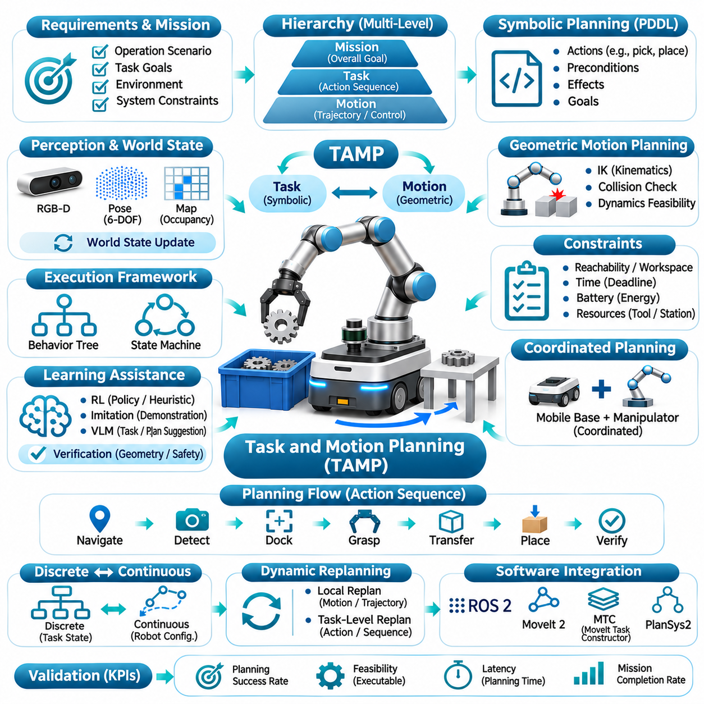{width="7.268055555555556in" height="7.268055555555556in"}

Task and Motion Planning (TAMP) is an integrated robotic planning methodology that combines high-level task decisions with low-level physical motion generation. In mobile manipulation systems, TAMP enables robots to determine what actions should be performed, where those actions should occur, and how the mobile platform and manipulator should move to accomplish complex operational objectives.

The TAMP development process begins with defining operational scenarios, task objectives, environmental conditions, and system constraints. Engineers must identify available robotic capabilities, object interaction requirements, workstation configurations, and mission completion criteria. These requirements establish the foundation for developing integrated planning architectures that connect symbolic reasoning with physical execution.

High-level task planning decomposes complex operational objectives into sequences of executable actions. Individual actions may include navigating to a workstation, identifying an object, repositioning the mobile platform, grasping a component, and transferring materials. Task planning determines logical dependencies, execution priorities, resource requirements, and conditions that must be satisfied before subsequent actions can begin.

Symbolic planning represents objects, environmental states, robotic capabilities, and operational actions through abstract mathematical descriptions. Planning Domain Definition Language (PDDL) provides a structured approach to defining action preconditions, effects, and task goals. Symbolic representations enable robotic systems to reason about operational requirements without explicitly evaluating every possible physical movement.

Geometric motion planning translates symbolic action sequences into physically executable trajectories. Each manipulation action must satisfy kinematic limitations, collision avoidance requirements, workspace restrictions, and dynamic constraints. Integrating geometric feasibility checks into symbolic planning prevents the system from selecting logically valid actions that cannot be physically executed within the actual environment.

The integration of discrete task planning and continuous motion planning represents a central technical challenge in TAMP development. Symbolic decisions operate over discrete states and actions, while physical motion generation involves continuous configuration spaces. Integrated planning algorithms must coordinate these representations through geometric constraints, feasibility feedback, and iterative refinement of candidate task sequences.

Hierarchical planning architectures organize complex robotic missions into multiple abstraction levels. Mission planning defines overall operational objectives, task planning determines action sequences, and motion planning generates executable trajectories. This decomposition reduces planning complexity while enabling individual software components to be developed, optimized, tested, and maintained through well-defined interfaces.

Constraint-based task and motion planning evaluates logical, geometric, temporal, and physical requirements within a coordinated framework. Constraints may include object accessibility, actuator limitations, collision clearance, resource availability, battery capacity, and task deadlines. Constraint propagation and optimization techniques help identify feasible action sequences while eliminating unsuitable planning alternatives.

Mobile manipulation planning extends conventional TAMP by incorporating mobile platform configurations into task and motion decisions. The planning system must determine suitable navigation goals, docking positions, manipulator configurations, and object interaction strategies. Coordinated base and arm planning improves workspace accessibility and reduces unnecessary repositioning during complex industrial manipulation operations.

Perception-driven planning continuously incorporates environmental observations into task and motion decisions. Object detection, pose estimation, semantic mapping, and occupancy information provide updated representations of the physical environment. The planning system must reconcile symbolic world states with sensor observations to maintain consistency between expected conditions and actual operational circumstances.

Behavior trees and state machines provide practical execution frameworks for implementing integrated task and motion plans. Individual execution states or behavior nodes can represent navigation, perception, grasp generation, trajectory execution, force-controlled interaction, and recovery operations. These frameworks support modular execution management, conditional decision-making, and structured handling of operational failures.

Dynamic replanning enables robotic systems to adapt when environmental conditions invalidate previously generated plans. Moving obstacles, unavailable objects, unsuccessful grasps, blocked trajectories, or equipment changes may require modifications to the original action sequence. The planning architecture should determine whether local motion replanning or high-level task replanning is necessary to restore mission feasibility.

Learning-based task and motion planning utilizes artificial intelligence to improve action selection, geometric feasibility prediction, and planning efficiency. Reinforcement learning, imitation learning, and vision-language models can provide candidate actions or planning heuristics. Learned decisions must remain subject to geometric verification, physical constraints, and independently validated safety mechanisms before execution.

Software integration connects symbolic planners, perception pipelines, motion planning libraries, trajectory controllers, and mission management systems. Frameworks such as ROS 2, MoveIt 2, MoveIt Task Constructor, and PlanSys2 provide infrastructure for developing integrated planning applications. Standardized interfaces support communication, state synchronization, modular development, and systematic diagnostic analysis.

Performance optimization focuses on reducing planning latency, execution time, computational complexity, and unnecessary robotic movements. Hierarchical decomposition, heuristic search, parallel feasibility evaluation, and reusable planning results can improve system efficiency. Engineers must balance planning speed, solution quality, operational flexibility, execution reliability, and available onboard computational resources.

Task and motion planning validation requires systematic testing across representative missions, object configurations, environmental conditions, and operational disturbances. Key performance indicators include task planning success rate, motion feasibility rate, planning latency, mission completion rate, and replanning effectiveness. Validated TAMP capabilities establish the foundation for scalable autonomous industrial mobile manipulation.

## 10 Error Recovery

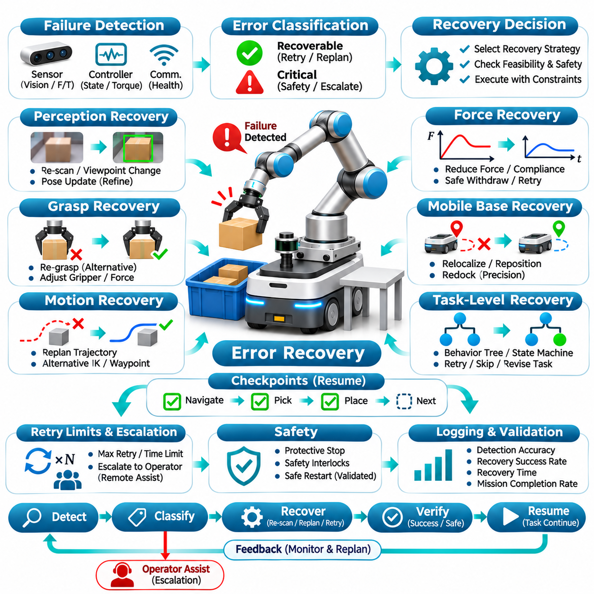{width="7.268055555555556in" height="7.268055555555556in"}

Error recovery is a fundamental capability of robotic manipulation systems that enables autonomous robots to respond to operational failures, unexpected environmental conditions, and execution uncertainties. In mobile manipulation, effective error recovery coordinates perception, navigation, motion planning, force control, and task execution to restore operational functionality while maintaining safety and reliability.

The error recovery development process begins with identifying potential failure scenarios throughout the manipulation workflow. Engineers must analyze perception failures, localization errors, unsuccessful grasps, unreachable targets, trajectory interruptions, communication failures, and actuator abnormalities. Systematic failure analysis establishes the foundation for developing appropriate detection mechanisms and recovery strategies.

Error detection continuously monitors operational parameters to identify deviations from expected system behavior. Sensor measurements, controller feedback, execution states, communication status, and task completion signals provide information about emerging failures. Threshold-based monitoring and model-based anomaly detection can identify abnormal conditions before they develop into more significant operational problems.

Error classification organizes detected failures according to their origin, severity, operational impact, and recovery feasibility. Recoverable errors may include temporary perception failures or unsuccessful grasps, while critical failures may involve mechanical damage or safety system abnormalities. Accurate classification enables the system to select appropriate recovery actions without introducing additional operational risks.

Perception error recovery addresses inaccurate object detection, missing sensor data, uncertain pose estimation, and environmental observation failures. Recovery strategies may include repeated image acquisition, camera viewpoint adjustment, alternative sensor utilization, and object pose refinement. Updating environmental observations enables the robot to reconstruct reliable manipulation targets before attempting further physical interaction.

Grasp failure recovery enables the robotic manipulator to respond to unsuccessful object acquisition, object slippage, insufficient gripping force, and unexpected object movement. The system may generate alternative grasp candidates, modify gripper orientation, adjust gripping parameters within validated limits, or reposition the manipulator. Recovery decisions must consider object characteristics, collision risks, and available workspace.

Motion planning recovery addresses unreachable target poses, invalid trajectories, unexpected obstacles, and kinematic limitations. Alternative inverse kinematics solutions, trajectory regeneration, intermediate waypoint selection, and mobile platform repositioning can restore motion feasibility. Updated collision models and environmental representations are essential for preventing repeated planning failures under changing operational conditions.

Force control recovery manages excessive contact forces, unexpected resistance, unstable interaction, and abnormal torque measurements. The controller may interrupt manipulation, reduce commanded force, or initiate a validated withdrawal trajectory when conditions permit. Force and torque feedback provide valuable information for determining whether the operation can safely resume or requires additional intervention.

Mobile platform recovery addresses localization uncertainty, navigation failures, docking errors, wheel slippage, and unexpected platform displacement. Relocalization, alternative route generation, and precision docking retries can restore the spatial conditions required for manipulation. The system must verify platform stability and positioning accuracy before restarting interrupted robotic arm operations.

Task-level recovery evaluates whether an interrupted action can be repeated, replaced, skipped, or incorporated into a revised task sequence. Behavior trees, hierarchical state machines, and task planning frameworks support structured recovery decisions. Recovery logic must preserve completed operations, maintain consistent object states, and prevent duplicated actions that could compromise production processes.

Checkpoint-based recovery records meaningful execution states throughout the manipulation workflow. Checkpoints may include completed navigation stages, verified object acquisition, confirmed placement, and workstation readiness. When an interruption occurs, the system can evaluate the most recent valid checkpoint and resume from an appropriate operational state after confirming actual physical conditions.

Retry management prevents indefinite repetition of unsuccessful recovery actions. Maximum retry counts, recovery time limits, failure escalation rules, and alternative action sequences should be established during development. Repeated failures must trigger diagnostic evaluation or operator intervention rather than uncontrolled execution loops that increase equipment wear, energy consumption, and operational delays.

Safety-oriented recovery ensures that corrective actions remain within validated operational boundaries. Emergency stops, protective stops, actuator faults, and safety sensor failures require controlled responses consistent with the system safety architecture. Automatic recovery must not bypass safety interlocks or restart hazardous motion without satisfying applicable reset and restart requirements.

Remote assistance provides an escalation mechanism when autonomous recovery cannot resolve complex operational failures. Operators may review synchronized sensor data, diagnostic messages, robot configurations, and task histories before authorizing appropriate corrective actions. Clearly defined intervention procedures help maintain operational continuity without compromising safety or introducing inconsistent system states.

Error recovery software integration connects monitoring services, diagnostic modules, perception pipelines, motion controllers, task orchestration frameworks, and fleet management systems. ROS 2 communication mechanisms, action interfaces, and behavior trees provide infrastructure for implementing modular recovery architectures. Standardized error codes and execution status messages support coordinated recovery and systematic troubleshooting.

Operational failure logging supports continuous improvement by preserving information about detected errors, environmental conditions, recovery decisions, and execution outcomes. Historical failure data can reveal recurring problems, inefficient recovery sequences, and weaknesses in perception or control algorithms. Statistical analysis enables engineers to prioritize corrective actions and improve long-term system reliability.

Error recovery validation requires systematic testing through controlled fault injection, environmental disturbances, sensor interruptions, and representative manipulation failures. Key performance indicators include failure detection accuracy, autonomous recovery success rate, mean time to recovery, repeated failure rate, and mission completion rate. Validated recovery capabilities establish the foundation for resilient autonomous industrial mobile manipulation.

## 11 Performance Optimization

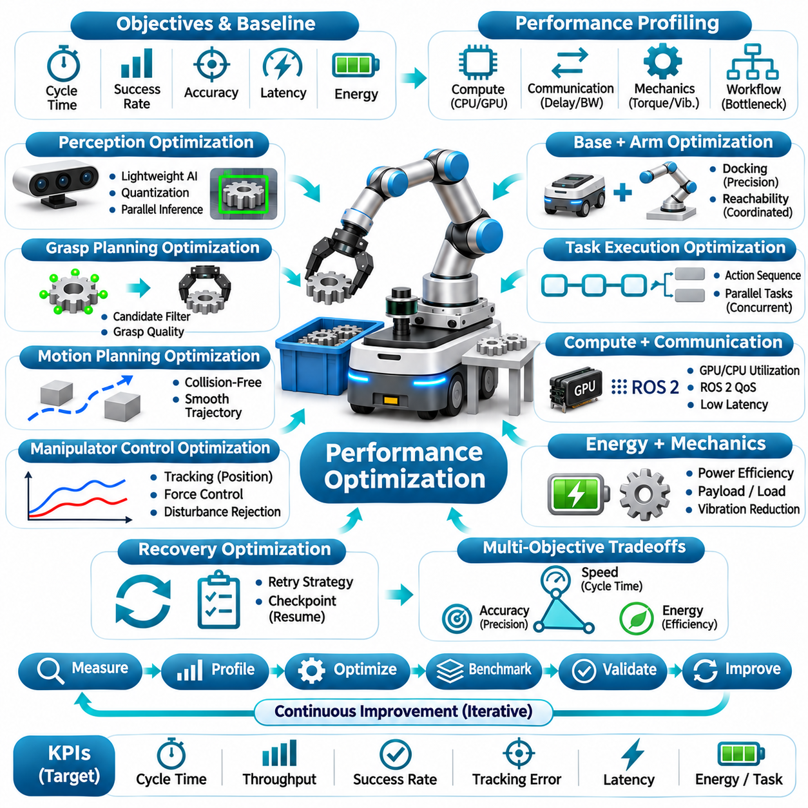{width="7.268055555555556in" height="7.268055555555556in"}

Performance optimization is a systematic engineering process that improves the operational efficiency, execution accuracy, responsiveness, and reliability of robotic manipulation systems. In mobile manipulation, optimization requires coordinated improvements across perception, navigation, grasp planning, motion planning, force control, task execution, and computational resource management.

The performance optimization process begins with establishing measurable operational objectives and baseline performance indicators. Engineers must define target cycle times, manipulation success rates, positioning accuracy, processing latency, energy consumption, and equipment utilization. Baseline measurements provide a quantitative reference for identifying performance limitations and evaluating subsequent engineering improvements.

Performance profiling identifies computational bottlenecks, communication delays, mechanical limitations, and inefficient execution sequences throughout the manipulation workflow. Timestamped sensor measurements, software execution traces, controller feedback, and task completion records provide detailed performance information. Profiling should distinguish between average execution behavior and worst-case operational conditions.

Perception optimization focuses on improving object detection, pose estimation, scene reconstruction, and grasp detection efficiency. Lightweight neural network architectures, model quantization, optimized inference engines, and parallel image processing can reduce computational latency. Engineers must ensure that improvements in processing speed do not significantly compromise perception accuracy or manipulation reliability.

Grasp planning optimization reduces the computational effort required to identify reliable and accessible grasp configurations. Efficient candidate generation, geometric filtering, grasp quality estimation, and prioritized feasibility evaluation can eliminate unsuitable alternatives before detailed analysis. Selecting robust grasp candidates reduces unsuccessful acquisition attempts and minimizes unnecessary recovery operations.

Motion planning optimization improves trajectory generation efficiency while maintaining collision avoidance, kinematic feasibility, and dynamic stability. Adaptive sampling, heuristic search, trajectory reuse, and parallel planning algorithms can reduce planning latency. Trajectory smoothing and time parameterization further improve execution efficiency by minimizing unnecessary movements and abrupt acceleration changes.

Manipulator control optimization focuses on improving trajectory tracking accuracy, joint coordination, force regulation, and disturbance rejection. Appropriate controller tuning, feedforward compensation, friction compensation, and adaptive control techniques can improve dynamic performance. Optimization must consider actuator limitations, structural flexibility, mechanical vibration, and long-term equipment durability.

Coordinated mobile base and manipulator optimization improves the spatial relationship between navigation and manipulation activities. Selecting appropriate docking positions, approach directions, and manipulator configurations can reduce unnecessary platform movements and improve workspace accessibility. Coordinated planning also helps avoid kinematic singularities, joint limitations, and unstable payload configurations.

Task execution optimization reduces operational delays by improving action sequencing, resource allocation, and synchronization between software components. Independent operations such as perception processing and trajectory preparation may be executed concurrently when their dependencies permit. Efficient task orchestration minimizes idle periods without compromising execution consistency or operational safety.

Computational resource optimization ensures that onboard processors, graphics processing units, memory, and communication interfaces are utilized efficiently. Workload distribution, asynchronous processing, hardware acceleration, and memory management can improve overall system responsiveness. Resource allocation must prioritize time-critical control and safety-related functions over nonessential computational activities.

Communication optimization addresses message transmission delays, excessive bandwidth consumption, synchronization errors, and middleware overhead. ROS 2 communication mechanisms, appropriate Quality of Service configurations, shared-memory transport, and efficient message structures can improve data exchange performance. Communication settings should reflect the timing and reliability requirements of individual software modules.

Energy efficiency optimization reduces unnecessary power consumption during navigation, manipulation, computation, and standby operation. Energy-aware trajectory planning, efficient actuator utilization, adaptive computational workloads, and intelligent charging strategies can extend operating duration. Energy optimization must account for battery characteristics, payload variations, production schedules, and mission requirements.

Mechanical performance optimization addresses structural stiffness, payload distribution, end-effector weight, actuator efficiency, and vibration characteristics. Reducing unnecessary moving mass and improving mechanical configurations can increase manipulation speed and positioning accuracy. Mechanical improvements should be evaluated together with control parameters to prevent undesirable dynamic interactions and excessive component loading.

Recovery performance optimization minimizes operational interruptions caused by unsuccessful grasps, perception errors, planning failures, and environmental disturbances. Accurate failure classification, efficient retry strategies, checkpoint-based recovery, and alternative task planning can reduce recovery time. Improving recovery effectiveness contributes to higher mission completion rates and sustained production throughput.

Multi-objective optimization evaluates competing performance requirements within a unified engineering framework. Faster manipulation may increase energy consumption, mechanical wear, vibration, or positioning errors, while higher accuracy may require longer processing times. Pareto optimization and systematic parameter exploration help engineers identify balanced configurations that satisfy application-specific operational requirements.

Performance benchmarking compares optimization results against established baseline measurements under consistent experimental conditions. Representative workloads, object configurations, payloads, environmental variations, and repeated trials are necessary for meaningful comparisons. Benchmarking must include statistical variability, failure rates, and worst-case performance rather than relying exclusively on average measurements.

Continuous performance optimization incorporates operational data, diagnostic information, and field deployment results into iterative development cycles. Engineers can identify recurring bottlenecks, evaluate software updates, refine control parameters, and improve hardware configurations. Regression testing and configuration management ensure that individual optimizations do not degrade previously validated system capabilities.

Performance optimization validation establishes whether engineering improvements satisfy measurable operational requirements under representative industrial conditions. Key performance indicators include average cycle time, hourly throughput, manipulation success rate, trajectory tracking error, end-to-end latency, and energy consumption per task. Validated performance establishes the foundation for scalable and commercially viable industrial mobile manipulation.

## 12 Manipulation Validation

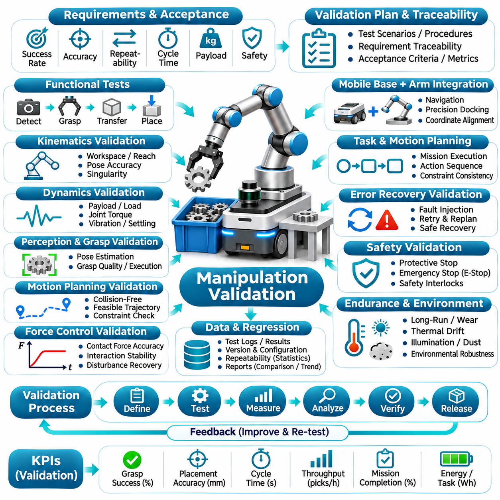{width="7.268055555555556in" height="7.268055555555556in"}

Manipulation validation is a systematic engineering process that establishes whether a robotic manipulation system satisfies its specified functional, performance, safety, and reliability requirements. In mobile manipulation, validation encompasses the integrated behavior of perception, navigation, grasp planning, motion planning, force control, task execution, and error recovery under representative operational conditions.

The manipulation validation process begins with establishing measurable acceptance criteria based on product requirements and intended application scenarios. Engineers must define target manipulation success rates, positioning accuracy, repeatability, execution time, payload capacity, and operational safety requirements. Each acceptance criterion should be traceable to corresponding system requirements and documented test procedures.

Functional validation evaluates whether individual manipulation capabilities operate correctly within the integrated robotic system. Representative test scenarios include object identification, pose estimation, grasp generation, trajectory execution, object acquisition, material transfer, and controlled placement. Functional testing must cover normal operating conditions as well as foreseeable variations in objects and environments.

Kinematic validation evaluates manipulator workspace accessibility, positioning accuracy, orientation accuracy, joint limitations, and singularity avoidance. Experimental measurements should compare actual end-effector poses with commanded poses across representative configurations. External metrology equipment, calibrated reference targets, and independent measurement systems can support reliable quantitative assessments.

Dynamic validation examines manipulator behavior under varying payloads, acceleration profiles, external disturbances, and operating speeds. Joint torque measurements, trajectory tracking errors, vibration characteristics, and settling times provide information about dynamic performance. Testing should confirm that mechanical structures, actuators, and control algorithms operate within their validated design limitations.

Perception and grasp validation evaluates the reliability of object detection, pose estimation, grasp candidate generation, and physical object acquisition. Representative datasets and physical test objects should encompass variations in geometry, material, surface properties, orientation, and occlusion. Actual grasp execution results must be compared with predicted grasp quality to establish practical manipulation reliability.

Motion planning validation assesses whether generated trajectories satisfy collision avoidance, kinematic feasibility, dynamic constraints, and operational requirements. Test scenarios should include confined workspaces, complex obstacle configurations, unreachable targets, and changing environmental conditions. Validation must evaluate both successful trajectory generation and the appropriate rejection of unsafe or infeasible motions.

Force control validation evaluates contact force accuracy, response characteristics, interaction stability, and disturbance recovery during physical manipulation. Representative tests may include component insertion, surface inspection, compliant grasping, and controlled object extraction. Force tracking error, maximum overshoot, settling time, and contact stability provide quantitative indicators of interaction performance.

Mobile base and manipulator integration validation examines the combined performance of autonomous navigation, precision docking, platform stabilization, and robotic arm operation. Testing must evaluate variations in docking accuracy, floor conditions, platform orientation, and payload distribution. Successful integration requires consistent coordinate transformations and reliable spatial alignment across multiple workstations.

Task and motion planning validation evaluates the execution of complete operational workflows rather than isolated robotic movements. Representative missions should include navigation, object identification, grasping, transportation, placement, and task completion verification. Validation must confirm that logical action sequences remain consistent with physical conditions, resource availability, and operational constraints.

Error recovery validation examines the ability of the robotic system to detect, classify, and recover from operational failures. Controlled fault injection can simulate perception errors, unsuccessful grasps, blocked trajectories, communication interruptions, and localization disturbances. Testing must verify recovery effectiveness, retry limitations, failure escalation, and safe transitions between execution states.

Safety validation evaluates risks associated with collisions, excessive contact forces, unexpected movements, dropped objects, actuator failures, and mobile platform instability. Protective stops, emergency stops, safety interlocks, and restart procedures must be assessed against applicable safety requirements. Successful functional manipulation alone does not demonstrate compliance with safety-related performance requirements.

Endurance validation evaluates manipulation reliability during repetitive and extended operating periods. Continuous execution of representative workflows can reveal thermal limitations, mechanical wear, calibration drift, sensor degradation, and software resource management problems. Long-duration testing should record failure frequency, performance degradation, maintenance requirements, and changes in energy consumption.

Environmental robustness validation examines manipulation performance under variations in illumination, temperature, dust exposure, floor conditions, object arrangements, and workstation accessibility. Test conditions should reflect the intended operational environment and foreseeable disturbances. Environmental testing establishes practical operating boundaries and identifies conditions requiring additional protective measures.

Performance validation quantifies manipulation efficiency through measurable indicators such as first-attempt grasp success rate, placement accuracy, average cycle time, hourly throughput, mission completion rate, and energy consumption per task. Repeated trials under controlled conditions enable statistical evaluation of performance variability and help distinguish consistent improvements from temporary experimental results.

Validation data management ensures that test configurations, software versions, hardware revisions, calibration parameters, environmental conditions, and experimental results remain traceable. Automated data collection and standardized reporting improve reproducibility and support systematic failure analysis. Regression testing verifies that subsequent engineering modifications do not degrade previously validated manipulation capabilities.

Final manipulation validation consolidates functional, performance, reliability, integration, and safety evidence into a documented assessment of system readiness. Unresolved deviations must be classified, investigated, and addressed before release according to their operational significance. Validated manipulation capabilities establish the technical foundation for field deployment, manufacturing readiness, quality assurance, and commercial mobile manipulator development.
