# Chapter 05. Manipulation Development

## 01 Manipulation System Overview

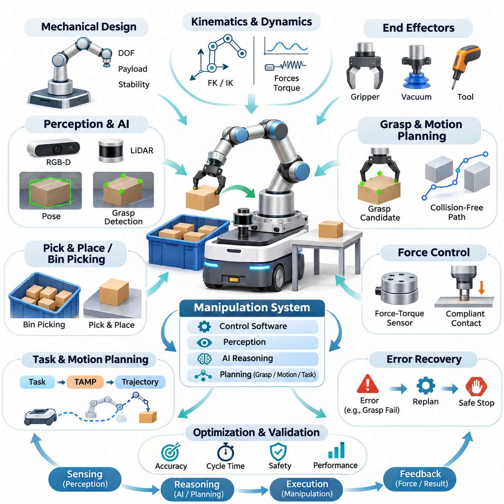{width="7.268055555555556in" height="7.268055555555556in"}

조작 시스템(Manipulation System)은 물체 및 주변 환경과의 물리적 상호작용(Physical Interaction)을 가능하게 하는 모바일 매니퓰레이터(Mobile Manipulator)의 핵심 구성 요소이다. 자율이동로봇(Autonomous Mobile Robot, AMR)이 이동성을 제공하는 반면, 조작 시스템은 물체의 파지(Grasping), 들어 올리기(Lifting), 운반(Transporting), 위치 조정(Positioning), 조립(Assembling) 및 조작(Operating)을 수행한다. 이동성과 조작 기능의 통합은 기존 고정형 산업 자동화를 넘어 로봇의 활용 범위를 확장한다.

조작 시스템의 아키텍처(Architecture)는 기계 구조(Mechanical Structure), 액추에이터(Actuator), 센서(Sensor), 말단 장치(End Effector), 제어 소프트웨어(Control Software), 인식 알고리즘(Perception Algorithm) 및 지능형 의사결정 모듈(Intelligent Decision-Making Module)로 구성된다. 이러한 구성 요소는 신뢰성 있는 물리적 상호작용을 달성하기 위해 하나의 통합 시스템으로 동작해야 한다. 따라서 조작 시스템 개발에는 기계공학(Mechanical Engineering), 제어이론(Control Theory), 로봇공학(Robotics), 컴퓨터 비전(Computer Vision) 및 인공지능(Artificial Intelligence)을 포함하는 다학제적 엔지니어링(Multidisciplinary Engineering)이 필요하다.

기계적 아키텍처(Mechanical Architecture)는 조작 시스템의 물리적 성능과 한계를 결정한다. 로봇 팔 구성(Robot Arm Configuration), 자유도(Degrees of Freedom, DOF), 관절 배치(Joint Arrangement), 링크 치수(Link Dimension), 가반하중(Payload Capacity), 도달 가능성(Reachability) 및 구조적 강성(Structural Stiffness)은 운용 성능에 직접적인 영향을 미친다. 모바일 응용 분야에서는 중량 분포(Weight Distribution), 장착 위치(Mounting Position), 무게중심(Center of Gravity) 및 조작 과정에서의 동적 안정성(Dynamic Stability)을 추가적으로 고려해야 한다.

기구학(Kinematics)은 로봇 관절과 말단 장치 사이의 공간적 관계를 결정하기 위한 수학적 기반을 제공한다. 순기구학(Forward Kinematics)은 관절 구성으로부터 말단 장치의 위치와 방향을 계산하는 반면, 역기구학(Inverse Kinematics)은 목표 자세(Target Pose)를 달성하기 위한 적절한 관절 구성을 결정한다. 정확한 기구학 모델링(Kinematic Modeling)은 궤적 생성(Trajectory Generation), 작업공간 평가(Workspace Evaluation) 및 정밀 물체 조작(Precise Object Manipulation)에 필수적이다.

동역학 모델링(Dynamics Modeling)은 로봇의 운동, 작용하는 힘, 관절 토크(Joint Torque) 및 물리적 특성 사이의 관계를 설명한다. 관성(Inertia), 중력(Gravity), 마찰(Friction), 원심력(Centrifugal Force) 및 코리올리 효과(Coriolis Effect)는 로봇 매니퓰레이터의 거동에 영향을 미친다. 모바일 조작(Mobile Manipulation)에서는 로봇 팔과 이동 플랫폼 사이에 추가적인 동적 상호작용(Dynamic Interaction)이 발생하므로 하중 이동(Load Transfer), 구조적 진동(Structural Vibration) 및 운용 안정성(Operational Stability)을 평가해야 한다.

말단 장치(End Effector)는 로봇 시스템과 물리적 환경 사이의 핵심 인터페이스(Interface)이다. 응용 분야의 요구사항에 따라 조작 시스템에는 평행형 그리퍼(Parallel Gripper), 진공 그리퍼(Vacuum Gripper), 적응형 로봇 손(Adaptive Robotic Hand), 자기식 그리퍼(Magnetic Gripper), 검사 장비(Inspection Instrument) 또는 특수 산업용 도구(Specialized Industrial Tool)가 적용될 수 있다. 말단 장치의 선정에는 물체 형상(Object Geometry), 표면 특성(Surface Characteristics), 재료 특성(Material Properties), 가반하중 및 작업 요구사항이 고려되어야 한다.

인식 시스템(Perception System)은 지능형 조작(Intelligent Manipulation)에 필요한 환경 정보를 제공한다. RGB 카메라(RGB Camera), 깊이 카메라(Depth Camera), 3차원 라이다(3D LiDAR), 힘·토크 센서(Force-Torque Sensor) 및 촉각 센서(Tactile Sensor)는 물체와 주변 환경에 대한 상호보완적인 정보를 제공한다. 센서 보정(Sensor Calibration), 시간 동기화(Temporal Synchronization) 및 좌표 변환(Coordinate Transformation)은 인식 결과가 로봇 제어 시스템(Robot Control System) 내에서 일관되게 해석되도록 보장한다.

인공지능(Artificial Intelligence, AI)은 로봇이 물체를 인식하고, 공간적 자세를 추정하며, 파지 가능한 위치를 식별하고, 환경 변화에 적응하도록 함으로써 조작 능력을 향상시킨다. 딥러닝 모델(Deep Learning Model)은 복잡한 시각 정보를 처리하고 작업과 관련된 표현(Task-Relevant Representation)을 생성할 수 있다. 그러나 인공지능이 생성한 출력은 실제 물리적 동작을 수행하기 전에 기계적 제약조건(Mechanical Constraint), 충돌 조건(Collision Condition) 및 안전 요구사항(Safety Requirement)에 따라 평가되어야 한다.

파지 계획(Grasp Planning)은 로봇 매니퓰레이터가 목표 물체에 접근하고, 접촉하며, 안정적으로 물체를 파지하는 방법을 결정한다. 효과적인 파지 계획에는 물체 형상(Object Geometry), 표면 마찰(Surface Friction), 그리퍼 구성(Gripper Configuration), 접근 가능성(Accessibility), 질량중심(Center of Mass) 및 예상되는 외부 외란(External Disturbance)이 고려된다. 파지 후보(Candidate Grasp)는 안정성(Stability), 도달 가능성(Reachability), 충돌 위험(Collision Risk) 및 후속 조작 작업에 대한 적합성을 기준으로 평가된다.

운동 계획(Motion Planning)은 로봇의 초기 구성(Initial Configuration)과 목표 구성(Target Configuration) 사이에서 실행 가능한 궤적(Feasible Trajectory)을 생성한다. 계획 과정에서는 관절 한계(Joint Limit), 환경 장애물(Environmental Obstacle), 자기 충돌(Self-Collision), 속도 제약조건(Velocity Constraint), 가속도 한계(Acceleration Limit) 및 작업공간 제한(Workspace Restriction)을 고려해야 한다. 모바일 매니퓰레이터에서는 접근성과 운용 효율성을 향상시키기 위해 이동 플랫폼과 로봇 팔의 움직임을 통합적으로 조정할 수 있다.

픽 앤 플레이스(Pick-and-Place) 작업은 조작 시스템의 대표적인 응용 분야이다. 완전한 작업 과정은 일반적으로 물체 검출(Object Detection), 자세 추정(Pose Estimation), 파지 선택(Grasp Selection), 접근 궤적 생성(Approach Trajectory Generation), 파지 실행(Grasp Execution), 물체 운반(Object Transportation), 배치(Placement) 및 결과 검증(Result Verification)으로 구성된다. 산업적 구현(Industrial Implementation)에서는 물체의 위치와 방향, 환경 조건 및 생산 일정의 변화에도 일관된 작업 수행 능력이 요구된다.

빈 피킹(Bin Picking)은 목표 물체가 무작위로 분포하거나, 부분적으로 가려져 있거나, 물리적으로 서로 얽혀 있을 수 있기 때문에 추가적인 복잡성을 수반한다. 조작 시스템은 접근 가능한 물체를 식별하고, 물체의 3차원 자세(3D Pose)를 추정하며, 적절한 파지 구성(Grasp Configuration)을 평가하고, 주변 물체 및 용기 표면과의 충돌을 방지해야 한다. 남아 있는 물체의 배치 상태가 변화함에 따라 반복적인 환경 인식(Perception)과 재계획(Replanning)이 필요할 수 있다.

힘 제어(Force Control)는 로봇 매니퓰레이터가 물체 및 외부 표면과의 물리적 상호작용을 조절할 수 있도록 한다. 순수한 위치 기반 제어(Position-Based Control)와 달리, 힘 인지형 조작(Force-Aware Manipulation)은 불확실한 접촉 조건을 수반하는 조립(Assembly), 삽입(Insertion), 연마(Polishing), 표면 검사(Surface Inspection) 및 섬세한 물체 취급(Delicate Object Handling) 등의 작업을 지원한다. 힘 피드백(Force Feedback), 임피던스 제어(Impedance Control) 및 유연성 메커니즘(Compliance Mechanism)은 안정적이고 제어된 상호작용에 기여한다.

작업 및 운동 계획(Task and Motion Planning, TAMP)은 상위 수준의 작업 목표(High-Level Task Objective)를 물리적으로 실행 가능한 로봇 동작과 연결한다. 작업 계획(Task Planning)은 임무를 달성하기 위해 필요한 행동 순서(Action Sequence)를 결정하는 반면, 운동 계획(Motion Planning)은 개별 행동에 대한 실행 가능한 궤적을 생성한다. 두 계획의 통합을 통해 모바일 매니퓰레이터는 환경적 제약조건(Environmental Constraint)과 변화하는 운용 조건(Operational Condition)을 고려하면서 복잡한 작업을 수행할 수 있다.

오류 복구(Error Recovery)는 실제 환경에서 조작 시스템의 신뢰성(Manipulation Reliability)을 유지하기 위한 필수적인 요소이다. 파지 실패(Grasp Failure), 부정확한 물체 위치 추정(Object Localization), 예상하지 못한 접촉(Unexpected Contact), 통신 중단(Communication Interruption) 및 계획 실패(Planning Failure)를 검출하고 분류해야 한다. 복구 전략(Recovery Strategy)에는 환경 재인식, 대체 파지 선택(Alternative Grasp Selection), 궤적 재계획(Trajectory Replanning), 제어된 후퇴(Controlled Retreat) 또는 자율 복구가 불가능한 경우 사전에 정의된 안전 상태(Predefined Safe State)로의 전환이 포함될 수 있다.

성능 최적화(Performance Optimization)는 조작 정확도(Manipulation Accuracy), 작업 성공률(Task Success Rate), 작업 주기 시간(Cycle Time), 에너지 효율성(Energy Efficiency) 및 연산 응답성(Computational Responsiveness)을 향상시키는 것을 목표로 한다. 엔지니어링 개발팀은 이러한 목표와 기계적 한계(Mechanical Limitation), 환경적 불확실성(Environmental Uncertainty) 및 운용 안전성(Operational Safety) 사이의 균형을 확보해야 한다. 이후 조작 검증(Manipulation Validation)을 통해 통합 시스템이 대표적인 산업 운용 조건에서 정량적으로 측정 가능한 요구사항을 충족하는지 평가한다.

## 02 Kinematics Development

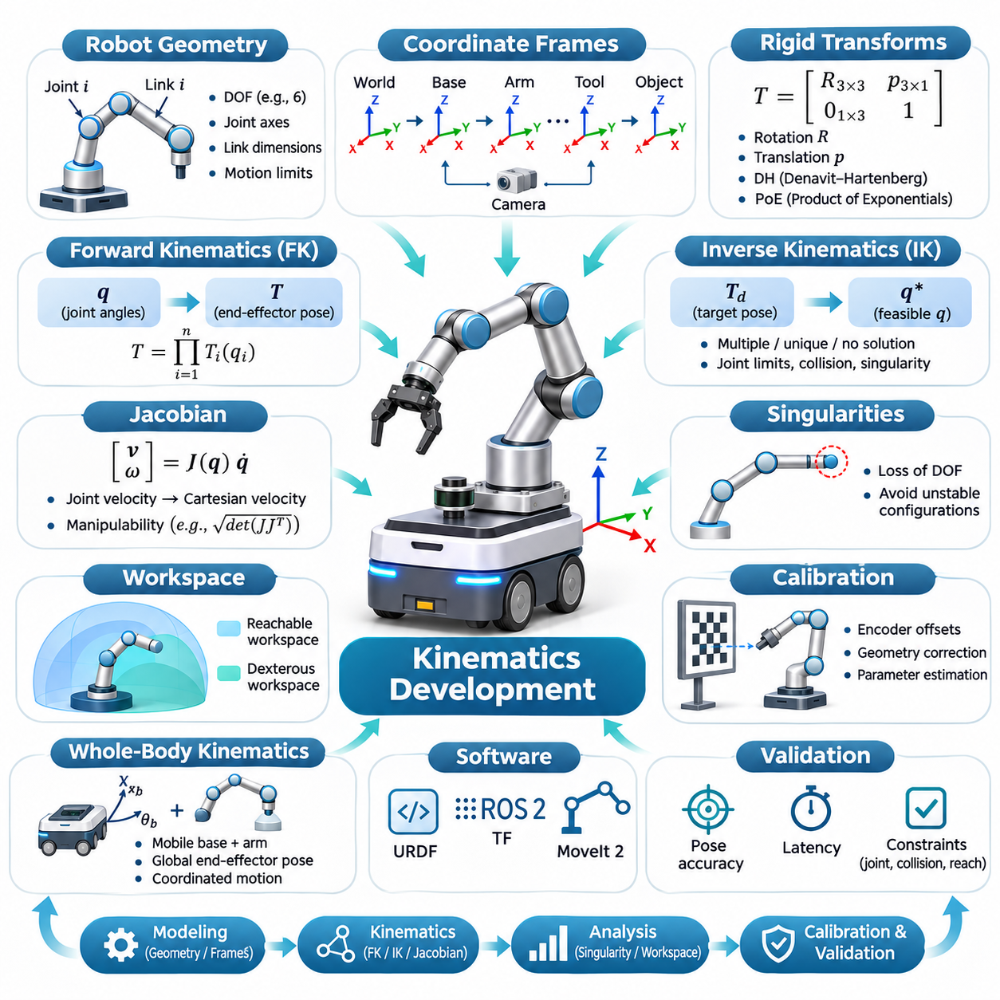{width="7.268055555555556in" height="7.268055555555556in"}

기구학 개발(Kinematics Development)은 로봇 매니퓰레이터(Robotic Manipulator)의 운동을 발생시키는 힘(Force)과 토크(Torque)를 명시적으로 고려하지 않고 운동을 제어하기 위한 수학적 및 연산적 기반을 확립한다. 모바일 조작 시스템(Mobile Manipulation System)에서 기구학은 이동 플랫폼(Mobile Platform), 로봇 팔(Robot Arm), 센서(Sensor), 말단 장치(End Effector) 및 목표 물체(Target Object) 사이의 공간적 관계를 설명한다. 정확한 기구학 모델(Kinematic Model)은 신뢰성 있는 위치 제어(Positioning)와 협조 조작(Coordinated Manipulation)에 필수적이다.

기구학 개발 프로세스(Kinematics Development Process)는 로봇 시스템의 기계적 구성(Mechanical Configuration)을 정의하는 것에서 시작된다. 엔지니어는 자유도(Degrees of Freedom, DOF), 관절 유형(Joint Type), 관절 축(Joint Axis), 링크 치수(Link Dimension), 장착 위치(Mounting Position) 및 기계적 운동 한계(Mechanical Movement Limit)를 식별한다. 이러한 물리적 특성은 로봇의 수학적 표현(Mathematical Representation)을 결정하고 전체 운용 작업공간(Operational Workspace)에서 로봇의 운동을 제한하는 기본적인 제약조건(Constraint)을 확립한다.

좌표계 정의(Coordinate Frame Definition)는 기구학 개발에서 가장 중요한 활동 중 하나이다. 모바일 매니퓰레이터(Mobile Manipulator)는 일반적으로 전역 좌표계(World Frame), 지도 좌표계(Map Frame), 이동 베이스 좌표계(Mobile Base Frame), 매니퓰레이터 베이스 좌표계(Manipulator Base Frame), 관절 좌표계(Joint Frame), 카메라 좌표계(Camera Frame), 도구 좌표계(Tool Frame) 및 물체 좌표계(Object Frame)를 사용한다. 각각의 좌표계는 특정 공간적 기준(Spatial Reference)을 나타낸다. 이러한 좌표계 사이의 일관된 변환 관계(Transformation Relationship)는 인식(Perception), 위치 추정(Localization), 내비게이션(Navigation) 및 조작 모듈(Manipulation Module)이 공간 정보를 신뢰성 있게 교환하도록 한다.

동차 변환 행렬(Homogeneous Transformation Matrix)은 3차원 위치(Position)와 방향(Orientation)을 수학적으로 표현하는 방법을 제공한다. 회전 행렬(Rotation Matrix)과 병진 벡터(Translation Vector)를 결합함으로써 엔지니어는 연속적인 로봇 링크와 좌표계 사이의 공간적 관계를 표현할 수 있다. 변환 행렬(Transformation Matrix)의 순차적 곱셈(Sequential Multiplication)을 통해 베이스 또는 다른 기준 좌표계(Reference Coordinate Frame)에 대한 매니퓰레이터의 전체 공간적 구성(Spatial Configuration)을 결정할 수 있다.

데나빗-하텐버그 표기법(Denavit-Hartenberg Convention, DH)은 연속적인 로봇 관절 사이의 기하학적 관계(Geometric Relationship)를 표현하기 위해 널리 사용된다. 네 가지 매개변수(Parameter)는 링크 길이(Link Length), 링크 비틀림(Link Twist), 링크 오프셋(Link Offset) 및 관절 각도(Joint Angle)를 나타낸다. 지수곱 공식(Product of Exponentials, PoE)과 같은 대체 접근 방식은 복잡한 로봇 구조(Robotic Structure)를 표현하는 데 추가적인 유연성(Flexibility)을 제공한다. 선정된 모델링 방법(Modeling Method)은 전체 개발 및 검증 과정에서 일관되게 적용되어야 한다.

순기구학(Forward Kinematics)은 알려진 관절 구성(Joint Configuration)을 바탕으로 로봇 말단 장치의 위치와 방향을 계산한다. 관절 엔코더 측정값(Joint Encoder Measurement)은 수학적 모델(Mathematical Model)을 통해 처리되어 대응하는 직교좌표계 자세(Cartesian Pose)를 결정한다. 순기구학은 실시간 모니터링(Real-Time Monitoring), 시각화(Visualization), 충돌 검출(Collision Detection), 작업공간 분석(Workspace Analysis) 및 매니퓰레이터가 명령된 물리적 구성(Commanded Physical Configuration)에 도달하였는지를 확인하는 검증 과정(Verification)을 지원한다.

역기구학(Inverse Kinematics)은 지정된 말단 장치의 위치와 방향을 달성하기 위해 필요한 관절 구성을 결정한다. 순기구학과 달리 역기구학은 다중 해(Multiple Solutions), 유일해(Unique Solution) 또는 실행 가능한 해가 존재하지 않는 경우(No Feasible Solution)를 도출할 수 있다. 실제 구현에서는 관절 한계(Joint Limit), 충돌 제약조건(Collision Constraint), 특이점 조건(Singularity Condition) 및 목표 조작 작업의 접근 가능성 요구사항(Accessibility Requirement)을 기준으로 관절 구성 후보(Candidate Configuration)를 평가해야 한다.

해석적 역기구학(Analytical Inverse Kinematics)은 적용 가능한 매니퓰레이터 구성에 대해 폐형식 수학적 해(Closed-Form Mathematical Solution)를 제공하며, 예측 가능한 연산 시간(Computation Time)과 높은 수치적 효율성(Numerical Efficiency)을 제공한다. 수치적 역기구학(Numerical Inverse Kinematics)은 위치 및 방향 오차를 최소화하기 위해 반복적 최적화 기법(Iterative Optimization Technique)을 활용한다. 자코비안 기반 방법(Jacobian-Based Method), 감쇠 최소제곱법(Damped Least Squares) 및 제약조건 최적화(Constrained Optimization)는 해석적 해를 구할 수 없거나 작업 제약조건이 복잡한 경우에 특히 유용하다.

자코비안 행렬(Jacobian Matrix)은 관절 속도(Joint Velocity)와 말단 장치의 선속도(Linear Velocity) 및 각속도(Angular Velocity) 사이의 관계를 나타낸다. 이러한 미분 기구학적 관계(Differential Kinematic Relationship)는 직교좌표계 운동 제어(Cartesian Motion Control), 속도 변환(Velocity Transformation) 및 조작성 분석(Manipulability Analysis)을 가능하게 한다. 엔지니어는 자코비안 기반 계산을 활용하여 특정 방향으로의 운동이 어려워지는 관절 구성을 식별하고, 기구학적 특이점(Kinematic Singularity) 주변에서 안정적인 운동 생성(Motion Generation)을 지원한다.

기구학적 특이점(Kinematic Singularity)은 매니퓰레이터가 하나 이상의 직교좌표계 방향(Cartesian Direction)으로 운동을 생성할 수 있는 능력을 상실할 때 발생한다. 특이점 구성(Singular Configuration) 주변에서는 상대적으로 작은 직교좌표계 운동에도 과도한 관절 속도(Joint Velocity)가 요구될 수 있다. 개발팀은 수학적 분석(Mathematical Analysis)과 시뮬레이션(Simulation)을 통해 이러한 구성을 식별하고, 특이점 회피(Singularity Avoidance), 속도 제한(Velocity Limitation) 및 대체 관절 구성 선택(Alternative Configuration Selection)을 제어 아키텍처(Control Architecture)에 통합해야 한다.

작업공간 분석(Workspace Analysis)은 로봇 매니퓰레이터가 물리적으로 도달할 수 있는 공간적 영역을 결정한다. 도달 가능 작업공간(Reachable Workspace)은 말단 장치가 도달할 수 있는 위치를 나타내는 반면, 다자세 작업공간(Dexterous Workspace)은 요구되는 모든 방향으로의 자세 설정이 가능한 위치를 나타낸다. 엔지니어는 매니퓰레이터 장착(Mounting)과 이동 플랫폼 위치 설정(Mobile Platform Positioning)을 최적화하기 위해 운용 시나리오(Operational Scenario), 물체 위치(Object Location), 장비 형상(Equipment Geometry) 및 접근 가능성 요구사항을 기준으로 이러한 영역을 평가한다.

모바일 조작(Mobile Manipulation)은 로봇 팔이 이동 가능한 플랫폼에 장착되기 때문에 추가적인 기구학적 관계(Kinematic Relationship)를 수반한다. 전역 좌표계에서의 말단 장치 자세(Global End-Effector Pose)는 이동 베이스의 위치와 매니퓰레이터의 관절 구성 모두에 의해 결정된다. 전신 기구학(Whole-Body Kinematics)은 이러한 운동 능력을 하나의 통합된 표현(Unified Representation)으로 결합한다. 이를 통해 이동 베이스의 조향 제약조건(Steering Constraint)과 매니퓰레이터의 운동 한계(Movement Limitation)를 고려하면서 협조 위치 제어(Coordinated Positioning)를 수행할 수 있다.

기구학 보정(Kinematic Calibration)은 공칭 수학적 모델(Nominal Mathematical Model)과 실제 기계 구조(Actual Mechanical Structure) 사이의 차이를 식별하여 위치 정확도(Positioning Accuracy)를 향상시킨다. 제조 공차(Manufacturing Tolerance), 관절 엔코더 오프셋(Joint Encoder Offset), 조립 편차(Assembly Deviation) 및 도구 장착 오차(Tool Mounting Error)는 체계적인 위치 오차(Systematic Positioning Error)를 발생시킬 수 있다. 외부 측정 장비(External Measurement Equipment), 보정 타깃(Calibration Target) 및 최적화 알고리즘(Optimization Algorithm)은 기하학적 매개변수(Geometric Parameter)를 추정하고 구현된 기구학 모델의 정확도를 향상시키는 데 활용된다.

소프트웨어 구현(Software Implementation)은 수학적 기구학 모델을 실시간 로봇 운용(Real-Time Robotic Operation)을 지원하는 연산 모듈(Computational Module)로 변환한다. 통합 로봇 기술 형식(Unified Robot Description Format, URDF), ROS 2 좌표 변환 라이브러리(Transformation Library) 및 MoveIt 2는 실용적인 개발 인프라(Development Infrastructure)를 제공한다. 엔지니어는 통합된 소프트웨어 구성 요소 전반에서 좌표계 규약(Coordinate Convention), 측정 단위(Measurement Unit), 관절 정의(Joint Definition), 도구 구성(Tool Configuration) 및 모델 버전(Model Version)의 일관성을 유지해야 한다.

기구학 검증(Kinematics Validation)은 계산된 로봇의 위치 및 방향과 실험적으로 측정된 위치 및 방향 사이의 체계적인 비교(Systematic Comparison)를 요구한다. 순기구학 및 역기구학 정확도(Kinematics Accuracy), 변환 일관성(Transformation Consistency), 작업공간 범위(Workspace Coverage), 특이점 처리(Singularity Handling), 연산 지연시간(Computational Latency) 및 관절 한계 준수(Joint-Limit Compliance)는 대표적인 운용 조건(Representative Operating Condition)에서 평가되어야 한다. 검증된 기구학 모델은 동역학 모델링(Dynamics Modeling), 파지 계획(Grasp Planning), 운동 계획(Motion Planning) 및 신뢰성 있는 산업용 조작(Industrial Manipulation)을 위한 기반을 확립한다.

## 03 Dynamics Modeling

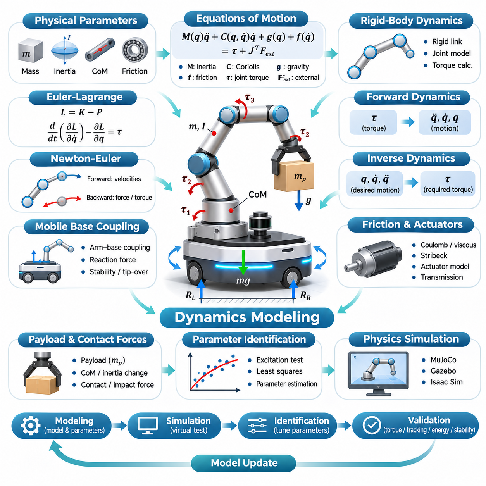{width="7.268055555555556in" height="7.268055555555556in"}

동역학 모델링(Dynamics Modeling)은 힘(Force), 토크(Torque), 질량 분포(Mass Distribution) 및 물리적 상호작용(Physical Interaction)이 로봇 매니퓰레이터(Robotic Manipulator)의 운동에 어떠한 영향을 미치는지 이해하기 위한 수학적 기반을 확립한다. 기하학적 관계(Geometric Relationship)를 통해 운동을 설명하는 기구학(Kinematics)과 달리 동역학(Dynamics)은 운동을 발생시키는 물리적 메커니즘(Physical Mechanism)을 설명한다. 정확한 동역학 모델(Dynamic Model)은 안정적이고 효율적이며 신뢰성 있는 모바일 조작 시스템(Mobile Manipulation System)을 개발하는 데 필수적이다.

동역학 개발 프로세스(Dynamics Development Process)는 개별 로봇 구성 요소의 물리적 특성(Physical Properties)을 식별하는 것에서 시작된다. 링크 질량(Link Mass), 질량중심(Center of Mass), 관성 텐서(Inertia Tensor), 액추에이터 특성(Actuator Characteristics), 동력 전달비(Transmission Ratio), 관절 마찰(Joint Friction) 및 기계적 강성(Mechanical Stiffness)을 정의해야 한다. 이러한 매개변수(Parameter)는 컴퓨터 지원 설계(Computer-Aided Design, CAD) 모델, 제조업체 사양(Manufacturer Specification), 물리적 측정(Physical Measurement) 및 실험적 시스템 식별(Experimental System Identification)을 통해 확보할 수 있다.

강체 동역학(Rigid-Body Dynamics)은 로봇 매니퓰레이터의 기본적인 모델링 접근 방식(Modeling Approach)을 제공한다. 각각의 매니퓰레이터 링크(Manipulator Link)는 정의된 질량 및 관성 특성(Inertial Properties)을 가지며, 기계적 관절(Mechanical Joint)을 통해 연결된 강체(Rigid Body)로 표현된다. 이러한 표현 방식은 구조적 거동(Structural Behavior)을 단순화하지만, 관절 토크(Joint Torque) 계산, 운동 응답(Motion Response) 예측, 액추에이터 요구사항(Actuator Requirement) 평가 및 실시간 제어 알고리즘(Real-Time Control Algorithm) 개발을 위한 실용적인 기반을 제공한다.

운동 방정식(Equations of Motion)은 관절 위치(Joint Position), 속도(Velocity), 가속도(Acceleration) 및 인가 토크(Applied Torque) 사이의 관계를 설명한다. 일반적인 매니퓰레이터 동역학 모델(Manipulator Dynamics Model)은 관성 행렬(Inertia Matrix), 코리올리 및 원심력 항(Coriolis and Centrifugal Terms), 중력(Gravity), 마찰 효과(Friction Effect) 및 외부 상호작용 힘(External Interaction Force)을 포함한다. 이러한 수학적 구성 요소(Mathematical Component)는 정적 및 동적 운용(Static and Dynamic Operation) 과정에서 로봇 시스템의 물리적 거동(Physical Behavior)을 종합적으로 나타낸다.

오일러-라그랑주 공식화(Euler-Lagrange Formulation)는 기계 시스템의 운동에너지(Kinetic Energy)와 위치에너지(Potential Energy)를 활용하여 로봇의 운동 방정식을 유도한다. 라그랑지안(Lagrangian)은 이러한 에너지 구성 요소 사이의 차이를 나타내며, 일반화 힘(Generalized Force)과 관절 운동 관계(Joint Motion Relationship)를 체계적으로 계산할 수 있도록 한다. 이러한 공식화 방식은 이론적 분석(Theoretical Analysis), 제어기 개발(Controller Development) 및 여러 로봇 관절 사이의 동적 결합(Dynamic Coupling)을 이해하는 데 특히 유용하다.

뉴턴-오일러 공식화(Newton-Euler Formulation)는 힘(Force), 모멘트(Moment), 선가속도(Linear Acceleration) 및 각가속도(Angular Acceleration) 사이의 관계를 통해 매니퓰레이터 동역학을 설명한다. 재귀적 뉴턴-오일러 알고리즘(Recursive Newton-Euler Algorithm)은 로봇 구조를 따라 운동 정보를 순방향으로 전파하고, 필요한 힘과 토크를 베이스 방향으로 역방향 계산한다. 이러한 연산 효율적인 접근 방식(Computationally Efficient Approach)은 실시간 역동역학(Real-Time Inverse Dynamics) 및 모델 기반 로봇 제어(Model-Based Robotic Control)에 널리 적용될 수 있다.

순동역학(Forward Dynamics)은 인가된 힘(Applied Force), 액추에이터 토크(Actuator Torque) 및 현재 로봇 상태(Current Robot State)가 주어졌을 때 발생하는 관절 가속도(Joint Acceleration)를 계산한다. 이후 수치적 적분(Numerical Integration)을 통해 시간에 따른 후속 관절 속도(Joint Velocity)와 위치(Joint Position)를 결정한다. 순동역학은 로봇 시뮬레이션(Robotic Simulation), 가상 시제품 개발(Virtual Prototyping), 제어기 평가(Controller Evaluation), 외란 분석(Disturbance Analysis) 및 다양한 운용 조건에서의 기계적 거동(Mechanical Behavior) 예측에 특히 중요하다.

역동역학(Inverse Dynamics)은 지정된 관절 위치, 속도 및 가속도를 달성하기 위해 필요한 액추에이터 토크를 결정한다. 엔지니어는 역동역학을 활용하여 전향 보상(Feedforward Compensation)을 개발하고, 액추에이터 부하(Actuator Loading)를 추정하며, 궤적 추종 성능(Trajectory Tracking Performance)을 향상시킨다. 정확한 토크 예측(Torque Prediction)은 모터 선정(Motor Selection), 동력 전달 시스템 설계(Transmission Design), 열적 평가(Thermal Evaluation) 및 기계적 한계(Mechanical Limitation)를 초과할 가능성이 있는 운용 조건의 식별에도 활용된다.

마찰 모델링(Friction Modeling)은 베어링(Bearing), 기어(Gear), 동력 전달 구성 요소(Transmission Component) 및 기타 가동 인터페이스(Moving Interface)에서 발생하는 기계적 저항(Mechanical Resistance)을 표현한다. 쿨롱 마찰(Coulomb Friction), 점성 마찰(Viscous Friction), 정지 마찰(Static Friction) 및 스트리벡 효과(Stribeck Effect)는 서로 다른 마찰 거동(Frictional Behavior)의 특성을 설명한다. 적절한 마찰 보상(Friction Compensation)은 저속 운동(Low-Speed Movement), 위치 정확도(Positioning Accuracy), 에너지 효율성(Energy Efficiency) 및 섬세한 물리적 상호작용을 수반하는 조작 작업의 일관성(Consistency)을 향상시킨다.

모바일 매니퓰레이터(Mobile Manipulator)는 로봇 팔(Robot Arm)과 이동 플랫폼(Mobile Platform) 사이에 동적 결합(Dynamic Coupling)을 발생시킨다. 로봇 팔의 가속 운동은 플랫폼 안정성(Platform Stability), 휠 하중(Wheel Loading) 및 위치 정확도에 영향을 미치는 반력(Reaction Force)과 모멘트(Moment)를 생성한다. 이동 플랫폼과 로봇 팔의 동시 운동(Simultaneous Motion)은 동적 복잡성(Dynamic Complexity)을 더욱 증가시키므로 차량 운동(Vehicle Motion), 지면 접촉(Ground Contact), 현가장치 특성(Suspension Characteristics) 및 매니퓰레이터 구성(Manipulator Configuration)을 고려하는 통합 기계 모델(Integrated Mechanical Model)이 필요하다.

가반하중 동역학(Payload Dynamics)은 파지된 물체가 로봇 시스템의 유효 질량(Effective Mass), 질량중심(Center of Mass) 및 관성(Inertia)을 변화시키기 때문에 조작 성능(Manipulation Performance)에 상당한 영향을 미친다. 무거운 물체를 운반하는 로봇 팔이 확장된 상태에서는 상당한 전복 모멘트(Overturning Moment)와 액추에이터 부하가 발생할 수 있다. 동역학 모델은 가반하중 변화(Payload Variation)를 반영하고 적응형 보상(Adaptive Compensation)을 지원하여 안정성(Stability), 궤적 정확도(Trajectory Accuracy) 및 기계적 운용 한계(Mechanical Operating Limit)의 준수를 유지해야 한다.

외력 모델링(External Force Modeling)은 매니퓰레이터와 주변 환경 사이의 물리적 상호작용을 설명한다. 접촉력(Contact Force), 마찰 제약조건(Frictional Constraint), 반작용 모멘트(Reaction Moment) 및 충격 하중(Impact Load)은 파지(Grasping), 조립(Assembly), 삽입(Insertion) 및 표면 검사(Surface Inspection)와 같은 작업에 영향을 미친다. 힘·토크 센서(Force-Torque Sensor)와 동역학 관측기(Dynamic Observer)는 외부 외란(External Disturbance)을 추정하기 위한 피드백을 제공할 수 있으며, 불확실한 조건에서 순응형 조작(Compliant Manipulation)을 지원하고 접촉 안정성(Contact Stability)을 향상시킨다.

동역학 매개변수 식별(Dynamic Parameter Identification)은 이론적 예측(Theoretical Prediction)과 실험적으로 측정된 로봇 거동(Experimentally Measured Robotic Behavior)을 비교함으로써 모델 정확도(Model Accuracy)를 향상시킨다. 엔지니어는 사전에 정의된 가진 궤적(Predefined Excitation Trajectory)을 실행하면서 관절 위치, 속도, 가속도 및 토크 측정값(Torque Measurement)을 수집한다. 최소제곱법(Least Squares)과 수치적 최적화(Numerical Optimization)를 포함하는 매개변수 추정 기법(Parameter Estimation Technique)은 시스템 동역학에 영향을 미치는 관성 특성(Inertial Properties), 마찰 계수(Friction Coefficient) 및 기타 특성을 식별한다.

물리 기반 시뮬레이션(Physics-Based Simulation)은 실제 시스템에 구현하기 전에 동역학 모델을 평가할 수 있는 제어된 환경(Controlled Environment)을 제공한다. MuJoCo, Gazebo 및 NVIDIA Isaac Sim과 같은 플랫폼은 강체 동역학(Rigid-Body Dynamics), 액추에이터 모델링(Actuator Modeling), 충돌 상호작용(Collision Interaction) 및 접촉 시뮬레이션(Contact Simulation)을 지원한다. 엔지니어는 시뮬레이션과 현실 사이의 격차(Simulation-to-Reality Gap)를 줄이고 가상 개발 결과(Virtual Development Result)의 신뢰성을 향상시키기 위해 실제 물리적 측정값을 기준으로 시뮬레이션 매개변수(Simulation Parameter)를 보정해야 한다.

동역학 검증(Dynamics Validation)은 예측된 관절 응답(Joint Response), 액추에이터 토크(Actuator Torque), 에너지 소비량(Energy Consumption) 및 플랫폼 안정성(Platform Stability)을 실제 측정 결과와 체계적으로 비교하는 과정을 요구한다. 시험에는 대표적인 가반하중(Representative Payload), 운동 속도(Movement Speed), 가속도 프로파일(Acceleration Profile) 및 외부 상호작용 조건(External Interaction Condition)이 포함되어야 한다. 검증된 동역학 모델(Validated Dynamic Model)은 운동 계획(Motion Planning), 힘 제어(Force Control), 성능 최적화(Performance Optimization) 및 신뢰성 있는 산업용 모바일 조작(Industrial Mobile Manipulation)을 위한 공학적 기반(Engineering Foundation)을 제공한다.

## 04 Grasp Planning

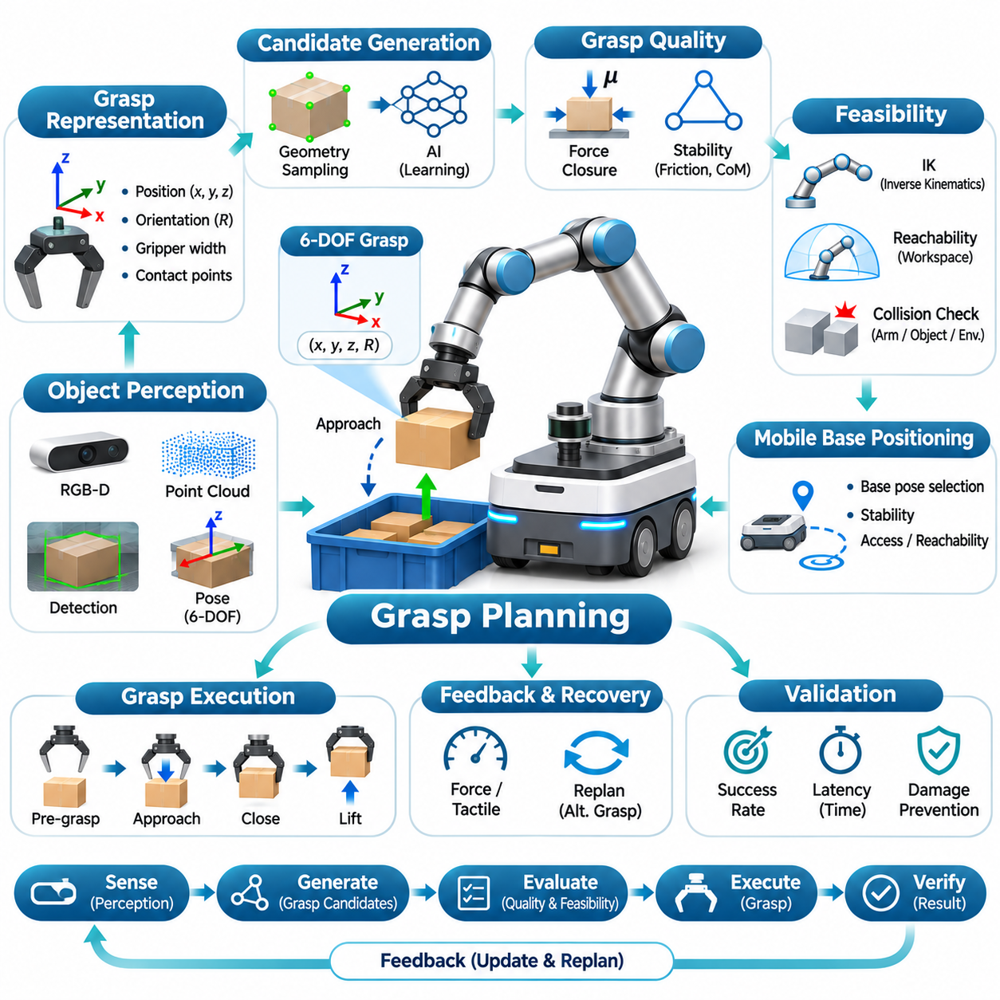{width="7.268055555555556in" height="7.268055555555556in"}

파지 계획(Grasp Planning)은 로봇이 물리적 작업(Physical Task)을 수행하기 위해 목표 물체(Target Object)에 접근하고, 접촉하며, 안정적으로 파지하는 방법을 결정하는 로봇 조작(Robotic Manipulation)의 핵심 프로세스이다. 모바일 조작 시스템(Mobile Manipulation System)에서 파지 계획은 물체 특성(Object Characteristics)과 그리퍼 성능(Gripper Capability)뿐만 아니라 이동 플랫폼 위치 설정(Mobile Platform Positioning), 환경적 제약조건(Environmental Constraint), 매니퓰레이터 도달 가능성(Manipulator Reachability) 및 후속 작업(Subsequent Operation)의 요구사항을 고려해야 한다.

파지 계획 개발 프로세스(Grasp Planning Development Process)는 운용 요구사항(Operational Requirement)과 목표 물체의 특성을 정의하는 것에서 시작된다. 물체의 치수(Object Dimension), 형상(Geometry), 질량(Mass), 재료 특성(Material Properties), 표면 상태(Surface Condition), 파손 취약성(Fragility) 및 예상 방향(Expected Orientation)은 파지 전략(Grasping Strategy)의 선정에 영향을 미친다. 엔지니어는 파지 성공률(Grasp Success Rate), 위치 정확도(Positioning Accuracy), 실행 시간(Execution Time), 허용 접촉력(Allowable Contact Force) 및 물체 손상 방지(Object Damage Prevention)에 대한 정량적으로 측정 가능한 요구사항을 확립해야 한다.

물체 인식(Object Perception)은 실행 가능한 파지 구성(Feasible Grasp Configuration)을 생성하는 데 필요한 환경 정보를 제공한다. RGB 카메라(RGB Camera), 깊이 카메라(Depth Camera) 및 3차원 포인트 클라우드(3D Point Cloud)를 활용하여 시스템은 목표 물체를 식별하고 공간적 위치(Spatial Position)와 방향(Orientation)을 추정할 수 있다. 정확한 센서 보정(Sensor Calibration)과 좌표 변환(Coordinate Transformation)은 인식 결과(Perception Result)를 매니퓰레이터 좌표계(Manipulator Coordinate Frame) 내에서 실행 가능한 파지 목표(Grasp Target)로 변환하는 데 필수적이다.

파지 표현(Grasp Representation)은 잠재적인 파지(Potential Grasp)와 관련된 기하학적 및 물리적 매개변수(Geometric and Physical Parameter)를 나타낸다. 일반적인 파지 표현에는 3차원 파지 위치(3D Gripping Position), 그리퍼 방향(Gripper Orientation), 손가락 개방 폭(Finger Opening Width), 접근 방향(Approach Direction) 및 예상 접촉점(Expected Contact Point)이 포함된다. 6자유도 파지 표현(Six-Degree-of-Freedom Grasp Representation, 6-DOF)은 복잡하거나 비정형적인 환경(Unstructured Environment)에 위치한 물체를 조작하는 데 추가적인 유연성(Flexibility)을 제공한다.

해석적 파지 계획(Analytical Grasp Planning)은 안정적인 파지 구성(Stable Grasp Configuration)을 결정하기 위해 물체 형상(Object Geometry), 접촉 역학(Contact Mechanics), 마찰(Friction) 및 힘의 평형(Force Equilibrium)에 대한 수학적 모델(Mathematical Model)을 활용한다. 힘 폐쇄(Force Closure)는 가정된 접촉 모델(Contact Model) 내에서 접촉력이 임의의 외부 외란(External Disturbance)에 저항할 수 있는지를 평가하는 반면, 형상 폐쇄(Form Closure)는 기하학적 제약조건(Geometric Constraint)이 물체의 움직임을 방지하는지를 평가한다. 이러한 접근 방식은 파지 평가(Grasp Evaluation)를 위한 물리적으로 해석 가능한 기준을 제공한다.

학습 기반 파지 계획(Learning-Based Grasp Planning)은 센서 관측 정보(Sensory Observation)로부터 직접 파지 후보(Grasp Candidate)를 생성하고 평가하기 위해 인공지능(Artificial Intelligence, AI)을 활용한다. 심층 신경망(Deep Neural Network)은 RGB 이미지(RGB Image), 깊이 맵(Depth Map) 또는 포인트 클라우드(Point Cloud)로부터 파지 위치(Grasp Position), 방향(Orientation), 접촉 영역(Contact Region) 및 파지 품질 점수(Grasp Quality Score)를 예측할 수 있다. 학습 데이터세트(Training Dataset)에는 시뮬레이션 기반 파지 경험(Simulated Grasping Experience), 물리적 실험(Physical Experiment), 인간 시연(Human Demonstration) 및 자동 생성 어노테이션(Automatically Generated Annotation)이 포함될 수 있다.

파지 후보 생성(Grasp Candidate Generation)은 단일 예측 파지(Single Predicted Grasp)에만 의존하지 않고 여러 잠재적 파지 구성을 식별하는 과정이다. 파지 후보 구성(Candidate Grasp Configuration)은 기하학적 샘플링(Geometric Sampling), 표면 법선 분석(Surface Normal Analysis), 신경망 추론(Neural Network Inference) 또는 최적화 알고리즘(Optimization Algorithm)을 통해 생성될 수 있다. 대체 파지 후보(Alternative Grasp Candidate)를 유지하면 우선적으로 선택된 파지 구성이 접근 불가능하거나 불안정하거나 주변 물체에 의해 방해받는 상황에서 운용 유연성(Operational Flexibility)을 향상시킬 수 있다.

파지 품질 평가(Grasp Quality Evaluation)는 각 파지 후보가 실제 물리적 실행(Physical Execution)에 적합한지를 결정한다. 평가 기준(Evaluation Criteria)에는 접촉 안정성(Contact Stability), 마찰 저항(Frictional Resistance), 질량중심 정렬(Center-of-Mass Alignment), 그리퍼 호환성(Gripper Compatibility), 충돌 위험(Collision Risk) 및 외부 외란에 대한 예상 저항력이 포함된다. 응용 분야별 추가 평가 기준(Application-Specific Criteria)으로는 배치 방향(Placement Orientation), 물체 변형(Object Deformation), 운반 안정성(Transportation Stability) 및 후속 조작 작업의 접근 가능성(Accessibility)을 고려할 수 있다.

기구학적 실행 가능성 분석(Kinematic Feasibility Analysis)은 파지 후보가 로봇 매니퓰레이터(Robotic Manipulator)에 의해 물리적으로 구현될 수 있는지를 확인한다. 역기구학(Inverse Kinematics)은 목표 파지 자세(Desired Grasp Pose)에 적합한 관절 구성(Joint Configuration)을 계산하며, 관절 한계(Joint Limit), 특이점 조건(Singularity Condition) 및 작업공간 제한(Workspace Restriction)을 기준으로 부적합한 파지 후보를 제거한다. 모바일 매니퓰레이터(Mobile Manipulator)는 파지 접근 가능성(Grasp Accessibility)을 향상시키고 더욱 유리한 로봇 팔 구성을 확보하기 위해 이동 플랫폼의 위치를 재조정할 수 있다.

충돌 인지형 파지 계획(Collision-Aware Grasp Planning)은 로봇 팔(Robot Arm), 그리퍼(Gripper), 목표 물체, 인접 물체(Neighboring Object) 및 주변 장비(Surrounding Equipment) 사이에서 발생할 수 있는 상호작용을 평가한다. 3차원 환경 표현(3D Environmental Representation)은 접근(Approach), 파지 실행(Grasp Execution) 및 물체 인출(Object Removal) 과정에서의 충돌 검사(Collision Checking)를 지원한다. 적절한 이격 여유(Clearance Margin)는 인식 불확실성(Perception Uncertainty), 보정 오차(Calibration Error), 기계적 공차(Mechanical Tolerance) 및 예상하지 못한 환경 변화(Environmental Change)를 고려하여 설정해야 한다.

파지 실행(Grasp Execution)은 전체 물리적 상호작용 과정에서 매니퓰레이터와 말단 장치(End Effector)의 협조 제어(Coordinated Control)를 요구한다. 일반적인 실행 순서(Execution Sequence)는 사전 파지 자세(Pre-Grasp Pose)로의 이동, 제어된 접근(Controlled Approach), 그리퍼 닫힘(Gripper Closure), 접촉 검증(Contact Verification) 및 물체 들어 올리기(Object Lifting)로 구성된다. 힘·토크 센서(Force-Torque Sensor), 촉각 센서(Tactile Sensor), 액추에이터 전류 측정(Actuator Current Measurement) 및 그리퍼 위치 피드백(Gripper Position Feedback)은 성공적인 물리적 접촉을 검출하기 위한 상호보완적인 정보를 제공할 수 있다.

강건한 파지 계획(Robust Grasp Planning)은 물체 위치 추정(Object Localization), 표면 마찰(Surface Friction), 재료 특성(Material Properties) 및 환경적 외란(Environmental Disturbance)과 관련된 불확실성(Uncertainty)을 처리한다. 확률적 평가(Probabilistic Evaluation), 불확실성 인지형 최적화(Uncertainty-Aware Optimization) 및 폐루프 시각 피드백(Closed-Loop Visual Feedback)은 파지 신뢰성(Grasp Reliability)을 향상시킬 수 있다. 초기 실행 조건(Initial Execution Condition)이 예측된 조건과 다른 경우 시스템은 물체 자세 추정값(Object Pose Estimate)을 갱신하거나, 파지력(Gripping Force)을 조정하거나, 대체 파지 구성을 선택할 수 있다.

모바일 파지 계획(Mobile Grasp Planning)은 이동 플랫폼의 위치와 방향을 계획 프로세스에 통합함으로써 기존의 파지 생성(Grasp Generation) 방식을 확장한다. 베이스 위치 설정(Base Positioning)은 매니퓰레이터 도달 가능성(Manipulator Reachability), 플랫폼 안정성(Platform Stability), 내비게이션 제약조건(Navigation Constraint) 및 사용 가능한 운용 공간(Available Operational Space)을 고려해야 한다. 이동 베이스와 로봇 팔의 협조 구성 선택(Coordinated Base and Arm Configuration Selection)은 불필요한 움직임(Unnecessary Movement), 에너지 소비량(Energy Consumption) 및 실행 시간을 줄이면서 파지 성공률을 향상시킬 수 있다.

파지 계획 소프트웨어(Grasp Planning Software)는 인식(Perception), 파지 생성(Grasp Generation), 후보 평가(Candidate Evaluation), 역기구학(Inverse Kinematics), 충돌 검출(Collision Detection) 및 운동 계획(Motion Planning)을 하나의 통합 실행 파이프라인(Coordinated Execution Pipeline)으로 구성한다. ROS 2 및 MoveIt 2와 같은 개발 프레임워크(Development Framework)는 기하학적 정보(Geometric Information)를 교환하고 계획된 궤적(Planned Trajectory)을 실행하기 위한 인프라(Infrastructure)를 제공한다. 모듈형 소프트웨어 설계(Modular Software Design)는 독립적인 알고리즘 평가(Algorithm Evaluation), 구성 요소 교체(Component Replacement) 및 체계적인 디버깅(Systematic Debugging)을 지원한다.

파지 실패 검출 및 복구(Grasp Failure Detection and Recovery)는 신뢰성 있는 산업용 조작(Industrial Manipulation)을 구현하기 위한 필수적인 요소이다. 파지 실패는 부정확한 자세 추정(Inaccurate Pose Estimation), 불충분한 파지력(Insufficient Gripping Force), 물체 미끄러짐(Object Slippage), 예상하지 못한 충돌(Unexpected Collision) 또는 접근 불가능한 파지 구성(Inaccessible Grasp Configuration)으로 인해 발생할 수 있다. 복구 메커니즘(Recovery Mechanism)은 실패 조건(Failure Condition)을 분류하고, 환경 재인식(Renewed Perception), 대체 파지 선택(Alternative Grasp Selection), 제어된 위치 재조정(Controlled Repositioning) 또는 안전한 임무 종료(Safe Mission Termination) 중 적절한 대응 방법을 결정해야 한다.

파지 계획 검증(Grasp Planning Validation)은 대표적인 물체 형상, 재료, 중량, 방향 및 환경 조건에 대한 체계적인 시험(Systematic Testing)을 요구한다. 핵심 성과 지표(Key Performance Indicator, KPI)에는 최초 시도 파지 성공률(First-Attempt Grasp Success Rate), 전체 파지 성공률(Overall Grasp Success Rate), 계획 지연시간(Planning Latency), 실행 시간(Execution Time), 물체 손상률(Object Damage Rate) 및 복구 효과성(Recovery Effectiveness)이 포함된다. 검증된 파지 계획(Validated Grasp Planning)은 신뢰성 있는 픽 앤 플레이스(Pick-and-Place), 빈 피킹(Bin Picking) 및 자율 산업용 조작(Autonomous Industrial Manipulation)을 구현하기 위한 기반을 확립한다.

## 05 Motion Planning

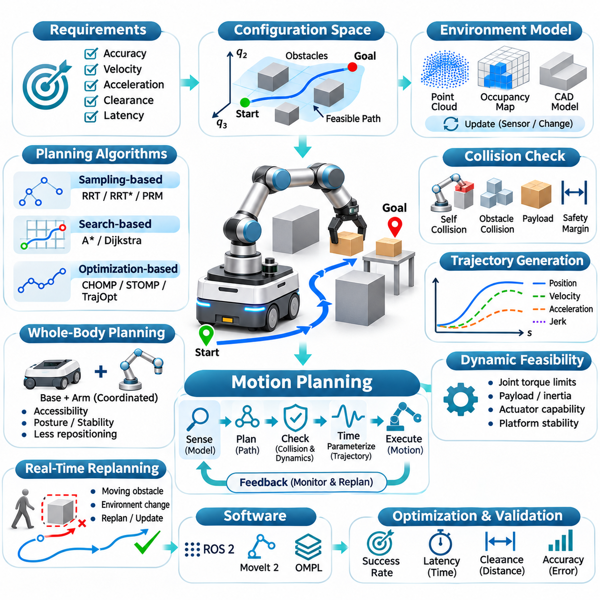{width="7.268055555555556in" height="7.268055555555556in"}

운동 계획(Motion Planning)은 물리적, 환경적 및 운용 제약조건(Physical, Environmental, and Operational Constraints)을 충족하면서 로봇의 초기 구성(Initial Configuration)과 목표 구성(Desired Configuration) 사이에서 실행 가능한 움직임을 결정하는 로봇 조작 시스템(Robotic Manipulation System)의 핵심 기능이다. 모바일 조작(Mobile Manipulation)에서 운동 계획은 로봇 팔(Robot Arm)과 이동 플랫폼(Mobile Platform)을 상호 연결된 시스템(Interconnected System)으로 고려해야 하며, 정확하고 효율적이며 신뢰성 있는 물리적 작업 실행(Physical Task Execution)을 지원하는 협조 운동(Coordinated Motion)을 가능하게 한다.

운동 계획 개발 프로세스(Motion Planning Development Process)는 운용 요구사항(Operational Requirement), 환경적 특성(Environmental Characteristics) 및 기계적 한계(Mechanical Limitation)를 정의하는 것에서 시작된다. 엔지니어는 목표 위치 정확도(Target Positioning Accuracy), 궤적 실행 시간(Trajectory Execution Time), 허용 속도(Allowable Velocity), 가속도 한계(Acceleration Limit), 충돌 방지 이격거리(Collision Clearance) 및 연산 지연시간(Computational Latency)을 확립해야 한다. 이러한 요구사항은 알고리즘 선정(Algorithm Selection), 소프트웨어 구현(Software Implementation) 및 후속 시스템 검증(System Validation)을 위한 정량적으로 측정 가능한 공학적 목표(Engineering Objective)를 제공한다.

구성 공간(Configuration Space)은 로봇 시스템에서 가능한 모든 구성을 수학적으로 표현하는 방법을 제공한다. 각각의 차원(Dimension)은 일반적으로 독립적인 관절 변수(Independent Joint Variable) 또는 이동 플랫폼 좌표(Mobile Platform Coordinate)에 대응한다. 환경 장애물(Environmental Obstacle), 기계적 한계 및 충돌 조건(Collision Condition)은 이러한 공간 내에서 제한 영역(Restricted Region)을 형성한다. 운동 계획은 초기 구성과 목표 구성을 연결하는 실행 가능 영역(Feasible Region) 내에서 연속적인 경로(Continuous Path)를 식별한다.

환경 모델링(Environmental Modeling)은 충돌 인지형 운동 계획(Collision-Aware Motion Planning)에 필요한 공간 정보(Spatial Information)를 제공한다. 3차원 포인트 클라우드(3D Point Cloud), 점유 지도(Occupancy Map), 기본 기하 도형(Geometric Primitive) 및 컴퓨터 지원 설계(Computer-Aided Design, CAD) 모델은 주변 환경을 표현하는 데 활용될 수 있다. 이러한 표현은 내부 계획 환경(Internal Planning Environment)과 물리적 현실(Physical Reality) 사이의 일관성을 유지하기 위해 센서 관측 정보(Sensor Observation), 물체 이동(Object Movement) 및 운용 환경 변화(Operational Change)에 따라 갱신되어야 한다.

샘플링 기반 운동 계획 알고리즘(Sampling-Based Motion Planning Algorithm)은 후보 구성(Candidate Configuration)을 생성하고 평가함으로써 구성 공간을 탐색한다. 급속 탐색 랜덤 트리(Rapidly-exploring Random Trees, RRT), RRT-Connect, RRT\\\* 및 확률적 로드맵(Probabilistic Roadmaps, PRM)은 고차원 로봇 시스템(High-Dimensional Robotic System)에 널리 사용된다. 이러한 알고리즘은 복잡한 장애물 회피(Obstacle Avoidance)를 지원하지만, 계획 효율성(Planning Efficiency)과 경로 품질(Path Quality)은 샘플링 전략(Sampling Strategy), 환경 복잡성(Environmental Complexity) 및 연산 자원(Computational Resource)에 따라 달라진다.

탐색 기반 운동 계획(Search-Based Motion Planning)은 구조화된 그래프(Structured Graph) 또는 이산화된 구성 공간(Discretized Configuration Space)을 통해 가능한 움직임을 표현한다. A\\\* 알고리즘(A\\\* Algorithm) 및 다익스트라 알고리즘(Dijkstra\'s Algorithm)과 같은 알고리즘은 사전에 정의된 비용 함수(Cost Function)를 기준으로 실행 가능한 경로를 식별한다. 고차원 매니퓰레이터(High-Dimensional Manipulator)에서는 이산화(Discretization)에 따른 연산 비용이 증가하지만, 탐색 기반 접근 방식은 모바일 내비게이션(Mobile Navigation), 구조화된 작업공간(Structured Workspace) 및 계층적 계획 아키텍처(Hierarchical Planning Architecture)에서 여전히 유용하다.

최적화 기반 운동 계획(Optimization-Based Motion Planning)은 운용 제약조건(Operational Constraint)을 충족하면서 수학적 목적 함수(Mathematical Objective Function)를 최소화함으로써 궤적(Trajectory)을 생성하거나 개선한다. 최적화 기준(Optimization Criteria)에는 경로 길이(Path Length), 실행 시간(Execution Time), 에너지 소비량(Energy Consumption), 궤적 평활성(Trajectory Smoothness) 및 장애물 이격거리(Obstacle Clearance)가 포함될 수 있다. CHOMP, STOMP 및 TrajOpt와 같은 알고리즘은 복잡한 환경에서 조작 궤적(Manipulation Trajectory)을 개선하기 위한 실용적인 접근 방식을 제공한다.

충돌 검출(Collision Detection)은 계획된 로봇 구성과 중간 운동(Intermediate Movement)이 의도하지 않은 물리적 접촉(Undesirable Physical Contact)을 발생시키는지를 평가한다. 충돌 모델(Collision Model)은 매니퓰레이터 링크(Manipulator Link), 말단 장치(End Effector), 장착된 가반하중(Attached Payload), 이동 플랫폼 및 주변 장비(Surrounding Equipment)를 표현해야 한다. 자기 충돌(Self-Collision)과 환경 충돌(Environmental Collision)을 모두 고려해야 하며, 적절한 안전 여유(Safety Margin)를 설정하여 위치 추정 오차(Localization Error), 인식 불확실성(Perception Uncertainty) 및 기계적 공차(Mechanical Tolerance)를 반영해야 한다.

궤적 생성(Trajectory Generation)은 기하학적 경로(Geometric Path)를 속도(Velocity), 가속도(Acceleration), 저크(Jerk) 및 액추에이터 한계(Actuator Limitation)를 충족하는 시간 의존적 운동 명령(Time-Dependent Motion Command)으로 변환한다. 시간 매개변수화(Time Parameterization)는 계획된 경로를 따라 로봇이 각각의 구성에 도달해야 하는 시점을 결정한다. 부드러운 궤적 생성(Smooth Trajectory Generation)은 기계적 진동(Mechanical Vibration), 급격한 하중 이동(Sudden Load Transfer), 액추에이터 응력(Actuator Stress) 및 운반과 정밀 조작 과정에서 물체 위치가 변동할 가능성(Object Displacement Probability)을 감소시킨다.

동역학적 실행 가능성 분석(Dynamic Feasibility Analysis)은 계획된 궤적을 실행하기 위해 필요한 힘(Force)과 토크(Torque)를 고려함으로써 기하학적 운동 계획(Geometric Motion Planning)을 확장한다. 관절 토크 한계(Joint Torque Limit), 액추에이터 성능(Actuator Capability), 가반하중 특성(Payload Characteristics), 관성(Inertia) 및 이동 플랫폼 안정성(Mobile Platform Stability)은 실행 가능성(Execution Feasibility)에 영향을 미친다. 동역학적 제약조건(Dynamic Constraint)을 반영하면 높은 성능이 요구되는 조작 작업에서 과도한 액추에이터 부하(Excessive Actuator Loading), 불안정한 운동(Unstable Movement) 및 잠재적인 전복 조건(Potential Tipping Condition)을 방지하는 데 도움이 된다.

전신 운동 계획(Whole-Body Motion Planning)은 통합 계획 프레임워크(Integrated Planning Framework) 내에서 이동 플랫폼과 로봇 팔의 움직임을 협조적으로 제어할 수 있도록 한다. 내비게이션(Navigation)과 조작(Manipulation)을 완전히 독립적인 프로세스로 처리하는 대신 전신 운동 계획은 결합된 시스템 구성(Combined System Configuration)을 평가한다. 이러한 접근 방식은 작업공간 접근성(Workspace Accessibility)을 향상시키고, 불리한 로봇 팔 자세(Unfavorable Arm Posture)를 회피하며, 불필요한 플랫폼 위치 재조정(Platform Repositioning)을 줄이고, 공간적으로 제한된 환경(Spatially Constrained Environment)에서의 조작 작업을 지원할 수 있다.

실시간 운동 재계획(Real-Time Motion Replanning)은 로봇 시스템이 작업 실행 과정에서 예상하지 못한 환경 변화에 대응할 수 있도록 한다. 이동 장애물(Moving Obstacle), 위치가 변경된 물체(Displaced Object), 위치 추정 오차(Localization Error) 및 운용 조건 변화(Change in Operational Condition)는 이전에 생성된 궤적의 유효성을 상실하게 할 수 있다. 계획 시스템(Planning System)은 갱신된 관측 정보(Updated Observation)를 평가하고 현재 궤적을 수정할 것인지, 새로운 계획 프로세스를 시작할 것인지 또는 제어된 정지(Controlled Stop)를 요청할 것인지를 결정해야 한다.

운동 계획 소프트웨어(Motion Planning Software)는 로봇 기술 정보(Robot Description), 환경 표현(Environmental Representation), 기구학 해석기(Kinematics Solver), 충돌 검출 라이브러리(Collision Detection Library), 계획 알고리즘(Planning Algorithm) 및 궤적 제어기(Trajectory Controller)를 통합한다. ROS 2, MoveIt 2 및 개방형 운동 계획 라이브러리(Open Motion Planning Library, OMPL)와 같은 개발 프레임워크(Development Framework)는 재사용 가능한 인프라(Reusable Infrastructure)를 제공한다. 모듈형 인터페이스(Modular Interface)는 알고리즘 비교(Algorithm Comparison), 매개변수 조정(Parameter Adjustment), 시뮬레이션 시험(Simulation Testing) 및 상위 수준 작업 계획(High-Level Task Planning)과의 통합을 용이하게 한다.

운동 계획 성능 최적화(Motion Planning Performance Optimization)는 궤적 품질(Trajectory Quality)과 실행 신뢰성(Execution Reliability)을 향상시키면서 연산 지연시간(Computational Latency)을 감소시키는 데 중점을 둔다. 병렬 충돌 검사(Parallel Collision Checking), 효율적인 공간 인덱싱(Efficient Spatial Indexing), 적응형 샘플링(Adaptive Sampling) 및 이전에 검증된 계획 결과의 재사용(Reuse of Previously Validated Planning Results)은 연산 처리 요구량(Processing Requirement)을 감소시킬 수 있다. 엔지니어는 연산 효율성(Computational Efficiency), 계획 완전성(Planning Completeness), 환경 복잡성 및 사용 가능한 온보드 연산 자원(Onboard Computational Resource) 사이의 균형을 확보해야 한다.

운동 계획 검증(Motion Planning Validation)은 시뮬레이션(Simulation) 및 대표적인 물리적 환경(Representative Physical Environment)에서의 체계적인 시험(Systematic Testing)을 요구한다. 핵심 성과 지표(Key Performance Indicator, KPI)에는 계획 성공률(Planning Success Rate), 계획 지연시간(Planning Latency), 궤적 실행 시간(Trajectory Execution Time), 위치 정확도(Positioning Accuracy), 최소 장애물 이격거리(Minimum Obstacle Clearance) 및 동역학적 제약조건 준수(Dynamic Constraint Compliance)가 포함된다. 검증된 운동 계획(Validated Motion Planning)은 신뢰성 있는 픽 앤 플레이스(Pick-and-Place), 빈 피킹(Bin Picking), 힘 제어 기반 상호작용(Force-Controlled Interaction) 및 자율 모바일 조작(Autonomous Mobile Manipulation)을 구현하기 위한 공학적 기반(Engineering Foundation)을 제공한다.

## 06 Pick and Place

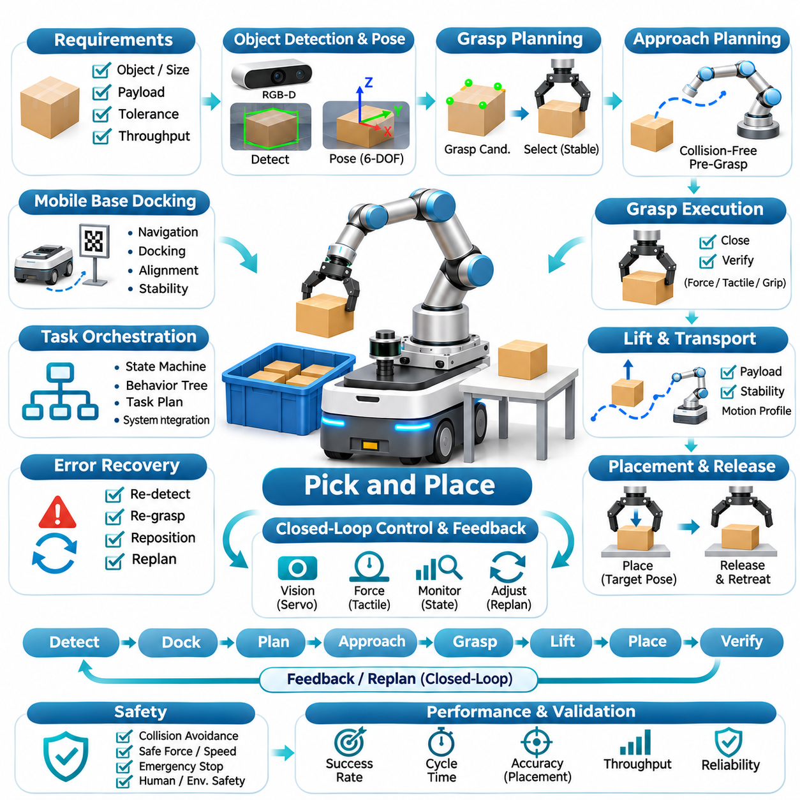{width="7.268055555555556in" height="7.268055555555556in"}

픽 앤 플레이스(Pick-and-Place)는 초기 위치(Initial Location)에서 목표 물체(Target Object)를 획득하고 지정된 목적지(Designated Destination)로 이동시키는 로봇 조작(Robotic Manipulation)의 기본적인 작업이다. 모바일 조작 시스템(Mobile Manipulation System)에서 픽 앤 플레이스 작업은 자율 내비게이션(Autonomous Navigation), 환경 인식(Environmental Perception), 파지 계획(Grasp Planning), 운동 계획(Motion Planning) 및 물리적 상호작용(Physical Interaction)을 결합하여 물류창고, 공장, 병원 및 물류 시설 전반에서 유연한 자동화(Flexible Automation)를 지원한다.

픽 앤 플레이스 개발 프로세스(Pick-and-Place Development Process)는 운용 시나리오(Operational Scenario)와 정량적으로 측정 가능한 성능 요구사항(Performance Requirement)을 정의하는 것에서 시작된다. 엔지니어는 목표 물체 특성(Target Object Characteristics), 피킹 위치(Picking Location), 배치 목적지(Placement Destination), 가반하중 요구사항(Payload Requirement), 위치 허용오차(Positioning Tolerance) 및 예상 처리량(Expected Throughput)을 식별해야 한다. 이러한 요구사항은 매니퓰레이터 선정(Manipulator Selection), 말단 장치 구성(End-Effector Configuration), 센서 아키텍처(Sensor Architecture), 제어 전략(Control Strategy) 및 소프트웨어 통합(Software Integration)에 영향을 미친다.

물체 검출(Object Detection)과 자세 추정(Pose Estimation)은 피킹 작업(Picking Operation)을 시작하는 데 필요한 공간 정보(Spatial Information)를 제공한다. RGB 카메라(RGB Camera), 깊이 카메라(Depth Camera) 및 3차원 비전 시스템(3D Vision System)은 목표 물체를 식별하고 물체의 위치(Position)와 방향(Orientation)을 추정한다. 카메라 좌표계(Camera Frame), 이동 베이스 좌표계(Mobile Base Frame), 매니퓰레이터 좌표계(Manipulator Frame) 및 도구 좌표계(Tool Frame) 사이의 정확한 좌표 변환(Coordinate Transformation)은 인식 결과(Perception Result)를 실행 가능한 조작 명령(Executable Manipulation Command)으로 변환하는 데 필수적이다.

이동 플랫폼 위치 설정(Mobile Platform Positioning)은 로봇 팔(Robot Arm)이 조작을 시작하기 전에 적절한 작업 위치(Operational Location)를 확보하는 과정이다. 자율이동로봇(Autonomous Mobile Robot, AMR)은 내비게이션 제약조건(Navigation Constraint), 매니퓰레이터 도달 가능성(Manipulator Reachability), 환경 장애물(Environmental Obstacle) 및 플랫폼 안정성(Platform Stability)을 고려하면서 작업 스테이션(Workstation)에 접근해야 한다. 정밀 도킹(Precision Docking)과 국부 시각 정렬(Local Visual Alignment)은 위치 추정 오차(Localization Error)를 보상하고 피킹 및 배치 작업의 반복성(Repeatability)을 향상시킬 수 있다.

파지 계획(Grasp Planning)은 목표 물체를 획득하기 위한 적절한 접촉 위치(Contact Location), 그리퍼 방향(Gripper Orientation), 접근 방향(Approach Direction) 및 파지력(Gripping Force)을 결정한다. 여러 파지 후보(Multiple Grasp Candidates)는 물체 형상(Object Geometry), 표면 특성(Surface Characteristics), 질량중심(Center of Mass), 충돌 위험(Collision Risk) 및 후속 배치 요구사항(Subsequent Placement Requirement)을 기준으로 평가될 수 있다. 선정된 파지 구성(Selected Grasp Configuration)은 전체 조작 과정(Manipulation Sequence)에서 성공적인 물체 획득(Object Acquisition)과 안정적인 운반(Stable Transportation)을 모두 지원해야 한다.

사전 파지 접근(Pre-Grasp Approach)은 목표 물체를 향해 제어된 운동(Controlled Movement)을 수행할 수 있도록 매니퓰레이터의 중간 구성(Intermediate Configuration)을 설정한다. 운동 계획 알고리즘(Motion Planning Algorithm)은 관절 한계(Joint Limitation), 환경적 제약조건(Environmental Constraint) 및 충돌 회피 요구사항(Collision Avoidance Requirement)을 충족하는 궤적(Trajectory)을 생성한다. 최종 접근(Final Approach) 과정에서는 시각 피드백(Visual Feedback) 또는 근접 감지(Proximity Sensing)를 활용하여 잔여 인식 오차(Residual Perception Error)와 보정 오차(Calibration Error)를 보상하도록 말단 장치의 위치를 정밀하게 조정할 수 있다.

파지 실행(Grasp Execution)은 목표 물체와 안정적인 물리적 접촉(Secure Physical Contact)을 형성하기 위해 말단 장치를 닫거나 활성화하는 과정이다. 평행형 그리퍼(Parallel Gripper), 진공 그리퍼(Vacuum Gripper), 적응형 로봇 손(Adaptive Robotic Hand) 및 특수 파지 메커니즘(Specialized Gripping Mechanism)은 서로 다른 제어 전략을 요구한다. 그리퍼 위치 피드백(Gripper Position Feedback), 진공 압력(Vacuum Pressure), 촉각 측정값(Tactile Measurement) 및 힘·토크 정보(Force-Torque Information)는 물체 획득이 성공적으로 완료되었는지를 검증하는 데 활용될 수 있다.

물체 들어 올리기 및 운반(Object Lifting and Transportation)은 기계적 및 동역학적 한계(Mechanical and Dynamic Limitation)를 준수하면서 파지 안정성(Grasp Stability)을 유지하는 협조 궤적 생성(Coordinated Trajectory Generation)을 요구한다. 과도한 가속(Excessive Acceleration), 급격한 방향 변화(Abrupt Directional Change) 및 불리한 로봇 팔 구성(Unfavorable Arm Configuration)은 물체 미끄러짐(Object Slippage)이나 플랫폼 불안정성(Platform Instability)을 유발할 수 있다. 엔지니어는 파지력, 액추에이터 토크(Actuator Torque), 관성(Inertia) 및 통합 무게중심(Combined Center of Gravity)을 고려하는 가반하중 기반 운동 프로파일(Payload-Dependent Motion Profile)을 확립해야 한다.

배치 계획(Placement Planning)은 지정된 목적지에서 물체의 목표 위치(Target Position)와 방향(Target Orientation)을 결정한다. 응용 분야의 요구사항에 따라 배치 작업에는 컨베이어 적재(Conveyor Loading), 선반 보충(Shelf Replenishment), 포장(Packaging), 팔레타이징(Palletizing) 또는 정밀 부품 위치 설정(Precision Component Positioning)이 포함될 수 있다. 계획 시스템(Planning System)은 사용 가능한 공간(Available Space), 목적지 형상(Destination Geometry), 인접 물체(Neighboring Object), 배치 허용오차(Placement Tolerance) 및 물체 해제 과정에서의 말단 장치 접근 가능성(End-Effector Accessibility)을 고려해야 한다.

제어된 물체 해제(Controlled Object Release)는 픽 앤 플레이스 작업 순서(Pick-and-Place Sequence)에서 중요한 단계를 구성한다. 매니퓰레이터는 의도하지 않은 물체 이동(Unintended Movement), 낙하(Dropping) 또는 손상(Damage)을 방지하기 위해 물체를 해제하기 전에 적절한 지지 조건(Support Condition)을 확보해야 한다. 힘 피드백(Force Feedback), 시각 검사(Visual Inspection) 및 그리퍼 상태 모니터링(Gripper State Monitoring)은 성공적인 물체 배치를 검증할 수 있다. 이후 충돌 없는 후퇴 궤적(Collision-Free Retreat Trajectory)을 통해 매니퓰레이터는 적절한 운용 구성(Operational Configuration)으로 복귀할 수 있다.

폐루프 픽 앤 플레이스 제어(Closed-Loop Pick-and-Place Control)는 센서 피드백(Sensory Feedback)을 조작 의사결정(Manipulation Decision)에 지속적으로 반영함으로써 실행 신뢰성(Execution Reliability)을 향상시킨다. 시각 서보 제어(Visual Servoing)는 위치 오차(Positioning Error)를 보정할 수 있으며, 힘 및 촉각 피드백(Force and Tactile Feedback)은 예상하지 못한 접촉(Unexpected Contact)이나 물체 이동을 검출할 수 있다. 폐루프 접근 방식(Closed-Loop Approach)은 연속적인 작업 사이에서 장비 위치(Equipment Location), 표면 조건(Surface Condition) 및 물체 배치(Object Arrangement)가 변화할 수 있는 모바일 환경(Mobile Environment)에서 특히 유용하다.

작업 오케스트레이션(Task Orchestration)은 상태 머신(State Machine), 행동 트리(Behavior Tree) 또는 작업 계획 프레임워크(Task Planning Framework)를 통해 전체 픽 앤 플레이스 작업 흐름(Workflow)을 조정한다. 각각의 운용 단계(Operational Stage)는 진입 조건(Entry Condition), 완료 기준(Completion Criteria), 시간 초과 한계(Timeout Limit) 및 실패 대응(Failure Response)을 정의해야 한다. 창고 관리 시스템(Warehouse Management System, WMS), 제조 실행 시스템(Manufacturing Execution System, MES) 및 플릿 관리 플랫폼(Fleet Management Platform)과의 통합은 자율 임무 할당(Autonomous Mission Assignment), 재고 추적(Inventory Tracking) 및 협조 자재 취급(Coordinated Material Handling)을 가능하게 한다.

오류 복구 메커니즘(Error Recovery Mechanism)은 부정확한 물체 검출(Inaccurate Object Detection), 파지 실패(Unsuccessful Grasping), 물체 미끄러짐(Object Slippage), 차단된 궤적(Blocked Trajectory) 및 잘못된 물체 배치(Incorrect Placement)와 같은 실패 상황을 처리한다. 복구 전략(Recovery Strategy)에는 환경 재인식(Renewed Perception), 대체 파지 선택(Alternative Grasp Selection), 이동 플랫폼 위치 재조정(Mobile Platform Repositioning), 궤적 재계획(Trajectory Replanning) 또는 제어된 임무 종료(Controlled Mission Termination)가 포함될 수 있다. 재시도 한계(Retry Limit)와 구조화된 진단 기록(Structured Diagnostic Record)은 반복적인 실패를 방지하고 체계적인 엔지니어링 개선(Systematic Engineering Improvement)을 지원한다.

안전 엔지니어링(Safety Engineering)은 전체 픽 앤 플레이스 과정에서 발생할 수 있는 충돌 위험(Collision Hazard), 물체 낙하(Dropped Object), 압착 위험(Crushing Risk), 예상하지 못한 플랫폼 이동(Unexpected Platform Movement) 및 과도한 접촉력(Excessive Contact Force)을 고려해야 한다. 위험성 평가(Risk Assessment)는 안전 등급 모니터링(Safety-Rated Monitoring), 제한 운용 구역(Restricted Operating Zone), 속도 제한(Speed Limitation) 및 보호 정지(Protective Stop)를 포함하는 적절한 보호 조치(Protective Measure)를 결정한다. 안전 기능(Safety Function)은 일반적인 인식 및 계획 알고리즘(Perception and Planning Algorithm)과 독립적으로 유효하게 작동해야 한다.

성능 최적화(Performance Optimization)는 피킹 정확도(Picking Accuracy), 배치 반복성(Placement Repeatability), 작업 성공률(Task Success Rate), 처리량(Throughput) 및 에너지 효율성(Energy Efficiency)을 향상시키는 데 중점을 둔다. 병렬 인식 처리(Parallel Perception Processing), 효율적인 궤적 생성(Efficient Trajectory Generation), 최적화된 파지 선택(Optimized Grasp Selection) 및 플랫폼 위치 재조정 감소(Reduced Platform Repositioning)는 작업 주기 시간(Operational Cycle Time)을 단축할 수 있다. 개발팀은 생산성 향상(Productivity Improvement)과 파지 신뢰성(Grasp Reliability), 장비 내구성(Equipment Durability), 연산 요구사항(Computational Requirement) 및 운용 안전성(Operational Safety) 사이의 균형을 확보해야 한다.

픽 앤 플레이스 검증(Pick-and-Place Validation)은 대표적인 물체 유형(Object Type), 가반하중(Payload), 물체 방향(Orientation), 작업 스테이션 구성(Workstation Configuration) 및 환경 조건(Environmental Condition)에 대한 체계적인 시험(Systematic Testing)을 요구한다. 핵심 성과 지표(Key Performance Indicator, KPI)에는 최초 시도 피킹 성공률(First-Attempt Picking Success Rate), 배치 정확도(Placement Accuracy), 평균 작업 주기 시간(Average Cycle Time), 시간당 처리량(Hourly Throughput), 물체 손상률(Object Damage Rate) 및 복구 효과성(Recovery Effectiveness)이 포함된다. 검증된 픽 앤 플레이스 기능(Validated Pick-and-Place Capability)은 확장 가능한 산업용 모바일 조작(Scalable Industrial Mobile Manipulation)과 자율 자재 취급(Autonomous Material Handling)을 구현하기 위한 기반을 확립한다.

## 07 Bin Picking

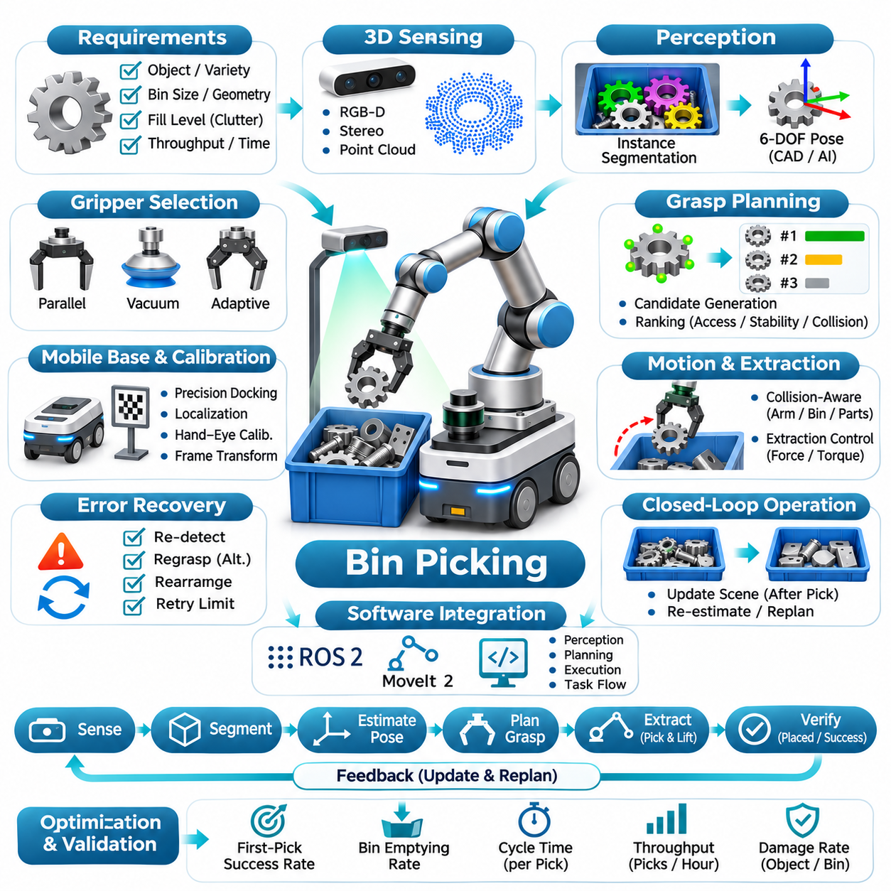{width="7.268055555555556in" height="7.268055555555556in"}

빈 피킹(Bin Picking)은 무작위로 배열되거나 부분적으로 정렬된 물체가 들어 있는 용기(Container)에서 개별 물체를 식별하고, 획득하며, 인출하는 로봇 조작 작업(Robotic Manipulation Operation)이다. 모바일 조작 시스템(Mobile Manipulation System)에서 빈 피킹은 자율 내비게이션(Autonomous Navigation), 3차원 인식(3D Perception), 물체 자세 추정(Object Pose Estimation), 파지 계획(Grasp Planning), 운동 계획(Motion Planning) 및 적응형 제어(Adaptive Control)를 결합하여 복잡한 산업 환경(Industrial Environment)에서 자재 취급(Material Handling)을 자동화한다.

빈 피킹 개발 프로세스(Bin Picking Development Process)는 목표 물체 특성(Target Object Characteristics), 용기 치수(Container Dimension), 적재 조건(Loading Condition), 운용 환경(Operational Environment) 및 생산 요구사항(Production Requirement)을 정의하는 것에서 시작된다. 엔지니어는 피킹 성공률(Picking Success Rate), 처리량(Processing Throughput), 물체 손상 방지(Object Damage Prevention), 위치 정확도(Positioning Accuracy) 및 복구 효과성(Recovery Effectiveness)에 대한 정량적으로 측정 가능한 목표를 확립해야 한다. 이러한 요구사항은 하드웨어 선정(Hardware Selection), 인식 아키텍처(Perception Architecture) 및 조작 전략(Manipulation Strategy)에 영향을 미친다.

3차원 인식(3D Perception)은 물체들이 빈번하게 중첩(Overlap)되고, 서로 가려지며(Occlusion), 예측하기 어려운 방향으로 배치되기 때문에 빈 피킹 시스템의 핵심 구성 요소이다. RGB-D 카메라(RGB-D Camera), 스테레오 비전 시스템(Stereo Vision System), 구조광 센서(Structured Light Sensor) 및 산업용 3차원 스캐너(Industrial 3D Scanner)는 용기 내부 물체에 대한 기하학적 정보(Geometric Information)를 제공한다. 사각지대(Blind Spot), 빛 반사(Reflection) 및 측정 불확실성(Measurement Uncertainty)을 최소화하기 위해 센서 배치(Sensor Placement)와 조명(Illumination)을 최적화해야 한다.

물체 검출(Object Detection)과 인스턴스 분할(Instance Segmentation)은 로봇 시스템이 물체가 밀집된 용기 내부에서 개별 물체를 구분할 수 있도록 한다. 딥러닝 모델(Deep Learning Model)은 부분적인 가려짐(Partial Occlusion)에도 불구하고 물체 범주(Object Category), 가시 경계(Visible Boundary) 및 접근 가능한 표면(Accessible Surface)을 식별할 수 있다. 인스턴스 분할은 동일한 부품이 여러 개 존재하는 경우 인식 시스템(Perception System)이 인접 물체(Neighboring Object)를 구분하고 독립적인 조작 목표(Independent Manipulation Target)를 생성할 수 있도록 한다는 점에서 특히 유용하다.

6자유도 물체 자세 추정(Six-Degree-of-Freedom Object Pose Estimation, 6-DoF)은 검출된 각 물체의 3차원 위치(3D Position)와 방향(Orientation)을 결정한다. 모델 기반 접근 방식(Model-Based Approach)은 CAD 형상(CAD Geometry)과 포인트 클라우드 정합(Point Cloud Registration)을 활용하는 반면, 학습 기반 접근 방식(Learning-Based Approach)은 센서 관측 정보(Sensory Observation)로부터 물체의 자세를 직접 추정한다. 기하학적 정밀 보정(Geometric Refinement)과 신경망 예측(Neural Network Prediction)을 결합한 하이브리드 방식(Hybrid Method)은 까다로운 조명, 가려짐 및 혼잡한 배치 조건(Clutter Condition)에서 자세 정확도(Pose Accuracy)를 향상시킬 수 있다.

파지 후보 생성(Grasp Candidate Generation)은 용기 내부의 개별 물체에 대해 접근 가능한 접촉 영역(Accessible Contact Region)과 실행 가능한 그리퍼 구성(Feasible Gripper Configuration)을 식별한다. 파지 후보(Grasp Candidate)는 물체 형상(Object Geometry), 표면 특성(Surface Properties), 사용 가능한 이격 공간(Available Clearance), 인접 물체 및 그리퍼 치수(Gripper Dimension)를 고려해야 한다. 학습 기반 파지 검출(Learning-Based Grasp Detection)과 기하학적 분석(Geometric Analysis)은 개별 물체의 자세를 신뢰성 있게 추정하기 어려운 경우 피킹 유연성(Picking Flexibility)을 향상시키는 여러 대체 파지 후보를 생성할 수 있다.

파지 순위 결정(Grasp Ranking)은 잠재적인 파지 후보의 예상 실행 가능성(Execution Feasibility)과 물체 획득 신뢰성(Acquisition Reliability)을 기준으로 평가하는 과정이다. 평가 기준(Evaluation Criteria)에는 파지 품질(Grasp Quality), 물체 접근성(Object Accessibility), 충돌 확률(Collision Probability), 접근 방향(Approach Direction) 및 인출 난이도(Extraction Difficulty)가 포함될 수 있다. 가장 가까운 물체보다 접근성이 가장 높은 물체를 선택하면 피킹 성공률을 향상시키고 물체가 밀집된 용기 내부에서 불필요한 조작 운동(Unnecessary Manipulation Movement)을 감소시킬 수 있다.

충돌 인지형 운동 계획(Collision-Aware Motion Planning)은 로봇 팔(Robot Arm)과 그리퍼(Gripper)가 제한된 용기 경계(Container Boundary) 내부에서 작동해야 하기 때문에 특히 중요하다. 충돌 모델(Collision Model)은 용기 벽면(Bin Wall), 인접 물체, 매니퓰레이터 링크(Manipulator Link) 및 말단 장치 형상(End-Effector Geometry)을 표현해야 한다. 접근 궤적(Approach Trajectory)과 인출 궤적(Extraction Trajectory)은 인식 불확실성(Perception Uncertainty), 보정 오차(Calibration Error) 및 주변 물체의 잠재적인 움직임을 고려하면서 적절한 이격거리(Clearance)를 유지해야 한다.

말단 장치 선정(End-Effector Selection)은 빈 피킹 시스템의 운용 성능(Operational Capability)에 상당한 영향을 미친다. 평행형 그리퍼(Parallel Gripper)는 다양한 강체 기계 부품(Rigid Mechanical Component)에 적합하며, 진공 그리퍼(Vacuum Gripper)는 적절한 표면 특성을 가진 물체를 취급할 수 있다. 적응형 그리퍼(Adaptive Gripper)와 특수 도구(Specialized Tooling)는 불규칙한 물체 배치(Irregular Arrangement)에서 접근성을 향상시킬 수 있다. 그리퍼 치수, 손가락 형상(Finger Geometry), 파지력(Gripping Force) 및 가반하중 용량(Payload Capacity)은 응용 분야의 요구사항(Application Requirement)에 부합해야 한다.

모바일 빈 피킹(Mobile Bin Picking)은 플랫폼 위치 설정(Platform Positioning), 위치 추정 정확도(Localization Accuracy) 및 작업 스테이션의 변동성(Workstation Variability)과 관련된 추가적인 기술적 과제를 수반한다. 정밀 도킹(Precision Docking)과 국부 시각 정렬(Local Visual Alignment)은 모바일 매니퓰레이터(Mobile Manipulator)와 목표 용기(Target Container) 사이에 일관된 공간적 관계(Spatial Relationship)를 확립한다. 정확한 핸드-아이 보정(Hand-Eye Calibration)과 좌표 변환(Coordinate Transformation)은 서로 다른 작업 스테이션과 반복적인 이동 플랫폼 움직임에도 인식 결과(Perception Result)를 지속적으로 활용할 수 있도록 한다.

물체 인출(Object Extraction)은 인접 물체의 배치를 흐트러뜨리거나 용기를 손상시키지 않으면서 선택된 부품을 제거하기 위한 제어된 조작(Controlled Manipulation)을 요구한다. 서로 맞물린 부품(Interlocking Component), 중첩된 형상(Overlapping Geometry) 및 예상하지 못한 마찰(Unexpected Friction)은 인출 난이도를 증가시킬 수 있다. 힘·토크 감지(Force-Torque Sensing), 순응 제어(Compliant Control) 및 적응형 인양 궤적(Adaptive Lifting Trajectory)은 비정상적인 저항(Abnormal Resistance)을 검출하고 필요한 경우 제어된 인출(Controlled Extraction) 또는 안전한 파지 해제(Safe Release)를 지원한다.

폐루프 인식 및 조작(Closed-Loop Perception and Manipulation)은 각각의 피킹 작업이 완료된 이후 환경 정보를 갱신함으로써 빈 피킹 신뢰성(Bin Picking Reliability)을 향상시킨다. 하나의 물체를 제거하면 남아 있는 부품의 위치와 방향이 변화하는 경우가 많다. 반복적인 장면 정보 획득(Repeated Scene Acquisition), 물체 자세 정밀 보정(Object Pose Refinement) 및 파지 후보 재생성(Grasp Candidate Regeneration)은 시스템이 초기 환경 관측 정보(Initial Environmental Observation)에만 의존하지 않고 변화하는 용기 내부 상태(Container Condition)에 적응할 수 있도록 한다.

오류 복구 메커니즘(Error Recovery Mechanism)은 파지 실패(Unsuccessful Grasping), 물체 미끄러짐(Object Slippage), 과도한 인출 저항(Excessive Extraction Resistance), 인식 실패(Perception Failure) 및 접근 불가능한 부품(Inaccessible Component)을 처리한다. 복구 전략(Recovery Strategy)에는 대체 파지 선택(Alternative Grasp Selection), 장면 정보 재획득(Renewed Scene Acquisition), 관측 시점 조정(Viewpoint Adjustment) 또는 제어된 물체 재배열(Controlled Rearrangement of Objects)이 포함될 수 있다. 재시도 한계(Retry Limit)와 실패 분류(Failure Classification)는 통제되지 않은 반복 실행을 방지하고 후속 엔지니어링 개선(Engineering Improvement)을 위한 진단 정보(Diagnostic Information)를 제공한다.

소프트웨어 통합(Software Integration)은 인식 모듈(Perception Module), 파지 검출 알고리즘(Grasp Detection Algorithm), 기구학 해석기(Kinematics Solver), 충돌 검출(Collision Detection), 궤적 제어기(Trajectory Controller) 및 작업 오케스트레이션 프레임워크(Task Orchestration Framework)를 연결한다. ROS 2와 MoveIt 2는 모듈형 빈 피킹 애플리케이션(Modular Bin Picking Application)을 구현하기 위한 재사용 가능한 인프라(Reusable Infrastructure)를 제공한다. 플릿 관리 시스템(Fleet Management System) 및 제조 실행 시스템(Manufacturing Execution System, MES)과의 통합은 자율 용기 취급(Autonomous Container Servicing), 생산 일정 관리(Production Scheduling) 및 자재 분배(Material Distribution)를 지원한다.

성능 최적화(Performance Optimization)는 파지 신뢰성(Grasp Reliability)과 운용 안전성(Operational Safety)을 유지하면서 피킹 처리량(Picking Throughput)을 증가시키는 데 중점을 둔다. 병렬 인식 처리(Parallel Perception Processing), 효율적인 파지 순위 결정(Efficient Grasp Ranking), 적응형 궤적 생성(Adaptive Trajectory Generation) 및 최적화된 물체 선택(Optimized Object Selection)은 작업 주기 시간(Cycle Time)을 단축할 수 있다. 엔지니어는 연산 지연시간(Computational Latency), 조작 속도(Manipulation Speed), 장비 내구성(Equipment Durability), 에너지 소비량(Energy Consumption) 및 신뢰성 있는 산업 운용에 필요한 정확도(Accuracy) 사이의 균형을 확보해야 한다.

빈 피킹 검증(Bin Picking Validation)은 대표적인 물체 형상, 재료(Material), 용기 구성(Container Configuration), 적재 수준(Fill Level) 및 환경 조건(Environmental Condition)에 대한 체계적인 시험(Systematic Testing)을 요구한다. 핵심 성과 지표(Key Performance Indicator, KPI)에는 최초 시도 피킹 성공률(First-Attempt Picking Success Rate), 용기 비우기 비율(Bin Emptying Rate), 평균 작업 주기 시간(Average Cycle Time), 시간당 처리량(Hourly Throughput), 물체 손상률(Object Damage Rate) 및 복구 효과성(Recovery Effectiveness)이 포함된다. 검증된 빈 피킹 기능(Validated Bin Picking Capability)은 확장 가능한 자율 산업용 자재 취급(Scalable Autonomous Industrial Material Handling)을 구현하기 위한 기반을 확립한다.

## 08 Force Control

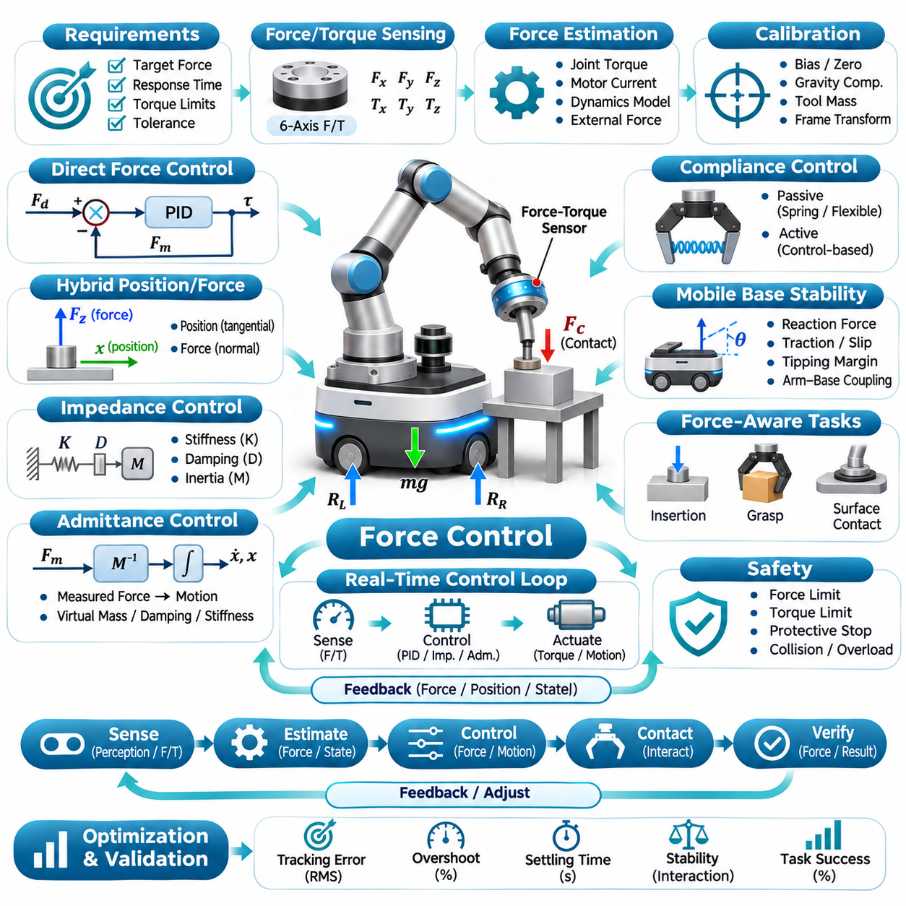{width="7.268055555555556in" height="7.268055555555556in"}

힘 제어(Force Control)는 로봇과 주변 환경 사이의 물리적 상호작용(Physical Interaction)을 조절하는 로봇 조작 시스템(Robotic Manipulation System)의 핵심 기능이다. 목표 기하학적 구성(Desired Geometric Configuration)에 도달하는 데 주로 초점을 맞추는 기존 위치 제어(Position Control)와 달리, 힘 제어는 로봇이 파지(Grasping), 조립(Assembly), 표면 검사(Surface Inspection), 자재 취급(Material Handling) 및 정밀 조작(Precision Manipulation) 과정에서 적절한 접촉력(Contact Force)을 유지할 수 있도록 한다.

힘 제어 개발 프로세스(Force Control Development Process)는 운용 요구사항(Operational Requirement)과 물리적 상호작용 조건(Physical Interaction Condition)을 정의하는 것에서 시작된다. 엔지니어는 목표 접촉력(Target Contact Force), 허용 힘 편차(Allowable Force Deviation), 응답 시간(Response Time), 토크 한계(Torque Limitation), 위치 허용오차(Positioning Tolerance) 및 환경 강성 특성(Environmental Stiffness Characteristics)을 확립해야 한다. 이러한 요구사항은 센서 선정(Sensor Selection), 액추에이터 구성(Actuator Configuration), 기계적 설계(Mechanical Design) 및 제어 아키텍처(Control Architecture)에 영향을 미친다.

힘·토크 센서(Force-Torque Sensor)는 조작 과정에서 물리적 상호작용을 모니터링하는 데 필요한 핵심 측정 기능(Measurement Capability)을 제공한다. 6축 힘·토크 센서(Six-Axis Force-Torque Sensor)는 3개 방향의 힘(Directional Force)과 3개의 회전 모멘트(Rotational Moment)를 측정하여 접촉 조건(Contact Condition)을 상세하게 분석할 수 있도록 한다. 센서 선정은 측정 범위(Measurement Range), 분해능(Resolution), 정확도(Accuracy), 샘플링 주파수(Sampling Frequency), 과부하 보호(Overload Protection), 통신 지연시간(Communication Latency) 및 기계적 통합 요구사항(Mechanical Integration Requirement)을 고려해야 한다.

힘 추정(Force Estimation)은 직접적인 힘 측정(Direct Force Measurement)에 대한 대체 또는 상호보완적인 접근 방식을 제공한다. 관절 토크 센서(Joint Torque Sensor), 액추에이터 전류 측정(Actuator Current Measurement) 및 동역학 모델(Dynamic Model)은 매니퓰레이터(Manipulator)에 작용하는 외력(External Force)을 추정할 수 있다. 정확한 힘 추정을 위해서는 중력 효과(Gravitational Effect), 마찰(Friction), 관성(Inertia) 및 액추에이터 특성(Actuator Characteristics)에 대한 보상(Compensation)이 필요하다. 직접 측정과 모델 기반 추정(Model-Based Estimation)을 결합하면 강건성(Robustness)과 진단 기능(Diagnostic Capability)을 향상시킬 수 있다.

직접 힘 제어(Direct Force Control)는 폐루프 피드백(Closed-Loop Feedback)을 통해 목표 접촉력(Desired Contact Force)과 측정된 접촉력(Measured Contact Force) 사이의 차이를 조절한다. 제어기(Controller)는 물리적 상호작용 과정에서 힘 추종 오차(Force Tracking Error)를 최소화하기 위해 액추에이터 토크(Actuator Torque) 또는 운동 명령(Motion Command)을 조정한다. 비례 제어(Proportional Control), 적분 제어(Integral Control) 및 미분 제어(Derivative Control) 전략은 시스템 동역학(System Dynamics), 환경 강성(Environmental Stiffness), 측정 잡음(Measurement Noise) 및 요구되는 응답 특성(Response Characteristics)에 따라 적용될 수 있다.

하이브리드 위치 및 힘 제어(Hybrid Position and Force Control)는 로봇 시스템이 서로 다른 공간적 방향(Spatial Direction)에서 위치와 접촉력을 동시에 조절할 수 있도록 한다. 예를 들어 표면 검사 과정에서 매니퓰레이터는 사전에 정의된 접선 방향 궤적(Tangential Trajectory)을 따라 이동하면서 일정한 수직 접촉력(Perpendicular Contact Force)을 유지할 수 있다. 이러한 접근 방식은 연마(Polishing), 조립(Assembly), 표면 가공(Surface Processing) 및 접촉 기반 검사(Contact-Based Inspection) 응용 분야에서 특히 유용하다.

임피던스 제어(Impedance Control)는 목표 강성(Stiffness), 감쇠(Damping) 및 관성(Inertia) 특성을 설정함으로써 외력과 매니퓰레이터 운동(Manipulator Motion) 사이의 동적 관계(Dynamic Relationship)를 조절한다. 임피던스 제어는 지정된 접촉력을 직접 유지하는 대신 로봇이 물리적 외란(Physical Disturbance)에 어떻게 반응해야 하는지를 정의한다. 조절 가능한 기계적 거동(Adjustable Mechanical Behavior)은 불확실한 환경(Uncertain Environment)과의 안정적인 상호작용(Stable Interaction)을 가능하게 하고 과도한 접촉력(Excessive Contact Force)을 감소시킨다.

어드미턴스 제어(Admittance Control)는 가상 동역학 모델(Virtual Dynamic Model)을 통해 측정된 외력(Measured External Force)을 목표 위치 명령(Desired Position Command) 또는 목표 속도 명령(Desired Velocity Command)으로 변환한다. 이러한 접근 방식은 고성능 위치 제어기(High-Performance Position Controller)를 갖추고 있지만 직접 토크 제어 기능(Direct Torque Control Capability)이 제한적인 로봇 매니퓰레이터에 특히 적합하다. 안정적이고 신속한 상호작용을 구현하기 위해서는 가상 질량(Virtual Mass), 감쇠 및 강성 매개변수(Stiffness Parameter)를 적절하게 선정하는 것이 필수적이다.

순응 제어(Compliance Control)는 매니퓰레이터가 기하학적 불확실성(Geometric Uncertainty), 정렬 오차(Alignment Error) 및 예상하지 못한 환경 저항(Unexpected Environmental Resistance)에 적응할 수 있도록 한다. 수동 순응(Passive Compliance)은 기계적 스프링(Mechanical Spring), 유연 구조(Flexible Structure) 또는 순응형 말단 장치(Compliant End Effector)를 통해 구현될 수 있으며, 능동 순응(Active Compliance)은 센서 피드백(Sensor Feedback)과 제어 알고리즘(Control Algorithm)을 활용한다. 두 가지 접근 방식을 결합하면 다양한 산업용 조작 시나리오(Industrial Manipulation Scenario)에서 상호작용 신뢰성(Interaction Reliability)을 향상시킬 수 있다.

모바일 조작(Mobile Manipulation)은 물리적 상호작용으로 인해 이동 플랫폼(Mobile Platform)에 영향을 미치는 반력(Reaction Force)이 발생하기 때문에 추가적인 힘 제어 과제를 수반한다. 플랫폼 강성(Platform Stiffness), 바퀴와 지면 사이의 마찰(Wheel-Ground Friction), 서스펜션 특성(Suspension Characteristics), 매니퓰레이터 구성(Manipulator Configuration) 및 가반하중 분포(Payload Distribution)는 전체 시스템의 안정성(Overall Stability)에 영향을 미친다. 힘 제어 전략은 플랫폼 운동 한계(Platform Movement Limitation)를 준수하고 의도하지 않은 변위(Unintended Displacement), 바퀴 미끄러짐(Wheel Slippage) 또는 전복(Tipping)을 방지해야 한다.

힘 제어 보정 및 보상(Force Control Calibration and Compensation)은 신뢰성 있는 상호작용 측정값(Interaction Measurement)을 획득하는 데 필수적이다. 시스템 개발 과정에서는 센서 편향(Sensor Bias), 중력 하중(Gravitational Loading), 도구 질량(Tool Mass), 가반하중 분포, 열적 드리프트(Thermal Drift) 및 좌표 변환(Coordinate Transformation)을 고려해야 한다. 보정 절차(Calibration Procedure)는 측정된 힘(Measured Force), 도구 좌표계(Tool Coordinate Frame), 매니퓰레이터 구성 및 실제 환경 접촉력(Actual Environmental Contact Force) 사이의 정확한 관계를 확립해야 한다.

실시간 힘 제어(Real-Time Force Control)는 예측 가능한 통신 지연시간(Predictable Communication Latency), 동기화된 센서 측정(Synchronized Sensor Measurement), 결정론적 제어기 실행(Deterministic Controller Execution) 및 적절한 피드백 주파수(Feedback Frequency)를 요구한다. 필터링 알고리즘(Filtering Algorithm)은 측정 잡음을 감소시킬 수 있지만, 과도한 필터링(Excessive Filtering)은 제어 안정성(Control Stability)을 저하시키는 지연을 발생시킬 수 있다. 엔지니어는 대표적인 접촉 강성(Contact Stiffness), 가반하중 조건(Payload Condition) 및 연산 작업부하(Computational Workload)에서 제어 성능(Control Performance)을 평가해야 한다.

힘 인지형 조작(Force-Aware Manipulation)은 접촉 측정(Contact Measurement)을 인식(Perception), 파지 계획(Grasp Planning), 운동 계획(Motion Planning) 및 작업 실행(Task Execution)과 통합한다. 시각 정보(Visual Information)는 초기 위치 설정(Initial Positioning)을 지원하는 반면, 힘 피드백(Force Feedback)은 삽입(Insertion), 정렬(Alignment), 파지 및 물체 인출(Object Extraction) 과정에서 미세 조정(Fine Adjustment)을 가능하게 한다. 이러한 상호보완적인 감지 방식(Complementary Sensing Modality)을 협조적으로 활용하면 기하학적 관측 정보(Geometric Observation)만으로 물리적 상호작용을 충분하게 설명할 수 없는 상황에서 조작 신뢰성(Manipulation Reliability)을 향상시킬 수 있다.

안전 엔지니어링(Safety Engineering)은 과도한 접촉력, 예상하지 못한 충돌(Unexpected Collision), 액추에이터 과부하(Actuator Overload), 물체 손상(Object Damage) 및 플랫폼 불안정성(Platform Instability)을 고려해야 한다. 힘 임계값(Force Threshold), 토크 제한(Torque Limitation), 제어된 후퇴(Controlled Withdrawal) 및 보호 정지(Protective Stop)는 체계적인 위험성 평가(Systematic Risk Assessment)를 통해 확립되어야 한다. 일반적인 힘 제어 알고리즘(Force Control Algorithm)은 독립적으로 검증된 안전 등급 기능(Independently Validated Safety-Rated Function)을 대체하는 수단으로 간주해서는 안 된다.

힘 제어 성능 최적화(Force Control Performance Optimization)는 추종 정확도(Tracking Accuracy), 응답 속도(Response Speed), 상호작용 안정성(Interaction Stability) 및 외란 억제(Disturbance Rejection)를 향상시키는 데 중점을 둔다. 제어기 튜닝(Controller Tuning), 적응형 매개변수 조정(Adaptive Parameter Adjustment), 동역학적 보상(Dynamic Compensation) 및 센서 융합(Sensor Fusion)은 변화하는 운용 조건(Operational Condition)에서 성능을 향상시킬 수 있다. 최적화 과정에서는 응답성(Responsiveness), 진동 발생 위험(Oscillation Risk), 측정 불확실성(Measurement Uncertainty), 기계적 내구성(Mechanical Durability) 및 연산 요구사항(Computational Requirement) 사이의 균형을 확보해야 한다.

힘 제어 검증(Force Control Validation)은 대표적인 접촉 표면(Contact Surface), 환경 강성 수준(Environmental Stiffness Level), 가반하중(Payload), 매니퓰레이터 구성 및 운용 시나리오(Operational Scenario)에 대한 체계적인 시험(Systematic Testing)을 요구한다. 핵심 성과 지표(Key Performance Indicator, KPI)에는 힘 추종 오차(Force Tracking Error), 최대 힘 오버슈트(Maximum Force Overshoot), 정착 시간(Settling Time), 접촉 안정성(Contact Stability), 작업 성공률(Task Success Rate) 및 외란 복구 성능(Disturbance Recovery Performance)이 포함된다. 검증된 힘 제어(Validated Force Control)는 신뢰성 있는 접촉 중심 산업용 모바일 조작(Contact-Rich Industrial Mobile Manipulation)을 구현하기 위한 기반을 제공한다.

## 09 Task and Motion Planning

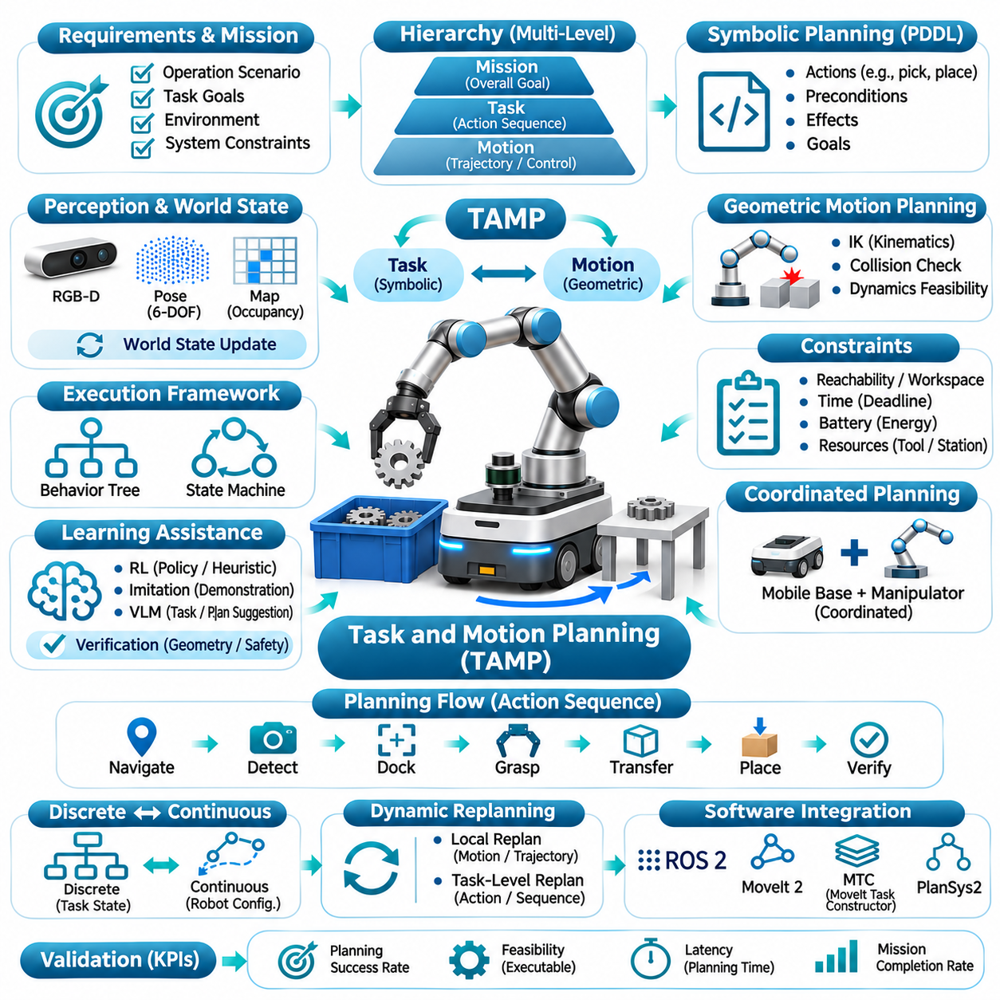{width="7.268055555555556in" height="7.268055555555556in"}

작업 및 운동 계획(Task and Motion Planning, TAMP)은 상위 수준의 작업 의사결정(High-Level Task Decision)과 하위 수준의 물리적 운동 생성(Low-Level Physical Motion Generation)을 결합하는 통합 로봇 계획 방법론(Integrated Robotic Planning Methodology)이다. 모바일 조작 시스템(Mobile Manipulation System)에서 TAMP는 복잡한 운용 목표(Operational Objective)를 달성하기 위해 로봇이 어떤 행동을 수행해야 하는지, 해당 행동을 어디에서 수행해야 하는지, 그리고 이동 플랫폼(Mobile Platform)과 매니퓰레이터(Manipulator)가 어떻게 움직여야 하는지를 결정할 수 있도록 한다.

TAMP 개발 프로세스(TAMP Development Process)는 운용 시나리오(Operational Scenario), 작업 목표(Task Objective), 환경 조건(Environmental Condition) 및 시스템 제약조건(System Constraint)을 정의하는 것에서 시작된다. 엔지니어는 사용 가능한 로봇 기능(Robotic Capability), 물체 상호작용 요구사항(Object Interaction Requirement), 작업 스테이션 구성(Workstation Configuration) 및 임무 완료 기준(Mission Completion Criteria)을 식별해야 한다. 이러한 요구사항은 기호적 추론(Symbolic Reasoning)과 물리적 실행(Physical Execution)을 연결하는 통합 계획 아키텍처(Integrated Planning Architecture)를 개발하기 위한 기반을 확립한다.

상위 수준 작업 계획(High-Level Task Planning)은 복잡한 운용 목표를 실행 가능한 행동 순서(Executable Action Sequence)로 분해한다. 개별 행동(Individual Action)에는 작업 스테이션으로의 이동, 물체 식별(Object Identification), 이동 플랫폼 위치 재조정(Mobile Platform Repositioning), 부품 파지(Component Grasping) 및 자재 이송(Material Transfer)이 포함될 수 있다. 작업 계획(Task Planning)은 논리적 의존관계(Logical Dependency), 실행 우선순위(Execution Priority), 자원 요구사항(Resource Requirement) 및 후속 행동을 시작하기 전에 충족해야 하는 조건을 결정한다.

기호적 계획(Symbolic Planning)은 추상적인 수학적 표현(Abstract Mathematical Representation)을 통해 물체, 환경 상태(Environmental State), 로봇 기능 및 운용 행동(Operational Action)을 표현한다. 계획 도메인 정의 언어(Planning Domain Definition Language, PDDL)는 행동의 사전조건(Action Precondition), 효과(Effect) 및 작업 목표를 정의하기 위한 구조화된 접근 방식(Structured Approach)을 제공한다. 기호적 표현(Symbolic Representation)은 로봇 시스템이 가능한 모든 물리적 움직임을 명시적으로 평가하지 않고도 운용 요구사항을 추론할 수 있도록 한다.

기하학적 운동 계획(Geometric Motion Planning)은 기호적 행동 순서(Symbolic Action Sequence)를 물리적으로 실행 가능한 궤적(Physically Executable Trajectory)으로 변환한다. 각각의 조작 행동(Manipulation Action)은 기구학적 한계(Kinematic Limitation), 충돌 회피 요구사항(Collision Avoidance Requirement), 작업공간 제한(Workspace Restriction) 및 동역학적 제약조건(Dynamic Constraint)을 충족해야 한다. 기하학적 실행 가능성 검사(Geometric Feasibility Check)를 기호적 계획에 통합하면 실제 환경에서 물리적으로 실행할 수 없는 논리적으로 유효한 행동(Logically Valid Action)이 선택되는 것을 방지할 수 있다.

이산적 작업 계획(Discrete Task Planning)과 연속적 운동 계획(Continuous Motion Planning)의 통합은 TAMP 개발에서 핵심적인 기술적 과제(Technical Challenge)를 구성한다. 기호적 의사결정(Symbolic Decision)은 이산 상태(Discrete State)와 행동을 기반으로 수행되는 반면, 물리적 운동 생성(Physical Motion Generation)은 연속 구성 공간(Continuous Configuration Space)을 기반으로 수행된다. 통합 계획 알고리즘(Integrated Planning Algorithm)은 기하학적 제약조건(Geometric Constraint), 실행 가능성 피드백(Feasibility Feedback) 및 작업 순서 후보(Candidate Task Sequence)의 반복적 정밀화(Iterative Refinement)를 통해 이러한 표현 방식들을 조정해야 한다.

계층적 계획 아키텍처(Hierarchical Planning Architecture)는 복잡한 로봇 임무(Robotic Mission)를 여러 추상화 수준(Abstraction Level)으로 구성한다. 임무 계획(Mission Planning)은 전체 운용 목표를 정의하고, 작업 계획은 행동 순서를 결정하며, 운동 계획(Motion Planning)은 실행 가능한 궤적을 생성한다. 이러한 계층적 분해(Hierarchical Decomposition)는 계획 복잡성(Planning Complexity)을 감소시키면서 명확하게 정의된 인터페이스(Well-Defined Interface)를 통해 개별 소프트웨어 구성 요소(Software Component)를 개발하고, 최적화하며, 시험하고, 유지관리할 수 있도록 한다.

제약조건 기반 작업 및 운동 계획(Constraint-Based Task and Motion Planning)은 논리적(Logical), 기하학적(Geometric), 시간적(Temporal) 및 물리적(Physical) 요구사항을 하나의 통합된 프레임워크(Coordinated Framework) 내에서 평가한다. 제약조건에는 물체 접근성(Object Accessibility), 액추에이터 한계(Actuator Limitation), 충돌 방지 이격거리(Collision Clearance), 자원 가용성(Resource Availability), 배터리 용량(Battery Capacity) 및 작업 완료 기한(Task Deadline)이 포함될 수 있다. 제약조건 전파(Constraint Propagation)와 최적화 기법(Optimization Technique)은 부적합한 계획 대안(Planning Alternative)을 제거하면서 실행 가능한 행동 순서를 식별하는 데 도움이 된다.

모바일 조작 계획(Mobile Manipulation Planning)은 이동 플랫폼 구성(Mobile Platform Configuration)을 작업 및 운동 의사결정(Task and Motion Decision)에 통합함으로써 기존 TAMP를 확장한다. 계획 시스템(Planning System)은 적절한 내비게이션 목표(Navigation Goal), 도킹 위치(Docking Position), 매니퓰레이터 구성(Manipulator Configuration) 및 물체 상호작용 전략(Object Interaction Strategy)을 결정해야 한다. 이동 베이스와 로봇 팔의 협조 계획(Coordinated Base and Arm Planning)은 복잡한 산업용 조작 작업(Industrial Manipulation Operation)에서 작업공간 접근성(Workspace Accessibility)을 향상시키고 불필요한 위치 재조정(Unnecessary Repositioning)을 감소시킨다.

인식 기반 계획(Perception-Driven Planning)은 환경 관측 정보(Environmental Observation)를 작업 및 운동 의사결정에 지속적으로 반영한다. 물체 검출(Object Detection), 자세 추정(Pose Estimation), 의미론적 매핑(Semantic Mapping) 및 점유 정보(Occupancy Information)는 물리적 환경(Physical Environment)에 대한 갱신된 표현(Updated Representation)을 제공한다. 계획 시스템은 예상된 조건(Expected Condition)과 실제 운용 상황(Actual Operational Circumstance) 사이의 일관성(Consistency)을 유지하기 위해 기호적 세계 상태(Symbolic World State)와 센서 관측 정보(Sensor Observation)를 일치시켜야 한다.

행동 트리(Behavior Tree)와 상태 머신(State Machine)은 통합 작업 및 운동 계획을 구현하기 위한 실용적인 실행 프레임워크(Execution Framework)를 제공한다. 개별 실행 상태(Execution State) 또는 행동 노드(Behavior Node)는 내비게이션(Navigation), 인식(Perception), 파지 생성(Grasp Generation), 궤적 실행(Trajectory Execution), 힘 제어 기반 상호작용(Force-Controlled Interaction) 및 복구 작업(Recovery Operation)을 표현할 수 있다. 이러한 프레임워크는 모듈형 실행 관리(Modular Execution Management), 조건부 의사결정(Conditional Decision-Making) 및 운용 실패(Operational Failure)에 대한 구조화된 처리를 지원한다.

동적 재계획(Dynamic Replanning)은 환경 조건의 변화로 인해 이전에 생성된 계획이 더 이상 유효하지 않은 경우 로봇 시스템이 이에 적응할 수 있도록 한다. 이동 장애물(Moving Obstacle), 이용할 수 없는 물체(Unavailable Object), 파지 실패(Unsuccessful Grasp), 차단된 궤적(Blocked Trajectory) 또는 장비 변경(Equipment Change)은 기존 행동 순서의 수정을 요구할 수 있다. 계획 아키텍처(Planning Architecture)는 임무 실행 가능성(Mission Feasibility)을 복원하기 위해 국부 운동 재계획(Local Motion Replanning) 또는 상위 수준 작업 재계획(High-Level Task Replanning)이 필요한지를 결정해야 한다.

학습 기반 작업 및 운동 계획(Learning-Based Task and Motion Planning)은 행동 선택(Action Selection), 기하학적 실행 가능성 예측(Geometric Feasibility Prediction) 및 계획 효율성(Planning Efficiency)을 향상시키기 위해 인공지능(Artificial Intelligence, AI)을 활용한다. 강화학습(Reinforcement Learning), 모방학습(Imitation Learning) 및 비전-언어 모델(Vision-Language Model, VLM)은 행동 후보(Candidate Action) 또는 계획 휴리스틱(Planning Heuristic)을 제공할 수 있다. 학습을 통해 도출된 의사결정(Learned Decision)은 실행 전에 기하학적 검증(Geometric Verification), 물리적 제약조건(Physical Constraint) 및 독립적으로 검증된 안전 메커니즘(Independently Validated Safety Mechanism)의 적용을 받아야 한다.

소프트웨어 통합(Software Integration)은 기호적 계획기(Symbolic Planner), 인식 파이프라인(Perception Pipeline), 운동 계획 라이브러리(Motion Planning Library), 궤적 제어기(Trajectory Controller) 및 임무 관리 시스템(Mission Management System)을 연결한다. ROS 2, MoveIt 2, MoveIt Task Constructor 및 PlanSys2와 같은 프레임워크(Framework)는 통합 계획 애플리케이션(Integrated Planning Application)을 개발하기 위한 인프라(Infrastructure)를 제공한다. 표준화된 인터페이스(Standardized Interface)는 통신(Communication), 상태 동기화(State Synchronization), 모듈형 개발(Modular Development) 및 체계적인 진단 분석(Systematic Diagnostic Analysis)을 지원한다.

성능 최적화(Performance Optimization)는 계획 지연시간(Planning Latency), 실행 시간(Execution Time), 연산 복잡성(Computational Complexity) 및 불필요한 로봇 움직임(Unnecessary Robotic Movement)을 감소시키는 데 중점을 둔다. 계층적 분해(Hierarchical Decomposition), 휴리스틱 탐색(Heuristic Search), 병렬 실행 가능성 평가(Parallel Feasibility Evaluation) 및 재사용 가능한 계획 결과(Reusable Planning Result)는 시스템 효율성(System Efficiency)을 향상시킬 수 있다. 엔지니어는 계획 속도(Planning Speed), 해의 품질(Solution Quality), 운용 유연성(Operational Flexibility), 실행 신뢰성(Execution Reliability) 및 사용 가능한 온보드 연산 자원(Onboard Computational Resource) 사이의 균형을 확보해야 한다.

작업 및 운동 계획 검증(Task and Motion Planning Validation)은 대표적인 임무(Mission), 물체 구성(Object Configuration), 환경 조건(Environmental Condition) 및 운용 외란(Operational Disturbance)에 대한 체계적인 시험(Systematic Testing)을 요구한다. 핵심 성과 지표(Key Performance Indicator, KPI)에는 작업 계획 성공률(Task Planning Success Rate), 운동 실행 가능률(Motion Feasibility Rate), 계획 지연시간(Planning Latency), 임무 완료율(Mission Completion Rate) 및 재계획 효과성(Replanning Effectiveness)이 포함된다. 검증된 TAMP 기능(Validated TAMP Capability)은 확장 가능한 자율 산업용 모바일 조작(Scalable Autonomous Industrial Mobile Manipulation)을 구현하기 위한 기반을 확립한다.

## 10 Error Recovery

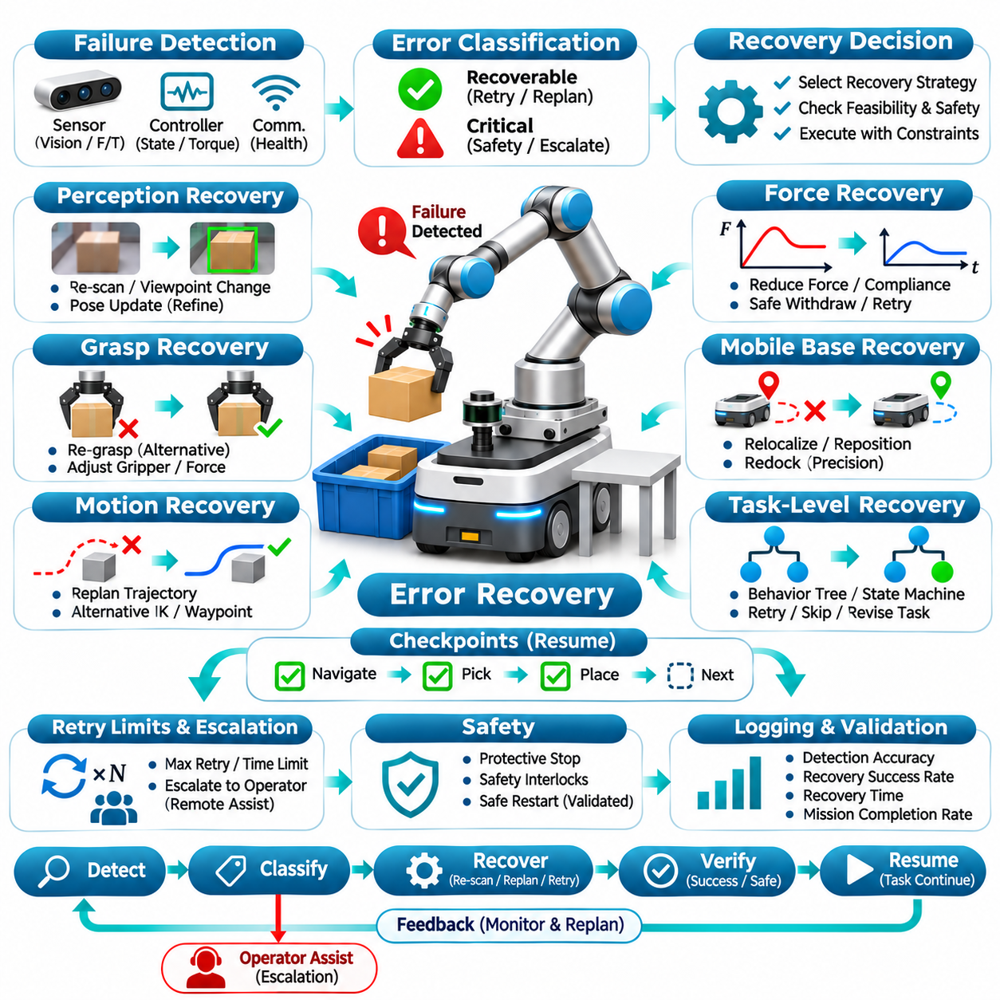{width="7.268055555555556in" height="7.268055555555556in"}

오류 복구(Error Recovery)는 자율 로봇(Autonomous Robot)이 운용 실패(Operational Failure), 예상하지 못한 환경 조건(Unexpected Environmental Condition) 및 실행 불확실성(Execution Uncertainty)에 대응할 수 있도록 하는 로봇 조작 시스템(Robotic Manipulation System)의 핵심 기능이다. 모바일 조작(Mobile Manipulation)에서 효과적인 오류 복구는 인식(Perception), 내비게이션(Navigation), 운동 계획(Motion Planning), 힘 제어(Force Control) 및 작업 실행(Task Execution)을 협조적으로 통합하여 안전성(Safety)과 신뢰성(Reliability)을 유지하면서 운용 기능(Operational Functionality)을 복원한다.

오류 복구 개발 프로세스(Error Recovery Development Process)는 전체 조작 작업 흐름(Manipulation Workflow)에서 발생할 수 있는 잠재적 실패 시나리오(Potential Failure Scenario)를 식별하는 것에서 시작된다. 엔지니어는 인식 실패(Perception Failure), 위치 추정 오류(Localization Error), 파지 실패(Unsuccessful Grasp), 도달 불가능한 목표(Unreachable Target), 궤적 중단(Trajectory Interruption), 통신 장애(Communication Failure) 및 액추에이터 이상(Actuator Abnormality)을 분석해야 한다. 체계적인 실패 분석(Systematic Failure Analysis)은 적절한 검출 메커니즘(Detection Mechanism)과 복구 전략(Recovery Strategy)을 개발하기 위한 기반을 확립한다.

오류 검출(Error Detection)은 예상된 시스템 거동(Expected System Behavior)으로부터의 편차를 식별하기 위해 운용 매개변수(Operational Parameter)를 지속적으로 모니터링한다. 센서 측정값(Sensor Measurement), 제어기 피드백(Controller Feedback), 실행 상태(Execution State), 통신 상태(Communication Status) 및 작업 완료 신호(Task Completion Signal)는 발생하는 오류에 관한 정보를 제공한다. 임계값 기반 모니터링(Threshold-Based Monitoring)과 모델 기반 이상 검출(Model-Based Anomaly Detection)은 비정상적인 조건(Abnormal Condition)이 더욱 심각한 운용 문제(Operational Problem)로 발전하기 전에 이를 식별할 수 있다.

오류 분류(Error Classification)는 검출된 오류를 발생 원인(Origin), 심각도(Severity), 운용 영향(Operational Impact) 및 복구 가능성(Recovery Feasibility)에 따라 분류한다. 복구 가능한 오류(Recoverable Error)에는 일시적인 인식 실패(Temporary Perception Failure) 또는 파지 실패가 포함될 수 있는 반면, 치명적 오류(Critical Failure)에는 기계적 손상(Mechanical Damage) 또는 안전 시스템 이상(Safety System Abnormality)이 포함될 수 있다. 정확한 오류 분류(Accurate Error Classification)는 시스템이 추가적인 운용 위험(Operational Risk)을 발생시키지 않으면서 적절한 복구 행동(Recovery Action)을 선택할 수 있도록 한다.

인식 오류 복구(Perception Error Recovery)는 부정확한 물체 검출(Inaccurate Object Detection), 센서 데이터 누락(Missing Sensor Data), 불확실한 자세 추정(Uncertain Pose Estimation) 및 환경 관측 실패(Environmental Observation Failure)를 처리한다. 복구 전략에는 반복적인 이미지 획득(Repeated Image Acquisition), 카메라 관측 시점 조정(Camera Viewpoint Adjustment), 대체 센서 활용(Alternative Sensor Utilization) 및 물체 자세 정밀 보정(Object Pose Refinement)이 포함될 수 있다. 환경 관측 정보(Environmental Observation)를 갱신하면 로봇이 추가적인 물리적 상호작용(Physical Interaction)을 시도하기 전에 신뢰성 있는 조작 목표(Manipulation Target)를 재구성할 수 있다.

파지 실패 복구(Grasp Failure Recovery)는 로봇 매니퓰레이터(Robotic Manipulator)가 물체 획득 실패(Unsuccessful Object Acquisition), 물체 미끄러짐(Object Slippage), 불충분한 파지력(Insufficient Gripping Force) 및 예상하지 못한 물체 움직임(Unexpected Object Movement)에 대응할 수 있도록 한다. 시스템은 대체 파지 후보(Alternative Grasp Candidate)를 생성하거나, 그리퍼 방향(Gripper Orientation)을 변경하거나, 검증된 한계(Validated Limit) 내에서 파지 매개변수(Gripping Parameter)를 조정하거나, 매니퓰레이터의 위치를 재설정할 수 있다. 복구 의사결정(Recovery Decision)은 물체 특성(Object Characteristics), 충돌 위험(Collision Risk) 및 사용 가능한 작업공간(Available Workspace)을 고려해야 한다.

운동 계획 복구(Motion Planning Recovery)는 도달 불가능한 목표 자세(Unreachable Target Pose), 유효하지 않은 궤적(Invalid Trajectory), 예상하지 못한 장애물(Unexpected Obstacle) 및 기구학적 한계(Kinematic Limitation)를 처리한다. 대체 역기구학 해(Alternative Inverse Kinematics Solution), 궤적 재생성(Trajectory Regeneration), 중간 경유점 선택(Intermediate Waypoint Selection) 및 이동 플랫폼 위치 재조정(Mobile Platform Repositioning)은 운동 실행 가능성(Motion Feasibility)을 복원할 수 있다. 갱신된 충돌 모델(Collision Model)과 환경 표현(Environmental Representation)은 변화하는 운용 조건(Operational Condition)에서 반복적인 계획 실패(Repeated Planning Failure)를 방지하는 데 필수적이다.

힘 제어 복구(Force Control Recovery)는 과도한 접촉력(Excessive Contact Force), 예상하지 못한 저항(Unexpected Resistance), 불안정한 상호작용(Unstable Interaction) 및 비정상적인 토크 측정값(Abnormal Torque Measurement)을 관리한다. 제어기(Controller)는 조작 작업을 중단하거나, 명령된 힘(Commanded Force)을 감소시키거나, 조건이 허용하는 경우 검증된 후퇴 궤적(Validated Withdrawal Trajectory)을 실행할 수 있다. 힘 및 토크 피드백(Force and Torque Feedback)은 작업을 안전하게 재개(Safe Resumption)할 수 있는지 또는 추가적인 개입(Additional Intervention)이 필요한지를 결정하는 데 중요한 정보를 제공한다.

이동 플랫폼 복구(Mobile Platform Recovery)는 위치 추정 불확실성(Localization Uncertainty), 내비게이션 실패(Navigation Failure), 도킹 오류(Docking Error), 바퀴 미끄러짐(Wheel Slippage) 및 예상하지 못한 플랫폼 변위(Unexpected Platform Displacement)를 처리한다. 위치 재추정(Relocalization), 대체 경로 생성(Alternative Route Generation) 및 정밀 도킹 재시도(Precision Docking Retry)는 조작 작업에 필요한 공간적 조건(Spatial Condition)을 복원할 수 있다. 시스템은 중단된 로봇 팔 작업(Robotic Arm Operation)을 재개하기 전에 플랫폼 안정성(Platform Stability)과 위치 정확도(Positioning Accuracy)를 검증해야 한다.

작업 수준 복구(Task-Level Recovery)는 중단된 행동(Interrupted Action)을 반복하거나, 대체하거나, 생략하거나, 수정된 작업 순서(Revised Task Sequence)에 통합할 수 있는지를 평가한다. 행동 트리(Behavior Tree), 계층적 상태 머신(Hierarchical State Machine) 및 작업 계획 프레임워크(Task Planning Framework)는 구조화된 복구 의사결정(Structured Recovery Decision)을 지원한다. 복구 로직(Recovery Logic)은 완료된 작업(Completed Operation)을 보존하고, 일관된 물체 상태(Consistent Object State)를 유지하며, 생산 프로세스(Production Process)에 부정적인 영향을 미칠 수 있는 중복 행동(Duplicated Action)을 방지해야 한다.

체크포인트 기반 복구(Checkpoint-Based Recovery)는 전체 조작 작업 흐름에서 의미 있는 실행 상태(Execution State)를 기록한다. 체크포인트(Checkpoint)에는 완료된 내비게이션 단계(Completed Navigation Stage), 검증된 물체 획득(Verified Object Acquisition), 확인된 물체 배치(Confirmed Placement) 및 작업 스테이션 준비 상태(Workstation Readiness)가 포함될 수 있다. 작업 중단(Interruption)이 발생하면 시스템은 가장 최근의 유효한 체크포인트(Valid Checkpoint)를 평가하고 실제 물리적 조건(Actual Physical Condition)을 확인한 이후 적절한 운용 상태(Operational State)에서 작업을 재개할 수 있다.

재시도 관리(Retry Management)는 실패한 복구 행동이 무한하게 반복되는 것을 방지한다. 최대 재시도 횟수(Maximum Retry Count), 복구 시간 한계(Recovery Time Limit), 실패 상향 대응 규칙(Failure Escalation Rule) 및 대체 행동 순서(Alternative Action Sequence)는 개발 과정에서 확립되어야 한다. 반복적인 실패(Repeated Failure)는 장비 마모(Equipment Wear), 에너지 소비량(Energy Consumption) 및 운용 지연(Operational Delay)을 증가시키는 통제되지 않은 실행 루프(Uncontrolled Execution Loop)가 아니라 진단 평가(Diagnostic Evaluation) 또는 운영자 개입(Operator Intervention)을 유발해야 한다.

안전 중심 복구(Safety-Oriented Recovery)는 시정 행동(Corrective Action)이 검증된 운용 경계(Validated Operational Boundary) 내에서 유지되도록 보장한다. 비상 정지(Emergency Stop), 보호 정지(Protective Stop), 액추에이터 고장(Actuator Fault) 및 안전 센서 장애(Safety Sensor Failure)는 시스템 안전 아키텍처(System Safety Architecture)에 부합하는 제어된 대응(Controlled Response)을 요구한다. 자동 복구(Automatic Recovery)는 안전 인터록(Safety Interlock)을 우회하거나 적용되는 리셋 및 재시작 요구사항(Reset and Restart Requirement)을 충족하지 않은 상태에서 위험한 움직임(Hazardous Motion)을 재개해서는 안 된다.

원격 지원(Remote Assistance)은 자율 복구(Autonomous Recovery)가 복잡한 운용 실패를 해결할 수 없는 경우 상위 단계 대응 메커니즘(Escalation Mechanism)을 제공한다. 운영자는 적절한 시정 행동을 승인하기 전에 동기화된 센서 데이터(Synchronized Sensor Data), 진단 메시지(Diagnostic Message), 로봇 구성(Robot Configuration) 및 작업 이력(Task History)을 검토할 수 있다. 명확하게 정의된 개입 절차(Intervention Procedure)는 안전성을 저하시키거나 일관성 없는 시스템 상태(Inconsistent System State)를 발생시키지 않으면서 운용 연속성(Operational Continuity)을 유지하는 데 도움이 된다.

오류 복구 소프트웨어 통합(Error Recovery Software Integration)은 모니터링 서비스(Monitoring Service), 진단 모듈(Diagnostic Module), 인식 파이프라인(Perception Pipeline), 운동 제어기(Motion Controller), 작업 오케스트레이션 프레임워크(Task Orchestration Framework) 및 플릿 관리 시스템(Fleet Management System)을 연결한다. ROS 2 통신 메커니즘(Communication Mechanism), 액션 인터페이스(Action Interface) 및 행동 트리는 모듈형 복구 아키텍처(Modular Recovery Architecture)를 구현하기 위한 인프라(Infrastructure)를 제공한다. 표준화된 오류 코드(Standardized Error Code)와 실행 상태 메시지(Execution Status Message)는 협조적 복구(Coordinated Recovery)와 체계적인 문제 해결(Systematic Troubleshooting)을 지원한다.

운용 실패 로깅(Operational Failure Logging)은 검출된 오류, 환경 조건(Environmental Condition), 복구 의사결정 및 실행 결과(Execution Outcome)에 관한 정보를 보존함으로써 지속적 개선(Continuous Improvement)을 지원한다. 과거 실패 데이터(Historical Failure Data)는 반복적으로 발생하는 문제(Recurring Problem), 비효율적인 복구 순서(Inefficient Recovery Sequence) 및 인식 또는 제어 알고리즘(Control Algorithm)의 취약점(Weakness)을 식별할 수 있도록 한다. 통계적 분석(Statistical Analysis)은 엔지니어가 시정 조치(Corrective Action)의 우선순위를 결정하고 장기적인 시스템 신뢰성(Long-Term System Reliability)을 향상시킬 수 있도록 한다.

오류 복구 검증(Error Recovery Validation)은 제어된 결함 주입(Controlled Fault Injection), 환경 외란(Environmental Disturbance), 센서 중단(Sensor Interruption) 및 대표적인 조작 실패(Representative Manipulation Failure)를 통한 체계적인 시험(Systematic Testing)을 요구한다. 핵심 성과 지표(Key Performance Indicator, KPI)에는 실패 검출 정확도(Failure Detection Accuracy), 자율 복구 성공률(Autonomous Recovery Success Rate), 평균 복구 시간(Mean Time to Recovery, MTTR), 반복 실패율(Repeated Failure Rate) 및 임무 완료율(Mission Completion Rate)이 포함된다. 검증된 복구 기능(Validated Recovery Capability)은 복원력 있는 자율 산업용 모바일 조작(Resilient Autonomous Industrial Mobile Manipulation)을 구현하기 위한 기반을 확립한다.

## 11 Performance Optimization

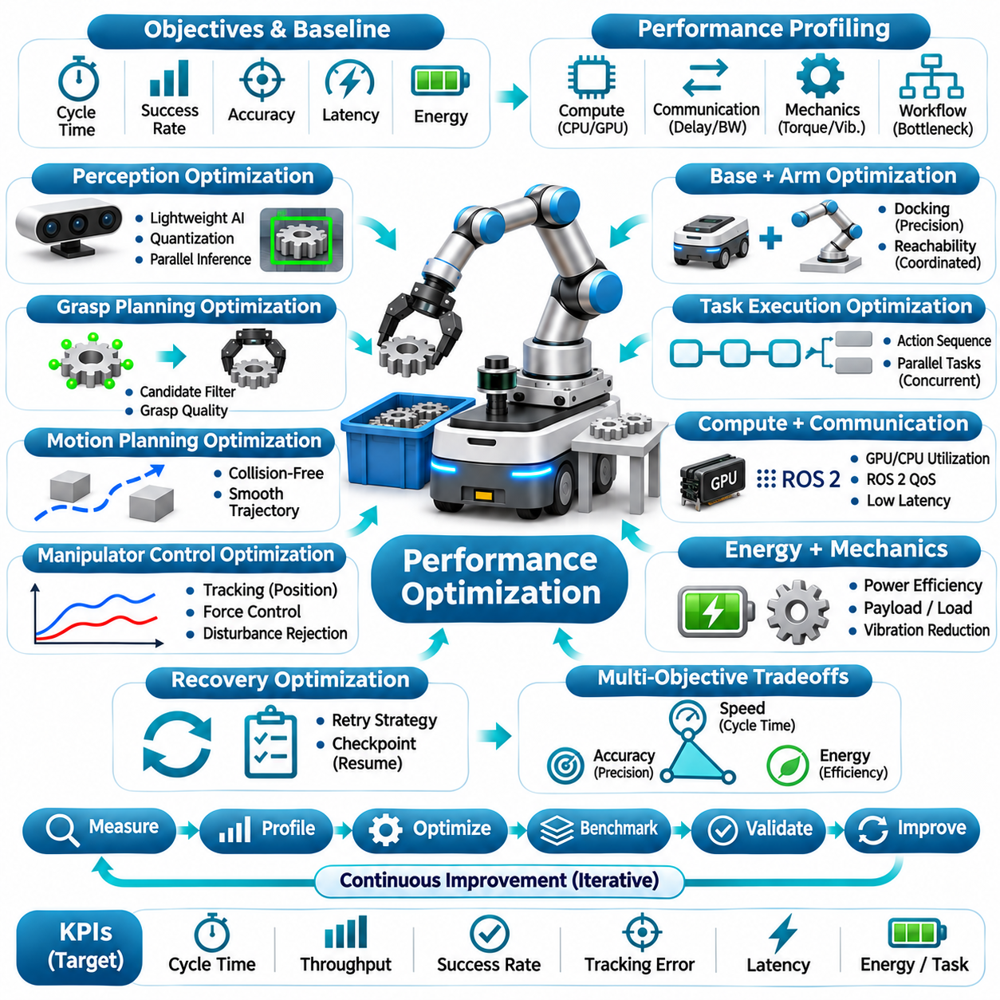{width="7.268055555555556in" height="7.268055555555556in"}

성능 최적화(Performance Optimization)는 로봇 조작 시스템(Robotic Manipulation System)의 운용 효율성(Operational Efficiency), 실행 정확도(Execution Accuracy), 응답성(Responsiveness) 및 신뢰성(Reliability)을 향상시키는 체계적인 엔지니어링 프로세스(Systematic Engineering Process)이다. 모바일 조작(Mobile Manipulation)에서 성능 최적화는 인식(Perception), 내비게이션(Navigation), 파지 계획(Grasp Planning), 운동 계획(Motion Planning), 힘 제어(Force Control), 작업 실행(Task Execution) 및 연산 자원 관리(Computational Resource Management) 전반에 걸친 통합적인 개선을 요구한다.

성능 최적화 프로세스(Performance Optimization Process)는 측정 가능한 운용 목표(Measurable Operational Objective)와 기준 성능 지표(Baseline Performance Indicator)를 확립하는 것에서 시작된다. 엔지니어는 목표 작업 주기 시간(Target Cycle Time), 조작 성공률(Manipulation Success Rate), 위치 정확도(Positioning Accuracy), 처리 지연시간(Processing Latency), 에너지 소비량(Energy Consumption) 및 장비 활용률(Equipment Utilization)을 정의해야 한다. 기준 성능 측정(Baseline Measurement)은 성능 한계(Performance Limitation)를 식별하고 후속 엔지니어링 개선(Engineering Improvement)을 평가하기 위한 정량적 기준(Quantitative Reference)을 제공한다.

성능 프로파일링(Performance Profiling)은 전체 조작 작업 흐름(Manipulation Workflow)에서 발생하는 연산 병목현상(Computational Bottleneck), 통신 지연(Communication Delay), 기계적 한계(Mechanical Limitation) 및 비효율적인 실행 순서(Inefficient Execution Sequence)를 식별한다. 타임스탬프가 기록된 센서 측정값(Timestamped Sensor Measurement), 소프트웨어 실행 추적(Software Execution Trace), 제어기 피드백(Controller Feedback) 및 작업 완료 기록(Task Completion Record)은 상세한 성능 정보(Performance Information)를 제공한다. 프로파일링은 평균 실행 거동(Average Execution Behavior)과 최악의 운용 조건(Worst-Case Operational Condition)을 구분해야 한다.

인식 최적화(Perception Optimization)는 물체 검출(Object Detection), 자세 추정(Pose Estimation), 장면 재구성(Scene Reconstruction) 및 파지 검출(Grasp Detection)의 효율성을 향상시키는 데 중점을 둔다. 경량 신경망 아키텍처(Lightweight Neural Network Architecture), 모델 양자화(Model Quantization), 최적화된 추론 엔진(Optimized Inference Engine) 및 병렬 이미지 처리(Parallel Image Processing)는 연산 지연시간(Computational Latency)을 감소시킬 수 있다. 엔지니어는 처리 속도(Processing Speed)의 향상이 인식 정확도(Perception Accuracy) 또는 조작 신뢰성(Manipulation Reliability)을 현저하게 저하시키지 않도록 해야 한다.

파지 계획 최적화(Grasp Planning Optimization)는 신뢰성 있고 접근 가능한 파지 구성(Grasp Configuration)을 식별하는 데 필요한 연산량(Computational Effort)을 감소시킨다. 효율적인 후보 생성(Efficient Candidate Generation), 기하학적 필터링(Geometric Filtering), 파지 품질 추정(Grasp Quality Estimation) 및 우선순위 기반 실행 가능성 평가(Prioritized Feasibility Evaluation)는 상세한 분석 이전에 부적합한 대안(Unsuitable Alternative)을 제거할 수 있다. 강건한 파지 후보(Robust Grasp Candidate)를 선택하면 물체 획득 실패(Unsuccessful Acquisition Attempt)를 감소시키고 불필요한 복구 작업(Unnecessary Recovery Operation)을 최소화할 수 있다.

운동 계획 최적화(Motion Planning Optimization)는 충돌 회피(Collision Avoidance), 기구학적 실행 가능성(Kinematic Feasibility) 및 동적 안정성(Dynamic Stability)을 유지하면서 궤적 생성 효율성(Trajectory Generation Efficiency)을 향상시킨다. 적응형 샘플링(Adaptive Sampling), 휴리스틱 탐색(Heuristic Search), 궤적 재사용(Trajectory Reuse) 및 병렬 계획 알고리즘(Parallel Planning Algorithm)은 계획 지연시간(Planning Latency)을 감소시킬 수 있다. 궤적 평활화(Trajectory Smoothing)와 시간 매개변수화(Time Parameterization)는 불필요한 움직임과 급격한 가속도 변화(Abrupt Acceleration Change)를 최소화함으로써 실행 효율성(Execution Efficiency)을 더욱 향상시킨다.

매니퓰레이터 제어 최적화(Manipulator Control Optimization)는 궤적 추종 정확도(Trajectory Tracking Accuracy), 관절 협조 제어(Joint Coordination), 힘 조절(Force Regulation) 및 외란 억제(Disturbance Rejection)를 향상시키는 데 중점을 둔다. 적절한 제어기 튜닝(Controller Tuning), 피드포워드 보상(Feedforward Compensation), 마찰 보상(Friction Compensation) 및 적응형 제어 기법(Adaptive Control Technique)은 동적 성능(Dynamic Performance)을 향상시킬 수 있다. 최적화 과정에서는 액추에이터 한계(Actuator Limitation), 구조적 유연성(Structural Flexibility), 기계적 진동(Mechanical Vibration) 및 장기적인 장비 내구성(Long-Term Equipment Durability)을 고려해야 한다.

이동 베이스 및 매니퓰레이터 협조 최적화(Coordinated Mobile Base and Manipulator Optimization)는 내비게이션과 조작 활동(Manipulation Activity) 사이의 공간적 관계(Spatial Relationship)를 개선한다. 적절한 도킹 위치(Docking Position), 접근 방향(Approach Direction) 및 매니퓰레이터 구성(Manipulator Configuration)을 선택하면 불필요한 플랫폼 움직임(Platform Movement)을 감소시키고 작업공간 접근성(Workspace Accessibility)을 향상시킬 수 있다. 협조 계획(Coordinated Planning)은 또한 기구학적 특이점(Kinematic Singularity), 관절 한계(Joint Limitation) 및 불안정한 가반하중 구성(Unstable Payload Configuration)을 회피하는 데 도움이 된다.

작업 실행 최적화(Task Execution Optimization)는 행동 순서 결정(Action Sequencing), 자원 할당(Resource Allocation) 및 소프트웨어 구성 요소(Software Component) 사이의 동기화(Synchronization)를 개선함으로써 운용 지연(Operational Delay)을 감소시킨다. 인식 처리(Perception Processing)와 궤적 준비(Trajectory Preparation)와 같은 독립적인 작업(Independent Operation)은 작업 간 의존관계(Dependency)가 허용하는 경우 동시에 실행될 수 있다. 효율적인 작업 오케스트레이션(Task Orchestration)은 실행 일관성(Execution Consistency)이나 운용 안전성(Operational Safety)을 저하시키지 않으면서 유휴 시간(Idle Time)을 최소화한다.

연산 자원 최적화(Computational Resource Optimization)는 온보드 프로세서(Onboard Processor), 그래픽 처리 장치(Graphics Processing Unit, GPU), 메모리(Memory) 및 통신 인터페이스(Communication Interface)가 효율적으로 활용되도록 한다. 작업부하 분산(Workload Distribution), 비동기 처리(Asynchronous Processing), 하드웨어 가속(Hardware Acceleration) 및 메모리 관리(Memory Management)는 전체 시스템 응답성(Overall System Responsiveness)을 향상시킬 수 있다. 자원 할당은 비필수적인 연산 활동(Nonessential Computational Activity)보다 시간 민감형 제어(Time-Critical Control)와 안전 관련 기능(Safety-Related Function)에 우선순위를 부여해야 한다.

통신 최적화(Communication Optimization)는 메시지 전송 지연(Message Transmission Delay), 과도한 대역폭 소비(Excessive Bandwidth Consumption), 동기화 오류(Synchronization Error) 및 미들웨어 오버헤드(Middleware Overhead)를 개선한다. ROS 2 통신 메커니즘(Communication Mechanism), 적절한 서비스 품질 설정(Quality of Service Configuration, QoS), 공유 메모리 전송(Shared-Memory Transport) 및 효율적인 메시지 구조(Efficient Message Structure)는 데이터 교환 성능(Data Exchange Performance)을 향상시킬 수 있다. 통신 설정(Communication Setting)은 개별 소프트웨어 모듈(Software Module)의 시간적 요구사항(Timing Requirement)과 신뢰성 요구사항(Reliability Requirement)을 반영해야 한다.

에너지 효율 최적화(Energy Efficiency Optimization)는 내비게이션, 조작, 연산(Computation) 및 대기 운용(Standby Operation) 과정에서 발생하는 불필요한 전력 소비(Power Consumption)를 감소시킨다. 에너지 인지형 궤적 계획(Energy-Aware Trajectory Planning), 효율적인 액추에이터 활용(Efficient Actuator Utilization), 적응형 연산 작업부하(Adaptive Computational Workload) 및 지능형 충전 전략(Intelligent Charging Strategy)은 운용 지속시간(Operating Duration)을 연장할 수 있다. 에너지 최적화는 배터리 특성(Battery Characteristics), 가반하중 변화(Payload Variation), 생산 일정(Production Schedule) 및 임무 요구사항(Mission Requirement)을 고려해야 한다.

기계적 성능 최적화(Mechanical Performance Optimization)는 구조적 강성(Structural Stiffness), 가반하중 분포(Payload Distribution), 말단 장치 중량(End-Effector Weight), 액추에이터 효율(Actuator Efficiency) 및 진동 특성(Vibration Characteristics)을 개선한다. 불필요한 가동 질량(Moving Mass)을 감소시키고 기계적 구성(Mechanical Configuration)을 개선하면 조작 속도(Manipulation Speed)와 위치 정확도를 향상시킬 수 있다. 기계적 개선(Mechanical Improvement)은 바람직하지 않은 동적 상호작용(Undesirable Dynamic Interaction)과 과도한 부품 하중(Excessive Component Loading)을 방지하기 위해 제어 매개변수(Control Parameter)와 함께 평가되어야 한다.

복구 성능 최적화(Recovery Performance Optimization)는 파지 실패(Unsuccessful Grasp), 인식 오류(Perception Error), 계획 실패(Planning Failure) 및 환경 외란(Environmental Disturbance)으로 인해 발생하는 운용 중단(Operational Interruption)을 최소화한다. 정확한 실패 분류(Failure Classification), 효율적인 재시도 전략(Efficient Retry Strategy), 체크포인트 기반 복구(Checkpoint-Based Recovery) 및 대체 작업 계획(Alternative Task Planning)은 복구 시간(Recovery Time)을 단축할 수 있다. 복구 효과성(Recovery Effectiveness)의 향상은 더 높은 임무 완료율(Mission Completion Rate)과 지속적인 생산 처리량(Sustained Production Throughput)을 확보하는 데 기여한다.

다목적 최적화(Multi-Objective Optimization)는 상호 경쟁하는 성능 요구사항(Competing Performance Requirement)을 통합된 엔지니어링 프레임워크(Unified Engineering Framework) 내에서 평가한다. 더욱 빠른 조작은 에너지 소비량, 기계적 마모(Mechanical Wear), 진동(Vibration) 또는 위치 오차(Positioning Error)를 증가시킬 수 있는 반면, 더 높은 정확도는 더 긴 처리 시간(Processing Time)을 요구할 수 있다. 파레토 최적화(Pareto Optimization)와 체계적인 매개변수 탐색(Systematic Parameter Exploration)은 엔지니어가 응용 분야별 운용 요구사항(Application-Specific Operational Requirement)을 충족하는 균형 잡힌 구성(Balanced Configuration)을 식별할 수 있도록 한다.

성능 벤치마킹(Performance Benchmarking)은 일관된 실험 조건(Consistent Experimental Condition)에서 최적화 결과(Optimization Result)를 사전에 확립된 기준 성능 측정값과 비교한다. 의미 있는 비교(Meaningful Comparison)를 위해서는 대표적인 작업부하(Representative Workload), 물체 구성(Object Configuration), 가반하중(Payload), 환경 변화(Environmental Variation) 및 반복 시험(Repeated Trial)이 필요하다. 벤치마킹은 평균 측정값(Average Measurement)에만 의존하지 않고 통계적 변동성(Statistical Variability), 실패율(Failure Rate) 및 최악 조건 성능(Worst-Case Performance)을 포함해야 한다.

지속적인 성능 최적화(Continuous Performance Optimization)는 운용 데이터(Operational Data), 진단 정보(Diagnostic Information) 및 현장 배포 결과(Field Deployment Result)를 반복적인 개발 주기(Iterative Development Cycle)에 통합한다. 엔지니어는 반복적으로 발생하는 병목현상(Recurring Bottleneck)을 식별하고, 소프트웨어 업데이트(Software Update)를 평가하며, 제어 매개변수를 정밀하게 조정하고, 하드웨어 구성(Hardware Configuration)을 개선할 수 있다. 회귀 시험(Regression Testing)과 형상 관리(Configuration Management)는 개별적인 최적화가 이전에 검증된 시스템 기능(Previously Validated System Capability)을 저하시키지 않도록 보장한다.

성능 최적화 검증(Performance Optimization Validation)은 엔지니어링 개선 사항이 대표적인 산업 환경(Representative Industrial Condition)에서 측정 가능한 운용 요구사항(Measurable Operational Requirement)을 충족하는지를 확인한다. 핵심 성과 지표(Key Performance Indicator, KPI)에는 평균 작업 주기 시간(Average Cycle Time), 시간당 처리량(Hourly Throughput), 조작 성공률(Manipulation Success Rate), 궤적 추종 오차(Trajectory Tracking Error), 종단 간 지연시간(End-to-End Latency) 및 작업당 에너지 소비량(Energy Consumption per Task)이 포함된다. 검증된 성능(Validated Performance)은 확장 가능하고 상업적 실현 가능성을 갖춘 산업용 모바일 조작(Scalable and Commercially Viable Industrial Mobile Manipulation)을 구현하기 위한 기반을 확립한다.

## 12 Manipulation Validation

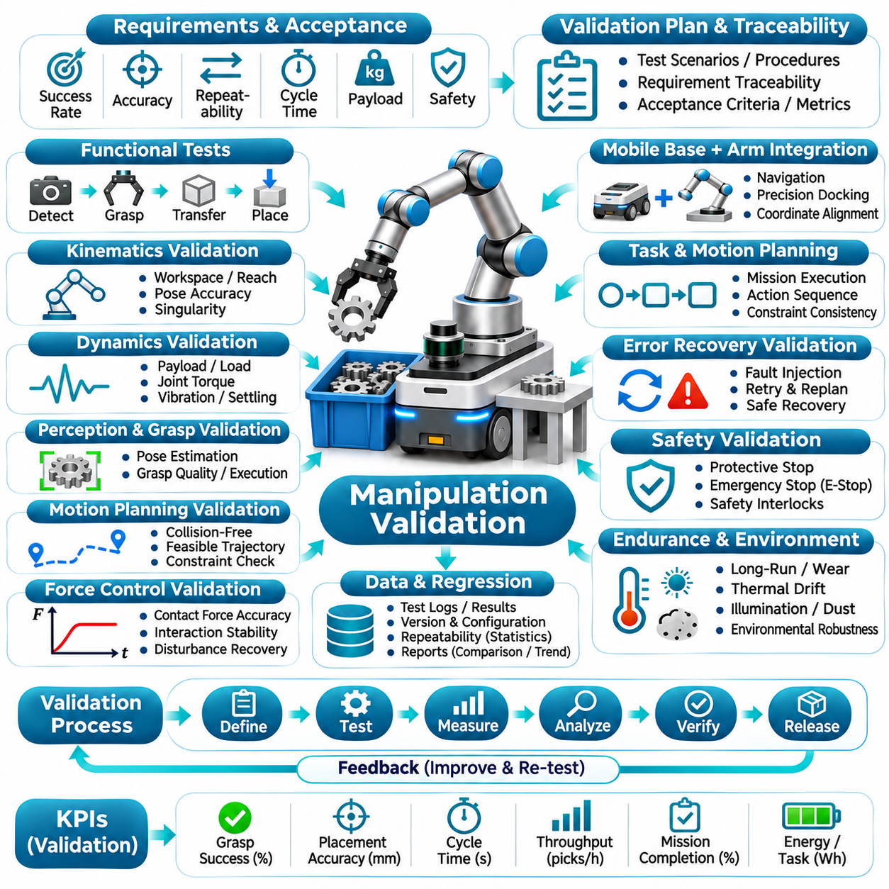{width="7.268055555555556in" height="7.268055555555556in"}

조작 검증(Manipulation Validation)은 로봇 조작 시스템(Robotic Manipulation System)이 명시된 기능적 요구사항(Functional Requirement), 성능 요구사항(Performance Requirement), 안전 요구사항(Safety Requirement) 및 신뢰성 요구사항(Reliability Requirement)을 충족하는지를 확인하는 체계적인 엔지니어링 프로세스(Systematic Engineering Process)이다. 모바일 조작(Mobile Manipulation)에서 검증은 대표적인 운용 조건(Operational Condition)에서 인식(Perception), 내비게이션(Navigation), 파지 계획(Grasp Planning), 운동 계획(Motion Planning), 힘 제어(Force Control), 작업 실행(Task Execution) 및 오류 복구(Error Recovery)의 통합적인 거동(Integrated Behavior)을 포함한다.

조작 검증 프로세스(Manipulation Validation Process)는 제품 요구사항(Product Requirement)과 목표 응용 시나리오(Intended Application Scenario)를 기반으로 측정 가능한 인수 기준(Measurable Acceptance Criteria)을 확립하는 것에서 시작된다. 엔지니어는 목표 조작 성공률(Target Manipulation Success Rate), 위치 정확도(Positioning Accuracy), 반복 정밀도(Repeatability), 실행 시간(Execution Time), 가반하중 용량(Payload Capacity) 및 운용 안전 요구사항(Operational Safety Requirement)을 정의해야 한다. 각각의 인수 기준은 해당 시스템 요구사항(System Requirement) 및 문서화된 시험 절차(Documented Test Procedure)와 추적 가능성(Traceability)을 확보해야 한다.

기능 검증(Functional Validation)은 개별 조작 기능(Individual Manipulation Capability)이 통합 로봇 시스템(Integrated Robotic System) 내에서 정상적으로 작동하는지를 평가한다. 대표적인 시험 시나리오(Test Scenario)에는 물체 식별(Object Identification), 자세 추정(Pose Estimation), 파지 생성(Grasp Generation), 궤적 실행(Trajectory Execution), 물체 획득(Object Acquisition), 자재 이송(Material Transfer) 및 제어된 배치(Controlled Placement)가 포함된다. 기능 시험(Functional Testing)은 정상 운용 조건(Normal Operating Condition)뿐만 아니라 예측 가능한 물체 및 환경의 변화(Foreseeable Variations in Objects and Environments)도 포함해야 한다.

기구학적 검증(Kinematic Validation)은 매니퓰레이터 작업공간 접근성(Manipulator Workspace Accessibility), 위치 정확도(Positioning Accuracy), 방향 정확도(Orientation Accuracy), 관절 한계(Joint Limitation) 및 특이점 회피(Singularity Avoidance)를 평가한다. 실험적 측정(Experimental Measurement)은 대표적인 매니퓰레이터 구성(Manipulator Configuration)에서 실제 말단 장치 자세(Actual End-Effector Pose)와 명령된 자세(Commanded Pose)를 비교해야 한다. 외부 정밀 계측 장비(External Metrology Equipment), 보정된 기준 타깃(Calibrated Reference Target) 및 독립적인 측정 시스템(Independent Measurement System)은 신뢰성 있는 정량적 평가(Quantitative Assessment)를 지원할 수 있다.

동역학적 검증(Dynamic Validation)은 다양한 가반하중(Payload), 가속도 프로파일(Acceleration Profile), 외부 외란(External Disturbance) 및 운용 속도(Operating Speed)에서 매니퓰레이터의 거동(Manipulator Behavior)을 평가한다. 관절 토크 측정(Joint Torque Measurement), 궤적 추종 오차(Trajectory Tracking Error), 진동 특성(Vibration Characteristics) 및 정착 시간(Settling Time)은 동적 성능(Dynamic Performance)에 관한 정보를 제공한다. 시험은 기계적 구조(Mechanical Structure), 액추에이터(Actuator) 및 제어 알고리즘(Control Algorithm)이 검증된 설계 한계(Validated Design Limitation) 내에서 작동하는지를 확인해야 한다.

인식 및 파지 검증(Perception and Grasp Validation)은 물체 검출(Object Detection), 자세 추정, 파지 후보 생성(Grasp Candidate Generation) 및 물리적 물체 획득(Physical Object Acquisition)의 신뢰성을 평가한다. 대표적인 데이터세트(Representative Dataset)와 실제 시험 물체(Physical Test Object)는 기하학적 형상(Geometry), 재료(Material), 표면 특성(Surface Properties), 방향(Orientation) 및 가려짐(Occlusion)의 다양한 변화를 포함해야 한다. 실제 파지 실행 결과(Actual Grasp Execution Result)는 실질적인 조작 신뢰성(Practical Manipulation Reliability)을 확립하기 위해 예측된 파지 품질(Predicted Grasp Quality)과 비교되어야 한다.

운동 계획 검증(Motion Planning Validation)은 생성된 궤적(Generated Trajectory)이 충돌 회피(Collision Avoidance), 기구학적 실행 가능성(Kinematic Feasibility), 동역학적 제약조건(Dynamic Constraint) 및 운용 요구사항을 충족하는지를 평가한다. 시험 시나리오에는 제한된 작업공간(Confined Workspace), 복잡한 장애물 구성(Complex Obstacle Configuration), 도달 불가능한 목표(Unreachable Target) 및 변화하는 환경 조건(Changing Environmental Condition)이 포함되어야 한다. 검증은 성공적인 궤적 생성(Trajectory Generation)뿐만 아니라 안전하지 않거나 실행 불가능한 운동(Unsafe or Infeasible Motion)을 적절하게 거부하는 기능도 평가해야 한다.

힘 제어 검증(Force Control Validation)은 물리적 조작(Physical Manipulation) 과정에서 접촉력 정확도(Contact Force Accuracy), 응답 특성(Response Characteristics), 상호작용 안정성(Interaction Stability) 및 외란 복구(Disturbance Recovery)를 평가한다. 대표적인 시험에는 부품 삽입(Component Insertion), 표면 검사(Surface Inspection), 순응형 파지(Compliant Grasping) 및 제어된 물체 인출(Controlled Object Extraction)이 포함될 수 있다. 힘 추종 오차(Force Tracking Error), 최대 오버슈트(Maximum Overshoot), 정착 시간 및 접촉 안정성(Contact Stability)은 상호작용 성능(Interaction Performance)에 대한 정량적 지표(Quantitative Indicator)를 제공한다.

이동 베이스 및 매니퓰레이터 통합 검증(Mobile Base and Manipulator Integration Validation)은 자율 내비게이션(Autonomous Navigation), 정밀 도킹(Precision Docking), 플랫폼 안정화(Platform Stabilization) 및 로봇 팔 운용(Robotic Arm Operation)의 통합 성능(Combined Performance)을 평가한다. 시험은 도킹 정확도(Docking Accuracy), 바닥 조건(Floor Condition), 플랫폼 방향(Platform Orientation) 및 가반하중 분포(Payload Distribution)의 변화를 평가해야 한다. 성공적인 통합(Successful Integration)을 위해서는 여러 작업 스테이션(Workstation)에서 일관된 좌표 변환(Coordinate Transformation)과 신뢰성 있는 공간적 정렬(Spatial Alignment)이 요구된다.

작업 및 운동 계획 검증(Task and Motion Planning Validation)은 개별적으로 분리된 로봇 움직임(Isolated Robotic Movement)이 아니라 전체 운용 작업 흐름(Complete Operational Workflow)의 실행을 평가한다. 대표적인 임무(Representative Mission)에는 내비게이션, 물체 식별, 파지(Grasping), 운송(Transportation), 배치(Placement) 및 작업 완료 확인(Task Completion Verification)이 포함되어야 한다. 검증은 논리적 행동 순서(Logical Action Sequence)가 물리적 조건(Physical Condition), 자원 가용성(Resource Availability) 및 운용 제약조건(Operational Constraint)과 일관성을 유지하는지를 확인해야 한다.

오류 복구 검증(Error Recovery Validation)은 로봇 시스템이 운용 실패(Operational Failure)를 검출하고, 분류하며, 복구할 수 있는 능력을 평가한다. 제어된 결함 주입(Controlled Fault Injection)은 인식 오류(Perception Error), 파지 실패(Unsuccessful Grasp), 차단된 궤적(Blocked Trajectory), 통신 중단(Communication Interruption) 및 위치 추정 외란(Localization Disturbance)을 모의할 수 있다. 시험은 복구 효과성(Recovery Effectiveness), 재시도 한계(Retry Limitation), 실패 상향 대응(Failure Escalation) 및 실행 상태 간 안전한 전환(Safe Transition Between Execution States)을 검증해야 한다.

안전 검증(Safety Validation)은 충돌(Collision), 과도한 접촉력(Excessive Contact Force), 예상하지 못한 움직임(Unexpected Movement), 물체 낙하(Dropped Object), 액추에이터 고장(Actuator Failure) 및 이동 플랫폼 불안정성(Mobile Platform Instability)과 관련된 위험(Risk)을 평가한다. 보호 정지(Protective Stop), 비상 정지(Emergency Stop), 안전 인터록(Safety Interlock) 및 재시작 절차(Restart Procedure)는 적용되는 안전 요구사항(Applicable Safety Requirement)을 기준으로 평가되어야 한다. 조작 기능이 성공적으로 수행되었다는 사실만으로는 안전 관련 성능 요구사항(Safety-Related Performance Requirement)의 준수 여부를 입증할 수 없다.

내구성 검증(Endurance Validation)은 반복적이고 장시간 지속되는 운용 기간(Repetitive and Extended Operating Period) 동안 조작 신뢰성을 평가한다. 대표적인 작업 흐름(Representative Workflow)을 지속적으로 실행하면 열적 한계(Thermal Limitation), 기계적 마모(Mechanical Wear), 보정 드리프트(Calibration Drift), 센서 성능 저하(Sensor Degradation) 및 소프트웨어 자원 관리 문제(Software Resource Management Problem)를 식별할 수 있다. 장시간 시험(Long-Duration Testing)은 고장 발생 빈도(Failure Frequency), 성능 저하(Performance Degradation), 유지보수 요구사항(Maintenance Requirement) 및 에너지 소비량 변화(Change in Energy Consumption)를 기록해야 한다.

환경 강건성 검증(Environmental Robustness Validation)은 조명(Illumination), 온도(Temperature), 먼지 노출(Dust Exposure), 바닥 조건, 물체 배열(Object Arrangement) 및 작업 스테이션 접근성(Workstation Accessibility)의 변화에 따른 조작 성능(Manipulation Performance)을 평가한다. 시험 조건(Test Condition)은 목표 운용 환경(Intended Operational Environment)과 예측 가능한 외란(Foreseeable Disturbance)을 반영해야 한다. 환경 시험(Environmental Testing)은 실질적인 운용 경계(Practical Operating Boundary)를 확립하고 추가적인 보호 조치(Additional Protective Measure)가 필요한 조건을 식별한다.

성능 검증(Performance Validation)은 최초 시도 파지 성공률(First-Attempt Grasp Success Rate), 배치 정확도(Placement Accuracy), 평균 작업 주기 시간(Average Cycle Time), 시간당 처리량(Hourly Throughput), 임무 완료율(Mission Completion Rate) 및 작업당 에너지 소비량(Energy Consumption per Task)과 같은 측정 가능한 지표(Measurable Indicator)를 통해 조작 효율성(Manipulation Efficiency)을 정량화한다. 제어된 조건(Controlled Condition)에서의 반복 시험(Repeated Trial)은 성능 변동성(Performance Variability)에 대한 통계적 평가(Statistical Evaluation)를 가능하게 하고 일관된 성능 개선(Consistent Improvement)과 일시적인 실험 결과(Temporary Experimental Result)를 구분하는 데 도움이 된다.

검증 데이터 관리(Validation Data Management)는 시험 구성(Test Configuration), 소프트웨어 버전(Software Version), 하드웨어 개정 버전(Hardware Revision), 보정 매개변수(Calibration Parameter), 환경 조건(Environmental Condition) 및 실험 결과(Experimental Result)의 추적 가능성을 유지하도록 한다. 자동화된 데이터 수집(Automated Data Collection)과 표준화된 보고(Standardized Reporting)는 재현성(Reproducibility)을 향상시키고 체계적인 실패 분석(Systematic Failure Analysis)을 지원한다. 회귀 시험(Regression Testing)은 후속 엔지니어링 변경(Engineering Modification)이 이전에 검증된 조작 기능(Previously Validated Manipulation Capability)을 저하시키지 않는지를 확인한다.

최종 조작 검증(Final Manipulation Validation)은 기능(Functional), 성능(Performance), 신뢰성(Reliability), 통합(Integration) 및 안전(Safety)에 관한 검증 증거(Validation Evidence)를 통합하여 시스템 준비 상태(System Readiness)에 대한 문서화된 평가(Documented Assessment)를 수행한다. 해결되지 않은 편차(Unresolved Deviation)는 운용상 중요도(Operational Significance)에 따라 제품 출시(Release) 이전에 분류하고, 조사하며, 적절한 조치를 취해야 한다. 검증된 조작 기능(Validated Manipulation Capability)은 현장 배포(Field Deployment), 제조 준비(Manufacturing Readiness), 품질 보증(Quality Assurance) 및 상용 모바일 매니퓰레이터 개발(Commercial Mobile Manipulator Development)을 위한 기술적 기반(Technical Foundation)을 확립한다.
