**Volume 05. Mobile Manipulator Projects and Development Manual**


# Chapter 06. Testing

##  

## 01 Test Strategy

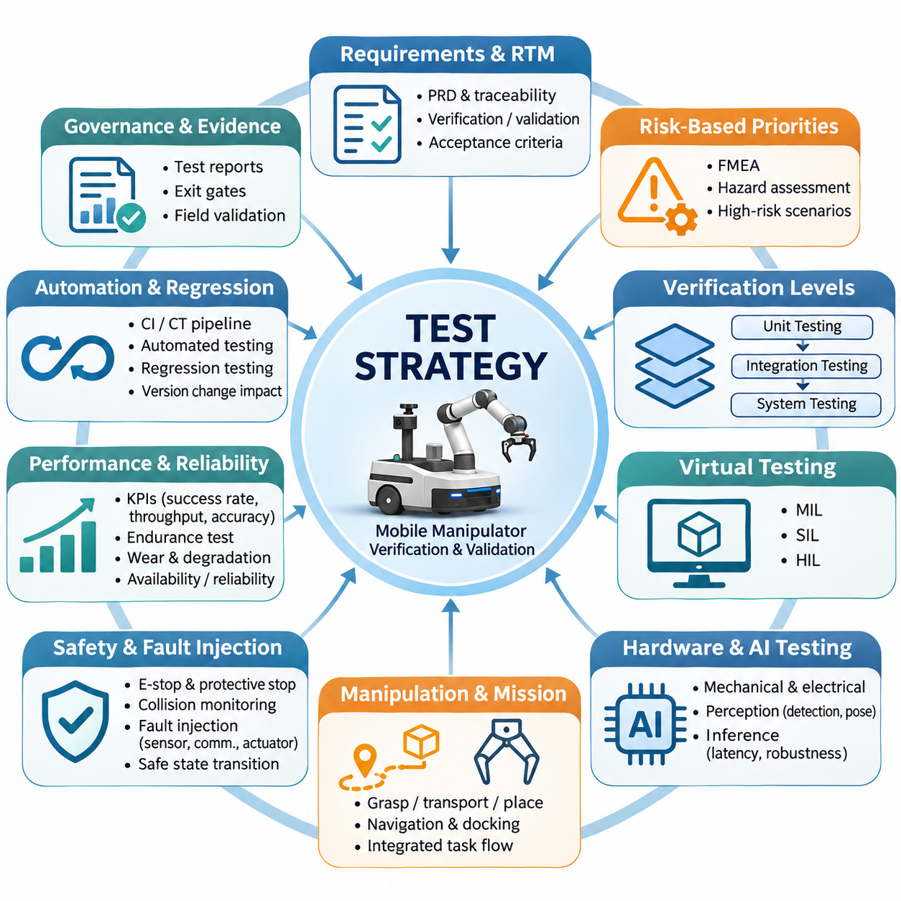{width="7.268055555555556in" height="7.268055555555556in"}

A test strategy defines the overall approach to verifying and validating the functionality, performance, reliability, and safety of a mobile manipulator throughout its development lifecycle. Unlike conventional industrial robots, mobile manipulators combine autonomous navigation, robotic manipulation, artificial intelligence, and distributed control systems. Consequently, testing must address individual subsystem behavior as well as interactions across the integrated robotic platform.

The test strategy should be established during the requirements engineering phase rather than after prototype development. Every functional, performance, safety, and operational requirement should be associated with an appropriate verification or validation method. Early test definition enables engineers to identify ambiguous requirements, establish measurable acceptance criteria, estimate testing resources, and reduce the risk of expensive design modifications during subsequent development stages.

A requirements-driven testing approach establishes traceability between the Product Requirement Document (PRD), system architecture, subsystem specifications, and test cases. A Requirements Traceability Matrix (RTM) provides a structured mechanism for monitoring verification coverage and identifying untested requirements. Each requirement should be linked to test procedures, acceptance thresholds, execution results, defect records, and supporting evidence for engineering approval.

Risk-based testing prioritizes verification activities according to the potential consequences and probability of system failures. Critical functions such as emergency stopping, collision avoidance, braking, manipulator stability, and human protection require extensive verification. Failure Mode and Effects Analysis (FMEA) and hazard assessments can help identify high-risk scenarios, allocate available testing resources, and determine the required depth of verification.

The testing architecture should incorporate multiple verification levels, progressing from component testing to subsystem integration and complete system evaluation. Unit testing verifies individual software modules and hardware functions, while integration testing examines communication and functional dependencies. System-level testing evaluates whether navigation, perception, manipulation, safety, and mission management collectively satisfy operational requirements.

Simulation-based testing provides an efficient environment for evaluating robotic behavior before physical prototypes become available. Software-in-the-Loop (SIL), Model-in-the-Loop (MIL), and Hardware-in-the-Loop (HIL) methods enable engineers to investigate control algorithms, communication interfaces, sensor behavior, and fault responses. Simulation also supports the controlled reproduction of hazardous or uncommon scenarios without exposing physical equipment to unnecessary risks.

Physical hardware testing should evaluate the mechanical, electrical, and embedded characteristics of the mobile manipulator. Verification activities include structural integrity, payload capacity, power consumption, battery endurance, thermal behavior, actuator performance, and communication stability. Particular attention should be given to the interaction between manipulator motion and mobile platform stability under different payloads and operating configurations.

Artificial intelligence testing requires a dedicated strategy because learning-based models exhibit statistical behavior rather than strictly deterministic responses. Object detection, pose estimation, grasp detection, vision-language models, and robotic agents should be evaluated using independent datasets and representative operational scenarios. Testing should address prediction accuracy, inference latency, robustness, uncertainty, environmental variation, and unexpected inputs.

Manipulation testing should evaluate the complete execution chain from object recognition to grasping, transportation, and placement. Relevant metrics include grasp success rate, positioning accuracy, repeatability, trajectory execution time, contact force, and recovery effectiveness. Test scenarios should incorporate variations in object geometry, material, weight, orientation, accessibility, and initial mobile platform positioning errors.

Integrated mission testing evaluates the coordination between autonomous navigation and robotic manipulation. A representative mission may include task allocation, route planning, obstacle avoidance, precision docking, object recognition, manipulation, transportation, and task completion reporting. Testing must verify that transitions between operational states occur correctly and that subsystem failures do not propagate into uncontrolled system behavior.

Safety testing constitutes an independent and essential element of the overall strategy. Protective stopping, emergency stopping, safety interlocks, speed restrictions, collision monitoring, and fault detection should be verified against applicable safety requirements. Fault injection should examine system responses to sensor failures, communication interruptions, actuator malfunctions, and power abnormalities under controlled conditions with appropriate protective measures.

Performance and reliability testing should establish whether the mobile manipulator consistently meets its intended operational targets. Key Performance Indicators (KPIs) may include mission success rate, task throughput, localization accuracy, manipulation cycle time, system availability, and energy efficiency. Extended operation and repetitive mission execution help identify thermal degradation, mechanical wear, memory leakage, and intermittent communication failures.

Test automation improves repeatability, verification coverage, and development efficiency by enabling standardized procedures to be executed throughout the engineering lifecycle. Continuous Integration and Continuous Testing (CI/CT) pipelines can automatically perform software verification, simulation scenarios, AI model evaluation, and regression testing. Automated results should remain traceable to software versions, hardware configurations, datasets, and environmental conditions.

A comprehensive regression testing strategy ensures that modifications do not degrade previously verified functionality. Changes to mechanical assemblies, firmware, control algorithms, AI models, communication protocols, or sensor configurations should trigger appropriate verification activities. Configuration management and version-controlled test assets enable engineers to reproduce failures, compare development baselines, and establish confidence in successive product releases.

Test governance should establish responsibilities for test execution, defect classification, corrective actions, result approval, and development milestone decisions. Objective entry and exit criteria should determine whether the system is ready to progress from prototype testing to integrated verification and field validation. Test reports should document measurement results, unresolved defects, deviations, residual risks, and the evidence supporting release decisions.

Ultimately, an effective test strategy connects requirements engineering, system design, hardware development, artificial intelligence, and manipulation development into a unified verification framework. The approach presented here extends the chapter structure into a general engineering methodology rather than prescribing project-specific acceptance thresholds. These thresholds must be established according to the intended application, operational environment, and applicable safety requirements.

시험 전략(Test Strategy)은 이동형 매니퓰레이터(Mobile Manipulator)의 전체 개발 수명주기(Development Lifecycle)에 걸쳐 기능성(Functionality), 성능(Performance), 신뢰성(Reliability) 및 안전성(Safety)을 검증하고 확인하기 위한 전반적인 접근 방식을 정의한다. 기존 산업용 로봇과 달리 이동형 매니퓰레이터는 자율주행(Autonomous Navigation), 로봇 조작(Robotic Manipulation), 인공지능(Artificial Intelligence), 분산 제어 시스템(Distributed Control System)을 결합한다. 따라서 시험은 개별 하위 시스템의 동작뿐만 아니라 통합 로봇 플랫폼 내에서 발생하는 상호작용까지 고려해야 한다.

시험 전략은 시제품 개발 이후가 아니라 요구사항 공학(Requirements Engineering) 단계에서 수립되어야 한다. 모든 기능적, 성능적, 안전 및 운영 요구사항은 적절한 검증(Verification) 또는 유효성 확인(Validation) 방법과 연결되어야 한다. 초기 시험 정의(Early Test Definition)를 통해 엔지니어는 모호한 요구사항을 식별하고, 측정 가능한 합격 기준(Acceptance Criteria)을 설정하며, 시험 자원을 산정하고, 후속 개발 단계에서 발생할 수 있는 고비용 설계 변경의 위험을 줄일 수 있다.

요구사항 기반 시험(Requirements-Driven Testing) 접근 방식은 제품 요구사항 정의서(Product Requirement Document, PRD), 시스템 아키텍처(System Architecture), 하위 시스템 사양(Subsystem Specification) 및 시험 사례(Test Case) 간의 추적성을 확보한다. 요구사항 추적성 매트릭스(Requirements Traceability Matrix, RTM)는 검증 범위(Verification Coverage)를 모니터링하고 시험되지 않은 요구사항을 식별하는 체계적인 메커니즘을 제공한다. 각 요구사항은 시험 절차, 합격 임계값, 실행 결과, 결함 기록 및 엔지니어링 승인을 위한 증빙 자료와 연결되어야 한다.

위험 기반 시험(Risk-Based Testing)은 시스템 고장의 잠재적 영향과 발생 확률에 따라 검증 활동의 우선순위를 결정한다. 비상 정지(Emergency Stop), 충돌 회피(Collision Avoidance), 제동(Braking), 매니퓰레이터 안정성(Manipulator Stability), 인간 보호(Human Protection)와 같은 핵심 기능은 광범위한 검증이 필요하다. 고장 모드 및 영향 분석(Failure Mode and Effects Analysis, FMEA)과 위험원 평가(Hazard Assessment)는 고위험 시나리오를 식별하고, 가용 시험 자원을 배분하며, 필요한 검증의 심층 수준을 결정하는 데 활용될 수 있다.

시험 아키텍처(Test Architecture)는 부품 시험(Component Testing)에서 하위 시스템 통합(Subsystem Integration) 및 전체 시스템 평가(Complete System Evaluation)로 발전하는 다단계 검증 구조를 포함해야 한다. 단위 시험(Unit Testing)은 개별 소프트웨어 모듈과 하드웨어 기능을 검증하며, 통합 시험(Integration Testing)은 통신 및 기능적 의존성을 확인한다. 시스템 수준 시험(System-Level Testing)은 자율주행, 인지, 조작, 안전 및 임무 관리 기능이 함께 운영 요구사항을 충족하는지를 평가한다.

시뮬레이션 기반 시험(Simulation-Based Testing)은 물리적 시제품이 준비되기 전에 로봇의 동작을 평가할 수 있는 효율적인 환경을 제공한다. 소프트웨어 인더 루프(Software-in-the-Loop, SIL), 모델 인더 루프(Model-in-the-Loop, MIL), 하드웨어 인더 루프(Hardware-in-the-Loop, HIL) 방식은 엔지니어가 제어 알고리즘(Control Algorithm), 통신 인터페이스(Communication Interface), 센서 동작(Sensor Behavior), 고장 대응(Fault Response)을 분석할 수 있도록 지원한다. 또한 시뮬레이션은 물리적 장비를 불필요한 위험에 노출하지 않고 위험하거나 드물게 발생하는 시나리오를 통제된 환경에서 재현할 수 있도록 한다.

물리적 하드웨어 시험(Physical Hardware Testing)은 이동형 매니퓰레이터의 기계적, 전기적 및 임베디드 시스템 특성을 평가해야 한다. 주요 검증 활동에는 구조적 건전성(Structural Integrity), 적재 용량(Payload Capacity), 전력 소비(Power Consumption), 배터리 지속 시간(Battery Endurance), 열적 거동(Thermal Behavior), 액추에이터 성능(Actuator Performance), 통신 안정성(Communication Stability) 등이 포함된다. 특히 다양한 적재 하중과 운영 구성에서 매니퓰레이터의 동작과 이동 플랫폼의 안정성 간에 발생하는 상호작용에 주의를 기울여야 한다.

인공지능 시험(Artificial Intelligence Testing)은 학습 기반 모델(Learning-Based Model)이 엄격한 결정론적 응답보다는 통계적 특성을 나타내기 때문에 독립적인 시험 전략이 필요하다. 객체 검출(Object Detection), 자세 추정(Pose Estimation), 파지 검출(Grasp Detection), 시각 언어 모델(Vision-Language Model), 로봇 에이전트(Robot Agent)는 독립적인 데이터셋과 대표적인 운영 시나리오를 활용하여 평가되어야 한다. 시험은 예측 정확도(Prediction Accuracy), 추론 지연시간(Inference Latency), 강건성(Robustness), 불확실성(Uncertainty), 환경 변화 및 예상하지 못한 입력을 고려해야 한다.

조작 시험(Manipulation Testing)은 객체 인식(Object Recognition)에서 파지(Grasping), 운반(Transportation), 배치(Placement)에 이르는 전체 실행 체인을 평가해야 한다. 주요 평가 지표에는 파지 성공률(Grasp Success Rate), 위치 정확도(Positioning Accuracy), 반복 정밀도(Repeatability), 궤적 실행 시간(Trajectory Execution Time), 접촉력(Contact Force), 복구 효과성(Recovery Effectiveness)이 포함된다. 시험 시나리오는 객체의 형상, 재질, 무게, 방향, 접근성 및 이동 플랫폼의 초기 위치 오차에 대한 다양한 변화를 포함해야 한다.

통합 임무 시험(Integrated Mission Testing)은 자율주행과 로봇 조작 간의 협조 동작(Coordination)을 평가한다. 대표적인 임무에는 작업 할당(Task Allocation), 경로 계획(Route Planning), 장애물 회피(Obstacle Avoidance), 정밀 도킹(Precision Docking), 객체 인식(Object Recognition), 조작(Manipulation), 운반(Transportation), 작업 완료 보고(Task Completion Reporting)가 포함될 수 있다. 시험은 운영 상태(Operational State) 간의 전이가 정확하게 이루어지는지와 하위 시스템의 고장이 통제되지 않는 시스템 동작으로 확산되지 않는지를 검증해야 한다.

안전 시험(Safety Testing)은 전체 시험 전략에서 독립적이고 필수적인 요소를 구성한다. 보호 정지(Protective Stop), 비상 정지(Emergency Stop), 안전 인터록(Safety Interlock), 속도 제한(Speed Restriction), 충돌 모니터링(Collision Monitoring), 고장 검출(Fault Detection)은 적용 가능한 안전 요구사항에 따라 검증되어야 한다. 고장 주입(Fault Injection)은 적절한 보호 조치가 마련된 통제 환경에서 센서 고장, 통신 중단, 액추에이터 오작동, 전원 이상에 대한 시스템의 대응을 확인해야 한다.

성능 및 신뢰성 시험(Performance and Reliability Testing)은 이동형 매니퓰레이터가 의도된 운영 목표를 지속적으로 충족하는지를 확인해야 한다. 핵심 성과 지표(Key Performance Indicator, KPI)에는 임무 성공률(Mission Success Rate), 작업 처리량(Task Throughput), 위치 추정 정확도(Localization Accuracy), 조작 사이클 시간(Manipulation Cycle Time), 시스템 가용성(System Availability), 에너지 효율(Energy Efficiency) 등이 포함될 수 있다. 장시간 운영과 반복적인 임무 수행은 열적 성능 저하(Thermal Degradation), 기계적 마모(Mechanical Wear), 메모리 누수(Memory Leakage), 간헐적 통신 장애(Intermittent Communication Failure)를 식별하는 데 도움이 된다.

시험 자동화(Test Automation)는 전체 엔지니어링 수명주기에서 표준화된 시험 절차를 실행함으로써 반복성(Repeatability), 검증 범위(Verification Coverage), 개발 효율성(Development Efficiency)을 향상시킨다. 지속적 통합 및 지속적 시험(Continuous Integration and Continuous Testing, CI/CT) 파이프라인은 소프트웨어 검증, 시뮬레이션 시나리오, 인공지능 모델 평가 및 회귀 시험(Regression Testing)을 자동으로 수행할 수 있다. 자동화된 시험 결과는 소프트웨어 버전, 하드웨어 구성, 데이터셋 및 환경 조건에 대한 추적성을 유지해야 한다.

포괄적인 회귀 시험 전략(Regression Testing Strategy)은 시스템 변경 사항이 이전에 검증된 기능을 저하시키지 않도록 보장하는 것을 목표로 한다. 기계 조립체(Mechanical Assembly), 펌웨어(Firmware), 제어 알고리즘(Control Algorithm), 인공지능 모델(AI Model), 통신 프로토콜(Communication Protocol), 센서 구성(Sensor Configuration)의 변경은 적절한 검증 활동으로 이어져야 한다. 형상 관리(Configuration Management)와 버전 관리되는 시험 자산(Version-Controlled Test Assets)은 엔지니어가 고장을 재현하고, 개발 기준선(Development Baseline)을 비교하며, 후속 제품 릴리스에 대한 신뢰성을 확보할 수 있도록 한다.

시험 거버넌스(Test Governance)는 시험 실행, 결함 분류(Defect Classification), 시정 조치(Corrective Action), 결과 승인(Result Approval), 개발 마일스톤 의사결정(Development Milestone Decision)에 대한 책임을 정의해야 한다. 객관적인 진입 및 종료 기준(Entry and Exit Criteria)은 시스템이 시제품 시험에서 통합 검증 및 현장 유효성 확인(Field Validation) 단계로 진행할 준비가 되었는지를 판단하는 데 활용되어야 한다. 시험 보고서(Test Report)는 측정 결과, 미해결 결함, 편차(Deviation), 잔여 위험(Residual Risk), 릴리스 의사결정을 뒷받침하는 검증 증거를 문서화해야 한다.

궁극적으로 효과적인 시험 전략(Test Strategy)은 요구사항 공학(Requirements Engineering), 시스템 설계(System Design), 하드웨어 개발(Hardware Development), 인공지능(Artificial Intelligence), 조작 개발(Manipulation Development)을 하나의 통합 검증 프레임워크(Unified Verification Framework)로 연결한다. 여기에서 제시한 접근 방식은 프로젝트별 합격 임계값을 규정하기보다는 해당 장의 구조를 일반적인 엔지니어링 방법론(Engineering Methodology)으로 확장한 것이다. 이러한 임계값은 목표 응용 분야(Target Application), 운영 환경(Operational Environment), 적용 가능한 안전 요구사항(Safety Requirement)에 따라 설정되어야 한다.

##  

## 02 Test Plan Development

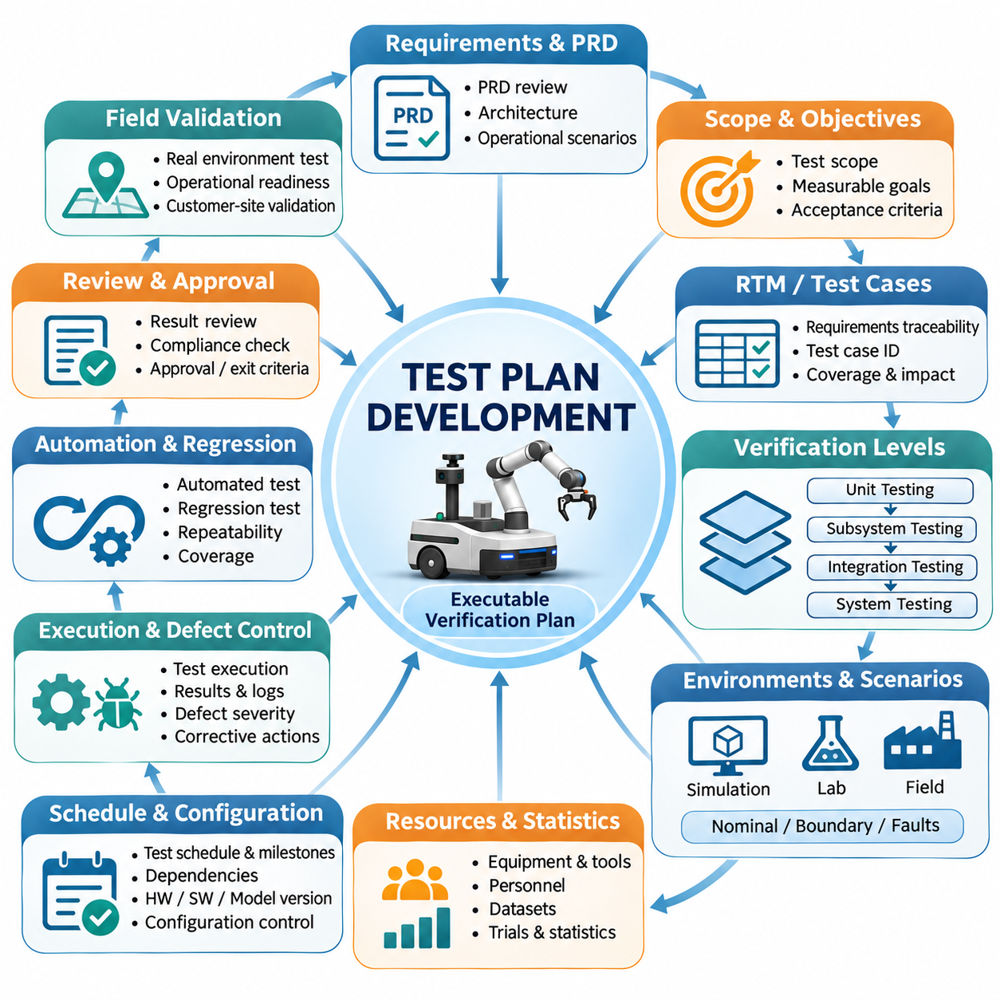{width="7.268055555555556in" height="7.268055555555556in"}

Test plan development translates the overall test strategy into a structured and executable framework for verifying and validating a mobile manipulator. While the test strategy defines the fundamental principles and objectives of testing, the test plan specifies what must be tested, how testing will be conducted, which resources are required, and how results will be evaluated. It establishes a common operational baseline for engineering and quality assurance teams.

The development of a test plan should begin with a comprehensive review of the Product Requirement Document (PRD), system architecture, subsystem specifications, and operational scenarios. These documents provide the technical foundation for identifying test objectives and defining measurable acceptance criteria. Every critical requirement should be associated with one or more test cases to ensure that verification activities provide sufficient coverage of the intended system capabilities.

The scope of the test plan should encompass mechanical hardware, electrical systems, embedded controllers, autonomous navigation, artificial intelligence, robotic manipulation, communication interfaces, and safety functions. Each technical domain requires specific verification methods and evaluation environments. Clear scope definition prevents unnecessary duplication of testing activities while ensuring that critical interactions between subsystems are adequately examined.

Test objectives should be established using measurable engineering parameters rather than subjective descriptions of expected behavior. For example, navigation testing may specify localization accuracy, docking precision, and obstacle avoidance performance, while manipulation testing may define positioning accuracy, grasp success rate, and execution time. Quantitative acceptance criteria enable consistent evaluation and provide an objective basis for determining whether requirements have been satisfied.

A Requirements Traceability Matrix (RTM) should be incorporated into the test planning process to maintain relationships between system requirements and verification activities. Each test case should have a unique identifier associated with its corresponding requirement, subsystem, test procedure, and acceptance criteria. Traceability enables engineers to identify verification gaps, evaluate the impact of design modifications, and monitor testing progress throughout development.

Test cases should be organized according to verification levels, including unit testing, subsystem testing, integration testing, and system-level testing. Each level should have clearly defined entry and exit criteria to prevent insufficiently verified components from progressing into more complex integration environments. This hierarchical approach reduces troubleshooting complexity and supports the gradual accumulation of evidence regarding system functionality, performance, and reliability.

The test environment must accurately represent the conditions under which the mobile manipulator is expected to operate. Depending on the application, testing environments may include simulation platforms, laboratory facilities, hardware test benches, controlled industrial environments, and representative customer sites. Environmental variables such as lighting, floor conditions, wireless connectivity, temperature, and obstacle distribution should be documented and controlled.

Test scenario development should address normal operation, boundary conditions, abnormal situations, and foreseeable failure modes. Nominal scenarios verify expected functionality, while boundary testing examines behavior near operational limitations. Abnormal scenarios evaluate the response to unexpected obstacles, localization errors, communication interruptions, sensor degradation, and unsuccessful manipulation attempts. Safety-related scenarios require controlled execution and appropriate protective measures.

The test plan should define the equipment, personnel, software tools, datasets, and infrastructure required for each verification activity. Measurement instruments must provide sufficient accuracy and resolution relative to the specified acceptance thresholds. Calibration status, equipment availability, software dependencies, and hardware configurations should be documented. Resource planning helps prevent scheduling conflicts and reduces uncertainty associated with measurement results.

Statistical considerations are particularly important when evaluating artificial intelligence models, grasping performance, navigation reliability, and repetitive mission execution. The test plan should establish the number of trials, sampling methods, environmental variations, and statistical evaluation criteria. Repeated measurements and representative test populations provide stronger evidence than isolated successful demonstrations and help characterize uncertainty and performance variability.

Test scheduling should be aligned with hardware development, software releases, AI model deployment, and system integration milestones. Dependencies between verification activities must be identified to establish an executable testing sequence. Sufficient time should be allocated for troubleshooting, corrective modifications, regression testing, and unexpected failures. Schedule adjustments should be managed through formal review rather than by eliminating critical verification activities.

Configuration management is essential for maintaining the reproducibility and validity of test results. Each test execution should reference the relevant hardware revision, firmware version, software build, AI model checkpoint, calibration parameters, and dataset version. Changes to these elements must be documented and evaluated to determine whether previous verification results remain applicable. Consistent configuration records support defect investigation and engineering audits.

The test plan should define standardized procedures for recording results, classifying defects, assigning corrective actions, and conducting retesting. Defect severity should reflect the impact on safety, functionality, performance, and operational availability. Failed or inconclusive tests should remain open until their causes have been investigated and appropriate corrective actions verified. Deviations from approved procedures must be documented, justified, and reviewed.

Test automation and regression testing should be incorporated wherever technically feasible. Automated scripts can execute software test cases, simulation scenarios, AI benchmarks, communication diagnostics, and repetitive functional checks. Regression test suites should be maintained to verify that system modifications do not introduce unexpected failures. Automation improves execution efficiency while providing consistent and traceable evidence across successive development iterations.

Formal test plan approval should involve representatives from system engineering, hardware development, software development, artificial intelligence, manipulation engineering, safety engineering, and quality assurance. Approval confirms that the proposed verification activities adequately address system requirements and identified risks. The plan should remain a controlled engineering document that evolves as requirements, system configurations, and development priorities change.

The completed test plan provides a practical foundation for subsequent unit, integration, functional, performance, AI, manipulation, safety, and reliability testing. It connects these activities with test automation, reporting, and eventual field validation. This methodology expands the development manual\'s testing structure into a general engineering framework, leaving project-specific acceptance thresholds, resource allocations, and approval responsibilities to be established by the development organization.

시험 계획 개발(Test Plan Development)은 전체 시험 전략(Test Strategy)을 이동형 매니퓰레이터(Mobile Manipulator)의 검증(Verification) 및 유효성 확인(Validation)을 위한 체계적이고 실행 가능한 프레임워크(Framework)로 구체화하는 과정이다. 시험 전략이 시험의 기본 원칙과 목표를 정의하는 반면, 시험 계획(Test Plan)은 무엇을 시험해야 하는지, 시험을 어떻게 수행할 것인지, 어떤 자원이 필요한지, 그리고 결과를 어떻게 평가할 것인지를 명시한다. 이를 통해 엔지니어링 및 품질 보증(Quality Assurance) 조직을 위한 공통 운영 기준선(Operational Baseline)을 수립할 수 있다.

시험 계획 개발은 제품 요구사항 정의서(Product Requirement Document, PRD), 시스템 아키텍처(System Architecture), 하위 시스템 사양(Subsystem Specification), 운영 시나리오(Operational Scenario)에 대한 종합적인 검토에서 시작되어야 한다. 이러한 문서는 시험 목표(Test Objective)를 식별하고 측정 가능한 합격 기준(Acceptance Criteria)을 정의하기 위한 기술적 기반을 제공한다. 모든 핵심 요구사항은 하나 이상의 시험 사례(Test Case)와 연결되어야 하며, 이를 통해 검증 활동이 의도된 시스템 기능에 대한 충분한 검증 범위(Verification Coverage)를 확보하도록 해야 한다.

시험 계획의 범위(Test Scope)는 기계적 하드웨어(Mechanical Hardware), 전기 시스템(Electrical System), 임베디드 제어기(Embedded Controller), 자율주행(Autonomous Navigation), 인공지능(Artificial Intelligence), 로봇 조작(Robotic Manipulation), 통신 인터페이스(Communication Interface), 안전 기능(Safety Function)을 포괄해야 한다. 각각의 기술 영역에는 특화된 검증 방법과 평가 환경이 필요하다. 명확한 시험 범위 정의는 시험 활동의 불필요한 중복을 방지하는 동시에 하위 시스템 간의 중요한 상호작용을 충분히 검토할 수 있도록 한다.

시험 목표(Test Objective)는 예상 동작에 대한 주관적인 설명보다는 측정 가능한 엔지니어링 매개변수(Engineering Parameter)를 활용하여 수립되어야 한다. 예를 들어, 자율주행 시험(Navigation Testing)은 위치 추정 정확도(Localization Accuracy), 도킹 정밀도(Docking Precision), 장애물 회피 성능(Obstacle Avoidance Performance)을 명시할 수 있으며, 조작 시험(Manipulation Testing)은 위치 정확도(Positioning Accuracy), 파지 성공률(Grasp Success Rate), 실행 시간(Execution Time)을 정의할 수 있다. 정량적 합격 기준(Quantitative Acceptance Criteria)은 일관된 평가를 가능하게 하며 요구사항 충족 여부를 판단하기 위한 객관적인 근거를 제공한다.

요구사항 추적성 매트릭스(Requirements Traceability Matrix, RTM)는 시스템 요구사항과 검증 활동 간의 연관성을 유지하기 위해 시험 계획 수립 과정에 포함되어야 한다. 각각의 시험 사례에는 해당 요구사항, 하위 시스템, 시험 절차(Test Procedure), 합격 기준과 연결되는 고유 식별자(Unique Identifier)가 부여되어야 한다. 이러한 추적성(Traceability)은 엔지니어가 검증 공백(Verification Gap)을 식별하고, 설계 변경의 영향을 평가하며, 전체 개발 과정에서 시험 진행 상황을 모니터링할 수 있도록 한다.

시험 사례(Test Case)는 단위 시험(Unit Testing), 하위 시스템 시험(Subsystem Testing), 통합 시험(Integration Testing), 시스템 수준 시험(System-Level Testing)을 포함하는 검증 수준(Verification Level)에 따라 구성되어야 한다. 각각의 검증 수준에는 명확한 진입 및 종료 기준(Entry and Exit Criteria)이 정의되어야 하며, 이를 통해 충분히 검증되지 않은 구성요소가 더욱 복잡한 통합 환경으로 진행되는 것을 방지할 수 있다. 이러한 계층적 접근 방식(Hierarchical Approach)은 문제 해결의 복잡성을 줄이고 시스템 기능성, 성능 및 신뢰성에 대한 검증 증거를 단계적으로 축적할 수 있도록 지원한다.

시험 환경(Test Environment)은 이동형 매니퓰레이터가 운영될 것으로 예상되는 조건을 정확하게 반영해야 한다. 응용 분야에 따라 시험 환경에는 시뮬레이션 플랫폼(Simulation Platform), 실험실 시설(Laboratory Facility), 하드웨어 시험 벤치(Hardware Test Bench), 통제된 산업 환경(Controlled Industrial Environment), 대표적인 고객 현장(Representative Customer Site)이 포함될 수 있다. 조명, 바닥 상태, 무선 연결성(Wireless Connectivity), 온도, 장애물 분포(Obstacle Distribution)와 같은 환경 변수(Environmental Variable)는 문서화되고 통제되어야 한다.

시험 시나리오 개발(Test Scenario Development)은 정상 운영(Normal Operation), 경계 조건(Boundary Condition), 비정상 상황(Abnormal Situation), 예측 가능한 고장 모드(Failure Mode)를 고려해야 한다. 정상 시나리오(Nominal Scenario)는 예상된 기능을 검증하며, 경계 시험(Boundary Testing)은 운영 한계에 근접한 상태에서의 동작을 확인한다. 비정상 시나리오(Abnormal Scenario)는 예상하지 못한 장애물, 위치 추정 오차, 통신 중단, 센서 성능 저하, 조작 실패에 대한 시스템의 대응을 평가한다. 안전 관련 시나리오는 통제된 실행 환경과 적절한 보호 조치를 필요로 한다.

시험 계획은 각각의 검증 활동에 필요한 장비, 인력, 소프트웨어 도구(Software Tool), 데이터셋(Dataset), 기반 시설(Infrastructure)을 정의해야 한다. 측정 장비(Measurement Instrument)는 명시된 합격 임계값(Acceptance Threshold)에 비해 충분한 정확도(Accuracy)와 분해능(Resolution)을 제공해야 한다. 교정 상태(Calibration Status), 장비 가용성(Equipment Availability), 소프트웨어 의존성(Software Dependency), 하드웨어 구성(Hardware Configuration)은 문서화되어야 한다. 자원 계획(Resource Planning)은 일정 충돌을 방지하고 측정 결과와 관련된 불확실성을 줄이는 데 도움이 된다.

통계적 고려사항(Statistical Consideration)은 인공지능 모델(AI Model), 파지 성능(Grasping Performance), 자율주행 신뢰성(Navigation Reliability), 반복 임무 수행(Repetitive Mission Execution)을 평가할 때 특히 중요하다. 시험 계획은 시험 반복 횟수(Number of Trials), 표본 추출 방법(Sampling Method), 환경 변화(Environmental Variation), 통계적 평가 기준(Statistical Evaluation Criteria)을 수립해야 한다. 반복 측정(Repeated Measurement)과 대표성을 갖춘 시험 모집단(Test Population)은 일회성 성공 시연보다 더욱 신뢰할 수 있는 증거를 제공하며, 불확실성과 성능 변동성(Performance Variability)을 파악하는 데 도움이 된다.

시험 일정 관리(Test Scheduling)는 하드웨어 개발(Hardware Development), 소프트웨어 릴리스(Software Release), 인공지능 모델 배포(AI Model Deployment), 시스템 통합 마일스톤(System Integration Milestone)과 연계되어야 한다. 실행 가능한 시험 순서(Test Sequence)를 수립하기 위해 검증 활동 간의 의존성(Dependency)을 식별해야 한다. 문제 해결(Troubleshooting), 시정 목적의 변경(Corrective Modification), 회귀 시험(Regression Testing), 예상하지 못한 고장에 대응하기 위한 충분한 시간이 배정되어야 한다. 일정 조정은 핵심 검증 활동을 제거하는 방식이 아니라 공식적인 검토(Formal Review)를 통해 관리되어야 한다.

형상 관리(Configuration Management)는 시험 결과의 재현성(Reproducibility)과 유효성(Validity)을 유지하기 위한 필수 요소이다. 각각의 시험 실행(Test Execution)은 관련 하드웨어 개정 버전(Hardware Revision), 펌웨어 버전(Firmware Version), 소프트웨어 빌드(Software Build), 인공지능 모델 체크포인트(AI Model Checkpoint), 교정 매개변수(Calibration Parameter), 데이터셋 버전(Dataset Version)을 참조해야 한다. 이러한 요소의 변경은 문서화되어야 하며, 이전 검증 결과가 여전히 유효한지를 판단하기 위해 평가되어야 한다. 일관된 형상 기록(Configuration Record)은 결함 조사와 엔지니어링 감사(Engineering Audit)를 지원한다.

시험 계획은 결과 기록(Result Recording), 결함 분류(Defect Classification), 시정 조치(Corrective Action) 할당, 재시험(Retesting) 수행을 위한 표준화된 절차(Standardized Procedure)를 정의해야 한다. 결함 심각도(Defect Severity)는 안전성, 기능성, 성능 및 운영 가용성(Operational Availability)에 미치는 영향을 반영해야 한다. 실패하거나 결론이 확정되지 않은 시험은 원인이 조사되고 적절한 시정 조치가 검증될 때까지 미해결 상태로 유지되어야 한다. 승인된 절차에서 벗어난 편차(Deviation)는 문서화되고, 그 타당성이 입증되며, 검토되어야 한다.

시험 자동화(Test Automation)와 회귀 시험(Regression Testing)은 기술적으로 실행 가능한 모든 영역에 적용되어야 한다. 자동화 스크립트(Automated Script)는 소프트웨어 시험 사례, 시뮬레이션 시나리오, 인공지능 벤치마크(AI Benchmark), 통신 진단(Communication Diagnostics), 반복적인 기능 점검(Functional Check)을 수행할 수 있다. 회귀 시험 모음(Regression Test Suite)은 시스템 변경 사항이 예상하지 못한 고장을 발생시키지 않는지를 검증하기 위해 지속적으로 유지되어야 한다. 자동화는 연속적인 개발 반복 과정에서 일관되고 추적 가능한 검증 증거를 제공하는 동시에 시험 실행 효율성(Execution Efficiency)을 향상시킨다.

공식적인 시험 계획 승인(Formal Test Plan Approval)에는 시스템 엔지니어링(System Engineering), 하드웨어 개발(Hardware Development), 소프트웨어 개발(Software Development), 인공지능(Artificial Intelligence), 조작 엔지니어링(Manipulation Engineering), 안전 엔지니어링(Safety Engineering), 품질 보증(Quality Assurance) 분야의 담당자가 참여해야 한다. 승인은 제안된 검증 활동이 시스템 요구사항과 식별된 위험을 충분히 고려하고 있음을 확인하는 과정이다. 시험 계획은 요구사항, 시스템 구성 및 개발 우선순위가 변경됨에 따라 지속적으로 발전하는 통제된 엔지니어링 문서(Controlled Engineering Document)로 유지되어야 한다.

완성된 시험 계획(Test Plan)은 이후 수행되는 단위 시험(Unit Testing), 통합 시험(Integration Testing), 기능 시험(Functional Testing), 성능 시험(Performance Testing), 인공지능 시험(AI Testing), 조작 시험(Manipulation Testing), 안전 시험(Safety Testing), 신뢰성 시험(Reliability Testing)을 위한 실질적인 기반을 제공한다. 또한 이러한 활동을 시험 자동화(Test Automation), 시험 보고(Reporting), 최종적인 현장 유효성 확인(Field Validation)과 연결한다. 본 방법론은 개발 매뉴얼(Development Manual)의 시험 구조를 일반적인 엔지니어링 프레임워크(Engineering Framework)로 확장한 것이며, 프로젝트별 합격 임계값, 자원 배분 및 승인 책임은 해당 개발 조직에서 수립해야 한다.

##  

## 03 Unit Testing

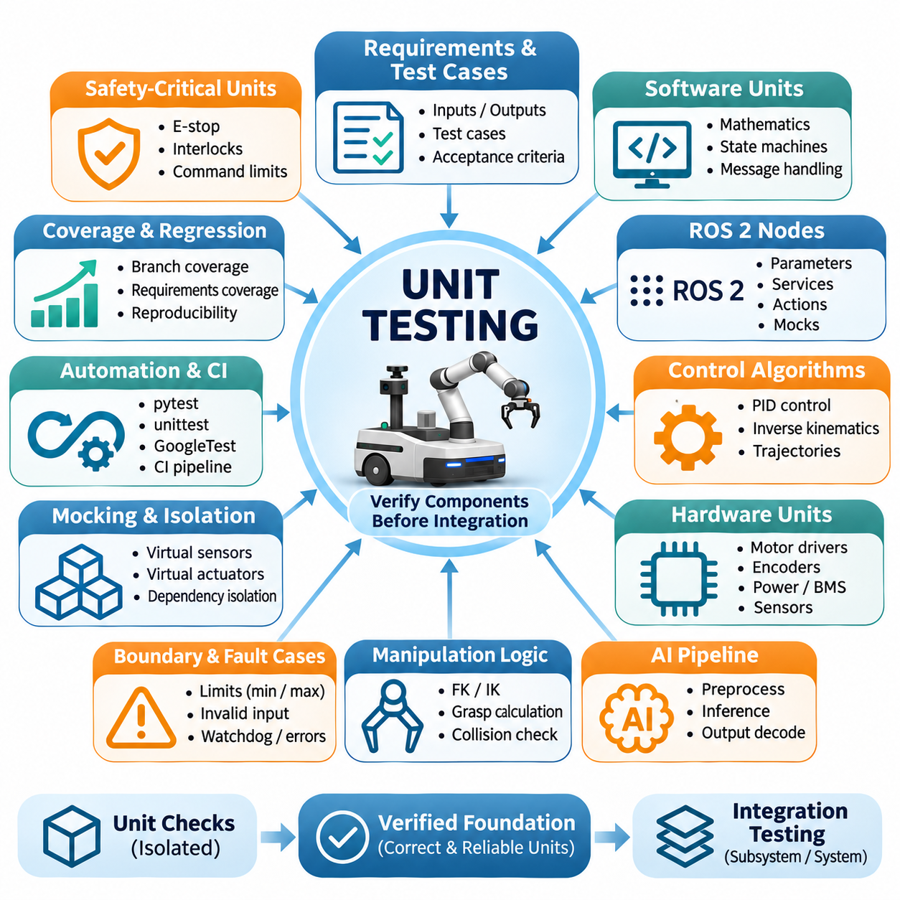{width="7.268055555555556in" height="7.268055555555556in"}

Unit testing is the fundamental verification activity used to evaluate individual software modules, control algorithms, hardware functions, and computational components within a mobile manipulator. Its primary objective is to determine whether each component behaves according to its specified requirements before integration with other subsystems. Early identification of defects reduces debugging complexity and improves overall system reliability.

In mobile manipulator development, a unit may represent a software function, a ROS 2 node, a device driver, a control module, or an independently testable hardware component. The definition of a unit depends on the system architecture and the intended verification boundaries. Each unit should have clearly defined inputs, outputs, interfaces, expected behavior, and operational constraints to support independent and reproducible testing.

Unit test development should begin with a detailed examination of functional requirements, subsystem specifications, and interface definitions. Engineers should establish expected responses for representative inputs and identify abnormal conditions that may affect component behavior. Each test case should specify initial conditions, input parameters, execution procedures, expected outputs, and measurable acceptance criteria to facilitate objective evaluation.

Software unit testing verifies the internal functionality of algorithms and application modules without requiring the complete robotic platform. Typical targets include coordinate transformations, numerical calculations, state machines, trajectory generation, communication message processing, and diagnostic functions. Testing should examine both computational correctness and the ability of individual functions to handle invalid or unexpected inputs.

ROS 2 applications require unit tests that address message processing, parameter management, service responses, action execution, and internal node behavior. Dependencies on external sensors, actuators, and communication networks can be replaced with mock objects or controlled test interfaces. This approach allows engineers to isolate individual software components and investigate failures without introducing unrelated hardware or network dependencies.

Control algorithm testing should evaluate the mathematical correctness and computational behavior of navigation and manipulation controllers. Representative targets include proportional-integral-derivative controllers, velocity regulation, inverse kinematics, joint trajectory interpolation, and force control calculations. Test inputs should incorporate nominal operating conditions, numerical limits, singular configurations, and invalid parameter combinations.

Hardware unit testing focuses on individual electronic, mechanical, and embedded components before subsystem integration. Motor drivers, encoders, power converters, battery management interfaces, sensor modules, and communication transceivers should be evaluated using controlled test benches. Verification activities may include electrical measurements, signal integrity checks, initialization sequences, and basic fault detection capabilities.

Artificial intelligence components also require unit-level verification, although their behavior differs from conventional deterministic software. Individual AI pipeline functions such as image preprocessing, tensor conversion, model initialization, inference execution, confidence filtering, and output decoding should be tested independently. These activities help ensure that implementation defects do not compromise subsequent model performance evaluation.

Manipulation software unit testing should examine individual functions associated with robotic arm operation. Forward kinematics, inverse kinematics, coordinate transformations, grasp parameter calculations, collision geometry processing, and trajectory constraints are representative examples. Known analytical solutions, reference datasets, and independently calculated results can provide reliable baselines for evaluating computational accuracy.

Boundary value testing is particularly important for robotic systems because physical and computational limitations directly influence operational behavior. Test cases should examine minimum and maximum joint positions, velocity limits, actuator command ranges, sensor measurement boundaries, and numerical precision. Invalid inputs, missing data, arithmetic overflow, and unexpected state transitions should also be evaluated against defined error-handling requirements.

Mocking and dependency isolation enable unit tests to execute without relying on complete hardware assemblies or operational environments. Simulated sensor readings, virtual actuator responses, predefined communication messages, and controlled timing sources allow engineers to reproduce specific conditions consistently. Such techniques are valuable when physical equipment is unavailable or when failure scenarios cannot be safely reproduced on actual hardware.

Automated unit testing should be incorporated into the software development workflow using appropriate testing frameworks. Python-based components may utilize pytest or unittest, while C++ modules may employ GoogleTest and GoogleMock. Automated test execution within Continuous Integration (CI) pipelines allows developers to detect implementation errors immediately after code modifications and maintain consistent verification across development branches.

Test coverage metrics provide quantitative indicators of the extent to which software implementations have been exercised. Statement coverage, branch coverage, condition coverage, and requirements coverage can help identify insufficiently tested logic. However, high code coverage alone does not demonstrate software correctness or functional safety. Coverage evaluation should therefore be combined with requirement-based testing and risk-based analysis.

Unit test results should be recorded together with relevant configuration information, including source code revisions, firmware versions, test framework versions, input datasets, and execution environments. Failed tests should generate reproducible diagnostic information that supports defect investigation and corrective development. Previously failed test cases should be retained within regression test suites to prevent the recurrence of identified defects.

Safety-related software and hardware units require particular attention because their failures may contribute to hazardous system behavior. Emergency stop signal processing, command limit enforcement, watchdog monitoring, interlock logic, and fault detection should undergo rigorous unit-level verification. Nevertheless, successful unit tests cannot replace integrated safety verification or demonstrate compliance with complete system safety requirements.

An effective unit testing methodology establishes a verified foundation for subsequent integration, functional, performance, AI, manipulation, safety, and reliability testing. It improves development efficiency by identifying defects before subsystem dependencies increase diagnostic complexity. This approach extends the development manual\'s testing structure into a general engineering methodology, while project-specific coverage targets, testing tools, and acceptance thresholds should be defined within the approved test plan.

단위 시험(Unit Testing)은 이동형 매니퓰레이터(Mobile Manipulator)를 구성하는 개별 소프트웨어 모듈(Software Module), 제어 알고리즘(Control Algorithm), 하드웨어 기능(Hardware Function), 연산 구성요소(Computational Component)를 평가하기 위한 기본적인 검증 활동(Verification Activity)이다. 주요 목적은 각각의 구성요소가 다른 하위 시스템과 통합되기 전에 명시된 요구사항에 따라 동작하는지를 확인하는 것이다. 개발 초기 단계에서 결함(Defect)을 식별하면 디버깅 복잡성(Debugging Complexity)을 줄이고 전체 시스템의 신뢰성(System Reliability)을 향상시킬 수 있다.

이동형 매니퓰레이터 개발에서 단위(Unit)는 소프트웨어 함수(Software Function), ROS 2 노드(ROS 2 Node), 장치 드라이버(Device Driver), 제어 모듈(Control Module) 또는 독립적으로 시험 가능한 하드웨어 구성요소(Hardware Component)를 의미할 수 있다. 단위의 정의는 시스템 아키텍처(System Architecture)와 의도된 검증 경계(Verification Boundary)에 따라 달라진다. 각각의 단위는 독립적이고 재현 가능한 시험을 지원하기 위해 명확하게 정의된 입력(Input), 출력(Output), 인터페이스(Interface), 예상 동작(Expected Behavior), 운영 제약조건(Operational Constraint)을 갖추어야 한다.

단위 시험 개발(Unit Test Development)은 기능 요구사항(Functional Requirement), 하위 시스템 사양(Subsystem Specification), 인터페이스 정의(Interface Definition)에 대한 상세한 검토에서 시작되어야 한다. 엔지니어는 대표적인 입력에 대한 예상 응답(Expected Response)을 수립하고 구성요소의 동작에 영향을 미칠 수 있는 비정상 조건(Abnormal Condition)을 식별해야 한다. 각각의 시험 사례(Test Case)는 객관적인 평가를 수행할 수 있도록 초기 조건(Initial Condition), 입력 매개변수(Input Parameter), 실행 절차(Execution Procedure), 예상 출력(Expected Output), 측정 가능한 합격 기준(Acceptance Criteria)을 명시해야 한다.

소프트웨어 단위 시험(Software Unit Testing)은 전체 로봇 플랫폼 없이 알고리즘(Algorithm)과 응용 프로그램 모듈(Application Module)의 내부 기능을 검증한다. 대표적인 시험 대상에는 좌표 변환(Coordinate Transformation), 수치 계산(Numerical Calculation), 상태 머신(State Machine), 궤적 생성(Trajectory Generation), 통신 메시지 처리(Communication Message Processing), 진단 기능(Diagnostic Function)이 포함된다. 시험은 연산 정확성(Computational Correctness)뿐만 아니라 개별 함수가 유효하지 않거나 예상하지 못한 입력을 처리하는 능력까지 검토해야 한다.

ROS 2 응용 프로그램은 메시지 처리(Message Processing), 매개변수 관리(Parameter Management), 서비스 응답(Service Response), 액션 실행(Action Execution), 내부 노드 동작(Internal Node Behavior)을 검증하는 단위 시험이 필요하다. 외부 센서, 액추에이터 및 통신 네트워크에 대한 의존성(Dependency)은 모의 객체(Mock Object) 또는 통제된 시험 인터페이스(Controlled Test Interface)로 대체할 수 있다. 이러한 접근 방식은 엔지니어가 개별 소프트웨어 구성요소를 격리하고 관련 없는 하드웨어 또는 네트워크 의존성을 추가하지 않으면서 고장을 조사할 수 있도록 한다.

제어 알고리즘 시험(Control Algorithm Testing)은 자율주행 및 조작 제어기의 수학적 정확성(Mathematical Correctness)과 연산 동작(Computational Behavior)을 평가해야 한다. 대표적인 시험 대상에는 비례·적분·미분 제어기(Proportional-Integral-Derivative Controller, PID Controller), 속도 제어(Velocity Regulation), 역기구학(Inverse Kinematics), 관절 궤적 보간(Joint Trajectory Interpolation), 힘 제어 계산(Force Control Calculation)이 포함된다. 시험 입력은 정상 운영 조건(Nominal Operating Condition), 수치적 한계(Numerical Limit), 특이점 구성(Singular Configuration), 유효하지 않은 매개변수 조합(Invalid Parameter Combination)을 포함해야 한다.

하드웨어 단위 시험(Hardware Unit Testing)은 하위 시스템 통합 이전에 개별 전자적, 기계적 및 임베디드 구성요소(Embedded Component)를 평가하는 데 중점을 둔다. 모터 드라이버(Motor Driver), 엔코더(Encoder), 전력 변환기(Power Converter), 배터리 관리 인터페이스(Battery Management Interface), 센서 모듈(Sensor Module), 통신 송수신기(Communication Transceiver)는 통제된 시험 벤치(Test Bench)를 활용하여 평가되어야 한다. 검증 활동에는 전기적 측정(Electrical Measurement), 신호 무결성 점검(Signal Integrity Check), 초기화 시퀀스(Initialization Sequence), 기본적인 고장 검출 기능(Fault Detection Capability)이 포함될 수 있다.

인공지능 구성요소(Artificial Intelligence Component) 역시 기존의 결정론적 소프트웨어(Deterministic Software)와는 다른 동작 특성을 갖지만 단위 수준 검증(Unit-Level Verification)이 필요하다. 이미지 전처리(Image Preprocessing), 텐서 변환(Tensor Conversion), 모델 초기화(Model Initialization), 추론 실행(Inference Execution), 신뢰도 필터링(Confidence Filtering), 출력 디코딩(Output Decoding)과 같은 개별 인공지능 파이프라인(AI Pipeline) 기능은 독립적으로 시험되어야 한다. 이러한 활동은 구현 결함(Implementation Defect)이 이후의 모델 성능 평가(Model Performance Evaluation)에 영향을 미치지 않도록 하는 데 도움이 된다.

조작 소프트웨어 단위 시험(Manipulation Software Unit Testing)은 로봇 팔(Robot Arm)의 운영과 관련된 개별 기능을 검토해야 한다. 순기구학(Forward Kinematics), 역기구학(Inverse Kinematics), 좌표 변환(Coordinate Transformation), 파지 매개변수 계산(Grasp Parameter Calculation), 충돌 형상 처리(Collision Geometry Processing), 궤적 제약조건(Trajectory Constraint)이 대표적인 사례이다. 이미 알려진 해석적 해(Analytical Solution), 참조 데이터셋(Reference Dataset), 독립적으로 계산된 결과는 연산 정확도(Computational Accuracy)를 평가하기 위한 신뢰성 있는 기준선(Baseline)을 제공할 수 있다.

경계값 시험(Boundary Value Testing)은 물리적 및 연산적 한계가 운영 동작에 직접적인 영향을 미치기 때문에 로봇 시스템에서 특히 중요하다. 시험 사례는 최소 및 최대 관절 위치(Joint Position), 속도 제한(Velocity Limit), 액추에이터 명령 범위(Actuator Command Range), 센서 측정 경계(Sensor Measurement Boundary), 수치 정밀도(Numerical Precision)를 검토해야 한다. 또한 유효하지 않은 입력(Invalid Input), 누락 데이터(Missing Data), 산술 오버플로(Arithmetic Overflow), 예상하지 못한 상태 전이(Unexpected State Transition)는 정의된 오류 처리 요구사항(Error-Handling Requirement)에 따라 평가되어야 한다.

모의 객체 활용(Mocking)과 의존성 격리(Dependency Isolation)는 완전한 하드웨어 조립체(Hardware Assembly) 또는 운영 환경에 의존하지 않고 단위 시험을 실행할 수 있도록 한다. 모의 센서 측정값(Simulated Sensor Reading), 가상 액추에이터 응답(Virtual Actuator Response), 사전에 정의된 통신 메시지(Predefined Communication Message), 통제된 시간 소스(Controlled Timing Source)는 엔지니어가 특정 조건을 일관되게 재현할 수 있도록 지원한다. 이러한 기술은 물리적 장비를 사용할 수 없거나 실제 하드웨어에서 고장 시나리오(Failure Scenario)를 안전하게 재현하기 어려운 경우에 특히 유용하다.

자동화된 단위 시험(Automated Unit Testing)은 적절한 시험 프레임워크(Testing Framework)를 활용하여 소프트웨어 개발 워크플로(Software Development Workflow)에 통합되어야 한다. 파이썬(Python) 기반 구성요소는 pytest 또는 unittest를 활용할 수 있으며, C++ 모듈은 GoogleTest와 GoogleMock을 사용할 수 있다. 지속적 통합(Continuous Integration, CI) 파이프라인 내에서 자동화된 시험 실행(Automated Test Execution)을 수행하면 개발자는 코드 변경 직후 구현 오류(Implementation Error)를 검출하고 여러 개발 브랜치(Development Branch)에 걸쳐 일관된 검증을 유지할 수 있다.

시험 커버리지 지표(Test Coverage Metric)는 소프트웨어 구현이 어느 정도까지 시험되었는지에 대한 정량적 지표(Quantitative Indicator)를 제공한다. 구문 커버리지(Statement Coverage), 분기 커버리지(Branch Coverage), 조건 커버리지(Condition Coverage), 요구사항 커버리지(Requirements Coverage)는 충분히 시험되지 않은 로직(Logic)을 식별하는 데 도움이 된다. 그러나 높은 코드 커버리지(Code Coverage)만으로 소프트웨어 정확성(Software Correctness)이나 기능 안전성(Functional Safety)을 입증할 수는 없다. 따라서 커버리지 평가는 요구사항 기반 시험(Requirement-Based Testing) 및 위험 기반 분석(Risk-Based Analysis)과 결합되어야 한다.

단위 시험 결과(Unit Test Result)는 소스 코드 개정 버전(Source Code Revision), 펌웨어 버전(Firmware Version), 시험 프레임워크 버전(Test Framework Version), 입력 데이터셋(Input Dataset), 실행 환경(Execution Environment)을 포함하는 관련 형상 정보(Configuration Information)와 함께 기록되어야 한다. 실패한 시험은 결함 조사(Defect Investigation)와 시정 개발(Corrective Development)을 지원할 수 있도록 재현 가능한 진단 정보(Diagnostic Information)를 생성해야 한다. 이전에 실패했던 시험 사례는 식별된 결함의 재발을 방지하기 위해 회귀 시험 모음(Regression Test Suite)에 지속적으로 유지되어야 한다.

안전 관련 소프트웨어 및 하드웨어 단위(Safety-Related Software and Hardware Unit)는 해당 구성요소의 고장이 위험한 시스템 동작(Hazardous System Behavior)으로 이어질 수 있으므로 특별한 주의가 필요하다. 비상 정지 신호 처리(Emergency Stop Signal Processing), 명령 제한 적용(Command Limit Enforcement), 워치독 모니터링(Watchdog Monitoring), 인터록 로직(Interlock Logic), 고장 검출(Fault Detection)은 엄격한 단위 수준 검증(Unit-Level Verification)을 거쳐야 한다. 그럼에도 불구하고 성공적인 단위 시험만으로 통합 안전 검증(Integrated Safety Verification)을 대체하거나 전체 시스템의 안전 요구사항 준수 여부를 입증할 수는 없다.

효과적인 단위 시험 방법론(Unit Testing Methodology)은 이후 수행되는 통합 시험(Integration Testing), 기능 시험(Functional Testing), 성능 시험(Performance Testing), 인공지능 시험(AI Testing), 조작 시험(Manipulation Testing), 안전 시험(Safety Testing), 신뢰성 시험(Reliability Testing)을 위한 검증된 기반을 수립한다. 하위 시스템 간의 의존성이 진단 복잡성(Diagnostic Complexity)을 증가시키기 전에 결함을 식별함으로써 개발 효율성(Development Efficiency)을 향상시킬 수 있다. 이러한 접근 방식은 개발 매뉴얼(Development Manual)의 시험 구조를 일반적인 엔지니어링 방법론(Engineering Methodology)으로 확장한 것이며, 프로젝트별 커버리지 목표(Coverage Target), 시험 도구(Testing Tool), 합격 임계값(Acceptance Threshold)은 승인된 시험 계획(Approved Test Plan)에서 정의되어야 한다.

##  

## 04 Integration Testing

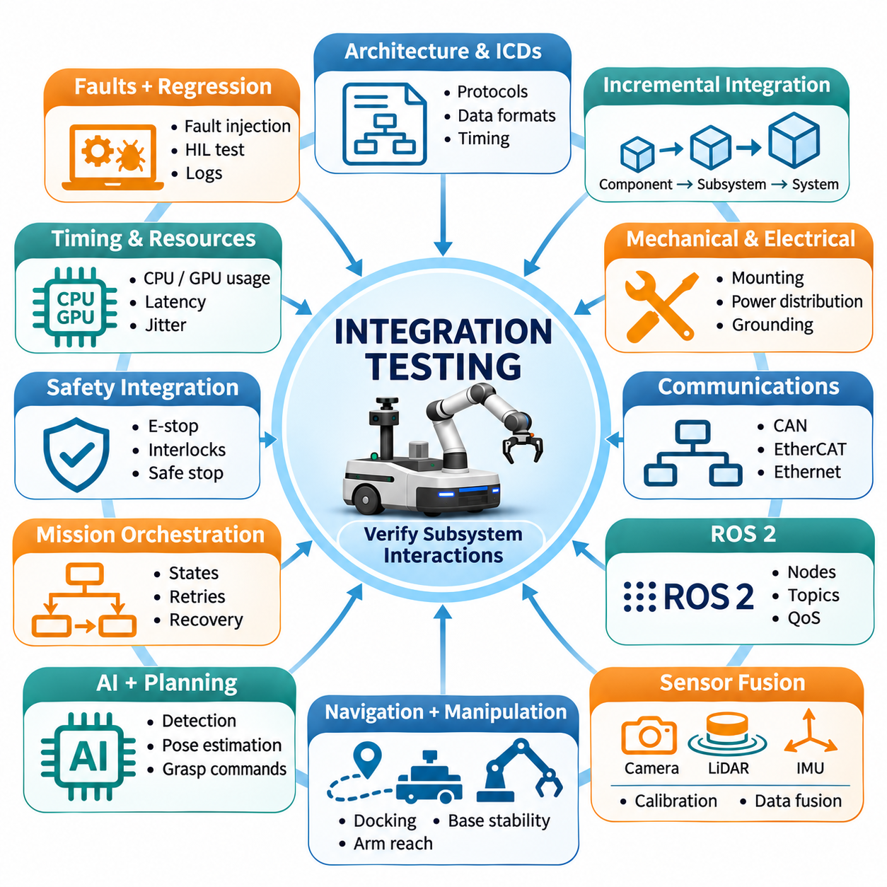{width="7.268055555555556in" height="7.268055555555556in"}

Integration testing is a systematic verification activity that evaluates interactions between independently developed components and subsystems within a mobile manipulator. While unit testing focuses on individual functions, integration testing examines whether hardware, software, artificial intelligence, and control modules operate correctly when interconnected. Its primary objective is to identify interface defects, communication failures, and unexpected dependencies.

Mobile manipulators combine autonomous mobile robots, robotic arms, end effectors, perception sensors, embedded controllers, and mission management software. Each subsystem may independently satisfy its design requirements while exhibiting unexpected behavior during combined operation. Integration testing therefore establishes confidence that mechanical, electrical, computational, and communication interfaces collectively support coordinated robotic behavior.

The integration testing process should begin with a comprehensive review of the system architecture and Interface Control Documents (ICDs). Interface specifications should define communication protocols, message structures, data formats, coordinate systems, timing requirements, and error-handling mechanisms. Test cases should verify that interconnected components comply with these specifications under both normal and abnormal operating conditions.

Incremental integration provides an effective methodology for managing the complexity of mobile manipulator development. Individual components are progressively assembled into functional subsystems before complete system integration. This approach enables engineers to identify interface defects within manageable verification boundaries, reduce troubleshooting complexity, and establish intermediate integration baselines before introducing additional dependencies.

Mechanical and electrical integration testing evaluates physical compatibility between the mobile platform, robotic arm, end effector, sensors, and supporting equipment. Verification should examine mounting interfaces, structural rigidity, cable routing, power distribution, grounding, and electromagnetic compatibility. Combined operation should also be evaluated to identify mechanical interference, vibration, voltage fluctuations, and unexpected thermal behavior.

Communication integration testing verifies reliable information exchange between distributed controllers, sensors, edge computing platforms, and supervisory software. Technologies such as CAN, CANopen, EtherCAT, Ethernet, and wireless communication may support different operational functions. Testing should evaluate message integrity, communication latency, synchronization accuracy, packet loss, timeout handling, and connectivity recovery.

ROS 2 integration testing examines interactions among nodes, topics, services, actions, and lifecycle management mechanisms. Particular attention should be given to Quality of Service (QoS) compatibility, message synchronization, namespace configuration, and distributed discovery. Integration scenarios should verify that navigation, perception, manipulation, and mission management nodes exchange information reliably under representative computational workloads.

Sensor integration testing evaluates the combined operation of cameras, LiDAR, inertial measurement units, wheel encoders, and force-torque sensors. Accurate timestamp alignment, coordinate transformations, calibration parameters, and sensor data consistency are essential for reliable perception and control. Verification should examine the effects of delayed measurements, missing data, calibration errors, and inconsistent sensor observations on integrated behavior.

Navigation and manipulation integration represents a critical verification domain because the mobile platform directly influences robotic arm positioning and task execution. Testing should evaluate precision docking, base stabilization, manipulator workspace availability, and coordinated motion constraints. The system must correctly determine when navigation has completed and whether the platform is sufficiently stable and accurately positioned for manipulation.

Artificial intelligence integration testing evaluates the interaction between perception models, robotic planning algorithms, and physical execution systems. Object detection, pose estimation, and grasp prediction outputs must be correctly transformed into actionable control parameters. Testing should examine coordinate consistency, inference latency, confidence thresholds, invalid predictions, and the ability of downstream controllers to reject unsuitable AI-generated commands.

Task planning integration testing verifies coordinated execution across mission management, navigation, perception, and manipulation subsystems. Behavior trees, state machines, and task orchestration frameworks should be evaluated through representative operational sequences. Testing must confirm that task transitions, completion acknowledgments, conditional branches, retry mechanisms, and recovery procedures operate consistently across distributed components.

Safety integration testing examines interactions between protective devices, safety controllers, mobile platform controllers, and robotic arm control systems. Emergency stop activation, protective stopping, motion restrictions, and safety interlocks must produce coordinated responses. Controlled fault injection should verify that communication failures, invalid commands, and subsystem malfunctions do not result in hazardous motion or unauthorized automatic restart.

Timing and resource integration testing evaluates whether multiple subsystems can operate concurrently without violating operational deadlines. Navigation, visual perception, AI inference, trajectory planning, and control processes may compete for CPU, GPU, memory, and network resources. Verification should examine processing latency, scheduling jitter, resource contention, and system responsiveness under nominal and peak computational workloads.

Integration testing should incorporate representative failure scenarios to evaluate fault propagation and recovery across subsystem boundaries. Sensor disconnection, communication interruption, localization failure, unsuccessful grasping, and controller restart can reveal hidden dependencies. The expected response should include appropriate fault detection, controlled state transitions, diagnostic reporting, and recovery consistent with the defined operational and safety requirements.

Automated integration testing and regression testing should be incorporated into the development workflow wherever practical. Simulation environments, Hardware-in-the-Loop (HIL) platforms, automated mission scripts, and continuous integration pipelines can support repeatable verification. Test results should include configuration references, synchronized logs, communication traces, execution metrics, and diagnostic evidence to facilitate defect investigation.

An effective integration testing methodology establishes the foundation for subsequent functional, performance, AI, manipulation, safety, and reliability testing. Successful integration demonstrates that independently verified subsystems can operate together within defined architectural constraints, but does not establish complete operational readiness. Project-specific acceptance thresholds, integration sequences, and approval criteria should be established within the approved test plan.

통합 시험(Integration Testing)은 이동형 매니퓰레이터(Mobile Manipulator) 내부에서 독립적으로 개발된 구성요소(Component)와 하위 시스템(Subsystem) 간의 상호작용을 평가하는 체계적인 검증 활동(Verification Activity)이다. 단위 시험(Unit Testing)이 개별 기능에 중점을 두는 반면, 통합 시험은 하드웨어(Hardware), 소프트웨어(Software), 인공지능(Artificial Intelligence), 제어 모듈(Control Module)이 상호 연결된 상태에서 올바르게 동작하는지를 검토한다. 주요 목적은 인터페이스 결함(Interface Defect), 통신 장애(Communication Failure), 예상하지 못한 의존성(Dependency)을 식별하는 것이다.

이동형 매니퓰레이터는 자율이동로봇(Autonomous Mobile Robot, AMR), 로봇 팔(Robotic Arm), 말단 작동기(End Effector), 인지 센서(Perception Sensor), 임베디드 제어기(Embedded Controller), 임무 관리 소프트웨어(Mission Management Software)를 결합한다. 각각의 하위 시스템은 독립적으로 설계 요구사항(Design Requirement)을 충족하더라도 통합 운영 과정에서 예상하지 못한 동작을 나타낼 수 있다. 따라서 통합 시험은 기계적, 전기적, 연산적 및 통신 인터페이스가 전체적으로 로봇의 협조 동작(Coordinated Robotic Behavior)을 지원한다는 신뢰성을 확보한다.

통합 시험 프로세스(Integration Testing Process)는 시스템 아키텍처(System Architecture)와 인터페이스 관리 문서(Interface Control Document, ICD)에 대한 종합적인 검토에서 시작되어야 한다. 인터페이스 사양(Interface Specification)은 통신 프로토콜(Communication Protocol), 메시지 구조(Message Structure), 데이터 형식(Data Format), 좌표계(Coordinate System), 타이밍 요구사항(Timing Requirement), 오류 처리 메커니즘(Error-Handling Mechanism)을 정의해야 한다. 시험 사례(Test Case)는 정상 및 비정상 운영 조건에서 상호 연결된 구성요소가 이러한 사양을 준수하는지를 검증해야 한다.

점진적 통합(Incremental Integration)은 이동형 매니퓰레이터 개발의 복잡성을 관리하기 위한 효과적인 방법론(Methodology)을 제공한다. 개별 구성요소는 전체 시스템 통합(System Integration)에 앞서 기능적 하위 시스템(Functional Subsystem)으로 단계적으로 조립된다. 이러한 접근 방식은 엔지니어가 관리 가능한 검증 경계(Verification Boundary) 내에서 인터페이스 결함을 식별하고, 문제 해결의 복잡성(Troubleshooting Complexity)을 줄이며, 추가적인 의존성을 도입하기 전에 중간 통합 기준선(Integration Baseline)을 수립할 수 있도록 한다.

기계 및 전기 통합 시험(Mechanical and Electrical Integration Testing)은 이동 플랫폼(Mobile Platform), 로봇 팔, 말단 작동기, 센서 및 지원 장비 간의 물리적 호환성(Physical Compatibility)을 평가한다. 검증은 장착 인터페이스(Mounting Interface), 구조적 강성(Structural Rigidity), 케이블 배선(Cable Routing), 전력 분배(Power Distribution), 접지(Grounding), 전자기 적합성(Electromagnetic Compatibility, EMC)을 검토해야 한다. 또한 통합 운영을 평가하여 기계적 간섭(Mechanical Interference), 진동(Vibration), 전압 변동(Voltage Fluctuation), 예상하지 못한 열적 거동(Thermal Behavior)을 식별해야 한다.

통신 통합 시험(Communication Integration Testing)은 분산 제어기(Distributed Controller), 센서, 엣지 컴퓨팅 플랫폼(Edge Computing Platform), 상위 제어 소프트웨어(Supervisory Software) 간의 신뢰성 있는 정보 교환(Information Exchange)을 검증한다. CAN, CANopen, EtherCAT, 이더넷(Ethernet), 무선 통신(Wireless Communication)과 같은 기술은 서로 다른 운영 기능을 지원할 수 있다. 시험은 메시지 무결성(Message Integrity), 통신 지연시간(Communication Latency), 동기화 정확도(Synchronization Accuracy), 패킷 손실(Packet Loss), 타임아웃 처리(Timeout Handling), 연결 복구(Connectivity Recovery)를 평가해야 한다.

ROS 2 통합 시험(ROS 2 Integration Testing)은 노드(Node), 토픽(Topic), 서비스(Service), 액션(Action), 수명주기 관리 메커니즘(Lifecycle Management Mechanism) 간의 상호작용을 검토한다. 특히 서비스 품질(Quality of Service, QoS)의 호환성, 메시지 동기화(Message Synchronization), 네임스페이스 구성(Namespace Configuration), 분산 탐색(Distributed Discovery)에 주의를 기울여야 한다. 통합 시나리오(Integration Scenario)는 대표적인 연산 부하(Computational Workload)에서 자율주행, 인지, 조작 및 임무 관리 노드가 신뢰성 있게 정보를 교환하는지를 검증해야 한다.

센서 통합 시험(Sensor Integration Testing)은 카메라(Camera), 라이다(LiDAR), 관성 측정 장치(Inertial Measurement Unit, IMU), 휠 엔코더(Wheel Encoder), 힘·토크 센서(Force-Torque Sensor)의 통합 동작을 평가한다. 정확한 타임스탬프 정렬(Timestamp Alignment), 좌표 변환(Coordinate Transformation), 교정 매개변수(Calibration Parameter), 센서 데이터 일관성(Sensor Data Consistency)은 신뢰성 있는 인지 및 제어를 위한 필수 요소이다. 검증은 지연된 측정값(Delayed Measurement), 누락 데이터(Missing Data), 교정 오차(Calibration Error), 일관성이 부족한 센서 관측값이 통합 동작에 미치는 영향을 검토해야 한다.

자율주행 및 조작 통합(Navigation and Manipulation Integration)은 이동 플랫폼이 로봇 팔의 위치 결정(Positioning)과 작업 실행(Task Execution)에 직접적인 영향을 미치기 때문에 핵심적인 검증 영역(Verification Domain)에 해당한다. 시험은 정밀 도킹(Precision Docking), 베이스 안정화(Base Stabilization), 매니퓰레이터 작업 공간 가용성(Manipulator Workspace Availability), 협조 동작 제약조건(Coordinated Motion Constraint)을 평가해야 한다. 시스템은 자율주행이 완료된 시점과 이동 플랫폼이 조작 작업을 수행하기에 충분히 안정적이고 정확하게 위치하였는지를 올바르게 판단해야 한다.

인공지능 통합 시험(Artificial Intelligence Integration Testing)은 인지 모델(Perception Model), 로봇 계획 알고리즘(Robotic Planning Algorithm), 물리적 실행 시스템(Physical Execution System) 간의 상호작용을 평가한다. 객체 검출(Object Detection), 자세 추정(Pose Estimation), 파지 예측(Grasp Prediction)의 출력은 실행 가능한 제어 매개변수(Control Parameter)로 정확하게 변환되어야 한다. 시험은 좌표 일관성(Coordinate Consistency), 추론 지연시간(Inference Latency), 신뢰도 임계값(Confidence Threshold), 유효하지 않은 예측(Invalid Prediction), 후속 제어기가 부적절한 인공지능 생성 명령(AI-Generated Command)을 거부할 수 있는 능력을 검토해야 한다.

작업 계획 통합 시험(Task Planning Integration Testing)은 임무 관리(Mission Management), 자율주행(Navigation), 인지(Perception), 조작(Manipulation) 하위 시스템 전반의 협조 실행(Coordinated Execution)을 검증한다. 행동 트리(Behavior Tree), 상태 머신(State Machine), 작업 오케스트레이션 프레임워크(Task Orchestration Framework)는 대표적인 운영 시퀀스(Operational Sequence)를 통해 평가되어야 한다. 시험은 작업 전이(Task Transition), 완료 확인(Completion Acknowledgment), 조건 분기(Conditional Branch), 재시도 메커니즘(Retry Mechanism), 복구 절차(Recovery Procedure)가 분산 구성요소 전반에서 일관되게 동작하는지를 확인해야 한다.

안전 통합 시험(Safety Integration Testing)은 보호 장치(Protective Device), 안전 제어기(Safety Controller), 이동 플랫폼 제어기(Mobile Platform Controller), 로봇 팔 제어 시스템(Robotic Arm Control System) 간의 상호작용을 검토한다. 비상 정지 활성화(Emergency Stop Activation), 보호 정지(Protective Stop), 동작 제한(Motion Restriction), 안전 인터록(Safety Interlock)은 상호 연계된 대응(Coordinated Response)을 생성해야 한다. 통제된 고장 주입(Controlled Fault Injection)을 통해 통신 장애, 유효하지 않은 명령, 하위 시스템 오작동이 위험한 동작(Hazardous Motion)이나 승인되지 않은 자동 재시작(Unauthorized Automatic Restart)으로 이어지지 않는지를 검증해야 한다.

타이밍 및 자원 통합 시험(Timing and Resource Integration Testing)은 여러 하위 시스템이 운영 시간 제약조건(Operational Deadline)을 위반하지 않고 동시에 동작할 수 있는지를 평가한다. 자율주행, 시각 인지(Visual Perception), 인공지능 추론(AI Inference), 궤적 계획(Trajectory Planning), 제어 프로세스(Control Process)는 중앙 처리 장치(Central Processing Unit, CPU), 그래픽 처리 장치(Graphics Processing Unit, GPU), 메모리(Memory), 네트워크(Network) 자원을 두고 경쟁할 수 있다. 검증은 정상 및 최대 연산 부하에서 처리 지연시간(Processing Latency), 스케줄링 지터(Scheduling Jitter), 자원 경합(Resource Contention), 시스템 응답성(System Responsiveness)을 검토해야 한다.

통합 시험은 하위 시스템 경계를 넘어 발생하는 고장 전파(Fault Propagation)와 복구(Recovery)를 평가하기 위해 대표적인 고장 시나리오(Failure Scenario)를 포함해야 한다. 센서 연결 해제(Sensor Disconnection), 통신 중단(Communication Interruption), 위치 추정 실패(Localization Failure), 파지 실패(Grasping Failure), 제어기 재시작(Controller Restart)은 숨겨진 의존성(Hidden Dependency)을 드러낼 수 있다. 예상되는 대응에는 적절한 고장 검출(Fault Detection), 통제된 상태 전이(Controlled State Transition), 진단 보고(Diagnostic Reporting), 정의된 운영 및 안전 요구사항에 부합하는 복구가 포함되어야 한다.

자동화된 통합 시험(Automated Integration Testing)과 회귀 시험(Regression Testing)은 실질적으로 적용 가능한 모든 영역에서 개발 워크플로(Development Workflow)에 통합되어야 한다. 시뮬레이션 환경(Simulation Environment), 하드웨어 인더 루프 플랫폼(Hardware-in-the-Loop Platform, HIL), 자동화된 임무 스크립트(Automated Mission Script), 지속적 통합 파이프라인(Continuous Integration Pipeline)은 반복 가능한 검증(Repeatable Verification)을 지원할 수 있다. 시험 결과에는 결함 조사(Defect Investigation)를 지원하기 위한 형상 참조 정보(Configuration Reference), 동기화된 로그(Synchronized Log), 통신 추적 기록(Communication Trace), 실행 지표(Execution Metric), 진단 증거(Diagnostic Evidence)가 포함되어야 한다.

효과적인 통합 시험 방법론(Integration Testing Methodology)은 이후 수행되는 기능 시험(Functional Testing), 성능 시험(Performance Testing), 인공지능 시험(AI Testing), 조작 시험(Manipulation Testing), 안전 시험(Safety Testing), 신뢰성 시험(Reliability Testing)을 위한 기반을 수립한다. 성공적인 통합은 독립적으로 검증된 하위 시스템이 정의된 아키텍처 제약조건(Architectural Constraint) 내에서 함께 동작할 수 있음을 입증하지만, 완전한 운영 준비 상태(Operational Readiness)를 보장하지는 않는다. 프로젝트별 합격 임계값(Acceptance Threshold), 통합 순서(Integration Sequence), 승인 기준(Approval Criteria)은 승인된 시험 계획(Approved Test Plan) 내에서 수립되어야 한다.

##  

## 05 Functional Testing

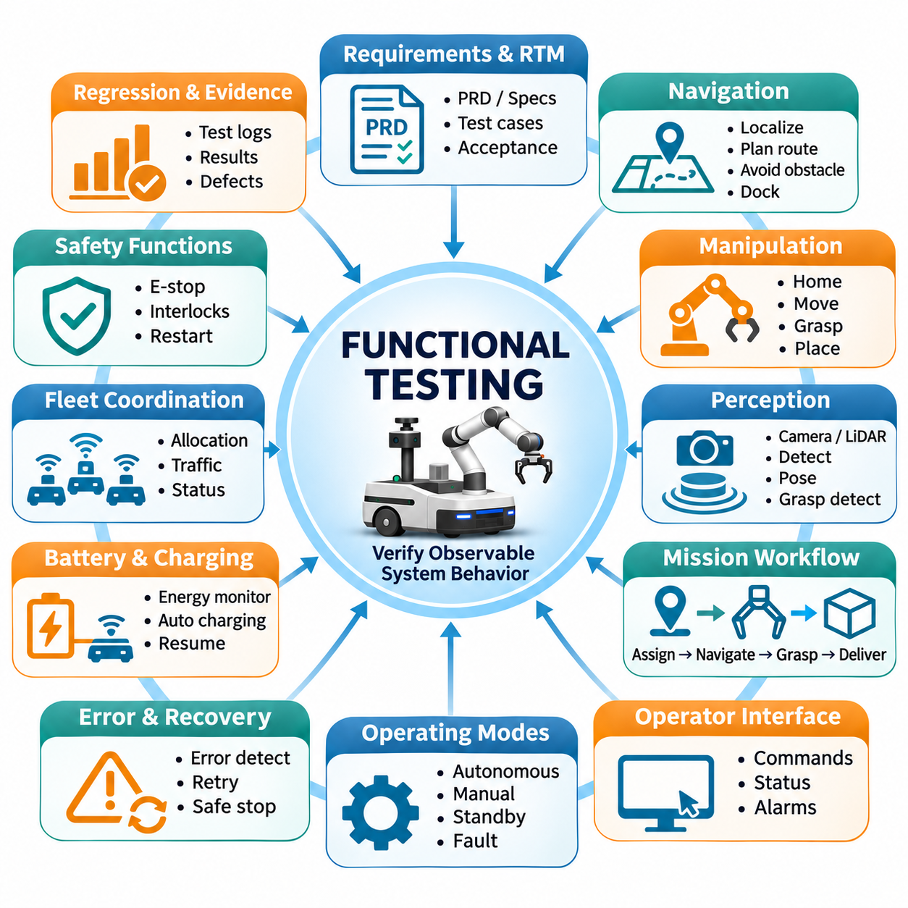{width="7.268055555555556in" height="7.268055555555556in"}

Functional testing is a systematic verification activity that determines whether a mobile manipulator performs its intended functions according to defined system requirements. Unlike unit testing and integration testing, which focus on individual components and subsystem interactions, functional testing evaluates observable system behavior. Its primary objective is to confirm that the integrated robotic platform executes required operations correctly and consistently.

Functional testing should be derived from the Product Requirement Document (PRD), functional specifications, system architecture, and operational scenarios. Each functional requirement should be translated into one or more executable test cases with clearly defined acceptance criteria. A Requirements Traceability Matrix (RTM) establishes the relationship between specified functions and verification evidence, ensuring that critical capabilities are adequately evaluated.

Functional test cases should define initial system conditions, input commands, environmental configurations, execution procedures, expected behavior, and evaluation criteria. Both positive and negative test cases are necessary to verify correct operation and appropriate responses to invalid inputs. Testing should consider normal operating conditions, boundary conditions, exceptional situations, and foreseeable disturbances within the intended operational environment.

Autonomous navigation functional testing evaluates whether the mobile platform can execute requested movement operations within its designated environment. Representative functions include map loading, localization initialization, route planning, obstacle avoidance, destination arrival, and precision docking. Testing should confirm that the robot responds correctly to environmental changes, updates its navigation decisions, and reports navigation status accurately.

Robotic manipulation functional testing examines whether the robotic arm and end effector execute the operations required by the intended application. Typical functions include homing, joint movement, Cartesian positioning, object approaching, grasping, lifting, transporting, and releasing objects. Each operation should be evaluated independently and as part of representative task sequences to verify functional consistency and correct execution.

Perception functional testing evaluates the ability of the robotic system to acquire environmental information and provide meaningful inputs to downstream planning and control modules. Camera acquisition, LiDAR scanning, object detection, pose estimation, and grasp detection should operate correctly under specified conditions. Testing should also verify how the system handles unavailable measurements, invalid observations, and uncertain perception outputs.

Task execution testing examines the complete operational workflow of a mobile manipulator from mission assignment to task completion. A representative warehouse mission may involve autonomous navigation, precision docking, object recognition, grasping, transportation, and placement. The system should execute these operations in the correct sequence while maintaining task state information and reporting completion or failure to supervisory applications.

Human-machine interface functional testing evaluates interactions between operators and the mobile manipulator through graphical interfaces, remote control applications, and supervisory management systems. Functions such as mission submission, manual operation, status monitoring, alarm visualization, and task cancellation should be verified. Operator commands must produce predictable responses consistent with authorization levels and current operating states.

Operating mode testing verifies transitions between autonomous, manual, maintenance, standby, charging, and fault states. Each operating mode should activate only the functions permitted by its corresponding requirements. Testing should examine whether incompatible commands are rejected, state transitions occur correctly, and interrupted operations are resumed or terminated according to defined recovery procedures without creating unintended system behavior.

Error-handling functional testing evaluates how the system responds when operational functions cannot be completed successfully. Representative scenarios include unreachable destinations, unsuccessful grasping, blocked trajectories, missing objects, sensor abnormalities, and communication interruptions. The robot should recognize failures, generate meaningful diagnostic messages, and execute predefined retry, recovery, or controlled termination procedures.

Battery management and automatic charging functions should be verified as part of the complete operational workflow. Functional tests should examine battery status monitoring, low-energy warnings, automatic charging requests, docking operations, charging initiation, and mission resumption. The system should prevent inappropriate task execution when available energy is insufficient and respond correctly to charging interruptions or docking failures.

Fleet management functional testing evaluates interactions between individual mobile manipulators and centralized or distributed supervisory systems. Task allocation, mission prioritization, robot availability reporting, traffic coordination, and fleet status synchronization should be verified where applicable. Testing should confirm that communication interruptions and conflicting task requests are handled according to predefined coordination policies.

Safety-related functional testing verifies that protective functions respond correctly when specified triggering conditions occur. Emergency stopping, protective stopping, motion interlocks, speed restrictions, and restart authorization should be evaluated through controlled scenarios. Although these activities provide important functional evidence, dedicated safety testing and applicable compliance assessments remain necessary to establish system-level safety assurance.

Functional regression testing ensures that modifications to software, hardware, AI models, and configuration parameters do not unintentionally change previously verified behavior. Automated mission scripts, simulation environments, and physical test platforms can support repeatable verification across successive development iterations. Test records should include system configurations, execution logs, observed outcomes, deviations, and associated defect identifiers.

Successful functional testing establishes confidence that a mobile manipulator delivers its specified capabilities and provides a foundation for subsequent performance, AI, manipulation, safety, and reliability testing. The methodology presented here expands the development manual\'s testing structure into a general engineering framework. Specific operational scenarios, acceptance thresholds, and release criteria must be defined within the approved project test plan.

기능 시험(Functional Testing)은 이동형 매니퓰레이터(Mobile Manipulator)가 정의된 시스템 요구사항(System Requirement)에 따라 의도된 기능을 수행하는지를 확인하는 체계적인 검증 활동(Verification Activity)이다. 단위 시험(Unit Testing)과 통합 시험(Integration Testing)이 개별 구성요소 및 하위 시스템 간의 상호작용에 중점을 두는 것과 달리, 기능 시험은 관찰 가능한 시스템 동작(Observable System Behavior)을 평가한다. 주요 목적은 통합 로봇 플랫폼(Integrated Robotic Platform)이 요구되는 작업을 정확하고 일관되게 수행하는지를 확인하는 것이다.

기능 시험은 제품 요구사항 정의서(Product Requirement Document, PRD), 기능 사양(Functional Specification), 시스템 아키텍처(System Architecture), 운영 시나리오(Operational Scenario)를 기반으로 개발되어야 한다. 각각의 기능 요구사항(Functional Requirement)은 명확하게 정의된 합격 기준(Acceptance Criteria)을 갖는 하나 이상의 실행 가능한 시험 사례(Test Case)로 변환되어야 한다. 요구사항 추적성 매트릭스(Requirements Traceability Matrix, RTM)는 명시된 기능과 검증 증거(Verification Evidence) 간의 관계를 수립하여 핵심 기능이 충분히 평가되도록 한다.

기능 시험 사례(Functional Test Case)는 초기 시스템 조건(Initial System Condition), 입력 명령(Input Command), 환경 구성(Environmental Configuration), 실행 절차(Execution Procedure), 예상 동작(Expected Behavior), 평가 기준(Evaluation Criteria)을 정의해야 한다. 올바른 동작과 유효하지 않은 입력에 대한 적절한 대응을 검증하기 위해 긍정 시험 사례(Positive Test Case)와 부정 시험 사례(Negative Test Case)가 모두 필요하다. 시험은 의도된 운영 환경 내에서 정상 운영 조건(Normal Operating Condition), 경계 조건(Boundary Condition), 예외 상황(Exceptional Situation), 예측 가능한 외란(Disturbance)을 고려해야 한다.

자율주행 기능 시험(Autonomous Navigation Functional Testing)은 이동 플랫폼(Mobile Platform)이 지정된 환경 내에서 요청된 이동 작업을 수행할 수 있는지를 평가한다. 대표적인 기능에는 지도 로딩(Map Loading), 위치 추정 초기화(Localization Initialization), 경로 계획(Route Planning), 장애물 회피(Obstacle Avoidance), 목적지 도착(Destination Arrival), 정밀 도킹(Precision Docking)이 포함된다. 시험은 로봇이 환경 변화에 올바르게 대응하고, 자율주행 의사결정(Navigation Decision)을 갱신하며, 자율주행 상태(Navigation Status)를 정확하게 보고하는지를 확인해야 한다.

로봇 조작 기능 시험(Robotic Manipulation Functional Testing)은 로봇 팔(Robotic Arm)과 말단 작동기(End Effector)가 목표 응용 분야에서 요구되는 작업을 수행하는지를 검토한다. 대표적인 기능에는 원점 복귀(Homing), 관절 이동(Joint Movement), 직교 좌표 위치 결정(Cartesian Positioning), 객체 접근(Object Approaching), 파지(Grasping), 들어 올리기(Lifting), 운반(Transportation), 객체 해제(Object Releasing)가 포함된다. 각각의 작업은 기능적 일관성(Functional Consistency)과 정확한 실행을 검증하기 위해 독립적으로 평가되는 동시에 대표적인 작업 시퀀스(Task Sequence)의 일부로 평가되어야 한다.

인지 기능 시험(Perception Functional Testing)은 로봇 시스템이 환경 정보를 획득하고 후속 계획 및 제어 모듈(Planning and Control Module)에 유의미한 입력을 제공하는 능력을 평가한다. 카메라 영상 획득(Camera Acquisition), 라이다 스캐닝(LiDAR Scanning), 객체 검출(Object Detection), 자세 추정(Pose Estimation), 파지 검출(Grasp Detection)은 명시된 조건에서 올바르게 동작해야 한다. 또한 시험은 시스템이 획득할 수 없는 측정값(Unavailable Measurement), 유효하지 않은 관측값(Invalid Observation), 불확실한 인지 출력(Uncertain Perception Output)을 어떻게 처리하는지 검증해야 한다.

작업 실행 시험(Task Execution Testing)은 임무 할당(Mission Assignment)부터 작업 완료(Task Completion)까지 이동형 매니퓰레이터의 전체 운영 워크플로(Operational Workflow)를 검토한다. 대표적인 물류창고 임무(Warehouse Mission)에는 자율주행(Autonomous Navigation), 정밀 도킹(Precision Docking), 객체 인식(Object Recognition), 파지(Grasping), 운반(Transportation), 배치(Placement)가 포함될 수 있다. 시스템은 작업 상태 정보(Task State Information)를 유지하면서 이러한 작업을 올바른 순서로 수행하고, 상위 관리 응용 프로그램(Supervisory Application)에 작업 완료 또는 실패 여부를 보고해야 한다.

인간-기계 인터페이스 기능 시험(Human-Machine Interface Functional Testing)은 그래픽 인터페이스(Graphical Interface), 원격 제어 응용 프로그램(Remote Control Application), 상위 관리 시스템(Supervisory Management System)을 통한 운영자와 이동형 매니퓰레이터 간의 상호작용을 평가한다. 임무 제출(Mission Submission), 수동 조작(Manual Operation), 상태 모니터링(Status Monitoring), 경보 시각화(Alarm Visualization), 작업 취소(Task Cancellation)와 같은 기능이 검증되어야 한다. 운영자 명령(Operator Command)은 권한 수준(Authorization Level) 및 현재 운영 상태(Current Operating State)에 부합하는 예측 가능한 응답을 생성해야 한다.

운영 모드 시험(Operating Mode Testing)은 자율 운영(Autonomous Operation), 수동 운영(Manual Operation), 유지보수(Maintenance), 대기(Standby), 충전(Charging), 고장(Fault) 상태 간의 전이를 검증한다. 각각의 운영 모드(Operating Mode)는 해당 요구사항에서 허용하는 기능만 활성화해야 한다. 시험은 호환되지 않는 명령(Incompatible Command)이 거부되는지, 상태 전이(State Transition)가 올바르게 이루어지는지, 중단된 작업이 의도하지 않은 시스템 동작을 유발하지 않으면서 정의된 복구 절차(Recovery Procedure)에 따라 재개되거나 종료되는지를 검토해야 한다.

오류 처리 기능 시험(Error-Handling Functional Testing)은 운영 기능을 성공적으로 완료할 수 없는 상황에서 시스템이 어떻게 대응하는지를 평가한다. 대표적인 시나리오에는 도달 불가능한 목적지(Unreachable Destination), 파지 실패(Grasping Failure), 차단된 궤적(Blocked Trajectory), 객체 누락(Missing Object), 센서 이상(Sensor Abnormality), 통신 중단(Communication Interruption)이 포함된다. 로봇은 고장을 인식하고 유의미한 진단 메시지(Diagnostic Message)를 생성하며, 사전에 정의된 재시도(Retry), 복구(Recovery) 또는 통제된 종료 절차(Controlled Termination Procedure)를 실행해야 한다.

배터리 관리(Battery Management)와 자동 충전(Automatic Charging) 기능은 전체 운영 워크플로의 일부로 검증되어야 한다. 기능 시험은 배터리 상태 모니터링(Battery Status Monitoring), 저에너지 경고(Low-Energy Warning), 자동 충전 요청(Automatic Charging Request), 도킹 작업(Docking Operation), 충전 개시(Charging Initiation), 임무 재개(Mission Resumption)를 검토해야 한다. 시스템은 가용 에너지(Available Energy)가 충분하지 않을 때 부적절한 작업 실행을 방지하고, 충전 중단(Charging Interruption) 또는 도킹 실패(Docking Failure)에 올바르게 대응해야 한다.

플릿 관리 기능 시험(Fleet Management Functional Testing)은 개별 이동형 매니퓰레이터와 중앙집중형 또는 분산형 상위 관리 시스템(Centralized or Distributed Supervisory System) 간의 상호작용을 평가한다. 해당 기능이 적용되는 경우 작업 할당(Task Allocation), 임무 우선순위 설정(Mission Prioritization), 로봇 가용성 보고(Robot Availability Reporting), 교통 조정(Traffic Coordination), 플릿 상태 동기화(Fleet Status Synchronization)가 검증되어야 한다. 시험은 통신 중단과 상충하는 작업 요청(Conflicting Task Request)이 사전에 정의된 협조 정책(Coordination Policy)에 따라 처리되는지를 확인해야 한다.

안전 관련 기능 시험(Safety-Related Functional Testing)은 명시된 작동 조건(Triggering Condition)이 발생했을 때 보호 기능(Protective Function)이 올바르게 대응하는지를 검증한다. 비상 정지(Emergency Stop), 보호 정지(Protective Stop), 동작 인터록(Motion Interlock), 속도 제한(Speed Restriction), 재시작 승인(Restart Authorization)은 통제된 시나리오(Controlled Scenario)를 통해 평가되어야 한다. 이러한 활동은 중요한 기능적 검증 증거(Functional Evidence)를 제공하지만, 시스템 수준의 안전 보증(System-Level Safety Assurance)을 확보하기 위해서는 별도의 안전 시험(Safety Testing)과 적용 가능한 적합성 평가(Compliance Assessment)가 필요하다.

기능 회귀 시험(Functional Regression Testing)은 소프트웨어, 하드웨어, 인공지능 모델(AI Model), 구성 매개변수(Configuration Parameter)의 변경이 이전에 검증된 동작을 의도하지 않게 변경하지 않도록 보장하는 것을 목표로 한다. 자동화된 임무 스크립트(Automated Mission Script), 시뮬레이션 환경(Simulation Environment), 물리적 시험 플랫폼(Physical Test Platform)은 연속적인 개발 반복 과정에서 재현 가능한 검증(Repeatable Verification)을 지원할 수 있다. 시험 기록(Test Record)에는 시스템 구성(System Configuration), 실행 로그(Execution Log), 관찰된 결과(Observed Outcome), 편차(Deviation), 관련 결함 식별자(Defect Identifier)가 포함되어야 한다.

성공적인 기능 시험(Functional Testing)은 이동형 매니퓰레이터가 명시된 기능을 제공한다는 신뢰성을 확보하고, 이후 수행되는 성능 시험(Performance Testing), 인공지능 시험(AI Testing), 조작 시험(Manipulation Testing), 안전 시험(Safety Testing), 신뢰성 시험(Reliability Testing)을 위한 기반을 제공한다. 여기에서 제시한 방법론은 개발 매뉴얼(Development Manual)의 시험 구조를 일반적인 엔지니어링 프레임워크(Engineering Framework)로 확장한 것이다. 구체적인 운영 시나리오(Operational Scenario), 합격 임계값(Acceptance Threshold), 릴리스 기준(Release Criteria)은 승인된 프로젝트 시험 계획(Approved Project Test Plan)에서 정의되어야 한다.

##  

## 06 Performance Testing

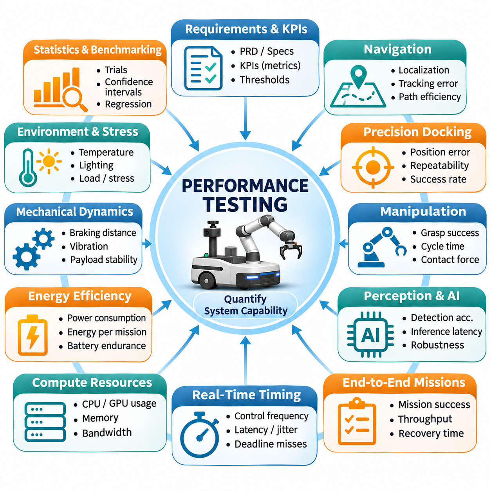{width="7.268055555555556in" height="7.268055555555556in"}

Performance testing is a quantitative verification activity that evaluates whether a mobile manipulator satisfies its specified operational and technical performance requirements. While functional testing determines whether required functions operate correctly, performance testing examines how accurately, rapidly, efficiently, and consistently these functions are executed under representative operating conditions and workloads.

Performance testing should be based on the Product Requirement Document (PRD), system specifications, operational scenarios, and approved test plan. Each performance requirement should be associated with measurable Key Performance Indicators (KPIs), standardized measurement procedures, and acceptance thresholds. These criteria establish an objective foundation for evaluating engineering improvements and determining system readiness.

Navigation performance testing evaluates the accuracy, responsiveness, and efficiency of the autonomous mobile platform. Representative metrics include localization accuracy, trajectory tracking error, navigation success rate, travel time, obstacle avoidance response time, and path efficiency. Tests should incorporate different floor surfaces, travel distances, obstacle configurations, vehicle speeds, and payload conditions.

Precision docking performance is particularly important because the positioning accuracy of the mobile platform directly influences the operational effectiveness of the robotic arm. Testing should measure translational and rotational positioning errors, docking repeatability, alignment time, and docking success rate. Measurements should consider different approach directions, initial positioning errors, payloads, and environmental conditions.

Manipulation performance testing evaluates the ability of the robotic arm and end effector to execute physical operations within specified performance limits. Relevant metrics include positioning accuracy, pose repeatability, trajectory tracking error, grasp success rate, manipulation cycle time, and contact force accuracy. Different object geometries, payloads, working distances, and manipulator configurations should be examined.

Perception and artificial intelligence performance testing evaluates the computational and predictive capabilities of learning-based robotic functions. Object detection accuracy, pose estimation error, grasp prediction accuracy, inference latency, and processing throughput should be measured under representative conditions. Testing should also examine performance degradation caused by illumination changes, occlusion, sensor noise, and computational constraints.

End-to-end mission performance testing evaluates the combined effectiveness of navigation, perception, manipulation, and task management. Mission completion time, mission success rate, task throughput, waiting time, and recovery duration provide important indicators of operational productivity. Individual subsystem performance should be analyzed together with complete mission execution to identify system-level bottlenecks and dependencies.

Real-time performance testing examines the ability of distributed robotic components to satisfy defined timing requirements. Control loop frequency, sensor acquisition latency, communication latency, scheduling jitter, and command execution delay should be measured. Average response times should be supplemented by percentile measurements, maximum observed delays, and deadline violation rates to characterize timing variability.

Computational performance testing evaluates the utilization of central processing units (CPUs), graphics processing units (GPUs), memory, storage, and communication bandwidth. Concurrent execution of navigation, perception, AI inference, motion planning, and diagnostic processes may introduce resource contention. Testing should identify computational bottlenecks and determine whether adequate processing capacity remains available during peak workloads.

Energy efficiency testing evaluates the relationship between electrical energy consumption and completed robotic operations. Representative metrics include average power consumption, peak electrical demand, energy consumption per mission, operating duration, and charging time. Measurements should consider different travel speeds, manipulation workloads, payload masses, idle periods, and battery states to establish realistic operational endurance.

Mechanical performance testing examines the dynamic behavior of the mobile platform and manipulator during representative physical operations. Acceleration, deceleration, braking distance, vibration, structural deflection, payload stability, and manipulator-induced platform movement should be evaluated. Particular attention should be given to changes in the combined center of gravity during arm extension and payload transportation.

Environmental performance testing evaluates how operating conditions influence the capabilities of the mobile manipulator. Temperature variations, humidity, lighting conditions, floor irregularities, dust exposure, and wireless communication interference may affect system performance. Testing should characterize performance degradation across the specified operational envelope and identify conditions requiring restrictions or additional engineering improvements.

Load testing and stress testing examine system behavior as operational demands approach or exceed specified capacity limits. Increased payloads within approved limits, higher mission frequencies, concurrent computational workloads, and intensive communication traffic can reveal performance limitations. Stress scenarios should be conducted under controlled conditions to determine whether overload protection and performance degradation mechanisms operate appropriately.

Statistical evaluation is essential because robotic performance can vary between repeated operations even under nominally identical conditions. Test procedures should define sample sizes, measurement uncertainty, environmental configurations, and statistical analysis methods. Mean values, standard deviations, confidence intervals, percentile distributions, and success rates provide a more comprehensive understanding of performance than isolated measurements.

Performance benchmarking establishes reference values for comparing alternative hardware configurations, control algorithms, AI models, and software implementations. Consistent workloads, measurement instruments, system configurations, and evaluation procedures are necessary for meaningful comparisons. Benchmark results should distinguish subsystem improvements from overall mission performance gains and account for trade-offs between accuracy, speed, energy consumption, and computational cost.

Performance regression testing verifies that successive hardware and software modifications do not reduce previously established capabilities. Automated benchmarking scripts, synchronized telemetry, and version-controlled test configurations support repeatable measurements. The resulting performance reports should document measured values, acceptance thresholds, statistical distributions, deviations, bottlenecks, and recommended corrective actions.

Successful performance testing provides quantitative evidence that a mobile manipulator can achieve its intended productivity, accuracy, responsiveness, and operational efficiency. It also establishes a technical baseline for subsequent optimization, reliability testing, field validation, and commercialization. Project-specific performance targets and acceptance thresholds should be established according to the intended application rather than assumed to be universally applicable.

성능 시험(Performance Testing)은 이동형 매니퓰레이터(Mobile Manipulator)가 명시된 운영 및 기술적 성능 요구사항(Performance Requirement)을 충족하는지를 평가하는 정량적 검증 활동(Quantitative Verification Activity)이다. 기능 시험(Functional Testing)이 요구된 기능이 올바르게 동작하는지를 확인하는 반면, 성능 시험은 대표적인 운영 조건(Operating Condition)과 작업 부하(Workload)에서 이러한 기능이 얼마나 정확하고, 신속하며, 효율적이고, 일관되게 실행되는지를 검토한다.

성능 시험은 제품 요구사항 정의서(Product Requirement Document, PRD), 시스템 사양(System Specification), 운영 시나리오(Operational Scenario), 승인된 시험 계획(Approved Test Plan)을 기반으로 수행되어야 한다. 각각의 성능 요구사항은 측정 가능한 핵심 성과 지표(Key Performance Indicator, KPI), 표준화된 측정 절차(Standardized Measurement Procedure), 합격 임계값(Acceptance Threshold)과 연결되어야 한다. 이러한 기준은 엔지니어링 개선 사항을 평가하고 시스템 준비 상태(System Readiness)를 판단하기 위한 객관적인 기반을 제공한다.

자율주행 성능 시험(Navigation Performance Testing)은 자율 이동 플랫폼(Autonomous Mobile Platform)의 정확성(Accuracy), 응답성(Responsiveness), 효율성(Efficiency)을 평가한다. 대표적인 성능 지표에는 위치 추정 정확도(Localization Accuracy), 궤적 추종 오차(Trajectory Tracking Error), 자율주행 성공률(Navigation Success Rate), 이동 시간(Travel Time), 장애물 회피 응답 시간(Obstacle Avoidance Response Time), 경로 효율성(Path Efficiency)이 포함된다. 시험은 다양한 바닥 표면, 이동 거리, 장애물 구성, 차량 속도 및 적재 하중 조건을 포함해야 한다.

정밀 도킹 성능(Precision Docking Performance)은 이동 플랫폼의 위치 결정 정확도(Positioning Accuracy)가 로봇 팔의 운영 효과성(Operational Effectiveness)에 직접적인 영향을 미치기 때문에 특히 중요하다. 시험은 병진 및 회전 위치 오차(Translational and Rotational Positioning Error), 도킹 반복 정밀도(Docking Repeatability), 정렬 시간(Alignment Time), 도킹 성공률(Docking Success Rate)을 측정해야 한다. 측정 과정에서는 다양한 접근 방향(Approach Direction), 초기 위치 오차(Initial Positioning Error), 적재 하중(Payload), 환경 조건(Environmental Condition)을 고려해야 한다.

조작 성능 시험(Manipulation Performance Testing)은 로봇 팔(Robotic Arm)과 말단 작동기(End Effector)가 명시된 성능 한계(Performance Limit) 내에서 물리적 작업을 수행하는 능력을 평가한다. 관련 성능 지표에는 위치 정확도(Positioning Accuracy), 자세 반복 정밀도(Pose Repeatability), 궤적 추종 오차(Trajectory Tracking Error), 파지 성공률(Grasp Success Rate), 조작 사이클 시간(Manipulation Cycle Time), 접촉력 정확도(Contact Force Accuracy)가 포함된다. 다양한 객체 형상(Object Geometry), 적재 하중, 작업 거리(Working Distance), 매니퓰레이터 구성(Manipulator Configuration)을 검토해야 한다.

인지 및 인공지능 성능 시험(Perception and Artificial Intelligence Performance Testing)은 학습 기반 로봇 기능(Learning-Based Robotic Function)의 연산 능력(Computational Capability)과 예측 능력(Predictive Capability)을 평가한다. 객체 검출 정확도(Object Detection Accuracy), 자세 추정 오차(Pose Estimation Error), 파지 예측 정확도(Grasp Prediction Accuracy), 추론 지연시간(Inference Latency), 처리량(Processing Throughput)은 대표적인 운영 조건에서 측정되어야 한다. 또한 조명 변화(Illumination Change), 가려짐(Occlusion), 센서 잡음(Sensor Noise), 연산 제약조건(Computational Constraint)으로 인한 성능 저하(Performance Degradation)를 검토해야 한다.

종단 간 임무 성능 시험(End-to-End Mission Performance Testing)은 자율주행(Navigation), 인지(Perception), 조작(Manipulation), 작업 관리(Task Management)의 통합 효과성을 평가한다. 임무 완료 시간(Mission Completion Time), 임무 성공률(Mission Success Rate), 작업 처리량(Task Throughput), 대기 시간(Waiting Time), 복구 소요 시간(Recovery Duration)은 운영 생산성(Operational Productivity)을 평가하는 중요한 지표를 제공한다. 개별 하위 시스템의 성능은 전체 임무 실행 과정과 함께 분석되어야 하며, 이를 통해 시스템 수준의 병목 현상(System-Level Bottleneck)과 의존성(Dependency)을 식별할 수 있다.

실시간 성능 시험(Real-Time Performance Testing)은 분산 로봇 구성요소(Distributed Robotic Component)가 정의된 타이밍 요구사항(Timing Requirement)을 충족하는 능력을 검토한다. 제어 루프 주파수(Control Loop Frequency), 센서 데이터 획득 지연시간(Sensor Acquisition Latency), 통신 지연시간(Communication Latency), 스케줄링 지터(Scheduling Jitter), 명령 실행 지연시간(Command Execution Delay)이 측정되어야 한다. 타이밍 변동성(Timing Variability)을 파악하기 위해 평균 응답 시간(Average Response Time)뿐만 아니라 백분위수 측정값(Percentile Measurement), 최대 관측 지연시간(Maximum Observed Delay), 실행 기한 위반율(Deadline Violation Rate)도 함께 평가해야 한다.

연산 성능 시험(Computational Performance Testing)은 중앙 처리 장치(Central Processing Unit, CPU), 그래픽 처리 장치(Graphics Processing Unit, GPU), 메모리(Memory), 저장장치(Storage), 통신 대역폭(Communication Bandwidth)의 활용도를 평가한다. 자율주행, 인지, 인공지능 추론(AI Inference), 동작 계획(Motion Planning), 진단 프로세스(Diagnostic Process)의 동시 실행(Concurrent Execution)은 자원 경합(Resource Contention)을 유발할 수 있다. 시험은 연산 병목 현상(Computational Bottleneck)을 식별하고 최대 작업 부하(Peak Workload)에서도 충분한 연산 처리 용량(Processing Capacity)이 확보되는지를 확인해야 한다.

에너지 효율 시험(Energy Efficiency Testing)은 전기 에너지 소비량(Electrical Energy Consumption)과 완료된 로봇 작업 간의 관계를 평가한다. 대표적인 성능 지표에는 평균 전력 소비량(Average Power Consumption), 최대 전력 수요(Peak Electrical Demand), 임무당 에너지 소비량(Energy Consumption per Mission), 운영 지속 시간(Operating Duration), 충전 시간(Charging Time)이 포함된다. 측정은 현실적인 운영 지속 능력(Operational Endurance)을 파악하기 위해 다양한 이동 속도, 조작 작업 부하, 적재 질량(Payload Mass), 유휴 기간(Idle Period), 배터리 상태(Battery State)를 고려해야 한다.

기계적 성능 시험(Mechanical Performance Testing)은 대표적인 물리적 작업 중 이동 플랫폼과 매니퓰레이터의 동적 거동(Dynamic Behavior)을 검토한다. 가속(Acceleration), 감속(Deceleration), 제동 거리(Braking Distance), 진동(Vibration), 구조적 변형(Structural Deflection), 적재물 안정성(Payload Stability), 매니퓰레이터 동작에 의해 유발되는 플랫폼 움직임(Manipulator-Induced Platform Movement)이 평가되어야 한다. 특히 로봇 팔의 확장(Arm Extension)과 적재물 운반(Payload Transportation) 과정에서 통합 무게중심(Combined Center of Gravity)이 변화하는 현상에 주의를 기울여야 한다.

환경 성능 시험(Environmental Performance Testing)은 운영 조건이 이동형 매니퓰레이터의 기능 및 성능에 어떠한 영향을 미치는지를 평가한다. 온도 변화(Temperature Variation), 습도(Humidity), 조명 조건(Lighting Condition), 바닥 불균일성(Floor Irregularity), 분진 노출(Dust Exposure), 무선 통신 간섭(Wireless Communication Interference)은 시스템 성능에 영향을 미칠 수 있다. 시험은 명시된 운영 범위(Operational Envelope) 전반에서 발생하는 성능 저하를 분석하고 운영 제한(Operational Restriction) 또는 추가적인 엔지니어링 개선이 필요한 조건을 식별해야 한다.

부하 시험(Load Testing)과 스트레스 시험(Stress Testing)은 운영 요구 수준이 명시된 용량 한계(Capacity Limit)에 근접하거나 이를 초과할 때 시스템의 동작을 검토한다. 승인된 한계 내에서 증가된 적재 하중, 높은 임무 수행 빈도(Mission Frequency), 동시 연산 작업 부하(Concurrent Computational Workload), 집중적인 통신 트래픽(Communication Traffic)은 시스템의 성능 한계를 드러낼 수 있다. 스트레스 시나리오(Stress Scenario)는 과부하 보호(Overload Protection)와 성능 저하 관리 메커니즘(Performance Degradation Mechanism)이 적절하게 동작하는지를 확인하기 위해 통제된 조건에서 수행되어야 한다.

통계적 평가(Statistical Evaluation)는 명목상 동일한 조건에서도 반복 작업에 따라 로봇 성능이 달라질 수 있기 때문에 필수적이다. 시험 절차(Test Procedure)는 표본 크기(Sample Size), 측정 불확실성(Measurement Uncertainty), 환경 구성(Environmental Configuration), 통계 분석 방법(Statistical Analysis Method)을 정의해야 한다. 평균값(Mean Value), 표준편차(Standard Deviation), 신뢰구간(Confidence Interval), 백분위수 분포(Percentile Distribution), 성공률(Success Rate)은 개별적인 측정값보다 시스템 성능에 대한 더욱 종합적인 이해를 제공한다.

성능 벤치마킹(Performance Benchmarking)은 대안적인 하드웨어 구성(Hardware Configuration), 제어 알고리즘(Control Algorithm), 인공지능 모델(AI Model), 소프트웨어 구현(Software Implementation)을 비교하기 위한 참조값(Reference Value)을 수립한다. 유의미한 비교를 위해서는 일관된 작업 부하, 측정 장비(Measurement Instrument), 시스템 구성(System Configuration), 평가 절차(Evaluation Procedure)가 필요하다. 벤치마크 결과(Benchmark Result)는 하위 시스템의 성능 개선과 전체 임무 성능 향상을 구분하고 정확도, 속도, 에너지 소비량 및 연산 비용(Computational Cost) 간의 상충 관계(Trade-Off)를 고려해야 한다.

성능 회귀 시험(Performance Regression Testing)은 연속적인 하드웨어 및 소프트웨어 변경이 이전에 확보된 성능을 저하시키지 않는지를 검증한다. 자동화된 벤치마킹 스크립트(Automated Benchmarking Script), 동기화된 원격 측정 데이터(Synchronized Telemetry), 버전 관리되는 시험 구성(Version-Controlled Test Configuration)은 반복 가능한 측정(Repeatable Measurement)을 지원한다. 성능 시험 보고서(Performance Test Report)는 측정값(Measured Value), 합격 임계값(Acceptance Threshold), 통계적 분포(Statistical Distribution), 편차(Deviation), 병목 현상(Bottleneck), 권고 시정 조치(Recommended Corrective Action)를 문서화해야 한다.

성공적인 성능 시험(Performance Testing)은 이동형 매니퓰레이터가 의도된 생산성(Productivity), 정확성(Accuracy), 응답성(Responsiveness), 운영 효율성(Operational Efficiency)을 달성할 수 있다는 정량적 증거(Quantitative Evidence)를 제공한다. 또한 이후 수행되는 성능 최적화(Performance Optimization), 신뢰성 시험(Reliability Testing), 현장 유효성 확인(Field Validation), 상용화(Commercialization)를 위한 기술적 기준선(Technical Baseline)을 수립한다. 프로젝트별 성능 목표(Performance Target)와 합격 임계값(Acceptance Threshold)은 모든 시스템에 보편적으로 적용되는 것으로 가정하기보다는 목표 응용 분야(Intended Application)에 따라 수립되어야 한다.

##  

## 07 AI Testing

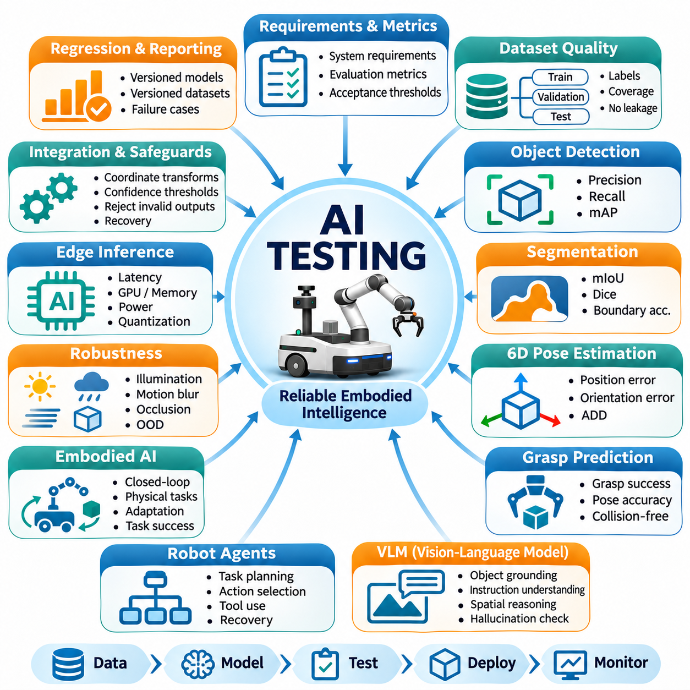{width="7.268055555555556in" height="7.268055555555556in"}

Artificial intelligence testing is a systematic verification and evaluation activity that examines the accuracy, robustness, computational efficiency, and operational behavior of AI models deployed within a mobile manipulator. Unlike conventional software testing, AI testing must account for statistical uncertainty, data-dependent behavior, environmental variability, and the relationship between model predictions and physical robotic actions.

AI testing should be derived from system requirements, AI functional specifications, operational scenarios, and the approved test plan. Each learning-based component should be associated with measurable evaluation metrics, representative test datasets, and acceptance thresholds. The testing methodology should establish whether AI capabilities satisfy both individual model requirements and integrated robotic system requirements.

Dataset verification establishes the foundation for reliable AI testing. Training, validation, and test datasets should be separated to prevent data leakage and ensure unbiased performance evaluation. Test datasets should represent operational environments, object categories, sensor configurations, and environmental variations. Dataset completeness, annotation accuracy, class distribution, and scenario coverage should be systematically examined.

Object detection testing evaluates whether AI models can accurately identify and localize objects relevant to robotic operations. Representative evaluation metrics include precision, recall, F1 score, Intersection over Union (IoU), and mean Average Precision (mAP). Testing should examine detection performance across different object sizes, viewing angles, illumination conditions, background complexity, and levels of occlusion.

Image segmentation testing evaluates the ability of AI models to distinguish target objects, traversable surfaces, obstacles, and relevant environmental structures at the pixel level. Semantic segmentation and instance segmentation models should be evaluated using appropriate metrics, including mean Intersection over Union (mIoU) and Dice coefficients. Boundary accuracy and segmentation consistency are particularly important for robotic manipulation.

Six-dimensional object pose estimation testing evaluates the accuracy of predicted object positions and orientations within three-dimensional space. Translational error, rotational error, Average Distance of Model Points (ADD), and symmetry-aware metrics should be considered. Testing should examine whether estimation errors remain within the tolerances required for successful grasping, alignment, and precision manipulation.

Grasp prediction testing evaluates whether AI-generated grasp candidates support successful physical object manipulation. Relevant metrics include grasp success rate, grasp pose accuracy, collision-free grasp availability, and object retention rate. Predictions should be evaluated using different object geometries, material properties, orientations, and environmental configurations through both simulation and physical experiments.

Vision-Language Model (VLM) testing examines the ability of multimodal AI systems to interpret visual observations and natural language instructions consistently. Evaluation should consider object grounding, instruction comprehension, spatial reasoning, and contextual interpretation. Particular attention should be given to ambiguous instructions, hallucinated objects, incorrect spatial relationships, and unsupported conclusions.

Robot agent testing evaluates the ability of AI-driven decision-making systems to select actions, coordinate tasks, and respond to changing operational conditions. Test scenarios should examine instruction decomposition, action selection, tool utilization, task sequencing, and recovery from unsuccessful operations. Agent-generated commands must remain within predefined operational constraints and authorized execution boundaries.

Embodied AI testing evaluates the relationship between perception, reasoning, decision-making, and physical interaction with the environment. Unlike offline model evaluation, embodied AI testing requires closed-loop assessment in which robotic actions influence subsequent observations. Testing should examine behavioral consistency, adaptation to environmental changes, error accumulation, and successful completion of physical tasks.

Robustness testing evaluates AI model behavior under environmental disturbances and conditions that differ from training data. Illumination variations, motion blur, sensor noise, object occlusion, unfamiliar geometries, and background changes should be incorporated into representative test scenarios. Out-of-distribution detection and uncertainty estimation can help identify situations requiring alternative execution or human intervention.

AI inference performance testing examines whether deployed models satisfy real-time computational requirements on target edge computing platforms. Inference latency, processing throughput, GPU utilization, memory consumption, and power demand should be measured under representative workloads. Quantization, pruning, and inference optimization should also be evaluated for their effects on predictive accuracy.

AI integration testing verifies that model outputs are correctly interpreted by navigation, motion planning, manipulation, and mission management components. Coordinate transformations, confidence thresholds, timestamp consistency, and command interfaces should be examined. Invalid predictions and uncertain outputs must be handled through appropriate rejection mechanisms, independent safeguards, and controlled recovery procedures.

AI regression testing evaluates whether model retraining, dataset expansion, software updates, and deployment optimization introduce unintended performance degradation. Version-controlled datasets, model checkpoints, evaluation scripts, and deployment configurations should support reproducible comparisons. Regression tests should examine both aggregate evaluation metrics and previously identified critical failure scenarios.

AI test reports should document model versions, dataset characteristics, experimental configurations, evaluation metrics, failure cases, statistical uncertainty, and computational resource requirements. Successful AI testing provides evidence for subsequent manipulation testing, safety testing, and field validation. These general testing practices extend the manual\'s chapter structure; project-specific acceptance thresholds must be defined separately.

인공지능 시험(Artificial Intelligence Testing)은 이동형 매니퓰레이터(Mobile Manipulator)에 배포된 인공지능 모델의 정확도(Accuracy), 강건성(Robustness), 연산 효율성(Computational Efficiency), 운영 동작(Operational Behavior)을 검토하는 체계적인 검증 및 평가 활동(Verification and Evaluation Activity)이다. 기존 소프트웨어 시험(Conventional Software Testing)과 달리 인공지능 시험은 통계적 불확실성(Statistical Uncertainty), 데이터 의존적 동작(Data-Dependent Behavior), 환경 변동성(Environmental Variability), 모델 예측과 물리적 로봇 동작 간의 관계를 고려해야 한다.

인공지능 시험은 시스템 요구사항(System Requirement), 인공지능 기능 사양(AI Functional Specification), 운영 시나리오(Operational Scenario), 승인된 시험 계획(Approved Test Plan)을 기반으로 개발되어야 한다. 각각의 학습 기반 구성요소(Learning-Based Component)는 측정 가능한 평가 지표(Evaluation Metric), 대표적인 시험 데이터셋(Test Dataset), 합격 임계값(Acceptance Threshold)과 연결되어야 한다. 시험 방법론(Testing Methodology)은 인공지능 기능이 개별 모델 요구사항(Model Requirement)과 통합 로봇 시스템 요구사항(Integrated Robotic System Requirement)을 모두 충족하는지를 확인해야 한다.

데이터셋 검증(Dataset Verification)은 신뢰성 있는 인공지능 시험을 위한 기반을 수립한다. 데이터 누출(Data Leakage)을 방지하고 편향되지 않은 성능 평가(Unbiased Performance Evaluation)를 보장하기 위해 학습 데이터셋(Training Dataset), 검증 데이터셋(Validation Dataset), 시험 데이터셋(Test Dataset)을 분리해야 한다. 시험 데이터셋은 운영 환경(Operational Environment), 객체 범주(Object Category), 센서 구성(Sensor Configuration), 환경 변화(Environmental Variation)를 대표해야 한다. 데이터셋 완전성(Dataset Completeness), 어노테이션 정확도(Annotation Accuracy), 클래스 분포(Class Distribution), 시나리오 커버리지(Scenario Coverage)를 체계적으로 검토해야 한다.

객체 검출 시험(Object Detection Testing)은 인공지능 모델이 로봇 작업과 관련된 객체를 정확하게 식별하고 위치를 추정할 수 있는지를 평가한다. 대표적인 평가 지표에는 정밀도(Precision), 재현율(Recall), F1 점수(F1 Score), 교집합 대 합집합 비율(Intersection over Union, IoU), 평균 정밀도 평균값(mean Average Precision, mAP)이 포함된다. 시험은 다양한 객체 크기(Object Size), 관측 각도(Viewing Angle), 조명 조건(Illumination Condition), 배경 복잡성(Background Complexity), 가려짐 수준(Occlusion Level)에서 검출 성능(Detection Performance)을 검토해야 한다.

이미지 분할 시험(Image Segmentation Testing)은 인공지능 모델이 대상 객체(Target Object), 주행 가능한 표면(Traversable Surface), 장애물(Obstacle), 관련 환경 구조(Environmental Structure)를 픽셀 수준(Pixel Level)에서 구분하는 능력을 평가한다. 의미론적 분할(Semantic Segmentation)과 인스턴스 분할(Instance Segmentation) 모델은 평균 교집합 대 합집합 비율(mean Intersection over Union, mIoU)과 다이스 계수(Dice Coefficient)를 포함한 적절한 지표를 사용하여 평가되어야 한다. 경계 정확도(Boundary Accuracy)와 분할 일관성(Segmentation Consistency)은 로봇 조작(Robotic Manipulation)에서 특히 중요하다.

6차원 객체 자세 추정 시험(Six-Dimensional Object Pose Estimation Testing)은 3차원 공간(Three-Dimensional Space) 내에서 예측된 객체 위치(Object Position)와 방향(Orientation)의 정확도를 평가한다. 병진 오차(Translational Error), 회전 오차(Rotational Error), 모델 점의 평균 거리(Average Distance of Model Points, ADD), 대칭성을 고려한 평가 지표(Symmetry-Aware Metric)가 고려되어야 한다. 시험은 추정 오차(Estimation Error)가 성공적인 파지(Grasping), 정렬(Alignment), 정밀 조작(Precision Manipulation)에 요구되는 허용 오차(Tolerance) 범위 내에 유지되는지를 검토해야 한다.

파지 예측 시험(Grasp Prediction Testing)은 인공지능이 생성한 파지 후보(Grasp Candidate)가 성공적인 물리적 객체 조작(Physical Object Manipulation)을 지원하는지를 평가한다. 관련 평가 지표에는 파지 성공률(Grasp Success Rate), 파지 자세 정확도(Grasp Pose Accuracy), 충돌 없는 파지 가용성(Collision-Free Grasp Availability), 객체 유지율(Object Retention Rate)이 포함된다. 예측 결과는 시뮬레이션(Simulation)과 물리적 실험(Physical Experiment)을 통해 다양한 객체 형상(Object Geometry), 재료 특성(Material Property), 방향(Orientation), 환경 구성(Environmental Configuration)에서 평가되어야 한다.

시각-언어 모델 시험(Vision-Language Model Testing, VLM Testing)은 멀티모달 인공지능 시스템(Multimodal AI System)이 시각적 관측 정보(Visual Observation)와 자연어 명령(Natural Language Instruction)을 일관되게 해석하는 능력을 검토한다. 평가에는 객체 그라운딩(Object Grounding), 명령 이해(Instruction Comprehension), 공간 추론(Spatial Reasoning), 문맥 해석(Contextual Interpretation)이 고려되어야 한다. 특히 모호한 명령(Ambiguous Instruction), 환각으로 생성된 객체(Hallucinated Object), 잘못된 공간 관계(Incorrect Spatial Relationship), 근거 없는 결론(Unsupported Conclusion)에 주의를 기울여야 한다.

로봇 에이전트 시험(Robot Agent Testing)은 인공지능 기반 의사결정 시스템(AI-Driven Decision-Making System)이 행동을 선택하고, 작업을 조정하며, 변화하는 운영 조건에 대응하는 능력을 평가한다. 시험 시나리오(Test Scenario)는 명령 분해(Instruction Decomposition), 행동 선택(Action Selection), 도구 활용(Tool Utilization), 작업 순서 결정(Task Sequencing), 실패한 작업으로부터의 복구(Recovery)를 검토해야 한다. 에이전트가 생성한 명령(Agent-Generated Command)은 사전에 정의된 운영 제약조건(Operational Constraint)과 승인된 실행 경계(Authorized Execution Boundary) 내에서 유지되어야 한다.

체화 인공지능 시험(Embodied AI Testing)은 인지(Perception), 추론(Reasoning), 의사결정(Decision-Making), 환경과의 물리적 상호작용(Physical Interaction) 간의 관계를 평가한다. 오프라인 모델 평가(Offline Model Evaluation)와 달리 체화 인공지능 시험은 로봇의 행동이 후속 관측에 영향을 미치는 폐루프 평가(Closed-Loop Assessment)를 필요로 한다. 시험은 행동 일관성(Behavioral Consistency), 환경 변화에 대한 적응(Adaptation), 오차 누적(Error Accumulation), 물리적 작업의 성공적인 완료(Physical Task Completion)를 검토해야 한다.

강건성 시험(Robustness Testing)은 환경적 외란(Environmental Disturbance)과 학습 데이터(Training Data)에서 벗어난 조건에서 인공지능 모델의 동작을 평가한다. 조명 변화(Illumination Variation), 동작 흐림(Motion Blur), 센서 잡음(Sensor Noise), 객체 가려짐(Object Occlusion), 익숙하지 않은 형상(Unfamiliar Geometry), 배경 변화(Background Change)가 대표적인 시험 시나리오에 포함되어야 한다. 분포 외 데이터 검출(Out-of-Distribution Detection, OOD Detection)과 불확실성 추정(Uncertainty Estimation)은 대체 실행(Alternative Execution) 또는 인간 개입(Human Intervention)이 필요한 상황을 식별하는 데 도움이 될 수 있다.

인공지능 추론 성능 시험(AI Inference Performance Testing)은 배포된 모델이 대상 엣지 컴퓨팅 플랫폼(Edge Computing Platform)에서 실시간 연산 요구사항(Real-Time Computational Requirement)을 충족하는지를 검토한다. 추론 지연시간(Inference Latency), 처리량(Processing Throughput), 그래픽 처리 장치 활용률(GPU Utilization), 메모리 소비량(Memory Consumption), 전력 수요(Power Demand)는 대표적인 작업 부하(Workload)에서 측정되어야 한다. 양자화(Quantization), 가지치기(Pruning), 추론 최적화(Inference Optimization)가 예측 정확도(Predictive Accuracy)에 미치는 영향도 평가되어야 한다.

인공지능 통합 시험(AI Integration Testing)은 모델 출력(Model Output)이 자율주행(Navigation), 동작 계획(Motion Planning), 조작(Manipulation), 임무 관리(Mission Management) 구성요소에 의해 올바르게 해석되는지를 검증한다. 좌표 변환(Coordinate Transformation), 신뢰도 임계값(Confidence Threshold), 타임스탬프 일관성(Timestamp Consistency), 명령 인터페이스(Command Interface)가 검토되어야 한다. 유효하지 않은 예측(Invalid Prediction)과 불확실한 출력(Uncertain Output)은 적절한 거부 메커니즘(Rejection Mechanism), 독립적인 안전 보호장치(Independent Safeguard), 통제된 복구 절차(Controlled Recovery Procedure)를 통해 처리되어야 한다.

인공지능 회귀 시험(AI Regression Testing)은 모델 재학습(Model Retraining), 데이터셋 확장(Dataset Expansion), 소프트웨어 업데이트(Software Update), 배포 최적화(Deployment Optimization)가 의도하지 않은 성능 저하(Performance Degradation)를 유발하는지를 평가한다. 버전 관리되는 데이터셋(Version-Controlled Dataset), 모델 체크포인트(Model Checkpoint), 평가 스크립트(Evaluation Script), 배포 구성(Deployment Configuration)은 재현 가능한 비교(Reproducible Comparison)를 지원해야 한다. 회귀 시험은 종합 평가 지표(Aggregate Evaluation Metric)와 이전에 식별된 주요 실패 시나리오(Critical Failure Scenario)를 모두 검토해야 한다.

인공지능 시험 보고서(AI Test Report)는 모델 버전(Model Version), 데이터셋 특성(Dataset Characteristic), 실험 구성(Experimental Configuration), 평가 지표(Evaluation Metric), 실패 사례(Failure Case), 통계적 불확실성(Statistical Uncertainty), 연산 자원 요구사항(Computational Resource Requirement)을 문서화해야 한다. 성공적인 인공지능 시험은 이후 수행되는 조작 시험(Manipulation Testing), 안전 시험(Safety Testing), 현장 유효성 확인(Field Validation)을 위한 검증 증거(Verification Evidence)를 제공한다. 이러한 일반적인 시험 방법은 개발 매뉴얼의 장 구조(Chapter Structure)를 확장한 것이며, 프로젝트별 합격 임계값(Acceptance Threshold)은 별도로 정의되어야 한다.

##  

## 08 Manipulation Testing

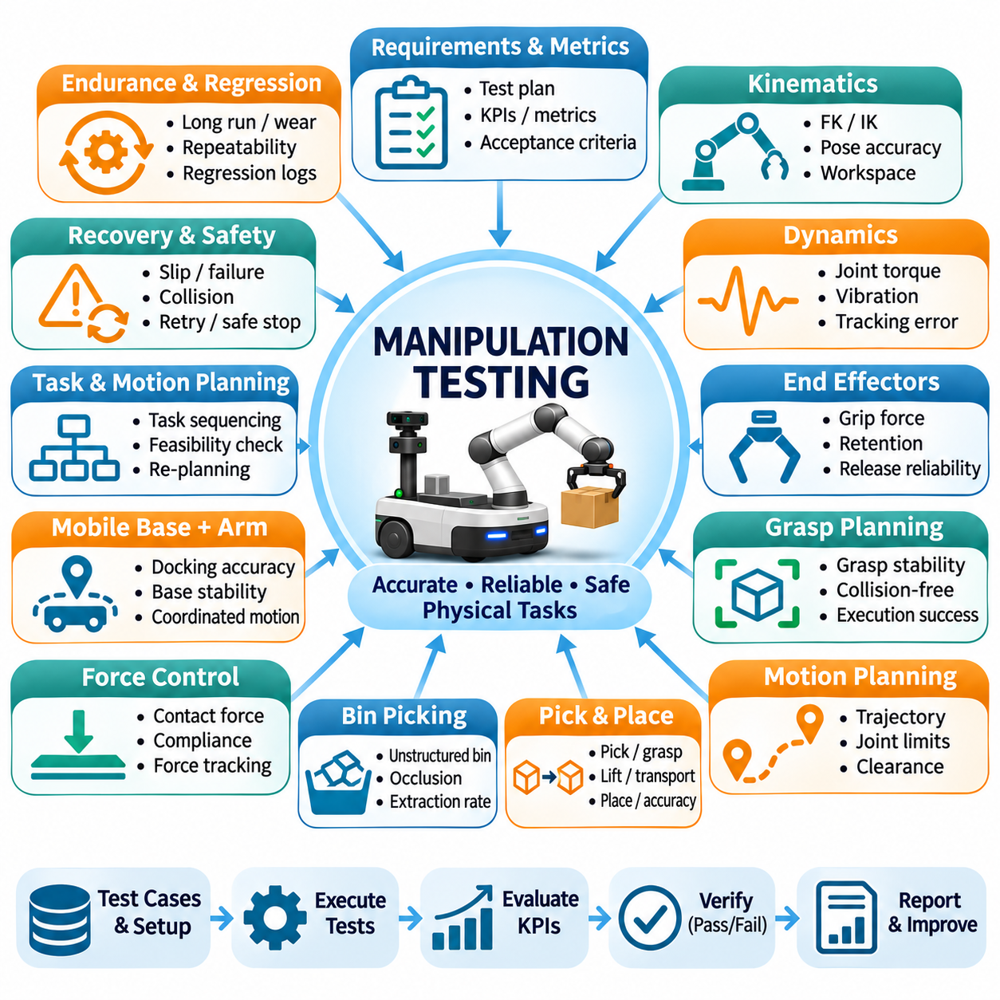{width="7.268055555555556in" height="7.268055555555556in"}

Manipulation testing is a systematic verification activity that evaluates the ability of a mobile manipulator to perform physical interactions with objects and surrounding environments. It examines the combined behavior of the robotic arm, end effector, perception system, motion planner, and control architecture. The primary objective is to establish whether manipulation tasks can be executed accurately, consistently, efficiently, and safely.

Manipulation testing should be derived from functional requirements, performance specifications, operational scenarios, and the approved system test plan. Each manipulation capability should be associated with measurable acceptance criteria and representative test conditions. Test procedures should define object characteristics, initial robot configurations, environmental constraints, measurement equipment, and expected operational outcomes.

Kinematic testing evaluates the accuracy of forward and inverse kinematic models used to determine robotic arm configurations and end-effector positions. Tests should examine joint movement, Cartesian positioning, orientation accuracy, workspace boundaries, and singularity handling. External measurement systems can provide independent reference data for comparing commanded positions with actual end-effector poses.

Dynamic testing examines the physical behavior of the robotic arm under different movement profiles and loading conditions. Representative measurements include joint torque, acceleration, deceleration, vibration, trajectory tracking error, and settling time. Testing should evaluate whether the dynamic model accurately represents the effects of payload mass, inertia, gravitational forces, and mechanical interactions.

End-effector testing evaluates the functional capabilities and physical performance of grippers, suction devices, magnetic gripping systems, and application-specific tools. Gripping force, opening distance, actuation response time, object retention, and release reliability should be examined. Different object materials, surface characteristics, geometries, and weight distributions should be incorporated into representative test scenarios.

Grasp planning testing evaluates whether generated grasp configurations are physically achievable and suitable for the intended manipulation task. Candidate grasps should be examined according to accessibility, grasp stability, collision avoidance, and compatibility with end-effector constraints. Physical execution tests should measure grasp success rates and identify differences between predicted grasp quality and actual performance.

Motion planning testing verifies the ability of the robotic system to generate executable trajectories within defined mechanical and environmental constraints. Planning success rate, computation time, trajectory smoothness, collision clearance, and joint limit compliance should be evaluated. Test scenarios should include restricted workspaces, complex obstacles, difficult target poses, and changes in environmental configurations.

Pick-and-place testing evaluates the complete sequence of object acquisition, grasping, lifting, transportation, positioning, and release. Each operation should be assessed individually and as part of an integrated manipulation cycle. Representative performance indicators include picking success rate, placement accuracy, cycle time, object damage rate, and successful completion without additional operator intervention.

Bin picking testing examines the ability of a mobile manipulator to identify, select, and retrieve objects from unstructured or partially structured containers. Different object arrangements, stacking conditions, overlapping geometries, occlusion levels, and container dimensions should be evaluated. Testing should measure successful extraction, collision frequency, picking efficiency, and recovery from unsuccessful grasp attempts.

Force control testing evaluates the ability of the robotic arm to regulate physical contact forces during manipulation tasks. Force tracking accuracy, torque response, contact detection sensitivity, compliance behavior, and force overshoot should be measured. Representative applications include insertion, assembly, surface inspection, and handling fragile objects that require controlled interaction with physical environments.

Mobile manipulation testing examines the relationship between mobile platform positioning and robotic arm performance. Navigation errors, docking accuracy, platform inclination, structural vibration, and residual movement can influence manipulation accuracy. Testing should evaluate whether coordinated base and arm operation maintains sufficient stability, workspace accessibility, and positioning accuracy throughout the intended task.

Task and motion planning testing evaluates the coordinated execution of high-level task sequences and low-level robotic movements. Test scenarios should examine action dependencies, object accessibility, intermediate configurations, environmental constraints, and planning failures. The system should correctly reorganize or terminate task sequences when physical execution becomes infeasible or predefined conditions are violated.

Manipulation error recovery testing examines system responses to unsuccessful grasping, object slippage, unexpected contact, blocked trajectories, and unavailable target objects. Controlled fault scenarios should verify whether the robot detects abnormal conditions and selects appropriate recovery actions. Reattempted operations must respect established retry limits, collision constraints, and independent safety mechanisms.

Manipulation performance evaluation should incorporate repeated experiments to characterize operational variability and statistical confidence. Success rates, positioning errors, cycle times, and contact forces should be assessed across representative combinations of objects, payloads, and workspace configurations. Statistical analysis should distinguish systematic errors from random variations and measurement uncertainties.

Manipulation endurance testing evaluates whether repeated physical operations introduce degradation in positioning accuracy, gripping performance, or mechanical stability. Continuous task cycles can reveal actuator overheating, joint backlash, gripper wear, sensor drift, and progressive calibration errors. Observed degradation should be documented to support subsequent reliability testing and preventive maintenance planning.

Automated manipulation testing and regression testing should be incorporated into the development workflow wherever practical. Simulation environments, digital twins, instrumented test fixtures, and automated execution scripts can support repeatable verification. Test records should preserve hardware configurations, calibration parameters, software versions, trajectory logs, force measurements, and observed failure conditions.

Successful manipulation testing provides technical evidence for subsequent safety testing, reliability testing, field validation, and product qualification. It establishes a measurable foundation for evaluating physical task execution and identifying engineering improvements. The methodology expands the development manual\'s manipulation development and testing structure, while specific acceptance thresholds remain dependent on project requirements.

조작 시험(Manipulation Testing)은 이동형 매니퓰레이터(Mobile Manipulator)가 객체 및 주변 환경과 물리적으로 상호작용하는 능력을 평가하는 체계적인 검증 활동(Verification Activity)이다. 로봇 팔(Robotic Arm), 말단 작동기(End Effector), 인지 시스템(Perception System), 동작 계획기(Motion Planner), 제어 아키텍처(Control Architecture)의 통합 동작을 검토한다. 주요 목적은 조작 작업(Manipulation Task)이 정확하고 일관되며 효율적이고 안전하게 수행될 수 있는지를 확인하는 것이다.

조작 시험은 기능 요구사항(Functional Requirement), 성능 사양(Performance Specification), 운영 시나리오(Operational Scenario), 승인된 시스템 시험 계획(Approved System Test Plan)을 기반으로 개발되어야 한다. 각각의 조작 기능(Manipulation Capability)은 측정 가능한 합격 기준(Acceptance Criteria)과 대표적인 시험 조건(Test Condition)에 연결되어야 한다. 시험 절차(Test Procedure)는 객체 특성(Object Characteristic), 초기 로봇 구성(Initial Robot Configuration), 환경 제약조건(Environmental Constraint), 측정 장비(Measurement Equipment), 예상 운영 결과(Expected Operational Outcome)를 정의해야 한다.

기구학 시험(Kinematic Testing)은 로봇 팔의 구성과 말단 작동기의 위치를 결정하는 데 사용되는 순기구학(Forward Kinematics) 및 역기구학(Inverse Kinematics) 모델의 정확도를 평가한다. 시험은 관절 이동(Joint Movement), 직교 좌표 위치 결정(Cartesian Positioning), 방향 정확도(Orientation Accuracy), 작업 공간 경계(Workspace Boundary), 특이점 처리(Singularity Handling)를 검토해야 한다. 외부 측정 시스템(External Measurement System)은 명령된 위치(Commanded Position)와 실제 말단 작동기 자세(Actual End-Effector Pose)를 비교하기 위한 독립적인 참조 데이터(Reference Data)를 제공할 수 있다.

동역학 시험(Dynamic Testing)은 다양한 이동 프로파일(Movement Profile)과 하중 조건(Loading Condition)에서 로봇 팔의 물리적 거동(Physical Behavior)을 검토한다. 대표적인 측정 항목에는 관절 토크(Joint Torque), 가속(Acceleration), 감속(Deceleration), 진동(Vibration), 궤적 추종 오차(Trajectory Tracking Error), 정착 시간(Settling Time)이 포함된다. 시험은 동역학 모델(Dynamic Model)이 적재 질량(Payload Mass), 관성(Inertia), 중력(Gravitational Force), 기계적 상호작용(Mechanical Interaction)의 영향을 정확하게 표현하는지를 평가해야 한다.

말단 작동기 시험(End-Effector Testing)은 그리퍼(Gripper), 흡착 장치(Suction Device), 자기 파지 시스템(Magnetic Gripping System), 응용 분야별 전용 도구(Application-Specific Tool)의 기능적 능력과 물리적 성능을 평가한다. 파지력(Gripping Force), 개방 거리(Opening Distance), 구동 응답 시간(Actuation Response Time), 객체 유지 능력(Object Retention), 해제 신뢰성(Release Reliability)이 검토되어야 한다. 다양한 객체 재료(Object Material), 표면 특성(Surface Characteristic), 형상(Geometry), 무게 분포(Weight Distribution)가 대표적인 시험 시나리오(Test Scenario)에 포함되어야 한다.

파지 계획 시험(Grasp Planning Testing)은 생성된 파지 구성(Grasp Configuration)이 물리적으로 실현 가능하고 의도된 조작 작업에 적합한지를 평가한다. 파지 후보(Candidate Grasp)는 접근 가능성(Accessibility), 파지 안정성(Grasp Stability), 충돌 회피(Collision Avoidance), 말단 작동기 제약조건(End-Effector Constraint)과의 호환성을 기준으로 검토되어야 한다. 물리적 실행 시험(Physical Execution Test)은 파지 성공률(Grasp Success Rate)을 측정하고 예측된 파지 품질(Predicted Grasp Quality)과 실제 성능(Actual Performance) 간의 차이를 식별해야 한다.

동작 계획 시험(Motion Planning Testing)은 로봇 시스템이 정의된 기계적 및 환경적 제약조건 내에서 실행 가능한 궤적(Executable Trajectory)을 생성하는 능력을 검증한다. 계획 성공률(Planning Success Rate), 연산 시간(Computation Time), 궤적 평활성(Trajectory Smoothness), 충돌 방지 여유 거리(Collision Clearance), 관절 한계 준수(Joint Limit Compliance)가 평가되어야 한다. 시험 시나리오에는 제한된 작업 공간(Restricted Workspace), 복잡한 장애물(Complex Obstacle), 도달하기 어려운 목표 자세(Difficult Target Pose), 환경 구성(Environmental Configuration)의 변화가 포함되어야 한다.

픽 앤 플레이스 시험(Pick-and-Place Testing)은 객체 획득(Object Acquisition), 파지(Grasping), 들어 올리기(Lifting), 운반(Transportation), 위치 결정(Positioning), 해제(Release)로 구성된 전체 작업 순서를 평가한다. 각각의 작업은 독립적으로 평가되는 동시에 통합 조작 사이클(Integrated Manipulation Cycle)의 일부로 평가되어야 한다. 대표적인 성능 지표(Performance Indicator)에는 피킹 성공률(Picking Success Rate), 배치 정확도(Placement Accuracy), 사이클 시간(Cycle Time), 객체 손상률(Object Damage Rate), 추가적인 운영자 개입(Operator Intervention) 없이 성공적으로 작업을 완료하는 능력이 포함된다.

빈 피킹 시험(Bin Picking Testing)은 이동형 매니퓰레이터가 비정형 또는 부분적으로 정형화된 컨테이너(Unstructured or Partially Structured Container)에서 객체를 식별하고 선택하며 인출하는 능력을 검토한다. 다양한 객체 배열(Object Arrangement), 적층 조건(Stacking Condition), 중첩 형상(Overlapping Geometry), 가려짐 수준(Occlusion Level), 컨테이너 치수(Container Dimension)가 평가되어야 한다. 시험은 객체 인출 성공(Successful Extraction), 충돌 빈도(Collision Frequency), 피킹 효율성(Picking Efficiency), 실패한 파지 시도로부터의 복구(Recovery)를 측정해야 한다.

힘 제어 시험(Force Control Testing)은 로봇 팔이 조작 작업 중 물리적 접촉력(Physical Contact Force)을 조절하는 능력을 평가한다. 힘 추종 정확도(Force Tracking Accuracy), 토크 응답(Torque Response), 접촉 검출 민감도(Contact Detection Sensitivity), 순응 거동(Compliance Behavior), 힘 오버슈트(Force Overshoot)가 측정되어야 한다. 대표적인 응용 분야에는 삽입(Insertion), 조립(Assembly), 표면 검사(Surface Inspection), 물리적 환경과의 정밀한 상호작용 제어가 필요한 파손되기 쉬운 객체의 취급(Fragile Object Handling)이 포함된다.

이동형 조작 시험(Mobile Manipulation Testing)은 이동 플랫폼 위치 결정(Mobile Platform Positioning)과 로봇 팔 성능(Robotic Arm Performance) 간의 관계를 검토한다. 자율주행 오차(Navigation Error), 도킹 정확도(Docking Accuracy), 플랫폼 경사(Platform Inclination), 구조적 진동(Structural Vibration), 잔류 움직임(Residual Movement)은 조작 정확도(Manipulation Accuracy)에 영향을 미칠 수 있다. 시험은 이동 베이스와 로봇 팔의 협조 동작(Coordinated Base and Arm Operation)이 의도된 작업 전반에서 충분한 안정성(Stability), 작업 공간 접근 가능성(Workspace Accessibility), 위치 결정 정확도(Positioning Accuracy)를 유지하는지를 평가해야 한다.

작업 및 동작 계획 시험(Task and Motion Planning Testing)은 상위 수준 작업 시퀀스(High-Level Task Sequence)와 하위 수준 로봇 동작(Low-Level Robotic Movement)의 협조 실행(Coordinated Execution)을 평가한다. 시험 시나리오는 행동 의존성(Action Dependency), 객체 접근 가능성(Object Accessibility), 중간 구성(Intermediate Configuration), 환경 제약조건(Environmental Constraint), 계획 실패(Planning Failure)를 검토해야 한다. 물리적 실행이 불가능해지거나 사전에 정의된 조건이 위반되는 경우 시스템은 작업 시퀀스를 올바르게 재구성하거나 종료해야 한다.

조작 오류 복구 시험(Manipulation Error Recovery Testing)은 파지 실패(Grasping Failure), 객체 미끄러짐(Object Slippage), 예상하지 못한 접촉(Unexpected Contact), 차단된 궤적(Blocked Trajectory), 대상 객체 부재(Unavailable Target Object)에 대한 시스템의 대응을 검토한다. 통제된 고장 시나리오(Controlled Fault Scenario)는 로봇이 비정상 조건(Abnormal Condition)을 검출하고 적절한 복구 동작(Recovery Action)을 선택하는지를 검증해야 한다. 재시도 작업(Reattempted Operation)은 설정된 재시도 한계(Retry Limit), 충돌 제약조건(Collision Constraint), 독립적인 안전 메커니즘(Independent Safety Mechanism)을 준수해야 한다.

조작 성능 평가(Manipulation Performance Evaluation)는 운영 변동성(Operational Variability)과 통계적 신뢰도(Statistical Confidence)를 분석하기 위해 반복 실험(Repeated Experiment)을 포함해야 한다. 성공률(Success Rate), 위치 결정 오차(Positioning Error), 사이클 시간(Cycle Time), 접촉력(Contact Force)은 대표적인 객체, 적재 하중 및 작업 공간 구성(Workspace Configuration)의 조합에서 평가되어야 한다. 통계 분석(Statistical Analysis)은 체계적 오차(Systematic Error)를 무작위 변동(Random Variation) 및 측정 불확실성(Measurement Uncertainty)과 구분해야 한다.

조작 내구성 시험(Manipulation Endurance Testing)은 반복적인 물리적 작업이 위치 결정 정확도, 파지 성능(Gripping Performance), 기계적 안정성(Mechanical Stability)의 저하를 유발하는지를 평가한다. 연속적인 작업 사이클(Continuous Task Cycle)은 액추에이터 과열(Actuator Overheating), 관절 백래시(Joint Backlash), 그리퍼 마모(Gripper Wear), 센서 드리프트(Sensor Drift), 점진적인 교정 오차(Progressive Calibration Error)를 드러낼 수 있다. 관찰된 성능 저하(Performance Degradation)는 이후 수행되는 신뢰성 시험(Reliability Testing)과 예방 유지보수 계획(Preventive Maintenance Planning)을 지원하기 위해 문서화되어야 한다.

자동화된 조작 시험(Automated Manipulation Testing)과 회귀 시험(Regression Testing)은 실질적으로 적용 가능한 모든 영역에서 개발 워크플로(Development Workflow)에 통합되어야 한다. 시뮬레이션 환경(Simulation Environment), 디지털 트윈(Digital Twin), 계측 장비가 장착된 시험 치구(Instrumented Test Fixture), 자동화된 실행 스크립트(Automated Execution Script)는 반복 가능한 검증(Repeatable Verification)을 지원할 수 있다. 시험 기록(Test Record)은 하드웨어 구성(Hardware Configuration), 교정 매개변수(Calibration Parameter), 소프트웨어 버전(Software Version), 궤적 로그(Trajectory Log), 힘 측정값(Force Measurement), 관찰된 고장 조건(Failure Condition)을 보존해야 한다.

성공적인 조작 시험(Manipulation Testing)은 이후 수행되는 안전 시험(Safety Testing), 신뢰성 시험(Reliability Testing), 현장 유효성 확인(Field Validation), 제품 적격성 평가(Product Qualification)를 위한 기술적 증거(Technical Evidence)를 제공한다. 또한 물리적 작업 실행(Physical Task Execution)을 평가하고 엔지니어링 개선 사항(Engineering Improvement)을 식별하기 위한 측정 가능한 기반을 수립한다. 이러한 방법론은 개발 매뉴얼(Development Manual)의 조작 개발 및 시험 구조를 확장한 것이며, 구체적인 합격 임계값(Acceptance Threshold)은 프로젝트별 요구사항(Project Requirement)에 따라 결정되어야 한다.

##  

## 09 Safety Testing

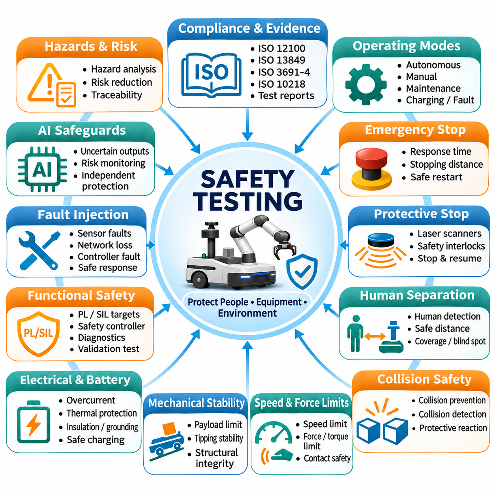{width="7.268055555555556in" height="7.268055555555556in"}

Safety testing is a systematic verification and validation activity that evaluates whether a mobile manipulator can operate without exposing humans, equipment, or surrounding environments to unacceptable risks. It examines the effectiveness of protective mechanisms, safety-related control functions, mechanical safeguards, and fault responses. Safety testing must address both intended operating conditions and reasonably foreseeable abnormal situations.

Safety testing should be derived from safety requirements, hazard analysis, risk assessments, system architecture, and applicable regulatory requirements. Each identified hazard should be associated with appropriate risk reduction measures and corresponding verification procedures. Traceability between hazards, safety requirements, protective functions, and test results provides a structured foundation for demonstrating safety assurance.

Hazard-based testing examines potential risks associated with autonomous navigation, robotic arm movement, object handling, electrical systems, and human-robot interaction. Representative hazards include unintended motion, crushing, trapping, collision, falling objects, electrical shock, and platform instability. Test scenarios should verify whether implemented protective measures reduce these risks to acceptable levels under specified operating conditions.

Emergency stop testing evaluates whether emergency stop activation produces the required stopping behavior across the mobile platform, robotic arm, and associated equipment. Testing should examine response time, stopping distance, actuator behavior, and coordination between distributed controllers. Emergency stop reset must not initiate unexpected motion, and subsequent operation should require an appropriate restart procedure.

Protective stop testing evaluates the ability of the robotic system to interrupt hazardous motion when predefined protective conditions are detected. Safety laser scanners, protective sensors, safety controllers, and motion interlocks should be evaluated individually and collectively. Testing should verify stopping behavior, protective field configurations, obstacle detection coverage, and conditions for authorized motion resumption.

Human detection and separation monitoring testing examines whether the system maintains required protective separation distances during applicable human-robot interaction scenarios. Detection coverage, sensor response time, approach direction, robot speed, and stopping performance should be considered. Testing should account for sensor blind spots, occlusion, and combined movements of the mobile platform and robotic arm.

Collision safety testing evaluates the effectiveness of collision prevention, collision detection, and protective reaction mechanisms. Representative scenarios may involve stationary obstacles, unexpected environmental changes, and restricted manipulation workspaces. Controlled experiments should verify that hazardous movements are prevented or interrupted according to defined safety requirements without exposing personnel to unnecessary risks.

Speed and force limitation testing examines whether the mobile manipulator respects specified movement speed, torque, power, and contact force restrictions. Measurements should consider robot configurations, payload conditions, contact geometries, and operating modes. Where power and force limiting is employed, application-specific contact risks and applicable biomechanical limits must be evaluated using appropriate measurement equipment.

Mechanical safety testing evaluates structural integrity, platform stability, payload retention, and resistance to hazardous mechanical failures. Robotic arm extension, acceleration, emergency braking, uneven surfaces, and changes in the combined center of gravity can influence system stability. Testing should verify that mechanical configurations remain within approved stability and loading limits throughout intended operating scenarios.

Electrical and battery safety testing examines protection against electrical faults, excessive current, overheating, insulation failure, and abnormal charging conditions. Protective devices, grounding arrangements, battery management systems, and power isolation mechanisms should be verified. Potentially destructive fault scenarios should be performed using qualified facilities, suitable protective equipment, and controlled experimental procedures.

Functional safety testing evaluates the behavior of safety-related control systems under normal and fault conditions. Safety controllers, redundant communication channels, diagnostic mechanisms, and safety-rated drive functions should be examined where applicable. Verification must address relevant Performance Level (PL) or Safety Integrity Level (SIL) requirements through appropriate architectural analysis, calculations, and validation testing.

Fault injection testing evaluates system responses to representative hardware, software, sensor, actuator, and communication failures. Controlled scenarios may include signal interruption, invalid measurements, controller malfunction, and loss of communication. Testing should verify fault detection, transition to a defined safe state, diagnostic reporting, and prevention of unauthorized restart or uncontrolled physical movement.

Artificial intelligence safety testing examines the consequences of unreliable predictions, uncertain perception outputs, incorrect task decisions, and unexpected AI-generated commands. Independent protective mechanisms should prevent unacceptable risks even when learning-based components produce incorrect results. Conventional AI accuracy metrics alone are insufficient to demonstrate the effectiveness of safety-related functions.

Safety testing should examine transitions between autonomous operation, manual control, maintenance, charging, fault recovery, and emergency conditions. Operating mode selection, authorization mechanisms, motion restrictions, and maintenance interlocks must respond consistently. Particular attention should be given to unexpected startup, remote command execution, and restoration of electrical power after an interruption.

Safety compliance assessment should consider applicable standards such as ISO 12100, ISO 13849, IEC 62061, ISO 3691-4, ISO 10218, and ISO/TS 15066, depending on the system classification and application. These standards address different aspects of machinery, functional, mobile robot, and industrial robot safety. Compliance must be assessed against the applicable editions, jurisdictional requirements, and complete integrated system.

Safety regression testing ensures that modifications to hardware, software, AI models, operating parameters, and mechanical configurations do not compromise previously verified protective functions. Safety test reports should document hazard references, test configurations, measurement methods, acceptance criteria, observed results, deviations, corrective actions, and residual risks to support subsequent engineering reviews.

Successful safety testing provides essential technical evidence for reliability testing, field validation, regulatory compliance, and product qualification. However, successful individual tests do not independently establish complete system safety. This methodology expands the development manual\'s safety requirements and testing structure into a general engineering framework, while project-specific safety limits and compliance criteria must be established separately.

안전 시험(Safety Testing)은 이동형 매니퓰레이터(Mobile Manipulator)가 인간, 장비 또는 주변 환경을 허용할 수 없는 위험(Unacceptable Risk)에 노출시키지 않고 운영될 수 있는지를 평가하는 체계적인 검증 및 유효성 확인 활동(Verification and Validation Activity)이다. 보호 메커니즘(Protective Mechanism), 안전 관련 제어 기능(Safety-Related Control Function), 기계적 안전 보호장치(Mechanical Safeguard), 고장 대응(Fault Response)의 효과성을 검토한다. 안전 시험은 의도된 운영 조건(Intended Operating Condition)과 합리적으로 예측 가능한 비정상 상황(Foreseeable Abnormal Situation)을 모두 다루어야 한다.

안전 시험은 안전 요구사항(Safety Requirement), 위험원 분석(Hazard Analysis), 위험성 평가(Risk Assessment), 시스템 아키텍처(System Architecture), 적용 가능한 규제 요구사항(Regulatory Requirement)을 기반으로 개발되어야 한다. 식별된 각각의 위험원(Hazard)은 적절한 위험 저감 조치(Risk Reduction Measure) 및 이에 대응하는 검증 절차(Verification Procedure)와 연결되어야 한다. 위험원, 안전 요구사항, 보호 기능(Protective Function), 시험 결과(Test Result) 간의 추적성(Traceability)은 안전 보증(Safety Assurance)을 입증하기 위한 체계적인 기반을 제공한다.

위험원 기반 시험(Hazard-Based Testing)은 자율주행(Autonomous Navigation), 로봇 팔 움직임(Robotic Arm Movement), 객체 취급(Object Handling), 전기 시스템(Electrical System), 인간-로봇 상호작용(Human-Robot Interaction, HRI)과 관련된 잠재적 위험을 검토한다. 대표적인 위험원에는 의도하지 않은 움직임(Unintended Motion), 압착(Crushing), 끼임(Trapping), 충돌(Collision), 객체 낙하(Falling Object), 감전(Electrical Shock), 플랫폼 불안정성(Platform Instability)이 포함된다. 시험 시나리오(Test Scenario)는 구현된 보호 조치(Protective Measure)가 명시된 운영 조건에서 이러한 위험을 허용 가능한 수준으로 감소시키는지를 검증해야 한다.

비상 정지 시험(Emergency Stop Testing)은 비상 정지 활성화(Emergency Stop Activation)가 이동 플랫폼(Mobile Platform), 로봇 팔(Robotic Arm), 관련 장비 전반에서 요구되는 정지 동작(Stopping Behavior)을 생성하는지를 평가한다. 시험은 응답 시간(Response Time), 정지 거리(Stopping Distance), 액추에이터 동작(Actuator Behavior), 분산 제어기(Distributed Controller) 간의 협조 동작(Coordination)을 검토해야 한다. 비상 정지 해제(Emergency Stop Reset)가 예상하지 못한 움직임을 시작해서는 안 되며, 이후의 운영에는 적절한 재시작 절차(Restart Procedure)가 요구되어야 한다.

보호 정지 시험(Protective Stop Testing)은 사전에 정의된 보호 조건(Protective Condition)이 검출되었을 때 로봇 시스템이 위험한 움직임(Hazardous Motion)을 중단하는 능력을 평가한다. 안전 레이저 스캐너(Safety Laser Scanner), 보호 센서(Protective Sensor), 안전 제어기(Safety Controller), 동작 인터록(Motion Interlock)은 개별적으로 평가되는 동시에 통합적으로 평가되어야 한다. 시험은 정지 동작(Stopping Behavior), 보호 영역 구성(Protective Field Configuration), 장애물 검출 범위(Obstacle Detection Coverage), 승인된 동작 재개(Authorized Motion Resumption)를 위한 조건을 검증해야 한다.

인간 검출 및 분리 거리 모니터링 시험(Human Detection and Separation Monitoring Testing)은 해당 인간-로봇 상호작용 시나리오에서 시스템이 요구되는 보호 분리 거리(Protective Separation Distance)를 유지하는지를 검토한다. 검출 범위(Detection Coverage), 센서 응답 시간(Sensor Response Time), 접근 방향(Approach Direction), 로봇 속도(Robot Speed), 정지 성능(Stopping Performance)이 고려되어야 한다. 시험은 센서 사각지대(Sensor Blind Spot), 가려짐(Occlusion), 이동 플랫폼과 로봇 팔의 복합 움직임(Combined Movement)을 고려해야 한다.

충돌 안전 시험(Collision Safety Testing)은 충돌 예방(Collision Prevention), 충돌 검출(Collision Detection), 보호 반응 메커니즘(Protective Reaction Mechanism)의 효과성을 평가한다. 대표적인 시나리오에는 정지 장애물(Stationary Obstacle), 예상하지 못한 환경 변화(Unexpected Environmental Change), 제한된 조작 작업 공간(Restricted Manipulation Workspace)이 포함될 수 있다. 통제된 실험(Controlled Experiment)은 작업자를 불필요한 위험에 노출시키지 않으면서 정의된 안전 요구사항에 따라 위험한 움직임이 방지되거나 중단되는지를 검증해야 한다.

속도 및 힘 제한 시험(Speed and Force Limitation Testing)은 이동형 매니퓰레이터가 명시된 이동 속도(Movement Speed), 토크(Torque), 동력(Power), 접촉력(Contact Force) 제한을 준수하는지를 검토한다. 측정 과정에서는 로봇 구성(Robot Configuration), 적재 하중 조건(Payload Condition), 접촉 형상(Contact Geometry), 운영 모드(Operating Mode)를 고려해야 한다. 동력 및 힘 제한(Power and Force Limiting, PFL)이 적용되는 경우, 응용 분야별 접촉 위험(Contact Risk)과 적용 가능한 생체역학적 한계(Biomechanical Limit)를 적절한 측정 장비(Measurement Equipment)를 사용하여 평가해야 한다.

기계적 안전 시험(Mechanical Safety Testing)은 구조적 건전성(Structural Integrity), 플랫폼 안정성(Platform Stability), 적재물 유지 능력(Payload Retention), 위험한 기계적 고장(Mechanical Failure)에 대한 저항성을 평가한다. 로봇 팔의 확장(Arm Extension), 가속(Acceleration), 비상 제동(Emergency Braking), 불균일한 표면(Uneven Surface), 통합 무게중심(Combined Center of Gravity)의 변화는 시스템 안정성에 영향을 미칠 수 있다. 시험은 의도된 운영 시나리오 전반에서 기계적 구성(Mechanical Configuration)이 승인된 안정성 및 하중 한계(Stability and Loading Limit) 내에 유지되는지를 검증해야 한다.

전기 및 배터리 안전 시험(Electrical and Battery Safety Testing)은 전기적 고장(Electrical Fault), 과전류(Excessive Current), 과열(Overheating), 절연 고장(Insulation Failure), 비정상 충전 조건(Abnormal Charging Condition)에 대한 보호 기능을 검토한다. 보호 장치(Protective Device), 접지 구성(Grounding Arrangement), 배터리 관리 시스템(Battery Management System, BMS), 전력 차단 메커니즘(Power Isolation Mechanism)이 검증되어야 한다. 잠재적으로 파괴적인 고장 시나리오(Destructive Fault Scenario)는 적격성을 갖춘 시험 시설(Qualified Facility), 적절한 보호 장비(Protective Equipment), 통제된 실험 절차(Controlled Experimental Procedure)를 사용하여 수행되어야 한다.

기능 안전 시험(Functional Safety Testing)은 정상 및 고장 조건에서 안전 관련 제어 시스템(Safety-Related Control System)의 동작을 평가한다. 해당되는 경우 안전 제어기(Safety Controller), 이중화 통신 채널(Redundant Communication Channel), 진단 메커니즘(Diagnostic Mechanism), 안전 등급 구동 기능(Safety-Rated Drive Function)이 검토되어야 한다. 검증은 적절한 아키텍처 분석(Architectural Analysis), 계산(Calculation), 유효성 확인 시험(Validation Testing)을 통해 관련 성능 수준(Performance Level, PL) 또는 안전 무결성 수준(Safety Integrity Level, SIL) 요구사항을 다루어야 한다.

고장 주입 시험(Fault Injection Testing)은 대표적인 하드웨어, 소프트웨어, 센서, 액추에이터 및 통신 고장에 대한 시스템 대응(System Response)을 평가한다. 통제된 시나리오에는 신호 중단(Signal Interruption), 유효하지 않은 측정값(Invalid Measurement), 제어기 오작동(Controller Malfunction), 통신 손실(Loss of Communication)이 포함될 수 있다. 시험은 고장 검출(Fault Detection), 정의된 안전 상태(Safe State)로의 전이, 진단 보고(Diagnostic Reporting), 승인되지 않은 재시작(Unauthorized Restart) 또는 통제되지 않은 물리적 움직임(Uncontrolled Physical Movement)의 방지를 검증해야 한다.

인공지능 안전 시험(Artificial Intelligence Safety Testing)은 신뢰할 수 없는 예측(Unreliable Prediction), 불확실한 인지 출력(Uncertain Perception Output), 잘못된 작업 의사결정(Incorrect Task Decision), 예상하지 못한 인공지능 생성 명령(AI-Generated Command)의 결과를 검토한다. 독립적인 보호 메커니즘(Independent Protective Mechanism)은 학습 기반 구성요소(Learning-Based Component)가 잘못된 결과를 생성하는 경우에도 허용할 수 없는 위험을 방지해야 한다. 기존 인공지능 정확도 지표(Conventional AI Accuracy Metric)만으로는 안전 관련 기능(Safety-Related Function)의 효과성을 입증하기에 충분하지 않다.

안전 시험은 자율 운영(Autonomous Operation), 수동 제어(Manual Control), 유지보수(Maintenance), 충전(Charging), 고장 복구(Fault Recovery), 비상 상황(Emergency Condition) 간의 상태 전이(State Transition)를 검토해야 한다. 운영 모드 선택(Operating Mode Selection), 권한 부여 메커니즘(Authorization Mechanism), 동작 제한(Motion Restriction), 유지보수 인터록(Maintenance Interlock)은 일관되게 대응해야 한다. 특히 예상하지 못한 시동(Unexpected Startup), 원격 명령 실행(Remote Command Execution), 전력 중단 이후의 전원 복구(Restoration of Electrical Power)에 주의를 기울여야 한다.

안전 적합성 평가(Safety Compliance Assessment)는 시스템 분류(System Classification)와 응용 분야에 따라 ISO 12100, ISO 13849, IEC 62061, ISO 3691-4, ISO 10218, ISO/TS 15066과 같은 적용 가능한 표준(Applicable Standard)을 고려해야 한다. 이러한 표준은 기계 안전(Machinery Safety), 기능 안전(Functional Safety), 이동 로봇 안전(Mobile Robot Safety), 산업용 로봇 안전(Industrial Robot Safety)의 다양한 측면을 다룬다. 적합성(Compliance)은 적용 가능한 표준 판본(Applicable Edition), 관할 지역의 규제 요구사항(Jurisdictional Requirement), 완전하게 통합된 시스템(Complete Integrated System)을 기준으로 평가되어야 한다.

안전 회귀 시험(Safety Regression Testing)은 하드웨어, 소프트웨어, 인공지능 모델(AI Model), 운영 매개변수(Operating Parameter), 기계적 구성의 변경이 이전에 검증된 보호 기능(Protective Function)을 저해하지 않도록 보장하는 것을 목표로 한다. 안전 시험 보고서(Safety Test Report)는 이후 수행되는 엔지니어링 검토(Engineering Review)를 지원하기 위해 위험원 참조 정보(Hazard Reference), 시험 구성(Test Configuration), 측정 방법(Measurement Method), 합격 기준(Acceptance Criteria), 관찰 결과(Observed Result), 편차(Deviation), 시정 조치(Corrective Action), 잔류 위험(Residual Risk)을 문서화해야 한다.

성공적인 안전 시험(Safety Testing)은 신뢰성 시험(Reliability Testing), 현장 유효성 확인(Field Validation), 규제 적합성(Regulatory Compliance), 제품 적격성 평가(Product Qualification)를 위한 필수적인 기술적 증거(Technical Evidence)를 제공한다. 그러나 개별 시험의 성공만으로 전체 시스템의 안전성(Complete System Safety)이 확보되는 것은 아니다. 이러한 방법론은 개발 매뉴얼(Development Manual)의 안전 요구사항과 시험 구조를 일반적인 엔지니어링 프레임워크(Engineering Framework)로 확장한 것이며, 프로젝트별 안전 한계(Safety Limit)와 적합성 기준(Compliance Criteria)은 별도로 수립되어야 한다.

##  

## 10 Reliability Testing

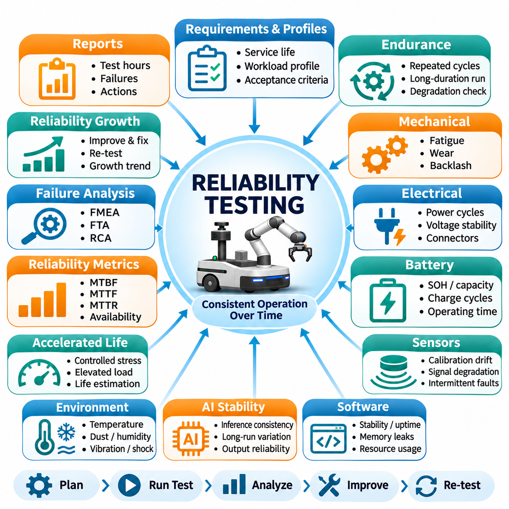{width="7.268055555555556in" height="7.268055555555556in"}

Reliability testing is a systematic engineering activity that evaluates the ability of a mobile manipulator to perform its intended functions consistently over a specified period under defined operating conditions. It examines hardware durability, software stability, sensor consistency, actuator performance, and integrated system behavior. The primary objective is to identify potential failure mechanisms and reduce unexpected operational interruptions.

Reliability testing should be derived from system requirements, operational scenarios, expected service life, maintenance strategies, and environmental specifications. Test procedures should define operating duration, workload distribution, environmental conditions, failure classifications, and acceptance criteria. Requirement traceability ensures that reliability objectives established during product development are systematically evaluated.

Reliability test planning should consider representative operational profiles that reflect the expected behavior of the mobile manipulator throughout its service life. Navigation distances, manipulation frequencies, payload distributions, charging cycles, and standby durations should be incorporated into the test environment. Representative workload profiles provide a more realistic basis for assessing long-term system performance.

Endurance testing evaluates the ability of the robotic system to sustain repeated operations without unacceptable performance degradation. Mobile platforms and robotic arms should execute representative navigation, docking, grasping, transportation, and placement cycles. Continuous monitoring of mechanical behavior, electrical characteristics, computational performance, and operational errors helps identify progressive deterioration.

Mechanical reliability testing examines structural components, drive mechanisms, robotic joints, bearings, transmission systems, and end effectors under repeated mechanical loading. Test procedures should evaluate fatigue, material deformation, mechanical wear, vibration, joint backlash, and fastening integrity. Particular attention should be given to components subjected to frequent acceleration, braking, and payload variations.

Electrical reliability testing evaluates the durability and operational stability of power distribution systems, motor controllers, wiring harnesses, connectors, and electronic components. Repeated power cycles, electrical load variations, thermal fluctuations, and representative vibration conditions should be considered. Monitoring voltage stability, current consumption, and connection integrity can reveal emerging electrical failure mechanisms.

Battery reliability testing examines the long-term performance of energy storage systems under representative charging and discharging conditions. Battery capacity, internal resistance, charging efficiency, operating temperature, and state of health should be monitored throughout repeated cycles. Battery management system behavior and the progressive reduction of available operating time should also be evaluated.

Sensor reliability testing evaluates the ability of perception and localization devices to maintain consistent measurement performance over extended operating periods. Cameras, LiDAR sensors, inertial measurement units, encoders, and force sensors should be examined for calibration drift, signal degradation, intermittent malfunction, and environmental sensitivity. Measurement deviations should be compared with established tolerances.

Software reliability testing examines the stability of operating systems, robotic middleware, navigation software, manipulation controllers, and mission management applications during prolonged execution. Memory leaks, resource exhaustion, process termination, communication interruptions, and synchronization errors should be monitored. Repeated task execution can reveal software defects that are difficult to identify through conventional functional testing.

Artificial intelligence reliability testing evaluates the consistency of deployed AI models throughout extended robotic operations. Changes in environmental conditions, sensor characteristics, object distributions, and computational workloads may influence prediction quality. Long-duration testing should examine inference stability, confidence variation, repeated prediction failures, and the operational consequences of inaccurate model outputs.

Environmental reliability testing examines system performance under physical conditions representative of the intended deployment environment. Temperature variations, humidity, dust exposure, mechanical shock, and vibration should be considered according to application requirements. Combined environmental stresses may reveal failure mechanisms that cannot be identified through isolated component testing.

Accelerated life testing applies controlled environmental or operational stresses to investigate potential failure mechanisms within reduced testing periods. Elevated temperatures, increased operating frequencies, and repeated mechanical loading may accelerate component degradation. Stress levels and acceleration models must be justified to prevent unrealistic failure mechanisms from producing misleading service life estimates.

Reliability evaluation should incorporate quantitative indicators such as Mean Time Between Failures (MTBF), Mean Time to Failure (MTTF), Mean Time to Repair (MTTR), failure rate, and operational availability. Each indicator provides different information about system dependability and maintenance requirements. Statistical confidence, sample size, observation duration, and failure definitions must be considered when interpreting reliability measurements.

Failure analysis should establish the underlying causes of observed mechanical, electrical, software, and operational problems. Failure Mode and Effects Analysis (FMEA), Fault Tree Analysis (FTA), and Root Cause Analysis (RCA) can support systematic investigations. Identified failure mechanisms should lead to appropriate design improvements, corrective actions, and subsequent verification through repeated reliability testing.

Reliability growth testing evaluates whether successive engineering improvements reduce failure occurrence and increase operational stability. Hardware revisions, software updates, calibration adjustments, and component replacements should be evaluated against established reliability baselines. Configuration management and standardized test procedures are essential for maintaining consistent comparisons between development iterations.

Reliability test reports should document operating conditions, accumulated operating hours, completed task cycles, failure events, maintenance activities, statistical results, and corrective actions. These records provide a technical foundation for field validation, manufacturing readiness, warranty planning, and lifecycle management. This general methodology expands the manual\'s testing structure; project-specific reliability targets require separate definition.

신뢰성 시험(Reliability Testing)은 이동형 매니퓰레이터(Mobile Manipulator)가 정의된 운영 조건(Operating Condition)에서 지정된 기간 동안 의도된 기능을 일관되게 수행하는 능력을 평가하는 체계적인 엔지니어링 활동(Engineering Activity)이다. 하드웨어 내구성(Hardware Durability), 소프트웨어 안정성(Software Stability), 센서 일관성(Sensor Consistency), 액추에이터 성능(Actuator Performance), 통합 시스템 동작(Integrated System Behavior)을 검토한다. 주요 목적은 잠재적인 고장 메커니즘(Failure Mechanism)을 식별하고 예상하지 못한 운영 중단(Operational Interruption)을 감소시키는 것이다.

신뢰성 시험은 시스템 요구사항(System Requirement), 운영 시나리오(Operational Scenario), 기대 사용 수명(Expected Service Life), 유지보수 전략(Maintenance Strategy), 환경 사양(Environmental Specification)을 기반으로 개발되어야 한다. 시험 절차(Test Procedure)는 운영 기간(Operating Duration), 작업 부하 분포(Workload Distribution), 환경 조건(Environmental Condition), 고장 분류(Failure Classification), 합격 기준(Acceptance Criteria)을 정의해야 한다. 요구사항 추적성(Requirement Traceability)은 제품 개발 과정에서 수립된 신뢰성 목표(Reliability Objective)가 체계적으로 평가되도록 보장한다.

신뢰성 시험 계획(Reliability Test Planning)은 이동형 매니퓰레이터의 전체 사용 수명 동안 예상되는 동작을 반영하는 대표적인 운영 프로파일(Operational Profile)을 고려해야 한다. 자율주행 거리(Navigation Distance), 조작 빈도(Manipulation Frequency), 적재 하중 분포(Payload Distribution), 충전 사이클(Charging Cycle), 대기 시간(Standby Duration)이 시험 환경(Test Environment)에 포함되어야 한다. 대표적인 작업 부하 프로파일(Workload Profile)은 장기적인 시스템 성능(Long-Term System Performance)을 평가하기 위한 보다 현실적인 기반을 제공한다.

내구성 시험(Endurance Testing)은 로봇 시스템이 허용할 수 없는 성능 저하(Performance Degradation) 없이 반복적인 작업을 지속하는 능력을 평가한다. 이동 플랫폼(Mobile Platform)과 로봇 팔(Robotic Arm)은 대표적인 자율주행(Navigation), 도킹(Docking), 파지(Grasping), 운반(Transportation), 배치(Placement) 사이클을 수행해야 한다. 기계적 거동(Mechanical Behavior), 전기적 특성(Electrical Characteristic), 연산 성능(Computational Performance), 운영 오류(Operational Error)에 대한 지속적인 모니터링(Continuous Monitoring)은 점진적인 성능 저하(Progressive Deterioration)를 식별하는 데 도움이 된다.

기계적 신뢰성 시험(Mechanical Reliability Testing)은 반복적인 기계적 하중(Mechanical Loading) 조건에서 구조 부품(Structural Component), 구동 메커니즘(Drive Mechanism), 로봇 관절(Robotic Joint), 베어링(Bearing), 동력 전달 시스템(Transmission System), 말단 작동기(End Effector)를 검토한다. 시험 절차는 피로(Fatigue), 재료 변형(Material Deformation), 기계적 마모(Mechanical Wear), 진동(Vibration), 관절 백래시(Joint Backlash), 체결 건전성(Fastening Integrity)을 평가해야 한다. 빈번한 가속(Acceleration), 제동(Braking), 적재 하중 변화(Payload Variation)에 노출되는 구성요소에 특별한 주의를 기울여야 한다.

전기적 신뢰성 시험(Electrical Reliability Testing)은 전력 분배 시스템(Power Distribution System), 모터 제어기(Motor Controller), 와이어링 하네스(Wiring Harness), 커넥터(Connector), 전자 부품(Electronic Component)의 내구성과 운영 안정성(Operational Stability)을 평가한다. 반복적인 전원 사이클(Power Cycle), 전기적 부하 변화(Electrical Load Variation), 온도 변동(Thermal Fluctuation), 대표적인 진동 조건(Vibration Condition)이 고려되어야 한다. 전압 안정성(Voltage Stability), 전류 소비량(Current Consumption), 연결 건전성(Connection Integrity)에 대한 모니터링은 새롭게 발생하는 전기적 고장 메커니즘(Electrical Failure Mechanism)을 식별할 수 있다.

배터리 신뢰성 시험(Battery Reliability Testing)은 대표적인 충전 및 방전 조건(Charging and Discharging Condition)에서 에너지 저장 시스템(Energy Storage System)의 장기적인 성능을 검토한다. 배터리 용량(Battery Capacity), 내부 저항(Internal Resistance), 충전 효율(Charging Efficiency), 운영 온도(Operating Temperature), 배터리 건강 상태(State of Health, SOH)는 반복적인 사이클 전반에 걸쳐 모니터링되어야 한다. 배터리 관리 시스템(Battery Management System, BMS)의 동작과 가용 운영 시간(Available Operating Time)의 점진적인 감소도 평가되어야 한다.

센서 신뢰성 시험(Sensor Reliability Testing)은 인지 및 위치 추정 장치(Perception and Localization Device)가 장기간의 운영 시간 동안 일관된 측정 성능(Measurement Performance)을 유지하는 능력을 평가한다. 카메라(Camera), 라이다 센서(LiDAR Sensor), 관성 측정 장치(Inertial Measurement Unit, IMU), 엔코더(Encoder), 힘 센서(Force Sensor)는 교정 드리프트(Calibration Drift), 신호 저하(Signal Degradation), 간헐적 오작동(Intermittent Malfunction), 환경 민감도(Environmental Sensitivity)에 대해 검토되어야 한다. 측정 편차(Measurement Deviation)는 사전에 설정된 허용 오차(Tolerance)와 비교되어야 한다.

소프트웨어 신뢰성 시험(Software Reliability Testing)은 장기간 실행(Long-Duration Execution)되는 동안 운영체제(Operating System), 로봇 미들웨어(Robotic Middleware), 자율주행 소프트웨어(Navigation Software), 조작 제어기(Manipulation Controller), 임무 관리 애플리케이션(Mission Management Application)의 안정성을 검토한다. 메모리 누수(Memory Leak), 자원 고갈(Resource Exhaustion), 프로세스 종료(Process Termination), 통신 중단(Communication Interruption), 동기화 오류(Synchronization Error)가 모니터링되어야 한다. 반복적인 작업 실행(Repeated Task Execution)은 기존 기능 시험(Functional Testing)을 통해 식별하기 어려운 소프트웨어 결함(Software Defect)을 드러낼 수 있다.

인공지능 신뢰성 시험(Artificial Intelligence Reliability Testing)은 장기간의 로봇 운영 전반에서 배포된 인공지능 모델(Deployed AI Model)의 일관성을 평가한다. 환경 조건(Environmental Condition), 센서 특성(Sensor Characteristic), 객체 분포(Object Distribution), 연산 작업 부하(Computational Workload)의 변화는 예측 품질(Prediction Quality)에 영향을 미칠 수 있다. 장시간 시험(Long-Duration Testing)은 추론 안정성(Inference Stability), 신뢰도 변화(Confidence Variation), 반복적인 예측 실패(Prediction Failure), 부정확한 모델 출력(Model Output)으로 인한 운영상의 결과(Operational Consequence)를 검토해야 한다.

환경 신뢰성 시험(Environmental Reliability Testing)은 의도된 배포 환경(Deployment Environment)을 대표하는 물리적 조건에서 시스템 성능을 검토한다. 응용 분야별 요구사항에 따라 온도 변화(Temperature Variation), 습도(Humidity), 분진 노출(Dust Exposure), 기계적 충격(Mechanical Shock), 진동(Vibration)이 고려되어야 한다. 복합 환경 스트레스(Combined Environmental Stress)는 개별 구성요소 시험(Isolated Component Testing)을 통해 식별할 수 없는 고장 메커니즘(Failure Mechanism)을 드러낼 수 있다.

가속 수명 시험(Accelerated Life Testing, ALT)은 단축된 시험 기간 내에 잠재적인 고장 메커니즘을 조사하기 위해 통제된 환경적 또는 운영적 스트레스(Environmental or Operational Stress)를 적용한다. 상승된 온도(Elevated Temperature), 증가된 운영 빈도(Operating Frequency), 반복적인 기계적 하중(Repeated Mechanical Loading)은 구성요소의 열화(Component Degradation)를 가속할 수 있다. 비현실적인 고장 메커니즘으로 인해 잘못된 사용 수명 추정(Service Life Estimation)이 도출되지 않도록 스트레스 수준(Stress Level)과 가속 모델(Acceleration Model)의 타당성이 입증되어야 한다.

신뢰성 평가(Reliability Evaluation)는 평균 고장 간격(Mean Time Between Failures, MTBF), 평균 고장 시간(Mean Time to Failure, MTTF), 평균 수리 시간(Mean Time to Repair, MTTR), 고장률(Failure Rate), 운영 가용성(Operational Availability)과 같은 정량적 지표(Quantitative Indicator)를 포함해야 한다. 각각의 지표는 시스템 신인성(System Dependability)과 유지보수 요구사항(Maintenance Requirement)에 대한 서로 다른 정보를 제공한다. 신뢰성 측정값(Reliability Measurement)을 해석할 때 통계적 신뢰도(Statistical Confidence), 표본 크기(Sample Size), 관측 기간(Observation Duration), 고장 정의(Failure Definition)가 고려되어야 한다.

고장 분석(Failure Analysis)은 관찰된 기계적, 전기적, 소프트웨어 및 운영상의 문제에 대한 근본적인 원인(Underlying Cause)을 규명해야 한다. 고장 형태 및 영향 분석(Failure Mode and Effects Analysis, FMEA), 결함 트리 분석(Fault Tree Analysis, FTA), 근본 원인 분석(Root Cause Analysis, RCA)은 체계적인 조사(Systematic Investigation)를 지원할 수 있다. 식별된 고장 메커니즘은 적절한 설계 개선(Design Improvement), 시정 조치(Corrective Action), 반복적인 신뢰성 시험을 통한 후속 검증(Subsequent Verification)으로 이어져야 한다.

신뢰성 성장 시험(Reliability Growth Testing)은 지속적인 엔지니어링 개선(Engineering Improvement)이 고장 발생(Failure Occurrence)을 감소시키고 운영 안정성(Operational Stability)을 향상시키는지를 평가한다. 하드웨어 개정(Hardware Revision), 소프트웨어 업데이트(Software Update), 교정 조정(Calibration Adjustment), 구성요소 교체(Component Replacement)는 사전에 수립된 신뢰성 기준선(Reliability Baseline)을 기준으로 평가되어야 한다. 형상 관리(Configuration Management)와 표준화된 시험 절차(Standardized Test Procedure)는 개발 반복 단계(Development Iteration) 간의 일관된 비교를 유지하는 데 필수적이다.

신뢰성 시험 보고서(Reliability Test Report)는 운영 조건(Operating Condition), 누적 운영 시간(Accumulated Operating Hours), 완료된 작업 사이클(Completed Task Cycle), 고장 이벤트(Failure Event), 유지보수 활동(Maintenance Activity), 통계적 결과(Statistical Result), 시정 조치(Corrective Action)를 문서화해야 한다. 이러한 기록은 현장 유효성 확인(Field Validation), 제조 준비도(Manufacturing Readiness), 품질 보증 기간 계획(Warranty Planning), 수명주기 관리(Lifecycle Management)를 위한 기술적 기반(Technical Foundation)을 제공한다. 이러한 일반적인 방법론은 개발 매뉴얼의 시험 구조를 확장한 것이며, 프로젝트별 신뢰성 목표(Reliability Target)는 별도로 정의되어야 한다.

##  

## 11 Test Automation

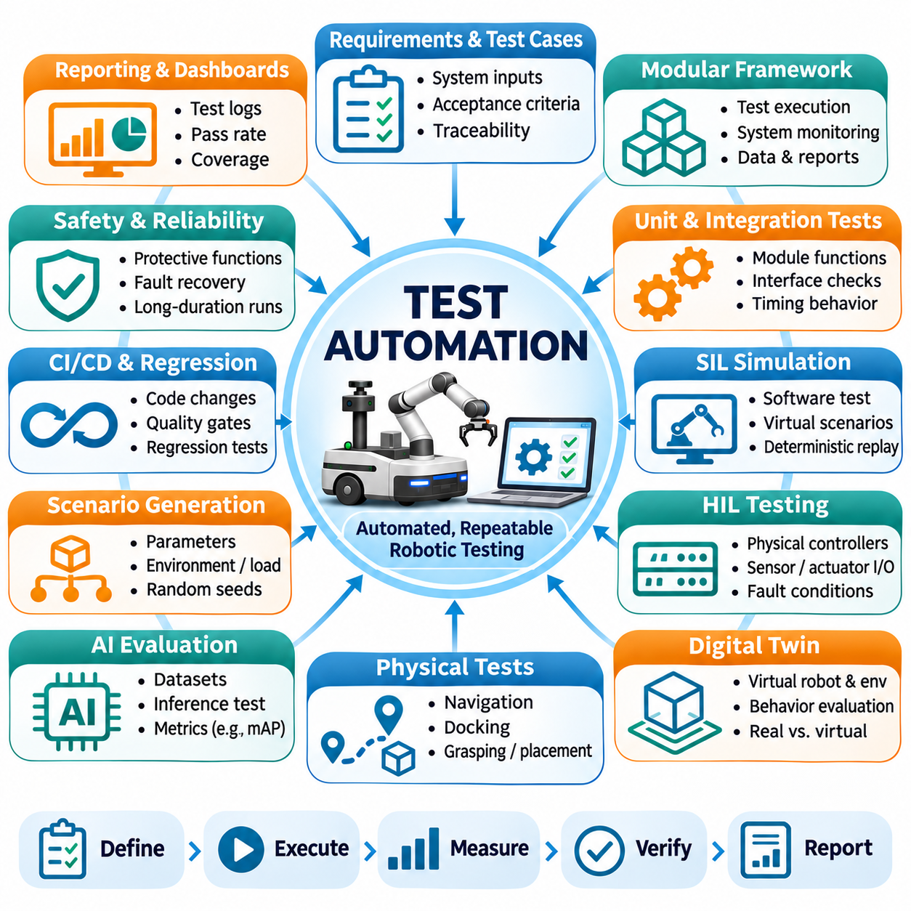{width="7.268055555555556in" height="7.268055555555556in"}

Test automation is a systematic engineering approach that uses software tools, simulation environments, measurement systems, and automated execution procedures to verify the functionality of a mobile manipulator. It reduces repetitive manual testing, improves test consistency, and enables continuous evaluation throughout the development lifecycle. Automated testing also supports early identification of system defects and performance degradation.

Test automation should be derived from system requirements, test strategies, and established verification procedures. Each automated test case should define initial conditions, input parameters, execution sequences, expected outputs, and acceptance criteria. Requirement traceability ensures that automated testing activities remain aligned with functional, performance, safety, and reliability objectives established during product development.

The test automation architecture should provide a modular framework for coordinating test execution, system monitoring, data acquisition, result evaluation, and report generation. Individual components should communicate through standardized interfaces and support different hardware and software configurations. Modular design enables test procedures to be reused across development platforms, prototype systems, and subsequent product versions.

Automated unit testing verifies individual software functions, algorithms, and control components without requiring complete robotic system operation. Representative targets include coordinate transformations, kinematic calculations, trajectory generation, sensor processing, and communication interfaces. Testing frameworks should support parameterized inputs, boundary condition evaluation, exception handling, and repeatable result verification.

Automated integration testing evaluates interactions between navigation software, robotic arm controllers, perception modules, safety controllers, and mission management applications. Test scripts should verify message exchange, interface compatibility, timing behavior, and coordinated execution. Simulated components and controlled input sequences can reproduce abnormal conditions that are difficult to generate through manual testing.

Software-in-the-Loop (SIL) testing enables automated verification of robotic software within simulated computational environments. Navigation algorithms, motion planners, manipulation controllers, and AI components can be evaluated without operating physical hardware. Simulation-based execution supports rapid scenario generation, parallel testing, deterministic replay, and early identification of software defects before hardware integration.

Hardware-in-the-Loop (HIL) testing integrates physical controllers, embedded computing platforms, and selected hardware components with simulated robotic environments. Automated test sequences can reproduce sensor inputs, communication events, actuator feedback, and representative fault conditions. HIL testing provides a controlled approach for verifying real-time behavior and hardware-software interactions before complete system deployment.

Digital twin technology extends test automation by providing virtual representations of robotic structures, operating environments, sensor configurations, and physical interactions. Automated scenarios can evaluate workspace accessibility, collision risks, manipulation sequences, and coordinated mobile platform behavior. Simulation results should be compared with physical measurements to establish the validity of the digital twin.

Automated physical testing uses instrumented test fixtures, external measurement devices, programmable targets, and robotic execution scripts to evaluate actual system performance. Repeated navigation, docking, grasping, and placement operations can be conducted under controlled conditions. Independent measurement equipment should verify positioning accuracy, cycle time, contact forces, and other relevant performance indicators.

Artificial intelligence test automation evaluates machine learning models through repeatable dataset processing, inference execution, metric calculation, and failure classification. Automated evaluation pipelines should support object detection, pose estimation, grasp prediction, and multimodal reasoning. Dataset versions, model checkpoints, inference configurations, and computational hardware characteristics must be recorded to ensure reproducibility.

Automated scenario generation expands test coverage by systematically varying environmental conditions, object configurations, initial robot poses, payload characteristics, and operational constraints. Parameterized scenarios and randomized testing can reveal unexpected interactions between robotic subsystems. Random seeds and scenario parameters should be preserved so that identified failures can be reproduced during subsequent investigations.

Continuous Integration and Continuous Delivery (CI/CD) pipelines incorporate automated testing into routine software development and deployment processes. Source code modifications should trigger appropriate unit, integration, simulation, and regression tests. Automated quality gates can prevent incompatible or insufficiently verified software versions from progressing to physical robotic platforms or production release stages.

Automated regression testing verifies that hardware revisions, software updates, AI model replacements, and configuration changes do not introduce unintended functional or performance degradation. Previously identified failure scenarios should be maintained within regression test libraries. Test prioritization can reduce execution time by selecting relevant scenarios according to modified components and associated engineering risks.

Automated safety and reliability testing supports repeated verification of protective functions, fault detection mechanisms, recovery procedures, and long-duration operational behavior. Physical test execution must remain within approved safety boundaries and independent protective mechanisms. Automated results provide supporting engineering evidence but cannot independently replace mandatory safety validation or regulatory assessment.

Automated test reporting should consolidate execution logs, measurement results, acceptance decisions, failure records, software versions, and hardware configurations into standardized documentation. Test dashboards can visualize pass rates, performance trends, requirement coverage, and recurring defects. This methodology extends the development manual\'s testing structure; specific automation tools, test coverage targets, and acceptance thresholds must be defined for each project.

시험 자동화(Test Automation)는 소프트웨어 도구(Software Tool), 시뮬레이션 환경(Simulation Environment), 측정 시스템(Measurement System), 자동화된 실행 절차(Automated Execution Procedure)를 사용하여 이동형 매니퓰레이터(Mobile Manipulator)의 기능을 검증하는 체계적인 엔지니어링 접근 방식(Engineering Approach)이다. 반복적인 수동 시험(Manual Testing)을 감소시키고 시험 일관성(Test Consistency)을 향상시키며, 전체 개발 수명주기(Development Lifecycle)에 걸쳐 지속적인 평가를 가능하게 한다. 자동화된 시험(Automated Testing)은 시스템 결함(System Defect)과 성능 저하(Performance Degradation)의 조기 식별도 지원한다.

시험 자동화는 시스템 요구사항(System Requirement), 시험 전략(Test Strategy), 사전에 수립된 검증 절차(Verification Procedure)를 기반으로 개발되어야 한다. 각각의 자동화된 시험 사례(Automated Test Case)는 초기 조건(Initial Condition), 입력 매개변수(Input Parameter), 실행 시퀀스(Execution Sequence), 예상 출력(Expected Output), 합격 기준(Acceptance Criteria)을 정의해야 한다. 요구사항 추적성(Requirement Traceability)은 자동화된 시험 활동이 제품 개발 과정에서 수립된 기능, 성능, 안전 및 신뢰성 목표와 일치하도록 보장한다.

시험 자동화 아키텍처(Test Automation Architecture)는 시험 실행(Test Execution), 시스템 모니터링(System Monitoring), 데이터 획득(Data Acquisition), 결과 평가(Result Evaluation), 보고서 생성(Report Generation)을 조정하기 위한 모듈형 프레임워크(Modular Framework)를 제공해야 한다. 개별 구성요소는 표준화된 인터페이스(Standardized Interface)를 통해 통신하고 다양한 하드웨어 및 소프트웨어 구성(Configuration)을 지원해야 한다. 모듈형 설계(Modular Design)는 개발 플랫폼(Development Platform), 프로토타입 시스템(Prototype System), 후속 제품 버전(Product Version)에서 시험 절차를 재사용할 수 있도록 한다.

자동화된 단위 시험(Automated Unit Testing)은 완전한 로봇 시스템의 운영 없이 개별 소프트웨어 기능(Software Function), 알고리즘(Algorithm), 제어 구성요소(Control Component)를 검증한다. 대표적인 시험 대상에는 좌표 변환(Coordinate Transformation), 기구학 계산(Kinematic Calculation), 궤적 생성(Trajectory Generation), 센서 처리(Sensor Processing), 통신 인터페이스(Communication Interface)가 포함된다. 시험 프레임워크(Testing Framework)는 매개변수화된 입력(Parameterized Input), 경계 조건 평가(Boundary Condition Evaluation), 예외 처리(Exception Handling), 반복 가능한 결과 검증(Repeatable Result Verification)을 지원해야 한다.

자동화된 통합 시험(Automated Integration Testing)은 자율주행 소프트웨어(Navigation Software), 로봇 팔 제어기(Robotic Arm Controller), 인지 모듈(Perception Module), 안전 제어기(Safety Controller), 임무 관리 애플리케이션(Mission Management Application) 간의 상호작용을 평가한다. 시험 스크립트(Test Script)는 메시지 교환(Message Exchange), 인터페이스 호환성(Interface Compatibility), 타이밍 동작(Timing Behavior), 협조 실행(Coordinated Execution)을 검증해야 한다. 시뮬레이션된 구성요소(Simulated Component)와 통제된 입력 시퀀스(Controlled Input Sequence)는 수동 시험을 통해 생성하기 어려운 비정상 조건(Abnormal Condition)을 재현할 수 있다.

소프트웨어 인더 루프 시험(Software-in-the-Loop Testing, SIL Testing)은 시뮬레이션된 연산 환경(Simulated Computational Environment) 내에서 로봇 소프트웨어의 자동화된 검증을 가능하게 한다. 자율주행 알고리즘(Navigation Algorithm), 동작 계획기(Motion Planner), 조작 제어기(Manipulation Controller), 인공지능 구성요소(AI Component)는 물리적 하드웨어를 작동시키지 않고 평가될 수 있다. 시뮬레이션 기반 실행(Simulation-Based Execution)은 신속한 시나리오 생성(Scenario Generation), 병렬 시험(Parallel Testing), 결정론적 재실행(Deterministic Replay), 하드웨어 통합 이전의 소프트웨어 결함 조기 식별을 지원한다.

하드웨어 인더 루프 시험(Hardware-in-the-Loop Testing, HIL Testing)은 물리적 제어기(Physical Controller), 임베디드 컴퓨팅 플랫폼(Embedded Computing Platform), 선정된 하드웨어 구성요소를 시뮬레이션된 로봇 환경(Simulated Robotic Environment)과 통합한다. 자동화된 시험 시퀀스(Automated Test Sequence)는 센서 입력(Sensor Input), 통신 이벤트(Communication Event), 액추에이터 피드백(Actuator Feedback), 대표적인 고장 조건(Fault Condition)을 재현할 수 있다. HIL 시험은 전체 시스템 배포(System Deployment) 이전에 실시간 동작(Real-Time Behavior)과 하드웨어-소프트웨어 상호작용(Hardware-Software Interaction)을 검증하기 위한 통제된 접근 방식을 제공한다.

디지털 트윈 기술(Digital Twin Technology)은 로봇 구조(Robotic Structure), 운영 환경(Operating Environment), 센서 구성(Sensor Configuration), 물리적 상호작용(Physical Interaction)의 가상 표현(Virtual Representation)을 제공함으로써 시험 자동화를 확장한다. 자동화된 시나리오(Automated Scenario)는 작업 공간 접근 가능성(Workspace Accessibility), 충돌 위험(Collision Risk), 조작 시퀀스(Manipulation Sequence), 이동 플랫폼의 협조 동작(Coordinated Mobile Platform Behavior)을 평가할 수 있다. 디지털 트윈의 유효성(Validity)을 확인하기 위해 시뮬레이션 결과(Simulation Result)는 물리적 측정값(Physical Measurement)과 비교되어야 한다.

자동화된 물리적 시험(Automated Physical Testing)은 계측 장비가 장착된 시험 치구(Instrumented Test Fixture), 외부 측정 장치(External Measurement Device), 프로그래밍 가능한 시험 대상(Programmable Target), 로봇 실행 스크립트(Robotic Execution Script)를 사용하여 실제 시스템 성능을 평가한다. 반복적인 자율주행(Navigation), 도킹(Docking), 파지(Grasping), 배치(Placement) 작업은 통제된 조건에서 수행될 수 있다. 독립적인 측정 장비(Independent Measurement Equipment)는 위치 결정 정확도(Positioning Accuracy), 사이클 시간(Cycle Time), 접촉력(Contact Force), 기타 관련 성능 지표(Performance Indicator)를 검증해야 한다.

인공지능 시험 자동화(Artificial Intelligence Test Automation)는 반복 가능한 데이터셋 처리(Dataset Processing), 추론 실행(Inference Execution), 평가 지표 계산(Metric Calculation), 실패 분류(Failure Classification)를 통해 기계학습 모델(Machine Learning Model)을 평가한다. 자동화된 평가 파이프라인(Automated Evaluation Pipeline)은 객체 검출(Object Detection), 자세 추정(Pose Estimation), 파지 예측(Grasp Prediction), 멀티모달 추론(Multimodal Reasoning)을 지원해야 한다. 재현성(Reproducibility)을 보장하기 위해 데이터셋 버전(Dataset Version), 모델 체크포인트(Model Checkpoint), 추론 구성(Inference Configuration), 연산 하드웨어 특성(Computational Hardware Characteristic)이 기록되어야 한다.

자동화된 시나리오 생성(Automated Scenario Generation)은 환경 조건(Environmental Condition), 객체 구성(Object Configuration), 초기 로봇 자세(Initial Robot Pose), 적재 하중 특성(Payload Characteristic), 운영 제약조건(Operational Constraint)을 체계적으로 변화시킴으로써 시험 커버리지(Test Coverage)를 확장한다. 매개변수화된 시나리오(Parameterized Scenario)와 무작위 시험(Randomized Testing)은 로봇 하위 시스템(Robotic Subsystem) 간의 예상하지 못한 상호작용을 드러낼 수 있다. 식별된 고장을 후속 조사에서 재현할 수 있도록 난수 시드(Random Seed)와 시나리오 매개변수(Scenario Parameter)를 보존해야 한다.

지속적 통합 및 지속적 제공(Continuous Integration and Continuous Delivery, CI/CD) 파이프라인은 자동화된 시험을 일상적인 소프트웨어 개발 및 배포 프로세스(Software Development and Deployment Process)에 통합한다. 소스 코드 변경(Source Code Modification)은 적절한 단위 시험(Unit Testing), 통합 시험(Integration Testing), 시뮬레이션 시험(Simulation Testing), 회귀 시험(Regression Testing)을 자동으로 실행하도록 해야 한다. 자동화된 품질 게이트(Automated Quality Gate)는 호환되지 않거나 충분히 검증되지 않은 소프트웨어 버전이 물리적 로봇 플랫폼(Physical Robotic Platform) 또는 제품 출시 단계(Production Release Stage)로 진행되는 것을 방지할 수 있다.

자동화된 회귀 시험(Automated Regression Testing)은 하드웨어 개정(Hardware Revision), 소프트웨어 업데이트(Software Update), 인공지능 모델 교체(AI Model Replacement), 구성 변경(Configuration Change)이 의도하지 않은 기능 또는 성능 저하(Functional or Performance Degradation)를 유발하지 않는지를 검증한다. 이전에 식별된 실패 시나리오(Failure Scenario)는 회귀 시험 라이브러리(Regression Test Library) 내에서 유지되어야 한다. 시험 우선순위 결정(Test Prioritization)은 변경된 구성요소와 관련 엔지니어링 위험(Engineering Risk)에 따라 적절한 시나리오를 선택함으로써 시험 실행 시간(Test Execution Time)을 단축할 수 있다.

자동화된 안전 및 신뢰성 시험(Automated Safety and Reliability Testing)은 보호 기능(Protective Function), 고장 검출 메커니즘(Fault Detection Mechanism), 복구 절차(Recovery Procedure), 장시간 운영 동작(Long-Duration Operational Behavior)의 반복적인 검증을 지원한다. 물리적 시험 실행(Physical Test Execution)은 승인된 안전 경계(Safety Boundary)와 독립적인 보호 메커니즘(Independent Protective Mechanism)이 보장하는 범위 내에서 이루어져야 한다. 자동화된 시험 결과는 보조적인 엔지니어링 증거(Engineering Evidence)를 제공하지만, 의무적인 안전 유효성 확인(Mandatory Safety Validation)이나 규제 평가(Regulatory Assessment)를 독립적으로 대체할 수는 없다.

자동화된 시험 보고(Automated Test Reporting)는 실행 로그(Execution Log), 측정 결과(Measurement Result), 합격 여부 판정(Acceptance Decision), 고장 기록(Failure Record), 소프트웨어 버전(Software Version), 하드웨어 구성(Hardware Configuration)을 표준화된 문서(Standardized Documentation)로 통합해야 한다. 시험 대시보드(Test Dashboard)는 시험 합격률(Pass Rate), 성능 추세(Performance Trend), 요구사항 커버리지(Requirement Coverage), 반복적으로 발생하는 결함(Recurring Defect)을 시각화할 수 있다. 이러한 방법론은 개발 매뉴얼(Development Manual)의 시험 구조를 확장한 것이며, 구체적인 자동화 도구(Automation Tool), 시험 커버리지 목표(Test Coverage Target), 합격 임계값(Acceptance Threshold)은 프로젝트별로 정의되어야 한다.

##  

## 12 Test Reports

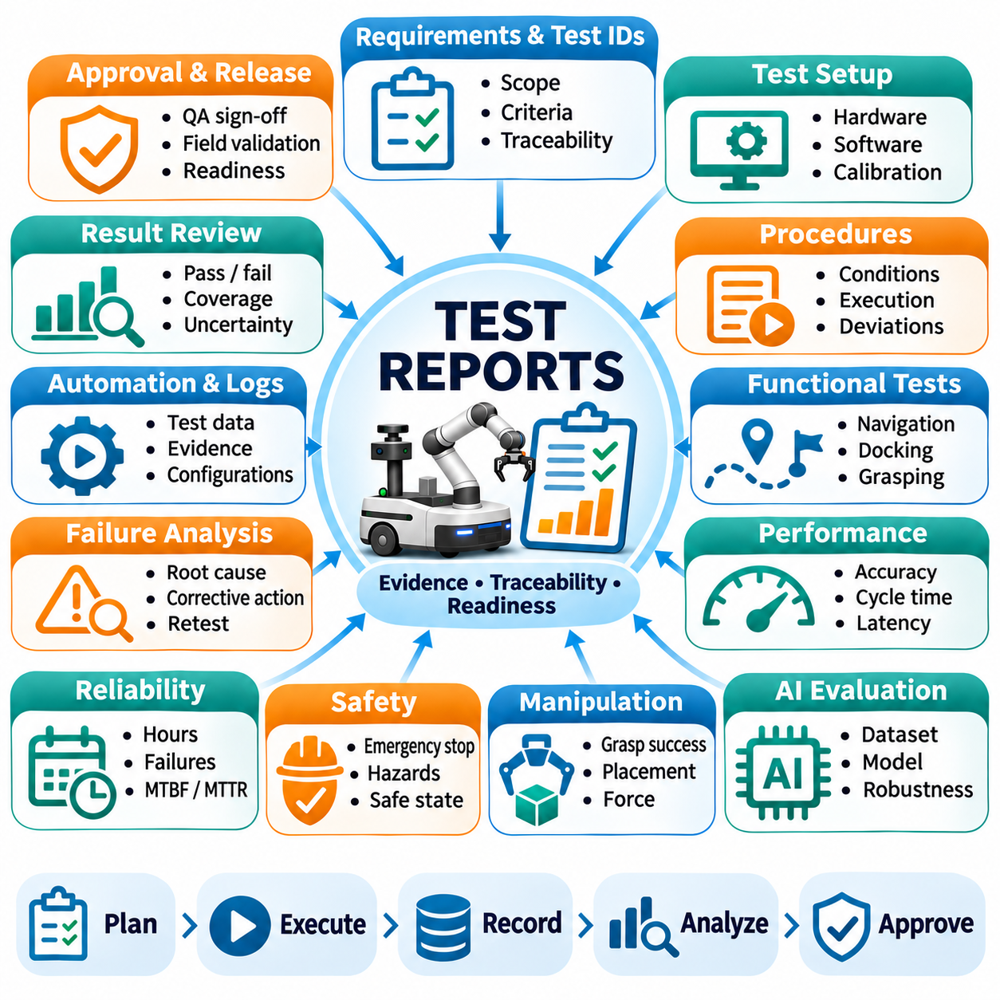{width="7.268055555555556in" height="7.268055555555556in"}

Test reports are structured engineering documents that consolidate verification and validation results obtained throughout the development of a mobile manipulator. They provide objective evidence of system functionality, performance, safety, and reliability under defined testing conditions. Test reports support engineering decisions, requirement compliance assessments, defect management, and the evaluation of overall product readiness.

Test reporting should be aligned with the approved test strategy, test plan, system requirements, and product development objectives. Each report should identify the purpose of testing, applicable requirements, test scope, execution methods, and acceptance criteria. Standardized reporting structures enable engineering teams to maintain consistency and compare results across different development stages and system configurations.

Test identification establishes the relationship between individual test activities and the overall verification framework. Each test report should include unique test identifiers, requirement references, execution dates, responsible personnel, and approval status. These identification elements support requirement traceability, configuration management, document version control, and subsequent engineering investigations.

Test environment documentation describes the physical and computational conditions under which testing was performed. Representative information includes hardware configurations, software versions, firmware revisions, sensor arrangements, calibration parameters, and environmental conditions. Measurement equipment specifications and calibration status should also be recorded to support reproducibility and measurement confidence.

Test procedure documentation describes the execution sequence, initial conditions, input parameters, operational scenarios, and expected system behavior. Differences between approved test procedures and actual execution should be explicitly recorded. Clear procedural documentation enables independent engineers to reproduce experiments, investigate unexpected results, and determine whether the testing methodology remains appropriate.

Functional test reports document whether individual robotic functions satisfy established functional requirements. Representative functions include autonomous navigation, obstacle avoidance, docking, robotic arm control, object recognition, grasping, and mission execution. Each result should include expected behavior, actual behavior, acceptance status, and supporting evidence, including relevant system logs and measurement records.

Performance test reports consolidate quantitative measurements associated with the operational capabilities of the mobile manipulator. Representative indicators include navigation accuracy, positioning repeatability, manipulation cycle time, task success rate, computational latency, energy consumption, and operational throughput. Measured results should be compared with predefined performance requirements and acceptance thresholds.

Artificial intelligence test reports document the predictive performance and operational behavior of deployed machine learning models. Evaluation results should include dataset characteristics, model versions, detection accuracy, pose estimation errors, inference latency, and robustness measurements. Representative failure cases, uncertainty estimates, and computational resource requirements should also be documented to support model improvement.

Manipulation test reports describe the physical execution capabilities of the robotic arm and associated end effectors. Relevant measurements include grasp success rate, placement accuracy, trajectory tracking error, contact force, collision frequency, and task completion time. Reports should identify relationships between manipulation failures, perception errors, mechanical limitations, and mobile platform positioning conditions.

Safety test reports provide documented evidence concerning the effectiveness of implemented protective functions and risk reduction measures. Emergency stop behavior, protective stop response, stopping distance, fault detection, and safe state transitions should be recorded. Safety-related deviations, unresolved hazards, residual risks, and applicable compliance references must be clearly identified for subsequent safety reviews.

Reliability test reports document long-duration operational behavior, accumulated operating hours, completed task cycles, failure events, and maintenance activities. Quantitative results may include failure rates, Mean Time Between Failures (MTBF), Mean Time to Repair (MTTR), and operational availability. Statistical confidence, observation duration, and limitations of the collected evidence should accompany reliability estimates.

Failure documentation is an essential component of test reporting because unsuccessful results provide valuable information for engineering improvements. Each failure record should describe observed symptoms, triggering conditions, affected components, operational consequences, and reproducibility. Root cause analysis, corrective actions, responsible personnel, and retest results should be linked to the original failure record.

Automated test reporting integrates execution logs, measurement data, evaluation metrics, and acceptance decisions into standardized digital records. Continuous integration pipelines, simulation environments, and physical test automation frameworks can generate reports with minimal manual intervention. Automated reporting processes should preserve original evidence and maintain traceability between generated results and test configurations.

Test result analysis should distinguish successful, unsuccessful, blocked, inconclusive, and unexecuted test cases. Overall pass rates should be interpreted together with requirement criticality, test coverage, unresolved defects, and measurement uncertainty. A high aggregate pass rate does not necessarily demonstrate product readiness when critical safety, performance, or functional requirements remain unverified.

Test report review and approval establish formal accountability for verification outcomes and subsequent development decisions. Responsible engineers and quality assurance personnel should examine the completeness, accuracy, and consistency of reported results. Unresolved deviations and outstanding verification activities should be addressed through corrective action plans, additional testing, or formally authorized engineering decisions.

Consolidated test reports provide the technical foundation for field validation, manufacturing readiness, quality assurance, and product qualification. Approved reports should be retained within controlled engineering repositories throughout the product lifecycle. This methodology expands the development manual\'s testing structure into a general reporting framework; project-specific templates, approval responsibilities, and acceptance criteria must be defined separately.

시험 보고서(Test Report)는 이동형 매니퓰레이터(Mobile Manipulator)의 전체 개발 과정에서 획득한 검증 및 유효성 확인 결과(Verification and Validation Result)를 통합하는 체계적인 엔지니어링 문서(Engineering Document)이다. 정의된 시험 조건(Test Condition)에서 시스템의 기능성(Functionality), 성능(Performance), 안전성(Safety), 신뢰성(Reliability)에 대한 객관적인 증거(Objective Evidence)를 제공한다. 시험 보고서는 엔지니어링 의사결정(Engineering Decision), 요구사항 적합성 평가(Requirement Compliance Assessment), 결함 관리(Defect Management), 전반적인 제품 준비도(Product Readiness) 평가를 지원한다.

시험 보고(Test Reporting)는 승인된 시험 전략(Approved Test Strategy), 시험 계획(Test Plan), 시스템 요구사항(System Requirement), 제품 개발 목표(Product Development Objective)와 일치해야 한다. 각각의 보고서는 시험 목적(Test Purpose), 적용 가능한 요구사항(Applicable Requirement), 시험 범위(Test Scope), 실행 방법(Execution Method), 합격 기준(Acceptance Criteria)을 명시해야 한다. 표준화된 보고 구조(Standardized Reporting Structure)는 엔지니어링 팀이 일관성을 유지하고 다양한 개발 단계(Development Stage) 및 시스템 구성(System Configuration) 간의 결과를 비교할 수 있도록 한다.

시험 식별(Test Identification)은 개별 시험 활동(Test Activity)과 전체 검증 프레임워크(Verification Framework) 간의 관계를 수립한다. 각각의 시험 보고서는 고유 시험 식별자(Unique Test Identifier), 요구사항 참조 정보(Requirement Reference), 실행 날짜(Execution Date), 담당 인력(Responsible Personnel), 승인 상태(Approval Status)를 포함해야 한다. 이러한 식별 요소(Identification Element)는 요구사항 추적성(Requirement Traceability), 형상 관리(Configuration Management), 문서 버전 관리(Document Version Control), 후속 엔지니어링 조사(Engineering Investigation)를 지원한다.

시험 환경 문서화(Test Environment Documentation)는 시험이 수행된 물리적 및 연산 조건(Physical and Computational Condition)을 설명한다. 대표적인 정보에는 하드웨어 구성(Hardware Configuration), 소프트웨어 버전(Software Version), 펌웨어 개정(Firmware Revision), 센서 배치(Sensor Arrangement), 교정 매개변수(Calibration Parameter), 환경 조건(Environmental Condition)이 포함된다. 재현성(Reproducibility)과 측정 신뢰도(Measurement Confidence)를 지원하기 위해 측정 장비 사양(Measurement Equipment Specification)과 교정 상태(Calibration Status)도 기록되어야 한다.

시험 절차 문서화(Test Procedure Documentation)는 실행 시퀀스(Execution Sequence), 초기 조건(Initial Condition), 입력 매개변수(Input Parameter), 운영 시나리오(Operational Scenario), 예상 시스템 동작(Expected System Behavior)을 설명한다. 승인된 시험 절차(Approved Test Procedure)와 실제 실행(Actual Execution) 간의 차이는 명시적으로 기록되어야 한다. 명확한 절차 문서화(Procedural Documentation)는 독립적인 엔지니어가 실험을 재현하고 예상하지 못한 결과를 조사하며 시험 방법론(Testing Methodology)이 여전히 적절한지를 판단할 수 있도록 한다.

기능 시험 보고서(Functional Test Report)는 개별 로봇 기능(Robotic Function)이 사전에 수립된 기능 요구사항(Functional Requirement)을 충족하는지를 문서화한다. 대표적인 기능에는 자율주행(Autonomous Navigation), 장애물 회피(Obstacle Avoidance), 도킹(Docking), 로봇 팔 제어(Robotic Arm Control), 객체 인식(Object Recognition), 파지(Grasping), 임무 실행(Mission Execution)이 포함된다. 각각의 결과는 예상 동작(Expected Behavior), 실제 동작(Actual Behavior), 합격 상태(Acceptance Status), 관련 시스템 로그(System Log)와 측정 기록(Measurement Record)을 포함한 입증 자료(Supporting Evidence)를 포함해야 한다.

성능 시험 보고서(Performance Test Report)는 이동형 매니퓰레이터의 운영 능력(Operational Capability)과 관련된 정량적 측정값(Quantitative Measurement)을 통합한다. 대표적인 지표에는 자율주행 정확도(Navigation Accuracy), 위치 결정 반복 정밀도(Positioning Repeatability), 조작 사이클 시간(Manipulation Cycle Time), 작업 성공률(Task Success Rate), 연산 지연시간(Computational Latency), 에너지 소비량(Energy Consumption), 운영 처리량(Operational Throughput)이 포함된다. 측정 결과(Measured Result)는 사전에 정의된 성능 요구사항(Performance Requirement) 및 합격 임계값(Acceptance Threshold)과 비교되어야 한다.

인공지능 시험 보고서(Artificial Intelligence Test Report)는 배포된 기계학습 모델(Deployed Machine Learning Model)의 예측 성능(Predictive Performance)과 운영 동작(Operational Behavior)을 문서화한다. 평가 결과(Evaluation Result)는 데이터셋 특성(Dataset Characteristic), 모델 버전(Model Version), 검출 정확도(Detection Accuracy), 자세 추정 오차(Pose Estimation Error), 추론 지연시간(Inference Latency), 강건성 측정값(Robustness Measurement)을 포함해야 한다. 모델 개선(Model Improvement)을 지원하기 위해 대표적인 실패 사례(Failure Case), 불확실성 추정값(Uncertainty Estimate), 연산 자원 요구사항(Computational Resource Requirement)도 문서화되어야 한다.

조작 시험 보고서(Manipulation Test Report)는 로봇 팔(Robotic Arm)과 관련 말단 작동기(End Effector)의 물리적 실행 능력(Physical Execution Capability)을 설명한다. 관련 측정 항목에는 파지 성공률(Grasp Success Rate), 배치 정확도(Placement Accuracy), 궤적 추종 오차(Trajectory Tracking Error), 접촉력(Contact Force), 충돌 빈도(Collision Frequency), 작업 완료 시간(Task Completion Time)이 포함된다. 보고서는 조작 실패(Manipulation Failure), 인지 오류(Perception Error), 기계적 한계(Mechanical Limitation), 이동 플랫폼 위치 결정 조건(Mobile Platform Positioning Condition) 간의 관계를 식별해야 한다.

안전 시험 보고서(Safety Test Report)는 구현된 보호 기능(Protective Function)과 위험 저감 조치(Risk Reduction Measure)의 효과성에 관한 문서화된 증거(Documented Evidence)를 제공한다. 비상 정지 동작(Emergency Stop Behavior), 보호 정지 응답(Protective Stop Response), 정지 거리(Stopping Distance), 고장 검출(Fault Detection), 안전 상태 전이(Safe State Transition)가 기록되어야 한다. 후속 안전 검토(Safety Review)를 위해 안전 관련 편차(Safety-Related Deviation), 해결되지 않은 위험원(Unresolved Hazard), 잔류 위험(Residual Risk), 적용 가능한 적합성 참조 정보(Compliance Reference)가 명확하게 식별되어야 한다.

신뢰성 시험 보고서(Reliability Test Report)는 장시간 운영 동작(Long-Duration Operational Behavior), 누적 운영 시간(Accumulated Operating Hours), 완료된 작업 사이클(Completed Task Cycle), 고장 이벤트(Failure Event), 유지보수 활동(Maintenance Activity)을 문서화한다. 정량적 결과(Quantitative Result)에는 고장률(Failure Rate), 평균 고장 간격(Mean Time Between Failures, MTBF), 평균 수리 시간(Mean Time to Repair, MTTR), 운영 가용성(Operational Availability)이 포함될 수 있다. 신뢰성 추정값(Reliability Estimate)에는 통계적 신뢰도(Statistical Confidence), 관측 기간(Observation Duration), 수집된 증거의 한계(Limitations of Collected Evidence)가 함께 제시되어야 한다.

고장 문서화(Failure Documentation)는 실패한 시험 결과가 엔지니어링 개선(Engineering Improvement)을 위한 가치 있는 정보를 제공하기 때문에 시험 보고의 필수적인 구성요소이다. 각각의 고장 기록(Failure Record)은 관찰된 증상(Observed Symptom), 발생 조건(Triggering Condition), 영향을 받은 구성요소(Affected Component), 운영상의 영향(Operational Consequence), 재현성(Reproducibility)을 설명해야 한다. 근본 원인 분석(Root Cause Analysis, RCA), 시정 조치(Corrective Action), 담당 인력(Responsible Personnel), 재시험 결과(Retest Result)는 최초 고장 기록(Original Failure Record)과 연결되어야 한다.

자동화된 시험 보고(Automated Test Reporting)는 실행 로그(Execution Log), 측정 데이터(Measurement Data), 평가 지표(Evaluation Metric), 합격 여부 판정(Acceptance Decision)을 표준화된 디지털 기록(Standardized Digital Record)으로 통합한다. 지속적 통합 파이프라인(Continuous Integration Pipeline), 시뮬레이션 환경(Simulation Environment), 물리적 시험 자동화 프레임워크(Physical Test Automation Framework)는 최소한의 수동 개입(Manual Intervention)으로 보고서를 생성할 수 있다. 자동화된 보고 프로세스(Automated Reporting Process)는 원본 증거(Original Evidence)를 보존하고 생성된 결과와 시험 구성(Test Configuration) 간의 추적성을 유지해야 한다.

시험 결과 분석(Test Result Analysis)은 성공(Successful), 실패(Unsuccessful), 실행 차단(Blocked), 판정 불가(Inconclusive), 미실행(Unexecuted) 시험 사례(Test Case)를 구분해야 한다. 전체 시험 합격률(Overall Pass Rate)은 요구사항 중요도(Requirement Criticality), 시험 커버리지(Test Coverage), 해결되지 않은 결함(Unresolved Defect), 측정 불확실성(Measurement Uncertainty)과 함께 해석되어야 한다. 중요한 안전, 성능 또는 기능 요구사항이 검증되지 않은 상태로 남아 있는 경우 높은 종합 합격률(Aggregate Pass Rate)이 반드시 제품 준비도(Product Readiness)를 입증하는 것은 아니다.

시험 보고서 검토 및 승인(Test Report Review and Approval)은 검증 결과(Verification Outcome)와 후속 개발 의사결정(Development Decision)에 대한 공식적인 책임 체계(Formal Accountability)를 수립한다. 담당 엔지니어(Responsible Engineer)와 품질 보증 담당자(Quality Assurance Personnel)는 보고된 결과의 완전성(Completeness), 정확성(Accuracy), 일관성(Consistency)을 검토해야 한다. 해결되지 않은 편차(Unresolved Deviation)와 미완료 검증 활동(Outstanding Verification Activity)은 시정 조치 계획(Corrective Action Plan), 추가 시험(Additional Testing), 공식적으로 승인된 엔지니어링 의사결정(Formally Authorized Engineering Decision)을 통해 처리되어야 한다.

통합 시험 보고서(Consolidated Test Report)는 현장 유효성 확인(Field Validation), 제조 준비도(Manufacturing Readiness), 품질 보증(Quality Assurance), 제품 적격성 평가(Product Qualification)를 위한 기술적 기반(Technical Foundation)을 제공한다. 승인된 보고서(Approved Report)는 전체 제품 수명주기(Product Lifecycle)에 걸쳐 통제된 엔지니어링 저장소(Controlled Engineering Repository)에서 보존되어야 한다. 이러한 방법론은 개발 매뉴얼(Development Manual)의 시험 구조를 일반적인 보고 프레임워크(Reporting Framework)로 확장한 것이며, 프로젝트별 템플릿(Project-Specific Template), 승인 책임(Approval Responsibility), 합격 기준(Acceptance Criteria)은 별도로 정의되어야 한다.
