**Volume 05. Mobile Manipulator Projects and Development Manual**

# Chapter 06. Testing

## 01 Test Strategy

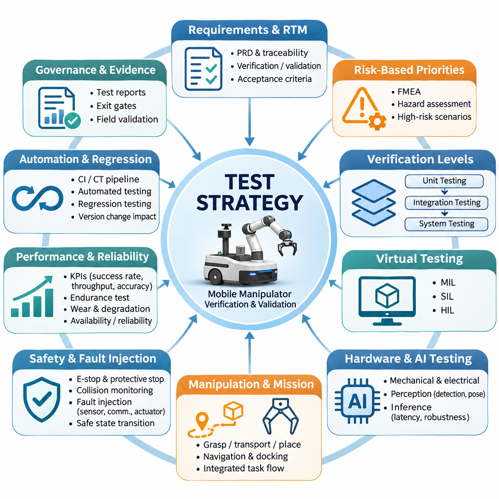{width="7.268055555555556in" height="7.268055555555556in"}

A test strategy defines the overall approach to verifying and validating the functionality, performance, reliability, and safety of a mobile manipulator throughout its development lifecycle. Unlike conventional industrial robots, mobile manipulators combine autonomous navigation, robotic manipulation, artificial intelligence, and distributed control systems. Consequently, testing must address individual subsystem behavior as well as interactions across the integrated robotic platform.

The test strategy should be established during the requirements engineering phase rather than after prototype development. Every functional, performance, safety, and operational requirement should be associated with an appropriate verification or validation method. Early test definition enables engineers to identify ambiguous requirements, establish measurable acceptance criteria, estimate testing resources, and reduce the risk of expensive design modifications during subsequent development stages.

A requirements-driven testing approach establishes traceability between the Product Requirement Document (PRD), system architecture, subsystem specifications, and test cases. A Requirements Traceability Matrix (RTM) provides a structured mechanism for monitoring verification coverage and identifying untested requirements. Each requirement should be linked to test procedures, acceptance thresholds, execution results, defect records, and supporting evidence for engineering approval.

Risk-based testing prioritizes verification activities according to the potential consequences and probability of system failures. Critical functions such as emergency stopping, collision avoidance, braking, manipulator stability, and human protection require extensive verification. Failure Mode and Effects Analysis (FMEA) and hazard assessments can help identify high-risk scenarios, allocate available testing resources, and determine the required depth of verification.

The testing architecture should incorporate multiple verification levels, progressing from component testing to subsystem integration and complete system evaluation. Unit testing verifies individual software modules and hardware functions, while integration testing examines communication and functional dependencies. System-level testing evaluates whether navigation, perception, manipulation, safety, and mission management collectively satisfy operational requirements.

Simulation-based testing provides an efficient environment for evaluating robotic behavior before physical prototypes become available. Software-in-the-Loop (SIL), Model-in-the-Loop (MIL), and Hardware-in-the-Loop (HIL) methods enable engineers to investigate control algorithms, communication interfaces, sensor behavior, and fault responses. Simulation also supports the controlled reproduction of hazardous or uncommon scenarios without exposing physical equipment to unnecessary risks.

Physical hardware testing should evaluate the mechanical, electrical, and embedded characteristics of the mobile manipulator. Verification activities include structural integrity, payload capacity, power consumption, battery endurance, thermal behavior, actuator performance, and communication stability. Particular attention should be given to the interaction between manipulator motion and mobile platform stability under different payloads and operating configurations.

Artificial intelligence testing requires a dedicated strategy because learning-based models exhibit statistical behavior rather than strictly deterministic responses. Object detection, pose estimation, grasp detection, vision-language models, and robotic agents should be evaluated using independent datasets and representative operational scenarios. Testing should address prediction accuracy, inference latency, robustness, uncertainty, environmental variation, and unexpected inputs.

Manipulation testing should evaluate the complete execution chain from object recognition to grasping, transportation, and placement. Relevant metrics include grasp success rate, positioning accuracy, repeatability, trajectory execution time, contact force, and recovery effectiveness. Test scenarios should incorporate variations in object geometry, material, weight, orientation, accessibility, and initial mobile platform positioning errors.

Integrated mission testing evaluates the coordination between autonomous navigation and robotic manipulation. A representative mission may include task allocation, route planning, obstacle avoidance, precision docking, object recognition, manipulation, transportation, and task completion reporting. Testing must verify that transitions between operational states occur correctly and that subsystem failures do not propagate into uncontrolled system behavior.

Safety testing constitutes an independent and essential element of the overall strategy. Protective stopping, emergency stopping, safety interlocks, speed restrictions, collision monitoring, and fault detection should be verified against applicable safety requirements. Fault injection should examine system responses to sensor failures, communication interruptions, actuator malfunctions, and power abnormalities under controlled conditions with appropriate protective measures.

Performance and reliability testing should establish whether the mobile manipulator consistently meets its intended operational targets. Key Performance Indicators (KPIs) may include mission success rate, task throughput, localization accuracy, manipulation cycle time, system availability, and energy efficiency. Extended operation and repetitive mission execution help identify thermal degradation, mechanical wear, memory leakage, and intermittent communication failures.

Test automation improves repeatability, verification coverage, and development efficiency by enabling standardized procedures to be executed throughout the engineering lifecycle. Continuous Integration and Continuous Testing (CI/CT) pipelines can automatically perform software verification, simulation scenarios, AI model evaluation, and regression testing. Automated results should remain traceable to software versions, hardware configurations, datasets, and environmental conditions.

A comprehensive regression testing strategy ensures that modifications do not degrade previously verified functionality. Changes to mechanical assemblies, firmware, control algorithms, AI models, communication protocols, or sensor configurations should trigger appropriate verification activities. Configuration management and version-controlled test assets enable engineers to reproduce failures, compare development baselines, and establish confidence in successive product releases.

Test governance should establish responsibilities for test execution, defect classification, corrective actions, result approval, and development milestone decisions. Objective entry and exit criteria should determine whether the system is ready to progress from prototype testing to integrated verification and field validation. Test reports should document measurement results, unresolved defects, deviations, residual risks, and the evidence supporting release decisions.

Ultimately, an effective test strategy connects requirements engineering, system design, hardware development, artificial intelligence, and manipulation development into a unified verification framework. The approach presented here extends the chapter structure into a general engineering methodology rather than prescribing project-specific acceptance thresholds. These thresholds must be established according to the intended application, operational environment, and applicable safety requirements.

## 02 Test Plan Development

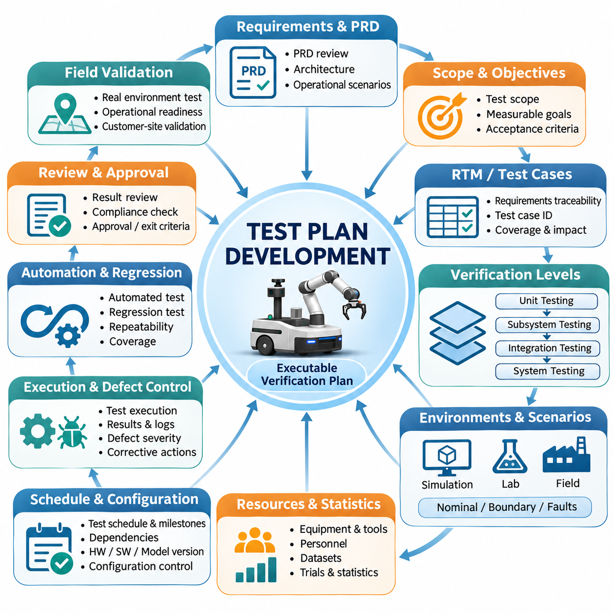{width="7.268055555555556in" height="7.268055555555556in"}

Test plan development translates the overall test strategy into a structured and executable framework for verifying and validating a mobile manipulator. While the test strategy defines the fundamental principles and objectives of testing, the test plan specifies what must be tested, how testing will be conducted, which resources are required, and how results will be evaluated. It establishes a common operational baseline for engineering and quality assurance teams.

The development of a test plan should begin with a comprehensive review of the Product Requirement Document (PRD), system architecture, subsystem specifications, and operational scenarios. These documents provide the technical foundation for identifying test objectives and defining measurable acceptance criteria. Every critical requirement should be associated with one or more test cases to ensure that verification activities provide sufficient coverage of the intended system capabilities.

The scope of the test plan should encompass mechanical hardware, electrical systems, embedded controllers, autonomous navigation, artificial intelligence, robotic manipulation, communication interfaces, and safety functions. Each technical domain requires specific verification methods and evaluation environments. Clear scope definition prevents unnecessary duplication of testing activities while ensuring that critical interactions between subsystems are adequately examined.

Test objectives should be established using measurable engineering parameters rather than subjective descriptions of expected behavior. For example, navigation testing may specify localization accuracy, docking precision, and obstacle avoidance performance, while manipulation testing may define positioning accuracy, grasp success rate, and execution time. Quantitative acceptance criteria enable consistent evaluation and provide an objective basis for determining whether requirements have been satisfied.

A Requirements Traceability Matrix (RTM) should be incorporated into the test planning process to maintain relationships between system requirements and verification activities. Each test case should have a unique identifier associated with its corresponding requirement, subsystem, test procedure, and acceptance criteria. Traceability enables engineers to identify verification gaps, evaluate the impact of design modifications, and monitor testing progress throughout development.

Test cases should be organized according to verification levels, including unit testing, subsystem testing, integration testing, and system-level testing. Each level should have clearly defined entry and exit criteria to prevent insufficiently verified components from progressing into more complex integration environments. This hierarchical approach reduces troubleshooting complexity and supports the gradual accumulation of evidence regarding system functionality, performance, and reliability.

The test environment must accurately represent the conditions under which the mobile manipulator is expected to operate. Depending on the application, testing environments may include simulation platforms, laboratory facilities, hardware test benches, controlled industrial environments, and representative customer sites. Environmental variables such as lighting, floor conditions, wireless connectivity, temperature, and obstacle distribution should be documented and controlled.

Test scenario development should address normal operation, boundary conditions, abnormal situations, and foreseeable failure modes. Nominal scenarios verify expected functionality, while boundary testing examines behavior near operational limitations. Abnormal scenarios evaluate the response to unexpected obstacles, localization errors, communication interruptions, sensor degradation, and unsuccessful manipulation attempts. Safety-related scenarios require controlled execution and appropriate protective measures.

The test plan should define the equipment, personnel, software tools, datasets, and infrastructure required for each verification activity. Measurement instruments must provide sufficient accuracy and resolution relative to the specified acceptance thresholds. Calibration status, equipment availability, software dependencies, and hardware configurations should be documented. Resource planning helps prevent scheduling conflicts and reduces uncertainty associated with measurement results.

Statistical considerations are particularly important when evaluating artificial intelligence models, grasping performance, navigation reliability, and repetitive mission execution. The test plan should establish the number of trials, sampling methods, environmental variations, and statistical evaluation criteria. Repeated measurements and representative test populations provide stronger evidence than isolated successful demonstrations and help characterize uncertainty and performance variability.

Test scheduling should be aligned with hardware development, software releases, AI model deployment, and system integration milestones. Dependencies between verification activities must be identified to establish an executable testing sequence. Sufficient time should be allocated for troubleshooting, corrective modifications, regression testing, and unexpected failures. Schedule adjustments should be managed through formal review rather than by eliminating critical verification activities.

Configuration management is essential for maintaining the reproducibility and validity of test results. Each test execution should reference the relevant hardware revision, firmware version, software build, AI model checkpoint, calibration parameters, and dataset version. Changes to these elements must be documented and evaluated to determine whether previous verification results remain applicable. Consistent configuration records support defect investigation and engineering audits.

The test plan should define standardized procedures for recording results, classifying defects, assigning corrective actions, and conducting retesting. Defect severity should reflect the impact on safety, functionality, performance, and operational availability. Failed or inconclusive tests should remain open until their causes have been investigated and appropriate corrective actions verified. Deviations from approved procedures must be documented, justified, and reviewed.

Test automation and regression testing should be incorporated wherever technically feasible. Automated scripts can execute software test cases, simulation scenarios, AI benchmarks, communication diagnostics, and repetitive functional checks. Regression test suites should be maintained to verify that system modifications do not introduce unexpected failures. Automation improves execution efficiency while providing consistent and traceable evidence across successive development iterations.

Formal test plan approval should involve representatives from system engineering, hardware development, software development, artificial intelligence, manipulation engineering, safety engineering, and quality assurance. Approval confirms that the proposed verification activities adequately address system requirements and identified risks. The plan should remain a controlled engineering document that evolves as requirements, system configurations, and development priorities change.

The completed test plan provides a practical foundation for subsequent unit, integration, functional, performance, AI, manipulation, safety, and reliability testing. It connects these activities with test automation, reporting, and eventual field validation. This methodology expands the development manual\'s testing structure into a general engineering framework, leaving project-specific acceptance thresholds, resource allocations, and approval responsibilities to be established by the development organization.

## 03 Unit Testing

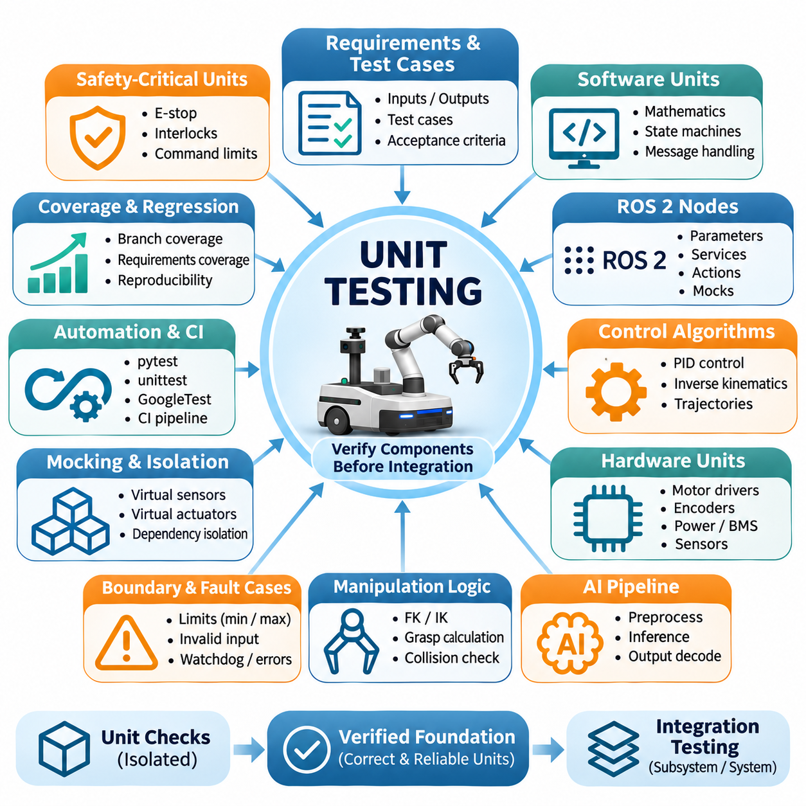{width="7.268055555555556in" height="7.268055555555556in"}

Unit testing is the fundamental verification activity used to evaluate individual software modules, control algorithms, hardware functions, and computational components within a mobile manipulator. Its primary objective is to determine whether each component behaves according to its specified requirements before integration with other subsystems. Early identification of defects reduces debugging complexity and improves overall system reliability.

In mobile manipulator development, a unit may represent a software function, a ROS 2 node, a device driver, a control module, or an independently testable hardware component. The definition of a unit depends on the system architecture and the intended verification boundaries. Each unit should have clearly defined inputs, outputs, interfaces, expected behavior, and operational constraints to support independent and reproducible testing.

Unit test development should begin with a detailed examination of functional requirements, subsystem specifications, and interface definitions. Engineers should establish expected responses for representative inputs and identify abnormal conditions that may affect component behavior. Each test case should specify initial conditions, input parameters, execution procedures, expected outputs, and measurable acceptance criteria to facilitate objective evaluation.

Software unit testing verifies the internal functionality of algorithms and application modules without requiring the complete robotic platform. Typical targets include coordinate transformations, numerical calculations, state machines, trajectory generation, communication message processing, and diagnostic functions. Testing should examine both computational correctness and the ability of individual functions to handle invalid or unexpected inputs.

ROS 2 applications require unit tests that address message processing, parameter management, service responses, action execution, and internal node behavior. Dependencies on external sensors, actuators, and communication networks can be replaced with mock objects or controlled test interfaces. This approach allows engineers to isolate individual software components and investigate failures without introducing unrelated hardware or network dependencies.

Control algorithm testing should evaluate the mathematical correctness and computational behavior of navigation and manipulation controllers. Representative targets include proportional-integral-derivative controllers, velocity regulation, inverse kinematics, joint trajectory interpolation, and force control calculations. Test inputs should incorporate nominal operating conditions, numerical limits, singular configurations, and invalid parameter combinations.

Hardware unit testing focuses on individual electronic, mechanical, and embedded components before subsystem integration. Motor drivers, encoders, power converters, battery management interfaces, sensor modules, and communication transceivers should be evaluated using controlled test benches. Verification activities may include electrical measurements, signal integrity checks, initialization sequences, and basic fault detection capabilities.

Artificial intelligence components also require unit-level verification, although their behavior differs from conventional deterministic software. Individual AI pipeline functions such as image preprocessing, tensor conversion, model initialization, inference execution, confidence filtering, and output decoding should be tested independently. These activities help ensure that implementation defects do not compromise subsequent model performance evaluation.

Manipulation software unit testing should examine individual functions associated with robotic arm operation. Forward kinematics, inverse kinematics, coordinate transformations, grasp parameter calculations, collision geometry processing, and trajectory constraints are representative examples. Known analytical solutions, reference datasets, and independently calculated results can provide reliable baselines for evaluating computational accuracy.

Boundary value testing is particularly important for robotic systems because physical and computational limitations directly influence operational behavior. Test cases should examine minimum and maximum joint positions, velocity limits, actuator command ranges, sensor measurement boundaries, and numerical precision. Invalid inputs, missing data, arithmetic overflow, and unexpected state transitions should also be evaluated against defined error-handling requirements.

Mocking and dependency isolation enable unit tests to execute without relying on complete hardware assemblies or operational environments. Simulated sensor readings, virtual actuator responses, predefined communication messages, and controlled timing sources allow engineers to reproduce specific conditions consistently. Such techniques are valuable when physical equipment is unavailable or when failure scenarios cannot be safely reproduced on actual hardware.

Automated unit testing should be incorporated into the software development workflow using appropriate testing frameworks. Python-based components may utilize pytest or unittest, while C++ modules may employ GoogleTest and GoogleMock. Automated test execution within Continuous Integration (CI) pipelines allows developers to detect implementation errors immediately after code modifications and maintain consistent verification across development branches.

Test coverage metrics provide quantitative indicators of the extent to which software implementations have been exercised. Statement coverage, branch coverage, condition coverage, and requirements coverage can help identify insufficiently tested logic. However, high code coverage alone does not demonstrate software correctness or functional safety. Coverage evaluation should therefore be combined with requirement-based testing and risk-based analysis.

Unit test results should be recorded together with relevant configuration information, including source code revisions, firmware versions, test framework versions, input datasets, and execution environments. Failed tests should generate reproducible diagnostic information that supports defect investigation and corrective development. Previously failed test cases should be retained within regression test suites to prevent the recurrence of identified defects.

Safety-related software and hardware units require particular attention because their failures may contribute to hazardous system behavior. Emergency stop signal processing, command limit enforcement, watchdog monitoring, interlock logic, and fault detection should undergo rigorous unit-level verification. Nevertheless, successful unit tests cannot replace integrated safety verification or demonstrate compliance with complete system safety requirements.

An effective unit testing methodology establishes a verified foundation for subsequent integration, functional, performance, AI, manipulation, safety, and reliability testing. It improves development efficiency by identifying defects before subsystem dependencies increase diagnostic complexity. This approach extends the development manual\'s testing structure into a general engineering methodology, while project-specific coverage targets, testing tools, and acceptance thresholds should be defined within the approved test plan.

## 04 Integration Testing

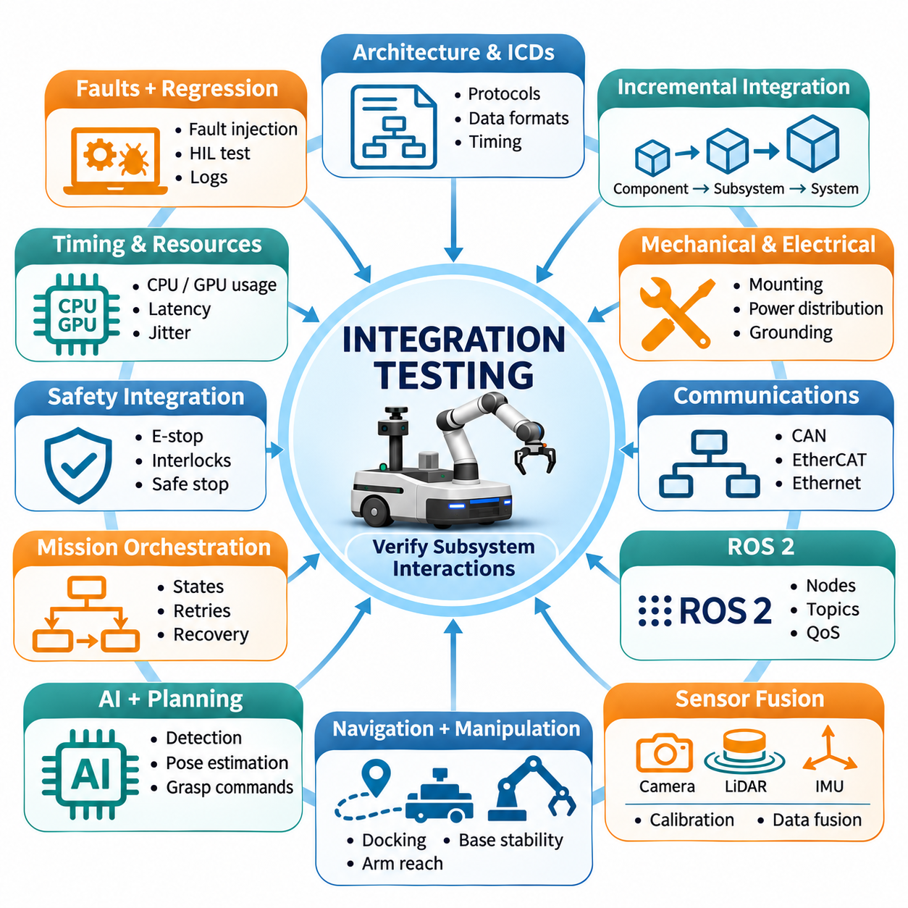{width="7.268055555555556in" height="7.268055555555556in"}

Integration testing is a systematic verification activity that evaluates interactions between independently developed components and subsystems within a mobile manipulator. While unit testing focuses on individual functions, integration testing examines whether hardware, software, artificial intelligence, and control modules operate correctly when interconnected. Its primary objective is to identify interface defects, communication failures, and unexpected dependencies.

Mobile manipulators combine autonomous mobile robots, robotic arms, end effectors, perception sensors, embedded controllers, and mission management software. Each subsystem may independently satisfy its design requirements while exhibiting unexpected behavior during combined operation. Integration testing therefore establishes confidence that mechanical, electrical, computational, and communication interfaces collectively support coordinated robotic behavior.

The integration testing process should begin with a comprehensive review of the system architecture and Interface Control Documents (ICDs). Interface specifications should define communication protocols, message structures, data formats, coordinate systems, timing requirements, and error-handling mechanisms. Test cases should verify that interconnected components comply with these specifications under both normal and abnormal operating conditions.

Incremental integration provides an effective methodology for managing the complexity of mobile manipulator development. Individual components are progressively assembled into functional subsystems before complete system integration. This approach enables engineers to identify interface defects within manageable verification boundaries, reduce troubleshooting complexity, and establish intermediate integration baselines before introducing additional dependencies.

Mechanical and electrical integration testing evaluates physical compatibility between the mobile platform, robotic arm, end effector, sensors, and supporting equipment. Verification should examine mounting interfaces, structural rigidity, cable routing, power distribution, grounding, and electromagnetic compatibility. Combined operation should also be evaluated to identify mechanical interference, vibration, voltage fluctuations, and unexpected thermal behavior.

Communication integration testing verifies reliable information exchange between distributed controllers, sensors, edge computing platforms, and supervisory software. Technologies such as CAN, CANopen, EtherCAT, Ethernet, and wireless communication may support different operational functions. Testing should evaluate message integrity, communication latency, synchronization accuracy, packet loss, timeout handling, and connectivity recovery.

ROS 2 integration testing examines interactions among nodes, topics, services, actions, and lifecycle management mechanisms. Particular attention should be given to Quality of Service (QoS) compatibility, message synchronization, namespace configuration, and distributed discovery. Integration scenarios should verify that navigation, perception, manipulation, and mission management nodes exchange information reliably under representative computational workloads.

Sensor integration testing evaluates the combined operation of cameras, LiDAR, inertial measurement units, wheel encoders, and force-torque sensors. Accurate timestamp alignment, coordinate transformations, calibration parameters, and sensor data consistency are essential for reliable perception and control. Verification should examine the effects of delayed measurements, missing data, calibration errors, and inconsistent sensor observations on integrated behavior.

Navigation and manipulation integration represents a critical verification domain because the mobile platform directly influences robotic arm positioning and task execution. Testing should evaluate precision docking, base stabilization, manipulator workspace availability, and coordinated motion constraints. The system must correctly determine when navigation has completed and whether the platform is sufficiently stable and accurately positioned for manipulation.

Artificial intelligence integration testing evaluates the interaction between perception models, robotic planning algorithms, and physical execution systems. Object detection, pose estimation, and grasp prediction outputs must be correctly transformed into actionable control parameters. Testing should examine coordinate consistency, inference latency, confidence thresholds, invalid predictions, and the ability of downstream controllers to reject unsuitable AI-generated commands.

Task planning integration testing verifies coordinated execution across mission management, navigation, perception, and manipulation subsystems. Behavior trees, state machines, and task orchestration frameworks should be evaluated through representative operational sequences. Testing must confirm that task transitions, completion acknowledgments, conditional branches, retry mechanisms, and recovery procedures operate consistently across distributed components.

Safety integration testing examines interactions between protective devices, safety controllers, mobile platform controllers, and robotic arm control systems. Emergency stop activation, protective stopping, motion restrictions, and safety interlocks must produce coordinated responses. Controlled fault injection should verify that communication failures, invalid commands, and subsystem malfunctions do not result in hazardous motion or unauthorized automatic restart.

Timing and resource integration testing evaluates whether multiple subsystems can operate concurrently without violating operational deadlines. Navigation, visual perception, AI inference, trajectory planning, and control processes may compete for CPU, GPU, memory, and network resources. Verification should examine processing latency, scheduling jitter, resource contention, and system responsiveness under nominal and peak computational workloads.

Integration testing should incorporate representative failure scenarios to evaluate fault propagation and recovery across subsystem boundaries. Sensor disconnection, communication interruption, localization failure, unsuccessful grasping, and controller restart can reveal hidden dependencies. The expected response should include appropriate fault detection, controlled state transitions, diagnostic reporting, and recovery consistent with the defined operational and safety requirements.

Automated integration testing and regression testing should be incorporated into the development workflow wherever practical. Simulation environments, Hardware-in-the-Loop (HIL) platforms, automated mission scripts, and continuous integration pipelines can support repeatable verification. Test results should include configuration references, synchronized logs, communication traces, execution metrics, and diagnostic evidence to facilitate defect investigation.

An effective integration testing methodology establishes the foundation for subsequent functional, performance, AI, manipulation, safety, and reliability testing. Successful integration demonstrates that independently verified subsystems can operate together within defined architectural constraints, but does not establish complete operational readiness. Project-specific acceptance thresholds, integration sequences, and approval criteria should be established within the approved test plan.

## 05 Functional Testing

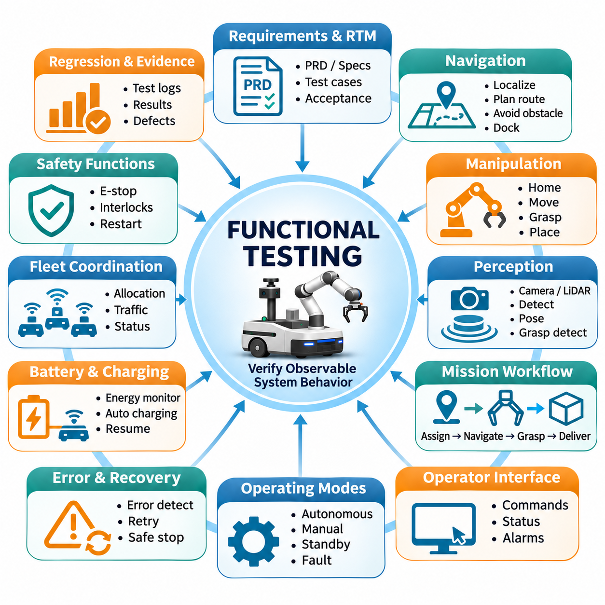{width="7.268055555555556in" height="7.268055555555556in"}

Functional testing is a systematic verification activity that determines whether a mobile manipulator performs its intended functions according to defined system requirements. Unlike unit testing and integration testing, which focus on individual components and subsystem interactions, functional testing evaluates observable system behavior. Its primary objective is to confirm that the integrated robotic platform executes required operations correctly and consistently.

Functional testing should be derived from the Product Requirement Document (PRD), functional specifications, system architecture, and operational scenarios. Each functional requirement should be translated into one or more executable test cases with clearly defined acceptance criteria. A Requirements Traceability Matrix (RTM) establishes the relationship between specified functions and verification evidence, ensuring that critical capabilities are adequately evaluated.

Functional test cases should define initial system conditions, input commands, environmental configurations, execution procedures, expected behavior, and evaluation criteria. Both positive and negative test cases are necessary to verify correct operation and appropriate responses to invalid inputs. Testing should consider normal operating conditions, boundary conditions, exceptional situations, and foreseeable disturbances within the intended operational environment.

Autonomous navigation functional testing evaluates whether the mobile platform can execute requested movement operations within its designated environment. Representative functions include map loading, localization initialization, route planning, obstacle avoidance, destination arrival, and precision docking. Testing should confirm that the robot responds correctly to environmental changes, updates its navigation decisions, and reports navigation status accurately.

Robotic manipulation functional testing examines whether the robotic arm and end effector execute the operations required by the intended application. Typical functions include homing, joint movement, Cartesian positioning, object approaching, grasping, lifting, transporting, and releasing objects. Each operation should be evaluated independently and as part of representative task sequences to verify functional consistency and correct execution.

Perception functional testing evaluates the ability of the robotic system to acquire environmental information and provide meaningful inputs to downstream planning and control modules. Camera acquisition, LiDAR scanning, object detection, pose estimation, and grasp detection should operate correctly under specified conditions. Testing should also verify how the system handles unavailable measurements, invalid observations, and uncertain perception outputs.

Task execution testing examines the complete operational workflow of a mobile manipulator from mission assignment to task completion. A representative warehouse mission may involve autonomous navigation, precision docking, object recognition, grasping, transportation, and placement. The system should execute these operations in the correct sequence while maintaining task state information and reporting completion or failure to supervisory applications.

Human-machine interface functional testing evaluates interactions between operators and the mobile manipulator through graphical interfaces, remote control applications, and supervisory management systems. Functions such as mission submission, manual operation, status monitoring, alarm visualization, and task cancellation should be verified. Operator commands must produce predictable responses consistent with authorization levels and current operating states.

Operating mode testing verifies transitions between autonomous, manual, maintenance, standby, charging, and fault states. Each operating mode should activate only the functions permitted by its corresponding requirements. Testing should examine whether incompatible commands are rejected, state transitions occur correctly, and interrupted operations are resumed or terminated according to defined recovery procedures without creating unintended system behavior.

Error-handling functional testing evaluates how the system responds when operational functions cannot be completed successfully. Representative scenarios include unreachable destinations, unsuccessful grasping, blocked trajectories, missing objects, sensor abnormalities, and communication interruptions. The robot should recognize failures, generate meaningful diagnostic messages, and execute predefined retry, recovery, or controlled termination procedures.

Battery management and automatic charging functions should be verified as part of the complete operational workflow. Functional tests should examine battery status monitoring, low-energy warnings, automatic charging requests, docking operations, charging initiation, and mission resumption. The system should prevent inappropriate task execution when available energy is insufficient and respond correctly to charging interruptions or docking failures.

Fleet management functional testing evaluates interactions between individual mobile manipulators and centralized or distributed supervisory systems. Task allocation, mission prioritization, robot availability reporting, traffic coordination, and fleet status synchronization should be verified where applicable. Testing should confirm that communication interruptions and conflicting task requests are handled according to predefined coordination policies.

Safety-related functional testing verifies that protective functions respond correctly when specified triggering conditions occur. Emergency stopping, protective stopping, motion interlocks, speed restrictions, and restart authorization should be evaluated through controlled scenarios. Although these activities provide important functional evidence, dedicated safety testing and applicable compliance assessments remain necessary to establish system-level safety assurance.

Functional regression testing ensures that modifications to software, hardware, AI models, and configuration parameters do not unintentionally change previously verified behavior. Automated mission scripts, simulation environments, and physical test platforms can support repeatable verification across successive development iterations. Test records should include system configurations, execution logs, observed outcomes, deviations, and associated defect identifiers.

Successful functional testing establishes confidence that a mobile manipulator delivers its specified capabilities and provides a foundation for subsequent performance, AI, manipulation, safety, and reliability testing. The methodology presented here expands the development manual\'s testing structure into a general engineering framework. Specific operational scenarios, acceptance thresholds, and release criteria must be defined within the approved project test plan.

## 06 Performance Testing

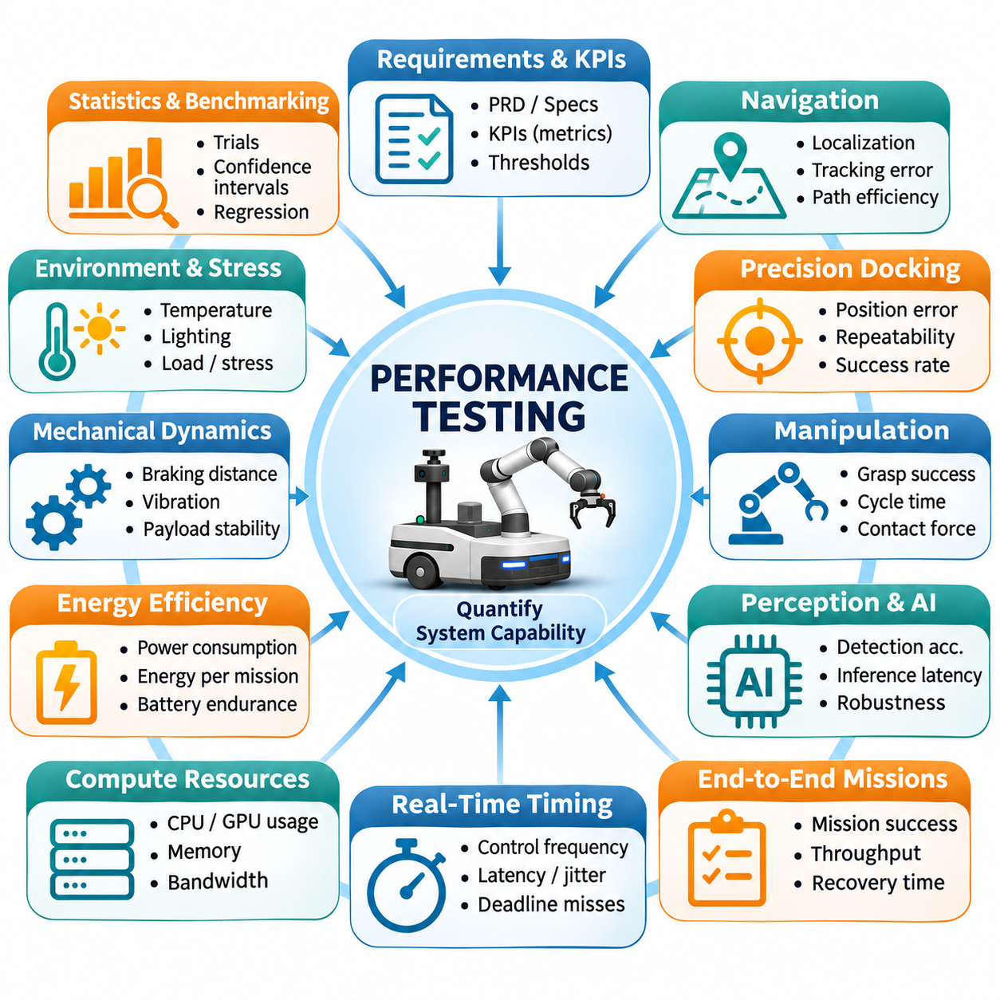{width="7.268055555555556in" height="7.268055555555556in"}

Performance testing is a quantitative verification activity that evaluates whether a mobile manipulator satisfies its specified operational and technical performance requirements. While functional testing determines whether required functions operate correctly, performance testing examines how accurately, rapidly, efficiently, and consistently these functions are executed under representative operating conditions and workloads.

Performance testing should be based on the Product Requirement Document (PRD), system specifications, operational scenarios, and approved test plan. Each performance requirement should be associated with measurable Key Performance Indicators (KPIs), standardized measurement procedures, and acceptance thresholds. These criteria establish an objective foundation for evaluating engineering improvements and determining system readiness.

Navigation performance testing evaluates the accuracy, responsiveness, and efficiency of the autonomous mobile platform. Representative metrics include localization accuracy, trajectory tracking error, navigation success rate, travel time, obstacle avoidance response time, and path efficiency. Tests should incorporate different floor surfaces, travel distances, obstacle configurations, vehicle speeds, and payload conditions.

Precision docking performance is particularly important because the positioning accuracy of the mobile platform directly influences the operational effectiveness of the robotic arm. Testing should measure translational and rotational positioning errors, docking repeatability, alignment time, and docking success rate. Measurements should consider different approach directions, initial positioning errors, payloads, and environmental conditions.

Manipulation performance testing evaluates the ability of the robotic arm and end effector to execute physical operations within specified performance limits. Relevant metrics include positioning accuracy, pose repeatability, trajectory tracking error, grasp success rate, manipulation cycle time, and contact force accuracy. Different object geometries, payloads, working distances, and manipulator configurations should be examined.

Perception and artificial intelligence performance testing evaluates the computational and predictive capabilities of learning-based robotic functions. Object detection accuracy, pose estimation error, grasp prediction accuracy, inference latency, and processing throughput should be measured under representative conditions. Testing should also examine performance degradation caused by illumination changes, occlusion, sensor noise, and computational constraints.

End-to-end mission performance testing evaluates the combined effectiveness of navigation, perception, manipulation, and task management. Mission completion time, mission success rate, task throughput, waiting time, and recovery duration provide important indicators of operational productivity. Individual subsystem performance should be analyzed together with complete mission execution to identify system-level bottlenecks and dependencies.

Real-time performance testing examines the ability of distributed robotic components to satisfy defined timing requirements. Control loop frequency, sensor acquisition latency, communication latency, scheduling jitter, and command execution delay should be measured. Average response times should be supplemented by percentile measurements, maximum observed delays, and deadline violation rates to characterize timing variability.

Computational performance testing evaluates the utilization of central processing units (CPUs), graphics processing units (GPUs), memory, storage, and communication bandwidth. Concurrent execution of navigation, perception, AI inference, motion planning, and diagnostic processes may introduce resource contention. Testing should identify computational bottlenecks and determine whether adequate processing capacity remains available during peak workloads.

Energy efficiency testing evaluates the relationship between electrical energy consumption and completed robotic operations. Representative metrics include average power consumption, peak electrical demand, energy consumption per mission, operating duration, and charging time. Measurements should consider different travel speeds, manipulation workloads, payload masses, idle periods, and battery states to establish realistic operational endurance.

Mechanical performance testing examines the dynamic behavior of the mobile platform and manipulator during representative physical operations. Acceleration, deceleration, braking distance, vibration, structural deflection, payload stability, and manipulator-induced platform movement should be evaluated. Particular attention should be given to changes in the combined center of gravity during arm extension and payload transportation.

Environmental performance testing evaluates how operating conditions influence the capabilities of the mobile manipulator. Temperature variations, humidity, lighting conditions, floor irregularities, dust exposure, and wireless communication interference may affect system performance. Testing should characterize performance degradation across the specified operational envelope and identify conditions requiring restrictions or additional engineering improvements.

Load testing and stress testing examine system behavior as operational demands approach or exceed specified capacity limits. Increased payloads within approved limits, higher mission frequencies, concurrent computational workloads, and intensive communication traffic can reveal performance limitations. Stress scenarios should be conducted under controlled conditions to determine whether overload protection and performance degradation mechanisms operate appropriately.

Statistical evaluation is essential because robotic performance can vary between repeated operations even under nominally identical conditions. Test procedures should define sample sizes, measurement uncertainty, environmental configurations, and statistical analysis methods. Mean values, standard deviations, confidence intervals, percentile distributions, and success rates provide a more comprehensive understanding of performance than isolated measurements.

Performance benchmarking establishes reference values for comparing alternative hardware configurations, control algorithms, AI models, and software implementations. Consistent workloads, measurement instruments, system configurations, and evaluation procedures are necessary for meaningful comparisons. Benchmark results should distinguish subsystem improvements from overall mission performance gains and account for trade-offs between accuracy, speed, energy consumption, and computational cost.

Performance regression testing verifies that successive hardware and software modifications do not reduce previously established capabilities. Automated benchmarking scripts, synchronized telemetry, and version-controlled test configurations support repeatable measurements. The resulting performance reports should document measured values, acceptance thresholds, statistical distributions, deviations, bottlenecks, and recommended corrective actions.

Successful performance testing provides quantitative evidence that a mobile manipulator can achieve its intended productivity, accuracy, responsiveness, and operational efficiency. It also establishes a technical baseline for subsequent optimization, reliability testing, field validation, and commercialization. Project-specific performance targets and acceptance thresholds should be established according to the intended application rather than assumed to be universally applicable.

## 07 AI Testing

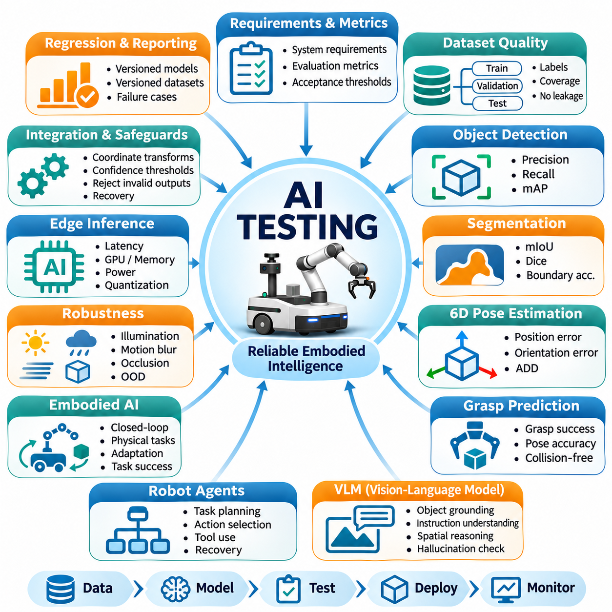{width="7.268055555555556in" height="7.268055555555556in"}

Artificial intelligence testing is a systematic verification and evaluation activity that examines the accuracy, robustness, computational efficiency, and operational behavior of AI models deployed within a mobile manipulator. Unlike conventional software testing, AI testing must account for statistical uncertainty, data-dependent behavior, environmental variability, and the relationship between model predictions and physical robotic actions.

AI testing should be derived from system requirements, AI functional specifications, operational scenarios, and the approved test plan. Each learning-based component should be associated with measurable evaluation metrics, representative test datasets, and acceptance thresholds. The testing methodology should establish whether AI capabilities satisfy both individual model requirements and integrated robotic system requirements.

Dataset verification establishes the foundation for reliable AI testing. Training, validation, and test datasets should be separated to prevent data leakage and ensure unbiased performance evaluation. Test datasets should represent operational environments, object categories, sensor configurations, and environmental variations. Dataset completeness, annotation accuracy, class distribution, and scenario coverage should be systematically examined.

Object detection testing evaluates whether AI models can accurately identify and localize objects relevant to robotic operations. Representative evaluation metrics include precision, recall, F1 score, Intersection over Union (IoU), and mean Average Precision (mAP). Testing should examine detection performance across different object sizes, viewing angles, illumination conditions, background complexity, and levels of occlusion.

Image segmentation testing evaluates the ability of AI models to distinguish target objects, traversable surfaces, obstacles, and relevant environmental structures at the pixel level. Semantic segmentation and instance segmentation models should be evaluated using appropriate metrics, including mean Intersection over Union (mIoU) and Dice coefficients. Boundary accuracy and segmentation consistency are particularly important for robotic manipulation.

Six-dimensional object pose estimation testing evaluates the accuracy of predicted object positions and orientations within three-dimensional space. Translational error, rotational error, Average Distance of Model Points (ADD), and symmetry-aware metrics should be considered. Testing should examine whether estimation errors remain within the tolerances required for successful grasping, alignment, and precision manipulation.

Grasp prediction testing evaluates whether AI-generated grasp candidates support successful physical object manipulation. Relevant metrics include grasp success rate, grasp pose accuracy, collision-free grasp availability, and object retention rate. Predictions should be evaluated using different object geometries, material properties, orientations, and environmental configurations through both simulation and physical experiments.

Vision-Language Model (VLM) testing examines the ability of multimodal AI systems to interpret visual observations and natural language instructions consistently. Evaluation should consider object grounding, instruction comprehension, spatial reasoning, and contextual interpretation. Particular attention should be given to ambiguous instructions, hallucinated objects, incorrect spatial relationships, and unsupported conclusions.

Robot agent testing evaluates the ability of AI-driven decision-making systems to select actions, coordinate tasks, and respond to changing operational conditions. Test scenarios should examine instruction decomposition, action selection, tool utilization, task sequencing, and recovery from unsuccessful operations. Agent-generated commands must remain within predefined operational constraints and authorized execution boundaries.

Embodied AI testing evaluates the relationship between perception, reasoning, decision-making, and physical interaction with the environment. Unlike offline model evaluation, embodied AI testing requires closed-loop assessment in which robotic actions influence subsequent observations. Testing should examine behavioral consistency, adaptation to environmental changes, error accumulation, and successful completion of physical tasks.

Robustness testing evaluates AI model behavior under environmental disturbances and conditions that differ from training data. Illumination variations, motion blur, sensor noise, object occlusion, unfamiliar geometries, and background changes should be incorporated into representative test scenarios. Out-of-distribution detection and uncertainty estimation can help identify situations requiring alternative execution or human intervention.

AI inference performance testing examines whether deployed models satisfy real-time computational requirements on target edge computing platforms. Inference latency, processing throughput, GPU utilization, memory consumption, and power demand should be measured under representative workloads. Quantization, pruning, and inference optimization should also be evaluated for their effects on predictive accuracy.

AI integration testing verifies that model outputs are correctly interpreted by navigation, motion planning, manipulation, and mission management components. Coordinate transformations, confidence thresholds, timestamp consistency, and command interfaces should be examined. Invalid predictions and uncertain outputs must be handled through appropriate rejection mechanisms, independent safeguards, and controlled recovery procedures.

AI regression testing evaluates whether model retraining, dataset expansion, software updates, and deployment optimization introduce unintended performance degradation. Version-controlled datasets, model checkpoints, evaluation scripts, and deployment configurations should support reproducible comparisons. Regression tests should examine both aggregate evaluation metrics and previously identified critical failure scenarios.

AI test reports should document model versions, dataset characteristics, experimental configurations, evaluation metrics, failure cases, statistical uncertainty, and computational resource requirements. Successful AI testing provides evidence for subsequent manipulation testing, safety testing, and field validation. These general testing practices extend the manual\'s chapter structure; project-specific acceptance thresholds must be defined separately.

## 08 Manipulation Testing

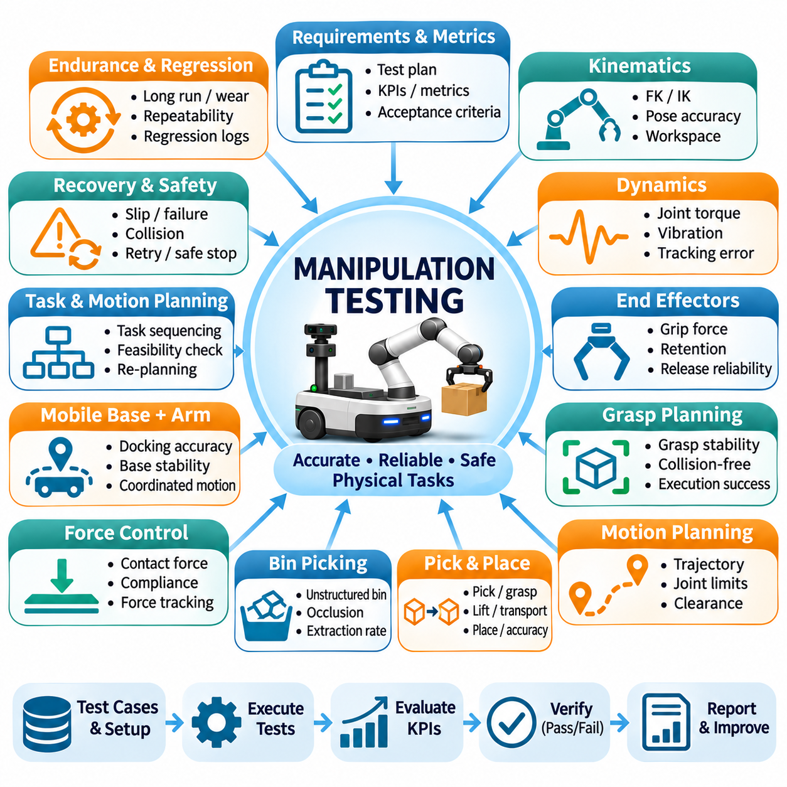{width="7.268055555555556in" height="7.268055555555556in"}

Manipulation testing is a systematic verification activity that evaluates the ability of a mobile manipulator to perform physical interactions with objects and surrounding environments. It examines the combined behavior of the robotic arm, end effector, perception system, motion planner, and control architecture. The primary objective is to establish whether manipulation tasks can be executed accurately, consistently, efficiently, and safely.

Manipulation testing should be derived from functional requirements, performance specifications, operational scenarios, and the approved system test plan. Each manipulation capability should be associated with measurable acceptance criteria and representative test conditions. Test procedures should define object characteristics, initial robot configurations, environmental constraints, measurement equipment, and expected operational outcomes.

Kinematic testing evaluates the accuracy of forward and inverse kinematic models used to determine robotic arm configurations and end-effector positions. Tests should examine joint movement, Cartesian positioning, orientation accuracy, workspace boundaries, and singularity handling. External measurement systems can provide independent reference data for comparing commanded positions with actual end-effector poses.

Dynamic testing examines the physical behavior of the robotic arm under different movement profiles and loading conditions. Representative measurements include joint torque, acceleration, deceleration, vibration, trajectory tracking error, and settling time. Testing should evaluate whether the dynamic model accurately represents the effects of payload mass, inertia, gravitational forces, and mechanical interactions.

End-effector testing evaluates the functional capabilities and physical performance of grippers, suction devices, magnetic gripping systems, and application-specific tools. Gripping force, opening distance, actuation response time, object retention, and release reliability should be examined. Different object materials, surface characteristics, geometries, and weight distributions should be incorporated into representative test scenarios.

Grasp planning testing evaluates whether generated grasp configurations are physically achievable and suitable for the intended manipulation task. Candidate grasps should be examined according to accessibility, grasp stability, collision avoidance, and compatibility with end-effector constraints. Physical execution tests should measure grasp success rates and identify differences between predicted grasp quality and actual performance.

Motion planning testing verifies the ability of the robotic system to generate executable trajectories within defined mechanical and environmental constraints. Planning success rate, computation time, trajectory smoothness, collision clearance, and joint limit compliance should be evaluated. Test scenarios should include restricted workspaces, complex obstacles, difficult target poses, and changes in environmental configurations.

Pick-and-place testing evaluates the complete sequence of object acquisition, grasping, lifting, transportation, positioning, and release. Each operation should be assessed individually and as part of an integrated manipulation cycle. Representative performance indicators include picking success rate, placement accuracy, cycle time, object damage rate, and successful completion without additional operator intervention.

Bin picking testing examines the ability of a mobile manipulator to identify, select, and retrieve objects from unstructured or partially structured containers. Different object arrangements, stacking conditions, overlapping geometries, occlusion levels, and container dimensions should be evaluated. Testing should measure successful extraction, collision frequency, picking efficiency, and recovery from unsuccessful grasp attempts.

Force control testing evaluates the ability of the robotic arm to regulate physical contact forces during manipulation tasks. Force tracking accuracy, torque response, contact detection sensitivity, compliance behavior, and force overshoot should be measured. Representative applications include insertion, assembly, surface inspection, and handling fragile objects that require controlled interaction with physical environments.

Mobile manipulation testing examines the relationship between mobile platform positioning and robotic arm performance. Navigation errors, docking accuracy, platform inclination, structural vibration, and residual movement can influence manipulation accuracy. Testing should evaluate whether coordinated base and arm operation maintains sufficient stability, workspace accessibility, and positioning accuracy throughout the intended task.

Task and motion planning testing evaluates the coordinated execution of high-level task sequences and low-level robotic movements. Test scenarios should examine action dependencies, object accessibility, intermediate configurations, environmental constraints, and planning failures. The system should correctly reorganize or terminate task sequences when physical execution becomes infeasible or predefined conditions are violated.

Manipulation error recovery testing examines system responses to unsuccessful grasping, object slippage, unexpected contact, blocked trajectories, and unavailable target objects. Controlled fault scenarios should verify whether the robot detects abnormal conditions and selects appropriate recovery actions. Reattempted operations must respect established retry limits, collision constraints, and independent safety mechanisms.

Manipulation performance evaluation should incorporate repeated experiments to characterize operational variability and statistical confidence. Success rates, positioning errors, cycle times, and contact forces should be assessed across representative combinations of objects, payloads, and workspace configurations. Statistical analysis should distinguish systematic errors from random variations and measurement uncertainties.

Manipulation endurance testing evaluates whether repeated physical operations introduce degradation in positioning accuracy, gripping performance, or mechanical stability. Continuous task cycles can reveal actuator overheating, joint backlash, gripper wear, sensor drift, and progressive calibration errors. Observed degradation should be documented to support subsequent reliability testing and preventive maintenance planning.

Automated manipulation testing and regression testing should be incorporated into the development workflow wherever practical. Simulation environments, digital twins, instrumented test fixtures, and automated execution scripts can support repeatable verification. Test records should preserve hardware configurations, calibration parameters, software versions, trajectory logs, force measurements, and observed failure conditions.

Successful manipulation testing provides technical evidence for subsequent safety testing, reliability testing, field validation, and product qualification. It establishes a measurable foundation for evaluating physical task execution and identifying engineering improvements. The methodology expands the development manual\'s manipulation development and testing structure, while specific acceptance thresholds remain dependent on project requirements.

## 09 Safety Testing

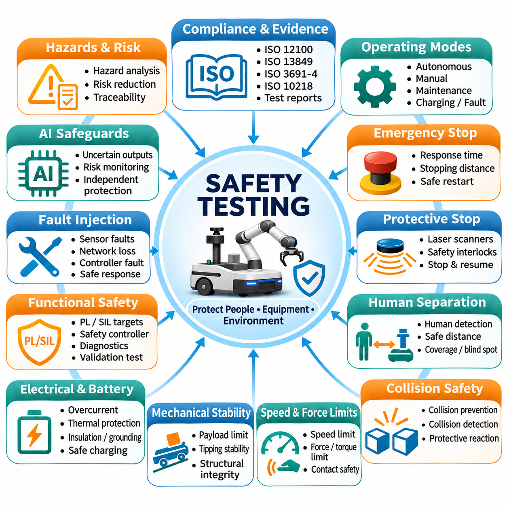{width="7.268055555555556in" height="7.268055555555556in"}

Safety testing is a systematic verification and validation activity that evaluates whether a mobile manipulator can operate without exposing humans, equipment, or surrounding environments to unacceptable risks. It examines the effectiveness of protective mechanisms, safety-related control functions, mechanical safeguards, and fault responses. Safety testing must address both intended operating conditions and reasonably foreseeable abnormal situations.

Safety testing should be derived from safety requirements, hazard analysis, risk assessments, system architecture, and applicable regulatory requirements. Each identified hazard should be associated with appropriate risk reduction measures and corresponding verification procedures. Traceability between hazards, safety requirements, protective functions, and test results provides a structured foundation for demonstrating safety assurance.

Hazard-based testing examines potential risks associated with autonomous navigation, robotic arm movement, object handling, electrical systems, and human-robot interaction. Representative hazards include unintended motion, crushing, trapping, collision, falling objects, electrical shock, and platform instability. Test scenarios should verify whether implemented protective measures reduce these risks to acceptable levels under specified operating conditions.

Emergency stop testing evaluates whether emergency stop activation produces the required stopping behavior across the mobile platform, robotic arm, and associated equipment. Testing should examine response time, stopping distance, actuator behavior, and coordination between distributed controllers. Emergency stop reset must not initiate unexpected motion, and subsequent operation should require an appropriate restart procedure.

Protective stop testing evaluates the ability of the robotic system to interrupt hazardous motion when predefined protective conditions are detected. Safety laser scanners, protective sensors, safety controllers, and motion interlocks should be evaluated individually and collectively. Testing should verify stopping behavior, protective field configurations, obstacle detection coverage, and conditions for authorized motion resumption.

Human detection and separation monitoring testing examines whether the system maintains required protective separation distances during applicable human-robot interaction scenarios. Detection coverage, sensor response time, approach direction, robot speed, and stopping performance should be considered. Testing should account for sensor blind spots, occlusion, and combined movements of the mobile platform and robotic arm.

Collision safety testing evaluates the effectiveness of collision prevention, collision detection, and protective reaction mechanisms. Representative scenarios may involve stationary obstacles, unexpected environmental changes, and restricted manipulation workspaces. Controlled experiments should verify that hazardous movements are prevented or interrupted according to defined safety requirements without exposing personnel to unnecessary risks.

Speed and force limitation testing examines whether the mobile manipulator respects specified movement speed, torque, power, and contact force restrictions. Measurements should consider robot configurations, payload conditions, contact geometries, and operating modes. Where power and force limiting is employed, application-specific contact risks and applicable biomechanical limits must be evaluated using appropriate measurement equipment.

Mechanical safety testing evaluates structural integrity, platform stability, payload retention, and resistance to hazardous mechanical failures. Robotic arm extension, acceleration, emergency braking, uneven surfaces, and changes in the combined center of gravity can influence system stability. Testing should verify that mechanical configurations remain within approved stability and loading limits throughout intended operating scenarios.

Electrical and battery safety testing examines protection against electrical faults, excessive current, overheating, insulation failure, and abnormal charging conditions. Protective devices, grounding arrangements, battery management systems, and power isolation mechanisms should be verified. Potentially destructive fault scenarios should be performed using qualified facilities, suitable protective equipment, and controlled experimental procedures.

Functional safety testing evaluates the behavior of safety-related control systems under normal and fault conditions. Safety controllers, redundant communication channels, diagnostic mechanisms, and safety-rated drive functions should be examined where applicable. Verification must address relevant Performance Level (PL) or Safety Integrity Level (SIL) requirements through appropriate architectural analysis, calculations, and validation testing.

Fault injection testing evaluates system responses to representative hardware, software, sensor, actuator, and communication failures. Controlled scenarios may include signal interruption, invalid measurements, controller malfunction, and loss of communication. Testing should verify fault detection, transition to a defined safe state, diagnostic reporting, and prevention of unauthorized restart or uncontrolled physical movement.

Artificial intelligence safety testing examines the consequences of unreliable predictions, uncertain perception outputs, incorrect task decisions, and unexpected AI-generated commands. Independent protective mechanisms should prevent unacceptable risks even when learning-based components produce incorrect results. Conventional AI accuracy metrics alone are insufficient to demonstrate the effectiveness of safety-related functions.

Safety testing should examine transitions between autonomous operation, manual control, maintenance, charging, fault recovery, and emergency conditions. Operating mode selection, authorization mechanisms, motion restrictions, and maintenance interlocks must respond consistently. Particular attention should be given to unexpected startup, remote command execution, and restoration of electrical power after an interruption.

Safety compliance assessment should consider applicable standards such as ISO 12100, ISO 13849, IEC 62061, ISO 3691-4, ISO 10218, and ISO/TS 15066, depending on the system classification and application. These standards address different aspects of machinery, functional, mobile robot, and industrial robot safety. Compliance must be assessed against the applicable editions, jurisdictional requirements, and complete integrated system.

Safety regression testing ensures that modifications to hardware, software, AI models, operating parameters, and mechanical configurations do not compromise previously verified protective functions. Safety test reports should document hazard references, test configurations, measurement methods, acceptance criteria, observed results, deviations, corrective actions, and residual risks to support subsequent engineering reviews.

Successful safety testing provides essential technical evidence for reliability testing, field validation, regulatory compliance, and product qualification. However, successful individual tests do not independently establish complete system safety. This methodology expands the development manual\'s safety requirements and testing structure into a general engineering framework, while project-specific safety limits and compliance criteria must be established separately.

## 10 Reliability Testing

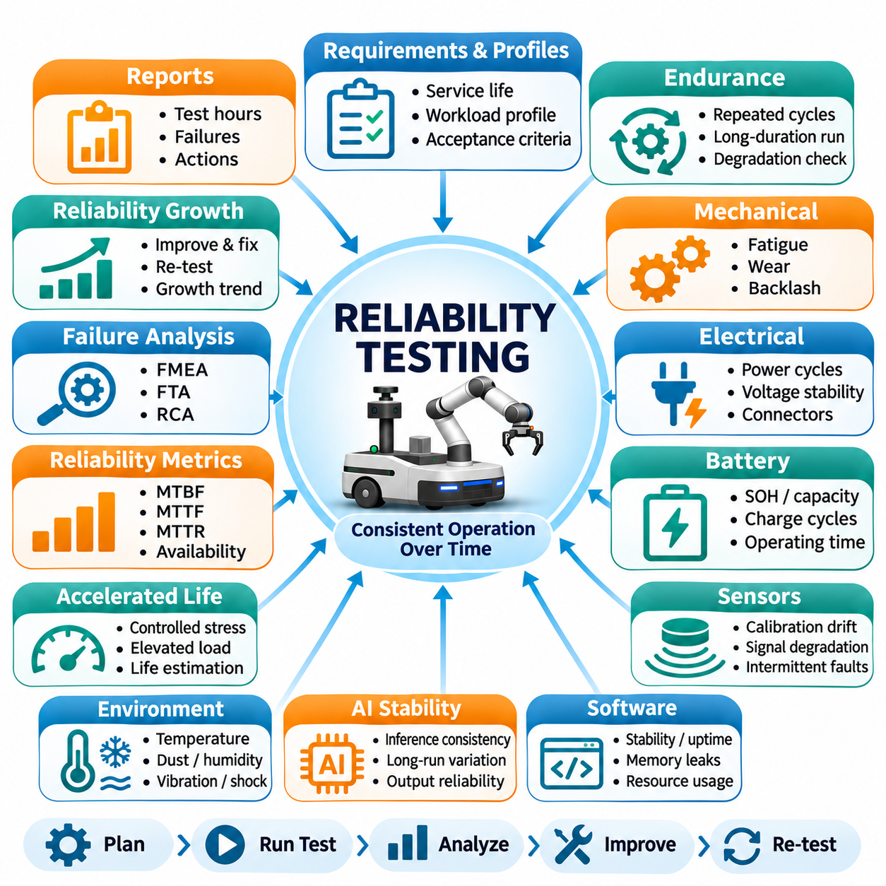{width="7.268055555555556in" height="7.268055555555556in"}

Reliability testing is a systematic engineering activity that evaluates the ability of a mobile manipulator to perform its intended functions consistently over a specified period under defined operating conditions. It examines hardware durability, software stability, sensor consistency, actuator performance, and integrated system behavior. The primary objective is to identify potential failure mechanisms and reduce unexpected operational interruptions.

Reliability testing should be derived from system requirements, operational scenarios, expected service life, maintenance strategies, and environmental specifications. Test procedures should define operating duration, workload distribution, environmental conditions, failure classifications, and acceptance criteria. Requirement traceability ensures that reliability objectives established during product development are systematically evaluated.

Reliability test planning should consider representative operational profiles that reflect the expected behavior of the mobile manipulator throughout its service life. Navigation distances, manipulation frequencies, payload distributions, charging cycles, and standby durations should be incorporated into the test environment. Representative workload profiles provide a more realistic basis for assessing long-term system performance.

Endurance testing evaluates the ability of the robotic system to sustain repeated operations without unacceptable performance degradation. Mobile platforms and robotic arms should execute representative navigation, docking, grasping, transportation, and placement cycles. Continuous monitoring of mechanical behavior, electrical characteristics, computational performance, and operational errors helps identify progressive deterioration.

Mechanical reliability testing examines structural components, drive mechanisms, robotic joints, bearings, transmission systems, and end effectors under repeated mechanical loading. Test procedures should evaluate fatigue, material deformation, mechanical wear, vibration, joint backlash, and fastening integrity. Particular attention should be given to components subjected to frequent acceleration, braking, and payload variations.

Electrical reliability testing evaluates the durability and operational stability of power distribution systems, motor controllers, wiring harnesses, connectors, and electronic components. Repeated power cycles, electrical load variations, thermal fluctuations, and representative vibration conditions should be considered. Monitoring voltage stability, current consumption, and connection integrity can reveal emerging electrical failure mechanisms.

Battery reliability testing examines the long-term performance of energy storage systems under representative charging and discharging conditions. Battery capacity, internal resistance, charging efficiency, operating temperature, and state of health should be monitored throughout repeated cycles. Battery management system behavior and the progressive reduction of available operating time should also be evaluated.

Sensor reliability testing evaluates the ability of perception and localization devices to maintain consistent measurement performance over extended operating periods. Cameras, LiDAR sensors, inertial measurement units, encoders, and force sensors should be examined for calibration drift, signal degradation, intermittent malfunction, and environmental sensitivity. Measurement deviations should be compared with established tolerances.

Software reliability testing examines the stability of operating systems, robotic middleware, navigation software, manipulation controllers, and mission management applications during prolonged execution. Memory leaks, resource exhaustion, process termination, communication interruptions, and synchronization errors should be monitored. Repeated task execution can reveal software defects that are difficult to identify through conventional functional testing.

Artificial intelligence reliability testing evaluates the consistency of deployed AI models throughout extended robotic operations. Changes in environmental conditions, sensor characteristics, object distributions, and computational workloads may influence prediction quality. Long-duration testing should examine inference stability, confidence variation, repeated prediction failures, and the operational consequences of inaccurate model outputs.

Environmental reliability testing examines system performance under physical conditions representative of the intended deployment environment. Temperature variations, humidity, dust exposure, mechanical shock, and vibration should be considered according to application requirements. Combined environmental stresses may reveal failure mechanisms that cannot be identified through isolated component testing.

Accelerated life testing applies controlled environmental or operational stresses to investigate potential failure mechanisms within reduced testing periods. Elevated temperatures, increased operating frequencies, and repeated mechanical loading may accelerate component degradation. Stress levels and acceleration models must be justified to prevent unrealistic failure mechanisms from producing misleading service life estimates.

Reliability evaluation should incorporate quantitative indicators such as Mean Time Between Failures (MTBF), Mean Time to Failure (MTTF), Mean Time to Repair (MTTR), failure rate, and operational availability. Each indicator provides different information about system dependability and maintenance requirements. Statistical confidence, sample size, observation duration, and failure definitions must be considered when interpreting reliability measurements.

Failure analysis should establish the underlying causes of observed mechanical, electrical, software, and operational problems. Failure Mode and Effects Analysis (FMEA), Fault Tree Analysis (FTA), and Root Cause Analysis (RCA) can support systematic investigations. Identified failure mechanisms should lead to appropriate design improvements, corrective actions, and subsequent verification through repeated reliability testing.

Reliability growth testing evaluates whether successive engineering improvements reduce failure occurrence and increase operational stability. Hardware revisions, software updates, calibration adjustments, and component replacements should be evaluated against established reliability baselines. Configuration management and standardized test procedures are essential for maintaining consistent comparisons between development iterations.

Reliability test reports should document operating conditions, accumulated operating hours, completed task cycles, failure events, maintenance activities, statistical results, and corrective actions. These records provide a technical foundation for field validation, manufacturing readiness, warranty planning, and lifecycle management. This general methodology expands the manual\'s testing structure; project-specific reliability targets require separate definition.

## 11 Test Automation

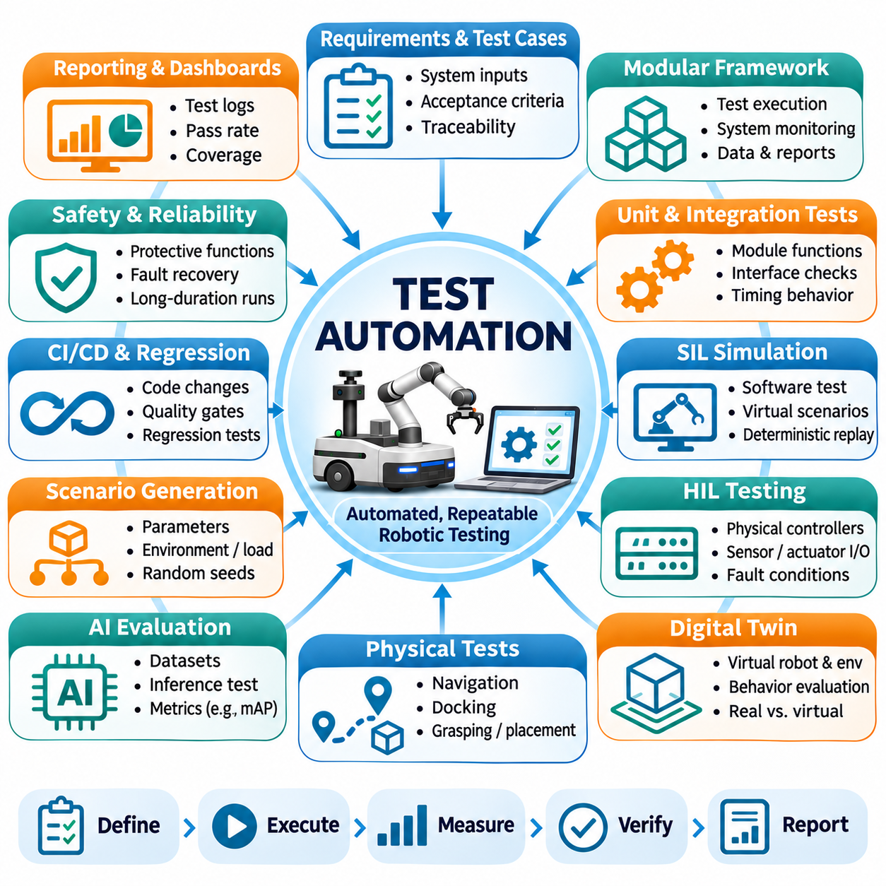{width="7.268055555555556in" height="7.268055555555556in"}

Test automation is a systematic engineering approach that uses software tools, simulation environments, measurement systems, and automated execution procedures to verify the functionality of a mobile manipulator. It reduces repetitive manual testing, improves test consistency, and enables continuous evaluation throughout the development lifecycle. Automated testing also supports early identification of system defects and performance degradation.

Test automation should be derived from system requirements, test strategies, and established verification procedures. Each automated test case should define initial conditions, input parameters, execution sequences, expected outputs, and acceptance criteria. Requirement traceability ensures that automated testing activities remain aligned with functional, performance, safety, and reliability objectives established during product development.

The test automation architecture should provide a modular framework for coordinating test execution, system monitoring, data acquisition, result evaluation, and report generation. Individual components should communicate through standardized interfaces and support different hardware and software configurations. Modular design enables test procedures to be reused across development platforms, prototype systems, and subsequent product versions.

Automated unit testing verifies individual software functions, algorithms, and control components without requiring complete robotic system operation. Representative targets include coordinate transformations, kinematic calculations, trajectory generation, sensor processing, and communication interfaces. Testing frameworks should support parameterized inputs, boundary condition evaluation, exception handling, and repeatable result verification.

Automated integration testing evaluates interactions between navigation software, robotic arm controllers, perception modules, safety controllers, and mission management applications. Test scripts should verify message exchange, interface compatibility, timing behavior, and coordinated execution. Simulated components and controlled input sequences can reproduce abnormal conditions that are difficult to generate through manual testing.

Software-in-the-Loop (SIL) testing enables automated verification of robotic software within simulated computational environments. Navigation algorithms, motion planners, manipulation controllers, and AI components can be evaluated without operating physical hardware. Simulation-based execution supports rapid scenario generation, parallel testing, deterministic replay, and early identification of software defects before hardware integration.

Hardware-in-the-Loop (HIL) testing integrates physical controllers, embedded computing platforms, and selected hardware components with simulated robotic environments. Automated test sequences can reproduce sensor inputs, communication events, actuator feedback, and representative fault conditions. HIL testing provides a controlled approach for verifying real-time behavior and hardware-software interactions before complete system deployment.

Digital twin technology extends test automation by providing virtual representations of robotic structures, operating environments, sensor configurations, and physical interactions. Automated scenarios can evaluate workspace accessibility, collision risks, manipulation sequences, and coordinated mobile platform behavior. Simulation results should be compared with physical measurements to establish the validity of the digital twin.

Automated physical testing uses instrumented test fixtures, external measurement devices, programmable targets, and robotic execution scripts to evaluate actual system performance. Repeated navigation, docking, grasping, and placement operations can be conducted under controlled conditions. Independent measurement equipment should verify positioning accuracy, cycle time, contact forces, and other relevant performance indicators.

Artificial intelligence test automation evaluates machine learning models through repeatable dataset processing, inference execution, metric calculation, and failure classification. Automated evaluation pipelines should support object detection, pose estimation, grasp prediction, and multimodal reasoning. Dataset versions, model checkpoints, inference configurations, and computational hardware characteristics must be recorded to ensure reproducibility.

Automated scenario generation expands test coverage by systematically varying environmental conditions, object configurations, initial robot poses, payload characteristics, and operational constraints. Parameterized scenarios and randomized testing can reveal unexpected interactions between robotic subsystems. Random seeds and scenario parameters should be preserved so that identified failures can be reproduced during subsequent investigations.

Continuous Integration and Continuous Delivery (CI/CD) pipelines incorporate automated testing into routine software development and deployment processes. Source code modifications should trigger appropriate unit, integration, simulation, and regression tests. Automated quality gates can prevent incompatible or insufficiently verified software versions from progressing to physical robotic platforms or production release stages.

Automated regression testing verifies that hardware revisions, software updates, AI model replacements, and configuration changes do not introduce unintended functional or performance degradation. Previously identified failure scenarios should be maintained within regression test libraries. Test prioritization can reduce execution time by selecting relevant scenarios according to modified components and associated engineering risks.

Automated safety and reliability testing supports repeated verification of protective functions, fault detection mechanisms, recovery procedures, and long-duration operational behavior. Physical test execution must remain within approved safety boundaries and independent protective mechanisms. Automated results provide supporting engineering evidence but cannot independently replace mandatory safety validation or regulatory assessment.

Automated test reporting should consolidate execution logs, measurement results, acceptance decisions, failure records, software versions, and hardware configurations into standardized documentation. Test dashboards can visualize pass rates, performance trends, requirement coverage, and recurring defects. This methodology extends the development manual\'s testing structure; specific automation tools, test coverage targets, and acceptance thresholds must be defined for each project.

## 12 Test Reports

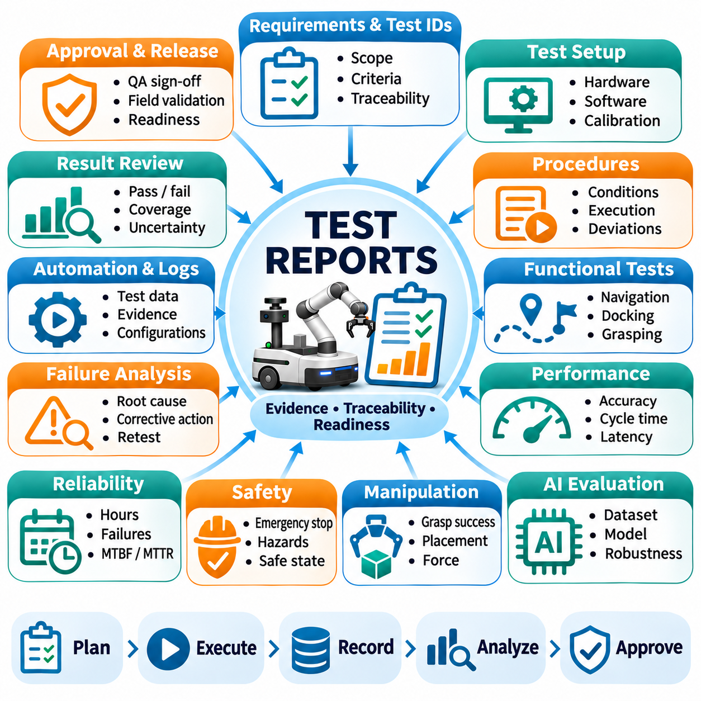{width="7.268055555555556in" height="7.268055555555556in"}

Test reports are structured engineering documents that consolidate verification and validation results obtained throughout the development of a mobile manipulator. They provide objective evidence of system functionality, performance, safety, and reliability under defined testing conditions. Test reports support engineering decisions, requirement compliance assessments, defect management, and the evaluation of overall product readiness.

Test reporting should be aligned with the approved test strategy, test plan, system requirements, and product development objectives. Each report should identify the purpose of testing, applicable requirements, test scope, execution methods, and acceptance criteria. Standardized reporting structures enable engineering teams to maintain consistency and compare results across different development stages and system configurations.

Test identification establishes the relationship between individual test activities and the overall verification framework. Each test report should include unique test identifiers, requirement references, execution dates, responsible personnel, and approval status. These identification elements support requirement traceability, configuration management, document version control, and subsequent engineering investigations.

Test environment documentation describes the physical and computational conditions under which testing was performed. Representative information includes hardware configurations, software versions, firmware revisions, sensor arrangements, calibration parameters, and environmental conditions. Measurement equipment specifications and calibration status should also be recorded to support reproducibility and measurement confidence.

Test procedure documentation describes the execution sequence, initial conditions, input parameters, operational scenarios, and expected system behavior. Differences between approved test procedures and actual execution should be explicitly recorded. Clear procedural documentation enables independent engineers to reproduce experiments, investigate unexpected results, and determine whether the testing methodology remains appropriate.

Functional test reports document whether individual robotic functions satisfy established functional requirements. Representative functions include autonomous navigation, obstacle avoidance, docking, robotic arm control, object recognition, grasping, and mission execution. Each result should include expected behavior, actual behavior, acceptance status, and supporting evidence, including relevant system logs and measurement records.

Performance test reports consolidate quantitative measurements associated with the operational capabilities of the mobile manipulator. Representative indicators include navigation accuracy, positioning repeatability, manipulation cycle time, task success rate, computational latency, energy consumption, and operational throughput. Measured results should be compared with predefined performance requirements and acceptance thresholds.

Artificial intelligence test reports document the predictive performance and operational behavior of deployed machine learning models. Evaluation results should include dataset characteristics, model versions, detection accuracy, pose estimation errors, inference latency, and robustness measurements. Representative failure cases, uncertainty estimates, and computational resource requirements should also be documented to support model improvement.

Manipulation test reports describe the physical execution capabilities of the robotic arm and associated end effectors. Relevant measurements include grasp success rate, placement accuracy, trajectory tracking error, contact force, collision frequency, and task completion time. Reports should identify relationships between manipulation failures, perception errors, mechanical limitations, and mobile platform positioning conditions.

Safety test reports provide documented evidence concerning the effectiveness of implemented protective functions and risk reduction measures. Emergency stop behavior, protective stop response, stopping distance, fault detection, and safe state transitions should be recorded. Safety-related deviations, unresolved hazards, residual risks, and applicable compliance references must be clearly identified for subsequent safety reviews.

Reliability test reports document long-duration operational behavior, accumulated operating hours, completed task cycles, failure events, and maintenance activities. Quantitative results may include failure rates, Mean Time Between Failures (MTBF), Mean Time to Repair (MTTR), and operational availability. Statistical confidence, observation duration, and limitations of the collected evidence should accompany reliability estimates.

Failure documentation is an essential component of test reporting because unsuccessful results provide valuable information for engineering improvements. Each failure record should describe observed symptoms, triggering conditions, affected components, operational consequences, and reproducibility. Root cause analysis, corrective actions, responsible personnel, and retest results should be linked to the original failure record.

Automated test reporting integrates execution logs, measurement data, evaluation metrics, and acceptance decisions into standardized digital records. Continuous integration pipelines, simulation environments, and physical test automation frameworks can generate reports with minimal manual intervention. Automated reporting processes should preserve original evidence and maintain traceability between generated results and test configurations.

Test result analysis should distinguish successful, unsuccessful, blocked, inconclusive, and unexecuted test cases. Overall pass rates should be interpreted together with requirement criticality, test coverage, unresolved defects, and measurement uncertainty. A high aggregate pass rate does not necessarily demonstrate product readiness when critical safety, performance, or functional requirements remain unverified.

Test report review and approval establish formal accountability for verification outcomes and subsequent development decisions. Responsible engineers and quality assurance personnel should examine the completeness, accuracy, and consistency of reported results. Unresolved deviations and outstanding verification activities should be addressed through corrective action plans, additional testing, or formally authorized engineering decisions.

Consolidated test reports provide the technical foundation for field validation, manufacturing readiness, quality assurance, and product qualification. Approved reports should be retained within controlled engineering repositories throughout the product lifecycle. This methodology expands the development manual\'s testing structure into a general reporting framework; project-specific templates, approval responsibilities, and acceptance criteria must be defined separately.
