**Volume 05. Mobile Manipulator Projects and Development Manual**

# Chapter 07. Field Validation

## 01 Field Validation Strategy

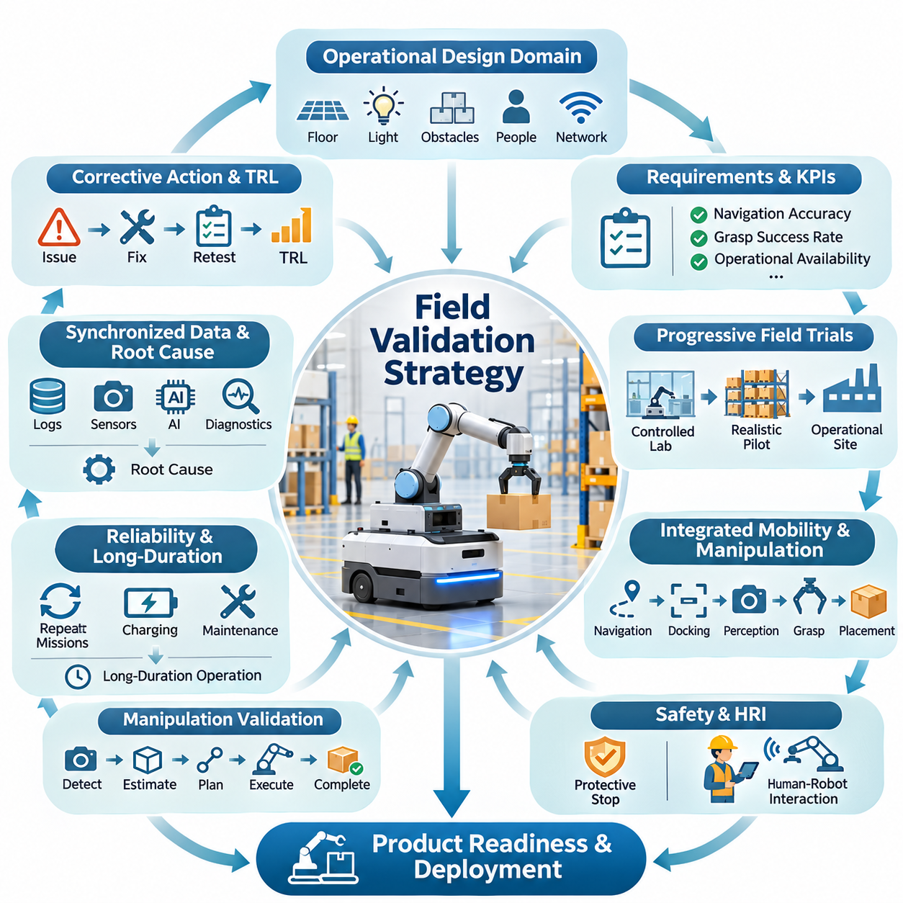{width="7.268055555555556in" height="7.268055555555556in"}

Field validation is the process of confirming that a mobile manipulator performs reliably, safely, and consistently in its intended operational environment. While laboratory testing verifies individual functions and integrated system behavior under controlled conditions, field validation determines whether the complete robot can satisfy real operational requirements. It evaluates the interaction between the autonomous mobile robot (AMR), manipulator, perception system, artificial intelligence, task planner, human operators, and surrounding infrastructure.

The primary objective of a field validation strategy is to establish measurable evidence that the developed system is ready for practical deployment. Validation should demonstrate that the robot can navigate through representative environments, identify and manipulate target objects, complete assigned tasks, recover from operational disturbances, and maintain acceptable performance over extended periods. These activities must be evaluated against the original product requirements and operational scenarios rather than relying only on successful demonstrations.

Field validation should begin with a clear definition of the operational domain. The operational design domain (ODD) describes the physical, environmental, and procedural conditions under which the mobile manipulator is expected to operate. Relevant characteristics include floor conditions, workspace dimensions, lighting, object locations, obstacle distributions, communication availability, human activity, and environmental disturbances. Defining these conditions establishes the boundaries within which validation results can be considered representative.

A validation strategy should connect system requirements with practical evaluation scenarios and measurable acceptance criteria. Navigation accuracy, localization stability, obstacle avoidance, manipulation precision, grasp success rate, task completion time, and operational availability are examples of relevant performance indicators. Each indicator should have a defined measurement method, evaluation period, and acceptance threshold. This approach prevents subjective judgments from replacing objective engineering evidence and provides traceability between product specifications and field performance.

The validation process should progress from controlled environments toward increasingly complex operational conditions. Initial activities can be conducted in a representative test facility where environmental variables are known and repeatable. Subsequent evaluations should introduce realistic workspace layouts, dynamic obstacles, variations in object placement, and interactions with human operators. This progressive approach allows engineering teams to identify performance limitations before exposing the complete system to demanding production environments.

Mobile manipulation requires particular attention to the relationship between vehicle positioning and manipulator accuracy. Unlike stationary industrial robots, a mobile manipulator must establish a sufficiently accurate base position before executing manipulation tasks. Localization errors, chassis vibration, wheel slip, floor irregularities, and mechanical deflection can influence the final end-effector position. Field validation should therefore evaluate the complete positioning chain, including navigation, docking, base stabilization, arm motion, and tool alignment.

Perception and artificial intelligence must also be evaluated under actual operating conditions. Camera exposure, illumination changes, reflective surfaces, occlusion, object variation, and background complexity can influence detection and pose estimation performance. A model that performs well on a prepared dataset may behave differently when encountering unfamiliar objects or changing environmental conditions. Validation should therefore include representative variations and record both successful predictions and failure cases to determine whether the AI subsystem satisfies its intended operational requirements.

Manipulation validation should examine complete task execution rather than evaluating grasping accuracy in isolation. A successful operation may require object detection, pose estimation, grasp planning, arm trajectory generation, contact establishment, object handling, and placement at a designated destination. Failures can originate from any stage or from interactions between stages. Recording intermediate execution results helps engineers distinguish perception errors, planning limitations, mechanical inaccuracies, and control instability.

Safety validation must be integrated throughout field activities. The robot should demonstrate appropriate responses to unexpected obstacles, human presence, restricted areas, communication interruptions, emergency stop activation, and abnormal mechanical conditions. Particular attention should be given to situations where the mobile base and manipulator operate simultaneously. Validation should confirm that protective functions remain effective during navigation, arm movement, object handling, docking, and recovery procedures.

Human-robot interaction (HRI) is another important dimension of field validation. In practical environments, operators may approach the robot, change task priorities, interrupt operations, request assistance, or introduce objects into the workspace. The system should communicate its operating state clearly and respond predictably to authorized human commands. Validation should examine whether operators can understand robot intentions, recognize abnormal conditions, and safely resume interrupted tasks without requiring unnecessary technical intervention.

Reliability must be assessed through repeated operation rather than isolated successful demonstrations. Field trials should include continuous missions, repeated manipulation cycles, charging operations, automatic recovery, and scheduled maintenance activities. Engineers should record unexpected stops, localization losses, communication failures, manipulation errors, software exceptions, and component degradation. These observations provide evidence about operational availability and reveal failure patterns that may not appear during short-duration laboratory testing.

Operational data collection should be designed as a fundamental part of the validation strategy. Robot logs, sensor recordings, navigation trajectories, manipulation results, AI inference outputs, system diagnostics, and operator feedback should be collected using synchronized timestamps and consistent data formats. This information supports root cause analysis, performance comparisons, and software improvement. Data collection procedures should also consider storage capacity, privacy requirements, network limitations, and the protection of customer operational information.

The validation team should establish a controlled procedure for handling failures and unexpected behavior. Each observed issue should be recorded with its operating conditions, system configuration, reproduction steps, severity, and potential impact. Engineering teams should classify problems according to their origin, such as mechanical design, electrical integration, perception, AI inference, motion planning, control, communication, or operational procedures. Corrective actions should be verified through repeated testing before the corresponding issue is considered resolved.

Field validation should also consider differences between deployment environments. Warehouse operations, factory automation, hospital logistics, and service robotics involve different workspace characteristics, safety expectations, object distributions, and human interaction patterns. A validation strategy should therefore define common system-level performance requirements while allowing environment-specific test scenarios. This approach provides a consistent engineering framework without assuming that successful operation in one application automatically guarantees suitability for another.

The relationship between field validation and technology readiness level (TRL) should be explicitly established. Laboratory demonstrations and controlled integration tests provide evidence for earlier development stages, whereas representative operational trials demonstrate whether the technology can perform under realistic conditions. Repeated pilot deployments, documented performance improvements, and stable long-duration operation contribute to higher technology readiness. However, a higher TRL should be assigned only when the required evidence has been collected and evaluated against the relevant assessment criteria.

Field validation results should ultimately support engineering decisions concerning product readiness, design modification, and commercialization. A system that meets its functional requirements but requires frequent manual intervention may not yet be suitable for practical deployment. Similarly, a robot that achieves high task accuracy but cannot maintain sufficient operational availability may fail to deliver the expected productivity benefits. Validation must therefore consider technical performance, operational effectiveness, safety, maintainability, and deployment feasibility together.

A complete field validation strategy should produce reproducible evidence that connects operational requirements, test scenarios, measured results, identified limitations, and corrective actions. The resulting documentation provides a technical foundation for pilot deployment decisions, customer acceptance, manufacturing preparation, and subsequent quality assurance activities. By treating field validation as a structured engineering process rather than a final demonstration, development teams can reduce deployment risks and establish a reliable transition from prototype development to commercially deployable mobile manipulation systems.

## 02 Pilot Deployments

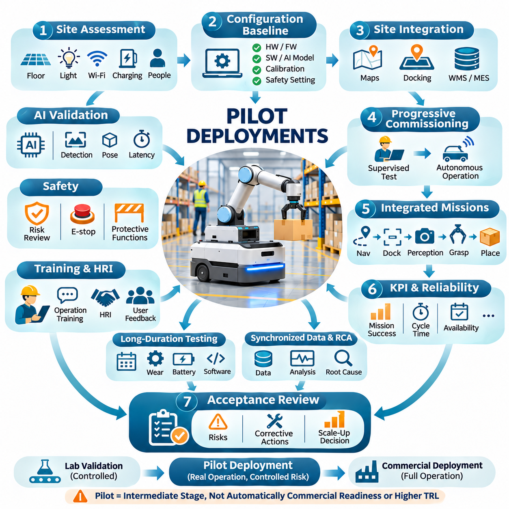{width="7.268055555555556in" height="7.268055555555556in"}

Pilot deployment represents an intermediate stage between controlled engineering validation and full commercial deployment of a mobile manipulator. Its primary purpose is to evaluate system capabilities within an actual operational environment while maintaining controlled exposure to technical and operational risks. Unlike laboratory demonstrations, pilot deployments involve real infrastructure, representative workloads, operational personnel, and environmental variations that influence overall robotic performance.

A pilot deployment should begin with clearly defined objectives derived from product requirements, customer expectations, and operational scenarios. These objectives should establish the functions to be demonstrated, the performance levels to be achieved, and the limitations to be investigated. The deployment scope should also define the number of robots, operating locations, mission types, evaluation periods, and responsibilities of participating organizations to prevent uncontrolled expansion of project requirements.

Site selection is a fundamental consideration in pilot deployment planning. The selected environment should represent the intended commercial application while providing sufficient accessibility for engineering support and operational monitoring. Warehouses, manufacturing facilities, hospitals, and commercial service environments present different infrastructure requirements and operational challenges. A preliminary site assessment should examine floor conditions, workspace layouts, lighting, wireless communication coverage, charging infrastructure, and human activity.

Before deployment, the engineering team should establish a controlled system configuration that includes hardware revisions, firmware versions, software packages, AI models, calibration parameters, and safety settings. This configuration baseline provides a reference for subsequent performance evaluation and failure analysis. Any modifications introduced during the pilot program should be documented through configuration management procedures to maintain traceability and prevent inconsistent validation results.

Site preparation involves integrating the mobile manipulator with the existing operational infrastructure. Navigation maps, localization references, docking stations, charging facilities, restricted zones, and manipulation workstations must be established and verified. Communication interfaces with warehouse management systems, manufacturing execution systems, fleet management platforms, and external equipment should be evaluated where applicable. These preparations ensure that the robot can participate in actual workflows without disrupting essential operations.

Pilot deployments should follow a progressive commissioning process that gradually increases operational complexity. Initial activities may include supervised navigation, localization verification, docking accuracy measurements, and basic manipulation tasks. Subsequent stages can introduce autonomous mission execution, dynamic obstacles, variable object positions, and interactions with surrounding equipment. Progression between stages should depend on predefined safety and performance criteria rather than schedule pressure.

Integrated mission execution is particularly important for mobile manipulators because navigation and manipulation must operate as coordinated processes. A representative mission may involve traveling to a workstation, establishing an accurate docking position, detecting a target object, generating a manipulation trajectory, executing a grasp, transporting the object, and completing placement. Pilot evaluation should examine the entire mission sequence, including transitions between individual subsystems and recovery from unsuccessful operations.

Artificial intelligence performance should be evaluated using data collected from the actual deployment environment. Variations in illumination, object appearance, background complexity, occlusion, and sensor quality may reveal limitations that were not identified during laboratory testing. Engineers should monitor object detection accuracy, pose estimation errors, grasp prediction reliability, inference latency, and confidence distributions. Identified weaknesses should guide controlled dataset expansion and subsequent model improvement.

Safety management must remain a primary requirement throughout pilot deployment. Before autonomous operation begins, site-specific risk assessments should identify potential hazards associated with vehicle movement, manipulator trajectories, object handling, human proximity, and unexpected system failures. Protective functions, emergency stops, speed restrictions, collision prevention mechanisms, and safe recovery procedures must be verified. Operational boundaries should only be expanded after appropriate safety reviews and authorization.

Operational personnel should receive appropriate training before participating in pilot activities. Training should cover normal robot operation, mission assignment, status monitoring, emergency procedures, fault identification, and authorized recovery actions. Human-robot interaction should also be evaluated to determine whether operators can understand system behavior and respond effectively to unexpected events. Operator feedback provides valuable information about usability, workflow compatibility, and practical maintenance requirements.

Operational performance should be measured through predefined key performance indicators (KPIs). Relevant indicators include mission success rate, grasp success rate, docking accuracy, manipulation precision, average cycle time, operational availability, intervention frequency, energy consumption, and recovery success rate. Measurements should distinguish autonomous task completion from operations requiring human assistance. Consistent evaluation methods and representative workloads are necessary for meaningful comparisons between pilot stages.

Long-duration pilot operation provides evidence concerning system reliability, component durability, and operational stability. Repeated navigation and manipulation cycles can reveal mechanical wear, thermal limitations, battery degradation, calibration drift, communication instability, and software resource consumption. Automated charging and mission resumption should also be examined. Maintaining records of operating hours, completed missions, failures, and maintenance activities supports reliability and lifecycle assessments.

Operational data collection should support continuous engineering improvement throughout the pilot deployment. Time-synchronized sensor data, robot trajectories, AI inference results, controller states, diagnostic messages, mission histories, and operator interventions should be recorded where appropriate. Failure events should be associated with environmental conditions and system configurations. This information enables root cause analysis, regression testing, and systematic improvements across hardware, software, and AI subsystems.

Pilot deployment results should be reviewed through formal acceptance and readiness assessments involving engineering teams, operational personnel, and customer representatives. Unresolved issues should be classified according to severity, operational impact, and corrective action requirements. Successful completion of a pilot program does not automatically establish commercial readiness or a higher technology readiness level (TRL). Final decisions should consider documented validation evidence, remaining risks, operational economics, maintainability, and the feasibility of scaling deployment across multiple sites.

## 03 Warehouse Validation

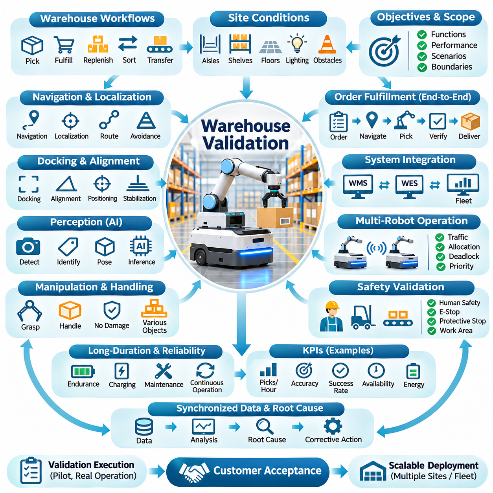{width="7.268055555555556in" height="7.268055555555556in"}

Warehouse validation is the process of evaluating the operational suitability of mobile manipulators within logistics and distribution environments. Unlike controlled laboratory testing, warehouse validation exposes the integrated robotic system to practical material handling requirements, dynamic traffic conditions, continuously changing inventory, and interactions with human workers. The objective is to determine whether autonomous navigation and manipulation can reliably support existing warehouse operations.

The validation process should begin with an analysis of warehouse workflows and operational requirements. Typical applications include item picking, order fulfillment, inventory replenishment, tote transportation, product sorting, and material transfer between workstations. Each application introduces different requirements for navigation accuracy, manipulation capability, payload handling, and task execution. Representative operational scenarios should be selected according to the intended application and customer requirements.

The physical characteristics of the warehouse must be evaluated before autonomous operation begins. Aisle widths, shelving configurations, floor conditions, storage heights, lighting variations, loading areas, and temporary obstacles can significantly influence system performance. The validation team should establish operational boundaries that define accessible workspaces, permissible travel routes, manipulation zones, charging locations, and areas requiring additional safety precautions.

Navigation validation should examine the ability of the mobile platform to move reliably through representative warehouse environments. The robot must maintain localization accuracy while navigating narrow aisles, intersections, storage areas, and dynamically changing surroundings. Repetitive shelving structures and changes in inventory distribution may introduce localization ambiguity. Validation should measure navigation success, route efficiency, positioning errors, obstacle avoidance, and recovery from localization failures.

Docking and workstation alignment are particularly important because manipulation accuracy depends on the relative position between the robotic arm and the target workspace. Small positioning errors at the mobile base can propagate through the manipulation system and reduce grasping reliability. Validation should measure docking repeatability, angular alignment, base stabilization, and end-effector positioning accuracy under different payload conditions, approach directions, and floor characteristics.

Warehouse perception systems must demonstrate reliable object detection, identification, and pose estimation under realistic storage conditions. Products may vary in dimensions, packaging materials, colors, textures, and surface reflectivity. Objects can also be partially occluded, tightly packed, or positioned irregularly. Validation should examine perception accuracy, depth measurement quality, inference latency, and model robustness across representative product categories and environmental variations.

Manipulation validation should evaluate the complete handling process for representative warehouse inventory. The robot must identify target objects, generate feasible grasp configurations, execute collision-free trajectories, establish stable contact, and transfer products without causing damage. Validation should include objects with different weights, geometries, surface materials, and packaging characteristics. Grasp success rates and handling failures should be analyzed according to object categories and operating conditions.

Integrated order fulfillment validation should examine complete missions from task assignment to successful product delivery. A representative mission may require receiving an order, navigating to a storage location, identifying the requested item, performing a grasp, verifying product identity, and transporting the item to a designated station. The system should maintain accurate task states and inventory records throughout execution while detecting and recovering from incomplete or incorrect operations.

Integration with warehouse management systems (WMS), warehouse execution systems (WES), and fleet management platforms is essential for coordinated operation where these systems are present. Validation should confirm that task requests, inventory information, robot status, mission progress, and completion notifications are exchanged consistently. Communication interruptions, duplicate commands, delayed responses, and inconsistent inventory records should be examined to verify reliable synchronization and recovery behavior.

Multi-robot operation introduces additional challenges involving traffic coordination, shared workspaces, resource allocation, and task scheduling. Multiple mobile manipulators may compete for narrow aisles, picking stations, elevators, or charging facilities. Validation should evaluate congestion management, conflict resolution, deadlock prevention, and priority handling. Fleet-level performance must be assessed separately from individual robot performance to identify limitations affecting deployment scalability.

Safety validation must address interactions between mobile manipulators, warehouse workers, forklifts, conveyors, and other automated equipment. Particular attention should be given to manipulator movement beyond the mobile platform footprint, unstable payloads, unexpected pedestrian movements, and restricted visibility. Protective stopping functions, emergency stop mechanisms, speed limitations, and workspace restrictions should be verified under representative operating conditions before expanding autonomous activities.

Warehouse environments frequently require continuous operation across multiple shifts. Long-duration validation should examine battery endurance, automatic charging, thermal stability, mechanical wear, calibration drift, and software reliability. Repeated picking and transportation cycles may expose failures that remain undetected during short demonstrations. Operational availability, mean time between failures, maintenance frequency, and recovery duration should be recorded throughout extended validation periods.

Performance evaluation should rely on predefined key performance indicators (KPIs) that reflect both robotic capabilities and warehouse productivity. Relevant indicators include items picked per hour, order completion time, mission success rate, picking accuracy, grasp success rate, intervention frequency, operational availability, and energy consumption per completed mission. Measurements should distinguish successful autonomous operations from tasks completed with human assistance or additional corrective actions.

Operational data collection provides the foundation for identifying performance bottlenecks and improving warehouse automation systems. Navigation trajectories, sensor recordings, perception outputs, grasping results, task execution histories, system diagnostics, and operator feedback should be collected with synchronized timestamps. Failure events should be associated with product characteristics, environmental conditions, and system configurations to support root cause analysis and reproducible regression testing.

Warehouse validation should ultimately determine whether mobile manipulators provide sustainable operational and economic benefits. Productivity improvements must be evaluated alongside infrastructure costs, maintenance requirements, inventory accuracy, system availability, and remaining safety risks. Documented validation results should establish the conditions required for customer acceptance, operational expansion, manufacturing preparation, and the transition from pilot deployment to scalable commercial warehouse automation.

## 04 Factory Validation

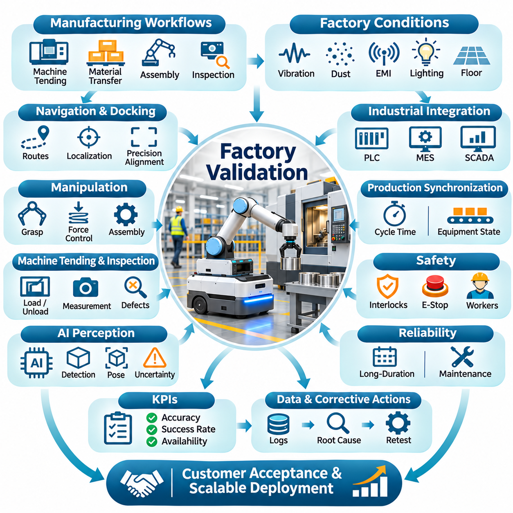{width="7.268055555555556in" height="7.268055555555556in"}

Factory validation is the process of evaluating whether a mobile manipulator can operate reliably, safely, and effectively within an actual manufacturing environment. Unlike laboratory testing, factory validation exposes the integrated robotic system to industrial workloads, production schedules, machinery, environmental disturbances, and human operators. Its primary objective is to establish practical evidence that mobile manipulation can support manufacturing operations without compromising production stability.

The validation process should begin with an analysis of manufacturing workflows and production requirements. Representative applications include machine tending, component transportation, assembly assistance, automated inspection, material feeding, and finished product handling. Each application introduces different requirements for positioning accuracy, manipulation precision, operational timing, and equipment coordination. Validation scenarios should reflect actual manufacturing processes and customer expectations.

Factory environments introduce physical and environmental challenges that may significantly influence robotic performance. Floor irregularities, industrial vibration, electromagnetic interference, airborne particles, temperature variations, and changing illumination conditions should be considered during validation. Engineering teams must evaluate whether mechanical structures, electrical systems, sensors, and computing platforms can maintain their intended performance within the specified operating conditions.

Navigation validation should demonstrate that the mobile platform can operate reliably around production equipment, assembly lines, storage areas, and moving industrial vehicles. Dynamic obstacles and changes in factory layouts may affect localization accuracy and path planning performance. Validation should examine navigation repeatability, route completion time, obstacle avoidance, localization recovery, and the ability to maintain predictable movement within designated production areas.

Precision docking and workstation alignment are fundamental requirements for manufacturing applications involving mobile manipulators. Machine tending, component insertion, and automated inspection may require positioning accuracy significantly greater than that achieved through conventional autonomous navigation. Validation should evaluate the combined effects of mobile base positioning, local reference measurements, coordinate transformations, mechanical deflection, and manipulator repeatability.

Manipulation validation should examine the ability of the robotic arm to perform industrial tasks under representative production conditions. Components may vary in geometry, weight, orientation, dimensional tolerance, and surface characteristics. The robot must generate feasible grasp configurations, execute collision-free trajectories, and maintain stable object handling. Force control and compliant manipulation should also be evaluated for tasks involving mechanical contact or precision assembly.

Machine tending validation should examine the complete interaction between the mobile manipulator and manufacturing equipment. Typical operations include loading raw materials, removing processed components, opening machine doors, and exchanging fixtures. The robot must coordinate its movements with machine operating states and authorized access conditions. Communication failures, incomplete loading operations, and unexpected machine stops should be included in controlled recovery scenarios.

Automated inspection applications require validation of both robotic positioning and measurement performance. A mobile manipulator carrying cameras, laser scanners, or other inspection sensors must maintain appropriate measurement distances, viewing angles, and positional stability. Validation should examine inspection repeatability, measurement uncertainty, defect detection accuracy, and coverage completeness. Recorded inspection results should also remain traceable to individual products and production records.

Artificial intelligence validation must consider variations in actual manufacturing conditions. Reflective metal surfaces, visually similar components, partial occlusion, changing backgrounds, and inconsistent illumination can influence perception performance. Engineers should evaluate object detection, pose estimation, defect recognition, and inference latency using representative production data. Uncertain predictions should trigger appropriate fallback procedures instead of uncontrolled physical actions.

Integration with industrial automation systems is essential for coordinated factory operation. Mobile manipulators may communicate with programmable logic controllers (PLCs), manufacturing execution systems (MES), supervisory control and data acquisition (SCADA) systems, and fleet management platforms. Validation should confirm reliable command exchange, equipment state synchronization, task authorization, completion reporting, and recovery from interrupted or inconsistent communication.

Production synchronization should be evaluated to determine whether mobile manipulators can satisfy manufacturing cycle time requirements. Delayed material delivery, inaccurate component placement, or prolonged recovery procedures may create production bottlenecks. Validation should measure task execution time, waiting time, equipment utilization, and coordination delays. Performance should remain acceptable during representative workload fluctuations and changes in production priorities.

Safety validation must address hazards arising from interactions between mobile robots, industrial machinery, human workers, and transported components. Particular attention should be given to extended manipulator workspaces, moving equipment, suspended payloads, and restricted visibility. Protective stopping functions, safety interlocks, emergency stops, speed restrictions, and authorized restart procedures must be verified according to the application-specific risk assessment.

Long-duration factory operation provides important evidence concerning mechanical durability, electrical reliability, thermal stability, and software robustness. Repeated transportation and manipulation cycles may reveal actuator wear, connector degradation, battery deterioration, calibration drift, or computing resource limitations. Validation should record operating hours, completed production tasks, unexpected failures, charging cycles, maintenance activities, and the time required to restore normal operation.

Factory performance should be evaluated through predefined key performance indicators (KPIs), including mission success rate, docking accuracy, manipulation precision, production cycle time, operational availability, and intervention frequency. Additional indicators may include first-pass assembly success, inspection accuracy, equipment waiting time, and energy consumption per completed task. Measurements should distinguish autonomous operation from activities requiring manual assistance.

Operational data collection should establish traceability between manufacturing conditions, robotic actions, and production outcomes. Time-synchronized sensor recordings, navigation trajectories, manipulator states, AI inference results, equipment signals, and diagnostic records provide evidence for systematic failure analysis. Controlled corrective actions and regression testing should confirm that system modifications improve performance without introducing unacceptable operational risks.

Factory validation should ultimately determine whether mobile manipulators provide sustainable manufacturing benefits while satisfying technical, safety, and economic requirements. Productivity improvements must be considered alongside integration costs, maintenance requirements, system availability, and production quality. Documented validation results should support customer acceptance, technology readiness assessment, manufacturing preparation, and expansion toward scalable industrial deployment.

## 05 Hospital Validation

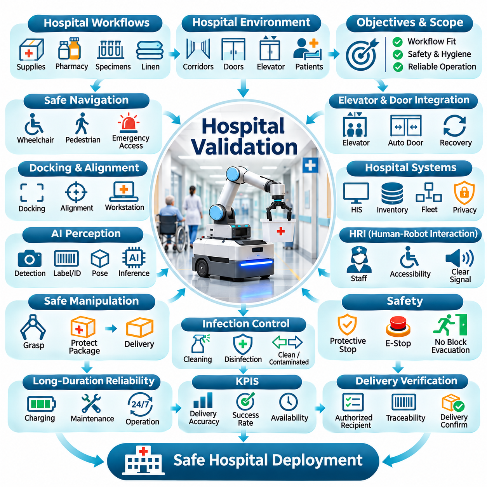{width="7.268055555555556in" height="7.268055555555556in"}

Hospital validation is the process of evaluating whether mobile manipulators can operate safely, reliably, and effectively within healthcare environments. Unlike warehouse and factory applications, hospitals involve vulnerable patients, medical personnel, sensitive equipment, strict hygiene requirements, and continuously changing operational conditions. Validation must demonstrate that robotic systems can support healthcare workflows without compromising patient safety or clinical operations.

The validation process should begin with an analysis of hospital workflows and operational requirements. Representative applications include medical supply transportation, pharmaceutical distribution, laboratory specimen delivery, linen handling, and automated inventory replenishment. Each application introduces different requirements for navigation, manipulation, hygiene, accessibility, and delivery accuracy, which must be reflected in representative validation scenarios.

Hospital environments present unique physical and operational challenges. Narrow corridors, automatic doors, elevators, patient rooms, nursing stations, and crowded waiting areas may influence robotic performance. Validation should examine floor transitions, accessibility constraints, communication coverage, and dynamic pedestrian traffic. Operational boundaries must clearly distinguish authorized robotic workspaces from restricted clinical and emergency areas.

Navigation validation should evaluate the ability of the mobile platform to move predictably through shared hospital environments. Patients using wheelchairs, medical personnel transporting equipment, and pedestrians with limited mobility may exhibit unpredictable movement patterns. The robot must maintain localization accuracy, appropriate separation distances, and safe travel speeds while accommodating changing traffic conditions and emergency access requirements.

Elevator and automatic door integration is particularly important for hospital robots operating across multiple floors. Validation should examine the complete sequence of requesting elevator services, entering the elevator, selecting destinations, exiting safely, and continuing assigned missions. Communication interruptions, unexpected occupancy, unavailable elevators, and door closing events should be included in controlled recovery scenarios.

Precision docking and workstation alignment must be validated at medical supply stations, storage cabinets, laboratory interfaces, and charging facilities. Positioning errors may reduce manipulation accuracy or interfere with surrounding medical equipment. Engineers should evaluate docking repeatability, angular alignment, base stabilization, and relative positioning between the manipulator and target workspace under representative operating conditions.

Perception and artificial intelligence validation should address the visual complexity of healthcare environments. Medical containers, transparent packaging, reflective instruments, labels, and visually similar pharmaceutical products may challenge object recognition. Validation should examine object detection accuracy, identification reliability, pose estimation, inference latency, and uncertainty handling to prevent incorrect or unauthorized physical actions.

Manipulation validation should evaluate the complete handling process for representative medical objects and supplies. The robot must grasp, transport, and place items without damaging packaging, contaminating protected surfaces, or compromising container integrity. Different object geometries, weights, materials, and fragility levels should be included. Handling procedures must also preserve required object orientations and storage conditions.

Infection prevention and hygiene management are essential components of hospital validation. Robotic surfaces, grippers, wheels, and storage compartments may become potential sources of cross-contamination. Validation should examine material compatibility with approved cleaning agents, accessibility for disinfection, cleaning effectiveness, and separation between clean and contaminated workflows. Procedures should follow the hospital\'s infection control requirements.

Human-robot interaction is especially important because hospital robots operate near individuals with diverse physical and cognitive abilities. The system should communicate its intentions through understandable visual or auditory signals without unnecessarily disturbing patients. Validation should examine pedestrian responses, operator interactions, accessibility, perceived safety, and the ability of medical personnel to interrupt or redirect robotic operations.

Safety validation must address hazards associated with mobile platforms, extended manipulator workspaces, transported medical supplies, and unexpected human movements. Protective stopping functions, emergency stop mechanisms, speed restrictions, collision avoidance, and safe restart procedures should be verified. Autonomous activities must not obstruct emergency evacuation routes, patient transportation, or access to critical medical equipment.

Integration with hospital information systems (HIS), inventory management platforms, building automation systems, and fleet management software may be necessary for coordinated operation. Validation should confirm reliable task assignment, delivery authorization, destination verification, status reporting, and transaction recording. Cybersecurity and patient privacy requirements must be considered when exchanging or storing operational information.

Medical logistics validation should examine complete missions from supply requests to confirmed delivery. Incorrect destinations, misidentified products, damaged containers, and incomplete handovers may create significant operational risks. The robot should maintain traceable task records and verify delivery completion through approved identification or confirmation mechanisms. Exceptional conditions must trigger controlled recovery or authorized human intervention.

Long-duration hospital operation should evaluate battery endurance, automatic charging, thermal stability, mechanical durability, calibration drift, and software reliability. Continuous operation across daytime and nighttime shifts may reveal different environmental and communication challenges. Validation should also examine whether charging, maintenance, and recovery activities can be performed without disrupting essential healthcare services.

Hospital performance should be evaluated through predefined key performance indicators (KPIs), including mission success rate, delivery accuracy, average delivery time, grasp success rate, operational availability, and intervention frequency. Additional indicators may include hygiene compliance, workflow disruption, and staff workload reduction. Operational data should support failure analysis while respecting applicable privacy and data protection requirements.

Hospital validation should ultimately determine whether mobile manipulators provide sustainable operational benefits without introducing unacceptable risks to patients or healthcare personnel. Documented results should support customer acceptance, technology readiness assessment, corrective actions, and controlled deployment expansion. Acceptance thresholds and regulatory obligations must be defined according to the intended use, applicable jurisdiction, and hospital-specific requirements.

## 06 Service Robot Validation

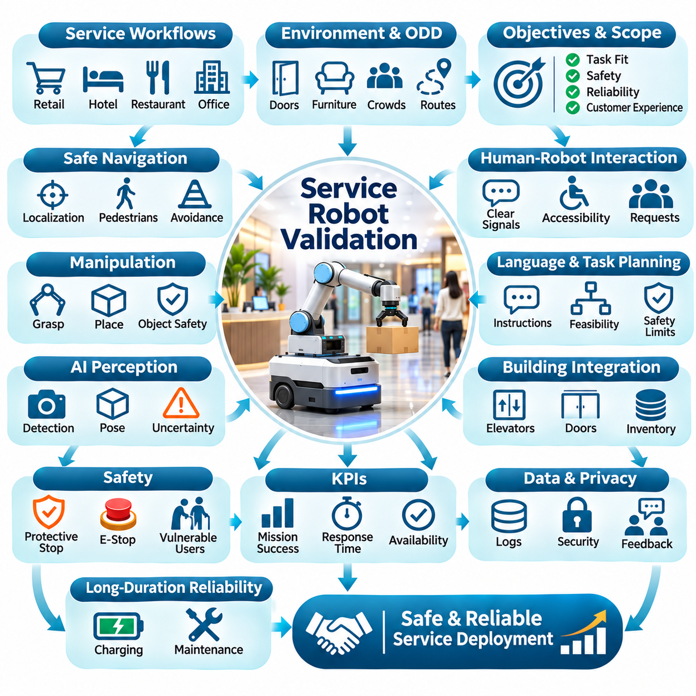{width="7.268055555555556in" height="7.268055555555556in"}

Service robot validation evaluates whether mobile manipulators can perform practical service tasks safely, reliably, and effectively within human-centered environments. Unlike industrial applications, service robots frequently operate in public or semi-public spaces where environmental conditions and human behavior are less predictable. Validation must establish that autonomous navigation, manipulation, and interaction capabilities satisfy the intended service requirements.

The validation process should begin with an analysis of service workflows and customer expectations. Representative applications include retail assistance, shelf replenishment, hotel deliveries, restaurant logistics, office material transportation, and facility management. Each application introduces different requirements for mobility, manipulation, accessibility, and interaction. Validation scenarios should reflect actual service conditions and expected variations in customer demand.

Physical environment assessment is essential because service robots operate across diverse architectural layouts and infrastructure conditions. Doorways, narrow passages, furniture arrangements, floor transitions, temporary obstacles, and crowded public areas may influence operational performance. Engineers should establish the operational design domain, including permissible travel routes, manipulation zones, environmental limitations, and areas requiring additional safety precautions.

Navigation validation should examine the ability of mobile manipulators to move safely and predictably through dynamic service environments. Pedestrians may suddenly change direction, stop unexpectedly, or approach the robot without understanding its intended movements. Validation should evaluate localization accuracy, obstacle avoidance, trajectory smoothness, safe separation distances, and recovery behavior under different pedestrian densities and environmental conditions.

Manipulation validation should evaluate the ability of the robotic arm to handle objects commonly encountered during service operations. Representative objects may include packaged products, containers, trays, documents, and personal belongings. Variations in object geometry, weight, material, and placement should be incorporated into validation scenarios. Grasp stability, placement accuracy, object integrity, and collision-free movement must be assessed throughout complete handling cycles.

Perception and artificial intelligence validation should consider the visual diversity of service environments. Changing illumination, reflective surfaces, unfamiliar objects, cluttered backgrounds, and partial occlusion may reduce perception reliability. Engineers should evaluate object detection, pose estimation, semantic recognition, and inference latency. Uncertain predictions must activate predefined fallback mechanisms rather than initiate potentially unsafe manipulation activities.

Human-robot interaction is a fundamental component of service robot validation. Unlike trained industrial operators, customers and visitors may have limited knowledge of robotic systems. The robot should communicate its intentions, operational status, and service availability through understandable visual, auditory, or conversational interfaces. Validation should examine interaction clarity, response consistency, accessibility, and the handling of unexpected human requests.

Service task validation should evaluate complete operational sequences rather than isolated robotic capabilities. A representative retail mission may involve receiving a replenishment request, navigating to a storage area, identifying the requested product, executing a grasp, transporting the product, and placing it at the designated location. Each stage should be evaluated for execution accuracy, transition reliability, task completion, and recovery from unsuccessful operations.

Conversational interfaces and AI-based task planning introduce additional validation requirements. Service robots may interpret natural language instructions through large language models, vision-language models, or robotic agents. Validation should examine instruction understanding, task feasibility assessment, contextual accuracy, and authorization boundaries. AI-generated instructions must remain subject to deterministic execution constraints and independent safety mechanisms.

Safety validation must address risks associated with public interaction, vehicle movement, extended manipulator workspaces, and transported objects. Children, elderly individuals, and people with disabilities may approach the robot unexpectedly or respond differently to its movement. Protective stopping functions, emergency stops, speed restrictions, workspace limitations, and safe recovery procedures must be verified according to application-specific risk assessments.

Service robots may require integration with building automation systems, elevator controllers, automatic doors, inventory platforms, and customer service applications. Validation should confirm reliable command exchange, destination verification, task synchronization, and completion reporting. Network interruptions, delayed responses, unavailable infrastructure, and conflicting requests should be included in controlled failure and recovery scenarios.

Long-duration service operation should evaluate mechanical durability, battery endurance, thermal stability, calibration drift, and software reliability. Service demand may fluctuate significantly throughout operating hours, creating alternating periods of continuous activity and standby operation. Validation should examine automatic charging, mission resumption, resource consumption, and maintenance requirements under representative daily operating schedules.

Operational performance should be evaluated through predefined key performance indicators (KPIs), including mission success rate, service completion time, navigation reliability, grasp success rate, operational availability, and human intervention frequency. Additional indicators may include customer satisfaction, interaction success, waiting time, and service request accuracy. Autonomous task completion should be distinguished from operations requiring manual assistance.

Operational data collection should support systematic evaluation and continuous service improvement. Robot trajectories, perception outputs, manipulation results, interaction histories, system diagnostics, and customer feedback should be associated with relevant operating conditions. Data collection must comply with applicable privacy and security requirements, particularly when cameras, microphones, or conversational interfaces capture information in publicly accessible environments.

Service robot validation should ultimately determine whether mobile manipulators provide sustainable operational, economic, and customer experience benefits. Evaluation must consider service quality, labor efficiency, infrastructure costs, maintenance requirements, accessibility, and residual safety risks. Documented validation evidence should establish application-specific acceptance criteria and support technology readiness assessment, customer acceptance, and controlled commercial deployment.

## 07 HRI Validation

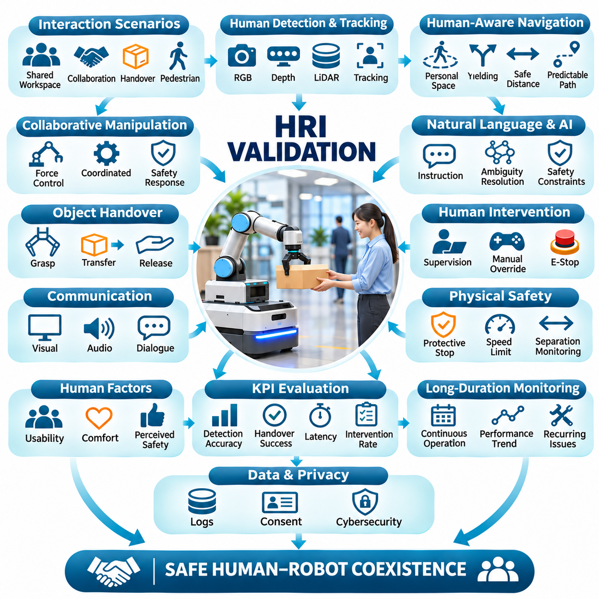{width="7.268055555555556in" height="7.268055555555556in"}

Human-robot interaction (HRI) validation is the process of evaluating whether mobile manipulators can interact with humans safely, effectively, and predictably within actual operating environments. Unlike conventional industrial robots operating within isolated workspaces, mobile manipulators frequently share physical spaces with human workers, customers, and visitors. Validation must address both technical performance and human-centered operational requirements.

The validation process should begin with an analysis of interaction scenarios and human behavioral characteristics. Representative scenarios include shared workspace operation, collaborative manipulation, object handover, pedestrian encounters, task instruction, and human intervention during autonomous missions. Each scenario introduces different requirements for communication, spatial awareness, response time, operational predictability, and physical safety.

Human detection and tracking are fundamental capabilities for reliable human-robot interaction. Mobile manipulators may utilize RGB cameras, depth cameras, LiDAR sensors, and multimodal perception systems to identify surrounding individuals and estimate their movements. Validation should examine detection accuracy, tracking continuity, distance estimation, and robustness against partial occlusion, changing illumination, crowded environments, and sensor degradation.

Human-aware navigation validation should evaluate the ability of mobile manipulators to move naturally and safely within shared environments. The robot must consider human movement trajectories, personal space, pedestrian priorities, and potential interaction conflicts. Validation should examine path predictability, approach behavior, safe separation distances, yielding strategies, and the ability to respond appropriately to unexpected human movements.

Collaborative manipulation validation should assess interactions between human operators and robotic manipulators within shared workspaces. Representative operations may include component delivery, cooperative assembly, tool exchange, and workstation assistance. Engineers should evaluate trajectory coordination, workspace limitations, force control, motion predictability, and protective responses when humans approach or enter the manipulator\'s active workspace.

Object handover validation is particularly important for mobile manipulators designed to transfer physical objects directly between humans and robots. The system must identify appropriate handover positions, maintain grasp stability, and determine when the receiving individual has securely obtained the object. Validation should examine transfer timing, release conditions, object integrity, unsuccessful handover recovery, and variations in human reaching behavior.

Communication validation should evaluate the effectiveness of visual, auditory, tactile, and conversational interfaces used during human-robot interaction. Indicators, display panels, warning sounds, and spoken messages should communicate operational status and intended actions clearly. The system must provide understandable feedback when accepting commands, executing tasks, encountering errors, or requesting assistance from human operators.

Natural language interaction introduces additional validation requirements for mobile manipulators equipped with intelligent conversational interfaces. Large language models, vision-language models, and robotic agents may interpret human instructions and generate task sequences. Validation should examine instruction accuracy, contextual understanding, ambiguity resolution, authorization boundaries, and the rejection of unsafe or physically infeasible requests.

Human intervention and supervisory control should be validated to ensure that authorized individuals can interrupt, modify, or terminate autonomous operations when necessary. Manual control interfaces, emergency stop mechanisms, remote assistance functions, and task cancellation procedures must operate consistently. Transitions between autonomous and manual control should prevent conflicting commands, unexpected movement, and unauthorized mission resumption.

Physical safety validation must address hazards associated with mobile platform movement, robotic arm motion, transported objects, and unintended human contact. Protective stopping, safety-rated speed restrictions, separation monitoring, and force-limiting functions should be evaluated where applicable. Validation procedures must reflect application-specific risk assessments, foreseeable misuse, and the limitations of installed safety mechanisms.

Ergonomic and psychological aspects of human-robot interaction should also be considered during field validation. Excessive movement speed, unexpected acceleration, ambiguous communication, and uncomfortable approach distances may reduce human confidence. Evaluation should examine perceived safety, usability, cognitive workload, interaction comfort, and user acceptance across individuals with different physical abilities, experience levels, and technical backgrounds.

Long-duration interaction validation should examine whether human-robot interaction performance remains consistent throughout extended operational periods. Repeated encounters, changing pedestrian densities, communication interruptions, sensor contamination, and environmental disturbances may influence system behavior. Continuous monitoring should identify recurring interaction failures, degraded response performance, and situations requiring frequent human assistance.

Human-robot interaction performance should be evaluated through predefined key performance indicators (KPIs), including human detection accuracy, interaction success rate, command recognition accuracy, handover success rate, response latency, and intervention frequency. Additional indicators may include perceived safety, user satisfaction, protective stop frequency, and task completion reliability. Subjective assessments should complement quantitative measurements.

Operational data collection should support systematic analysis of human-robot interaction events and unexpected system behavior. Time-synchronized sensor recordings, navigation trajectories, manipulation states, interaction commands, safety events, and operator feedback should be associated with relevant operating conditions. Data collection must comply with applicable privacy, consent, cybersecurity, and personal information protection requirements.

Human-robot interaction validation should ultimately establish whether mobile manipulators can coexist with humans while providing sustainable operational benefits and maintaining acceptable risk levels. Documented validation evidence should support design refinement, safety assessment, technology readiness evaluation, and customer acceptance. Successful validation provides a foundation for scalable deployment across industrial, commercial, healthcare, and public service environments.

## 08 Long Duration Operation

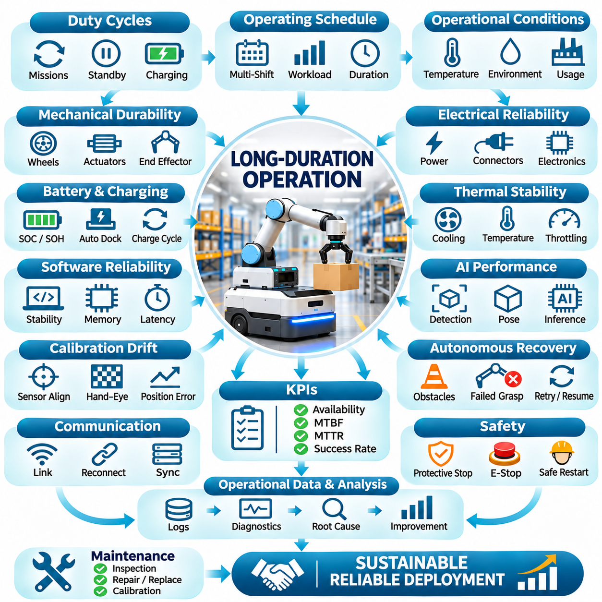{width="7.268055555555556in" height="7.268055555555556in"}

Long-duration operation is an essential component of field validation that evaluates whether mobile manipulators can maintain reliable, safe, and consistent performance throughout extended operating periods. Unlike short-term functional testing, long-duration validation exposes integrated robotic systems to cumulative mechanical stress, electrical degradation, environmental variations, computational workloads, and repeated autonomous task execution.

The validation process should begin with the definition of representative operating schedules and workload profiles. Mobile manipulators may operate continuously across multiple production shifts or alternate between active missions, standby periods, automatic charging, and maintenance activities. Validation duration should reflect intended operational requirements, expected duty cycles, environmental conditions, and customer expectations regarding system availability.

Mechanical durability validation should examine the effects of repeated navigation and manipulation cycles on structural components, actuators, bearings, transmission systems, wheels, and end effectors. Continuous operation may introduce mechanical wear, increased backlash, structural deformation, and reduced positioning accuracy. Periodic measurements should identify progressive degradation before it causes unacceptable performance reductions or mechanical failures.

Electrical reliability validation should evaluate power distribution systems, wiring harnesses, connectors, motor controllers, voltage converters, and embedded electronic devices under extended operating conditions. Repeated acceleration, braking, manipulation, and charging activities may introduce electrical stress and temperature fluctuations. Engineers should monitor voltage stability, current consumption, connection integrity, and abnormal electrical behavior.

Battery performance and energy management are critical factors influencing long-duration operation. Validation should examine battery discharge characteristics, charging efficiency, state-of-charge estimation, state-of-health monitoring, and energy consumption under representative workloads. Automatic charging systems must demonstrate reliable docking, charging initiation, mission interruption management, and safe resumption of previously suspended operations.

Thermal stability validation should evaluate temperature variations within computing platforms, motor controllers, actuators, batteries, and enclosed electronic assemblies. Continuous AI inference and repeated mechanical operation may generate substantial thermal loads. Engineers should monitor temperature profiles, cooling system effectiveness, thermal throttling, and protective shutdown behavior to ensure that sustained operation remains within acceptable thermal limits.

Software reliability validation should examine whether navigation, manipulation, perception, communication, and task management processes remain stable throughout extended execution periods. Memory leaks, resource exhaustion, deadlocks, message queue accumulation, and synchronization errors may emerge only after prolonged operation. Continuous monitoring should identify abnormal resource consumption, increasing response latency, and unexpected software termination.

Artificial intelligence performance should be evaluated continuously to determine whether perception and decision-making capabilities remain consistent under changing operational conditions. Sensor contamination, illumination variations, environmental changes, and computational resource limitations may influence inference reliability. Validation should examine detection accuracy, pose estimation stability, grasp prediction consistency, uncertainty handling, and inference latency over time.

Calibration stability is particularly important for mobile manipulators because navigation and manipulation depend on accurate relationships between multiple coordinate systems. Mechanical vibration, repeated physical contact, temperature variations, and component wear may introduce calibration drift. Periodic verification should examine sensor alignment, hand-eye calibration, docking accuracy, manipulator repeatability, and accumulated positioning errors throughout operation.

Autonomous error recovery should be evaluated under representative long-duration operating conditions. Mobile manipulators may encounter temporary obstacles, unsuccessful grasps, localization failures, communication interruptions, and unavailable infrastructure. The system must recognize abnormal conditions, execute appropriate recovery procedures, and resume authorized missions without compromising safety. Repeated recovery failures should trigger controlled human intervention.

Communication reliability validation should examine the stability of interactions between onboard computing systems, embedded controllers, fleet management platforms, and external infrastructure. Long-duration operation may reveal intermittent network disconnections, communication latency, packet loss, and inconsistent system states. Validation should confirm reliable reconnection, state synchronization, command integrity, and controlled operation during communication failures.

Safety performance must remain consistent throughout the entire operational period. Mechanical degradation, sensor contamination, software faults, and changing environmental conditions may influence protective capabilities. Periodic verification should examine emergency stop functions, protective stopping, speed restrictions, obstacle detection, and authorized restart procedures. Safety-related failures must trigger predefined responses and prevent uncontrolled autonomous operation.

Maintenance validation should determine whether inspection, cleaning, lubrication, calibration, component replacement, and diagnostic activities can be performed efficiently during extended deployment. Engineers should evaluate preventive maintenance intervals, component accessibility, repair procedures, and spare parts requirements. Maintenance records should establish relationships between operating hours, failure occurrences, degradation patterns, and restoration activities.

Long-duration performance should be evaluated through predefined key performance indicators (KPIs), including operational availability, mission success rate, mean time between failures (MTBF), mean time to repair (MTTR), energy consumption, and human intervention frequency. Performance measurements should distinguish productive operating time, scheduled maintenance, charging periods, and unplanned downtime to provide representative evidence of operational reliability.

Operational data collection should support systematic failure analysis and the identification of progressive performance degradation. Time-synchronized sensor recordings, actuator states, temperature measurements, battery information, software diagnostics, and mission histories should be maintained throughout validation. Corrective actions and regression testing should demonstrate that identified problems have been resolved without introducing additional operational risks.

Long-duration operation validation should ultimately establish whether mobile manipulators can deliver sustainable performance throughout their intended operating schedules. Documented validation results should support reliability assessment, maintenance planning, lifecycle cost estimation, technology readiness evaluation, and commercial deployment. Test durations and acceptance thresholds must be defined according to application-specific requirements and operating risks.

## 09 Operational Data Collection

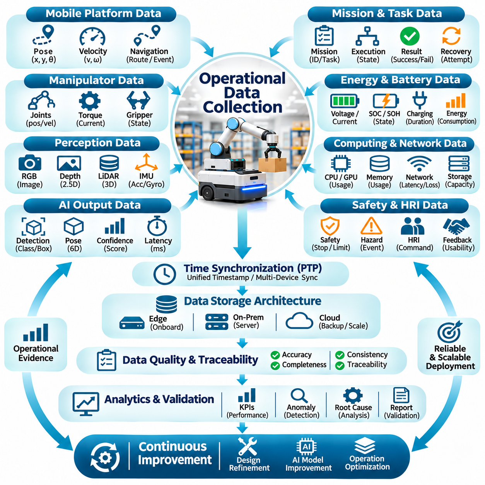{width="7.268055555555556in" height="7.268055555555556in"}

Operational data collection is a fundamental component of field validation that provides measurable evidence of mobile manipulator performance, reliability, safety, and operational effectiveness. Based on the development manual\'s field validation framework, the following engineering methodology expands the operational data collection topic to establish traceability between system behavior, environmental conditions, and actual mission outcomes.

The data collection process should begin with the definition of measurement objectives, data requirements, recording frequencies, and operational scenarios. Collected information must support the verification of system requirements, performance evaluation, failure analysis, and continuous improvement. Each data category should have a defined source, measurement unit, timestamp, retention policy, and responsible engineering team.

Mobile platform data collection should include position, orientation, linear velocity, angular velocity, wheel encoder measurements, motor currents, and localization confidence. Navigation trajectories, planned paths, obstacle detection events, and recovery activities should also be recorded. These measurements provide evidence for evaluating navigation accuracy, motion stability, route efficiency, and autonomous mobility performance.

Manipulator data collection should capture joint positions, joint velocities, actuator torques, end-effector poses, force measurements, and gripper states. Planned trajectories and actual motion trajectories should be recorded to identify tracking errors and unexpected mechanical behavior. Manipulation data supports the evaluation of grasp stability, positioning accuracy, trajectory execution, and physical interaction with target objects.

Perception data collection should include information generated by RGB cameras, depth cameras, LiDAR sensors, inertial measurement units, and other environmental sensing devices. Raw sensor measurements and processed outputs should be retained according to validation objectives. Representative data should capture environmental variations, sensor degradation, occlusion, and unexpected objects that may influence perception reliability.

Artificial intelligence data collection should record object detection results, classification outputs, pose estimates, grasp predictions, confidence scores, and inference latency. Model versions, preprocessing configurations, and inference parameters must remain traceable to individual predictions. These records support the identification of recognition failures, model performance degradation, and opportunities for subsequent model improvement.

Time synchronization is essential for establishing accurate relationships between measurements generated by distributed robotic subsystems. Onboard computers, embedded controllers, sensors, and external monitoring platforms should maintain a consistent time reference. Precision Time Protocol (PTP), hardware triggering, and synchronized timestamps may be employed according to application requirements and acceptable synchronization errors.

Mission-level data collection should document the complete execution history of autonomous tasks. Recorded information should include mission identifiers, task assignments, execution states, destination information, completion results, recovery attempts, and operator interventions. Hierarchical task records enable engineers to identify relationships between subsystem behavior, individual task failures, and overall mission performance.

Energy and electrical data collection should examine battery voltage, current consumption, state of charge, state of health, charging duration, and power distribution characteristics. Energy measurements should be associated with navigation, manipulation, AI inference, standby operation, and charging activities. These records support battery endurance evaluation, power consumption optimization, and lifecycle performance assessment.

Computational and communication data should include processor utilization, GPU utilization, memory consumption, storage capacity, network latency, packet loss, and message transmission rates. Continuous resource monitoring can reveal computational bottlenecks, memory leaks, communication instability, and thermal throttling. Data collection should avoid imposing excessive processing overhead on time-critical robotic functions.

Safety-related data collection must document emergency stops, protective stops, safety sensor activations, speed restrictions, hazardous proximity events, and authorized restart procedures. Each safety event should be associated with relevant robot states and environmental conditions. Where appropriate, pre-event and post-event recordings should be preserved to support incident reconstruction, risk assessment, and corrective engineering actions.

Human-robot interaction data collection should capture operator commands, interaction events, task cancellations, object handovers, manual interventions, and requests for assistance. User feedback may provide additional information regarding usability, perceived safety, operational predictability, and service quality. Personal information must be collected only when necessary and handled according to applicable privacy and consent requirements.

Data storage architecture should support structured operational records, high-volume sensor datasets, diagnostic logs, and event-based recordings. Onboard storage may be combined with edge servers, on-premises infrastructure, or cloud-based platforms. Recording policies should balance data completeness, storage capacity, communication bandwidth, retention requirements, and operational costs while protecting critical evidence against unauthorized modification.

Data quality management should ensure that collected measurements are accurate, complete, consistent, and appropriately synchronized. Missing records, duplicated messages, corrupted files, inaccurate timestamps, and inconsistent measurement units may reduce analytical reliability. Automated validation procedures should identify recording failures and maintain traceability to robot configurations, software versions, AI models, and sensor calibration records.

Operational data analysis should transform recorded measurements into actionable engineering information. Statistical analysis, time-series evaluation, anomaly detection, and event correlation can reveal recurring failures and progressive performance degradation. Validated datasets should support key performance indicator (KPI) evaluation, root cause analysis, predictive maintenance, corrective actions, and subsequent regression testing.

Operational data collection should ultimately establish a sustainable feedback mechanism connecting field deployment with system development and lifecycle management. Documented operational evidence should support design optimization, AI model improvement, reliability assessment, technology readiness evaluation, and customer acceptance. Data governance, cybersecurity, access control, and configuration management must remain integral to the collection process.

## 10 KPI Evaluation

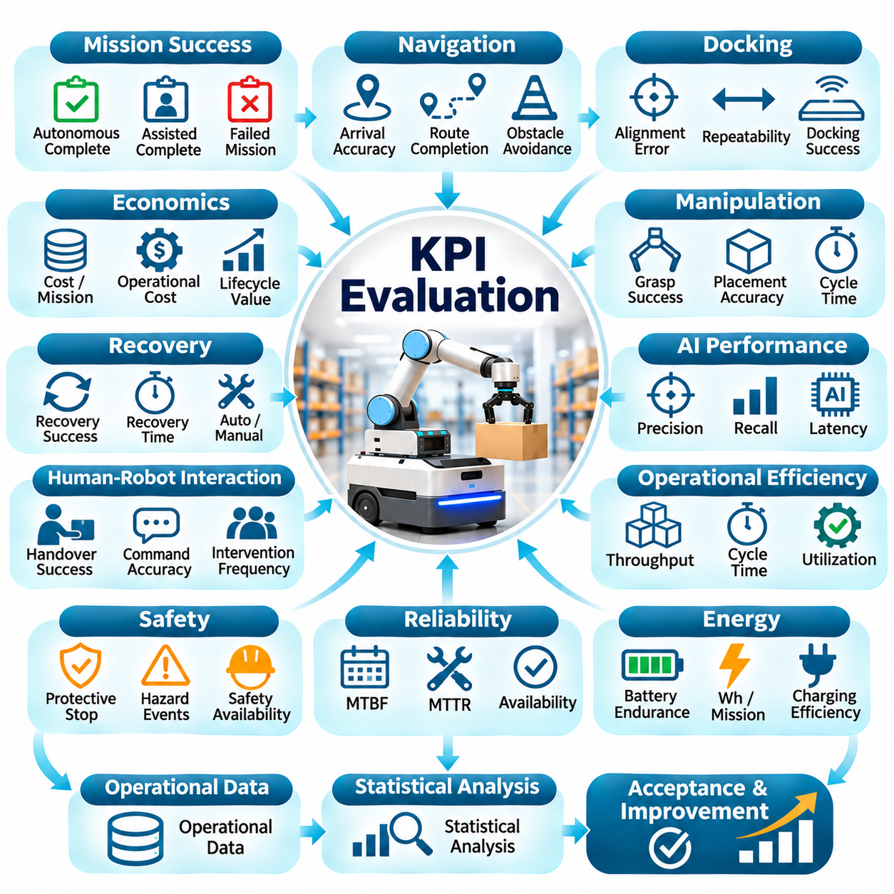{width="7.268055555555556in" height="7.268055555555556in"}

Key performance indicator (KPI) evaluation is a fundamental component of field validation that determines whether mobile manipulators satisfy predefined technical, operational, safety, and economic requirements. Within the development manual\'s field validation framework, KPI evaluation translates operational measurements into quantitative evidence supporting system acceptance, engineering improvement, and commercial deployment decisions.

The KPI evaluation process should begin with the definition of measurable objectives, calculation methods, acceptance thresholds, and representative operating conditions. Each indicator must be associated with specific system requirements, measurement procedures, data sources, and evaluation periods. Consistent evaluation criteria enable meaningful comparisons between different robot configurations, software versions, and deployment environments.

Mission success rate is a primary indicator of overall mobile manipulator performance. It is calculated by dividing the number of successfully completed missions by the total number of attempted missions and multiplying the result by one hundred. Autonomous mission completion, completion through human assistance, partial completion, and unsuccessful missions should be classified separately to accurately represent autonomous operational capabilities.

Navigation performance evaluation should examine destination arrival accuracy, route completion rate, travel time, localization stability, and obstacle avoidance performance. Additional indicators may include path planning latency, navigation recovery success rate, and deviations between planned and actual trajectories. Measurements should reflect representative operating environments containing static obstacles, dynamic obstacles, and human traffic.

Docking and positioning performance are particularly important because successful manipulation depends on accurate spatial relationships between the mobile platform and target workspaces. Relevant KPIs include docking success rate, translational positioning error, angular alignment error, docking repeatability, and alignment completion time. Measurements should distinguish mobile platform positioning errors from manipulator positioning errors.

Manipulation performance evaluation should examine grasp success rate, placement accuracy, trajectory tracking error, object handling stability, and manipulation cycle time. Representative test objects should include variations in geometry, weight, orientation, material, and surface characteristics. Evaluation should distinguish failures originating from perception, grasp planning, motion planning, actuator control, and end-effector limitations.

Artificial intelligence performance indicators should evaluate the accuracy, reliability, and computational efficiency of deployed models. Depending on the application, relevant metrics may include precision, recall, mean average precision (mAP), classification accuracy, six-dimensional pose estimation error, and inference latency. AI evaluation must also examine uncertainty handling and the operational consequences of incorrect predictions.

Operational efficiency should be evaluated through mission completion time, task cycle time, throughput, equipment utilization, and productive operating time. The complete operational sequence should include navigation, docking, perception, manipulation, communication, waiting, and recovery activities. Detailed time measurements enable engineers to identify bottlenecks and determine which subsystems impose limitations on overall productivity.

Reliability and availability evaluation should examine mean time between failures (MTBF), mean time to repair (MTTR), operational availability, and unplanned downtime. Failure definitions and measurement boundaries must be established before field validation. Scheduled maintenance, charging activities, software interruptions, and hardware failures should be recorded separately to support accurate reliability and availability calculations.

Energy efficiency evaluation should examine battery endurance, average power consumption, energy consumption per completed mission, and charging efficiency. Energy requirements may vary significantly according to payload weight, travel distance, manipulation frequency, computing workload, and environmental conditions. Measurements should support the optimization of battery capacity, charging strategies, power management, and operating schedules.

Safety performance evaluation should examine protective stop frequency, hazardous proximity events, collision occurrences, emergency stop response time, and safety function availability. Safety-related indicators must be interpreted according to application-specific risk assessments and operational exposure. Favorable statistical results cannot replace the verification of required safety functions or justify accepting unresolved safety hazards.

Human-robot interaction performance should be evaluated through interaction success rate, command recognition accuracy, response latency, object handover success rate, and human intervention frequency. Additional indicators may include usability, perceived safety, accessibility, and user satisfaction. Quantitative measurements should be complemented by structured feedback from representative operators, customers, and other affected individuals.

Error recovery performance is an important indicator of operational autonomy and system robustness. Recovery success rate, average recovery time, repeated failure frequency, and manual intervention requirements should be evaluated across representative abnormal conditions. Recovery attempts should be classified according to their initiating faults and outcomes to identify persistent weaknesses in autonomous operation and fault management.

Economic performance evaluation should consider operational cost per completed mission, maintenance expenditure, labor efficiency, energy costs, and infrastructure requirements. Comparisons with conventional workflows should use equivalent workloads, service quality expectations, and operating schedules. Economic indicators should account for lifecycle costs and deployment limitations rather than relying exclusively on theoretical productivity improvements.

KPI results should be analyzed using validated operational datasets, appropriate statistical methods, and consistent measurement definitions. Average values should be supplemented by measures of variability, percentile values, sample sizes, and confidence intervals where appropriate. Aggregated results must not conceal unacceptable performance under specific environmental conditions, operational scenarios, or safety-critical circumstances.

KPI evaluation should ultimately establish objective evidence for requirement acceptance, corrective actions, technology readiness assessment, and deployment expansion. Documented results should maintain traceability to operational datasets, robot configurations, software versions, and validation conditions. The appropriate indicators, target values, and acceptance thresholds must be determined according to application-specific requirements.

## 11 TRL Assessment

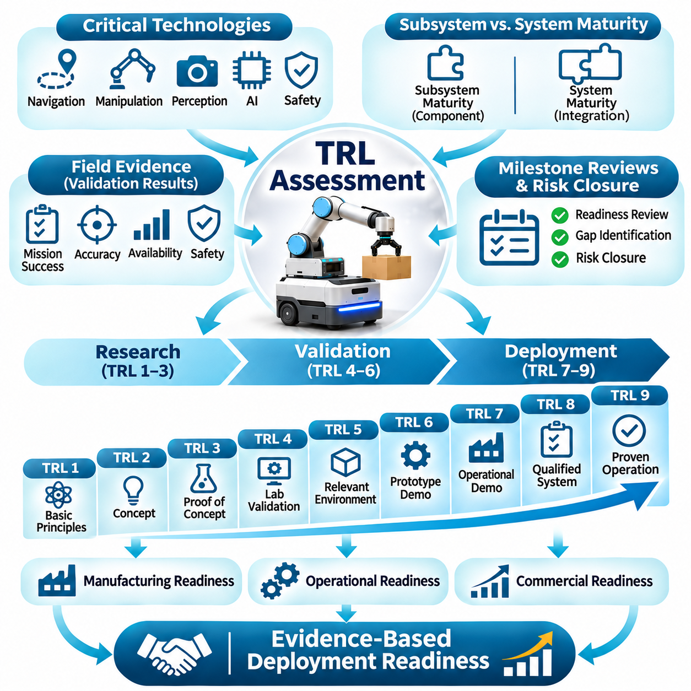{width="7.268055555555556in" height="7.268055555555556in"}

Technology readiness level (TRL) assessment is a fundamental component of field validation that evaluates the maturity of mobile manipulator technologies throughout their development lifecycle. Based on the development manual\'s field validation framework, the following assessment methodology expands the TRL topic to establish objective relationships between technological maturity, system integration, operational performance, and commercial deployment readiness.

The technology readiness level framework generally consists of nine maturity levels, ranging from the observation of basic scientific principles at TRL 1 to the demonstration of an actual system through successful operational use at TRL 9. Each level represents a progressive reduction in technological uncertainty through experimental research, prototype development, system integration, validation, and operational demonstration.

Technology readiness assessment should begin with the identification of critical technologies and engineering subsystems within the mobile manipulator architecture. These may include autonomous navigation, manipulator control, visual perception, artificial intelligence, grasp planning, battery management, communication infrastructure, and safety systems. Each critical technology should be evaluated against clearly defined maturity criteria.

TRL 1 and TRL 2 represent the earliest stages of technological development, where fundamental principles are observed and potential technological concepts are formulated. For mobile manipulators, these stages may involve investigating autonomous mobility algorithms, robotic manipulation principles, perception architectures, or learning-based control methods. Research findings establish the theoretical foundation for subsequent development.

TRL 3 represents experimental proof of concept, where analytical investigations and preliminary experiments demonstrate the feasibility of critical technological functions. Mobile manipulator development may involve validating object recognition algorithms, grasp prediction models, localization methods, or coordinated motion control strategies. Experimental results should demonstrate feasibility under defined conditions.

TRL 4 represents technology validation within a laboratory environment. Individual components and preliminary subsystems are integrated and evaluated under controlled conditions. Mobile manipulator validation may include laboratory demonstrations of autonomous navigation, object detection, robotic grasping, and coordinated task execution. Laboratory testing should establish repeatable evidence of essential functional capabilities.

TRL 5 represents technology validation within a relevant environment that reproduces important characteristics of the intended application. Mobile manipulators should be evaluated using representative payloads, operational scenarios, environmental conditions, and physical interfaces. Validation should identify technological limitations that may not have been observable during controlled laboratory experiments.

TRL 6 represents the demonstration of a system or subsystem prototype within a relevant environment. An integrated mobile manipulator should demonstrate coordinated navigation, perception, docking, manipulation, and task execution under representative operational conditions. Performance measurements, safety verification, and recovery demonstrations should provide evidence of increasing technological maturity.

TRL 7 represents the demonstration of a system prototype within an actual operational environment. Mobile manipulators should perform representative missions within warehouses, factories, hospitals, or commercial service facilities. Field validation should examine operational reliability, infrastructure compatibility, human-robot interaction, long-duration performance, and autonomous recovery under realistic operating conditions.

TRL 8 represents an actual system that has been completed and qualified through appropriate testing and demonstration. Hardware configurations, software releases, artificial intelligence models, safety mechanisms, and system interfaces should be sufficiently finalized and documented. Qualification evidence should demonstrate compliance with applicable technical requirements, performance criteria, and safety obligations.

TRL 9 represents an actual system proven through successful operational use within its intended environment. Mobile manipulators should demonstrate sustainable operational performance, reliable autonomous task execution, effective maintenance procedures, and consistent service delivery. Long-term deployment records should establish evidence that the technology performs successfully under intended operating conditions.

Technology readiness assessment must distinguish individual subsystem maturity from integrated system maturity. Mature navigation platforms, industrial manipulators, and perception technologies do not automatically establish an equivalent readiness level for the complete mobile manipulator. Integration complexity, interface reliability, coordinated task execution, and unresolved critical technological risks must be evaluated independently.

Field validation results should provide quantitative and qualitative evidence supporting technology readiness assessment. Relevant evidence may include mission success rates, navigation accuracy, docking repeatability, manipulation performance, operational availability, energy efficiency, and safety verification results. Acceptance thresholds should be established according to application-specific requirements and operational risks.

Technology readiness progression should be managed through systematic milestone reviews and documented assessment procedures. Engineering teams should identify gaps between demonstrated capabilities and the requirements of the next maturity level. Unresolved technical risks, insufficient validation evidence, integration failures, and operational limitations should be addressed through corrective actions and additional testing.

Technology readiness must also be distinguished from manufacturing readiness, operational readiness, and commercial readiness. A technologically mature mobile manipulator may still require manufacturing optimization, supply chain development, production quality assurance, maintenance infrastructure, and regulatory approval. These complementary assessments are necessary to establish sustainable commercialization capabilities.

Technology readiness assessment should ultimately support evidence-based decisions regarding continued development, prototype refinement, pilot deployment, qualification, and commercial introduction. Assessment records should maintain traceability to system requirements, configuration baselines, validation datasets, test reports, and documented limitations. A readiness level should be assigned only when its applicable criteria are demonstrably satisfied.

## 12 Field Validation Reports

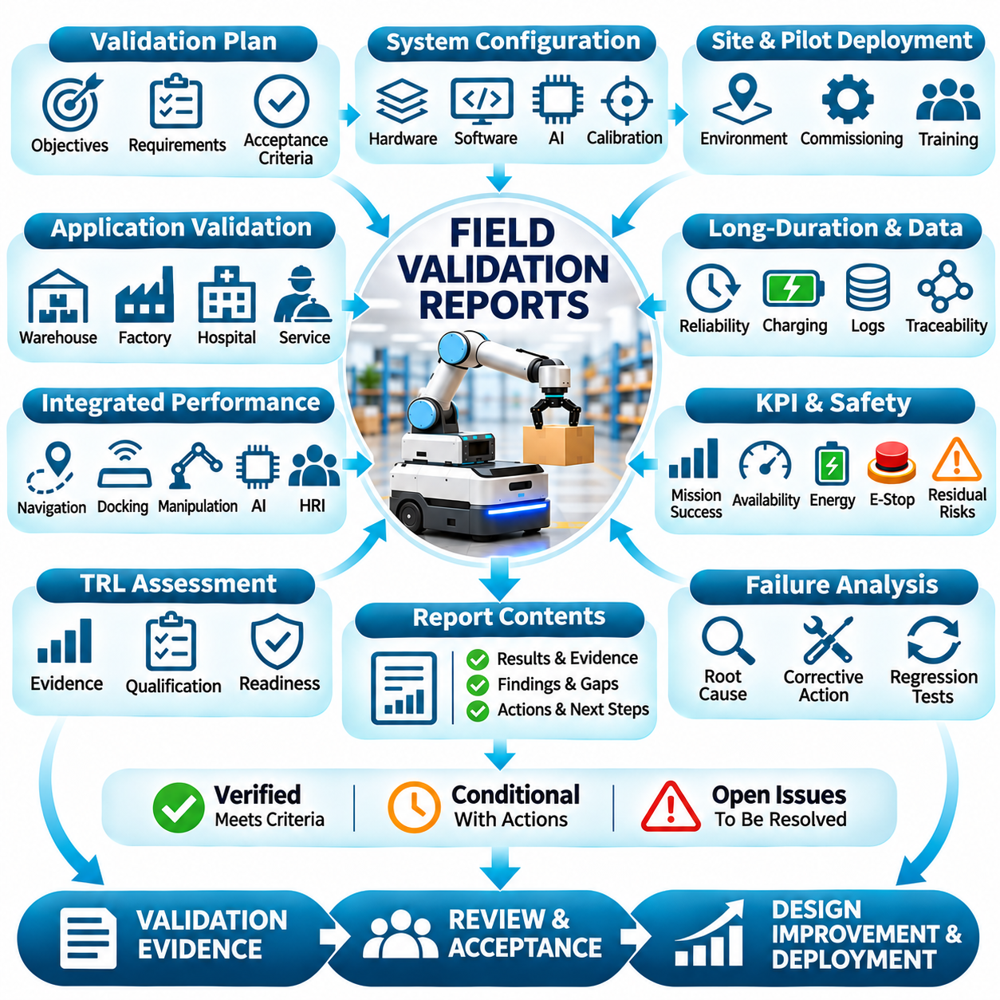{width="7.268055555555556in" height="7.268055555555556in"}

Field validation reports are essential engineering documents that consolidate the results of mobile manipulator validation conducted under representative and actual operating conditions. As the concluding component of the field validation chapter, this topic integrates validation strategies, pilot deployments, application-specific assessments, operational data collection, KPI evaluation, and technology readiness assessment into a structured engineering reporting methodology.

The field validation report should begin with a description of the validation objectives, system requirements, operational scope, and intended application. Since the development manual defines the overall topic structure rather than detailed reporting specifications, individual report contents should be adapted to project-specific requirements. The report must establish clear relationships between validation objectives, evaluation procedures, and acceptance criteria.

System configuration documentation should identify the mobile platform, manipulator, end effector, sensor architecture, computing hardware, communication interfaces, and safety mechanisms used during field validation. Software versions, firmware versions, artificial intelligence models, calibration parameters, and configuration baselines must also be recorded to ensure reproducibility and technical traceability.

Operational environment documentation should describe the physical characteristics, infrastructure, environmental conditions, and operational constraints of the validation site. Relevant information may include floor conditions, workspace dimensions, illumination, obstacle distribution, network availability, and human traffic. Differences between planned validation conditions and actual operating conditions should be explicitly documented.

Pilot deployment results should summarize installation procedures, system commissioning, infrastructure integration, operator training, and initial operational experiences. The report should document deployment challenges, configuration adjustments, compatibility issues, and early technical failures. These findings provide practical evidence for improving subsequent deployments and reducing implementation risks.

Application-specific validation results should describe performance within warehouses, factories, hospitals, and commercial service environments, as applicable. Each environment introduces different operational requirements, interaction patterns, infrastructure dependencies, and safety constraints. Validation reports should distinguish application-specific findings from general system capabilities and limitations.

Navigation and manipulation results should document destination arrival accuracy, localization performance, obstacle avoidance, docking repeatability, grasp success rates, placement accuracy, and task execution time. Integrated mission results should demonstrate whether autonomous mobility, perception, manipulation, and task management functions operate together reliably under representative field conditions.

Artificial intelligence validation reporting should summarize object detection accuracy, pose estimation performance, grasp prediction reliability, inference latency, and model robustness. Representative recognition failures, uncertain predictions, environmental variations, and computational limitations should be documented. AI model performance must also be evaluated in relation to its impact on physical task execution.

Human-robot interaction validation reports should document operator commands, interaction success rates, object handover performance, human intervention frequency, and user feedback. Observations concerning usability, perceived safety, accessibility, and operational predictability should be included. Findings should support improvements to human-machine interfaces, interaction strategies, and operator training procedures.

Long-duration operation results should document operating hours, completed missions, charging cycles, component degradation, thermal stability, software reliability, and maintenance activities. Unplanned downtime, recurring failures, and recovery attempts should be analyzed in relation to actual operating conditions. These findings support reliability assessment, maintenance planning, and lifecycle performance evaluation.

Operational data documentation should identify recorded sensor measurements, diagnostic logs, mission histories, actuator states, safety events, and energy consumption records. Data sources, recording frequencies, synchronization methods, and storage locations should remain traceable. Missing measurements, recording failures, and data quality limitations must be disclosed to establish the reliability of reported conclusions.

Key performance indicator (KPI) reporting should compare measured performance against predefined target values and acceptance thresholds. Relevant indicators may include mission success rate, operational availability, throughput, positioning accuracy, energy efficiency, and recovery success rate. Statistical results should include representative sample sizes, performance variability, and measurement uncertainty where appropriate.

Safety validation reporting must document emergency stop verification, protective stopping performance, hazardous events, collision occurrences, and identified residual risks. Safety-related failures should be accompanied by incident descriptions, investigation results, corrective actions, and verification evidence. Unresolved safety deficiencies must remain visible and prevent unsupported declarations of operational readiness.

Failure analysis and corrective action reporting should establish traceability between observed problems, operating conditions, root causes, and engineering modifications. Each identified issue should have an assigned responsibility, severity classification, resolution status, and verification requirement. Regression testing results should demonstrate whether corrective actions have resolved the identified deficiencies without introducing additional risks.

Technology readiness level (TRL) assessment results should summarize the maturity demonstrated through prototype integration, relevant environment testing, operational demonstration, and qualification activities. The assigned readiness level must be supported by documented validation evidence and applicable maturity criteria. Remaining technological uncertainties and requirements for progression to subsequent readiness levels should be identified.

Field validation reports should ultimately provide objective evidence for system acceptance, design refinement, manufacturing preparation, and commercial deployment decisions. Final conclusions should distinguish verified capabilities, conditional acceptance, unresolved deficiencies, and operational limitations. Approved reports should be maintained under document and configuration management procedures to support audits, continuous improvement, and future development.
