# Chapter 07. Field Validation

## 01 Field Validation Strategy

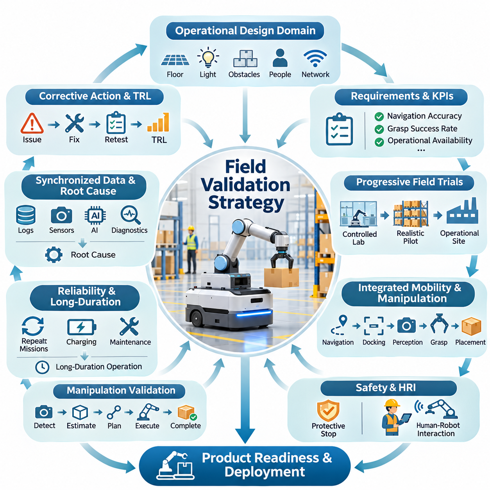{width="7.268055555555556in" height="7.268055555555556in"}

현장 검증(Field Validation)은 모바일 매니퓰레이터(Mobile Manipulator)가 목표로 하는 운영 환경에서 신뢰성(Reliability), 안전성(Safety), 일관성(Consistency)을 확보하며 동작하는지를 확인하는 과정이다. 실험실 시험(Laboratory Testing)이 통제된 조건에서 개별 기능과 통합 시스템의 동작을 검증한다면, 현장 검증은 완성된 로봇이 실제 운영 요구사항을 충족할 수 있는지를 판단한다. 자율 이동 로봇(AMR), 매니퓰레이터(Manipulator), 인지 시스템(Perception System), 인공지능(AI), 작업 계획기(Task Planner), 운영자 및 주변 인프라 간의 상호작용을 평가한다.

현장 검증 전략(Field Validation Strategy)의 주요 목적은 개발된 시스템이 실제 배치(Deployment)를 수행할 준비가 되었음을 입증하는 정량적 근거(Measurable Evidence)를 확보하는 것이다. 검증 과정에서는 로봇이 대표적인 환경에서 자율주행을 수행하고, 목표 객체를 식별하고 조작하며, 할당된 작업을 완료하고, 운영 중 발생하는 장애로부터 복구하며, 장시간 동안 허용 가능한 성능을 유지할 수 있음을 입증해야 한다. 이러한 활동은 단순히 성공적인 시연(Demonstration)에 의존하기보다 초기 제품 요구사항(Product Requirements)과 운영 시나리오(Operational Scenario)를 기준으로 평가해야 한다.

현장 검증은 운영 영역(Operational Domain)을 명확하게 정의하는 것에서 시작해야 한다. 운영 설계 영역(ODD, Operational Design Domain)은 모바일 매니퓰레이터가 동작하도록 설계된 물리적, 환경적, 절차적 조건을 설명한다. 주요 특성에는 바닥 상태, 작업 공간의 크기, 조명, 객체 위치, 장애물 분포, 통신 가용성(Communication Availability), 인간의 활동 및 환경적 외란(Environmental Disturbance)이 포함된다. 이러한 조건을 정의함으로써 검증 결과가 대표성을 가질 수 있는 범위를 설정할 수 있다.

검증 전략(Validation Strategy)은 시스템 요구사항(System Requirements)을 실제 평가 시나리오(Evaluation Scenario) 및 측정 가능한 수용 기준(Acceptance Criteria)과 연결해야 한다. 자율주행 정확도(Navigation Accuracy), 위치 추정 안정성(Localization Stability), 장애물 회피(Obstacle Avoidance), 조작 정밀도(Manipulation Precision), 파지 성공률(Grasp Success Rate), 작업 완료 시간(Task Completion Time), 운영 가용성(Operational Availability) 등이 주요 성능 지표에 해당한다. 각각의 지표에는 측정 방법, 평가 기간 및 수용 임계값(Acceptance Threshold)이 정의되어야 한다. 이러한 접근법은 주관적인 판단이 객관적인 공학적 근거를 대체하는 것을 방지하고 제품 사양과 현장 성능 간의 추적성(Traceability)을 제공한다.

검증 과정은 통제된 환경에서 점차 복잡한 실제 운영 조건으로 발전해야 한다. 초기 검증 활동은 환경 변수가 명확하고 반복 가능한 대표 시험 시설(Representative Test Facility)에서 수행할 수 있다. 이후 평가에서는 실제 작업 공간의 배치, 동적 장애물(Dynamic Obstacle), 객체 배치의 변화 및 운영자와의 상호작용을 도입해야 한다. 이러한 점진적 접근법(Progressive Approach)은 완성된 시스템을 복잡한 생산 환경에 적용하기 전에 엔지니어링 팀이 성능 한계(Performance Limitation)를 식별할 수 있도록 한다.

모바일 매니퓰레이션(Mobile Manipulation)에서는 이동 플랫폼의 위치 정밀도(Positioning Accuracy)와 매니퓰레이터의 조작 정확도 간의 관계에 특별한 주의를 기울여야 한다. 고정형 산업용 로봇(Stationary Industrial Robot)과 달리 모바일 매니퓰레이터는 조작 작업을 수행하기 전에 충분히 정확한 이동 플랫폼의 위치를 확보해야 한다. 위치 추정 오차(Localization Error), 차체 진동(Chassis Vibration), 휠 슬립(Wheel Slip), 바닥의 불균일성 및 기계적 변형(Mechanical Deflection)은 최종 엔드 이펙터(End Effector)의 위치에 영향을 미칠 수 있다. 따라서 현장 검증에서는 자율주행, 도킹(Docking), 이동 플랫폼 안정화, 로봇 팔의 움직임 및 도구 정렬(Tool Alignment)을 포함한 전체 위치 결정 체계(Positioning Chain)를 평가해야 한다.

인지(Perception)와 인공지능(Artificial Intelligence) 역시 실제 운영 조건에서 평가해야 한다. 카메라 노출(Camera Exposure), 조명 변화, 반사 표면(Reflective Surface), 가림 현상(Occlusion), 객체의 다양성 및 배경의 복잡성은 객체 검출(Object Detection)과 자세 추정(Pose Estimation) 성능에 영향을 미칠 수 있다. 사전에 준비된 데이터셋(Dataset)에서 우수한 성능을 보이는 모델이라도 익숙하지 않은 객체나 변화하는 환경 조건에서는 다른 동작 특성을 나타낼 수 있다. 따라서 검증에는 대표적인 환경 변화를 포함해야 하며, 성공적인 예측 결과와 실패 사례를 모두 기록하여 인공지능 하위 시스템(AI Subsystem)이 목표 운영 요구사항을 충족하는지를 판단해야 한다.

조작 검증(Manipulation Validation)은 파지 정확도(Grasping Accuracy)를 독립적으로 평가하는 것보다 전체 작업 실행 과정(Task Execution)을 평가해야 한다. 성공적인 작업을 위해서는 객체 검출(Object Detection), 자세 추정(Pose Estimation), 파지 계획(Grasp Planning), 로봇 팔의 궤적 생성(Trajectory Generation), 접촉 형성(Contact Establishment), 객체 취급(Object Handling) 및 지정된 목적지로의 배치(Placement)가 필요할 수 있다. 실패는 개별 단계 또는 단계 간 상호작용에서 발생할 수 있다. 중간 실행 결과를 기록하면 엔지니어가 인지 오류, 계획의 한계, 기계적 부정확성 및 제어 불안정성(Control Instability)을 구분할 수 있다.

안전 검증(Safety Validation)은 모든 현장 검증 활동에 통합되어야 한다. 로봇은 예상하지 못한 장애물, 인간의 접근, 제한 구역(Restricted Area), 통신 중단(Communication Interruption), 비상 정지(Emergency Stop) 활성화 및 비정상적인 기계적 상태에 적절하게 대응할 수 있음을 입증해야 한다. 특히 이동 플랫폼과 매니퓰레이터가 동시에 동작하는 상황에 주의를 기울여야 한다. 검증 과정에서는 자율주행, 로봇 팔의 움직임, 객체 취급, 도킹 및 복구 절차 중에도 보호 기능(Protective Function)이 효과적으로 유지되는지를 확인해야 한다.

인간-로봇 상호작용(HRI, Human-Robot Interaction)은 현장 검증의 또 다른 중요한 평가 영역이다. 실제 운영 환경에서 작업자는 로봇에 접근하거나, 작업 우선순위(Task Priority)를 변경하거나, 작업을 중단하거나, 지원을 요청하거나, 작업 공간에 새로운 객체를 배치할 수 있다. 시스템은 자신의 운영 상태(Operational State)를 명확하게 전달하고 권한이 부여된 인간의 명령에 예측 가능한 방식으로 응답해야 한다. 검증 과정에서는 운영자가 로봇의 행동 의도를 이해하고, 비정상적인 상태를 인식하며, 불필요한 기술적 개입 없이 중단된 작업을 안전하게 재개할 수 있는지를 평가해야 한다.

신뢰성(Reliability)은 일회성의 성공적인 시연이 아니라 반복적인 운영을 통해 평가해야 한다. 현장 시험(Field Trial)에는 연속적인 임무 수행, 반복적인 조작 사이클(Manipulation Cycle), 충전 작업(Charging Operation), 자동 복구(Automatic Recovery) 및 계획된 유지보수(Scheduled Maintenance) 활동이 포함되어야 한다. 엔지니어는 예상하지 못한 정지, 위치 추정 손실(Localization Loss), 통신 장애, 조작 오류, 소프트웨어 예외(Software Exception) 및 부품의 성능 저하(Component Degradation)를 기록해야 한다. 이러한 관찰 결과는 운영 가용성에 관한 근거를 제공하며 단기간의 실험실 시험에서는 나타나지 않을 수 있는 고장 패턴(Failure Pattern)을 발견할 수 있도록 한다.

운영 데이터 수집(Operational Data Collection)은 검증 전략의 기본 요소로 설계되어야 한다. 로봇 로그(Robot Log), 센서 기록(Sensor Recording), 자율주행 궤적(Navigation Trajectory), 조작 결과, 인공지능 추론 결과(AI Inference Output), 시스템 진단(System Diagnostics) 및 운영자 피드백(Operator Feedback)은 동기화된 타임스탬프(Synchronized Timestamp)와 일관된 데이터 형식을 사용하여 수집해야 한다. 이러한 정보는 근본 원인 분석(RCA, Root Cause Analysis), 성능 비교 및 소프트웨어 개선을 지원한다. 데이터 수집 절차에서는 저장 용량, 개인정보 보호 요구사항, 네트워크 제약 및 고객 운영 정보의 보호도 고려해야 한다.

검증팀은 고장 및 예상하지 못한 동작을 처리하기 위한 통제된 절차를 수립해야 한다. 관찰된 각각의 문제는 운영 조건, 시스템 구성(System Configuration), 재현 절차(Reproduction Step), 심각도(Severity) 및 잠재적 영향과 함께 기록되어야 한다. 엔지니어링 팀은 기계 설계(Mechanical Design), 전기적 통합(Electrical Integration), 인지, 인공지능 추론, 동작 계획(Motion Planning), 제어, 통신 또는 운영 절차 등 문제의 발생 원인에 따라 이를 분류해야 한다. 해당 문제가 해결되었다고 판단하기 전에 반복적인 시험을 통해 시정 조치(Corrective Action)의 효과를 검증해야 한다.

현장 검증에서는 배치 환경(Deployment Environment) 간의 차이도 고려해야 한다. 물류 창고 운영(Warehouse Operation), 공장 자동화(Factory Automation), 병원 물류(Hospital Logistics) 및 서비스 로보틱스(Service Robotics)는 서로 다른 작업 공간의 특성, 안전에 대한 기대 수준, 객체 분포 및 인간과의 상호작용 패턴을 가진다. 따라서 검증 전략은 공통적인 시스템 수준 성능 요구사항(System-Level Performance Requirements)을 정의하면서 환경별 특화 시험 시나리오(Environment-Specific Test Scenario)를 허용해야 한다. 이러한 접근법은 특정 응용 분야에서의 성공적인 운영이 다른 분야에서의 적합성을 자동으로 보장한다고 가정하지 않으면서 일관된 엔지니어링 프레임워크(Engineering Framework)를 제공한다.

현장 검증과 기술 성숙도(TRL, Technology Readiness Level) 간의 관계도 명확하게 설정해야 한다. 실험실 시연과 통제된 통합 시험(Integration Testing)은 초기 개발 단계에 대한 근거를 제공하는 반면, 대표적인 운영 환경에서의 시험은 해당 기술이 실제와 유사한 조건에서 동작할 수 있는지를 입증한다. 반복적인 시범 배치(Pilot Deployment), 문서화된 성능 개선 및 안정적인 장시간 운영(Long-Duration Operation)은 기술 성숙도를 높이는 데 기여한다. 다만 상위 기술 성숙도는 필요한 근거가 수집되고 해당 평가 기준(Assessment Criteria)에 따라 검토된 경우에만 부여해야 한다.

현장 검증 결과는 궁극적으로 제품 준비도(Product Readiness), 설계 변경(Design Modification) 및 상용화(Commercialization)에 관한 엔지니어링 의사결정을 지원해야 한다. 기능 요구사항(Functional Requirements)을 충족하더라도 빈번한 수동 개입(Manual Intervention)이 필요한 시스템은 실제 배치에 적합하지 않을 수 있다. 마찬가지로 높은 작업 정확도를 달성하더라도 충분한 운영 가용성을 유지할 수 없는 로봇은 기대한 생산성 향상(Productivity Improvement)을 제공하지 못할 수 있다. 따라서 검증은 기술적 성능, 운영 효과성(Operational Effectiveness), 안전성, 유지보수성(Maintainability) 및 배치 실현 가능성(Deployment Feasibility)을 종합적으로 고려해야 한다.

완전한 현장 검증 전략은 운영 요구사항, 시험 시나리오(Test Scenario), 측정 결과, 식별된 한계 및 시정 조치를 연결하는 재현 가능한 근거(Reproducible Evidence)를 생성해야 한다. 이러한 결과 문서(Documentation)는 시범 배치에 관한 의사결정, 고객 인수(Customer Acceptance), 제조 준비(Manufacturing Preparation) 및 후속 품질 보증(QA, Quality Assurance) 활동을 위한 기술적 기반을 제공한다. 현장 검증을 단순한 최종 시연이 아니라 체계적인 엔지니어링 프로세스(Engineering Process)로 간주함으로써 개발팀은 배치 위험(Deployment Risk)을 줄이고 프로토타입 개발(Prototype Development)에서 상업적으로 배치 가능한 모바일 매니퓰레이션 시스템으로 안정적인 전환을 확립할 수 있다.

## 02 Pilot Deployments

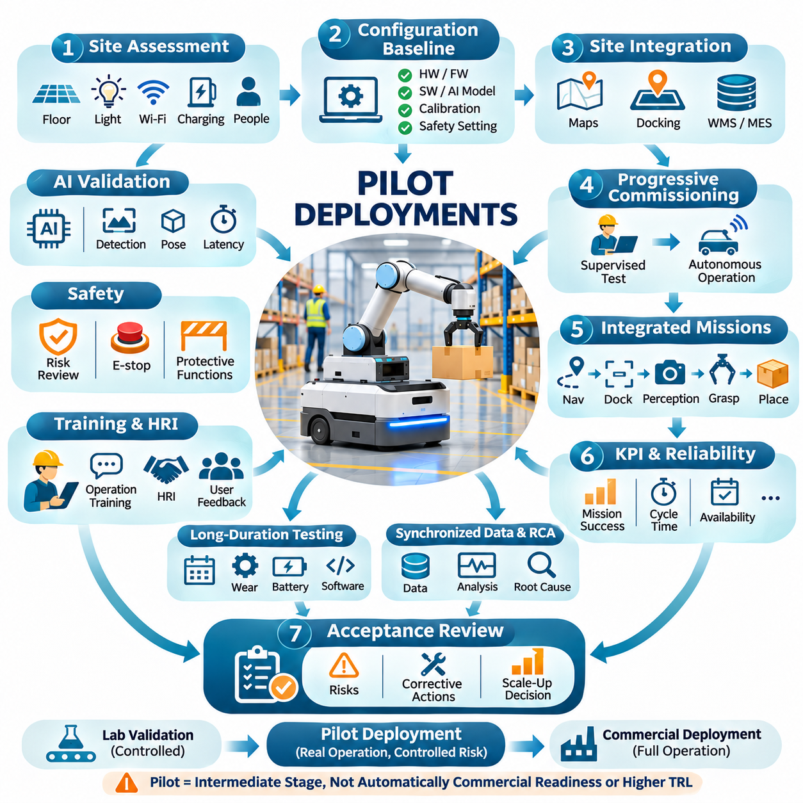{width="7.268055555555556in" height="7.268055555555556in"}

시범 배치(Pilot Deployment)는 모바일 매니퓰레이터(Mobile Manipulator)의 통제된 엔지니어링 검증(Engineering Validation)과 본격적인 상업적 배치(Commercial Deployment) 사이의 중간 단계를 의미한다. 주요 목적은 기술적 및 운영상의 위험을 통제하면서 실제 운영 환경에서 시스템의 역량을 평가하는 것이다. 실험실 시연(Laboratory Demonstration)과 달리 시범 배치에는 실제 인프라(Infrastructure), 대표적인 작업 부하(Workload), 운영 인력(Operational Personnel) 및 전체 로봇 성능에 영향을 미치는 환경적 변화(Environmental Variation)가 포함된다.

시범 배치는 제품 요구사항(Product Requirements), 고객 기대사항(Customer Expectations) 및 운영 시나리오(Operational Scenario)로부터 도출된 명확한 목표를 정의하는 것에서 시작해야 한다. 이러한 목표에는 입증해야 하는 기능, 달성해야 하는 성능 수준 및 조사해야 하는 시스템의 한계가 포함되어야 한다. 또한 프로젝트 요구사항이 통제되지 않은 상태에서 확장되는 것을 방지하기 위해 배치 범위(Deployment Scope)에는 로봇의 수량, 운영 장소, 임무 유형(Mission Type), 평가 기간(Evaluation Period) 및 참여 조직의 책임과 역할이 정의되어야 한다.

현장 선정(Site Selection)은 시범 배치 계획에서 기본적으로 고려해야 하는 요소이다. 선정된 환경은 목표 상업적 응용 분야를 대표할 수 있어야 하며, 엔지니어링 지원(Engineering Support)과 운영 모니터링(Operational Monitoring)을 위한 충분한 접근성을 제공해야 한다. 물류 창고(Warehouse), 제조 시설(Manufacturing Facility), 병원(Hospital) 및 상업적 서비스 환경은 서로 다른 인프라 요구사항과 운영상의 과제를 가진다. 사전 현장 평가(Preliminary Site Assessment)에서는 바닥 상태, 작업 공간 배치, 조명, 무선 통신 범위(Wireless Communication Coverage), 충전 인프라 및 인간의 활동을 조사해야 한다.

배치 이전에 엔지니어링 팀은 하드웨어 개정 버전(Hardware Revision), 펌웨어 버전(Firmware Version), 소프트웨어 패키지(Software Package), 인공지능 모델(AI Model), 보정 매개변수(Calibration Parameter) 및 안전 설정(Safety Setting)을 포함하는 통제된 시스템 구성(System Configuration)을 확립해야 한다. 이러한 구성 기준선(Configuration Baseline)은 이후의 성능 평가(Performance Evaluation)와 고장 분석(Failure Analysis)을 위한 기준을 제공한다. 시범 배치 프로그램 중에 도입되는 모든 변경사항은 추적성(Traceability)을 유지하고 일관성 없는 검증 결과를 방지하기 위해 형상 관리(Configuration Management) 절차에 따라 문서화해야 한다.

현장 준비(Site Preparation)는 모바일 매니퓰레이터를 기존 운영 인프라와 통합하는 과정이다. 자율주행 지도(Navigation Map), 위치 추정 기준(Localization Reference), 도킹 스테이션(Docking Station), 충전 시설(Charging Facility), 제한 구역(Restricted Zone) 및 조작 작업대(Manipulation Workstation)를 구축하고 검증해야 한다. 해당되는 경우 창고 관리 시스템(WMS, Warehouse Management System), 제조 실행 시스템(MES, Manufacturing Execution System), 플릿 관리 플랫폼(Fleet Management Platform) 및 외부 장비와의 통신 인터페이스(Communication Interface)도 평가해야 한다. 이러한 준비 과정은 로봇이 필수적인 운영 활동을 방해하지 않으면서 실제 작업 흐름(Workflow)에 참여할 수 있도록 한다.

시범 배치는 운영 복잡도(Operational Complexity)를 점진적으로 증가시키는 단계적 시운전(Progressive Commissioning) 절차를 따라야 한다. 초기 활동에는 감독하의 자율주행(Supervised Navigation), 위치 추정 검증(Localization Verification), 도킹 정확도(Docking Accuracy) 측정 및 기본 조작 작업이 포함될 수 있다. 이후 단계에서는 자율 임무 실행(Autonomous Mission Execution), 동적 장애물(Dynamic Obstacle), 가변적인 객체 위치 및 주변 장비와의 상호작용을 도입할 수 있다. 각 단계 간의 전환은 일정에 대한 압박이 아니라 사전에 정의된 안전성 및 성능 기준(Performance Criteria)을 충족하는지에 따라 결정해야 한다.

통합 임무 실행(Integrated Mission Execution)은 자율주행과 조작이 상호 협조적인 프로세스로 동작해야 하는 모바일 매니퓰레이터에서 특히 중요하다. 대표적인 임무에는 작업대로의 이동, 정확한 도킹 위치 확보, 목표 객체 검출(Target Object Detection), 조작 궤적(Manipulation Trajectory) 생성, 파지 실행(Grasp Execution), 객체 운반(Object Transportation) 및 배치(Placement) 완료가 포함될 수 있다. 시범 배치 평가에서는 개별 하위 시스템(Subsystem) 간의 전환과 실패한 작업으로부터의 복구(Recovery)를 포함한 전체 임무 수행 순서(Mission Sequence)를 평가해야 한다.

인공지능 성능(AI Performance)은 실제 배치 환경에서 수집된 데이터를 사용하여 평가해야 한다. 조명의 변화, 객체 외형(Object Appearance), 배경의 복잡성(Background Complexity), 가림 현상(Occlusion) 및 센서 품질(Sensor Quality)의 변화는 실험실 시험에서 발견되지 않았던 성능 한계를 드러낼 수 있다. 엔지니어는 객체 검출 정확도(Object Detection Accuracy), 자세 추정 오차(Pose Estimation Error), 파지 예측 신뢰성(Grasp Prediction Reliability), 추론 지연시간(Inference Latency) 및 신뢰도 분포(Confidence Distribution)를 모니터링해야 한다. 식별된 취약점은 통제된 데이터셋 확장(Dataset Expansion)과 후속 모델 개선(Model Improvement)의 방향을 결정하는 데 활용해야 한다.

안전 관리(Safety Management)는 시범 배치 전반에서 최우선 요구사항으로 유지되어야 한다. 자율 운영(Autonomous Operation)을 시작하기 전에 현장별 위험성 평가(Site-Specific Risk Assessment)를 수행하여 차량의 움직임, 매니퓰레이터 궤적(Manipulator Trajectory), 객체 취급(Object Handling), 인간의 근접 접근(Human Proximity) 및 예상하지 못한 시스템 고장과 관련된 잠재적 위험 요소(Hazard)를 식별해야 한다. 보호 기능(Protective Function), 비상 정지(Emergency Stop), 속도 제한(Speed Restriction), 충돌 방지 메커니즘(Collision Prevention Mechanism) 및 안전한 복구 절차(Safe Recovery Procedure)를 검증해야 한다. 운영 범위(Operational Boundary)는 적절한 안전 검토(Safety Review)와 승인이 이루어진 이후에만 확장해야 한다.

운영 인력(Operational Personnel)은 시범 배치 활동에 참여하기 전에 적절한 교육 및 훈련(Training)을 받아야 한다. 교육에는 정상적인 로봇 운영, 임무 할당(Mission Assignment), 상태 모니터링(Status Monitoring), 비상 대응 절차(Emergency Procedure), 고장 식별(Fault Identification) 및 권한이 부여된 복구 작업(Authorized Recovery Action)이 포함되어야 한다. 또한 운영자가 시스템의 동작을 이해하고 예상하지 못한 상황에 효과적으로 대응할 수 있는지를 판단하기 위해 인간-로봇 상호작용(HRI, Human-Robot Interaction)을 평가해야 한다. 운영자 피드백(Operator Feedback)은 사용성(Usability), 작업 흐름 호환성(Workflow Compatibility) 및 실질적인 유지보수 요구사항(Maintenance Requirements)에 관한 중요한 정보를 제공한다.

운영 성능(Operational Performance)은 사전에 정의된 핵심 성과 지표(KPI, Key Performance Indicator)를 통해 측정해야 한다. 주요 지표에는 임무 성공률(Mission Success Rate), 파지 성공률(Grasp Success Rate), 도킹 정확도(Docking Accuracy), 조작 정밀도(Manipulation Precision), 평균 사이클 시간(Average Cycle Time), 운영 가용성(Operational Availability), 개입 빈도(Intervention Frequency), 에너지 소비량(Energy Consumption) 및 복구 성공률(Recovery Success Rate)이 포함된다. 측정 과정에서는 자율적으로 완료된 작업과 인간의 지원이 필요한 작업을 구분해야 한다. 시범 배치 단계 간의 유의미한 비교를 위해서는 일관된 평가 방법과 대표적인 작업 부하가 필요하다.

장시간 시범 운영(Long-Duration Pilot Operation)은 시스템 신뢰성(System Reliability), 부품 내구성(Component Durability) 및 운영 안정성(Operational Stability)에 관한 근거를 제공한다. 반복적인 자율주행과 조작 사이클(Manipulation Cycle)은 기계적 마모(Mechanical Wear), 열적 한계(Thermal Limitation), 배터리 성능 저하(Battery Degradation), 보정값 편이(Calibration Drift), 통신 불안정성(Communication Instability) 및 소프트웨어 자원 소비(Software Resource Consumption)와 관련된 문제를 드러낼 수 있다. 자동 충전(Automated Charging)과 임무 재개(Mission Resumption) 기능도 평가해야 한다. 운영 시간, 완료된 임무, 고장 및 유지보수 활동에 관한 기록을 유지함으로써 신뢰성 평가(Reliability Assessment)와 제품 수명주기 평가(Lifecycle Assessment)를 지원할 수 있다.

운영 데이터 수집(Operational Data Collection)은 시범 배치 전반에서 지속적인 엔지니어링 개선(Continuous Engineering Improvement)을 지원해야 한다. 필요한 경우 시간 동기화된 센서 데이터(Time-Synchronized Sensor Data), 로봇 궤적(Robot Trajectory), 인공지능 추론 결과(AI Inference Result), 제어기 상태(Controller State), 진단 메시지(Diagnostic Message), 임무 이력(Mission History) 및 운영자 개입(Operator Intervention)을 기록해야 한다. 고장 이벤트(Failure Event)는 발생 당시의 환경 조건 및 시스템 구성과 연계하여 기록해야 한다. 이러한 정보는 근본 원인 분석(RCA, Root Cause Analysis), 회귀 시험(Regression Testing) 및 하드웨어, 소프트웨어, 인공지능 하위 시스템 전반의 체계적인 개선을 가능하게 한다.

시범 배치 결과는 엔지니어링 팀, 운영 인력 및 고객 대표가 참여하는 공식적인 인수 평가(Acceptance Assessment)와 준비도 평가(Readiness Assessment)를 통해 검토해야 한다. 해결되지 않은 문제는 심각도(Severity), 운영 영향(Operational Impact) 및 시정 조치 요구사항(Corrective Action Requirements)에 따라 분류해야 한다. 시범 배치 프로그램을 성공적으로 완료했다고 해서 상용화 준비도(Commercial Readiness) 또는 더 높은 기술 성숙도(TRL, Technology Readiness Level)가 자동으로 확보되는 것은 아니다. 최종 의사결정에서는 문서화된 검증 근거(Validation Evidence), 잔존 위험(Residual Risk), 운영 경제성(Operational Economics), 유지보수성(Maintainability) 및 여러 현장으로 배치를 확장할 수 있는 실현 가능성(Deployment Scalability Feasibility)을 종합적으로 고려해야 한다.

## 03 Warehouse Validation

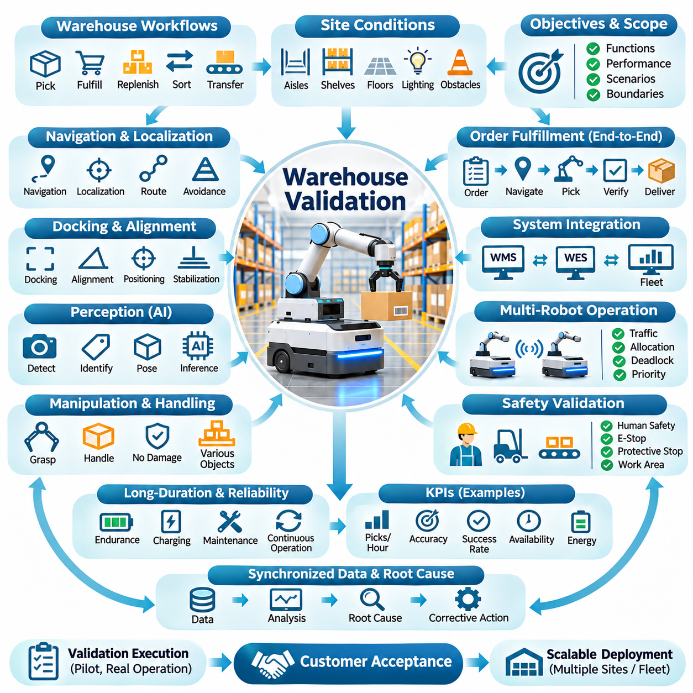{width="7.268055555555556in" height="7.268055555555556in"}

물류 창고 검증(Warehouse Validation)은 물류 및 유통 환경에서 모바일 매니퓰레이터(Mobile Manipulator)의 운영 적합성(Operational Suitability)을 평가하는 과정이다. 통제된 실험실 시험(Laboratory Testing)과 달리 물류 창고 검증에서는 통합 로봇 시스템을 실제 자재 취급 요구사항(Material Handling Requirements), 동적인 교통 상황(Dynamic Traffic Conditions), 지속적으로 변화하는 재고(Inventory) 및 작업자와의 상호작용에 노출시킨다. 주요 목적은 자율주행(Autonomous Navigation)과 조작(Manipulation)이 기존 물류 창고 운영을 안정적으로 지원할 수 있는지를 판단하는 것이다.

검증 과정은 물류 창고의 작업 흐름(Workflow)과 운영 요구사항(Operational Requirements)을 분석하는 것에서 시작해야 한다. 대표적인 응용 분야에는 상품 피킹(Item Picking), 주문 처리(Order Fulfillment), 재고 보충(Inventory Replenishment), 물류 용기 운반(Tote Transportation), 제품 분류(Product Sorting) 및 작업대 간 자재 이송(Material Transfer)이 포함된다. 각 응용 분야는 자율주행 정확도(Navigation Accuracy), 조작 능력(Manipulation Capability), 적재물 취급(Payload Handling) 및 작업 실행(Task Execution)에 대해 서로 다른 요구사항을 가진다. 대표적인 운영 시나리오(Operational Scenario)는 목표 응용 분야와 고객 요구사항(Customer Requirements)에 따라 선정해야 한다.

자율 운영(Autonomous Operation)을 시작하기 전에 물류 창고의 물리적 특성(Physical Characteristics)을 평가해야 한다. 통로 폭(Aisle Width), 선반 구성(Shelving Configuration), 바닥 상태(Floor Condition), 적재 높이(Storage Height), 조명 변화(Lighting Variation), 상하차 구역(Loading Area) 및 일시적 장애물(Temporary Obstacle)은 시스템 성능에 상당한 영향을 미칠 수 있다. 검증팀은 접근 가능한 작업 공간(Accessible Workspace), 허용된 이동 경로(Permissible Travel Route), 조작 구역(Manipulation Zone), 충전 위치(Charging Location) 및 추가적인 안전 예방 조치가 필요한 구역을 정의하는 운영 범위(Operational Boundary)를 설정해야 한다.

자율주행 검증(Navigation Validation)은 이동 플랫폼(Mobile Platform)이 대표적인 물류 창고 환경에서 안정적으로 이동할 수 있는지를 평가해야 한다. 로봇은 좁은 통로(Narrow Aisle), 교차로(Intersection), 적재 구역(Storage Area) 및 동적으로 변화하는 주변 환경에서 이동하는 동안 위치 추정 정확도(Localization Accuracy)를 유지해야 한다. 반복적인 선반 구조와 재고 분포의 변화는 위치 추정 모호성(Localization Ambiguity)을 유발할 수 있다. 검증에서는 자율주행 성공률(Navigation Success Rate), 경로 효율성(Route Efficiency), 위치 결정 오차(Positioning Error), 장애물 회피(Obstacle Avoidance) 및 위치 추정 실패로부터의 복구(Recovery)를 측정해야 한다.

도킹(Docking)과 작업대 정렬(Workstation Alignment)은 조작 정확도가 로봇 팔과 목표 작업 공간 사이의 상대 위치(Relative Position)에 의존하기 때문에 특히 중요하다. 이동 플랫폼에서 발생하는 작은 위치 결정 오차도 조작 시스템 전체로 전파되어 파지 신뢰성(Grasping Reliability)을 저하시킬 수 있다. 검증에서는 서로 다른 적재 하중(Payload Condition), 접근 방향(Approach Direction) 및 바닥 특성(Floor Characteristics)에서 도킹 반복 정밀도(Docking Repeatability), 각도 정렬(Angular Alignment), 이동 플랫폼 안정화(Base Stabilization) 및 엔드 이펙터 위치 결정 정확도(End-Effector Positioning Accuracy)를 측정해야 한다.

물류 창고의 인지 시스템(Perception System)은 실제 적재 환경에서 신뢰할 수 있는 객체 검출(Object Detection), 객체 식별(Object Identification) 및 자세 추정(Pose Estimation) 성능을 입증해야 한다. 제품은 크기, 포장 재질(Packaging Material), 색상, 질감(Texture) 및 표면 반사율(Surface Reflectivity)에서 차이를 보일 수 있다. 또한 객체가 부분적으로 가려지거나(Partially Occluded), 밀집되어 적재되거나, 불규칙하게 배치될 수 있다. 검증에서는 대표적인 제품 유형과 환경 변화에 따른 인지 정확도(Perception Accuracy), 깊이 측정 품질(Depth Measurement Quality), 추론 지연시간(Inference Latency) 및 모델 강건성(Model Robustness)을 평가해야 한다.

조작 검증(Manipulation Validation)은 대표적인 물류 창고 재고에 대한 전체 취급 과정(Handling Process)을 평가해야 한다. 로봇은 목표 객체를 식별하고, 실현 가능한 파지 구성(Grasp Configuration)을 생성하며, 충돌 없는 궤적(Collision-Free Trajectory)을 실행하고, 안정적인 접촉(Stable Contact)을 형성하며, 제품에 손상을 주지 않고 이송할 수 있어야 한다. 검증에는 서로 다른 중량, 기하학적 형상(Geometry), 표면 재질(Surface Material) 및 포장 특성(Packaging Characteristics)을 가진 객체가 포함되어야 한다. 파지 성공률(Grasp Success Rate)과 취급 실패(Handling Failure)는 객체 유형 및 운영 조건에 따라 분석해야 한다.

통합 주문 처리 검증(Integrated Order Fulfillment Validation)은 작업 할당(Task Assignment)부터 성공적인 제품 배송(Product Delivery)까지의 전체 임무를 평가해야 한다. 대표적인 임무에는 주문 수신(Order Reception), 적재 위치로의 자율주행, 요청된 상품 식별, 파지 수행(Grasp Execution), 제품 식별 정보 확인(Product Identity Verification) 및 지정된 작업대로의 상품 운반이 포함될 수 있다. 시스템은 실행 과정 전반에서 정확한 작업 상태(Task State)와 재고 기록(Inventory Record)을 유지하면서 불완전하거나 잘못된 작업을 감지하고 복구할 수 있어야 한다.

창고 관리 시스템(WMS, Warehouse Management System), 창고 실행 시스템(WES, Warehouse Execution System) 및 플릿 관리 플랫폼(Fleet Management Platform)이 구축된 환경에서는 이러한 시스템과의 통합이 협조적인 운영(Coordinated Operation)을 위해 필수적이다. 검증에서는 작업 요청(Task Request), 재고 정보(Inventory Information), 로봇 상태(Robot Status), 임무 진행 상황(Mission Progress) 및 완료 통지(Completion Notification)가 일관되게 교환되는지를 확인해야 한다. 또한 신뢰할 수 있는 동기화(Synchronization) 및 복구 동작(Recovery Behavior)을 검증하기 위해 통신 중단(Communication Interruption), 중복 명령(Duplicate Command), 응답 지연(Delayed Response) 및 일관되지 않은 재고 기록을 평가해야 한다.

다중 로봇 운영(Multi-Robot Operation)은 교통 조정(Traffic Coordination), 공유 작업 공간(Shared Workspace), 자원 할당(Resource Allocation) 및 작업 스케줄링(Task Scheduling)과 관련된 추가적인 과제를 발생시킨다. 여러 모바일 매니퓰레이터가 좁은 통로, 피킹 작업대(Picking Station), 엘리베이터 또는 충전 시설을 동시에 이용하기 위해 경쟁할 수 있다. 검증에서는 혼잡 관리(Congestion Management), 충돌 및 경합 해결(Conflict Resolution), 교착 상태 방지(Deadlock Prevention) 및 우선순위 처리(Priority Handling)를 평가해야 한다. 배치 확장성(Deployment Scalability)에 영향을 미치는 한계를 식별하기 위해 플릿 수준 성능(Fleet-Level Performance)은 개별 로봇의 성능과 구분하여 평가해야 한다.

안전 검증(Safety Validation)은 모바일 매니퓰레이터, 물류 창고 작업자, 지게차(Forklift), 컨베이어(Conveyor) 및 기타 자동화 장비 간의 상호작용을 다루어야 한다. 특히 이동 플랫폼의 외곽 영역(Footprint)을 벗어나는 매니퓰레이터의 움직임, 불안정한 적재물(Unstable Payload), 예상하지 못한 보행자의 움직임 및 제한된 가시성(Restricted Visibility)에 주의를 기울여야 한다. 자율 운영 활동을 확대하기 전에 대표적인 운영 조건에서 보호 정지 기능(Protective Stopping Function), 비상 정지 메커니즘(Emergency Stop Mechanism), 속도 제한(Speed Limitation) 및 작업 공간 제한(Workspace Restriction)을 검증해야 한다.

물류 창고 환경에서는 여러 교대 근무(Multiple Shifts)에 걸친 연속 운영(Continuous Operation)이 요구되는 경우가 많다. 장시간 검증(Long-Duration Validation)에서는 배터리 지속 시간(Battery Endurance), 자동 충전(Automatic Charging), 열적 안정성(Thermal Stability), 기계적 마모(Mechanical Wear), 보정값 편이(Calibration Drift) 및 소프트웨어 신뢰성(Software Reliability)을 평가해야 한다. 반복적인 피킹 및 운반 사이클(Transportation Cycle)은 단기간의 시연에서는 발견되지 않는 고장을 드러낼 수 있다. 장시간 검증 기간 전체에 걸쳐 운영 가용성(Operational Availability), 평균 고장 간격(MTBF, Mean Time Between Failures), 유지보수 빈도(Maintenance Frequency) 및 복구 소요 시간(Recovery Duration)을 기록해야 한다.

성능 평가(Performance Evaluation)는 로봇의 역량과 물류 창고의 생산성(Warehouse Productivity)을 모두 반영하는 사전에 정의된 핵심 성과 지표(KPI, Key Performance Indicator)를 기반으로 수행해야 한다. 주요 지표에는 시간당 피킹 상품 수(Items Picked per Hour), 주문 완료 시간(Order Completion Time), 임무 성공률(Mission Success Rate), 피킹 정확도(Picking Accuracy), 파지 성공률(Grasp Success Rate), 개입 빈도(Intervention Frequency), 운영 가용성 및 완료된 임무당 에너지 소비량(Energy Consumption per Completed Mission)이 포함된다. 측정 과정에서는 성공적인 자율 운영과 인간의 지원 또는 추가적인 시정 조치(Corrective Action)를 통해 완료된 작업을 구분해야 한다.

운영 데이터 수집(Operational Data Collection)은 성능 병목현상(Performance Bottleneck)을 식별하고 물류 창고 자동화 시스템(Warehouse Automation System)을 개선하기 위한 기반을 제공한다. 자율주행 궤적(Navigation Trajectory), 센서 기록(Sensor Recording), 인지 결과(Perception Output), 파지 결과(Grasping Result), 작업 실행 이력(Task Execution History), 시스템 진단(System Diagnostics) 및 운영자 피드백(Operator Feedback)은 동기화된 타임스탬프(Synchronized Timestamp)를 사용하여 수집해야 한다. 고장 이벤트(Failure Event)는 근본 원인 분석(RCA, Root Cause Analysis)과 재현 가능한 회귀 시험(Regression Testing)을 지원하기 위해 제품 특성, 환경 조건 및 시스템 구성(System Configuration)과 연계하여 기록해야 한다.

물류 창고 검증은 궁극적으로 모바일 매니퓰레이터가 지속 가능한 운영적 및 경제적 이점(Operational and Economic Benefits)을 제공할 수 있는지를 판단해야 한다. 생산성 향상(Productivity Improvement)은 인프라 비용(Infrastructure Cost), 유지보수 요구사항(Maintenance Requirements), 재고 정확도(Inventory Accuracy), 시스템 가용성(System Availability) 및 잔존 안전 위험(Residual Safety Risk)과 함께 평가해야 한다. 문서화된 검증 결과(Validation Result)는 고객 인수(Customer Acceptance), 운영 확장(Operational Expansion), 제조 준비(Manufacturing Preparation) 및 시범 배치(Pilot Deployment)에서 확장 가능한 상업적 물류 창고 자동화(Scalable Commercial Warehouse Automation)로 전환하기 위해 필요한 조건을 확립해야 한다.

## 04 Factory Validation

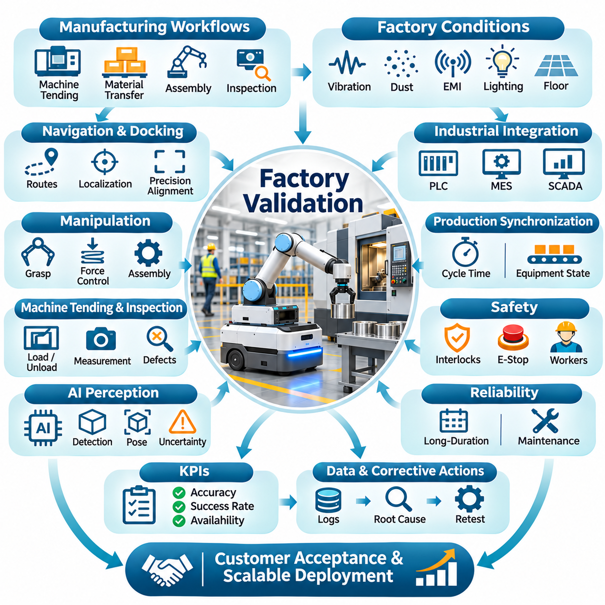{width="7.268055555555556in" height="7.268055555555556in"}

공장 검증(Factory Validation)은 모바일 매니퓰레이터(Mobile Manipulator)가 실제 제조 환경에서 신뢰성(Reliability), 안전성(Safety) 및 효과성(Effectiveness)을 확보하며 운영될 수 있는지를 평가하는 과정이다. 실험실 시험(Laboratory Testing)과 달리 공장 검증에서는 통합 로봇 시스템을 산업 작업 부하(Industrial Workload), 생산 일정(Production Schedule), 기계 장비(Machinery), 환경적 외란(Environmental Disturbance) 및 작업자와의 상호작용에 노출시킨다. 주요 목적은 모바일 매니퓰레이션(Mobile Manipulation)이 생산 안정성(Production Stability)을 저해하지 않으면서 제조 운영을 지원할 수 있다는 실질적인 근거를 확보하는 것이다.

검증 과정은 제조 작업 흐름(Manufacturing Workflow)과 생산 요구사항(Production Requirements)을 분석하는 것에서 시작해야 한다. 대표적인 응용 분야에는 머신 텐딩(Machine Tending), 부품 운반(Component Transportation), 조립 지원(Assembly Assistance), 자동 검사(Automated Inspection), 자재 공급(Material Feeding) 및 완제품 취급(Finished Product Handling)이 포함된다. 각각의 응용 분야는 위치 결정 정확도(Positioning Accuracy), 조작 정밀도(Manipulation Precision), 운영 타이밍(Operational Timing) 및 장비 간 협조(Equipment Coordination)에 대해 서로 다른 요구사항을 가진다. 검증 시나리오(Validation Scenario)는 실제 제조 공정과 고객의 기대사항을 반영해야 한다.

공장 환경에는 로봇 성능에 상당한 영향을 미칠 수 있는 물리적 및 환경적 과제가 존재한다. 바닥의 불균일성(Floor Irregularity), 산업 진동(Industrial Vibration), 전자기 간섭(EMI, Electromagnetic Interference), 공기 중 부유 입자(Airborne Particle), 온도 변화(Temperature Variation) 및 조명 조건의 변화(Illumination Variation)는 검증 과정에서 고려해야 한다. 엔지니어링 팀은 기계 구조물(Mechanical Structure), 전기 시스템(Electrical System), 센서(Sensor) 및 컴퓨팅 플랫폼(Computing Platform)이 지정된 운영 조건에서 목표 성능을 유지할 수 있는지를 평가해야 한다.

자율주행 검증(Navigation Validation)은 이동 플랫폼(Mobile Platform)이 생산 장비, 조립 라인(Assembly Line), 적재 구역(Storage Area) 및 이동 중인 산업용 차량(Industrial Vehicle) 주변에서 안정적으로 동작할 수 있음을 입증해야 한다. 동적 장애물(Dynamic Obstacle)과 공장 배치(Factory Layout)의 변화는 위치 추정 정확도(Localization Accuracy)와 경로 계획 성능(Path Planning Performance)에 영향을 미칠 수 있다. 검증에서는 자율주행 반복 정밀도(Navigation Repeatability), 경로 완료 시간(Route Completion Time), 장애물 회피(Obstacle Avoidance), 위치 추정 복구(Localization Recovery) 및 지정된 생산 구역 내에서 예측 가능한 움직임을 유지하는 능력을 평가해야 한다.

정밀 도킹(Precision Docking)과 작업대 정렬(Workstation Alignment)은 모바일 매니퓰레이터를 활용하는 제조 응용 분야의 핵심 요구사항이다. 머신 텐딩(Machine Tending), 부품 삽입(Component Insertion) 및 자동 검사(Automated Inspection)는 일반적인 자율주행을 통해 달성할 수 있는 위치 결정 정확도보다 훨씬 높은 수준의 정확도를 요구할 수 있다. 검증에서는 이동 플랫폼의 위치 결정(Mobile Base Positioning), 국부 기준 측정(Local Reference Measurement), 좌표 변환(Coordinate Transformation), 기계적 변형(Mechanical Deflection) 및 매니퓰레이터의 반복 정밀도(Manipulator Repeatability)가 복합적으로 미치는 영향을 평가해야 한다.

조작 검증(Manipulation Validation)은 대표적인 생산 조건에서 로봇 팔(Robotic Arm)이 산업 작업을 수행할 수 있는 능력을 평가해야 한다. 부품은 기하학적 형상(Geometry), 중량, 방향(Orientation), 치수 공차(Dimensional Tolerance) 및 표면 특성(Surface Characteristics)에서 차이를 보일 수 있다. 로봇은 실현 가능한 파지 구성(Grasp Configuration)을 생성하고, 충돌 없는 궤적(Collision-Free Trajectory)을 실행하며, 안정적인 객체 취급(Object Handling) 상태를 유지해야 한다. 기계적 접촉(Mechanical Contact)이나 정밀 조립(Precision Assembly)이 필요한 작업에서는 힘 제어(Force Control)와 순응 조작(Compliant Manipulation)도 평가해야 한다.

머신 텐딩 검증(Machine Tending Validation)은 모바일 매니퓰레이터와 제조 장비(Manufacturing Equipment) 간의 전체 상호작용을 평가해야 한다. 대표적인 작업에는 원자재 투입(Raw Material Loading), 가공된 부품의 제거(Processed Component Removal), 기계 도어 개방(Machine Door Opening) 및 고정구 교체(Fixture Exchange)가 포함된다. 로봇은 기계의 운영 상태(Machine Operating State) 및 승인된 접근 조건(Authorized Access Condition)에 따라 자신의 움직임을 조정해야 한다. 통신 장애(Communication Failure), 불완전한 자재 투입 작업 및 예상하지 못한 기계 정지는 통제된 복구 시나리오(Controlled Recovery Scenario)에 포함되어야 한다.

자동 검사 응용 분야(Automated Inspection Application)에서는 로봇의 위치 결정 성능과 측정 성능(Measurement Performance)을 모두 검증해야 한다. 카메라(Camera), 레이저 스캐너(Laser Scanner) 또는 기타 검사 센서(Inspection Sensor)를 탑재한 모바일 매니퓰레이터는 적절한 측정 거리(Measurement Distance), 관측 각도(Viewing Angle) 및 위치 안정성(Positional Stability)을 유지해야 한다. 검증에서는 검사 반복 정밀도(Inspection Repeatability), 측정 불확도(Measurement Uncertainty), 결함 검출 정확도(Defect Detection Accuracy) 및 검사 범위의 완전성(Coverage Completeness)을 평가해야 한다. 기록된 검사 결과는 개별 제품 및 생산 기록(Production Record)과의 추적성(Traceability)도 유지해야 한다.

인공지능 검증(AI Validation)은 실제 제조 조건에서 발생하는 다양한 변화를 고려해야 한다. 반사성이 높은 금속 표면(Reflective Metal Surface), 시각적으로 유사한 부품(Visually Similar Component), 부분적인 가림 현상(Partial Occlusion), 변화하는 배경 및 불균일한 조명은 인지 성능(Perception Performance)에 영향을 미칠 수 있다. 엔지니어는 대표적인 생산 데이터(Production Data)를 활용하여 객체 검출(Object Detection), 자세 추정(Pose Estimation), 결함 인식(Defect Recognition) 및 추론 지연시간(Inference Latency)을 평가해야 한다. 불확실한 예측(Uncertain Prediction)이 발생하는 경우 통제되지 않은 물리적 행동이 아니라 적절한 대체 대응 절차(Fallback Procedure)가 실행되어야 한다.

산업 자동화 시스템(Industrial Automation System)과의 통합은 협조적인 공장 운영(Coordinated Factory Operation)을 위해 필수적이다. 모바일 매니퓰레이터는 프로그래머블 로직 컨트롤러(PLC, Programmable Logic Controller), 제조 실행 시스템(MES, Manufacturing Execution System), 감시 제어 및 데이터 수집 시스템(SCADA, Supervisory Control and Data Acquisition) 및 플릿 관리 플랫폼(Fleet Management Platform)과 통신할 수 있다. 검증에서는 신뢰할 수 있는 명령 교환(Command Exchange), 장비 상태 동기화(Equipment State Synchronization), 작업 승인(Task Authorization), 완료 보고(Completion Reporting) 및 중단되거나 일관되지 않은 통신으로부터의 복구를 확인해야 한다.

생산 동기화(Production Synchronization)는 모바일 매니퓰레이터가 제조 사이클 시간 요구사항(Manufacturing Cycle Time Requirements)을 충족할 수 있는지를 판단하기 위해 평가해야 한다. 자재 공급 지연(Delayed Material Delivery), 부정확한 부품 배치(Inaccurate Component Placement) 또는 장시간의 복구 절차는 생산 병목현상(Production Bottleneck)을 유발할 수 있다. 검증에서는 작업 실행 시간(Task Execution Time), 대기 시간(Waiting Time), 장비 활용률(Equipment Utilization) 및 협조 동작 지연(Coordination Delay)을 측정해야 한다. 대표적인 작업 부하의 변동(Workload Fluctuation)과 생산 우선순위(Production Priority)의 변화 중에도 허용 가능한 성능을 유지해야 한다.

안전 검증(Safety Validation)은 모바일 로봇(Mobile Robot), 산업용 기계(Industrial Machinery), 작업자 및 운반 중인 부품 간의 상호작용에서 발생하는 위험 요소(Hazard)를 다루어야 한다. 특히 확장된 매니퓰레이터 작업 공간(Extended Manipulator Workspace), 움직이는 장비(Moving Equipment), 공중에 매달린 적재물(Suspended Payload) 및 제한된 가시성(Restricted Visibility)에 주의를 기울여야 한다. 보호 정지 기능(Protective Stopping Function), 안전 인터록(Safety Interlock), 비상 정지(Emergency Stop), 속도 제한(Speed Restriction) 및 승인된 재시작 절차(Authorized Restart Procedure)는 응용 분야별 위험성 평가(Application-Specific Risk Assessment)에 따라 검증해야 한다.

장시간 공장 운영(Long-Duration Factory Operation)은 기계적 내구성(Mechanical Durability), 전기적 신뢰성(Electrical Reliability), 열적 안정성(Thermal Stability) 및 소프트웨어 강건성(Software Robustness)에 관한 중요한 근거를 제공한다. 반복적인 운반 및 조작 사이클(Manipulation Cycle)은 액추에이터 마모(Actuator Wear), 커넥터 성능 저하(Connector Degradation), 배터리 열화(Battery Deterioration), 보정값 편이(Calibration Drift) 또는 컴퓨팅 자원 한계(Computing Resource Limitation)를 드러낼 수 있다. 검증에서는 운영 시간(Operating Hours), 완료된 생산 작업, 예상하지 못한 고장, 충전 사이클(Charging Cycle), 유지보수 활동(Maintenance Activity) 및 정상 운영 상태를 복원하는 데 필요한 시간을 기록해야 한다.

공장 성능(Factory Performance)은 사전에 정의된 핵심 성과 지표(KPI, Key Performance Indicator)를 통해 평가해야 하며, 여기에는 임무 성공률(Mission Success Rate), 도킹 정확도(Docking Accuracy), 조작 정밀도(Manipulation Precision), 생산 사이클 시간(Production Cycle Time), 운영 가용성(Operational Availability) 및 개입 빈도(Intervention Frequency)가 포함된다. 추가적인 지표에는 최초 조립 성공률(First-Pass Assembly Success), 검사 정확도(Inspection Accuracy), 장비 대기 시간(Equipment Waiting Time) 및 완료된 작업당 에너지 소비량(Energy Consumption per Completed Task)이 포함될 수 있다. 측정 과정에서는 자율 운영(Autonomous Operation)과 수동 지원(Manual Assistance)이 필요한 활동을 구분해야 한다.

운영 데이터 수집(Operational Data Collection)은 제조 조건(Manufacturing Condition), 로봇의 행동(Robotic Action) 및 생산 결과(Production Outcome) 간의 추적성을 확립해야 한다. 시간 동기화된 센서 기록(Time-Synchronized Sensor Recording), 자율주행 궤적(Navigation Trajectory), 매니퓰레이터 상태(Manipulator State), 인공지능 추론 결과(AI Inference Result), 장비 신호(Equipment Signal) 및 진단 기록(Diagnostic Record)은 체계적인 고장 분석(Failure Analysis)을 위한 근거를 제공한다. 통제된 시정 조치(Corrective Action)와 회귀 시험(Regression Testing)을 통해 시스템 변경사항이 허용할 수 없는 운영 위험을 초래하지 않으면서 성능을 개선하는지를 확인해야 한다.

공장 검증은 궁극적으로 모바일 매니퓰레이터가 기술적, 안전적 및 경제적 요구사항을 충족하면서 지속 가능한 제조상의 이점(Sustainable Manufacturing Benefits)을 제공할 수 있는지를 판단해야 한다. 생산성 향상(Productivity Improvement)은 통합 비용(Integration Cost), 유지보수 요구사항(Maintenance Requirements), 시스템 가용성(System Availability) 및 생산 품질(Production Quality)과 함께 고려해야 한다. 문서화된 검증 결과(Documented Validation Result)는 고객 인수(Customer Acceptance), 기술 성숙도 평가(TRL Assessment), 제조 준비(Manufacturing Preparation) 및 확장 가능한 산업적 배치(Scalable Industrial Deployment)로의 확대를 지원해야 한다.

## 05 Hospital Validation

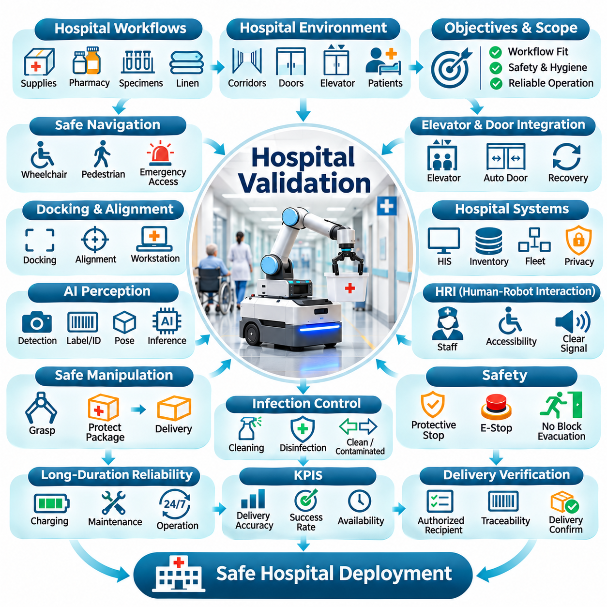{width="7.268055555555556in" height="7.268055555555556in"}

병원 검증(Hospital Validation)은 모바일 매니퓰레이터(Mobile Manipulator)가 의료 환경(Healthcare Environment)에서 안전하고 신뢰성 있으며 효과적으로 운영될 수 있는지를 평가하는 과정이다. 물류 창고 및 공장 응용 분야와 달리 병원에는 취약한 환자(Vulnerable Patient), 의료 인력(Medical Personnel), 민감한 의료 장비(Sensitive Equipment), 엄격한 위생 요구사항(Hygiene Requirements) 및 지속적으로 변화하는 운영 조건이 존재한다. 검증에서는 로봇 시스템이 환자 안전(Patient Safety)이나 임상 운영(Clinical Operation)을 저해하지 않으면서 의료 작업 흐름(Healthcare Workflow)을 지원할 수 있음을 입증해야 한다.

검증 과정은 병원의 작업 흐름(Hospital Workflow)과 운영 요구사항(Operational Requirements)을 분석하는 것에서 시작해야 한다. 대표적인 응용 분야에는 의료용품 운반(Medical Supply Transportation), 의약품 배송(Pharmaceutical Distribution), 실험실 검체 배송(Laboratory Specimen Delivery), 린넨 취급(Linen Handling) 및 자동 재고 보충(Automated Inventory Replenishment)이 포함된다. 각각의 응용 분야는 자율주행(Navigation), 조작(Manipulation), 위생(Hygiene), 접근성(Accessibility) 및 배송 정확도(Delivery Accuracy)에 대해 서로 다른 요구사항을 가지며, 이러한 요구사항은 대표적인 검증 시나리오(Validation Scenario)에 반영되어야 한다.

병원 환경에는 고유한 물리적 및 운영상의 과제가 존재한다. 좁은 복도(Narrow Corridor), 자동문(Automatic Door), 엘리베이터(Elevator), 환자 병실(Patient Room), 간호사 스테이션(Nursing Station) 및 혼잡한 대기 구역(Crowded Waiting Area)은 로봇 성능에 영향을 미칠 수 있다. 검증에서는 바닥 단차 및 전환 구간(Floor Transition), 접근성 제약(Accessibility Constraint), 통신 범위(Communication Coverage) 및 동적인 보행자 통행(Dynamic Pedestrian Traffic)을 평가해야 한다. 운영 범위(Operational Boundary)는 로봇의 승인된 작업 공간과 제한된 임상 및 응급 구역을 명확하게 구분해야 한다.

자율주행 검증(Navigation Validation)은 이동 플랫폼(Mobile Platform)이 공유된 병원 환경에서 예측 가능한 방식으로 이동할 수 있는 능력을 평가해야 한다. 휠체어를 사용하는 환자, 의료 장비를 운반하는 의료 인력 및 이동 능력이 제한된 보행자는 예측하기 어려운 이동 패턴(Movement Pattern)을 나타낼 수 있다. 로봇은 변화하는 통행 상황과 응급 접근 요구사항(Emergency Access Requirements)에 대응하면서 위치 추정 정확도(Localization Accuracy), 적절한 안전 이격 거리(Separation Distance) 및 안전한 주행 속도(Safe Travel Speed)를 유지해야 한다.

엘리베이터 및 자동문 통합(Elevator and Automatic Door Integration)은 여러 층에서 운영되는 병원 로봇(Hospital Robot)에 특히 중요하다. 검증에서는 엘리베이터 호출(Elevator Request), 엘리베이터 진입, 목적층 선택(Destination Selection), 안전한 진출 및 할당된 임무의 지속적인 수행을 포함하는 전체 실행 순서(Execution Sequence)를 평가해야 한다. 통신 중단(Communication Interruption), 예상하지 못한 탑승 상황(Unexpected Occupancy), 엘리베이터 이용 불가(Unavailable Elevator) 및 출입문 닫힘 이벤트(Door Closing Event)는 통제된 복구 시나리오(Controlled Recovery Scenario)에 포함되어야 한다.

정밀 도킹(Precision Docking)과 작업대 정렬(Workstation Alignment)은 의료용품 공급 스테이션(Medical Supply Station), 보관 캐비닛(Storage Cabinet), 실험실 인터페이스(Laboratory Interface) 및 충전 시설(Charging Facility)에서 검증해야 한다. 위치 결정 오차(Positioning Error)는 조작 정확도를 저하시키거나 주변 의료 장비에 간섭을 일으킬 수 있다. 엔지니어는 대표적인 운영 조건에서 도킹 반복 정밀도(Docking Repeatability), 각도 정렬(Angular Alignment), 이동 플랫폼 안정화(Base Stabilization) 및 매니퓰레이터와 목표 작업 공간 간의 상대 위치 결정(Relative Positioning) 성능을 평가해야 한다.

인지 및 인공지능 검증(Perception and AI Validation)은 의료 환경의 시각적 복잡성(Visual Complexity)을 고려해야 한다. 의료용 용기(Medical Container), 투명 포장재(Transparent Packaging), 반사성이 높은 의료 기구(Reflective Instrument), 라벨(Label) 및 시각적으로 유사한 의약품(Visually Similar Pharmaceutical Product)은 객체 인식(Object Recognition)에 어려움을 발생시킬 수 있다. 검증에서는 부정확하거나 승인되지 않은 물리적 행동을 방지하기 위해 객체 검출 정확도(Object Detection Accuracy), 식별 신뢰성(Identification Reliability), 자세 추정(Pose Estimation), 추론 지연시간(Inference Latency) 및 불확실성 처리(Uncertainty Handling)를 평가해야 한다.

조작 검증(Manipulation Validation)은 대표적인 의료용 객체 및 의료용품에 대한 전체 취급 과정(Handling Process)을 평가해야 한다. 로봇은 포장재를 손상시키거나 보호된 표면(Protected Surface)을 오염시키거나 용기의 무결성(Container Integrity)을 저해하지 않으면서 물품을 파지(Grasping), 운반(Transportation) 및 배치(Placement)할 수 있어야 한다. 서로 다른 객체의 기하학적 형상(Geometry), 중량, 재질(Material) 및 파손 취약성 수준(Fragility Level)이 검증에 포함되어야 한다. 또한 취급 절차(Handling Procedure)는 요구되는 객체의 방향(Orientation)과 보관 조건(Storage Condition)을 유지해야 한다.

감염 예방(Infection Prevention)과 위생 관리(Hygiene Management)는 병원 검증의 필수적인 구성 요소이다. 로봇의 표면(Robotic Surface), 그리퍼(Gripper), 휠(Wheel) 및 보관 공간(Storage Compartment)은 잠재적인 교차 오염(Cross-Contamination)의 원인이 될 수 있다. 검증에서는 승인된 세정제(Approved Cleaning Agent)에 대한 재질 호환성(Material Compatibility), 소독 접근성(Disinfection Accessibility), 세척 효과성(Cleaning Effectiveness) 및 청결 작업 흐름(Clean Workflow)과 오염 작업 흐름(Contaminated Workflow) 간의 분리를 평가해야 한다. 관련 절차는 병원의 감염 관리 요구사항(Infection Control Requirements)을 준수해야 한다.

인간-로봇 상호작용(HRI, Human-Robot Interaction)은 병원 로봇이 다양한 신체적 및 인지적 능력(Physical and Cognitive Abilities)을 가진 사람들 주변에서 운영되기 때문에 특히 중요하다. 시스템은 환자에게 불필요한 방해를 일으키지 않으면서 이해하기 쉬운 시각적 신호(Visual Signal) 또는 청각적 신호(Auditory Signal)를 통해 자신의 행동 의도를 전달해야 한다. 검증에서는 보행자 반응(Pedestrian Response), 운영자 상호작용(Operator Interaction), 접근성(Accessibility), 체감 안전성(Perceived Safety) 및 의료 인력이 로봇 운영을 중단하거나 변경할 수 있는 능력을 평가해야 한다.

안전 검증(Safety Validation)은 이동 플랫폼, 확장된 매니퓰레이터 작업 공간(Extended Manipulator Workspace), 운반 중인 의료용품 및 예상하지 못한 인간의 움직임과 관련된 위험 요소(Hazard)를 다루어야 한다. 보호 정지 기능(Protective Stopping Function), 비상 정지 메커니즘(Emergency Stop Mechanism), 속도 제한(Speed Restriction), 충돌 회피(Collision Avoidance) 및 안전한 재시작 절차(Safe Restart Procedure)를 검증해야 한다. 자율 운영(Autonomous Operation)은 비상 대피 경로(Emergency Evacuation Route), 환자 이송(Patient Transportation) 또는 필수 의료 장비(Critical Medical Equipment)에 대한 접근을 방해해서는 안 된다.

병원 정보 시스템(HIS, Hospital Information System), 재고 관리 플랫폼(Inventory Management Platform), 건물 자동화 시스템(BAS, Building Automation System) 및 플릿 관리 소프트웨어(Fleet Management Software)와의 통합은 협조적인 운영(Coordinated Operation)을 위해 필요할 수 있다. 검증에서는 신뢰할 수 있는 작업 할당(Task Assignment), 배송 승인(Delivery Authorization), 목적지 검증(Destination Verification), 상태 보고(Status Reporting) 및 거래 기록(Transaction Recording)을 확인해야 한다. 운영 정보를 교환하거나 저장할 때는 사이버 보안(Cybersecurity) 및 환자 개인정보 보호 요구사항(Patient Privacy Requirements)을 고려해야 한다.

의료 물류 검증(Medical Logistics Validation)은 의료용품 공급 요청(Supply Request)부터 배송 확인(Confirmed Delivery)까지의 전체 임무를 평가해야 한다. 잘못된 목적지(Incorrect Destination), 잘못 식별된 제품(Misidentified Product), 손상된 용기(Damaged Container) 및 불완전한 인계(Incomplete Handover)는 상당한 운영 위험(Operational Risk)을 발생시킬 수 있다. 로봇은 추적 가능한 작업 기록(Traceable Task Record)을 유지하고 승인된 식별 또는 확인 메커니즘(Confirmation Mechanism)을 통해 배송 완료를 검증해야 한다. 예외 상황(Exceptional Condition)이 발생하는 경우 통제된 복구(Controlled Recovery) 또는 승인된 인간 개입(Authorized Human Intervention)이 실행되어야 한다.

장시간 병원 운영(Long-Duration Hospital Operation)에서는 배터리 지속 시간(Battery Endurance), 자동 충전(Automatic Charging), 열적 안정성(Thermal Stability), 기계적 내구성(Mechanical Durability), 보정값 편이(Calibration Drift) 및 소프트웨어 신뢰성(Software Reliability)을 평가해야 한다. 주간 및 야간 교대 근무(Daytime and Nighttime Shift)에 걸친 연속 운영(Continuous Operation)은 서로 다른 환경적 및 통신상의 문제를 드러낼 수 있다. 또한 검증에서는 필수 의료 서비스(Essential Healthcare Service)를 방해하지 않으면서 충전, 유지보수(Maintenance) 및 복구(Recovery) 활동을 수행할 수 있는지를 평가해야 한다.

병원 운영 성능(Hospital Performance)은 사전에 정의된 핵심 성과 지표(KPI, Key Performance Indicator)를 통해 평가해야 하며, 여기에는 임무 성공률(Mission Success Rate), 배송 정확도(Delivery Accuracy), 평균 배송 시간(Average Delivery Time), 파지 성공률(Grasp Success Rate), 운영 가용성(Operational Availability) 및 개입 빈도(Intervention Frequency)가 포함된다. 추가적인 지표에는 위생 요구사항 준수(Hygiene Compliance), 작업 흐름 방해(Workflow Disruption) 및 의료 인력의 업무 부담 감소(Staff Workload Reduction)가 포함될 수 있다. 운영 데이터(Operational Data)는 적용되는 개인정보 보호(Privacy) 및 데이터 보호 요구사항(Data Protection Requirements)을 준수하면서 고장 분석(Failure Analysis)을 지원해야 한다.

병원 검증은 궁극적으로 모바일 매니퓰레이터가 환자나 의료 인력에게 허용할 수 없는 위험(Unacceptable Risk)을 발생시키지 않으면서 지속 가능한 운영상의 이점(Sustainable Operational Benefit)을 제공할 수 있는지를 판단해야 한다. 문서화된 검증 결과(Documented Validation Result)는 고객 인수(Customer Acceptance), 기술 성숙도 평가(TRL Assessment), 시정 조치(Corrective Action) 및 통제된 배치 확장(Controlled Deployment Expansion)을 지원해야 한다. 수용 임계값(Acceptance Threshold)과 규제 준수 의무(Regulatory Obligation)는 의도된 사용 목적(Intended Use), 적용 관할권(Applicable Jurisdiction) 및 병원별 요구사항(Hospital-Specific Requirements)에 따라 정의해야 한다.

## 06 Service Robot Validation

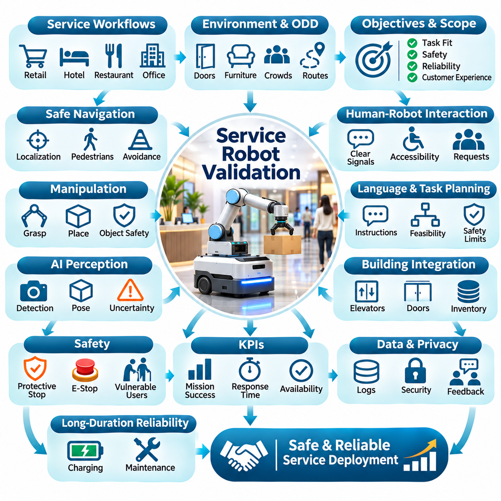{width="7.268055555555556in" height="7.268055555555556in"}

서비스 로봇 검증(Service Robot Validation)은 모바일 매니퓰레이터(Mobile Manipulator)가 인간 중심 환경(Human-Centered Environment)에서 실제 서비스 작업을 안전하고 신뢰성 있으며 효과적으로 수행할 수 있는지를 평가하는 과정이다. 산업용 응용 분야와 달리 서비스 로봇은 환경 조건과 인간의 행동을 예측하기 어려운 공공 또는 준공공 공간(Public or Semi-Public Space)에서 운영되는 경우가 많다. 검증에서는 자율주행(Autonomous Navigation), 조작(Manipulation) 및 상호작용(Interaction) 능력이 목표 서비스 요구사항(Service Requirements)을 충족한다는 것을 입증해야 한다.

검증 과정은 서비스 작업 흐름(Service Workflow)과 고객 기대사항(Customer Expectations)을 분석하는 것에서 시작해야 한다. 대표적인 응용 분야에는 소매 서비스 지원(Retail Assistance), 진열대 상품 보충(Shelf Replenishment), 호텔 배송(Hotel Delivery), 식당 물류(Restaurant Logistics), 사무실 자재 운반(Office Material Transportation) 및 시설 관리(Facility Management)가 포함된다. 각각의 응용 분야는 이동성(Mobility), 조작, 접근성(Accessibility) 및 상호작용에 대해 서로 다른 요구사항을 가진다. 검증 시나리오(Validation Scenario)는 실제 서비스 조건과 예상되는 고객 수요(Customer Demand)의 변화를 반영해야 한다.

서비스 로봇은 다양한 건축 공간 배치(Architectural Layout)와 인프라 조건(Infrastructure Condition)에서 운영되기 때문에 물리적 환경 평가(Physical Environment Assessment)가 필수적이다. 출입구(Doorway), 좁은 통로(Narrow Passage), 가구 배치(Furniture Arrangement), 바닥 단차 및 전환 구간(Floor Transition), 일시적 장애물(Temporary Obstacle) 및 혼잡한 공공장소(Crowded Public Area)는 운영 성능에 영향을 미칠 수 있다. 엔지니어는 허용된 이동 경로(Permissible Travel Route), 조작 구역(Manipulation Zone), 환경적 제약(Environmental Limitation) 및 추가적인 안전 예방 조치가 필요한 구역을 포함하는 운영 설계 영역(ODD, Operational Design Domain)을 설정해야 한다.

자율주행 검증(Navigation Validation)은 모바일 매니퓰레이터가 동적으로 변화하는 서비스 환경(Dynamic Service Environment)에서 안전하고 예측 가능한 방식으로 이동할 수 있는 능력을 평가해야 한다. 보행자는 갑자기 이동 방향을 변경하거나 예상하지 못한 위치에서 정지하거나 로봇의 이동 의도를 이해하지 못한 상태에서 접근할 수 있다. 검증에서는 다양한 보행자 밀도(Pedestrian Density)와 환경 조건에서 위치 추정 정확도(Localization Accuracy), 장애물 회피(Obstacle Avoidance), 궤적의 부드러움(Trajectory Smoothness), 안전 이격 거리(Safe Separation Distance) 및 복구 동작(Recovery Behavior)을 평가해야 한다.

조작 검증(Manipulation Validation)은 서비스 운영 중 일반적으로 접하는 객체를 로봇 팔(Robotic Arm)이 취급할 수 있는 능력을 평가해야 한다. 대표적인 객체에는 포장 제품(Packaged Product), 용기(Container), 트레이(Tray), 문서(Document) 및 개인 소지품(Personal Belongings)이 포함될 수 있다. 객체의 기하학적 형상(Geometry), 중량, 재질(Material) 및 배치 상태(Placement)의 변화를 검증 시나리오에 반영해야 한다. 전체 취급 사이클(Handling Cycle)에 걸쳐 파지 안정성(Grasp Stability), 배치 정확도(Placement Accuracy), 객체 무결성(Object Integrity) 및 충돌 없는 움직임(Collision-Free Movement)을 평가해야 한다.

인지 및 인공지능 검증(Perception and AI Validation)은 서비스 환경의 시각적 다양성(Visual Diversity)을 고려해야 한다. 조명 변화(Changing Illumination), 반사 표면(Reflective Surface), 익숙하지 않은 객체(Unfamiliar Object), 복잡한 배경(Cluttered Background) 및 부분적인 가림 현상(Partial Occlusion)은 인지 신뢰성(Perception Reliability)을 저하시킬 수 있다. 엔지니어는 객체 검출(Object Detection), 자세 추정(Pose Estimation), 의미론적 인식(Semantic Recognition) 및 추론 지연시간(Inference Latency)을 평가해야 한다. 불확실한 예측(Uncertain Prediction)이 발생하는 경우 잠재적으로 위험한 조작 활동을 시작하는 대신 사전에 정의된 대체 대응 메커니즘(Fallback Mechanism)을 활성화해야 한다.

인간-로봇 상호작용(HRI, Human-Robot Interaction)은 서비스 로봇 검증의 핵심 구성 요소이다. 훈련된 산업 현장의 운영자와 달리 고객과 방문객은 로봇 시스템에 대한 지식이 제한적일 수 있다. 로봇은 이해하기 쉬운 시각적 인터페이스(Visual Interface), 청각적 인터페이스(Auditory Interface) 또는 대화형 인터페이스(Conversational Interface)를 통해 자신의 행동 의도, 운영 상태(Operational Status) 및 서비스 가용성(Service Availability)을 전달해야 한다. 검증에서는 상호작용의 명확성(Interaction Clarity), 응답 일관성(Response Consistency), 접근성 및 예상하지 못한 인간의 요청을 처리하는 능력을 평가해야 한다.

서비스 작업 검증(Service Task Validation)은 개별 로봇 기능이 아니라 전체 운영 순서(Operational Sequence)를 평가해야 한다. 대표적인 소매 서비스 임무(Retail Service Mission)에는 상품 보충 요청(Replenishment Request)의 수신, 보관 구역으로의 자율주행, 요청된 제품의 식별, 파지 실행(Grasp Execution), 제품 운반(Product Transportation) 및 지정된 위치에 대한 배치가 포함될 수 있다. 각 단계에서는 실행 정확도(Execution Accuracy), 단계 전환 신뢰성(Transition Reliability), 작업 완료(Task Completion) 및 실패한 작업으로부터의 복구(Recovery)를 평가해야 한다.

대화형 인터페이스(Conversational Interface)와 인공지능 기반 작업 계획(AI-Based Task Planning)은 추가적인 검증 요구사항을 발생시킨다. 서비스 로봇은 대규모 언어 모델(LLM, Large Language Model), 비전-언어 모델(VLM, Vision-Language Model) 또는 로봇 에이전트(Robot Agent)를 통해 자연어 명령(Natural Language Instruction)을 해석할 수 있다. 검증에서는 명령 이해(Instruction Understanding), 작업 실현 가능성 평가(Task Feasibility Assessment), 문맥적 정확도(Contextual Accuracy) 및 권한 범위(Authorization Boundary)를 평가해야 한다. 인공지능이 생성한 명령(AI-Generated Instruction)은 결정론적 실행 제약(Deterministic Execution Constraint)과 독립적인 안전 메커니즘(Independent Safety Mechanism)의 통제를 받아야 한다.

안전 검증(Safety Validation)은 일반 대중과의 상호작용(Public Interaction), 이동 플랫폼의 움직임, 확장된 매니퓰레이터 작업 공간(Extended Manipulator Workspace) 및 운반 중인 객체와 관련된 위험을 다루어야 한다. 어린이, 고령자 및 장애인은 예상하지 못한 방식으로 로봇에 접근하거나 로봇의 움직임에 서로 다르게 반응할 수 있다. 보호 정지 기능(Protective Stopping Function), 비상 정지(Emergency Stop), 속도 제한(Speed Restriction), 작업 공간 제한(Workspace Limitation) 및 안전한 복구 절차(Safe Recovery Procedure)는 응용 분야별 위험성 평가(Application-Specific Risk Assessment)에 따라 검증해야 한다.

서비스 로봇은 건물 자동화 시스템(BAS, Building Automation System), 엘리베이터 제어기(Elevator Controller), 자동문(Automatic Door), 재고 관리 플랫폼(Inventory Platform) 및 고객 서비스 애플리케이션(Customer Service Application)과의 통합이 필요할 수 있다. 검증에서는 신뢰할 수 있는 명령 교환(Command Exchange), 목적지 검증(Destination Verification), 작업 동기화(Task Synchronization) 및 완료 보고(Completion Reporting)를 확인해야 한다. 네트워크 중단(Network Interruption), 응답 지연(Delayed Response), 인프라 사용 불가(Unavailable Infrastructure) 및 상충하는 요청(Conflicting Request)은 통제된 고장 및 복구 시나리오(Controlled Failure and Recovery Scenario)에 포함되어야 한다.

장시간 서비스 운영(Long-Duration Service Operation)에서는 기계적 내구성(Mechanical Durability), 배터리 지속 시간(Battery Endurance), 열적 안정성(Thermal Stability), 보정값 편이(Calibration Drift) 및 소프트웨어 신뢰성(Software Reliability)을 평가해야 한다. 서비스 수요(Service Demand)는 운영 시간 동안 상당한 변동을 나타낼 수 있으며, 이에 따라 연속적인 작업 활동(Continuous Activity)과 대기 운영(Standby Operation)이 교대로 발생할 수 있다. 검증에서는 대표적인 일일 운영 일정(Daily Operating Schedule)에 따라 자동 충전(Automatic Charging), 임무 재개(Mission Resumption), 자원 소비(Resource Consumption) 및 유지보수 요구사항(Maintenance Requirements)을 평가해야 한다.

운영 성능(Operational Performance)은 사전에 정의된 핵심 성과 지표(KPI, Key Performance Indicator)를 통해 평가해야 하며, 여기에는 임무 성공률(Mission Success Rate), 서비스 완료 시간(Service Completion Time), 자율주행 신뢰성(Navigation Reliability), 파지 성공률(Grasp Success Rate), 운영 가용성(Operational Availability) 및 인간 개입 빈도(Human Intervention Frequency)가 포함된다. 추가적인 지표에는 고객 만족도(Customer Satisfaction), 상호작용 성공률(Interaction Success Rate), 대기 시간(Waiting Time) 및 서비스 요청 처리 정확도(Service Request Accuracy)가 포함될 수 있다. 자율 작업 완료(Autonomous Task Completion)는 수동 지원(Manual Assistance)이 필요한 운영 활동과 구분해야 한다.

운영 데이터 수집(Operational Data Collection)은 체계적인 평가(Systematic Evaluation)와 지속적인 서비스 개선(Continuous Service Improvement)을 지원해야 한다. 로봇 궤적(Robot Trajectory), 인지 결과(Perception Output), 조작 결과(Manipulation Result), 상호작용 이력(Interaction History), 시스템 진단(System Diagnostics) 및 고객 피드백(Customer Feedback)은 관련 운영 조건과 연계하여 기록해야 한다. 특히 카메라(Camera), 마이크(Microphone) 또는 대화형 인터페이스가 일반 대중이 접근할 수 있는 환경에서 정보를 수집하는 경우, 데이터 수집은 적용되는 개인정보 보호(Privacy) 및 보안 요구사항(Security Requirements)을 준수해야 한다.

서비스 로봇 검증은 궁극적으로 모바일 매니퓰레이터가 지속 가능한 운영적 및 경제적 이점(Operational and Economic Benefits)과 고객 경험 향상(Customer Experience Benefits)을 제공할 수 있는지를 판단해야 한다. 평가에서는 서비스 품질(Service Quality), 노동 효율성(Labor Efficiency), 인프라 비용(Infrastructure Cost), 유지보수 요구사항, 접근성 및 잔존 안전 위험(Residual Safety Risk)을 종합적으로 고려해야 한다. 문서화된 검증 근거(Documented Validation Evidence)는 응용 분야별 수용 기준(Application-Specific Acceptance Criteria)을 확립하고, 기술 성숙도 평가(TRL Assessment), 고객 인수(Customer Acceptance) 및 통제된 상업적 배치(Controlled Commercial Deployment)를 지원해야 한다.

## 07 HRI Validation

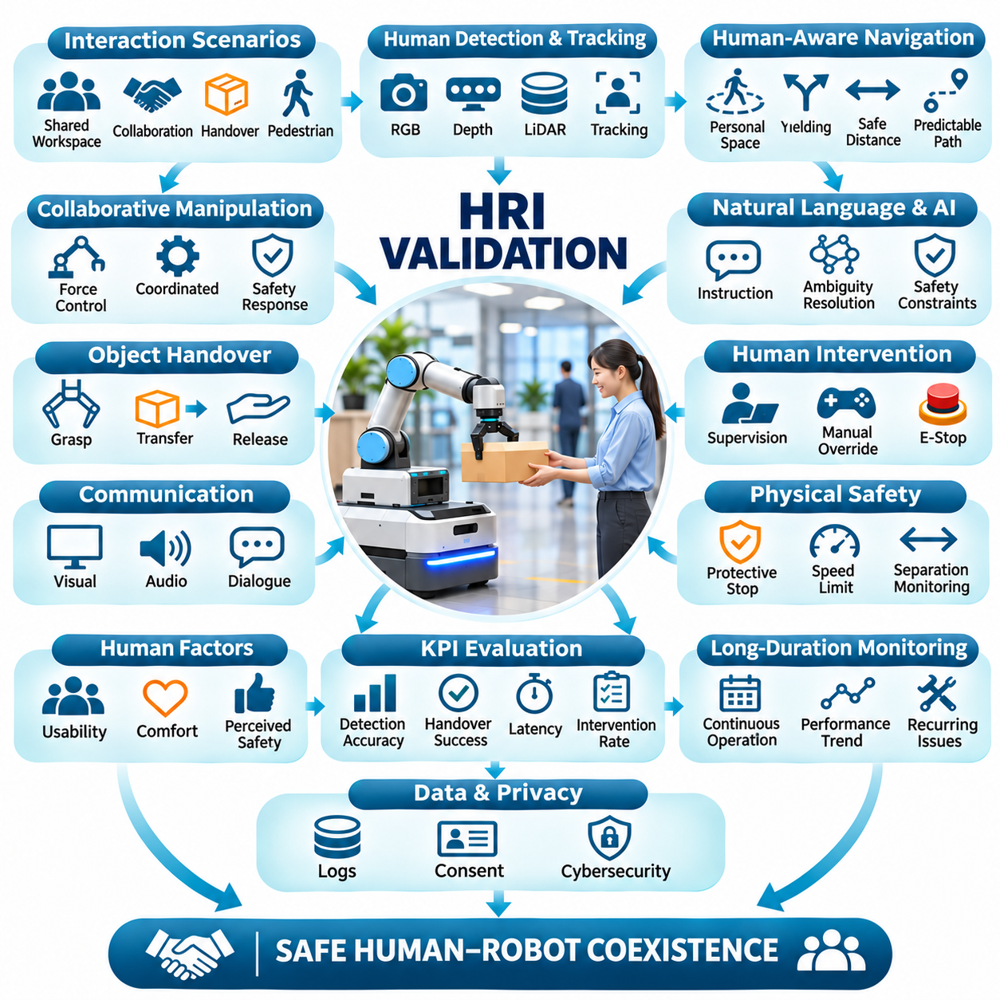{width="7.268055555555556in" height="7.268055555555556in"}

인간-로봇 상호작용 검증(HRI Validation, Human-Robot Interaction Validation)은 모바일 매니퓰레이터(Mobile Manipulator)가 실제 운영 환경에서 인간과 안전하고 효과적이며 예측 가능한 방식으로 상호작용할 수 있는지를 평가하는 과정이다. 격리된 작업 공간(Isolated Workspace)에서 운영되는 기존 산업용 로봇(Industrial Robot)과 달리 모바일 매니퓰레이터는 작업자, 고객 및 방문객과 물리적 공간(Physical Space)을 공유하는 경우가 많다. 검증에서는 기술적 성능(Technical Performance)과 인간 중심의 운영 요구사항(Human-Centered Operational Requirements)을 모두 고려해야 한다.

검증 과정은 상호작용 시나리오(Interaction Scenario)와 인간의 행동 특성(Human Behavioral Characteristics)을 분석하는 것에서 시작해야 한다. 대표적인 시나리오에는 공유 작업 공간 운영(Shared Workspace Operation), 협업 조작(Collaborative Manipulation), 객체 인계(Object Handover), 보행자와의 조우(Pedestrian Encounter), 작업 명령(Task Instruction) 및 자율 임무 중 인간 개입(Human Intervention)이 포함된다. 각각의 시나리오는 의사소통(Communication), 공간 인식(Spatial Awareness), 응답 시간(Response Time), 운영 예측 가능성(Operational Predictability) 및 물리적 안전성(Physical Safety)에 대해 서로 다른 요구사항을 가진다.

인간 검출 및 추적(Human Detection and Tracking)은 신뢰할 수 있는 인간-로봇 상호작용을 위한 핵심 기능이다. 모바일 매니퓰레이터는 주변 사람을 식별하고 움직임을 추정하기 위해 RGB 카메라(RGB Camera), 깊이 카메라(Depth Camera), 라이다 센서(LiDAR Sensor) 및 멀티모달 인지 시스템(Multimodal Perception System)을 활용할 수 있다. 검증에서는 검출 정확도(Detection Accuracy), 추적 연속성(Tracking Continuity), 거리 추정(Distance Estimation) 및 부분적인 가림 현상(Partial Occlusion), 조명 변화, 혼잡한 환경, 센서 성능 저하(Sensor Degradation)에 대한 강건성(Robustness)을 평가해야 한다.

인간 인식 기반 자율주행 검증(Human-Aware Navigation Validation)은 모바일 매니퓰레이터가 공유 환경(Shared Environment)에서 자연스럽고 안전하게 이동할 수 있는 능력을 평가해야 한다. 로봇은 인간의 이동 궤적(Human Movement Trajectory), 개인 공간(Personal Space), 보행자 우선권(Pedestrian Priority) 및 잠재적인 상호작용 충돌(Interaction Conflict)을 고려해야 한다. 검증에서는 경로 예측 가능성(Path Predictability), 접근 행동(Approach Behavior), 안전 이격 거리(Safe Separation Distance), 양보 전략(Yielding Strategy) 및 예상하지 못한 인간의 움직임에 적절하게 대응하는 능력을 평가해야 한다.

협업 조작 검증(Collaborative Manipulation Validation)은 공유 작업 공간 내에서 인간 작업자와 로봇 매니퓰레이터(Robotic Manipulator) 간의 상호작용을 평가해야 한다. 대표적인 작업에는 부품 전달(Component Delivery), 협업 조립(Cooperative Assembly), 공구 교환(Tool Exchange) 및 작업대 지원(Workstation Assistance)이 포함될 수 있다. 엔지니어는 궤적 협조 제어(Trajectory Coordination), 작업 공간 제한(Workspace Limitation), 힘 제어(Force Control), 움직임의 예측 가능성(Motion Predictability) 및 인간이 매니퓰레이터의 활성 작업 공간(Active Workspace)에 접근하거나 진입할 때의 보호 대응(Protective Response)을 평가해야 한다.

객체 인계 검증(Object Handover Validation)은 인간과 로봇 사이에서 물리적 객체(Physical Object)를 직접 전달하도록 설계된 모바일 매니퓰레이터에 특히 중요하다. 시스템은 적절한 인계 위치(Handover Position)를 식별하고 파지 안정성(Grasp Stability)을 유지하며, 물품을 받는 사람이 객체를 안전하게 확보한 시점을 판단해야 한다. 검증에서는 전달 타이밍(Transfer Timing), 파지 해제 조건(Release Condition), 객체 무결성(Object Integrity), 인계 실패 복구(Unsuccessful Handover Recovery) 및 인간이 손을 뻗는 행동(Human Reaching Behavior)의 다양한 변화를 평가해야 한다.

의사소통 검증(Communication Validation)은 인간-로봇 상호작용 중 사용되는 시각적 인터페이스(Visual Interface), 청각적 인터페이스(Auditory Interface), 촉각적 인터페이스(Tactile Interface) 및 대화형 인터페이스(Conversational Interface)의 효과성을 평가해야 한다. 상태 표시 장치(Indicator), 디스플레이 패널(Display Panel), 경고음(Warning Sound) 및 음성 메시지(Spoken Message)는 운영 상태(Operational Status)와 의도된 행동(Intended Action)을 명확하게 전달해야 한다. 시스템은 명령을 수락하거나 작업을 실행하거나 오류가 발생하거나 인간 작업자에게 지원을 요청할 때 이해하기 쉬운 피드백(Feedback)을 제공해야 한다.

자연어 상호작용(Natural Language Interaction)은 지능형 대화 인터페이스(Intelligent Conversational Interface)를 탑재한 모바일 매니퓰레이터에 추가적인 검증 요구사항을 발생시킨다. 대규모 언어 모델(LLM, Large Language Model), 비전-언어 모델(VLM, Vision-Language Model) 및 로봇 에이전트(Robot Agent)는 인간의 명령을 해석하고 작업 실행 순서(Task Sequence)를 생성할 수 있다. 검증에서는 명령 해석 정확도(Instruction Accuracy), 문맥 이해(Contextual Understanding), 모호성 해소(Ambiguity Resolution), 권한 범위(Authorization Boundary) 및 안전하지 않거나 물리적으로 실현 불가능한 요청(Physically Infeasible Request)을 거부하는 능력을 평가해야 한다.

인간 개입(Human Intervention)과 감독 제어(Supervisory Control)는 필요한 경우 승인된 사람이 자율 운영(Autonomous Operation)을 중단하거나 변경하거나 종료할 수 있도록 검증해야 한다. 수동 제어 인터페이스(Manual Control Interface), 비상 정지 메커니즘(Emergency Stop Mechanism), 원격 지원 기능(Remote Assistance Function) 및 작업 취소 절차(Task Cancellation Procedure)는 일관되게 동작해야 한다. 자율 제어(Autonomous Control)와 수동 제어(Manual Control) 간의 전환 과정에서는 상충하는 명령(Conflicting Command), 예상하지 못한 움직임(Unexpected Movement) 및 승인되지 않은 임무 재개(Unauthorized Mission Resumption)를 방지해야 한다.

물리적 안전 검증(Physical Safety Validation)은 이동 플랫폼의 움직임(Mobile Platform Movement), 로봇 팔의 동작(Robotic Arm Motion), 운반 중인 객체(Transported Object) 및 의도하지 않은 인간 접촉(Unintended Human Contact)과 관련된 위험 요소(Hazard)를 다루어야 한다. 적용 가능한 경우 보호 정지(Protective Stopping), 안전 등급 속도 제한(Safety-Rated Speed Restriction), 이격 거리 모니터링(Separation Monitoring) 및 힘 제한 기능(Force-Limiting Function)을 평가해야 한다. 검증 절차는 응용 분야별 위험성 평가(Application-Specific Risk Assessment), 예측 가능한 오사용(Foreseeable Misuse) 및 설치된 안전 메커니즘(Safety Mechanism)의 한계를 반영해야 한다.

현장 검증(Field Validation) 과정에서는 인간-로봇 상호작용의 인간공학적 측면(Ergonomic Aspect)과 심리적 측면(Psychological Aspect)도 고려해야 한다. 과도한 이동 속도(Excessive Movement Speed), 예상하지 못한 가속(Unexpected Acceleration), 모호한 의사소통(Ambiguous Communication) 및 불편함을 유발하는 접근 거리(Uncomfortable Approach Distance)는 인간의 신뢰도(Human Confidence)를 저하시킬 수 있다. 평가에서는 서로 다른 신체적 능력(Physical Ability), 경험 수준(Experience Level) 및 기술적 배경(Technical Background)을 가진 사람들을 대상으로 체감 안전성(Perceived Safety), 사용성(Usability), 인지적 작업 부하(Cognitive Workload), 상호작용의 편안함(Interaction Comfort) 및 사용자 수용성(User Acceptance)을 평가해야 한다.

장시간 상호작용 검증(Long-Duration Interaction Validation)은 장시간의 운영 기간에 걸쳐 인간-로봇 상호작용 성능(HRI Performance)이 일관되게 유지되는지를 평가해야 한다. 반복적인 인간과의 조우(Repeated Encounter), 보행자 밀도 변화(Changing Pedestrian Density), 통신 중단(Communication Interruption), 센서 오염(Sensor Contamination) 및 환경적 외란(Environmental Disturbance)은 시스템 행동(System Behavior)에 영향을 미칠 수 있다. 지속적인 모니터링(Continuous Monitoring)을 통해 반복적으로 발생하는 상호작용 실패(Recurring Interaction Failure), 응답 성능 저하(Degraded Response Performance) 및 빈번한 인간의 지원(Human Assistance)이 필요한 상황을 식별해야 한다.

인간-로봇 상호작용 성능은 사전에 정의된 핵심 성과 지표(KPI, Key Performance Indicator)를 통해 평가해야 하며, 여기에는 인간 검출 정확도(Human Detection Accuracy), 상호작용 성공률(Interaction Success Rate), 명령 인식 정확도(Command Recognition Accuracy), 인계 성공률(Handover Success Rate), 응답 지연시간(Response Latency) 및 개입 빈도(Intervention Frequency)가 포함된다. 추가적인 지표에는 체감 안전성(Perceived Safety), 사용자 만족도(User Satisfaction), 보호 정지 빈도(Protective Stop Frequency) 및 작업 완료 신뢰성(Task Completion Reliability)이 포함될 수 있다. 주관적 평가(Subjective Assessment)는 정량적 측정(Quantitative Measurement)을 보완해야 한다.

운영 데이터 수집(Operational Data Collection)은 인간-로봇 상호작용 이벤트(HRI Event)와 예상하지 못한 시스템 행동(Unexpected System Behavior)에 대한 체계적인 분석(Systematic Analysis)을 지원해야 한다. 시간 동기화된 센서 기록(Time-Synchronized Sensor Recording), 자율주행 궤적(Navigation Trajectory), 조작 상태(Manipulation State), 상호작용 명령(Interaction Command), 안전 이벤트(Safety Event) 및 운영자 피드백(Operator Feedback)은 관련 운영 조건과 연계하여 기록해야 한다. 데이터 수집은 적용되는 개인정보 보호(Privacy), 동의(Consent), 사이버 보안(Cybersecurity) 및 개인 정보 보호 요구사항(Personal Information Protection Requirements)을 준수해야 한다.

인간-로봇 상호작용 검증은 궁극적으로 모바일 매니퓰레이터가 허용 가능한 위험 수준(Acceptable Risk Level)을 유지하고 지속 가능한 운영상의 이점(Sustainable Operational Benefit)을 제공하면서 인간과 공존(Coexistence)할 수 있는지를 입증해야 한다. 문서화된 검증 근거(Documented Validation Evidence)는 설계 개선(Design Refinement), 안전성 평가(Safety Assessment), 기술 성숙도 평가(Technology Readiness Evaluation) 및 고객 인수(Customer Acceptance)를 지원해야 한다. 성공적인 검증은 산업(Industrial), 상업(Commercial), 의료(Healthcare) 및 공공 서비스 환경(Public Service Environment) 전반에 걸쳐 확장 가능한 배치(Scalable Deployment)를 실현하기 위한 기반을 제공한다.

## 08 Long Duration Operation

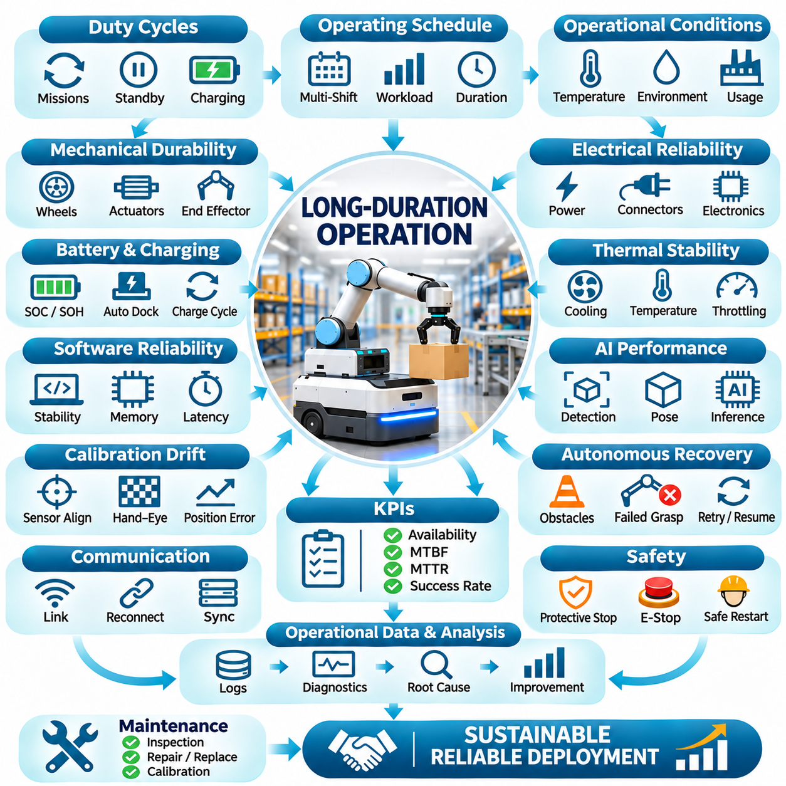{width="7.268055555555556in" height="7.268055555555556in"}

장시간 운영(Long-Duration Operation)은 모바일 매니퓰레이터(Mobile Manipulator)가 장시간의 운영 기간에 걸쳐 신뢰성 있고 안전하며 일관된 성능을 유지할 수 있는지를 평가하는 현장 검증(Field Validation)의 필수적인 구성 요소이다. 단기간 기능 시험(Short-Term Functional Testing)과 달리 장시간 검증(Long-Duration Validation)은 통합 로봇 시스템을 누적 기계적 응력(Cumulative Mechanical Stress), 전기적 열화(Electrical Degradation), 환경 변화(Environmental Variation), 컴퓨팅 작업 부하(Computational Workload) 및 반복적인 자율 작업 실행(Autonomous Task Execution)에 노출시킨다.

검증 과정은 대표적인 운영 일정(Operating Schedule)과 작업 부하 프로파일(Workload Profile)을 정의하는 것에서 시작해야 한다. 모바일 매니퓰레이터는 여러 생산 교대 근무(Production Shift)에 걸쳐 연속적으로 운영되거나 활성 임무(Active Mission), 대기 기간(Standby Period), 자동 충전(Automatic Charging) 및 유지보수 활동(Maintenance Activity)을 교대로 수행할 수 있다. 검증 기간(Validation Duration)은 목표 운영 요구사항(Operational Requirements), 예상 듀티 사이클(Duty Cycle), 환경 조건(Environmental Condition) 및 시스템 가용성(System Availability)에 대한 고객의 기대사항을 반영해야 한다.

기계적 내구성 검증(Mechanical Durability Validation)은 반복적인 자율주행 및 조작 사이클(Manipulation Cycle)이 구조 부품(Structural Component), 액추에이터(Actuator), 베어링(Bearing), 동력 전달 시스템(Transmission System), 휠(Wheel) 및 엔드 이펙터(End Effector)에 미치는 영향을 평가해야 한다. 연속 운영(Continuous Operation)은 기계적 마모(Mechanical Wear), 백래시 증가(Increased Backlash), 구조적 변형(Structural Deformation) 및 위치 결정 정확도(Positioning Accuracy)의 저하를 발생시킬 수 있다. 주기적인 측정(Periodic Measurement)을 통해 점진적 성능 저하(Progressive Degradation)가 허용할 수 없는 성능 감소나 기계적 고장(Mechanical Failure)을 유발하기 전에 이를 식별해야 한다.

전기적 신뢰성 검증(Electrical Reliability Validation)은 장시간 운영 조건에서 전력 분배 시스템(Power Distribution System), 와이어링 하네스(Wiring Harness), 커넥터(Connector), 모터 제어기(Motor Controller), 전압 변환기(Voltage Converter) 및 임베디드 전자 장치(Embedded Electronic Device)를 평가해야 한다. 반복적인 가속(Acceleration), 제동(Braking), 조작 및 충전 활동은 전기적 스트레스(Electrical Stress)와 온도 변동(Temperature Fluctuation)을 발생시킬 수 있다. 엔지니어는 전압 안정성(Voltage Stability), 전류 소비량(Current Consumption), 연결 무결성(Connection Integrity) 및 비정상적인 전기적 동작(Abnormal Electrical Behavior)을 모니터링해야 한다.

배터리 성능(Battery Performance)과 에너지 관리(Energy Management)는 장시간 운영에 영향을 미치는 핵심 요소이다. 검증에서는 대표적인 작업 부하 조건에서 배터리 방전 특성(Battery Discharge Characteristics), 충전 효율(Charging Efficiency), 충전 상태 추정(SOC Estimation, State-of-Charge Estimation), 건강 상태 모니터링(SOH Monitoring, State-of-Health Monitoring) 및 에너지 소비량(Energy Consumption)을 평가해야 한다. 자동 충전 시스템(Automatic Charging System)은 신뢰할 수 있는 도킹(Docking), 충전 시작(Charging Initiation), 임무 중단 관리(Mission Interruption Management) 및 이전에 중단된 운영의 안전한 재개(Safe Resumption)를 입증해야 한다.

열적 안정성 검증(Thermal Stability Validation)은 컴퓨팅 플랫폼(Computing Platform), 모터 제어기, 액추에이터, 배터리 및 밀폐형 전자 장치 어셈블리(Enclosed Electronic Assembly) 내부의 온도 변화를 평가해야 한다. 지속적인 인공지능 추론(Continuous AI Inference)과 반복적인 기계적 동작은 상당한 열 부하(Thermal Load)를 발생시킬 수 있다. 엔지니어는 지속적인 운영이 허용 가능한 열적 한계(Thermal Limit) 내에서 유지되도록 온도 프로파일(Temperature Profile), 냉각 시스템 효과성(Cooling System Effectiveness), 열적 스로틀링(Thermal Throttling) 및 보호 종료 동작(Protective Shutdown Behavior)을 모니터링해야 한다.

소프트웨어 신뢰성 검증(Software Reliability Validation)은 자율주행(Navigation), 조작(Manipulation), 인지(Perception), 통신(Communication) 및 작업 관리(Task Management) 프로세스가 장시간의 실행 기간 동안 안정적으로 유지되는지를 평가해야 한다. 메모리 누수(Memory Leak), 자원 고갈(Resource Exhaustion), 교착 상태(Deadlock), 메시지 큐 누적(Message Queue Accumulation) 및 동기화 오류(Synchronization Error)는 장시간 운영 이후에만 나타날 수 있다. 지속적인 모니터링(Continuous Monitoring)을 통해 비정상적인 자원 소비(Abnormal Resource Consumption), 응답 지연시간 증가(Increasing Response Latency) 및 예상하지 못한 소프트웨어 종료(Unexpected Software Termination)를 식별해야 한다.

인공지능 성능(AI Performance)은 변화하는 운영 조건에서 인지 및 의사결정 능력(Decision-Making Capability)이 일관되게 유지되는지를 판단하기 위해 지속적으로 평가해야 한다. 센서 오염(Sensor Contamination), 조명 변화(Illumination Variation), 환경 변화(Environmental Change) 및 컴퓨팅 자원 제약(Computational Resource Limitation)은 추론 신뢰성(Inference Reliability)에 영향을 미칠 수 있다. 검증에서는 시간의 경과에 따른 검출 정확도(Detection Accuracy), 자세 추정 안정성(Pose Estimation Stability), 파지 예측 일관성(Grasp Prediction Consistency), 불확실성 처리(Uncertainty Handling) 및 추론 지연시간(Inference Latency)을 평가해야 한다.

보정 안정성(Calibration Stability)은 자율주행과 조작이 다수의 좌표계(Coordinate System) 간의 정확한 관계에 의존하기 때문에 모바일 매니퓰레이터에서 특히 중요하다. 기계적 진동(Mechanical Vibration), 반복적인 물리적 접촉(Physical Contact), 온도 변화 및 부품 마모(Component Wear)는 보정값 편이(Calibration Drift)를 발생시킬 수 있다. 주기적인 확인(Periodic Verification)을 통해 전체 운영 기간에 걸쳐 센서 정렬(Sensor Alignment), 핸드-아이 보정(Hand-Eye Calibration), 도킹 정확도(Docking Accuracy), 매니퓰레이터 반복 정밀도(Manipulator Repeatability) 및 누적 위치 결정 오차(Accumulated Positioning Error)를 평가해야 한다.

자율 오류 복구(Autonomous Error Recovery)는 대표적인 장시간 운영 조건에서 평가해야 한다. 모바일 매니퓰레이터는 일시적 장애물(Temporary Obstacle), 파지 실패(Unsuccessful Grasp), 위치 추정 실패(Localization Failure), 통신 중단(Communication Interruption) 및 인프라 사용 불가(Unavailable Infrastructure) 상황에 직면할 수 있다. 시스템은 비정상적인 조건(Abnormal Condition)을 인식하고 적절한 복구 절차(Recovery Procedure)를 실행하며, 안전성을 저해하지 않으면서 승인된 임무(Authorized Mission)를 재개해야 한다. 반복적인 복구 실패(Repeated Recovery Failure)는 통제된 인간 개입(Controlled Human Intervention)을 유발해야 한다.

통신 신뢰성 검증(Communication Reliability Validation)은 온보드 컴퓨팅 시스템(Onboard Computing System), 임베디드 제어기(Embedded Controller), 플릿 관리 플랫폼(Fleet Management Platform) 및 외부 인프라(External Infrastructure) 간의 상호작용 안정성을 평가해야 한다. 장시간 운영은 간헐적인 네트워크 연결 중단(Intermittent Network Disconnection), 통신 지연시간(Communication Latency), 패킷 손실(Packet Loss) 및 일관되지 않은 시스템 상태(Inconsistent System State)를 드러낼 수 있다. 검증에서는 신뢰할 수 있는 재연결(Reconnection), 상태 동기화(State Synchronization), 명령 무결성(Command Integrity) 및 통신 장애(Communication Failure) 중의 통제된 운영(Controlled Operation)을 확인해야 한다.

안전 성능(Safety Performance)은 전체 운영 기간에 걸쳐 일관되게 유지되어야 한다. 기계적 성능 저하(Mechanical Degradation), 센서 오염, 소프트웨어 결함(Software Fault) 및 변화하는 환경 조건은 보호 기능(Protective Capability)에 영향을 미칠 수 있다. 주기적인 확인을 통해 비상 정지 기능(Emergency Stop Function), 보호 정지(Protective Stopping), 속도 제한(Speed Restriction), 장애물 검출(Obstacle Detection) 및 승인된 재시작 절차(Authorized Restart Procedure)를 평가해야 한다. 안전 관련 고장(Safety-Related Failure)은 사전에 정의된 대응 조치(Predefined Response)를 유발하고 통제되지 않은 자율 운영(Uncontrolled Autonomous Operation)을 방지해야 한다.

유지보수 검증(Maintenance Validation)은 장기간 배치(Extended Deployment) 중 점검(Inspection), 세척(Cleaning), 윤활(Lubrication), 보정(Calibration), 부품 교체(Component Replacement) 및 진단 활동(Diagnostic Activity)을 효율적으로 수행할 수 있는지를 판단해야 한다. 엔지니어는 예방 유지보수 주기(Preventive Maintenance Interval), 부품 접근성(Component Accessibility), 수리 절차(Repair Procedure) 및 예비 부품 요구사항(Spare Parts Requirements)을 평가해야 한다. 유지보수 기록(Maintenance Record)은 운영 시간(Operating Hours), 고장 발생(Failure Occurrence), 열화 패턴(Degradation Pattern) 및 복원 활동(Restoration Activity) 간의 관계를 확립해야 한다.

장시간 운영 성능(Long-Duration Performance)은 사전에 정의된 핵심 성과 지표(KPI, Key Performance Indicator)를 통해 평가해야 하며, 여기에는 운영 가용성(Operational Availability), 임무 성공률(Mission Success Rate), 평균 고장 간격(MTBF, Mean Time Between Failures), 평균 수리 시간(MTTR, Mean Time to Repair), 에너지 소비량(Energy Consumption) 및 인간 개입 빈도(Human Intervention Frequency)가 포함된다. 성능 측정(Performance Measurement)은 운영 신뢰성(Operational Reliability)에 대한 대표적인 근거를 제공하기 위해 생산적 운영 시간(Productive Operating Time), 계획된 유지보수(Scheduled Maintenance), 충전 기간(Charging Period) 및 비계획 가동 중단 시간(Unplanned Downtime)을 구분해야 한다.

운영 데이터 수집(Operational Data Collection)은 체계적인 고장 분석(Failure Analysis)과 점진적인 성능 저하(Progressive Performance Degradation)의 식별을 지원해야 한다. 시간 동기화된 센서 기록(Time-Synchronized Sensor Recording), 액추에이터 상태(Actuator State), 온도 측정값(Temperature Measurement), 배터리 정보(Battery Information), 소프트웨어 진단(Software Diagnostics) 및 임무 이력(Mission History)은 전체 검증 기간에 걸쳐 유지되어야 한다. 시정 조치(Corrective Action)와 회귀 시험(Regression Testing)을 통해 식별된 문제가 추가적인 운영 위험(Operational Risk)을 발생시키지 않으면서 해결되었음을 입증해야 한다.

장시간 운영 검증(Long-Duration Operation Validation)은 궁극적으로 모바일 매니퓰레이터가 목표 운영 일정(Intended Operating Schedule) 전반에 걸쳐 지속 가능한 성능(Sustainable Performance)을 제공할 수 있는지를 입증해야 한다. 문서화된 검증 결과(Documented Validation Result)는 신뢰성 평가(Reliability Assessment), 유지보수 계획(Maintenance Planning), 수명주기 비용 추정(Lifecycle Cost Estimation), 기술 성숙도 평가(Technology Readiness Evaluation) 및 상업적 배치(Commercial Deployment)를 지원해야 한다. 시험 기간(Test Duration)과 수용 임계값(Acceptance Threshold)은 응용 분야별 요구사항(Application-Specific Requirements) 및 운영 위험(Operating Risk)에 따라 정의해야 한다.

## 09 Operational Data Collection

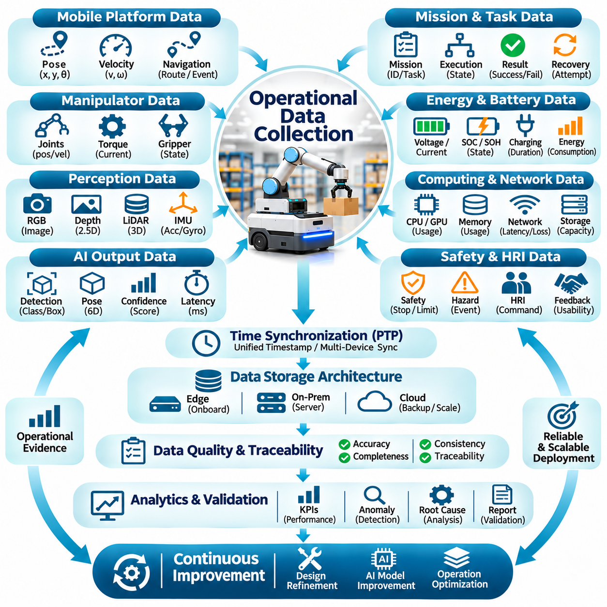{width="7.268055555555556in" height="7.268055555555556in"}

운영 데이터 수집(Operational Data Collection)은 모바일 매니퓰레이터(Mobile Manipulator)의 성능(Performance), 신뢰성(Reliability), 안전성(Safety) 및 운영 효과성(Operational Effectiveness)에 대한 측정 가능한 근거를 제공하는 현장 검증(Field Validation)의 핵심 구성 요소이다. 개발 매뉴얼의 현장 검증 프레임워크(Field Validation Framework)를 기반으로 다음의 엔지니어링 방법론(Engineering Methodology)은 시스템 행동(System Behavior), 환경 조건(Environmental Condition) 및 실제 임무 결과(Mission Outcome) 간의 추적성(Traceability)을 확립하기 위해 운영 데이터 수집에 관한 내용을 확장한다.

데이터 수집 과정(Data Collection Process)은 측정 목적(Measurement Objective), 데이터 요구사항(Data Requirements), 기록 주기(Recording Frequency) 및 운영 시나리오(Operational Scenario)를 정의하는 것에서 시작해야 한다. 수집된 정보는 시스템 요구사항 검증(System Requirement Verification), 성능 평가(Performance Evaluation), 고장 분석(Failure Analysis) 및 지속적인 개선(Continuous Improvement)을 지원해야 한다. 각각의 데이터 범주(Data Category)에는 데이터 출처(Data Source), 측정 단위(Measurement Unit), 타임스탬프(Timestamp), 데이터 보존 정책(Retention Policy) 및 담당 엔지니어링 팀이 정의되어야 한다.

이동 플랫폼 데이터 수집(Mobile Platform Data Collection)에는 위치(Position), 방향(Orientation), 선속도(Linear Velocity), 각속도(Angular Velocity), 휠 엔코더 측정값(Wheel Encoder Measurement), 모터 전류(Motor Current) 및 위치 추정 신뢰도(Localization Confidence)가 포함되어야 한다. 자율주행 궤적(Navigation Trajectory), 계획된 경로(Planned Path), 장애물 검출 이벤트(Obstacle Detection Event) 및 복구 활동(Recovery Activity)도 기록해야 한다. 이러한 측정값은 자율주행 정확도(Navigation Accuracy), 움직임 안정성(Motion Stability), 경로 효율성(Route Efficiency) 및 자율 이동 성능(Autonomous Mobility Performance)을 평가하기 위한 근거를 제공한다.

매니퓰레이터 데이터 수집(Manipulator Data Collection)은 관절 위치(Joint Position), 관절 속도(Joint Velocity), 액추에이터 토크(Actuator Torque), 엔드 이펙터 자세(End-Effector Pose), 힘 측정값(Force Measurement) 및 그리퍼 상태(Gripper State)를 기록해야 한다. 추종 오차(Tracking Error)와 예상하지 못한 기계적 동작(Mechanical Behavior)을 식별하기 위해 계획된 궤적(Planned Trajectory)과 실제 움직임 궤적(Actual Motion Trajectory)을 기록해야 한다. 조작 데이터(Manipulation Data)는 파지 안정성(Grasp Stability), 위치 결정 정확도(Positioning Accuracy), 궤적 실행(Trajectory Execution) 및 목표 객체와의 물리적 상호작용(Physical Interaction)을 평가하는 데 활용된다.

인지 데이터 수집(Perception Data Collection)에는 RGB 카메라(RGB Camera), 깊이 카메라(Depth Camera), 라이다 센서(LiDAR Sensor), 관성 측정 장치(IMU, Inertial Measurement Unit) 및 기타 환경 감지 장치(Environmental Sensing Device)에서 생성된 정보가 포함되어야 한다. 원시 센서 측정값(Raw Sensor Measurement)과 처리된 출력 데이터(Processed Output)는 검증 목적(Validation Objective)에 따라 보존해야 한다. 대표적인 데이터에는 인지 신뢰성(Perception Reliability)에 영향을 미칠 수 있는 환경 변화(Environmental Variation), 센서 성능 저하(Sensor Degradation), 가림 현상(Occlusion) 및 예상하지 못한 객체(Unexpected Object)가 포함되어야 한다.

인공지능 데이터 수집(AI Data Collection)은 객체 검출 결과(Object Detection Result), 분류 출력(Classification Output), 자세 추정값(Pose Estimate), 파지 예측(Grasp Prediction), 신뢰도 점수(Confidence Score) 및 추론 지연시간(Inference Latency)을 기록해야 한다. 모델 버전(Model Version), 전처리 구성(Preprocessing Configuration) 및 추론 매개변수(Inference Parameter)는 개별 예측 결과와의 추적성을 유지해야 한다. 이러한 기록은 인식 실패(Recognition Failure), 모델 성능 저하(Model Performance Degradation) 및 후속 모델 개선(Model Improvement)의 기회를 식별하는 데 활용된다.

시간 동기화(Time Synchronization)는 분산된 로봇 하위 시스템(Distributed Robotic Subsystem)에서 생성된 측정값 간의 정확한 관계를 확립하는 데 필수적이다. 온보드 컴퓨터(Onboard Computer), 임베디드 제어기(Embedded Controller), 센서(Sensor) 및 외부 모니터링 플랫폼(External Monitoring Platform)은 일관된 시간 기준(Time Reference)을 유지해야 한다. 응용 분야별 요구사항과 허용 가능한 동기화 오차(Synchronization Error)에 따라 정밀 시간 프로토콜(PTP, Precision Time Protocol), 하드웨어 트리거링(Hardware Triggering) 및 동기화된 타임스탬프(Synchronized Timestamp)를 활용할 수 있다.

임무 수준 데이터 수집(Mission-Level Data Collection)은 자율 작업(Autonomous Task)의 전체 실행 이력(Execution History)을 문서화해야 한다. 기록되는 정보에는 임무 식별자(Mission Identifier), 작업 할당(Task Assignment), 실행 상태(Execution State), 목적지 정보(Destination Information), 완료 결과(Completion Result), 복구 시도(Recovery Attempt) 및 운영자 개입(Operator Intervention)이 포함되어야 한다. 계층적 작업 기록(Hierarchical Task Record)을 통해 엔지니어는 하위 시스템의 행동(Subsystem Behavior), 개별 작업 실패(Individual Task Failure) 및 전체 임무 성능(Overall Mission Performance) 간의 관계를 식별할 수 있다.

에너지 및 전기 데이터 수집(Energy and Electrical Data Collection)은 배터리 전압(Battery Voltage), 전류 소비량(Current Consumption), 충전 상태(SOC, State of Charge), 배터리 건강 상태(SOH, State of Health), 충전 시간(Charging Duration) 및 전력 분배 특성(Power Distribution Characteristics)을 평가해야 한다. 에너지 측정값(Energy Measurement)은 자율주행(Navigation), 조작(Manipulation), 인공지능 추론(AI Inference), 대기 운영(Standby Operation) 및 충전 활동(Charging Activity)과 연계되어야 한다. 이러한 기록은 배터리 지속 시간 평가(Battery Endurance Evaluation), 전력 소비 최적화(Power Consumption Optimization) 및 수명주기 성능 평가(Lifecycle Performance Assessment)를 지원한다.

컴퓨팅 및 통신 데이터(Computational and Communication Data)에는 프로세서 활용률(Processor Utilization), GPU 활용률(GPU Utilization), 메모리 소비량(Memory Consumption), 저장 용량(Storage Capacity), 네트워크 지연시간(Network Latency), 패킷 손실(Packet Loss) 및 메시지 전송률(Message Transmission Rate)이 포함되어야 한다. 지속적인 자원 모니터링(Resource Monitoring)은 컴퓨팅 병목현상(Computational Bottleneck), 메모리 누수(Memory Leak), 통신 불안정성(Communication Instability) 및 열적 스로틀링(Thermal Throttling)을 드러낼 수 있다. 데이터 수집은 시간에 민감한 로봇 기능(Time-Critical Robotic Function)에 과도한 처리 오버헤드(Processing Overhead)를 발생시키지 않아야 한다.

안전 관련 데이터 수집(Safety-Related Data Collection)은 비상 정지(Emergency Stop), 보호 정지(Protective Stop), 안전 센서 활성화(Safety Sensor Activation), 속도 제한(Speed Restriction), 위험 근접 이벤트(Hazardous Proximity Event) 및 승인된 재시작 절차(Authorized Restart Procedure)를 문서화해야 한다. 각각의 안전 이벤트(Safety Event)는 관련 로봇 상태(Robot State) 및 환경 조건과 연계되어야 한다. 적절한 경우 사고 재구성(Incident Reconstruction), 위험성 평가(Risk Assessment) 및 엔지니어링 시정 조치(Corrective Engineering Action)를 지원하기 위해 이벤트 발생 이전 및 이후의 기록(Pre-Event and Post-Event Recording)을 보존해야 한다.

인간-로봇 상호작용 데이터 수집(HRI Data Collection, Human-Robot Interaction Data Collection)은 운영자 명령(Operator Command), 상호작용 이벤트(Interaction Event), 작업 취소(Task Cancellation), 객체 인계(Object Handover), 수동 개입(Manual Intervention) 및 지원 요청(Request for Assistance)을 기록해야 한다. 사용자 피드백(User Feedback)은 사용성(Usability), 체감 안전성(Perceived Safety), 운영 예측 가능성(Operational Predictability) 및 서비스 품질(Service Quality)에 관한 추가적인 정보를 제공할 수 있다. 개인정보(Personal Information)는 필요한 경우에만 수집해야 하며, 적용되는 개인정보 보호 및 동의 요구사항(Privacy and Consent Requirements)에 따라 처리해야 한다.

데이터 저장 아키텍처(Data Storage Architecture)는 구조화된 운영 기록(Structured Operational Record), 대용량 센서 데이터 세트(High-Volume Sensor Dataset), 진단 로그(Diagnostic Log) 및 이벤트 기반 기록(Event-Based Recording)을 지원해야 한다. 온보드 저장 장치(Onboard Storage)는 엣지 서버(Edge Server), 온프레미스 인프라(On-Premises Infrastructure) 또는 클라우드 기반 플랫폼(Cloud-Based Platform)과 결합하여 구성할 수 있다. 기록 정책(Recording Policy)은 데이터 완전성(Data Completeness), 저장 용량, 통신 대역폭(Communication Bandwidth), 데이터 보존 요구사항(Retention Requirements) 및 운영 비용(Operational Cost) 간의 균형을 유지하면서 핵심 근거 자료를 승인되지 않은 변경(Unauthorized Modification)으로부터 보호해야 한다.

데이터 품질 관리(Data Quality Management)는 수집된 측정값이 정확하고 완전하며 일관되고 적절하게 동기화되도록 보장해야 한다. 누락된 기록(Missing Record), 중복 메시지(Duplicated Message), 손상된 파일(Corrupted File), 부정확한 타임스탬프(Inaccurate Timestamp) 및 일관되지 않은 측정 단위(Inconsistent Measurement Unit)는 분석 신뢰성(Analytical Reliability)을 저하시킬 수 있다. 자동화된 검증 절차(Automated Validation Procedure)를 통해 기록 실패(Recording Failure)를 식별하고 로봇 구성(Robot Configuration), 소프트웨어 버전(Software Version), 인공지능 모델(AI Model) 및 센서 보정 기록(Sensor Calibration Record)과의 추적성을 유지해야 한다.

운영 데이터 분석(Operational Data Analysis)은 기록된 측정값을 실제 엔지니어링 활동에 활용할 수 있는 정보(Actionable Engineering Information)로 변환해야 한다. 통계 분석(Statistical Analysis), 시계열 평가(Time-Series Evaluation), 이상 탐지(Anomaly Detection) 및 이벤트 상관관계 분석(Event Correlation)은 반복적으로 발생하는 고장(Recurring Failure)과 점진적인 성능 저하(Progressive Performance Degradation)를 드러낼 수 있다. 검증된 데이터 세트(Validated Dataset)는 핵심 성과 지표 평가(KPI Evaluation, Key Performance Indicator Evaluation), 근본 원인 분석(RCA, Root Cause Analysis), 예측 유지보수(Predictive Maintenance), 시정 조치(Corrective Action) 및 후속 회귀 시험(Regression Testing)을 지원해야 한다.

운영 데이터 수집은 궁극적으로 현장 배치(Field Deployment)를 시스템 개발(System Development) 및 수명주기 관리(Lifecycle Management)와 연결하는 지속 가능한 피드백 메커니즘(Sustainable Feedback Mechanism)을 확립해야 한다. 문서화된 운영 근거(Documented Operational Evidence)는 설계 최적화(Design Optimization), 인공지능 모델 개선(AI Model Improvement), 신뢰성 평가(Reliability Assessment), 기술 성숙도 평가(Technology Readiness Evaluation) 및 고객 인수(Customer Acceptance)를 지원해야 한다. 데이터 거버넌스(Data Governance), 사이버 보안(Cybersecurity), 접근 제어(Access Control) 및 형상 관리(Configuration Management)는 데이터 수집 과정의 필수적인 구성 요소로 유지되어야 한다.

## 10 KPI Evaluation

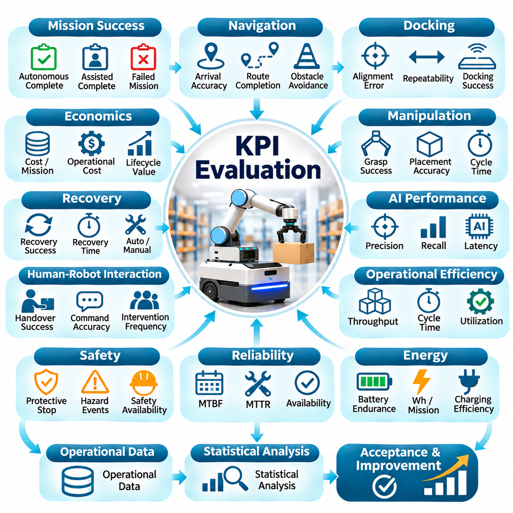{width="7.268055555555556in" height="7.268055555555556in"}

핵심 성과 지표 평가(KPI Evaluation, Key Performance Indicator Evaluation)는 모바일 매니퓰레이터(Mobile Manipulator)가 사전에 정의된 기술적, 운영적, 안전적 및 경제적 요구사항을 충족하는지를 판단하는 현장 검증(Field Validation)의 핵심 구성 요소이다. 개발 매뉴얼의 현장 검증 프레임워크(Field Validation Framework) 내에서 핵심 성과 지표 평가는 운영 측정값(Operational Measurement)을 시스템 인수(System Acceptance), 엔지니어링 개선(Engineering Improvement) 및 상업적 배치 의사결정(Commercial Deployment Decision)을 지원하는 정량적 근거(Quantitative Evidence)로 변환한다.

핵심 성과 지표 평가 과정은 측정 가능한 목표(Measurable Objective), 계산 방법(Calculation Method), 수용 임계값(Acceptance Threshold) 및 대표적인 운영 조건(Representative Operating Condition)을 정의하는 것에서 시작해야 한다. 각각의 지표는 특정 시스템 요구사항(System Requirements), 측정 절차(Measurement Procedure), 데이터 출처(Data Source) 및 평가 기간(Evaluation Period)과 연계되어야 한다. 일관된 평가 기준(Evaluation Criteria)을 통해 서로 다른 로봇 구성(Robot Configuration), 소프트웨어 버전(Software Version) 및 배치 환경(Deployment Environment) 간의 의미 있는 비교가 가능하다.

임무 성공률(Mission Success Rate)은 모바일 매니퓰레이터의 전체 성능(Overall Performance)을 평가하는 주요 지표이다. 성공적으로 완료된 임무의 수를 전체 시도된 임무의 수로 나눈 후 100을 곱하여 계산한다. 자율 임무 완료(Autonomous Mission Completion), 인간의 지원을 통한 완료(Completion through Human Assistance), 부분 완료(Partial Completion) 및 실패한 임무(Unsuccessful Mission)는 자율 운영 능력(Autonomous Operational Capability)을 정확하게 나타내기 위해 각각 구분하여 분류해야 한다.

자율주행 성능 평가(Navigation Performance Evaluation)는 목적지 도착 정확도(Destination Arrival Accuracy), 경로 완료율(Route Completion Rate), 이동 시간(Travel Time), 위치 추정 안정성(Localization Stability) 및 장애물 회피 성능(Obstacle Avoidance Performance)을 평가해야 한다. 추가적인 지표에는 경로 계획 지연시간(Path Planning Latency), 자율주행 복구 성공률(Navigation Recovery Success Rate) 및 계획된 궤적과 실제 궤적 간의 편차(Trajectory Deviation)가 포함될 수 있다. 측정 과정은 정적 장애물(Static Obstacle), 동적 장애물(Dynamic Obstacle) 및 보행자 통행(Human Traffic)이 존재하는 대표적인 운영 환경을 반영해야 한다.

도킹 및 위치 결정 성능(Docking and Positioning Performance)은 성공적인 조작이 이동 플랫폼(Mobile Platform)과 목표 작업 공간(Target Workspace) 간의 정확한 공간적 관계(Spatial Relationship)에 의존하기 때문에 특히 중요하다. 관련 핵심 성과 지표에는 도킹 성공률(Docking Success Rate), 병진 위치 결정 오차(Translational Positioning Error), 각도 정렬 오차(Angular Alignment Error), 도킹 반복 정밀도(Docking Repeatability) 및 정렬 완료 시간(Alignment Completion Time)이 포함된다. 측정 과정에서는 이동 플랫폼의 위치 결정 오차(Mobile Platform Positioning Error)와 매니퓰레이터의 위치 결정 오차(Manipulator Positioning Error)를 구분해야 한다.

조작 성능 평가(Manipulation Performance Evaluation)는 파지 성공률(Grasp Success Rate), 배치 정확도(Placement Accuracy), 궤적 추종 오차(Trajectory Tracking Error), 객체 취급 안정성(Object Handling Stability) 및 조작 사이클 시간(Manipulation Cycle Time)을 평가해야 한다. 대표적인 시험 객체(Test Object)에는 기하학적 형상(Geometry), 중량, 방향(Orientation), 재질(Material) 및 표면 특성(Surface Characteristics)의 다양한 변화가 포함되어야 한다. 평가에서는 인지(Perception), 파지 계획(Grasp Planning), 모션 계획(Motion Planning), 액추에이터 제어(Actuator Control) 및 엔드 이펙터의 한계(End-Effector Limitation)에서 발생하는 실패를 구분해야 한다.

인공지능 성능 지표(AI Performance Indicator)는 배치된 모델의 정확도(Accuracy), 신뢰성(Reliability) 및 컴퓨팅 효율성(Computational Efficiency)을 평가해야 한다. 응용 분야에 따라 관련 지표에는 정밀도(Precision), 재현율(Recall), 평균 정밀도 평균(mAP, Mean Average Precision), 분류 정확도(Classification Accuracy), 6차원 자세 추정 오차(6D Pose Estimation Error) 및 추론 지연시간(Inference Latency)이 포함될 수 있다. 인공지능 평가(AI Evaluation)에서는 불확실성 처리(Uncertainty Handling)와 잘못된 예측(Incorrect Prediction)이 운영에 미치는 영향도 평가해야 한다.

운영 효율성(Operational Efficiency)은 임무 완료 시간(Mission Completion Time), 작업 사이클 시간(Task Cycle Time), 처리량(Throughput), 장비 활용률(Equipment Utilization) 및 생산적 운영 시간(Productive Operating Time)을 통해 평가해야 한다. 전체 운영 순서(Operational Sequence)에는 자율주행(Navigation), 도킹(Docking), 인지(Perception), 조작(Manipulation), 통신(Communication), 대기(Waiting) 및 복구 활동(Recovery Activity)이 포함되어야 한다. 세부적인 시간 측정(Time Measurement)을 통해 엔지니어는 병목현상(Bottleneck)을 식별하고 어떤 하위 시스템이 전체 생산성(Overall Productivity)을 제한하는지를 판단할 수 있다.

신뢰성 및 가용성 평가(Reliability and Availability Evaluation)는 평균 고장 간격(MTBF, Mean Time Between Failures), 평균 수리 시간(MTTR, Mean Time to Repair), 운영 가용성(Operational Availability) 및 비계획 가동 중단 시간(Unplanned Downtime)을 평가해야 한다. 고장의 정의(Failure Definition)와 측정 범위(Measurement Boundary)는 현장 검증 이전에 확립되어야 한다. 계획된 유지보수(Scheduled Maintenance), 충전 활동(Charging Activity), 소프트웨어 중단(Software Interruption) 및 하드웨어 고장(Hardware Failure)은 정확한 신뢰성 및 가용성 계산을 지원하기 위해 각각 구분하여 기록해야 한다.

에너지 효율성 평가(Energy Efficiency Evaluation)는 배터리 지속 시간(Battery Endurance), 평균 전력 소비량(Average Power Consumption), 완료된 임무당 에너지 소비량(Energy Consumption per Completed Mission) 및 충전 효율(Charging Efficiency)을 평가해야 한다. 에너지 요구량(Energy Requirement)은 적재물 중량(Payload Weight), 이동 거리(Travel Distance), 조작 빈도(Manipulation Frequency), 컴퓨팅 작업 부하(Computing Workload) 및 환경 조건에 따라 상당한 차이를 나타낼 수 있다. 측정 결과는 배터리 용량(Battery Capacity), 충전 전략(Charging Strategy), 전력 관리(Power Management) 및 운영 일정(Operating Schedule)의 최적화를 지원해야 한다.

안전 성능 평가(Safety Performance Evaluation)는 보호 정지 빈도(Protective Stop Frequency), 위험 근접 이벤트(Hazardous Proximity Event), 충돌 발생(Collision Occurrence), 비상 정지 응답 시간(Emergency Stop Response Time) 및 안전 기능 가용성(Safety Function Availability)을 평가해야 한다. 안전 관련 지표(Safety-Related Indicator)는 응용 분야별 위험성 평가(Application-Specific Risk Assessment)와 운영 중 위험 노출(Operational Exposure)을 고려하여 해석해야 한다. 양호한 통계적 결과(Statistical Result)는 요구되는 안전 기능(Safety Function)의 검증을 대체하거나 해결되지 않은 안전 위험(Safety Hazard)의 수용을 정당화할 수 없다.

인간-로봇 상호작용 성능(HRI Performance, Human-Robot Interaction Performance)은 상호작용 성공률(Interaction Success Rate), 명령 인식 정확도(Command Recognition Accuracy), 응답 지연시간(Response Latency), 객체 인계 성공률(Object Handover Success Rate) 및 인간 개입 빈도(Human Intervention Frequency)를 통해 평가해야 한다. 추가적인 지표에는 사용성(Usability), 체감 안전성(Perceived Safety), 접근성(Accessibility) 및 사용자 만족도(User Satisfaction)가 포함될 수 있다. 정량적 측정(Quantitative Measurement)은 대표적인 운영자, 고객 및 기타 영향을 받는 사람들로부터 수집된 구조화된 피드백(Structured Feedback)을 통해 보완되어야 한다.

오류 복구 성능(Error Recovery Performance)은 운영 자율성(Operational Autonomy)과 시스템 강건성(System Robustness)을 평가하는 중요한 지표이다. 복구 성공률(Recovery Success Rate), 평균 복구 시간(Average Recovery Time), 반복 고장 빈도(Repeated Failure Frequency) 및 수동 개입 요구사항(Manual Intervention Requirements)은 대표적인 비정상 조건(Abnormal Condition) 전반에 걸쳐 평가해야 한다. 복구 시도(Recovery Attempt)는 자율 운영(Autonomous Operation)과 고장 관리(Fault Management)에서 지속적으로 나타나는 취약점을 식별하기 위해 복구를 유발한 초기 결함(Initiating Fault)과 복구 결과(Recovery Outcome)에 따라 분류해야 한다.

경제적 성능 평가(Economic Performance Evaluation)는 완료된 임무당 운영 비용(Operational Cost per Completed Mission), 유지보수 비용(Maintenance Expenditure), 노동 효율성(Labor Efficiency), 에너지 비용(Energy Cost) 및 인프라 요구사항(Infrastructure Requirements)을 고려해야 한다. 기존 작업 흐름(Conventional Workflow)과 비교할 때는 동등한 작업 부하(Equivalent Workload), 서비스 품질 기대 수준(Service Quality Expectations) 및 운영 일정을 활용해야 한다. 경제적 지표(Economic Indicator)는 이론적인 생산성 향상(Theoretical Productivity Improvement)에만 의존하지 않고 수명주기 비용(Lifecycle Cost)과 배치 제약사항(Deployment Limitation)을 고려해야 한다.

핵심 성과 지표 결과(KPI Result)는 검증된 운영 데이터 세트(Validated Operational Dataset), 적절한 통계적 방법(Statistical Method) 및 일관된 측정 정의(Measurement Definition)를 활용하여 분석해야 한다. 평균값(Average Value)은 적절한 경우 변동성 측정값(Measure of Variability), 백분위수 값(Percentile Value), 표본 크기(Sample Size) 및 신뢰 구간(Confidence Interval)을 통해 보완되어야 한다. 집계된 결과(Aggregated Result)는 특정 환경 조건, 운영 시나리오(Operational Scenario) 또는 안전 필수 상황(Safety-Critical Circumstance)에서 나타나는 허용할 수 없는 성능(Unacceptable Performance)을 은폐해서는 안 된다.

핵심 성과 지표 평가는 궁극적으로 요구사항 수용(Requirement Acceptance), 시정 조치(Corrective Action), 기술 성숙도 평가(TRL Assessment, Technology Readiness Level Assessment) 및 배치 확장(Deployment Expansion)을 위한 객관적인 근거(Objective Evidence)를 확립해야 한다. 문서화된 평가 결과(Documented Result)는 운영 데이터 세트(Operational Dataset), 로봇 구성(Robot Configuration), 소프트웨어 버전(Software Version) 및 검증 조건(Validation Condition)과의 추적성(Traceability)을 유지해야 한다. 적절한 평가 지표(Evaluation Indicator), 목표값(Target Value) 및 수용 임계값(Acceptance Threshold)은 응용 분야별 요구사항(Application-Specific Requirements)에 따라 결정되어야 한다.

## 11 TRL Assessment

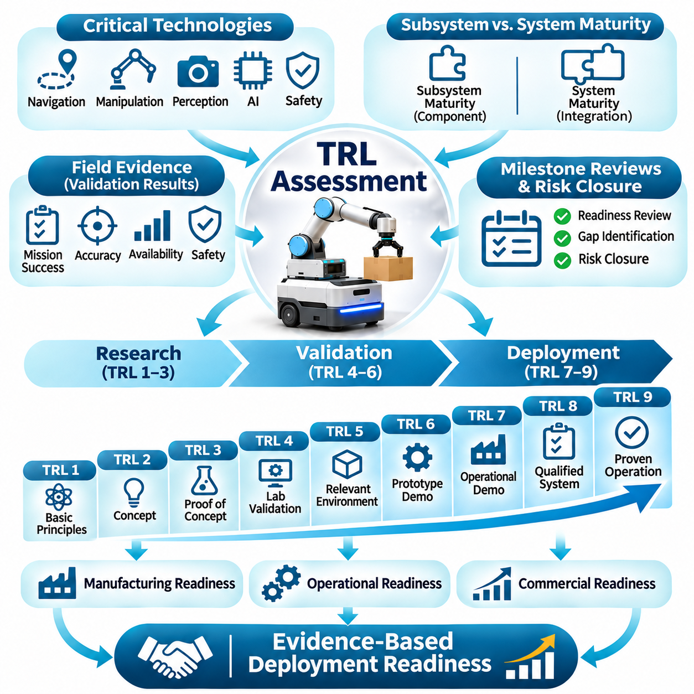{width="7.268055555555556in" height="7.268055555555556in"}

기술 성숙도 평가(TRL Assessment, Technology Readiness Level Assessment)는 모바일 매니퓰레이터(Mobile Manipulator) 기술의 개발 수명주기(Development Lifecycle) 전반에 걸친 성숙도를 평가하는 현장 검증(Field Validation)의 핵심 구성 요소이다. 개발 매뉴얼의 현장 검증 프레임워크(Field Validation Framework)를 기반으로 다음의 평가 방법론(Assessment Methodology)은 기술적 성숙도(Technological Maturity), 시스템 통합(System Integration), 운영 성능(Operational Performance) 및 상업적 배치 준비도(Commercial Deployment Readiness) 간의 객관적인 관계를 확립하기 위해 기술 성숙도에 관한 내용을 확장한다.

기술 성숙도 프레임워크(Technology Readiness Level Framework)는 일반적으로 기초 과학적 원리(Basic Scientific Principle)를 관찰하는 TRL 1부터 성공적인 실제 운영(Operational Use)을 통해 실제 시스템을 입증하는 TRL 9까지 총 9개의 성숙도 단계(Maturity Level)로 구성된다. 각각의 단계는 실험적 연구(Experimental Research), 프로토타입 개발(Prototype Development), 시스템 통합(System Integration), 검증(Validation) 및 운영 실증(Operational Demonstration)을 통해 기술적 불확실성(Technological Uncertainty)을 점진적으로 감소시키는 과정을 나타낸다.

기술 성숙도 평가는 모바일 매니퓰레이터 아키텍처(Mobile Manipulator Architecture) 내에서 핵심 기술(Critical Technology)과 엔지니어링 하위 시스템(Engineering Subsystem)을 식별하는 것에서 시작해야 한다. 여기에는 자율주행(Autonomous Navigation), 매니퓰레이터 제어(Manipulator Control), 시각 인지(Visual Perception), 인공지능(Artificial Intelligence), 파지 계획(Grasp Planning), 배터리 관리(Battery Management), 통신 인프라(Communication Infrastructure) 및 안전 시스템(Safety System)이 포함될 수 있다. 각각의 핵심 기술은 명확하게 정의된 성숙도 기준(Maturity Criteria)에 따라 평가되어야 한다.

TRL 1과 TRL 2는 기초 원리(Fundamental Principle)를 관찰하고 잠재적인 기술 개념(Technological Concept)을 정립하는 기술 개발(Technological Development)의 초기 단계를 나타낸다. 모바일 매니퓰레이터의 경우 이러한 단계에는 자율 이동 알고리즘(Autonomous Mobility Algorithm), 로봇 조작 원리(Robotic Manipulation Principle), 인지 아키텍처(Perception Architecture) 또는 학습 기반 제어 방법(Learning-Based Control Method)에 대한 연구가 포함될 수 있다. 연구 결과(Research Finding)는 후속 개발(Subsequent Development)을 위한 이론적 기반(Theoretical Foundation)을 확립한다.

TRL 3은 분석적 연구(Analytical Investigation)와 예비 실험(Preliminary Experiment)을 통해 핵심 기술 기능(Critical Technological Function)의 실현 가능성을 입증하는 실험적 개념 증명(Experimental Proof of Concept) 단계를 나타낸다. 모바일 매니퓰레이터 개발에는 객체 인식 알고리즘(Object Recognition Algorithm), 파지 예측 모델(Grasp Prediction Model), 위치 추정 방법(Localization Method) 또는 협조 모션 제어 전략(Coordinated Motion Control Strategy)에 대한 검증이 포함될 수 있다. 실험 결과(Experimental Result)는 정의된 조건에서 기술적 실현 가능성(Technological Feasibility)을 입증해야 한다.

TRL 4는 실험실 환경(Laboratory Environment) 내에서의 기술 검증(Technology Validation) 단계를 나타낸다. 개별 구성 요소(Individual Component)와 초기 하위 시스템(Preliminary Subsystem)은 통제된 조건(Controlled Condition)에서 통합되고 평가된다. 모바일 매니퓰레이터 검증에는 자율주행(Autonomous Navigation), 객체 검출(Object Detection), 로봇 파지(Robotic Grasping) 및 협조 작업 실행(Coordinated Task Execution)에 대한 실험실 실증(Laboratory Demonstration)이 포함될 수 있다. 실험실 시험(Laboratory Testing)은 필수적인 기능적 능력(Functional Capability)에 대한 반복 가능한 근거(Repeatable Evidence)를 확립해야 한다.

TRL 5는 목표 응용 분야(Intended Application)의 주요 특성을 재현하는 유사 환경(Relevant Environment) 내에서의 기술 검증 단계를 나타낸다. 모바일 매니퓰레이터는 대표적인 적재물(Representative Payload), 운영 시나리오(Operational Scenario), 환경 조건(Environmental Condition) 및 물리적 인터페이스(Physical Interface)를 활용하여 평가되어야 한다. 검증 과정에서는 통제된 실험실 실험(Controlled Laboratory Experiment) 중에는 관찰되지 않았을 수 있는 기술적 한계(Technological Limitation)를 식별해야 한다.

TRL 6은 유사 환경 내에서 시스템 또는 하위 시스템 프로토타입(System or Subsystem Prototype)을 실증하는 단계를 나타낸다. 통합 모바일 매니퓰레이터(Integrated Mobile Manipulator)는 대표적인 운영 조건(Representative Operational Condition)에서 협조 자율주행(Coordinated Navigation), 인지(Perception), 도킹(Docking), 조작(Manipulation) 및 작업 실행(Task Execution)을 입증해야 한다. 성능 측정(Performance Measurement), 안전 검증(Safety Verification) 및 복구 실증(Recovery Demonstration)은 기술적 성숙도가 향상되고 있음을 보여주는 근거를 제공해야 한다.

TRL 7은 실제 운영 환경(Actual Operational Environment) 내에서 시스템 프로토타입(System Prototype)을 실증하는 단계를 나타낸다. 모바일 매니퓰레이터는 물류 창고(Warehouse), 공장(Factory), 병원(Hospital) 또는 상업적 서비스 시설(Commercial Service Facility) 내에서 대표적인 임무(Representative Mission)를 수행해야 한다. 현장 검증에서는 실제와 같은 운영 조건(Realistic Operating Condition)에서 운영 신뢰성(Operational Reliability), 인프라 호환성(Infrastructure Compatibility), 인간-로봇 상호작용(HRI, Human-Robot Interaction), 장시간 운영 성능(Long-Duration Performance) 및 자율 복구(Autonomous Recovery)를 평가해야 한다.

TRL 8은 적절한 시험(Testing)과 실증(Demonstration)을 통해 완성되고 적격성이 입증된 실제 시스템(Actual System)을 나타낸다. 하드웨어 구성(Hardware Configuration), 소프트웨어 릴리스(Software Release), 인공지능 모델(AI Model), 안전 메커니즘(Safety Mechanism) 및 시스템 인터페이스(System Interface)는 충분히 확정되고 문서화되어야 한다. 적격성 평가 근거(Qualification Evidence)는 적용되는 기술적 요구사항(Technical Requirements), 성능 기준(Performance Criteria) 및 안전 관련 의무사항(Safety Obligation)의 충족 여부를 입증해야 한다.

TRL 9는 목표 환경(Intended Environment) 내에서 성공적인 실제 운영을 통해 입증된 실제 시스템을 나타낸다. 모바일 매니퓰레이터는 지속 가능한 운영 성능(Sustainable Operational Performance), 신뢰성 있는 자율 작업 실행(Autonomous Task Execution), 효과적인 유지보수 절차(Maintenance Procedure) 및 일관된 서비스 제공(Service Delivery)을 입증해야 한다. 장기간 배치 기록(Long-Term Deployment Record)은 해당 기술이 목표 운영 조건(Intended Operating Condition)에서 성공적으로 작동한다는 근거를 확립해야 한다.

기술 성숙도 평가에서는 개별 하위 시스템 성숙도(Individual Subsystem Maturity)와 통합 시스템 성숙도(Integrated System Maturity)를 구분해야 한다. 성숙한 자율주행 플랫폼(Navigation Platform), 산업용 매니퓰레이터(Industrial Manipulator) 및 인지 기술(Perception Technology)이 완전한 모바일 매니퓰레이터 시스템에 대해 자동으로 동등한 기술 성숙도를 보장하는 것은 아니다. 통합 복잡성(Integration Complexity), 인터페이스 신뢰성(Interface Reliability), 협조 작업 실행(Coordinated Task Execution) 및 해결되지 않은 핵심 기술 위험(Critical Technological Risk)은 독립적으로 평가되어야 한다.

현장 검증 결과(Field Validation Result)는 기술 성숙도 평가를 지원하는 정량적 및 정성적 근거(Quantitative and Qualitative Evidence)를 제공해야 한다. 관련 근거에는 임무 성공률(Mission Success Rate), 자율주행 정확도(Navigation Accuracy), 도킹 반복 정밀도(Docking Repeatability), 조작 성능(Manipulation Performance), 운영 가용성(Operational Availability), 에너지 효율성(Energy Efficiency) 및 안전 검증 결과(Safety Verification Result)가 포함될 수 있다. 수용 임계값(Acceptance Threshold)은 응용 분야별 요구사항(Application-Specific Requirements)과 운영 위험(Operational Risk)에 따라 확립되어야 한다.

기술 성숙도 향상(Technology Readiness Progression)은 체계적인 마일스톤 검토(Milestone Review)와 문서화된 평가 절차(Documented Assessment Procedure)를 통해 관리되어야 한다. 엔지니어링 팀은 입증된 기술적 능력(Demonstrated Capability)과 다음 성숙도 단계(Next Maturity Level)의 요구사항 간의 격차(Gap)를 식별해야 한다. 해결되지 않은 기술적 위험(Unresolved Technical Risk), 불충분한 검증 근거(Insufficient Validation Evidence), 통합 실패(Integration Failure) 및 운영 제약사항(Operational Limitation)은 시정 조치(Corrective Action)와 추가 시험(Additional Testing)을 통해 해결되어야 한다.

기술 성숙도(Technology Readiness)는 제조 성숙도(Manufacturing Readiness), 운영 준비도(Operational Readiness) 및 상업화 준비도(Commercial Readiness)와도 구분되어야 한다. 기술적으로 성숙한 모바일 매니퓰레이터라 하더라도 제조 최적화(Manufacturing Optimization), 공급망 개발(Supply Chain Development), 생산 품질 보증(Production Quality Assurance), 유지보수 인프라(Maintenance Infrastructure) 및 규제 승인(Regulatory Approval)이 추가적으로 요구될 수 있다. 이러한 상호 보완적 평가(Complementary Assessment)는 지속 가능한 상업화 능력(Sustainable Commercialization Capability)을 확립하는 데 필요하다.

기술 성숙도 평가는 궁극적으로 지속적인 개발(Continued Development), 프로토타입 개선(Prototype Refinement), 파일럿 배치(Pilot Deployment), 적격성 평가(Qualification) 및 상업적 도입(Commercial Introduction)에 관한 근거 기반 의사결정(Evidence-Based Decision-Making)을 지원해야 한다. 평가 기록(Assessment Record)은 시스템 요구사항(System Requirements), 형상 기준선(Configuration Baseline), 검증 데이터 세트(Validation Dataset), 시험 보고서(Test Report) 및 문서화된 한계사항(Documented Limitation)과의 추적성(Traceability)을 유지해야 한다. 기술 성숙도 단계는 해당 단계에 적용되는 평가 기준(Applicable Criteria)이 충족되었음을 명확하게 입증한 경우에만 부여되어야 한다.

## 12 Field Validation Reports

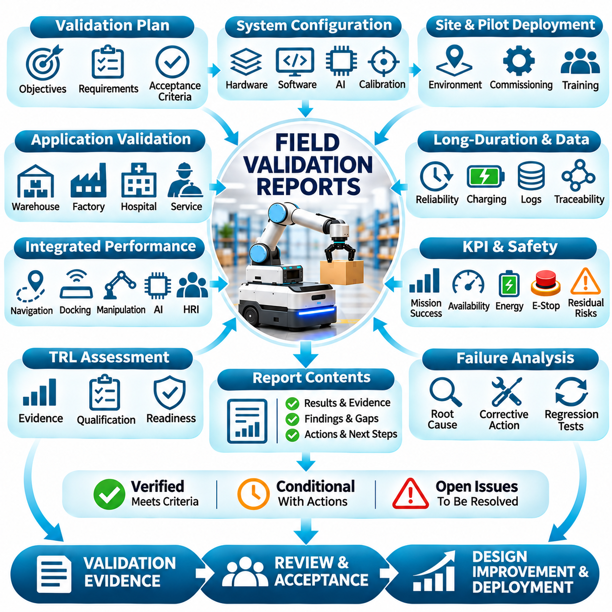{width="7.268055555555556in" height="7.268055555555556in"}

현장 검증 보고서(Field Validation Report)는 대표적인 운영 조건(Representative Operating Condition)과 실제 운영 조건(Actual Operating Condition)에서 수행된 모바일 매니퓰레이터(Mobile Manipulator)의 검증 결과를 통합하는 필수적인 엔지니어링 문서(Engineering Document)이다. 현장 검증(Field Validation) 장의 최종 구성 요소로서 본 주제는 검증 전략(Validation Strategy), 파일럿 배치(Pilot Deployment), 응용 분야별 평가(Application-Specific Assessment), 운영 데이터 수집(Operational Data Collection), 핵심 성과 지표 평가(KPI Evaluation) 및 기술 성숙도 평가(TRL Assessment)를 구조화된 엔지니어링 보고 방법론(Engineering Reporting Methodology)으로 통합한다.

현장 검증 보고서는 검증 목적(Validation Objective), 시스템 요구사항(System Requirements), 운영 범위(Operational Scope) 및 목표 응용 분야(Intended Application)에 대한 설명으로 시작해야 한다. 개발 매뉴얼(Development Manual)은 상세한 보고서 작성 사양(Reporting Specification)이 아닌 전체 주제 구조(Topic Structure)를 정의하므로 개별 보고서의 내용은 프로젝트별 요구사항(Project-Specific Requirements)에 맞게 조정되어야 한다. 보고서는 검증 목적, 평가 절차(Evaluation Procedure) 및 수용 기준(Acceptance Criteria) 간의 명확한 관계를 확립해야 한다.

시스템 구성 문서화(System Configuration Documentation)는 현장 검증에 사용된 이동 플랫폼(Mobile Platform), 매니퓰레이터(Manipulator), 엔드 이펙터(End Effector), 센서 아키텍처(Sensor Architecture), 컴퓨팅 하드웨어(Computing Hardware), 통신 인터페이스(Communication Interface) 및 안전 메커니즘(Safety Mechanism)을 식별해야 한다. 재현성(Reproducibility)과 기술적 추적성(Technical Traceability)을 보장하기 위해 소프트웨어 버전(Software Version), 펌웨어 버전(Firmware Version), 인공지능 모델(AI Model), 보정 매개변수(Calibration Parameter) 및 형상 기준선(Configuration Baseline)도 기록해야 한다.

운영 환경 문서화(Operational Environment Documentation)는 검증 현장(Validation Site)의 물리적 특성(Physical Characteristics), 인프라(Infrastructure), 환경 조건(Environmental Condition) 및 운영 제약사항(Operational Constraint)을 설명해야 한다. 관련 정보에는 바닥 상태(Floor Condition), 작업 공간 치수(Workspace Dimension), 조명(Illumination), 장애물 분포(Obstacle Distribution), 네트워크 가용성(Network Availability) 및 보행자 통행(Human Traffic)이 포함될 수 있다. 계획된 검증 조건(Planned Validation Condition)과 실제 운영 조건(Actual Operating Condition) 간의 차이는 명확하게 문서화되어야 한다.

파일럿 배치 결과(Pilot Deployment Result)는 설치 절차(Installation Procedure), 시스템 시운전(System Commissioning), 인프라 통합(Infrastructure Integration), 운영자 교육(Operator Training) 및 초기 운영 경험(Initial Operational Experience)을 요약해야 한다. 보고서는 배치 과정의 문제점(Deployment Challenge), 구성 조정(Configuration Adjustment), 호환성 문제(Compatibility Issue) 및 초기 기술적 고장(Early Technical Failure)을 문서화해야 한다. 이러한 조사 결과는 후속 배치(Subsequent Deployment)를 개선하고 구축 위험(Implementation Risk)을 감소시키기 위한 실질적인 근거(Practical Evidence)를 제공한다.

응용 분야별 검증 결과(Application-Specific Validation Result)는 해당되는 경우 물류 창고(Warehouse), 공장(Factory), 병원(Hospital) 및 상업적 서비스 환경(Commercial Service Environment) 내에서의 성능을 설명해야 한다. 각각의 환경은 서로 다른 운영 요구사항(Operational Requirements), 상호작용 패턴(Interaction Pattern), 인프라 의존성(Infrastructure Dependency) 및 안전 제약사항(Safety Constraint)을 수반한다. 검증 보고서는 응용 분야별 조사 결과(Application-Specific Finding)와 일반적인 시스템 능력(General System Capability) 및 한계사항(Limitation)을 구분해야 한다.

자율주행 및 조작 결과(Navigation and Manipulation Result)는 목적지 도착 정확도(Destination Arrival Accuracy), 위치 추정 성능(Localization Performance), 장애물 회피(Obstacle Avoidance), 도킹 반복 정밀도(Docking Repeatability), 파지 성공률(Grasp Success Rate), 배치 정확도(Placement Accuracy) 및 작업 실행 시간(Task Execution Time)을 문서화해야 한다. 통합 임무 결과(Integrated Mission Result)는 대표적인 현장 조건(Representative Field Condition)에서 자율 이동(Autonomous Mobility), 인지(Perception), 조작(Manipulation) 및 작업 관리(Task Management) 기능이 신뢰성 있게 연계되어 작동하는지를 입증해야 한다.

인공지능 검증 보고(AI Validation Reporting)는 객체 검출 정확도(Object Detection Accuracy), 자세 추정 성능(Pose Estimation Performance), 파지 예측 신뢰성(Grasp Prediction Reliability), 추론 지연시간(Inference Latency) 및 모델 강건성(Model Robustness)을 요약해야 한다. 대표적인 인식 실패(Recognition Failure), 불확실한 예측(Uncertain Prediction), 환경 변화(Environmental Variation) 및 컴퓨팅 한계(Computational Limitation)를 문서화해야 한다. 인공지능 모델 성능(AI Model Performance)은 물리적 작업 실행(Physical Task Execution)에 미치는 영향과 연계하여 평가되어야 한다.

인간-로봇 상호작용 검증 보고서(HRI Validation Report, Human-Robot Interaction Validation Report)는 운영자 명령(Operator Command), 상호작용 성공률(Interaction Success Rate), 객체 인계 성능(Object Handover Performance), 인간 개입 빈도(Human Intervention Frequency) 및 사용자 피드백(User Feedback)을 문서화해야 한다. 사용성(Usability), 체감 안전성(Perceived Safety), 접근성(Accessibility) 및 운영 예측 가능성(Operational Predictability)에 관한 관찰 결과도 포함되어야 한다. 이러한 조사 결과는 인간-기계 인터페이스(HMI, Human-Machine Interface), 상호작용 전략(Interaction Strategy) 및 운영자 교육 절차(Operator Training Procedure)의 개선을 지원해야 한다.

장시간 운영 결과(Long-Duration Operation Result)는 운영 시간(Operating Hours), 완료된 임무(Completed Mission), 충전 사이클(Charging Cycle), 부품 열화(Component Degradation), 열적 안정성(Thermal Stability), 소프트웨어 신뢰성(Software Reliability) 및 유지보수 활동(Maintenance Activity)을 문서화해야 한다. 비계획 가동 중단 시간(Unplanned Downtime), 반복적으로 발생하는 고장(Recurring Failure) 및 복구 시도(Recovery Attempt)는 실제 운영 조건과 연계하여 분석해야 한다. 이러한 조사 결과는 신뢰성 평가(Reliability Assessment), 유지보수 계획(Maintenance Planning) 및 수명주기 성능 평가(Lifecycle Performance Evaluation)를 지원한다.

운영 데이터 문서화(Operational Data Documentation)는 기록된 센서 측정값(Sensor Measurement), 진단 로그(Diagnostic Log), 임무 이력(Mission History), 액추에이터 상태(Actuator State), 안전 이벤트(Safety Event) 및 에너지 소비 기록(Energy Consumption Record)을 식별해야 한다. 데이터 출처(Data Source), 기록 주기(Recording Frequency), 동기화 방법(Synchronization Method) 및 저장 위치(Storage Location)는 추적 가능하게 유지되어야 한다. 보고된 결론의 신뢰성(Reliability)을 확립하기 위해 누락된 측정값(Missing Measurement), 기록 실패(Recording Failure) 및 데이터 품질 한계(Data Quality Limitation)를 명시해야 한다.

핵심 성과 지표 보고(KPI Reporting, Key Performance Indicator Reporting)는 측정된 성능(Measured Performance)을 사전에 정의된 목표값(Target Value) 및 수용 임계값(Acceptance Threshold)과 비교해야 한다. 관련 지표에는 임무 성공률(Mission Success Rate), 운영 가용성(Operational Availability), 처리량(Throughput), 위치 결정 정확도(Positioning Accuracy), 에너지 효율성(Energy Efficiency) 및 복구 성공률(Recovery Success Rate)이 포함될 수 있다. 통계적 결과(Statistical Result)에는 적절한 경우 대표적인 표본 크기(Sample Size), 성능 변동성(Performance Variability) 및 측정 불확실성(Measurement Uncertainty)이 포함되어야 한다.

안전 검증 보고(Safety Validation Reporting)는 비상 정지 검증(Emergency Stop Verification), 보호 정지 성능(Protective Stopping Performance), 위험 이벤트(Hazardous Event), 충돌 발생(Collision Occurrence) 및 식별된 잔여 위험(Residual Risk)을 문서화해야 한다. 안전 관련 고장(Safety-Related Failure)에는 사고 설명(Incident Description), 조사 결과(Investigation Result), 시정 조치(Corrective Action) 및 검증 근거(Verification Evidence)가 수반되어야 한다. 해결되지 않은 안전 결함(Unresolved Safety Deficiency)은 명확하게 표시되어야 하며, 충분한 근거 없이 운영 준비도(Operational Readiness)를 선언하는 것을 방지해야 한다.

고장 분석 및 시정 조치 보고(Failure Analysis and Corrective Action Reporting)는 관찰된 문제(Observed Problem), 운영 조건(Operating Condition), 근본 원인(Root Cause) 및 엔지니어링 변경사항(Engineering Modification) 간의 추적성을 확립해야 한다. 식별된 각각의 문제에는 담당 책임(Assigned Responsibility), 심각도 분류(Severity Classification), 해결 상태(Resolution Status) 및 검증 요구사항(Verification Requirement)이 지정되어야 한다. 회귀 시험 결과(Regression Testing Result)는 시정 조치가 추가적인 위험(Additional Risk)을 발생시키지 않으면서 식별된 결함(Identified Deficiency)을 해결했는지를 입증해야 한다.

기술 성숙도 평가 결과(TRL Assessment Result, Technology Readiness Level Assessment Result)는 프로토타입 통합(Prototype Integration), 유사 환경 시험(Relevant Environment Testing), 운영 실증(Operational Demonstration) 및 적격성 평가 활동(Qualification Activity)을 통해 입증된 성숙도(Maturity)를 요약해야 한다. 부여된 기술 성숙도 단계(Assigned Readiness Level)는 문서화된 검증 근거(Documented Validation Evidence)와 적용 가능한 성숙도 기준(Applicable Maturity Criteria)에 의해 뒷받침되어야 한다. 남아 있는 기술적 불확실성(Technological Uncertainty)과 후속 성숙도 단계로 발전하기 위한 요구사항(Requirements for Readiness Progression)을 식별해야 한다.

현장 검증 보고서는 궁극적으로 시스템 인수(System Acceptance), 설계 개선(Design Refinement), 제조 준비(Manufacturing Preparation) 및 상업적 배치 의사결정(Commercial Deployment Decision)을 위한 객관적인 근거(Objective Evidence)를 제공해야 한다. 최종 결론(Final Conclusion)은 검증된 능력(Verified Capability), 조건부 인수(Conditional Acceptance), 해결되지 않은 결함(Unresolved Deficiency) 및 운영 한계(Operational Limitation)를 명확하게 구분해야 한다. 승인된 보고서(Approved Report)는 감사(Audit), 지속적인 개선(Continuous Improvement) 및 향후 개발(Future Development)을 지원하기 위해 문서 관리(Document Management) 및 형상 관리(Configuration Management) 절차에 따라 유지되어야 한다.
