**Volume 05. Mobile Manipulator Projects and Development Manual**

# Chapter 08. Manufacturing

## 01 Manufacturing Strategy

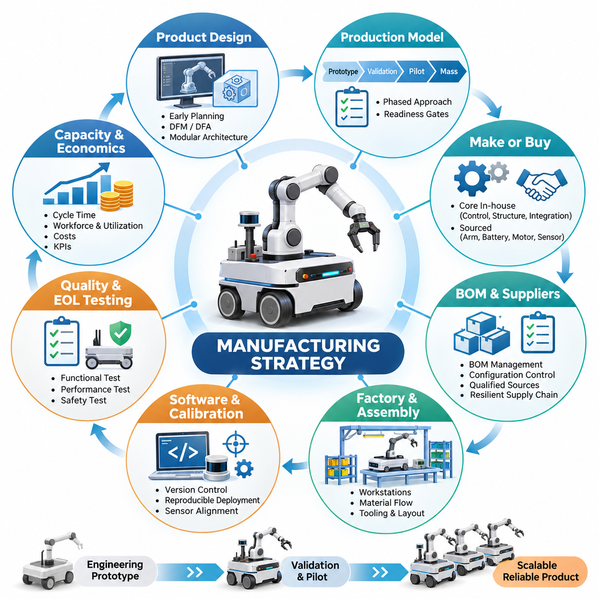{width="7.268055555555556in" height="7.268055555555556in"}

Manufacturing strategy establishes the fundamental approach for transforming a mobile manipulator from an engineering prototype into a commercially viable and reproducible robotic product. It connects product development, production engineering, supply chain management, quality assurance, and business objectives within a unified manufacturing framework. Its primary objective is to achieve consistent product quality, predictable production costs, and scalable manufacturing capacity.

Unlike conventional industrial products, mobile manipulators combine autonomous mobile robots (AMRs), robotic arms, end effectors, perception sensors, embedded computing platforms, and artificial intelligence software. These heterogeneous components introduce complex mechanical, electrical, and software integration requirements. Manufacturing strategies must therefore address both physical assembly and system-level functional consistency across individual production units.

Manufacturing planning should begin during the early stages of product development rather than after prototype validation. Engineering teams must evaluate component availability, assembly complexity, production tolerances, manufacturing processes, and expected production volumes. Early collaboration between development and manufacturing teams reduces expensive design modifications and supports a smoother transition from experimental systems to commercial products.

The manufacturing strategy should define an appropriate production model according to market demand, product maturity, capital investment, and organizational capabilities. Prototype manufacturing typically relies on flexible engineering workshops and manual assembly, whereas commercial manufacturing requires standardized processes and controlled production environments. Production methods should evolve progressively as demand increases and product designs stabilize.

A phased manufacturing approach supports the transition from prototype fabrication to engineering validation, design validation, production validation, and mass production. Each phase should establish specific entry and exit criteria covering design maturity, component reliability, assembly repeatability, and operational performance. Manufacturing readiness must be evaluated alongside technology readiness to prevent premature commercialization.

Make-or-buy decisions represent a fundamental element of manufacturing strategy. Robot manufacturers must determine which components should be developed and manufactured internally and which should be procured from external suppliers. Proprietary control systems, specialized mechanical structures, and integration technologies may justify internal development, while standardized robotic arms, batteries, motors, and sensors may be sourced externally.

Modular product architecture enables manufacturing flexibility and reduces the complexity of producing multiple mobile manipulator configurations. Common mobile platforms, electrical architectures, computing modules, and standardized mechanical interfaces can support different robotic arms and application-specific end effectors. Platform modularity also improves inventory utilization, engineering reuse, maintenance efficiency, and product scalability.

Design for Manufacturing (DFM) and Design for Assembly (DFA) principles should be incorporated throughout product development. Mechanical structures must be designed for practical fabrication, accessible fastening, simplified alignment, and efficient component installation. Electrical systems should minimize wiring complexity and support standardized connectors, while hardware arrangements should facilitate inspection, calibration, and component replacement.

Bill of Materials (BOM) management provides the foundation for material procurement, production planning, configuration control, and manufacturing cost estimation. Engineering and manufacturing BOMs must remain synchronized throughout the product lifecycle. Component substitutions, supplier changes, hardware revisions, and software dependencies should be controlled through formal engineering change management processes.

Production facilities should be organized according to material flow, assembly sequences, equipment requirements, operator accessibility, and safety considerations. Dedicated workstations may support mechanical assembly, electrical installation, robotic arm integration, software provisioning, sensor calibration, and final system testing. Efficient facility layouts reduce unnecessary transportation, production bottlenecks, and handling-related component damage.

Manufacturing a mobile manipulator also requires systematic software integration and configuration management. Operating systems, device drivers, robot middleware, navigation software, manipulation algorithms, and AI models must be installed using controlled and reproducible procedures. Each production unit should maintain traceable software versions, configuration parameters, calibration records, and hardware compatibility information.

Calibration and production testing are particularly important because small manufacturing variations can influence navigation accuracy, manipulation precision, and perception reliability. Standardized test fixtures should support wheel alignment, sensor coordinate transformation, robotic arm mounting verification, and end-effector calibration. End-of-Line (EOL) testing must confirm that completed robots satisfy predefined functional, performance, and safety requirements.

Production capacity planning should consider assembly cycle time, workforce availability, equipment utilization, supplier lead times, and testing throughput. Manufacturing organizations must identify bottlenecks before increasing production volumes and establish realistic capacity expansion plans. Pilot production provides valuable information about actual assembly times, defect rates, rework requirements, and resource consumption under representative conditions.

Manufacturing economics must be evaluated across the complete product lifecycle rather than through component prices alone. Direct material costs, labor expenses, production overhead, tooling investment, warranty exposure, logistics, and maintenance requirements influence overall profitability. Manufacturing strategies should balance cost reduction against system reliability, safety, operational performance, and long-term customer satisfaction.

A sustainable manufacturing strategy requires resilient supply chains, qualified alternative suppliers, controlled inventories, and continuous process improvement. Key Performance Indicators (KPIs), including first-pass yield, production cycle time, manufacturing cost, defect rates, and on-time delivery, provide measurable feedback. Ultimately, manufacturing success depends on converting validated engineering designs into reliable products that can be produced consistently at commercial scale.

## 02 BOM Management

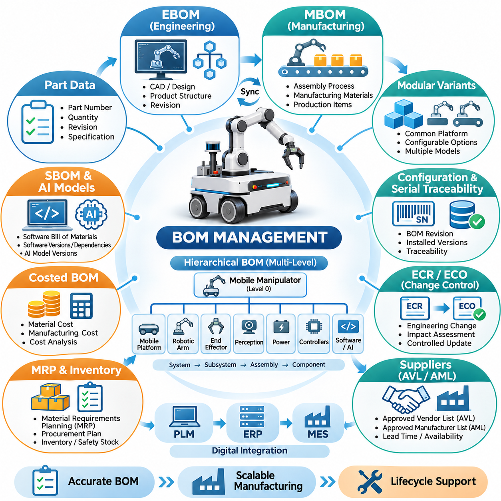{width="7.268055555555556in" height="7.268055555555556in"}

Bill of Materials (BOM) management is a fundamental manufacturing discipline that defines, organizes, and controls all components, materials, assemblies, and software-related configuration items required to produce a mobile manipulator. It establishes a structured relationship between engineering design, procurement, production planning, inventory management, quality control, and maintenance throughout the entire product lifecycle.

A mobile manipulator BOM encompasses multiple engineering domains, including mechanical structures, autonomous mobile robot (AMR) platforms, robotic arms, end effectors, electrical components, wiring harnesses, perception sensors, batteries, embedded controllers, and computing platforms. Because these subsystems have different procurement cycles, configuration requirements, and operational dependencies, BOM management requires a multidisciplinary approach.

The Engineering Bill of Materials (EBOM) represents the product structure from an engineering design perspective. It is typically derived from Computer-Aided Design (CAD) models, electrical schematics, system architecture documents, and engineering specifications. The EBOM defines component relationships, technical characteristics, part identifiers, assembly hierarchies, and design revisions while maintaining consistency with approved engineering requirements.

The Manufacturing Bill of Materials (MBOM) reorganizes engineering information according to actual production requirements and assembly processes. Unlike the EBOM, which primarily describes the designed product, the MBOM includes manufacturing-specific materials, consumables, intermediate assemblies, packaging materials, and production-related components. Synchronization between the EBOM and MBOM is essential for preventing discrepancies between design and manufacturing.

A hierarchical BOM structure supports the systematic decomposition of mobile manipulators into systems, subsystems, assemblies, subassemblies, and individual components. The highest level represents the complete robotic product, while lower levels describe the mobile platform, manipulation system, perception system, power distribution architecture, and control hardware. This hierarchy improves configuration management and supports efficient component traceability.

Each BOM item should possess a unique part number, standardized description, quantity, unit of measurement, revision identifier, material specification, and procurement classification. Additional information may include supplier identifiers, estimated costs, manufacturing lead times, lifecycle status, and approved alternatives. Consistent data structures and part numbering conventions reduce duplication, procurement errors, and configuration inconsistencies.

Modular BOM architecture enables manufacturers to develop multiple mobile manipulator product variants using shared components and standardized interfaces. A common AMR platform may support different robotic arms, payload capacities, perception configurations, battery capacities, and computing architectures. Configurable BOM structures simplify product customization, reduce unnecessary inventory, promote engineering reuse, and improve manufacturing scalability.

Configuration management is particularly important when mobile manipulators are manufactured in multiple hardware and software configurations. Each production unit must remain associated with its approved BOM revision, installed component versions, firmware releases, software packages, and AI model configurations. Serial number-based traceability enables manufacturers to reconstruct the actual configuration of individual robots during maintenance and failure investigation.

Engineering change management provides a controlled mechanism for modifying BOM structures throughout the product lifecycle. Engineering Change Requests (ECRs) identify proposed modifications, while Engineering Change Orders (ECOs) authorize approved changes and define implementation conditions. Changes should be evaluated for their effects on manufacturing processes, procurement commitments, existing inventory, system compatibility, safety, and operational performance.

BOM management must maintain strong integration with supplier management and procurement processes. Critical components such as robotic arms, drive motors, motor controllers, safety LiDAR sensors, batteries, and edge computing modules may have extended procurement lead times or limited availability. Approved Vendor Lists (AVLs) and Approved Manufacturer Lists (AMLs) support controlled sourcing and reduce risks associated with unauthorized substitutions.

Material Requirements Planning (MRP) utilizes BOM information to calculate component demand based on production schedules, inventory availability, procurement lead times, and expected manufacturing quantities. Accurate BOM data enables manufacturers to determine purchasing requirements, maintain appropriate safety stock, and prevent material shortages. Errors in component quantities or assembly relationships can significantly disrupt production schedules.

Costed BOM management provides detailed visibility into the material costs associated with mobile manipulator manufacturing. Component purchase prices, manufacturing costs, supplier quotations, transportation expenses, and currency exchange assumptions support systematic cost estimation. Costed BOM analysis also identifies major cost contributors and enables engineering teams to evaluate alternative designs without compromising functional or safety requirements.

Software and AI configuration management should complement traditional hardware-oriented BOM structures. A Software Bill of Materials (SBOM) identifies software components, libraries, dependencies, versions, and licensing information. AI model manifests should separately record model versions, artifact identifiers, runtime compatibility, and relevant validation references, enabling reproducible deployment and controlled software maintenance across production units.

Enterprise Resource Planning (ERP), Product Lifecycle Management (PLM), and Manufacturing Execution Systems (MES) provide complementary capabilities for digital BOM management. PLM maintains engineering product definitions and change histories, ERP coordinates procurement and inventory planning, and MES supports production execution and as-built records. Integration between these systems reduces manual data duplication and improves manufacturing traceability.

Effective BOM management requires continuous verification, revision control, and lifecycle monitoring. Key Performance Indicators (KPIs) may include BOM accuracy, material shortage frequency, component standardization rates, engineering change implementation time, and material cost variance. Ultimately, disciplined BOM management establishes a reliable digital foundation for scalable manufacturing, consistent product quality, supply chain resilience, and long-term mobile manipulator lifecycle support.

## 03 Supplier Management

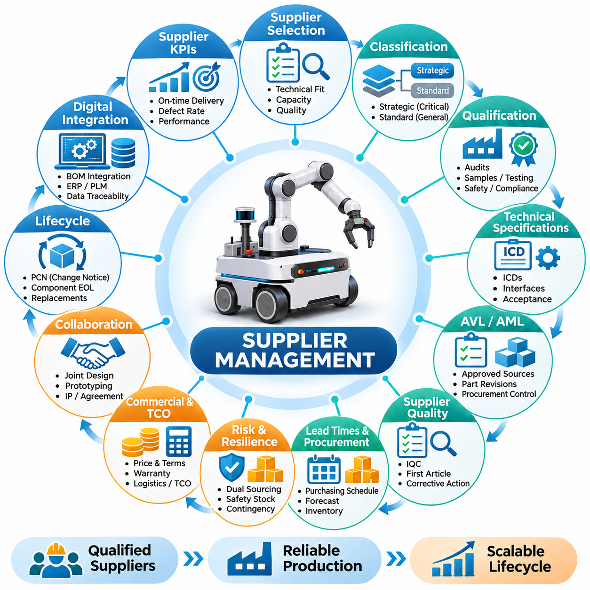{width="7.268055555555556in" height="7.268055555555556in"}

Supplier management is a fundamental manufacturing discipline that ensures the reliable procurement of components, materials, technologies, and external services required for mobile manipulator production. It establishes structured relationships between manufacturers and suppliers to achieve consistent product quality, competitive procurement costs, predictable delivery schedules, and long-term supply chain stability throughout the product lifecycle.

Mobile manipulators incorporate heterogeneous components from multiple industrial sectors, including robotic arms, drive systems, motor controllers, batteries, perception sensors, embedded computers, safety devices, and mechanical assemblies. Each component category presents different technical requirements, manufacturing capabilities, procurement lead times, and supply risks. Supplier management must therefore address both commercial relationships and engineering compatibility.

Supplier selection should begin during the early stages of system architecture and hardware development. Candidate suppliers must be evaluated according to technical capabilities, product specifications, manufacturing capacity, quality management systems, financial stability, and engineering support. Early supplier involvement enables development teams to identify component limitations, improve system integration, and reduce expensive design modifications.

Supplier classification enables manufacturing organizations to allocate management resources according to component criticality and business impact. Strategic suppliers may provide robotic arms, drive modules, safety controllers, batteries, or specialized computing platforms that significantly influence product performance. Standard component suppliers generally provide commercially available materials, fasteners, connectors, and mechanical accessories with lower substitution barriers.

Supplier qualification establishes a formal process for verifying whether potential suppliers satisfy predefined technical, manufacturing, quality, and commercial requirements. Qualification activities may include manufacturing facility audits, technical documentation reviews, sample evaluation, reliability testing, and production capability assessment. Safety-critical components require additional scrutiny of certification records, configuration restrictions, and applicable regulatory requirements.

Technical procurement specifications provide a common foundation for communication between manufacturers and suppliers. These specifications should define mechanical dimensions, electrical characteristics, communication protocols, environmental operating conditions, performance tolerances, reliability expectations, and acceptance criteria. Interface Control Documents (ICDs) are particularly important for ensuring compatibility between externally sourced components and the overall mobile manipulator architecture.

Approved Vendor Lists (AVLs) and Approved Manufacturer Lists (AMLs) establish controlled procurement sources for production components. These records should maintain supplier qualifications, approved part numbers, revision information, manufacturing locations, and applicable purchasing restrictions. Unauthorized component substitutions must be prevented through procurement controls and engineering approval procedures, particularly when changes may affect system safety or functional performance.

Supplier quality management establishes mechanisms for maintaining component conformity throughout manufacturing and delivery. Incoming Quality Control (IQC), first article inspection, statistical process control, and supplier quality audits provide evidence of manufacturing consistency. Nonconforming components should be documented and investigated through structured corrective action processes to prevent recurring defects and downstream production failures.

Procurement lead time management is essential because specialized robotic components may require substantially longer delivery periods than standard industrial materials. Manufacturers should maintain realistic purchasing schedules based on production forecasts, supplier capacity, transportation requirements, and inventory availability. Long-lead-time components should be identified early and supported through appropriate purchasing commitments and inventory planning.

Supplier risk management addresses potential disruptions associated with single-source components, manufacturing limitations, financial instability, geopolitical conditions, transportation delays, and technological obsolescence. Alternative sourcing strategies, qualified secondary suppliers, safety stock, and contingency plans improve supply chain resilience. Alternative components must undergo appropriate engineering verification before being introduced into approved production configurations.

Commercial supplier management requires systematic evaluation of purchasing prices, payment terms, minimum order quantities, warranty conditions, tooling investments, and volume-based pricing agreements. Total Cost of Ownership (TCO) provides a broader evaluation framework than initial purchase prices alone. Component reliability, integration effort, maintenance requirements, logistics expenses, and replacement availability influence the overall economic value of supplier relationships.

Supplier collaboration becomes increasingly important when mobile manipulator manufacturers require customized mechanical assemblies, drive systems, wiring harnesses, or embedded computing solutions. Joint engineering reviews, design feasibility assessments, prototype evaluations, and manufacturing feedback support collaborative product development. Intellectual property ownership, confidentiality obligations, technical responsibilities, and engineering change procedures should be clearly established.

Supplier lifecycle management ensures that externally sourced components remain available and supportable throughout the operational lifetime of mobile manipulators. Manufacturers should monitor Product Change Notifications (PCNs), End-of-Life (EOL) announcements, firmware updates, and component discontinuation schedules. Controlled replacement planning and configuration verification reduce the risk of unexpected redesigns, maintenance difficulties, and production interruptions.

Digital supplier management integrates procurement information with Bill of Materials (BOM) management, Enterprise Resource Planning (ERP), Product Lifecycle Management (PLM), and quality management systems. Centralized supplier records enable manufacturers to monitor purchasing histories, component revisions, delivery performance, inspection results, and corrective actions. Digital integration improves traceability and supports coordinated decision-making across engineering and manufacturing organizations.

Effective supplier management relies on continuous performance evaluation and long-term relationship development. Key Performance Indicators (KPIs), including on-time delivery, incoming defect rates, procurement cost variance, lead time stability, and corrective action response time, provide measurable performance feedback. Ultimately, disciplined supplier management establishes a resilient industrial ecosystem capable of supporting reliable mobile manipulator production, commercial scalability, and sustainable lifecycle operations.

## 04 DFM and DFA

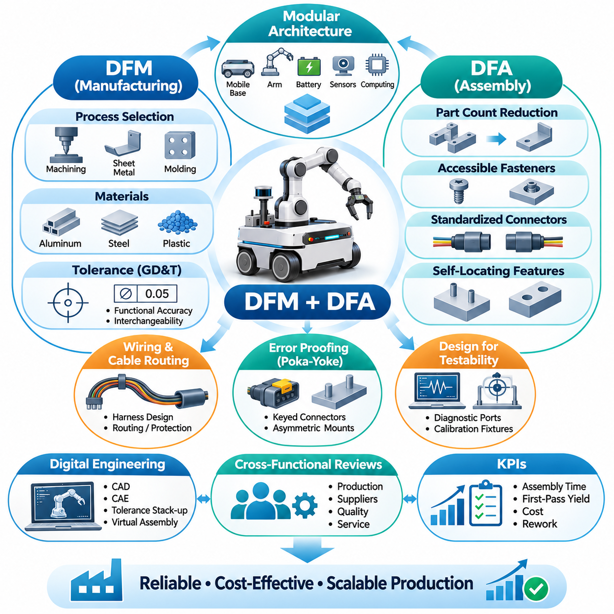{width="7.268055555555556in" height="7.268055555555556in"}

Design for Manufacturing (DFM) and Design for Assembly (DFA) are complementary engineering methodologies that optimize product designs for efficient fabrication, assembly, and commercial production. In mobile manipulator development, these methodologies establish a systematic relationship between engineering performance and manufacturing practicality, ensuring that validated robotic systems can be produced consistently, economically, and reliably.

Mobile manipulators integrate autonomous mobile robot (AMR) platforms, robotic arms, mechanical structures, electrical systems, perception sensors, computing hardware, and artificial intelligence software. The complexity of these heterogeneous subsystems introduces numerous manufacturing and assembly challenges. DFM and DFA principles help reduce unnecessary structural complexity, improve component accessibility, and establish repeatable integration processes.

Design for Manufacturing focuses on optimizing individual components and mechanical assemblies according to available manufacturing technologies, material properties, production volumes, and cost constraints. Engineering teams must evaluate whether components can be efficiently produced through machining, sheet metal fabrication, welding, casting, injection molding, or additive manufacturing while maintaining required structural and dimensional characteristics.

Material selection represents an important aspect of DFM because material properties directly influence manufacturing complexity, structural performance, product weight, and production costs. Aluminum alloys, structural steels, engineering plastics, and composite materials should be evaluated according to mechanical strength, corrosion resistance, thermal characteristics, fabrication requirements, and availability throughout the intended product lifecycle.

Mechanical tolerance optimization is essential for achieving consistent manufacturing quality without imposing unnecessarily expensive fabrication requirements. Critical interfaces, including robotic arm mounting surfaces, drive module installation points, sensor brackets, and bearing assemblies, require appropriate dimensional control. Geometric Dimensioning and Tolerancing (GD&T) supports functional accuracy, interchangeability, and systematic manufacturing inspection.

Design for Assembly focuses on simplifying the integration of components into complete functional products. Assembly operations should minimize unnecessary handling, component repositioning, specialized tooling, and operator-dependent adjustments. Mechanical structures should incorporate accessible fastening locations, self-locating features, standardized connectors, and clearly defined installation orientations to improve assembly repeatability and productivity.

Part count reduction is a fundamental DFA principle that simplifies manufacturing operations and reduces procurement, inventory, and assembly costs. Multiple mechanical components may be consolidated into integrated structures when functional requirements and manufacturing feasibility permit. However, component consolidation must be balanced against repairability, replacement costs, structural reliability, and the need for application-specific customization.

Modular product architecture supports both DFM and DFA by separating mobile manipulators into standardized functional assemblies. Mobile platforms, robotic arm mounting modules, battery systems, computing enclosures, perception assemblies, and end-effector interfaces can be manufactured and tested independently. Modularization reduces assembly complexity, enables parallel production, and supports efficient customization across different product variants.

Fastener standardization improves manufacturing efficiency by reducing the number of tools, assembly procedures, and inventory items required during production. Engineering teams should minimize unnecessary variations in bolt dimensions, thread specifications, and fastening methods. Critical fastening locations must maintain appropriate torque specifications, locking mechanisms, and inspection accessibility to ensure mechanical integrity during repeated robotic operation.

Electrical system design should incorporate manufacturing and assembly considerations through standardized wiring harnesses, connector families, cable routing structures, and clearly identified electrical interfaces. Preassembled harnesses reduce manual wiring operations and connection errors. Appropriate strain relief, connector accessibility, electromagnetic compatibility, and cable protection must be maintained throughout the mobile manipulator structure.

Error-proofing techniques, commonly referred to as Poka-Yoke, prevent incorrect component installation and assembly mistakes through appropriate engineering design. Asymmetric mounting patterns, keyed connectors, orientation guides, color identification, and mechanical alignment features reduce dependence on operator judgment. These techniques are particularly valuable for safety-related circuits, power distribution assemblies, and precision sensor installations.

Design for Testability (DFT) complements DFM and DFA by ensuring that manufactured products can be efficiently inspected, calibrated, and functionally verified. Test access points, diagnostic interfaces, reference surfaces, and calibration fixtures should be considered during system design. Accessible testing features reduce production verification time and improve the detection of manufacturing defects before final product release.

Digital engineering tools support DFM and DFA evaluation before physical manufacturing begins. Computer-Aided Design (CAD), Computer-Aided Engineering (CAE), tolerance stack-up analysis, and virtual assembly simulation enable engineers to identify interference, accessibility limitations, dimensional variations, and manufacturing bottlenecks. Digital manufacturing reviews reduce prototype iterations and improve coordination between engineering and production teams.

Manufacturing feasibility reviews should integrate feedback from production engineers, component suppliers, assembly operators, quality specialists, and maintenance personnel. Proposed design improvements must be evaluated against manufacturing cost, assembly time, tooling investment, structural performance, and safety requirements. Approved modifications should be incorporated into controlled engineering documentation, manufacturing instructions, and Bill of Materials (BOM) structures.

The effectiveness of DFM and DFA should be evaluated through measurable manufacturing indicators, including part count, assembly cycle time, first-pass yield, manufacturing cost, rework frequency, and tooling requirements. Continuous improvement based on pilot production and field feedback enables progressive design refinement. Ultimately, DFM and DFA establish the engineering foundation for reliable, cost-effective, and scalable mobile manipulator production.

## 05 Assembly Process Design

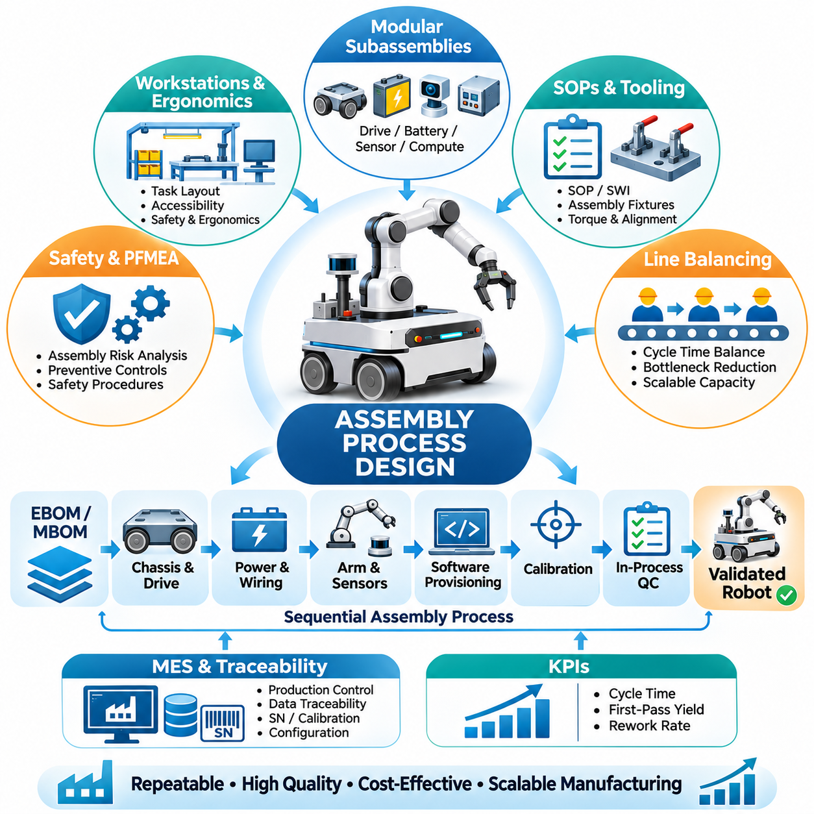{width="7.268055555555556in" height="7.268055555555556in"}

Assembly process design establishes a systematic methodology for transforming individual components, manufactured parts, and functional subsystems into a complete mobile manipulator. It defines assembly sequences, workstation configurations, tooling requirements, material flows, inspection procedures, and operational responsibilities. Its primary objective is to achieve consistent product quality, efficient production throughput, and repeatable manufacturing performance.

Mobile manipulator assembly involves the integration of autonomous mobile robot (AMR) platforms, robotic arms, end effectors, electrical systems, batteries, perception sensors, embedded controllers, and computing hardware. Unlike conventional mechanical assembly, robotic system production requires coordinated mechanical, electrical, electronic, and software integration. Assembly processes must therefore accommodate heterogeneous engineering requirements and subsystem dependencies.

Assembly process planning should begin with the decomposition of the complete robotic product into manageable manufacturing assemblies and subassemblies. The Engineering Bill of Materials (EBOM) and Manufacturing Bill of Materials (MBOM) provide the structural foundation for defining assembly operations. Each assembly stage should establish component requirements, installation procedures, necessary equipment, inspection criteria, and expected completion conditions.

Assembly sequence optimization determines the most efficient order for installing components and integrating functional subsystems. Mechanical chassis preparation typically precedes drive system installation, power distribution assembly, wiring harness integration, robotic arm mounting, and perception system installation. Assembly sequences must consider physical accessibility, component dependencies, alignment requirements, and potential interference between operations.

Modular assembly strategies enable functional subsystems to be manufactured, inspected, and tested independently before final system integration. Drive modules, battery assemblies, electrical cabinets, computing units, sensor assemblies, and robotic arm mounting structures may be prepared at dedicated workstations. Parallel subassembly production reduces final assembly complexity, improves resource utilization, and supports flexible manufacturing configurations.

Workstation design should consider assembly tasks, equipment accessibility, component handling, operator ergonomics, and safety requirements. Dedicated workstations may support chassis assembly, electrical installation, manipulator integration, software provisioning, and system calibration. Appropriate lifting equipment, positioning mechanisms, and adjustable work surfaces reduce operator fatigue and minimize damage to heavy or sensitive robotic components.

Standard Operating Procedures (SOPs) and Standard Work Instructions (SWIs) establish consistent execution methods for manufacturing personnel. These documents should identify required components, assembly sequences, fastening torque specifications, installation orientations, inspection checkpoints, and applicable safety precautions. Controlled documentation ensures that assembly operations remain repeatable across different operators, production shifts, and manufacturing facilities.

Assembly tooling and fixtures provide mechanical support, positioning accuracy, and operational consistency during production. Specialized fixtures may support chassis alignment, drive module positioning, robotic arm installation, sensor mounting, and electrical cabinet assembly. Tooling designs should minimize setup time and operator-dependent adjustments while maintaining dimensional accuracy, accessibility, and compatibility with approved product configurations.

Electrical assembly processes require particular attention to wiring harness routing, connector installation, grounding, cable protection, and power distribution integrity. High-current power circuits, communication networks, sensor connections, and safety-related circuits must be integrated according to approved electrical specifications. Intermediate electrical inspections should verify connection integrity, insulation, polarity, and grounding before controlled system energization.

Software provisioning represents an essential assembly operation for intelligent mobile robotic systems. Operating systems, firmware, device drivers, robot middleware, navigation software, manipulation algorithms, and artificial intelligence models must be installed through standardized procedures. Each production unit should receive approved software configurations, unique identification information, and traceable deployment records before functional verification.

System calibration should be integrated into the assembly process to compensate for manufacturing tolerances and installation variations. Wheel alignment, steering parameters, robotic arm coordinate systems, sensor extrinsic parameters, and end-effector tool center points require controlled verification. Calibration records must be associated with individual robot serial numbers to support operational consistency, maintenance, and future configuration changes.

In-process quality control establishes inspection checkpoints at critical assembly stages rather than relying exclusively on final product testing. Mechanical dimensions, fastening conditions, electrical connections, component identification, and subsystem functionality should be verified before subsequent operations proceed. Process Failure Mode and Effects Analysis (PFMEA) helps identify assembly risks and establish appropriate preventive controls.

Production line balancing distributes assembly activities across workstations according to operational complexity, cycle time, workforce availability, and equipment capacity. Bottleneck analysis identifies operations that restrict manufacturing throughput, including robotic arm installation, electrical verification, software provisioning, and sensor calibration. Pilot production data enables manufacturing engineers to refine work allocation and improve production efficiency.

Digital assembly process management integrates manufacturing instructions, component traceability, inspection records, and production status within a controlled information environment. Manufacturing Execution Systems (MES) can associate individual robot serial numbers with operator activities, installed components, process parameters, and assembly results. Digital traceability supports manufacturing consistency, defect investigation, and engineering change implementation.

Assembly process validation should confirm that approved manufacturing procedures consistently produce mobile manipulators that satisfy engineering and quality requirements. Key Performance Indicators (KPIs), including assembly cycle time, first-pass yield, labor productivity, rework frequency, and assembly cost, provide measurable feedback. Continuous process improvement establishes the foundation for reliable production, efficient manufacturing scale-up, and sustainable commercial operations.

## 06 Test Fixture Design

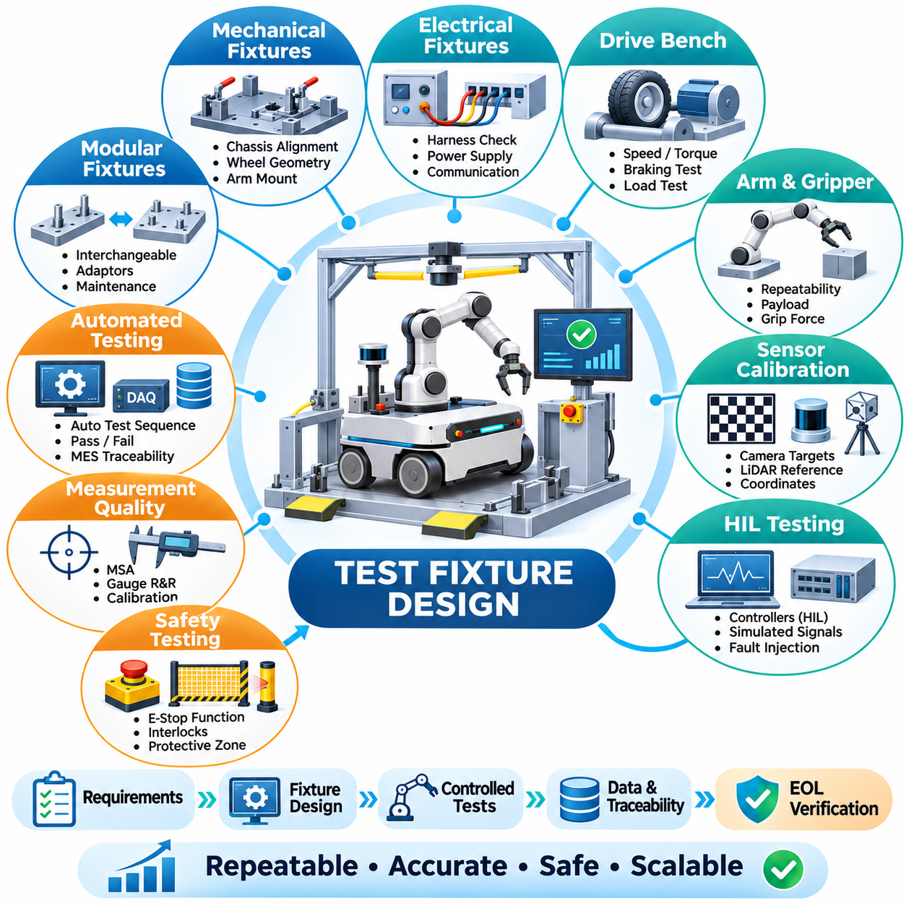{width="7.268055555555556in" height="7.268055555555556in"}

Test fixture design is a fundamental manufacturing engineering activity that establishes standardized equipment and supporting structures for inspecting, calibrating, and validating mobile manipulators during production. Properly designed test fixtures enable repeatable measurements, controlled testing conditions, and consistent evaluation of manufactured products while reducing operator dependency, inspection time, and production variability.

Mobile manipulators integrate mechanical structures, autonomous mobile robot (AMR) platforms, robotic arms, electrical systems, perception sensors, embedded computers, and artificial intelligence software. Each subsystem requires specific testing conditions and verification methods. Test fixture architectures must therefore accommodate mechanical, electrical, electronic, and software interfaces throughout subsystem testing and final system integration.

Test fixture development should begin with a systematic analysis of product requirements, manufacturing processes, critical dimensions, and functional acceptance criteria. Manufacturing engineers must identify measurable characteristics, required measurement accuracy, testing frequency, environmental conditions, and operational constraints. These requirements establish the technical foundation for selecting appropriate fixture structures and measurement equipment.

Mechanical test fixtures provide stable reference positions for evaluating dimensional accuracy, structural alignment, mounting interfaces, and assembly consistency. Dedicated fixtures may support chassis inspection, drive module positioning, wheel alignment, robotic arm mounting verification, and sensor bracket inspection. Fixture rigidity, dimensional stability, and repeatable positioning are essential for minimizing measurement uncertainty during production.

Electrical test fixtures enable controlled verification of wiring harnesses, power distribution systems, battery interfaces, communication networks, and safety-related circuits. Standardized connectors, protected test terminals, programmable power supplies, and measurement instruments support efficient electrical inspection. Appropriate protection mechanisms must prevent incorrect connections, electrical overloads, short circuits, and damage to sensitive electronic components.

Drive system test fixtures support the evaluation of traction motors, steering actuators, motor controllers, braking systems, and wheel assemblies before or after integration into the mobile platform. Roller-based test benches and controlled loading mechanisms can reproduce representative operating conditions. Measurement capabilities may include rotational speed, steering angle, torque, current consumption, vibration, and temperature monitoring.

Robotic arm test fixtures establish controlled reference environments for evaluating manipulator installation accuracy, positioning repeatability, movement characteristics, and end-effector functionality. Reference targets, calibrated measurement devices, and standardized test objects enable consistent comparisons between production units. Fixture configurations should accommodate the manipulator workspace while preventing unintended collisions and excessive mechanical loading.

Sensor calibration fixtures are essential for maintaining consistent perception performance across manufactured mobile manipulators. Camera calibration targets, LiDAR reference structures, depth measurement objects, and precisely positioned landmarks provide known geometric references. These fixtures support intrinsic and extrinsic calibration, coordinate transformation verification, and alignment between perception systems and robotic control architectures.

End-effector test fixtures should reproduce representative grasping, lifting, positioning, and object interaction conditions. Standardized test objects with defined dimensions, surface characteristics, masses, and material properties enable repeatable evaluation of gripper performance. Depending on the application, measurement devices may evaluate gripping force, payload retention, positioning accuracy, vacuum pressure, and mechanical repeatability.

Hardware-in-the-Loop (HIL) test fixtures enable embedded controllers and robotic control software to interact with simulated sensors, actuators, communication networks, and operational environments. These fixtures support functional verification without requiring complete physical robot assemblies. Automated signal generation, fault injection, and response monitoring provide efficient methods for detecting integration problems before final assembly.

Safety test fixtures must support controlled verification of emergency stop functions, protective stopping mechanisms, safety sensors, and safety-related control systems. Appropriate physical barriers, interlocking devices, restricted motion areas, and independent protective mechanisms reduce testing hazards. Safety-related testing procedures should be derived from approved risk assessments and applicable product-specific safety requirements.

Measurement System Analysis (MSA) provides a systematic methodology for evaluating the accuracy, repeatability, reproducibility, and stability of fixture-based measurement processes. Gauge Repeatability and Reproducibility (Gauge R&R) studies help determine whether measurement variations originate from equipment, operators, or manufactured products. Periodic calibration and reference standard verification maintain confidence in production inspection results.

Automated test fixtures integrate measurement instruments, programmable controllers, data acquisition systems, and testing software to support standardized production verification. Automated procedures can execute predefined test sequences, compare measured values against acceptance thresholds, and generate inspection reports. Integration with Manufacturing Execution Systems (MES) enables traceability between test results, robot serial numbers, and production configurations.

Modular fixture architecture improves manufacturing flexibility by supporting multiple mobile manipulator variants through interchangeable adapters, adjustable mounting structures, and configurable testing parameters. Fixture standardization reduces equipment duplication, simplifies maintenance, and improves scalability. Preventive maintenance schedules, controlled fixture revisions, and periodic verification procedures are necessary to preserve testing consistency throughout production.

Test fixture effectiveness should be evaluated through measurable indicators, including testing cycle time, measurement repeatability, defect detection capability, equipment availability, and maintenance costs. Pilot production results provide valuable feedback for fixture optimization before mass production. Ultimately, systematic test fixture design establishes a reliable foundation for production testing, End-of-Line (EOL) verification, manufacturing quality, and scalable mobile manipulator commercialization.

## 07 Production Testing

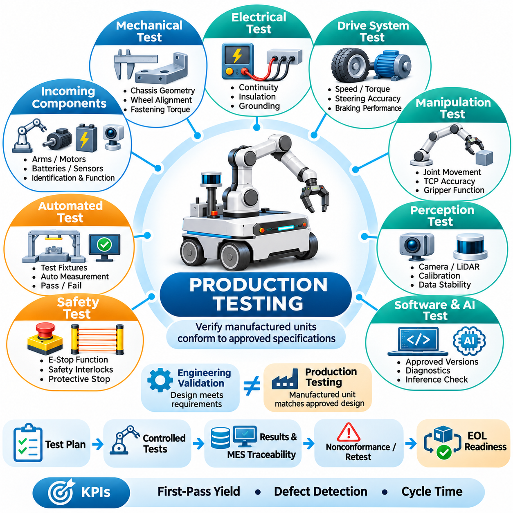{width="7.268055555555556in" height="7.268055555555556in"}

Production testing is a systematic manufacturing activity that verifies the quality, functionality, and configuration of mobile manipulators throughout the production process. It establishes controlled verification procedures for individual components, functional assemblies, and integrated robotic systems. Its primary objective is to detect manufacturing defects, prevent nonconforming products from progressing, and ensure consistent production quality.

Unlike engineering validation, which evaluates whether a product design satisfies its intended requirements, production testing verifies whether manufactured units conform to approved design specifications. Testing procedures must therefore emphasize repeatability, measurement accuracy, defect detection, and production efficiency. Each test should establish measurable acceptance criteria derived from validated engineering requirements.

Production test planning should begin during hardware development and assembly process design. Manufacturing engineers must identify critical product characteristics, potential failure modes, required test equipment, testing frequency, and inspection responsibilities. The resulting production test plan establishes relationships between manufacturing operations, verification procedures, acceptance thresholds, and corrective action mechanisms.

Incoming component testing provides the initial verification stage for externally sourced materials and functional assemblies. Robotic arms, drive motors, motor controllers, batteries, perception sensors, embedded computers, and safety devices should undergo appropriate inspections according to their criticality. Supplier documentation, component identification, dimensional characteristics, and functional performance may be evaluated before production release.

Mechanical production testing verifies the structural integrity, dimensional accuracy, and assembly consistency of manufactured mobile manipulators. Critical inspection items include chassis geometry, wheel alignment, bearing installation, robotic arm mounting interfaces, and fastening torque. Standardized measurement instruments and test fixtures enable consistent evaluation while minimizing variations associated with individual operators.

Electrical production testing confirms the correct assembly and functionality of power distribution systems, wiring harnesses, electrical interfaces, and communication networks. Continuity testing, insulation verification, polarity inspection, grounding measurements, and controlled power-on procedures help identify manufacturing defects. Electrical testing should precede unrestricted system activation to protect equipment and manufacturing personnel.

Drive system production testing evaluates traction motors, steering actuators, braking mechanisms, motor controllers, and wheel assemblies under controlled operating conditions. Test parameters may include rotational speed, steering angle accuracy, current consumption, torque response, braking performance, and abnormal vibration. Standardized load conditions and predefined acceptance limits enable consistent comparisons between manufactured mobile platforms.

Manipulation system production testing verifies the installation, movement, and functional performance of robotic arms and end effectors. Joint movement, reference position accuracy, tool center point alignment, gripping functionality, and communication interfaces should be evaluated. Representative manipulation sequences can identify assembly-related deviations, calibration errors, mechanical interference, and abnormal actuator behavior before system release.

Perception system production testing ensures that cameras, LiDAR sensors, depth sensors, inertial measurement units, and other sensing devices operate according to approved specifications. Testing should verify device connectivity, data acquisition stability, sensor alignment, calibration parameters, and timestamp synchronization. Standardized reference targets and controlled environmental conditions support consistent sensor performance evaluation.

Software and artificial intelligence production testing confirms that each manufactured robot contains approved software versions, firmware releases, configuration parameters, and AI model artifacts. Automated verification should evaluate software integrity, dependency compatibility, device communication, diagnostic functions, and representative inference behavior. Production checks complement rather than replace comprehensive AI model validation.

Safety-related production testing verifies that manufactured mobile manipulators correctly implement approved protective functions. Emergency stop devices, protective stopping mechanisms, safety sensors, interlocks, and safety-related control circuits should receive appropriate functional checks. Testing must follow controlled procedures derived from approved risk assessments without substituting routine production checks for formal safety validation.

Automated production testing improves manufacturing efficiency through programmable test sequences, standardized fixtures, integrated measurement instruments, and automated result evaluation. Testing software can acquire operational data, compare measurements against predefined acceptance thresholds, and generate standardized reports. Automated testing reduces manual inspection effort and improves consistency across production shifts and facilities.

Production test traceability establishes a documented relationship between individual robot serial numbers, installed components, software configurations, measurement results, and inspection personnel. Manufacturing Execution Systems (MES) and quality management platforms can maintain these records throughout production. Traceable test histories support defect investigation, warranty assessment, configuration management, and lifecycle maintenance.

Nonconforming products identified during production testing must be segregated and evaluated through controlled quality management procedures. Manufacturing teams should investigate failure causes, determine appropriate corrective actions, and perform documented retesting after approved repairs or adjustments. Statistical Process Control (SPC) and failure trend analysis help identify recurring manufacturing problems and prevent systematic defects.

Production testing effectiveness should be evaluated through Key Performance Indicators (KPIs), including first-pass yield, defect detection rate, testing cycle time, rework frequency, and test equipment availability. Continuous improvement based on production data enables greater testing efficiency without compromising verification coverage. Ultimately, production testing establishes a reliable foundation for final End-of-Line (EOL) testing and scalable mobile manipulator manufacturing.

## 08 End of Line Testing

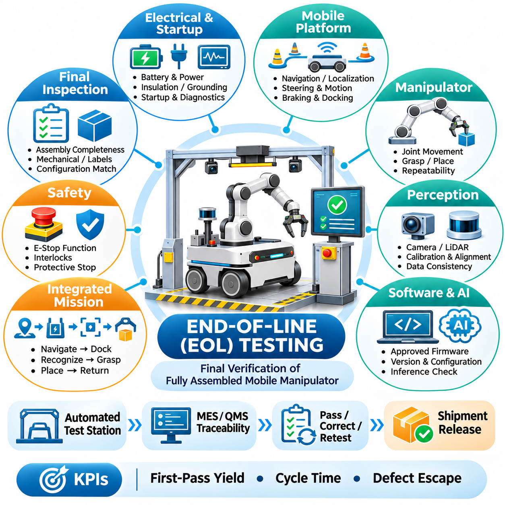{width="7.268055555555556in" height="7.268055555555556in"}

End-of-Line (EOL) testing represents the final manufacturing verification stage performed before a mobile manipulator is approved for shipment and customer deployment. It evaluates the functionality, performance, safety, and configuration of the fully assembled robotic system. Its primary objective is to ensure that each manufactured unit satisfies approved product specifications and predefined manufacturing acceptance criteria.

Unlike intermediate production testing, which focuses on individual components and functional assemblies, EOL testing evaluates the complete robotic system under integrated operating conditions. Mechanical structures, electrical systems, autonomous navigation, robotic manipulation, perception systems, and embedded software must operate cooperatively. This comprehensive verification identifies integration defects that may remain undetected during earlier manufacturing stages.

EOL test planning should establish standardized test sequences, required equipment, environmental conditions, acceptance thresholds, and inspection responsibilities. Each test case should maintain traceability to approved engineering requirements and critical product characteristics. Manufacturing engineers must balance verification coverage with production cycle time while ensuring that essential functional and safety requirements are adequately evaluated.

Initial EOL inspection should confirm the physical condition, assembly completeness, and configuration accuracy of the finished mobile manipulator. Mechanical fasteners, protective covers, electrical connectors, cable routing, sensor mounting structures, identification labels, and external surfaces should be inspected. Configuration verification ensures that installed hardware and accessories correspond to the approved manufacturing specifications and customer orders.

Electrical system verification should evaluate battery status, power distribution stability, electrical insulation, grounding integrity, and communication network functionality. Controlled startup procedures confirm that embedded controllers, computing platforms, motor controllers, and peripheral devices initialize correctly. Diagnostic monitoring helps identify abnormal current consumption, voltage fluctuations, communication failures, and unexpected system errors.

Mobile platform EOL testing evaluates autonomous movement, steering accuracy, acceleration, deceleration, braking performance, and fundamental navigation capabilities. Standardized test environments should provide representative travel paths, turning areas, docking locations, and reference positions. Positioning accuracy, motion stability, localization performance, and obstacle response should be evaluated against predefined acceptance criteria.

Manipulator EOL testing verifies robotic arm movement, joint initialization, positioning repeatability, workspace accessibility, and end-effector functionality. Representative manipulation tasks should include controlled grasping, lifting, object transportation, and placement operations where applicable. These tests identify mechanical interference, calibration deviations, unexpected actuator behavior, and integration failures between the mobile platform and manipulator.

Perception system verification evaluates the operational functionality of cameras, LiDAR sensors, depth sensors, inertial measurement units, and other sensing devices. Standardized reference targets and known environmental conditions support the verification of sensor alignment, data acquisition, coordinate transformations, and temporal synchronization. Perception outputs should remain consistent with approved calibration parameters and expected operating behavior.

Software and artificial intelligence verification ensures that the completed mobile manipulator contains authorized firmware releases, software packages, configuration parameters, and AI model versions. Automated diagnostic procedures should verify software integrity, device communication, system initialization, representative inference outputs, and computational resource availability. Production verification must remain distinct from comprehensive AI model validation.

Integrated mission testing evaluates cooperation between autonomous navigation, manipulation control, perception processing, and task orchestration. A representative mission may include movement toward a workstation, precise docking, object recognition, grasp execution, object placement, and return to a designated location. Mission completion results provide evidence that individual subsystems operate coherently within the complete robotic architecture.

Safety-related EOL testing verifies the correct implementation of approved protective functions within each manufactured robotic system. Emergency stop devices, protective stopping functions, safety sensors, interlocks, and designated fault responses should undergo controlled functional checks. These procedures must follow approved safety specifications and risk assessments without replacing formal safety validation or applicable conformity assessment activities.

Automated EOL test stations integrate standardized test fixtures, programmable instruments, communication interfaces, data acquisition systems, and test management software. Automated test sequences can collect measurements, compare results against acceptance thresholds, record diagnostic information, and generate inspection reports. Controlled test environments and calibrated equipment improve measurement consistency and reduce operator-dependent variability.

EOL test data management establishes traceability between individual robot serial numbers, hardware configurations, software versions, calibration parameters, measurement results, and final inspection decisions. Manufacturing Execution Systems (MES) and Quality Management Systems (QMS) can maintain centralized production records. These records support warranty management, failure investigation, product recalls, and lifecycle maintenance activities.

Robots that fail EOL testing must be prevented from entering the shipment process until appropriate corrective actions have been completed. Nonconforming products should undergo documented failure analysis, authorized repairs, configuration corrections, and relevant retesting. Final production release should require confirmation that all mandatory tests have passed and that unresolved nonconformities have been appropriately addressed.

EOL testing effectiveness should be evaluated through Key Performance Indicators (KPIs), including first-pass yield, test cycle time, defect escape rate, retesting frequency, and equipment availability. Continuous improvement based on production and field performance data strengthens verification coverage and manufacturing efficiency. Ultimately, systematic EOL testing provides the final manufacturing quality gate for reliable and scalable mobile manipulator commercialization.

## 09 Quality Control

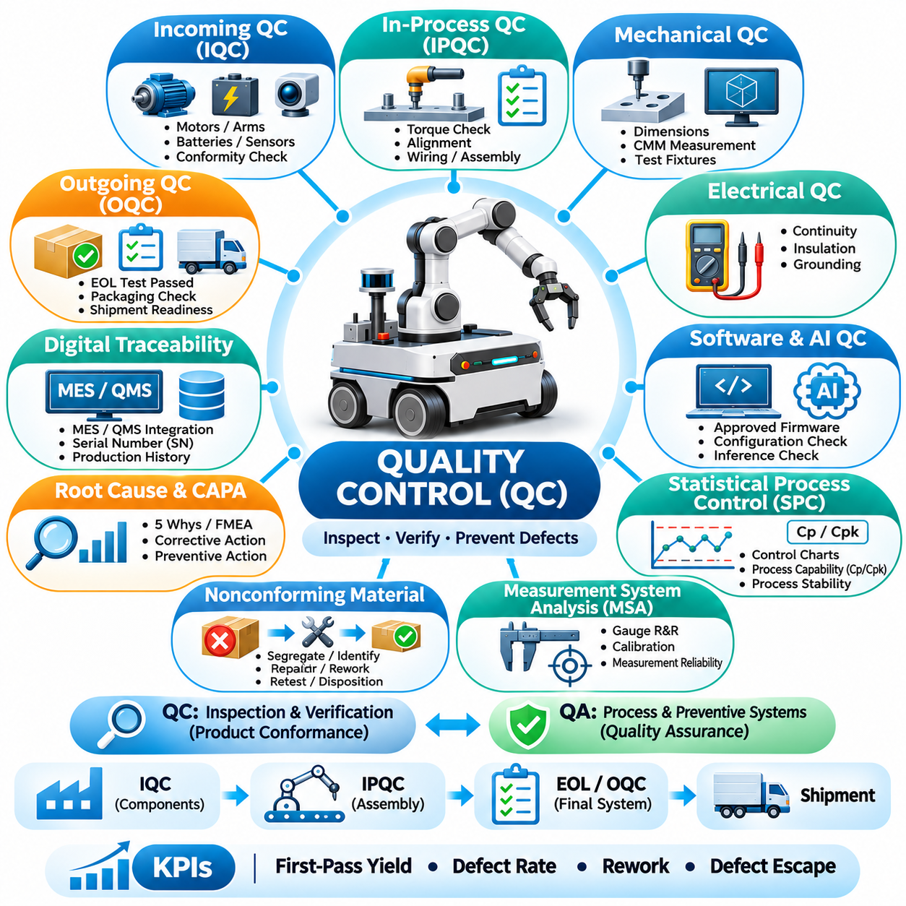{width="7.268055555555556in" height="7.268055555555556in"}

Quality control (QC) is a systematic manufacturing discipline that ensures mobile manipulators consistently satisfy approved engineering specifications, functional requirements, and manufacturing acceptance criteria. It encompasses material inspection, process monitoring, dimensional verification, functional testing, and defect management. Its primary objective is to prevent manufacturing defects and maintain consistent product quality throughout production.

Unlike quality assurance (QA), which establishes organizational processes and preventive frameworks for achieving quality objectives, quality control focuses on the inspection and verification of actual manufactured products. Both disciplines are complementary and essential to reliable robotic system manufacturing. Effective quality control provides measurable evidence that manufacturing processes produce conforming products.

Quality control planning should identify critical product characteristics, inspection methods, measurement equipment, sampling frequencies, acceptance criteria, and responsible personnel. A manufacturing quality control plan establishes inspection checkpoints throughout component procurement, subassembly production, system integration, and final verification. Inspection requirements should remain traceable to approved engineering specifications.

Incoming Quality Control (IQC) verifies the quality and conformity of externally sourced components before their introduction into manufacturing processes. Drive motors, robotic arms, batteries, electronic controllers, sensors, structural components, and wiring harnesses should undergo inspections according to their functional importance and associated risks. Supplier inspection records and component traceability support effective incoming quality management.

In-Process Quality Control (IPQC) monitors manufacturing operations and assembly activities to identify deviations before they propagate into subsequent production stages. Critical inspection items may include dimensional tolerances, fastening torque, electrical connections, component orientation, sensor alignment, and assembly completeness. Early defect detection reduces rework costs and prevents unnecessary consumption of manufacturing resources.

Mechanical quality control evaluates structural integrity, dimensional accuracy, surface conditions, material conformity, and assembly consistency. Coordinate Measuring Machines (CMMs), calibrated measurement instruments, inspection gauges, and dedicated test fixtures support objective measurement. Critical mechanical interfaces between the mobile platform, robotic arm, and end effector require particular attention to maintain system stability and positioning accuracy.

Electrical quality control verifies the correct implementation of power distribution systems, wiring harnesses, electrical interfaces, communication networks, and protective circuits. Inspection procedures should evaluate connector installation, electrical continuity, insulation resistance, grounding integrity, and cable routing. Electrical defects must be identified and corrected before unrestricted system operation to prevent equipment damage and safety hazards.

Software and artificial intelligence quality control ensures that manufactured mobile manipulators contain approved software releases, firmware versions, configuration parameters, and AI model artifacts. Automated inspection procedures should verify software integrity, system initialization, device communication, and representative inference behavior. Configuration management prevents unauthorized modifications and maintains consistency across production units.

Statistical Process Control (SPC) provides a quantitative methodology for monitoring manufacturing process stability and identifying abnormal variations. Control charts, process capability indices, and statistical distribution analysis support the evaluation of critical manufacturing characteristics. Process Capability Indices (Cp and Cpk) help determine whether stable manufacturing processes can consistently operate within specified tolerance limits.

Measurement System Analysis (MSA) evaluates the suitability and reliability of measurement processes used during manufacturing inspections. Gauge Repeatability and Reproducibility (Gauge R&R) studies quantify measurement variations associated with equipment and operators. Regular calibration, reference standard verification, and controlled environmental conditions help maintain measurement accuracy and confidence in quality control decisions.

Nonconforming Material Control establishes standardized procedures for identifying, segregating, documenting, and evaluating components or systems that fail manufacturing acceptance criteria. Nonconforming products must be prevented from progressing through uncontrolled production activities. Authorized disposition decisions may include rework, repair, supplier return, rejection, or approved concessions where applicable requirements permit.

Root Cause Analysis (RCA) and Corrective and Preventive Action (CAPA) provide systematic methodologies for investigating manufacturing defects and preventing their recurrence. Techniques such as the Five Whys, Fishbone Diagrams, Pareto Analysis, and Failure Mode and Effects Analysis (FMEA) support structured investigations. Corrective actions should be verified for effectiveness before quality-related issues are formally closed.

Digital quality control integrates inspection results, measurement data, component traceability, manufacturing parameters, and nonconformity records within centralized information systems. Quality Management Systems (QMS) and Manufacturing Execution Systems (MES) enable traceability between robot serial numbers and production histories. Automated data analysis supports defect trend identification, process optimization, and manufacturing quality improvement.

Outgoing Quality Control (OQC) represents the final quality verification activity before manufactured mobile manipulators are released for shipment. Inspection personnel should confirm successful End-of-Line (EOL) testing, product configuration, documentation completeness, labeling accuracy, packaging conditions, and included accessories. Final shipment authorization must ensure that all mandatory quality and safety requirements have been satisfied.

Quality control effectiveness should be evaluated through Key Performance Indicators (KPIs), including first-pass yield, defects per million opportunities, rejection rates, rework costs, customer return rates, and defect escape rates. Continuous improvement based on manufacturing and field quality data strengthens process stability and product reliability. Ultimately, systematic quality control supports cost optimization, scalable production, and sustainable mobile manipulator commercialization.

## 10 Cost Optimization

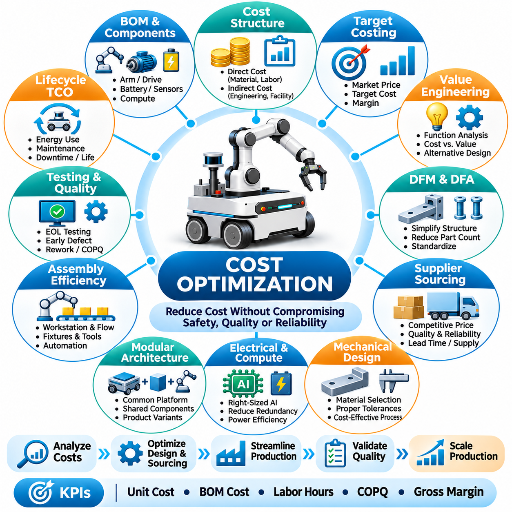{width="7.268055555555556in" height="7.268055555555556in"}

Cost optimization is a systematic manufacturing engineering activity that seeks to reduce the total cost of mobile manipulators while maintaining functional performance, product quality, operational reliability, and safety. It encompasses component selection, mechanical design, supplier management, assembly processes, testing procedures, and lifecycle expenses. Its primary objective is to improve commercial competitiveness and manufacturing profitability.

Manufacturing cost analysis should begin with a comprehensive evaluation of direct and indirect expenses associated with robotic system production. Direct costs include materials, purchased components, assembly labor, and production equipment usage. Indirect costs include engineering support, facility operation, quality management, inventory handling, logistics, and administrative overhead. Understanding these cost structures enables effective optimization.

Bill of Materials (BOM) cost optimization focuses on identifying expensive components and evaluating opportunities for cost reduction without compromising engineering requirements. Robotic arms, drive modules, batteries, perception sensors, embedded computing platforms, and safety devices typically represent significant cost contributors. Alternative components should be evaluated against functional specifications, reliability, compatibility, and lifecycle requirements.

Target costing establishes acceptable manufacturing cost objectives based on anticipated market prices, expected sales volumes, and desired profit margins. Cost targets should be allocated across mechanical, electrical, electronic, and software subsystems during product development. Continuous monitoring of estimated and actual manufacturing costs enables engineering teams to identify budget deviations and implement appropriate design improvements.

Value Engineering (VE) provides a structured methodology for evaluating the relationship between component functionality, manufacturing cost, and customer value. Components that introduce unnecessary complexity or excessive performance beyond operational requirements should be reviewed systematically. Functional analysis enables engineering teams to identify alternative materials, simplified structures, and economically efficient system configurations.

Design for Manufacturing (DFM) and Design for Assembly (DFA) contribute to cost optimization by reducing manufacturing complexity, component quantities, assembly operations, and production variability. Standardized fastening methods, simplified mechanical structures, accessible installation interfaces, and modular assemblies reduce labor requirements. These design improvements also help minimize manufacturing defects and subsequent rework expenses.

Supplier cost optimization involves evaluating procurement prices, component quality, delivery reliability, production capacity, and long-term commercial relationships. Competitive sourcing, volume-based purchasing agreements, supplier consolidation, and localization strategies can reduce procurement expenses. However, purchasing decisions should consider total acquisition costs rather than focusing exclusively on the lowest component price.

Mechanical manufacturing cost optimization requires the selection of appropriate materials, fabrication technologies, machining tolerances, and structural configurations. Sheet metal fabrication, welding, extrusion, casting, and precision machining should be evaluated according to production volume and functional requirements. Excessively restrictive tolerances and unnecessary machining operations increase production costs without necessarily improving system performance.

Electrical and computing architecture optimization focuses on reducing hardware redundancy, wiring complexity, power consumption, and unnecessary computational capacity. Standardized wiring harnesses, integrated controllers, common communication interfaces, and appropriately sized computing platforms can reduce manufacturing expenses. Computing resources should be selected according to measured AI inference workloads and real-time control requirements.

Modular product architecture enables cost reduction through component standardization, common platform development, and reusable subsystem configurations. Different mobile manipulator models can share drive modules, battery systems, electrical architectures, computing platforms, and software frameworks. Increased component commonality improves purchasing efficiency, simplifies inventory management, and reduces engineering and maintenance expenses.

Assembly process optimization reduces direct labor costs by improving workstation layouts, assembly sequences, material accessibility, and production line balancing. Dedicated fixtures, standardized work instructions, and selective automation improve operational efficiency and assembly repeatability. Manufacturing engineers should evaluate automation investments against expected production volumes, labor savings, equipment costs, and anticipated payback periods.

Production testing and quality control optimization should minimize inspection expenses without reducing essential verification coverage. Automated test fixtures, standardized calibration procedures, and integrated End-of-Line (EOL) testing can reduce testing cycle time and manual intervention. Early defect detection also decreases the cost of poor quality, including scrap, rework, warranty claims, product returns, and field service activities.

Total Cost of Ownership (TCO) extends cost analysis beyond initial manufacturing expenses to include energy consumption, maintenance, spare parts, software support, equipment downtime, and eventual product retirement. Low-cost components may increase lifecycle expenses if they introduce premature failures or inefficient operation. Lifecycle cost analysis therefore supports balanced decisions that consider both manufacturing economics and long-term customer value.

Economies of scale enable manufacturing cost reductions through increased procurement volumes, improved equipment utilization, standardized production processes, and the distribution of fixed expenses across larger production quantities. Pilot production data should be used to develop realistic cost models for progressive manufacturing expansion. Production volume forecasts must consider market demand, inventory exposure, and capital investment requirements.

Cost optimization effectiveness should be evaluated through Key Performance Indicators (KPIs), including unit manufacturing cost, BOM cost, assembly labor hours, procurement savings, cost of poor quality, and gross profit margin. Continuous cost analysis and cross-functional engineering reviews help identify sustainable improvement opportunities. Ultimately, systematic cost optimization supports scalable mass production and economically sustainable mobile manipulator commercialization without sacrificing essential performance, reliability, or safety.

## 11 Mass Production Ramp Up

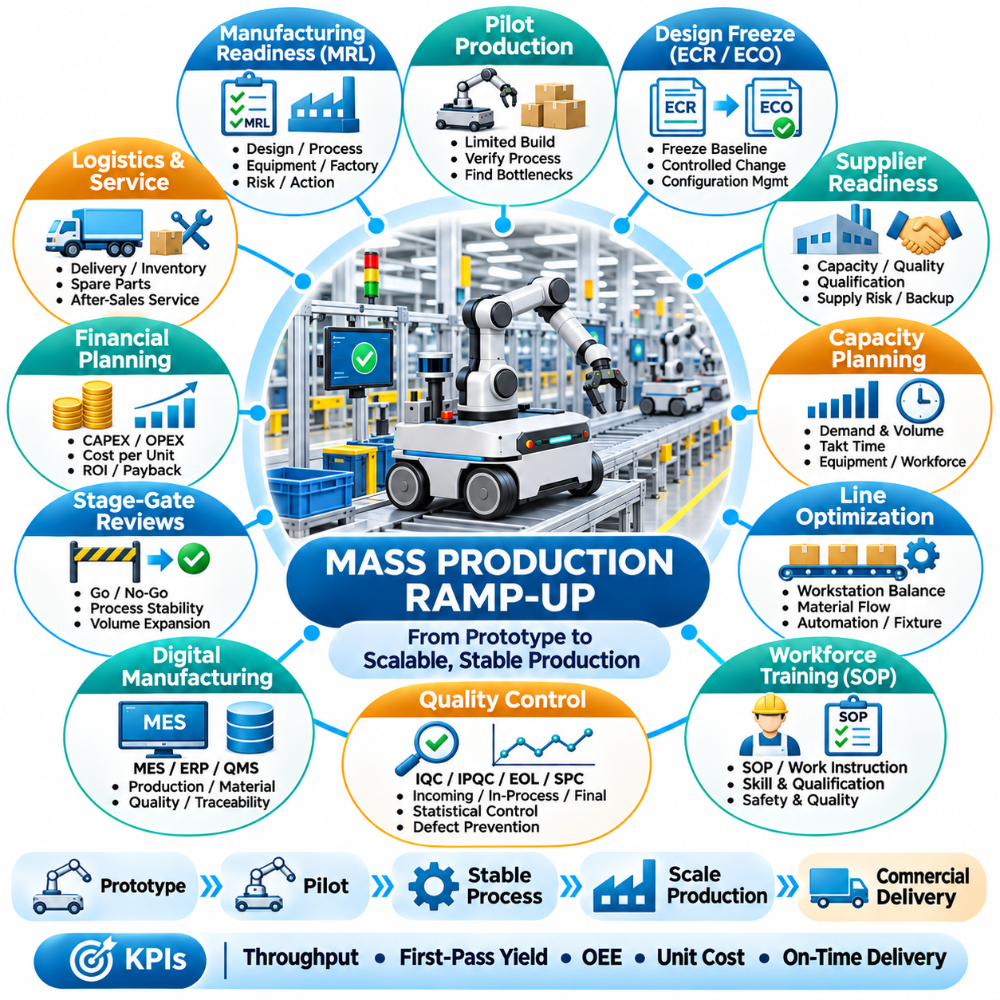{width="7.268055555555556in" height="7.268055555555556in"}

Mass production ramp-up is a structured manufacturing transition that transforms validated mobile manipulator prototypes and pilot production units into commercially scalable products. It involves the progressive expansion of manufacturing capacity, workforce capabilities, supplier networks, assembly operations, and quality control systems. Its primary objective is to achieve stable production volumes while maintaining consistent product quality and manufacturing efficiency.

The transition from prototype development to mass production requires a fundamental change in engineering and manufacturing priorities. Prototype development emphasizes functional feasibility, design flexibility, and technical experimentation, whereas mass production emphasizes repeatability, process stability, cost efficiency, and product consistency. Engineering teams must resolve critical design uncertainties before significantly increasing manufacturing volumes.

Manufacturing readiness assessment should evaluate product design maturity, component availability, supplier capabilities, assembly procedures, production equipment, and quality management systems. Manufacturing Readiness Levels (MRLs) provide a structured framework for assessing production maturity. Identified manufacturing risks should be addressed through documented corrective actions before advancing to subsequent production stages.

Pilot production represents an intermediate manufacturing stage between prototype fabrication and commercial mass production. Limited production quantities enable manufacturing engineers to evaluate assembly sequences, tooling effectiveness, equipment performance, workforce capabilities, and component consistency. Pilot production results provide essential information for identifying manufacturing bottlenecks and establishing realistic production capacity targets.

Design freeze and configuration management are essential prerequisites for controlled mass production ramp-up. Approved mechanical drawings, electrical schematics, manufacturing bills of materials, software releases, and assembly instructions must establish a consistent production baseline. Subsequent modifications should be managed through formal Engineering Change Requests (ECRs) and Engineering Change Orders (ECOs) to prevent uncontrolled product variations.

Supplier readiness becomes increasingly important as manufacturing volumes expand. Suppliers of robotic arms, drive modules, batteries, perception sensors, embedded computers, and safety devices must demonstrate adequate production capacity and consistent component quality. Long-term procurement agreements, supplier qualification, alternative sourcing strategies, and inventory planning help minimize material shortages and supply disruptions.

Production capacity planning determines the workforce, equipment, facilities, manufacturing resources, and operating schedules required to satisfy anticipated market demand. Production engineers should evaluate workstation capacity, takt time, assembly cycle time, equipment utilization, and material availability. Gradual capacity expansion reduces unnecessary capital investment while allowing manufacturing processes to stabilize before further scaling.

Production line optimization during ramp-up focuses on balancing assembly operations, reducing manufacturing bottlenecks, improving material flow, and minimizing unnecessary production delays. Standardized workstations, modular assembly processes, dedicated fixtures, and selective automation contribute to manufacturing efficiency. Continuous analysis of actual production data enables engineering teams to refine workstation configurations and resource allocation.

Workforce development is a critical requirement for scalable mobile manipulator manufacturing. Production personnel must receive structured training in mechanical assembly, electrical integration, software installation, system calibration, production testing, and safety procedures. Standard Operating Procedures (SOPs), competency assessments, and operator qualification programs help maintain manufacturing consistency as workforce size increases.

Quality control systems must expand alongside manufacturing capacity to prevent increasing production volumes from generating higher defect rates. Incoming Quality Control (IQC), In-Process Quality Control (IPQC), and End-of-Line (EOL) testing should operate within standardized manufacturing procedures. Statistical Process Control (SPC) enables early detection of process instability and supports systematic manufacturing quality improvement.

Digital manufacturing infrastructure supports mass production by integrating production scheduling, material management, assembly instructions, equipment monitoring, and quality records. Manufacturing Execution Systems (MES), Enterprise Resource Planning (ERP), and Quality Management Systems (QMS) establish coordinated information flows. Digital traceability enables individual robots to be associated with component histories and approved production configurations.

Production ramp-up should follow progressive manufacturing milestones rather than uncontrolled increases in production quantities. Advancement between production stages should depend on demonstrated process stability, acceptable defect rates, supplier readiness, and sufficient manufacturing capacity. Stage-gate reviews provide structured decision mechanisms for approving production expansion or implementing additional corrective actions.

Financial management during mass production ramp-up requires careful monitoring of capital expenditure, operating expenses, procurement commitments, inventory levels, and working capital. Increasing production volumes can reduce unit manufacturing costs through economies of scale, but excessive capacity expansion may create financial exposure. Manufacturing investments should therefore remain aligned with validated market demand and realistic revenue forecasts.

Mass production preparation must also establish scalable logistics, spare parts availability, technical support capabilities, maintenance procedures, and warranty management systems. Increasing product shipments creates additional responsibilities throughout the operational lifecycle. Coordination between manufacturing, sales, deployment, and service organizations ensures that commercial expansion remains supported by adequate operational resources.

Mass production ramp-up effectiveness should be evaluated through Key Performance Indicators (KPIs), including production throughput, first-pass yield, overall equipment effectiveness, unit manufacturing cost, on-time delivery, and customer return rates. Continuous improvement based on manufacturing and field performance data strengthens operational stability. Ultimately, controlled production scaling establishes the foundation for reliable, profitable, and sustainable mobile manipulator commercialization.

## 12 Global Supply Chain

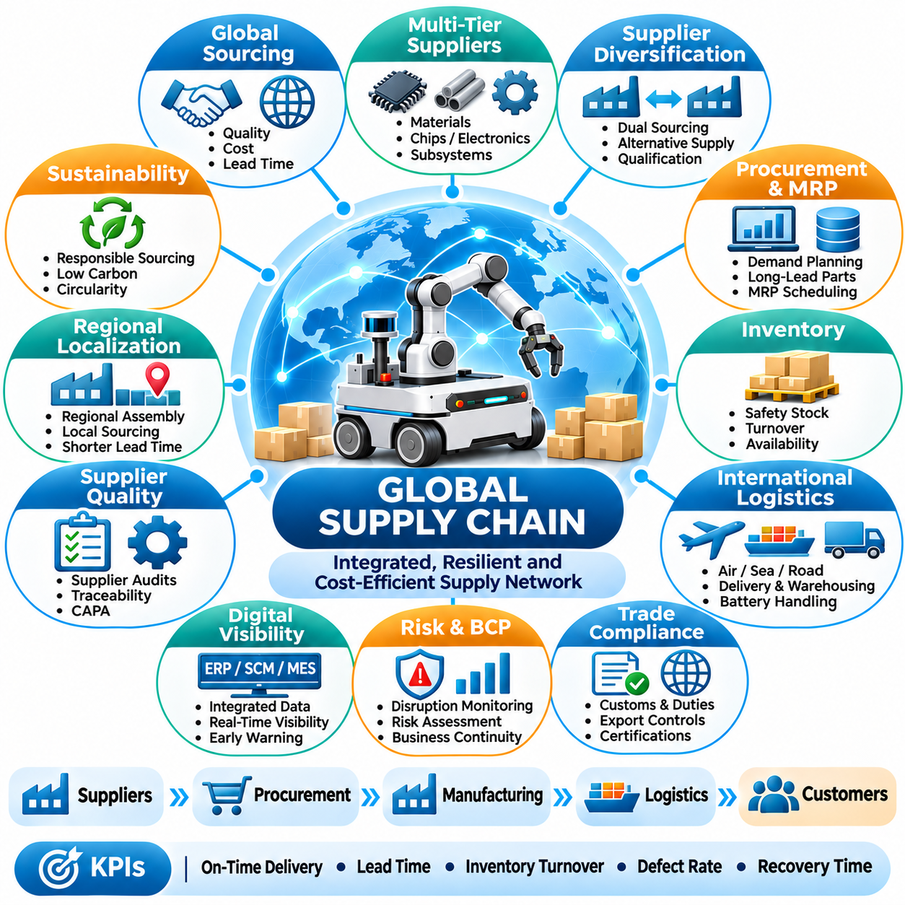{width="7.268055555555556in" height="7.268055555555556in"}

Global supply chain management is a strategic manufacturing discipline that coordinates the international procurement, production, transportation, storage, and distribution of components and finished mobile manipulators. It connects component manufacturers, technology suppliers, assembly facilities, logistics providers, and regional distribution networks. Its primary objective is to ensure supply continuity, cost efficiency, and reliable product delivery.

Mobile manipulator manufacturing relies on a complex international supply network involving mechanical components, electronic devices, robotic arms, drive modules, batteries, perception sensors, and embedded computing platforms. These components may originate from different countries and specialized manufacturing regions. Effective supply chain management requires comprehensive visibility into geographical dependencies, supplier capabilities, and procurement lead times.

Global sourcing strategies should evaluate suppliers according to technical capabilities, manufacturing quality, production capacity, procurement costs, delivery reliability, and geographical location. Supplier selection must consider total acquisition costs, including transportation, customs duties, inventory expenses, and potential supply disruptions. Strategic sourcing enables manufacturers to balance economic efficiency with operational resilience.

Multi-tier supply chain management extends supplier visibility beyond direct component manufacturers to include upstream material producers, semiconductor manufacturers, and specialized subsystem suppliers. Dependencies on critical upstream suppliers may create significant production vulnerabilities even when multiple direct suppliers are available. Supply chain mapping helps identify hidden dependencies and anticipate potential material shortages.

Supplier diversification reduces manufacturing risks associated with excessive dependence on individual suppliers, geographical regions, or transportation routes. Dual sourcing, alternative component qualification, and regional supplier development provide additional procurement flexibility. Alternative suppliers must satisfy approved engineering specifications, quality requirements, and configuration management procedures before entering production.

Global procurement planning requires coordination between anticipated production volumes, supplier lead times, minimum order quantities, material availability, and inventory requirements. Long-lead components such as robotic actuators, advanced computing modules, precision sensors, and specialized electronic devices require early procurement planning. Accurate demand forecasting reduces material shortages, excess inventory, and emergency purchasing expenses.

Inventory management within global supply chains seeks to balance material availability, working capital requirements, storage expenses, and supply disruption risks. Safety stock policies should reflect component criticality, demand variability, supplier reliability, and replenishment lead times. Material Requirements Planning (MRP) supports coordinated procurement scheduling and inventory replenishment across distributed manufacturing facilities.

International logistics management coordinates transportation modes, shipping schedules, customs clearance, warehousing, and regional distribution activities. Air freight, ocean freight, railway transportation, and road transportation should be evaluated according to delivery urgency, shipment characteristics, and transportation expenses. Specialized handling procedures are required for sensitive electronic equipment, robotic assemblies, and lithium-ion batteries.

Global trade compliance requires manufacturers to address applicable customs regulations, import duties, export controls, product certification requirements, and international transportation restrictions. Advanced computing hardware, specialized sensors, batteries, and robotic technologies may be subject to jurisdiction-specific regulations. Compliance documentation and controlled procurement procedures help reduce regulatory risks and unexpected shipment delays.

Supply chain risk management establishes systematic procedures for identifying, evaluating, monitoring, and mitigating potential disruptions. Relevant risks include geopolitical conflicts, natural disasters, semiconductor shortages, transportation interruptions, currency fluctuations, and supplier financial instability. Business Continuity Planning (BCP) and scenario-based risk assessments support manufacturing resilience under uncertain global conditions.

Digital supply chain management integrates procurement information, supplier performance records, inventory status, production schedules, and logistics data within interconnected information systems. Enterprise Resource Planning (ERP), Supply Chain Management (SCM), and Manufacturing Execution Systems (MES) support coordinated decision-making. Real-time supply chain visibility enables earlier identification of shortages and delivery deviations.

Supplier quality management must maintain consistent component quality across geographically distributed manufacturing facilities and procurement networks. Supplier audits, standardized inspection requirements, material traceability, and documented corrective actions support reliable component integration. Engineering change notifications should be communicated systematically to prevent unauthorized material substitutions and incompatible component configurations.

Regional manufacturing and localization strategies can reduce transportation expenses, shorten delivery lead times, improve responsiveness to regional customer requirements, and mitigate geographical supply risks. Manufacturers should evaluate centralized production, regional assembly facilities, contract manufacturing, and localized component sourcing according to market demand, infrastructure availability, and long-term manufacturing economics.

Sustainable supply chain management considers environmental impact, responsible material sourcing, energy consumption, transportation emissions, and component lifecycle management. Manufacturers should evaluate supplier environmental practices, material recyclability, packaging efficiency, and regulatory compliance. Responsible sourcing and circular economy principles support long-term manufacturing sustainability and corporate accountability.

Global supply chain performance should be evaluated through Key Performance Indicators (KPIs), including supplier on-time delivery, procurement lead time, inventory turnover, supplier defect rates, logistics costs, and supply disruption recovery time. Continuous improvement through supplier collaboration, digital integration, and risk monitoring strengthens manufacturing competitiveness. Ultimately, resilient global supply chains establish the foundation for scalable mass production and sustainable mobile manipulator commercialization.
