# Chapter 08. Manufacturing

## 01 Manufacturing Strategy

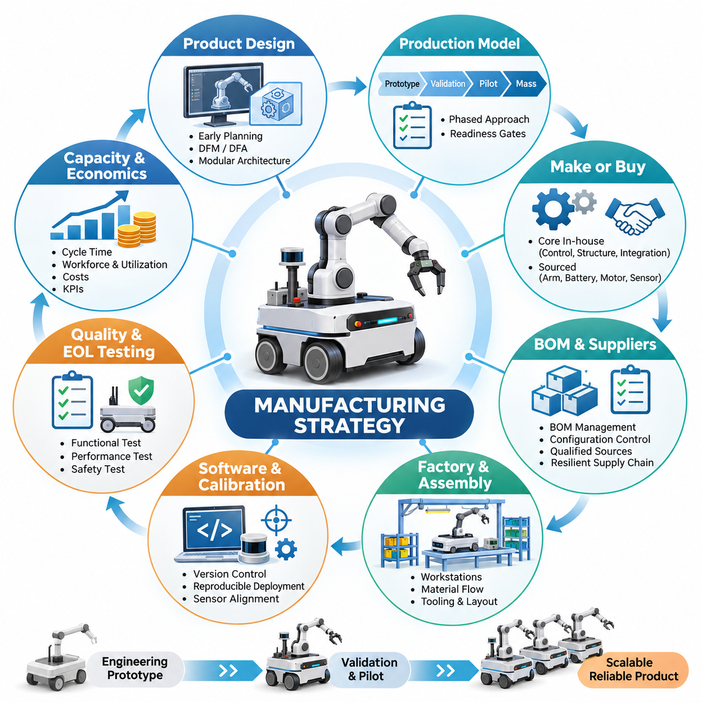{width="7.268055555555556in" height="7.268055555555556in"}

제조 전략(Manufacturing Strategy)은 모바일 매니퓰레이터(Mobile Manipulator)를 엔지니어링 프로토타입(Engineering Prototype)에서 상업적으로 실현 가능하고 반복 생산이 가능한 로봇 제품으로 전환하기 위한 기본적인 접근 방식을 수립한다. 이는 제품 개발(Product Development), 생산 공학(Production Engineering), 공급망 관리(Supply Chain Management), 품질 보증(Quality Assurance) 및 사업 목표를 통합된 제조 프레임워크(Manufacturing Framework)로 연결한다. 주요 목적은 일관된 제품 품질, 예측 가능한 생산 비용 및 확장 가능한 제조 역량을 확보하는 것이다.

기존의 일반적인 산업 제품과 달리 모바일 매니퓰레이터는 자율 이동 로봇(Autonomous Mobile Robot, AMR), 로봇 팔(Robotic Arm), 말단 장치(End Effector), 인지 센서(Perception Sensor), 임베디드 컴퓨팅 플랫폼(Embedded Computing Platform) 및 인공지능 소프트웨어(Artificial Intelligence Software)를 결합한다. 이러한 이기종 구성 요소(Heterogeneous Components)는 복잡한 기계적, 전기적 및 소프트웨어 통합 요구사항을 발생시킨다. 따라서 제조 전략은 물리적 조립뿐만 아니라 개별 생산 제품 간의 시스템 수준 기능적 일관성(Functional Consistency)도 고려해야 한다.

제조 계획(Manufacturing Planning)은 프로토타입 검증(Prototype Validation)이 완료된 이후가 아니라 제품 개발 초기 단계부터 시작되어야 한다. 엔지니어링 팀은 부품의 가용성(Component Availability), 조립 복잡성(Assembly Complexity), 생산 공차(Production Tolerance), 제조 공정(Manufacturing Process) 및 예상 생산량을 평가해야 한다. 개발팀과 제조팀 간의 초기 협업은 비용이 많이 소요되는 설계 변경(Design Modification)을 줄이고 실험적 시스템에서 상용 제품으로의 원활한 전환을 지원한다.

제조 전략은 시장 수요(Market Demand), 제품 성숙도(Product Maturity), 자본 투자(Capital Investment) 및 조직 역량(Organizational Capability)에 따라 적절한 생산 모델(Production Model)을 정의해야 한다. 프로토타입 제조(Prototype Manufacturing)는 일반적으로 유연한 엔지니어링 작업장과 수작업 조립(Manual Assembly)에 의존하는 반면, 상업적 제조(Commercial Manufacturing)는 표준화된 공정과 통제된 생산 환경을 요구한다. 생산 방식은 시장 수요가 증가하고 제품 설계가 안정화됨에 따라 점진적으로 발전해야 한다.

단계적 제조 접근 방식(Phased Manufacturing Approach)은 프로토타입 제작(Prototype Fabrication)에서 엔지니어링 검증(Engineering Validation), 설계 검증(Design Validation), 생산 검증(Production Validation) 및 양산(Mass Production)으로 이어지는 전환을 지원한다. 각 단계에서는 설계 성숙도(Design Maturity), 부품 신뢰성(Component Reliability), 조립 반복성(Assembly Repeatability) 및 운영 성능(Operational Performance)을 포함하는 구체적인 진입 및 종료 기준을 수립해야 한다. 성급한 상용화(Commercialization)를 방지하기 위해 제조 준비도(Manufacturing Readiness)는 기술 준비도(Technology Readiness)와 함께 평가되어야 한다.

자체 생산 또는 외부 구매 결정(Make-or-Buy Decision)은 제조 전략의 핵심 요소이다. 로봇 제조업체는 어떠한 구성 요소를 내부에서 개발하고 제조할 것인지, 어떠한 구성 요소를 외부 공급업체로부터 조달할 것인지 결정해야 한다. 독자적인 제어 시스템(Proprietary Control System), 특수 기계 구조(Specialized Mechanical Structure) 및 통합 기술(Integration Technology)은 자체 개발의 타당성을 확보할 수 있는 반면, 표준화된 로봇 팔, 배터리, 모터 및 센서는 외부 공급업체를 통해 조달할 수 있다.

모듈형 제품 아키텍처(Modular Product Architecture)는 제조 유연성(Manufacturing Flexibility)을 확보하고 다양한 모바일 매니퓰레이터 구성을 생산하는 과정의 복잡성을 줄인다. 공통 이동 플랫폼(Common Mobile Platform), 전기 아키텍처(Electrical Architecture), 컴퓨팅 모듈(Computing Module) 및 표준화된 기계 인터페이스(Mechanical Interface)는 다양한 로봇 팔과 응용 분야별 말단 장치를 지원할 수 있다. 플랫폼 모듈화(Platform Modularity)는 재고 활용도(Inventory Utilization), 엔지니어링 자산 재사용(Engineering Reuse), 유지보수 효율성(Maintenance Efficiency) 및 제품 확장성(Product Scalability)도 향상시킨다.

제조 용이성 설계(Design for Manufacturing, DFM)와 조립 용이성 설계(Design for Assembly, DFA) 원칙은 제품 개발 전반에 걸쳐 적용되어야 한다. 기계 구조(Mechanical Structure)는 실질적인 제작 가능성, 접근하기 쉬운 체결 구조, 단순화된 정렬 및 효율적인 부품 설치를 고려하여 설계되어야 한다. 전기 시스템(Electrical System)은 배선 복잡성(Wiring Complexity)을 최소화하고 표준화된 커넥터(Standardized Connector)를 지원해야 하며, 하드웨어 배치는 검사(Inspection), 교정(Calibration) 및 부품 교체(Component Replacement)가 용이하도록 구성되어야 한다.

자재 명세서 관리(Bill of Materials Management, BOM Management)는 자재 조달(Material Procurement), 생산 계획(Production Planning), 형상 관리(Configuration Control) 및 제조 비용 산정(Manufacturing Cost Estimation)의 기반을 제공한다. 엔지니어링 자재 명세서(Engineering BOM, EBOM)와 제조 자재 명세서(Manufacturing BOM, MBOM)는 제품 수명주기(Product Lifecycle) 전반에 걸쳐 동기화된 상태를 유지해야 한다. 부품 대체(Component Substitution), 공급업체 변경, 하드웨어 개정(Hardware Revision) 및 소프트웨어 의존성(Software Dependency)은 공식적인 엔지니어링 변경 관리(Engineering Change Management) 프로세스를 통해 통제되어야 한다.

생산 시설(Production Facility)은 자재 흐름(Material Flow), 조립 순서(Assembly Sequence), 장비 요구사항(Equipment Requirement), 작업자 접근성(Operator Accessibility) 및 안전 고려사항을 기반으로 구성되어야 한다. 전용 작업 스테이션(Dedicated Workstation)은 기계 조립(Mechanical Assembly), 전기 장치 설치(Electrical Installation), 로봇 팔 통합(Robotic Arm Integration), 소프트웨어 프로비저닝(Software Provisioning), 센서 교정(Sensor Calibration) 및 최종 시스템 시험(Final System Testing)을 지원할 수 있다. 효율적인 시설 배치(Facility Layout)는 불필요한 운반, 생산 병목 현상(Production Bottleneck) 및 취급 과정에서 발생하는 부품 손상을 줄인다.

모바일 매니퓰레이터의 제조에는 체계적인 소프트웨어 통합(Software Integration)과 형상 관리(Configuration Management)도 요구된다. 운영체제(Operating System), 장치 드라이버(Device Driver), 로봇 미들웨어(Robot Middleware), 자율주행 소프트웨어(Navigation Software), 매니퓰레이션 알고리즘(Manipulation Algorithm) 및 인공지능 모델(AI Model)은 통제되고 재현 가능한 절차를 통해 설치되어야 한다. 각 생산 제품은 추적 가능한 소프트웨어 버전(Software Version), 구성 매개변수(Configuration Parameter), 교정 기록(Calibration Record) 및 하드웨어 호환성(Hardware Compatibility) 정보를 유지해야 한다.

미세한 제조 편차(Manufacturing Variation)가 자율주행 정확도(Navigation Accuracy), 매니퓰레이션 정밀도(Manipulation Precision) 및 인지 신뢰성(Perception Reliability)에 영향을 줄 수 있으므로 교정과 생산 시험(Production Testing)은 특히 중요하다. 표준화된 시험 치구(Test Fixture)는 휠 정렬(Wheel Alignment), 센서 좌표 변환(Sensor Coordinate Transformation), 로봇 팔 장착 검증(Robotic Arm Mounting Verification) 및 말단 장치 교정을 지원해야 한다. 생산라인 종료 시험(End-of-Line Testing, EOL Testing)은 완성된 로봇이 사전에 정의된 기능적, 성능적 및 안전 요구사항을 충족하는지 확인해야 한다.

생산 능력 계획(Production Capacity Planning)은 조립 사이클 시간(Assembly Cycle Time), 인력 가용성(Workforce Availability), 장비 가동률(Equipment Utilization), 공급업체 조달 기간(Supplier Lead Time) 및 시험 처리량(Testing Throughput)을 고려해야 한다. 제조 조직은 생산량을 확대하기 전에 병목 구간을 식별하고 현실적인 생산 능력 확장 계획(Capacity Expansion Plan)을 수립해야 한다. 파일럿 생산(Pilot Production)은 실제 생산 환경을 대표하는 조건에서 조립 소요 시간, 불량률(Defect Rate), 재작업 요구사항(Rework Requirement) 및 자원 소비량에 관한 유용한 정보를 제공한다.

제조 경제성(Manufacturing Economics)은 단순히 부품 가격만을 기준으로 평가하는 것이 아니라 전체 제품 수명주기 관점에서 평가되어야 한다. 직접 재료비(Direct Material Cost), 인건비(Labor Cost), 제조 간접비(Manufacturing Overhead), 생산 도구 투자(Tooling Investment), 보증 관련 잠재 비용(Warranty Exposure), 물류(Logistics) 및 유지보수 요구사항은 전체 수익성(Profitability)에 영향을 미친다. 제조 전략은 비용 절감(Cost Reduction)과 시스템 신뢰성(System Reliability), 안전성(Safety), 운영 성능 및 장기적인 고객 만족도(Customer Satisfaction) 사이의 균형을 확보해야 한다.

지속 가능한 제조 전략(Sustainable Manufacturing Strategy)은 회복탄력성 있는 공급망(Resilient Supply Chain), 적격 대체 공급업체(Qualified Alternative Supplier), 통제된 재고(Controlled Inventory) 및 지속적인 공정 개선(Continuous Process Improvement)을 요구한다. 최초 합격률(First-Pass Yield, FPY), 생산 사이클 시간(Production Cycle Time), 제조 원가(Manufacturing Cost), 불량률 및 정시 납품률(On-Time Delivery)과 같은 핵심 성과 지표(Key Performance Indicator, KPI)는 측정 가능한 피드백을 제공한다. 궁극적으로 제조의 성공은 검증된 엔지니어링 설계를 상업적 규모에서 일관되게 생산할 수 있는 신뢰성 높은 제품으로 전환하는 역량에 달려 있다.

## 02 BOM Management

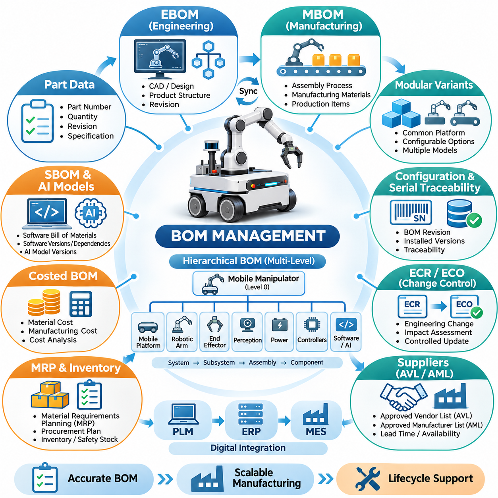{width="7.268055555555556in" height="7.268055555555556in"}

자재 명세서 관리(Bill of Materials Management, BOM Management)는 모바일 매니퓰레이터(Mobile Manipulator)를 생산하는 데 필요한 모든 부품, 자재, 조립체 및 소프트웨어 관련 형상 항목(Configuration Item)을 정의하고 구조화하며 통제하는 핵심 제조 관리 분야이다. 이는 전체 제품 수명주기(Product Lifecycle)에 걸쳐 엔지니어링 설계(Engineering Design), 조달(Procurement), 생산 계획(Production Planning), 재고 관리(Inventory Management), 품질 관리(Quality Control) 및 유지보수(Maintenance) 사이의 구조화된 관계를 수립한다.

모바일 매니퓰레이터의 자재 명세서(BOM)는 기계 구조(Mechanical Structure), 자율 이동 로봇(Autonomous Mobile Robot, AMR) 플랫폼, 로봇 팔(Robotic Arm), 말단 장치(End Effector), 전기 부품(Electrical Component), 와이어링 하네스(Wiring Harness), 인지 센서(Perception Sensor), 배터리(Battery), 임베디드 제어기(Embedded Controller) 및 컴퓨팅 플랫폼(Computing Platform)을 포함하는 여러 엔지니어링 분야를 포괄한다. 이러한 하위 시스템(Subsystem)은 서로 다른 조달 주기(Procurement Cycle), 형상 요구사항(Configuration Requirement) 및 운영 의존성(Operational Dependency)을 가지고 있으므로 자재 명세서 관리에는 다학제적 접근 방식(Multidisciplinary Approach)이 요구된다.

엔지니어링 자재 명세서(Engineering Bill of Materials, EBOM)는 엔지니어링 설계 관점에서 제품 구조(Product Structure)를 표현한다. 일반적으로 컴퓨터 지원 설계(Computer-Aided Design, CAD) 모델, 전기 회로도(Electrical Schematic), 시스템 아키텍처 문서(System Architecture Document) 및 엔지니어링 사양(Engineering Specification)을 기반으로 생성된다. 엔지니어링 자재 명세서는 승인된 엔지니어링 요구사항과의 일관성을 유지하면서 부품 간 관계(Component Relationship), 기술적 특성(Technical Characteristic), 부품 식별자(Part Identifier), 조립 계층 구조(Assembly Hierarchy) 및 설계 개정(Design Revision)을 정의한다.

제조 자재 명세서(Manufacturing Bill of Materials, MBOM)는 실제 생산 요구사항(Production Requirement)과 조립 공정(Assembly Process)에 따라 엔지니어링 정보를 재구성한다. 설계된 제품을 중심으로 설명하는 엔지니어링 자재 명세서와 달리 제조 자재 명세서는 제조 전용 자재(Manufacturing-Specific Material), 소모품(Consumable), 중간 조립체(Intermediate Assembly), 포장 자재(Packaging Material) 및 생산 관련 구성 요소를 포함한다. 엔지니어링 자재 명세서와 제조 자재 명세서 간의 동기화(Synchronization)는 설계와 제조 사이의 불일치(Discrepancy)를 방지하는 데 필수적이다.

계층적 자재 명세서 구조(Hierarchical BOM Structure)는 모바일 매니퓰레이터를 시스템(System), 하위 시스템(Subsystem), 조립체(Assembly), 하위 조립체(Subassembly) 및 개별 부품(Individual Component)으로 체계적으로 분해하는 것을 지원한다. 최상위 계층은 완성된 로봇 제품을 나타내며, 하위 계층은 이동 플랫폼(Mobile Platform), 매니퓰레이션 시스템(Manipulation System), 인지 시스템(Perception System), 전력 분배 아키텍처(Power Distribution Architecture) 및 제어 하드웨어(Control Hardware)를 설명한다. 이러한 계층 구조는 형상 관리(Configuration Management)를 개선하고 효율적인 부품 추적성(Component Traceability)을 지원한다.

각 자재 명세서 항목(BOM Item)은 고유한 부품 번호(Part Number), 표준화된 설명(Standardized Description), 수량(Quantity), 측정 단위(Unit of Measurement), 개정 식별자(Revision Identifier), 재료 사양(Material Specification) 및 조달 분류(Procurement Classification)를 포함해야 한다. 추가적인 정보로는 공급업체 식별자(Supplier Identifier), 예상 비용(Estimated Cost), 제조 소요 기간(Manufacturing Lead Time), 수명주기 상태(Lifecycle Status) 및 승인된 대체 부품(Approved Alternative)이 포함될 수 있다. 일관된 데이터 구조(Data Structure)와 부품 번호 부여 규칙(Part Numbering Convention)은 중복, 조달 오류(Procurement Error) 및 형상 불일치(Configuration Inconsistency)를 줄인다.

모듈형 자재 명세서 아키텍처(Modular BOM Architecture)는 제조업체가 공통 부품(Shared Component)과 표준화된 인터페이스(Standardized Interface)를 활용하여 다양한 모바일 매니퓰레이터 제품 파생 모델(Product Variant)을 개발할 수 있도록 한다. 공통 자율 이동 로봇 플랫폼(Common AMR Platform)은 다양한 로봇 팔, 적재 용량(Payload Capacity), 인지 구성(Perception Configuration), 배터리 용량(Battery Capacity) 및 컴퓨팅 아키텍처(Computing Architecture)를 지원할 수 있다. 구성 가능한 자재 명세서 구조(Configurable BOM Structure)는 제품 맞춤화(Product Customization)를 단순화하고 불필요한 재고를 줄이며, 엔지니어링 자산 재사용(Engineering Reuse)과 제조 확장성(Manufacturing Scalability)을 향상시킨다.

형상 관리(Configuration Management)는 모바일 매니퓰레이터가 다양한 하드웨어 및 소프트웨어 구성으로 제조될 때 특히 중요하다. 각 생산 제품은 승인된 자재 명세서 개정 버전(BOM Revision), 설치된 부품 버전(Component Version), 펌웨어 릴리스(Firmware Release), 소프트웨어 패키지(Software Package) 및 인공지능 모델 구성(AI Model Configuration)과의 연관성을 유지해야 한다. 일련번호 기반 추적성(Serial Number-Based Traceability)은 제조업체가 유지보수와 고장 조사(Failure Investigation) 과정에서 개별 로봇의 실제 구성을 재구성할 수 있도록 지원한다.

엔지니어링 변경 관리(Engineering Change Management)는 제품 수명주기 전반에 걸쳐 자재 명세서 구조를 변경하기 위한 통제된 메커니즘을 제공한다. 엔지니어링 변경 요청서(Engineering Change Request, ECR)는 제안된 변경사항을 식별하며, 엔지니어링 변경 지시서(Engineering Change Order, ECO)는 승인된 변경사항을 공식적으로 허가하고 적용 조건(Implementation Condition)을 정의한다. 변경사항은 제조 공정(Manufacturing Process), 조달 계약 및 약정(Procurement Commitment), 기존 재고(Existing Inventory), 시스템 호환성(System Compatibility), 안전성(Safety) 및 운영 성능(Operational Performance)에 미치는 영향을 기반으로 평가되어야 한다.

자재 명세서 관리는 공급업체 관리(Supplier Management) 및 조달 프로세스(Procurement Process)와 긴밀한 통합 상태를 유지해야 한다. 로봇 팔, 구동 모터(Drive Motor), 모터 제어기(Motor Controller), 안전 라이다 센서(Safety LiDAR Sensor), 배터리 및 엣지 컴퓨팅 모듈(Edge Computing Module)과 같은 핵심 부품(Critical Component)은 긴 조달 소요 기간(Procurement Lead Time)이나 제한된 공급 가용성(Supply Availability)을 가질 수 있다. 승인 공급업체 목록(Approved Vendor List, AVL)과 승인 제조업체 목록(Approved Manufacturer List, AML)은 통제된 부품 조달(Controlled Sourcing)을 지원하고 승인되지 않은 부품 대체(Unauthorized Substitution)와 관련된 위험을 줄인다.

자재 소요량 계획(Material Requirements Planning, MRP)은 생산 일정(Production Schedule), 재고 가용성(Inventory Availability), 조달 소요 기간 및 예상 생산 수량(Manufacturing Quantity)을 기반으로 부품 수요(Component Demand)를 계산하기 위해 자재 명세서 정보를 활용한다. 정확한 자재 명세서 데이터(BOM Data)는 제조업체가 구매 요구사항(Purchasing Requirement)을 결정하고 적절한 안전 재고(Safety Stock)를 유지하며 자재 부족(Material Shortage)을 방지할 수 있도록 한다. 부품 수량이나 조립 관계(Assembly Relationship)의 오류는 생산 일정에 심각한 차질을 초래할 수 있다.

원가 기반 자재 명세서 관리(Costed BOM Management)는 모바일 매니퓰레이터 제조와 관련된 재료비(Material Cost)에 대한 상세한 가시성(Visibility)을 제공한다. 부품 구매 가격(Component Purchase Price), 제조 비용(Manufacturing Cost), 공급업체 견적(Supplier Quotation), 운송 비용(Transportation Expense) 및 환율 가정(Currency Exchange Assumption)은 체계적인 원가 산정(Cost Estimation)을 지원한다. 원가 기반 자재 명세서 분석(Costed BOM Analysis)은 주요 원가 발생 요소(Cost Contributor)를 식별하고 엔지니어링 팀이 기능적 요구사항(Functional Requirement)이나 안전 요구사항(Safety Requirement)을 저해하지 않으면서 대안 설계(Alternative Design)를 평가할 수 있도록 한다.

소프트웨어 및 인공지능 형상 관리(Software and AI Configuration Management)는 기존의 하드웨어 중심 자재 명세서 구조(Hardware-Oriented BOM Structure)를 보완해야 한다. 소프트웨어 자재 명세서(Software Bill of Materials, SBOM)는 소프트웨어 구성 요소(Software Component), 라이브러리(Library), 의존성(Dependency), 버전(Version) 및 라이선스 정보(Licensing Information)를 식별한다. 인공지능 모델 매니페스트(AI Model Manifest)는 모델 버전(Model Version), 아티팩트 식별자(Artifact Identifier), 실행 환경 호환성(Runtime Compatibility) 및 관련 검증 참조 정보(Validation Reference)를 별도로 기록하여 전체 생산 제품에 걸쳐 재현 가능한 배포(Reproducible Deployment)와 통제된 소프트웨어 유지보수(Controlled Software Maintenance)를 지원해야 한다.

전사적 자원 관리(Enterprise Resource Planning, ERP), 제품 수명주기 관리(Product Lifecycle Management, PLM) 및 제조 실행 시스템(Manufacturing Execution System, MES)은 디지털 자재 명세서 관리(Digital BOM Management)를 위한 상호 보완적인 기능을 제공한다. 제품 수명주기 관리 시스템은 엔지니어링 제품 정의(Engineering Product Definition)와 변경 이력(Change History)을 유지하며, 전사적 자원 관리 시스템은 조달과 재고 계획(Inventory Planning)을 조정하고, 제조 실행 시스템은 생산 실행(Production Execution)과 실제 제작 형상 기록(As-Built Record)을 지원한다. 이러한 시스템 간의 통합(System Integration)은 수작업에 의한 데이터 중복(Manual Data Duplication)을 줄이고 제조 추적성(Manufacturing Traceability)을 향상시킨다.

효과적인 자재 명세서 관리는 지속적인 검증(Continuous Verification), 개정 관리(Revision Control) 및 수명주기 모니터링(Lifecycle Monitoring)을 요구한다. 핵심 성과 지표(Key Performance Indicator, KPI)에는 자재 명세서 정확도(BOM Accuracy), 자재 부족 발생 빈도(Material Shortage Frequency), 부품 표준화율(Component Standardization Rate), 엔지니어링 변경 적용 시간(Engineering Change Implementation Time) 및 재료비 편차(Material Cost Variance)가 포함될 수 있다. 궁극적으로 체계적인 자재 명세서 관리는 확장 가능한 제조(Scalable Manufacturing), 일관된 제품 품질(Consistent Product Quality), 공급망 회복탄력성(Supply Chain Resilience) 및 모바일 매니퓰레이터의 장기적인 수명주기 지원(Lifecycle Support)을 위한 신뢰성 높은 디지털 기반(Digital Foundation)을 구축한다.

## 03 Supplier Management

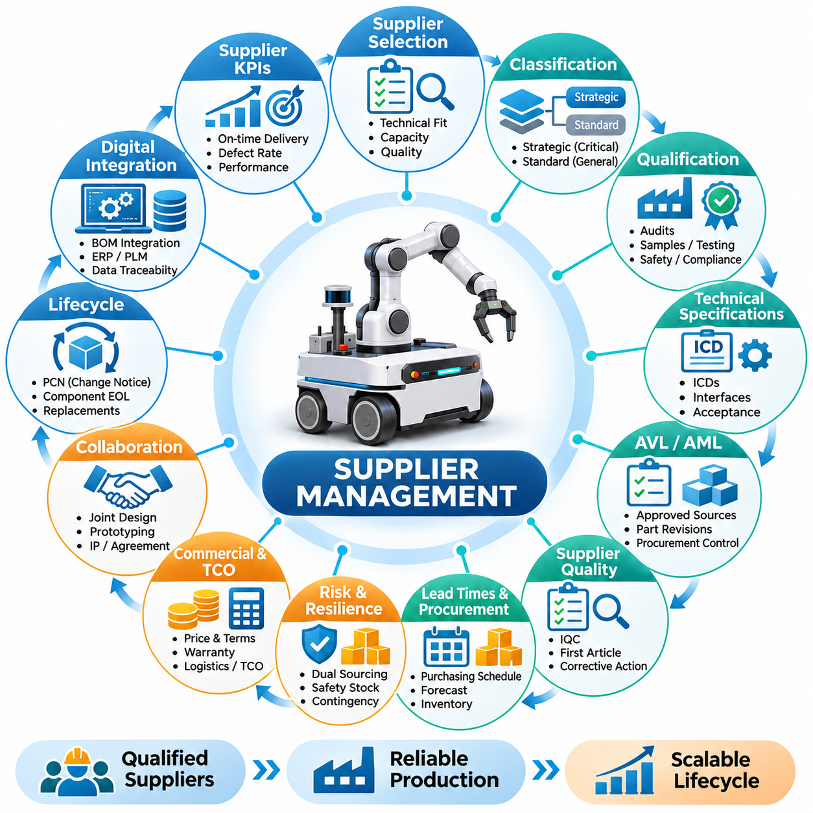{width="7.268055555555556in" height="7.268055555555556in"}

공급업체 관리(Supplier Management)는 모바일 매니퓰레이터(Mobile Manipulator) 생산에 필요한 부품, 자재, 기술 및 외부 서비스의 안정적인 조달을 보장하는 핵심 제조 관리 분야이다. 이는 제조업체와 공급업체 사이의 체계적인 관계를 구축하여 전체 제품 수명주기(Product Lifecycle)에 걸쳐 일관된 제품 품질(Consistent Product Quality), 경쟁력 있는 조달 비용(Competitive Procurement Cost), 예측 가능한 납품 일정(Delivery Schedule) 및 장기적인 공급망 안정성(Supply Chain Stability)을 확보한다.

모바일 매니퓰레이터는 로봇 팔(Robotic Arm), 구동 시스템(Drive System), 모터 제어기(Motor Controller), 배터리(Battery), 인지 센서(Perception Sensor), 임베디드 컴퓨터(Embedded Computer), 안전 장치(Safety Device) 및 기계 조립체(Mechanical Assembly)를 포함하는 여러 산업 분야의 이기종 구성 요소(Heterogeneous Component)를 통합한다. 각 부품 유형은 서로 다른 기술 요구사항(Technical Requirement), 제조 역량(Manufacturing Capability), 조달 소요 기간(Procurement Lead Time) 및 공급 위험(Supply Risk)을 가진다. 따라서 공급업체 관리는 상업적 관계(Commercial Relationship)뿐만 아니라 엔지니어링 호환성(Engineering Compatibility)도 고려해야 한다.

공급업체 선정(Supplier Selection)은 시스템 아키텍처(System Architecture)와 하드웨어 개발(Hardware Development)의 초기 단계부터 시작되어야 한다. 후보 공급업체는 기술 역량(Technical Capability), 제품 사양(Product Specification), 제조 능력(Manufacturing Capacity), 품질 경영 시스템(Quality Management System), 재무 안정성(Financial Stability) 및 엔지니어링 지원(Engineering Support)을 기반으로 평가되어야 한다. 공급업체의 초기 참여(Early Supplier Involvement)는 개발팀이 부품의 한계(Component Limitation)를 식별하고 시스템 통합(System Integration)을 개선하며 비용이 많이 소요되는 설계 변경(Design Modification)을 줄일 수 있도록 지원한다.

공급업체 분류(Supplier Classification)는 제조 조직이 부품 중요도(Component Criticality)와 사업 영향도(Business Impact)에 따라 관리 자원(Management Resource)을 배분할 수 있도록 한다. 전략적 공급업체(Strategic Supplier)는 제품 성능에 상당한 영향을 미치는 로봇 팔, 구동 모듈(Drive Module), 안전 제어기(Safety Controller), 배터리 또는 특수 컴퓨팅 플랫폼(Specialized Computing Platform)을 공급할 수 있다. 일반 부품 공급업체(Standard Component Supplier)는 일반적으로 대체 장벽(Substitution Barrier)이 낮은 상용 자재(Commercially Available Material), 체결 부품(Fastener), 커넥터(Connector) 및 기계 부속품(Mechanical Accessory)을 공급한다.

공급업체 자격 평가(Supplier Qualification)는 잠재적 공급업체가 사전에 정의된 기술적, 제조적, 품질적 및 상업적 요구사항을 충족하는지 검증하기 위한 공식적인 프로세스를 수립한다. 자격 평가 활동(Qualification Activity)에는 제조 시설 감사(Manufacturing Facility Audit), 기술 문서 검토(Technical Documentation Review), 샘플 평가(Sample Evaluation), 신뢰성 시험(Reliability Testing) 및 생산 역량 평가(Production Capability Assessment)가 포함될 수 있다. 안전 핵심 부품(Safety-Critical Component)은 인증 기록(Certification Record), 형상 제한사항(Configuration Restriction) 및 적용 가능한 규제 요구사항(Regulatory Requirement)에 대한 추가적인 검토가 요구된다.

기술 조달 사양(Technical Procurement Specification)은 제조업체와 공급업체 간 의사소통을 위한 공통 기반을 제공한다. 이러한 사양은 기계적 치수(Mechanical Dimension), 전기적 특성(Electrical Characteristic), 통신 프로토콜(Communication Protocol), 환경적 작동 조건(Environmental Operating Condition), 성능 허용 오차(Performance Tolerance), 신뢰성 기대 수준(Reliability Expectation) 및 인수 기준(Acceptance Criteria)을 정의해야 한다. 인터페이스 제어 문서(Interface Control Document, ICD)는 외부 조달 부품(Externally Sourced Component)과 전체 모바일 매니퓰레이터 아키텍처 간의 호환성을 보장하는 데 특히 중요하다.

승인 공급업체 목록(Approved Vendor List, AVL)과 승인 제조업체 목록(Approved Manufacturer List, AML)은 생산 부품을 위한 통제된 조달 공급원(Controlled Procurement Source)을 수립한다. 이러한 기록에는 공급업체 자격(Supplier Qualification), 승인된 부품 번호(Approved Part Number), 개정 정보(Revision Information), 제조 위치(Manufacturing Location) 및 적용 가능한 구매 제한사항(Purchasing Restriction)이 유지되어야 한다. 승인되지 않은 부품 대체(Unauthorized Component Substitution)는 조달 통제(Procurement Control)와 엔지니어링 승인 절차(Engineering Approval Procedure)를 통해 방지되어야 하며, 특히 변경사항이 시스템 안전성(System Safety)이나 기능적 성능(Functional Performance)에 영향을 미칠 수 있는 경우에는 더욱 중요하다.

공급업체 품질 관리(Supplier Quality Management)는 제조 및 납품 전반에 걸쳐 부품 적합성(Component Conformity)을 유지하기 위한 메커니즘을 구축한다. 수입 품질 검사(Incoming Quality Control, IQC), 초도품 검사(First Article Inspection, FAI), 통계적 공정 관리(Statistical Process Control, SPC) 및 공급업체 품질 감사(Supplier Quality Audit)는 제조 일관성(Manufacturing Consistency)에 대한 증거를 제공한다. 부적합 부품(Nonconforming Component)은 문서화되어야 하며, 반복적인 결함(Recurring Defect)과 후속 생산 공정에서의 장애(Downstream Production Failure)를 방지하기 위해 체계적인 시정조치 프로세스(Corrective Action Process)를 통해 조사되어야 한다.

조달 소요 기간 관리(Procurement Lead Time Management)는 특수 로봇 부품(Specialized Robotic Component)이 일반 산업용 자재(Standard Industrial Material)보다 상당히 긴 납품 기간을 요구할 수 있으므로 필수적이다. 제조업체는 생산 수요 예측(Production Forecast), 공급업체 생산 능력(Supplier Capacity), 운송 요구사항(Transportation Requirement) 및 재고 가용성(Inventory Availability)을 기반으로 현실적인 구매 일정(Purchasing Schedule)을 유지해야 한다. 장기 조달 부품(Long-Lead-Time Component)은 조기에 식별되어야 하며, 적절한 구매 약정(Purchasing Commitment)과 재고 계획(Inventory Planning)을 통해 지원되어야 한다.

공급업체 위험 관리(Supplier Risk Management)는 단일 공급원 부품(Single-Source Component), 제조 능력의 한계(Manufacturing Limitation), 재무 불안정성(Financial Instability), 지정학적 상황(Geopolitical Condition), 운송 지연(Transportation Delay) 및 기술적 노후화(Technological Obsolescence)와 관련된 잠재적 공급 차질을 다룬다. 대체 조달 전략(Alternative Sourcing Strategy), 적격 이차 공급업체(Qualified Secondary Supplier), 안전 재고(Safety Stock) 및 비상 대응 계획(Contingency Plan)은 공급망 회복탄력성(Supply Chain Resilience)을 향상시킨다. 대체 부품(Alternative Component)은 승인된 생산 형상(Approved Production Configuration)에 적용되기 전에 적절한 엔지니어링 검증(Engineering Verification)을 거쳐야 한다.

상업적 공급업체 관리(Commercial Supplier Management)는 구매 가격(Purchasing Price), 지불 조건(Payment Term), 최소 주문 수량(Minimum Order Quantity, MOQ), 보증 조건(Warranty Condition), 생산 도구 투자(Tooling Investment) 및 수량 기반 가격 계약(Volume-Based Pricing Agreement)에 대한 체계적인 평가를 요구한다. 총소유비용(Total Cost of Ownership, TCO)은 초기 구매 가격만을 고려하는 것보다 더욱 포괄적인 평가 프레임워크(Evaluation Framework)를 제공한다. 부품 신뢰성(Component Reliability), 통합에 필요한 노력(Integration Effort), 유지보수 요구사항(Maintenance Requirement), 물류 비용(Logistics Expense) 및 교체 부품 가용성(Replacement Availability)은 공급업체 관계의 전반적인 경제적 가치(Economic Value)에 영향을 미친다.

공급업체 협업(Supplier Collaboration)은 모바일 매니퓰레이터 제조업체가 맞춤형 기계 조립체(Customized Mechanical Assembly), 구동 시스템, 와이어링 하네스(Wiring Harness) 또는 임베디드 컴퓨팅 솔루션(Embedded Computing Solution)을 요구할 때 더욱 중요해진다. 공동 엔지니어링 검토(Joint Engineering Review), 설계 실현 가능성 평가(Design Feasibility Assessment), 프로토타입 평가(Prototype Evaluation) 및 제조 피드백(Manufacturing Feedback)은 협업 기반 제품 개발(Collaborative Product Development)을 지원한다. 지식재산권 소유권(Intellectual Property Ownership), 비밀유지 의무(Confidentiality Obligation), 기술적 책임(Technical Responsibility) 및 엔지니어링 변경 절차(Engineering Change Procedure)는 명확하게 수립되어야 한다.

공급업체 수명주기 관리(Supplier Lifecycle Management)는 모바일 매니퓰레이터의 전체 운영 수명(Operational Lifetime)에 걸쳐 외부에서 조달된 부품의 가용성과 기술 지원이 유지되도록 보장한다. 제조업체는 제품 변경 통지(Product Change Notification, PCN), 제품 수명 종료 공지(End-of-Life Announcement, EOL Announcement), 펌웨어 업데이트(Firmware Update) 및 부품 단종 일정(Component Discontinuation Schedule)을 모니터링해야 한다. 통제된 교체 계획(Controlled Replacement Planning)과 형상 검증(Configuration Verification)은 예상하지 못한 재설계(Unexpected Redesign), 유지보수의 어려움(Maintenance Difficulty) 및 생산 중단(Production Interruption)의 위험을 줄인다.

디지털 공급업체 관리(Digital Supplier Management)는 조달 정보(Procurement Information)를 자재 명세서 관리(Bill of Materials Management, BOM Management), 전사적 자원 관리(Enterprise Resource Planning, ERP), 제품 수명주기 관리(Product Lifecycle Management, PLM) 및 품질 경영 시스템(Quality Management System)과 통합한다. 중앙화된 공급업체 기록(Centralized Supplier Record)은 제조업체가 구매 이력(Purchasing History), 부품 개정(Component Revision), 납품 성과(Delivery Performance), 검사 결과(Inspection Result) 및 시정조치(Corrective Action)를 모니터링할 수 있도록 한다. 디지털 통합(Digital Integration)은 추적성(Traceability)을 향상시키고 엔지니어링 및 제조 조직 전반에 걸쳐 조율된 의사결정(Coordinated Decision-Making)을 지원한다.

효과적인 공급업체 관리는 지속적인 성과 평가(Continuous Performance Evaluation)와 장기적인 관계 구축(Long-Term Relationship Development)에 기반한다. 정시 납품률(On-Time Delivery), 입고 부품 불량률(Incoming Defect Rate), 조달 비용 편차(Procurement Cost Variance), 조달 소요 기간 안정성(Lead Time Stability) 및 시정조치 대응 시간(Corrective Action Response Time)을 포함하는 핵심 성과 지표(Key Performance Indicator, KPI)는 측정 가능한 성과 피드백(Performance Feedback)을 제공한다. 궁극적으로 체계적인 공급업체 관리는 신뢰성 높은 모바일 매니퓰레이터 생산, 상업적 확장성(Commercial Scalability) 및 지속 가능한 수명주기 운영(Sustainable Lifecycle Operation)을 지원할 수 있는 회복탄력성 있는 산업 생태계(Resilient Industrial Ecosystem)를 구축한다.

## 04 DFM and DFA

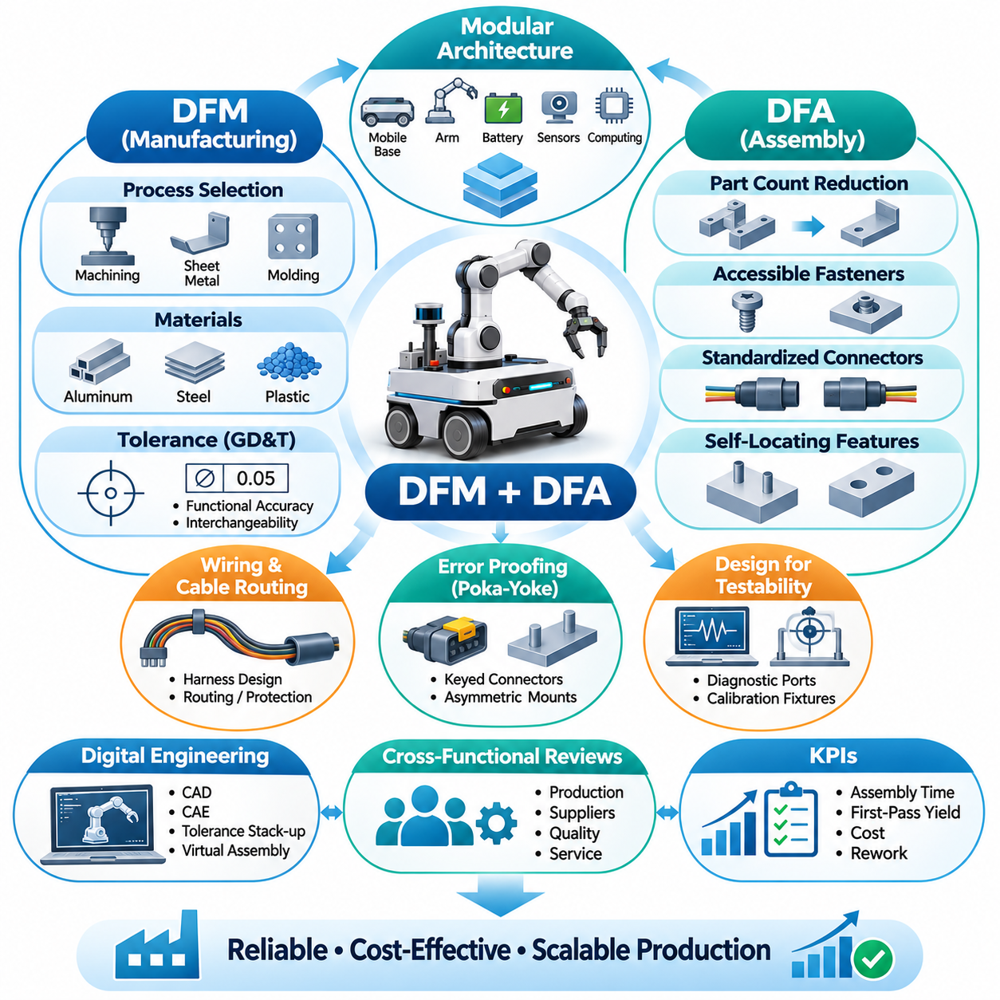{width="7.268055555555556in" height="7.268055555555556in"}

제조 용이성 설계(Design for Manufacturing, DFM)와 조립 용이성 설계(Design for Assembly, DFA)는 효율적인 제작(Fabrication), 조립(Assembly) 및 상업적 생산(Commercial Production)을 위해 제품 설계를 최적화하는 상호 보완적인 엔지니어링 방법론(Engineering Methodology)이다. 모바일 매니퓰레이터(Mobile Manipulator) 개발에서 이러한 방법론은 엔지니어링 성능(Engineering Performance)과 제조 실현 가능성(Manufacturing Practicality) 사이의 체계적인 관계를 수립하여 검증된 로봇 시스템을 일관되고 경제적이며 신뢰성 있게 생산할 수 있도록 한다.

모바일 매니퓰레이터는 자율 이동 로봇(Autonomous Mobile Robot, AMR) 플랫폼, 로봇 팔(Robotic Arm), 기계 구조(Mechanical Structure), 전기 시스템(Electrical System), 인지 센서(Perception Sensor), 컴퓨팅 하드웨어(Computing Hardware) 및 인공지능 소프트웨어(Artificial Intelligence Software)를 통합한다. 이러한 이기종 하위 시스템(Heterogeneous Subsystem)의 복잡성은 다양한 제조 및 조립 문제를 발생시킨다. 제조 용이성 설계와 조립 용이성 설계 원칙은 불필요한 구조적 복잡성(Structural Complexity)을 줄이고 부품 접근성(Component Accessibility)을 향상시키며 반복 가능한 통합 공정(Repeatable Integration Process)을 수립하는 데 기여한다.

제조 용이성 설계는 가용 제조 기술(Available Manufacturing Technology), 재료 특성(Material Property), 생산량(Production Volume) 및 비용 제약조건(Cost Constraint)에 따라 개별 부품과 기계 조립체(Mechanical Assembly)를 최적화하는 데 중점을 둔다. 엔지니어링 팀은 요구되는 구조적 및 치수적 특성(Structural and Dimensional Characteristics)을 유지하면서 기계 가공(Machining), 판금 가공(Sheet Metal Fabrication), 용접(Welding), 주조(Casting), 사출 성형(Injection Molding) 또는 적층 제조(Additive Manufacturing)를 통해 부품을 효율적으로 생산할 수 있는지 평가해야 한다.

재료 선정(Material Selection)은 재료 특성이 제조 복잡성(Manufacturing Complexity), 구조적 성능(Structural Performance), 제품 중량(Product Weight) 및 생산 비용(Production Cost)에 직접적인 영향을 미치기 때문에 제조 용이성 설계의 중요한 요소이다. 알루미늄 합금(Aluminum Alloy), 구조용 강재(Structural Steel), 엔지니어링 플라스틱(Engineering Plastic) 및 복합재료(Composite Material)는 기계적 강도(Mechanical Strength), 내식성(Corrosion Resistance), 열적 특성(Thermal Characteristic), 제작 요구사항(Fabrication Requirement) 및 예상 제품 수명주기(Product Lifecycle) 전반의 가용성(Availability)을 기반으로 평가되어야 한다.

기계적 공차 최적화(Mechanical Tolerance Optimization)는 불필요하게 높은 제작 비용을 발생시키지 않으면서 일관된 제조 품질(Manufacturing Quality)을 확보하는 데 필수적이다. 로봇 팔 장착면(Robotic Arm Mounting Surface), 구동 모듈 설치 지점(Drive Module Installation Point), 센서 브래킷(Sensor Bracket) 및 베어링 조립체(Bearing Assembly)를 포함하는 핵심 인터페이스(Critical Interface)는 적절한 치수 관리(Dimensional Control)를 요구한다. 기하 치수 및 공차(Geometric Dimensioning and Tolerancing, GD&T)는 기능적 정확도(Functional Accuracy), 호환성(Interchangeability) 및 체계적인 제조 검사(Manufacturing Inspection)를 지원한다.

조립 용이성 설계는 여러 구성 요소를 완전한 기능적 제품(Functional Product)으로 통합하는 과정을 단순화하는 데 중점을 둔다. 조립 작업(Assembly Operation)은 불필요한 부품 취급(Component Handling), 부품 재배치(Component Repositioning), 특수 공구(Specialized Tooling) 및 작업자 의존적 조정(Operator-Dependent Adjustment)을 최소화해야 한다. 기계 구조는 조립 반복성(Assembly Repeatability)과 생산성(Productivity)을 향상시키기 위해 접근 가능한 체결 위치(Accessible Fastening Location), 자체 위치 결정 구조(Self-Locating Feature), 표준화된 커넥터(Standardized Connector) 및 명확하게 정의된 설치 방향(Installation Orientation)을 포함해야 한다.

부품 수 감소(Part Count Reduction)는 제조 작업을 단순화하고 조달, 재고 및 조립 비용을 절감하는 조립 용이성 설계의 기본 원칙이다. 기능적 요구사항(Functional Requirement)과 제조 실현 가능성(Manufacturing Feasibility)이 허용하는 경우 여러 기계 부품(Mechanical Component)을 하나의 통합 구조(Integrated Structure)로 결합할 수 있다. 그러나 부품 통합(Component Consolidation)은 수리 용이성(Repairability), 교체 비용(Replacement Cost), 구조적 신뢰성(Structural Reliability) 및 응용 분야별 맞춤화(Application-Specific Customization)의 필요성과 균형을 이루어야 한다.

모듈형 제품 아키텍처(Modular Product Architecture)는 모바일 매니퓰레이터를 표준화된 기능적 조립체(Standardized Functional Assembly)로 분리함으로써 제조 용이성 설계와 조립 용이성 설계를 모두 지원한다. 이동 플랫폼(Mobile Platform), 로봇 팔 장착 모듈(Robotic Arm Mounting Module), 배터리 시스템(Battery System), 컴퓨팅 인클로저(Computing Enclosure), 인지 시스템 조립체(Perception Assembly) 및 말단 장치 인터페이스(End-Effector Interface)는 독립적으로 제조하고 시험할 수 있다. 모듈화(Modularization)는 조립 복잡성(Assembly Complexity)을 줄이고 병렬 생산(Parallel Production)을 가능하게 하며 다양한 제품 파생 모델(Product Variant)에 대한 효율적인 맞춤화를 지원한다.

체결 부품 표준화(Fastener Standardization)는 생산 과정에서 요구되는 공구, 조립 절차(Assembly Procedure) 및 재고 항목(Inventory Item)의 수를 줄임으로써 제조 효율성(Manufacturing Efficiency)을 향상시킨다. 엔지니어링 팀은 볼트 치수(Bolt Dimension), 나사산 사양(Thread Specification) 및 체결 방식(Fastening Method)의 불필요한 다양성을 최소화해야 한다. 핵심 체결 위치(Critical Fastening Location)는 반복적인 로봇 작동 중 기계적 건전성(Mechanical Integrity)을 확보하기 위해 적절한 체결 토크 사양(Torque Specification), 풀림 방지 메커니즘(Locking Mechanism) 및 검사 접근성(Inspection Accessibility)을 유지해야 한다.

전기 시스템 설계(Electrical System Design)는 표준화된 와이어링 하네스(Standardized Wiring Harness), 커넥터 제품군(Connector Family), 케이블 배치 구조(Cable Routing Structure) 및 명확하게 식별된 전기 인터페이스(Electrical Interface)를 통해 제조 및 조립 요구사항을 반영해야 한다. 사전 조립된 하네스(Preassembled Harness)는 수작업 배선 작업(Manual Wiring Operation)과 연결 오류(Connection Error)를 줄인다. 적절한 장력 완화 구조(Strain Relief), 커넥터 접근성(Connector Accessibility), 전자기 적합성(Electromagnetic Compatibility, EMC) 및 케이블 보호(Cable Protection)는 모바일 매니퓰레이터의 전체 구조에 걸쳐 유지되어야 한다.

일반적으로 포카요케(Poka-Yoke)라고 불리는 오류 방지 기법(Error-Proofing Technique)은 적절한 엔지니어링 설계를 통해 잘못된 부품 설치와 조립 오류(Assembly Error)를 방지한다. 비대칭 장착 패턴(Asymmetric Mounting Pattern), 오삽입 방지형 커넥터(Keyed Connector), 방향 가이드(Orientation Guide), 색상 식별(Color Identification) 및 기계적 정렬 구조(Mechanical Alignment Feature)는 작업자의 판단(Operator Judgment)에 대한 의존성을 줄인다. 이러한 기법은 안전 관련 회로(Safety-Related Circuit), 전력 분배 조립체(Power Distribution Assembly) 및 정밀 센서 설치(Precision Sensor Installation)에서 특히 유용하다.

시험 용이성 설계(Design for Testability, DFT)는 제조된 제품을 효율적으로 검사하고 교정하며 기능적으로 검증할 수 있도록 함으로써 제조 용이성 설계와 조립 용이성 설계를 보완한다. 시험 접근 지점(Test Access Point), 진단 인터페이스(Diagnostic Interface), 기준면(Reference Surface) 및 교정 치구(Calibration Fixture)는 시스템 설계(System Design) 단계에서부터 고려되어야 한다. 접근성이 우수한 시험 지원 구조(Accessible Testing Feature)는 생산 검증 시간(Production Verification Time)을 단축하고 최종 제품 출하(Final Product Release) 이전에 제조 결함(Manufacturing Defect)을 검출하는 능력을 향상시킨다.

디지털 엔지니어링 도구(Digital Engineering Tool)는 실제 제조가 시작되기 전에 제조 용이성 설계와 조립 용이성 설계에 대한 평가를 지원한다. 컴퓨터 지원 설계(Computer-Aided Design, CAD), 컴퓨터 지원 공학(Computer-Aided Engineering, CAE), 누적 공차 분석(Tolerance Stack-Up Analysis) 및 가상 조립 시뮬레이션(Virtual Assembly Simulation)은 엔지니어가 간섭(Interference), 접근성 제한(Accessibility Limitation), 치수 편차(Dimensional Variation) 및 제조 병목 현상(Manufacturing Bottleneck)을 식별할 수 있도록 한다. 디지털 제조 검토(Digital Manufacturing Review)는 반복적인 프로토타입 제작(Prototype Iteration)을 줄이고 엔지니어링 팀과 생산팀 간의 협업을 향상시킨다.

제조 실현 가능성 검토(Manufacturing Feasibility Review)는 생산 엔지니어(Production Engineer), 부품 공급업체(Component Supplier), 조립 작업자(Assembly Operator), 품질 전문가(Quality Specialist) 및 유지보수 담당자(Maintenance Personnel)의 피드백을 통합해야 한다. 제안된 설계 개선사항(Design Improvement)은 제조 비용(Manufacturing Cost), 조립 시간(Assembly Time), 생산 공구 투자(Tooling Investment), 구조적 성능 및 안전 요구사항(Safety Requirement)을 기준으로 평가되어야 한다. 승인된 변경사항(Approved Modification)은 통제된 엔지니어링 문서(Engineering Documentation), 제조 작업 지침(Manufacturing Instruction) 및 자재 명세서(Bill of Materials, BOM) 구조에 반영되어야 한다.

제조 용이성 설계와 조립 용이성 설계의 효과성(Effectiveness)은 부품 수(Part Count), 조립 사이클 시간(Assembly Cycle Time), 최초 합격률(First-Pass Yield, FPY), 제조 원가(Manufacturing Cost), 재작업 빈도(Rework Frequency) 및 생산 공구 요구사항(Tooling Requirement)을 포함하는 측정 가능한 제조 지표(Manufacturing Indicator)를 통해 평가되어야 한다. 파일럿 생산(Pilot Production)과 현장 피드백(Field Feedback)을 기반으로 하는 지속적인 개선(Continuous Improvement)은 점진적인 설계 개선(Progressive Design Refinement)을 가능하게 한다. 궁극적으로 제조 용이성 설계와 조립 용이성 설계는 신뢰성 높고 비용 효율적이며 확장 가능한 모바일 매니퓰레이터 생산을 위한 엔지니어링 기반(Engineering Foundation)을 구축한다.

## 05 Assembly Process Design

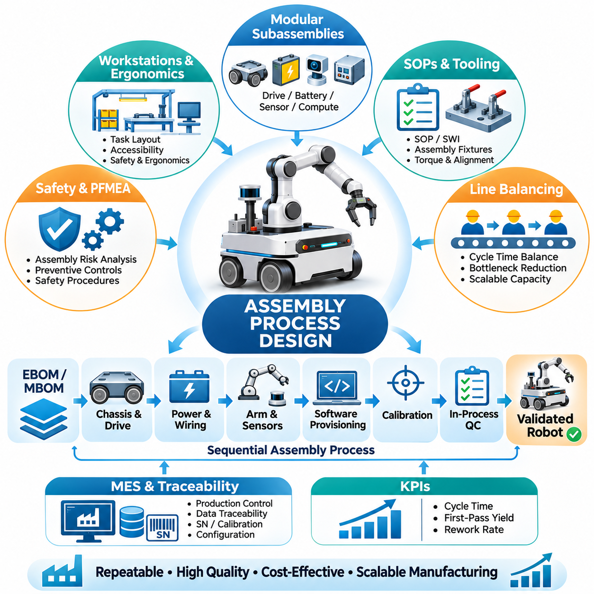{width="7.268055555555556in" height="7.268055555555556in"}

조립 공정 설계(Assembly Process Design)는 개별 부품(Individual Component), 제조 부품(Manufactured Part) 및 기능적 하위 시스템(Functional Subsystem)을 완전한 모바일 매니퓰레이터(Mobile Manipulator)로 통합하기 위한 체계적인 방법론을 수립한다. 이는 조립 순서(Assembly Sequence), 작업 스테이션 구성(Workstation Configuration), 공구 요구사항(Tooling Requirement), 자재 흐름(Material Flow), 검사 절차(Inspection Procedure) 및 작업 책임(Operational Responsibility)을 정의한다. 주요 목적은 일관된 제품 품질(Consistent Product Quality), 효율적인 생산 처리량(Production Throughput) 및 반복 가능한 제조 성능(Repeatable Manufacturing Performance)을 확보하는 것이다.

모바일 매니퓰레이터 조립은 자율 이동 로봇(Autonomous Mobile Robot, AMR) 플랫폼, 로봇 팔(Robotic Arm), 말단 장치(End Effector), 전기 시스템(Electrical System), 배터리(Battery), 인지 센서(Perception Sensor), 임베디드 제어기(Embedded Controller) 및 컴퓨팅 하드웨어(Computing Hardware)의 통합을 포함한다. 기존의 일반적인 기계 조립(Mechanical Assembly)과 달리 로봇 시스템 생산은 기계적, 전기적, 전자적 및 소프트웨어 통합(Software Integration)이 유기적으로 이루어져야 한다. 따라서 조립 공정은 이기종 엔지니어링 요구사항(Heterogeneous Engineering Requirement)과 하위 시스템 의존성(Subsystem Dependency)을 수용해야 한다.

조립 공정 계획(Assembly Process Planning)은 완성된 로봇 제품을 관리 가능한 제조 조립체(Manufacturing Assembly)와 하위 조립체(Subassembly)로 분해하는 것에서 시작되어야 한다. 엔지니어링 자재 명세서(Engineering Bill of Materials, EBOM)와 제조 자재 명세서(Manufacturing Bill of Materials, MBOM)는 조립 작업(Assembly Operation)을 정의하기 위한 구조적 기반(Structural Foundation)을 제공한다. 각 조립 단계에서는 부품 요구사항(Component Requirement), 설치 절차(Installation Procedure), 필요 장비(Required Equipment), 검사 기준(Inspection Criteria) 및 예상 완료 조건(Completion Condition)을 수립해야 한다.

조립 순서 최적화(Assembly Sequence Optimization)는 부품을 설치하고 기능적 하위 시스템을 통합하기 위한 가장 효율적인 작업 순서를 결정한다. 일반적으로 기계적 섀시 준비(Mechanical Chassis Preparation)는 구동 시스템 설치(Drive System Installation), 전력 분배 장치 조립(Power Distribution Assembly), 와이어링 하네스 통합(Wiring Harness Integration), 로봇 팔 장착(Robotic Arm Mounting) 및 인지 시스템 설치(Perception System Installation)에 선행한다. 조립 순서는 물리적 접근성(Physical Accessibility), 부품 간 의존성(Component Dependency), 정렬 요구사항(Alignment Requirement) 및 작업 간 잠재적 간섭(Potential Interference)을 고려해야 한다.

모듈형 조립 전략(Modular Assembly Strategy)은 최종 시스템 통합(Final System Integration) 이전에 기능적 하위 시스템을 독립적으로 제조하고 검사하며 시험할 수 있도록 한다. 구동 모듈(Drive Module), 배터리 조립체(Battery Assembly), 전기 캐비닛(Electrical Cabinet), 컴퓨팅 장치(Computing Unit), 센서 조립체(Sensor Assembly) 및 로봇 팔 장착 구조(Robotic Arm Mounting Structure)는 전용 작업 스테이션(Dedicated Workstation)에서 준비될 수 있다. 병렬 하위 조립체 생산(Parallel Subassembly Production)은 최종 조립 복잡성(Final Assembly Complexity)을 줄이고 자원 활용도(Resource Utilization)를 향상시키며 유연한 제조 구성(Flexible Manufacturing Configuration)을 지원한다.

작업 스테이션 설계(Workstation Design)는 조립 작업(Assembly Task), 장비 접근성(Equipment Accessibility), 부품 취급(Component Handling), 작업자 인체공학(Operator Ergonomics) 및 안전 요구사항(Safety Requirement)을 고려해야 한다. 전용 작업 스테이션은 섀시 조립(Chassis Assembly), 전기 장치 설치(Electrical Installation), 매니퓰레이터 통합(Manipulator Integration), 소프트웨어 프로비저닝(Software Provisioning) 및 시스템 교정(System Calibration)을 지원할 수 있다. 적절한 인양 장비(Lifting Equipment), 위치 결정 메커니즘(Positioning Mechanism) 및 조절 가능한 작업대(Adjustable Work Surface)는 작업자 피로(Operator Fatigue)를 줄이고 무겁거나 민감한 로봇 부품의 손상을 최소화한다.

표준 작업 절차(Standard Operating Procedure, SOP)와 표준 작업 지침(Standard Work Instruction, SWI)은 제조 작업자를 위한 일관된 작업 수행 방식(Execution Method)을 수립한다. 이러한 문서는 필요한 부품, 조립 순서, 체결 토크 사양(Fastening Torque Specification), 설치 방향(Installation Orientation), 검사 지점(Inspection Checkpoint) 및 적용 가능한 안전 예방조치(Safety Precaution)를 명시해야 한다. 통제된 문서 관리(Controlled Documentation)는 서로 다른 작업자, 생산 교대조(Production Shift) 및 제조 시설(Manufacturing Facility)에서도 조립 작업의 반복성(Repeatability)이 유지되도록 보장한다.

조립 공구 및 치구(Assembly Tooling and Fixture)는 생산 과정에서 기계적 지지(Mechanical Support), 위치 결정 정확도(Positioning Accuracy) 및 작업 일관성(Operational Consistency)을 제공한다. 특수 치구(Specialized Fixture)는 섀시 정렬(Chassis Alignment), 구동 모듈 위치 결정(Drive Module Positioning), 로봇 팔 설치(Robotic Arm Installation), 센서 장착(Sensor Mounting) 및 전기 캐비닛 조립(Electrical Cabinet Assembly)을 지원할 수 있다. 공구 및 치구 설계(Tooling Design)는 치수 정확도(Dimensional Accuracy), 접근성 및 승인된 제품 구성(Approved Product Configuration)과의 호환성을 유지하면서 작업 준비 시간(Setup Time)과 작업자 의존적 조정(Operator-Dependent Adjustment)을 최소화해야 한다.

전기 조립 공정(Electrical Assembly Process)은 와이어링 하네스 배치(Wiring Harness Routing), 커넥터 설치(Connector Installation), 접지(Grounding), 케이블 보호(Cable Protection) 및 전력 분배 건전성(Power Distribution Integrity)에 특별한 주의를 요구한다. 대전류 전력 회로(High-Current Power Circuit), 통신 네트워크(Communication Network), 센서 연결(Sensor Connection) 및 안전 관련 회로(Safety-Related Circuit)는 승인된 전기 사양(Electrical Specification)에 따라 통합되어야 한다. 중간 전기 검사(Intermediate Electrical Inspection)는 통제된 시스템 전원 인가(Controlled System Energization) 이전에 연결 건전성(Connection Integrity), 절연(Insulation), 극성(Polarity) 및 접지 상태를 검증해야 한다.

소프트웨어 프로비저닝(Software Provisioning)은 지능형 이동 로봇 시스템(Intelligent Mobile Robotic System)의 필수적인 조립 작업이다. 운영체제(Operating System), 펌웨어(Firmware), 장치 드라이버(Device Driver), 로봇 미들웨어(Robot Middleware), 자율주행 소프트웨어(Navigation Software), 매니퓰레이션 알고리즘(Manipulation Algorithm) 및 인공지능 모델(Artificial Intelligence Model)은 표준화된 절차(Standardized Procedure)를 통해 설치되어야 한다. 각 생산 제품에는 기능 검증(Functional Verification) 이전에 승인된 소프트웨어 구성(Approved Software Configuration), 고유 식별 정보(Unique Identification Information) 및 추적 가능한 배포 기록(Traceable Deployment Record)이 부여되어야 한다.

시스템 교정(System Calibration)은 제조 공차(Manufacturing Tolerance)와 설치 편차(Installation Variation)를 보상하기 위해 조립 공정에 통합되어야 한다. 휠 정렬(Wheel Alignment), 조향 매개변수(Steering Parameter), 로봇 팔 좌표계(Robotic Arm Coordinate System), 센서 외부 매개변수(Sensor Extrinsic Parameter) 및 말단 장치 공구 중심점(Tool Center Point, TCP)은 통제된 검증(Controlled Verification)을 요구한다. 교정 기록(Calibration Record)은 운영 일관성(Operational Consistency), 유지보수(Maintenance) 및 향후 형상 변경(Configuration Change)을 지원하기 위해 개별 로봇의 일련번호(Serial Number)와 연계되어야 한다.

공정 중 품질 관리(In-Process Quality Control)는 최종 제품 시험(Final Product Testing)에만 의존하지 않고 주요 조립 단계에 검사 지점(Inspection Checkpoint)을 설정한다. 기계적 치수(Mechanical Dimension), 체결 상태(Fastening Condition), 전기적 연결(Electrical Connection), 부품 식별(Component Identification) 및 하위 시스템 기능(Subsystem Functionality)은 후속 작업이 진행되기 전에 검증되어야 한다. 공정 고장 형태 및 영향 분석(Process Failure Mode and Effects Analysis, PFMEA)은 조립 위험(Assembly Risk)을 식별하고 적절한 예방 관리 방안(Preventive Control)을 수립하는 데 기여한다.

생산라인 균형화(Production Line Balancing)는 작업 복잡성(Operational Complexity), 사이클 시간(Cycle Time), 인력 가용성(Workforce Availability) 및 장비 용량(Equipment Capacity)에 따라 조립 작업을 각 작업 스테이션에 분배한다. 병목 분석(Bottleneck Analysis)은 로봇 팔 설치, 전기적 검증(Electrical Verification), 소프트웨어 프로비저닝 및 센서 교정(Sensor Calibration)을 포함하여 제조 처리량(Manufacturing Throughput)을 제한하는 작업을 식별한다. 파일럿 생산 데이터(Pilot Production Data)는 제조 엔지니어가 작업 배분(Work Allocation)을 개선하고 생산 효율성(Production Efficiency)을 향상시킬 수 있도록 지원한다.

디지털 조립 공정 관리(Digital Assembly Process Management)는 제조 작업 지침(Manufacturing Instruction), 부품 추적성(Component Traceability), 검사 기록(Inspection Record) 및 생산 상태(Production Status)를 통제된 정보 환경(Controlled Information Environment) 내에서 통합한다. 제조 실행 시스템(Manufacturing Execution System, MES)은 개별 로봇의 일련번호를 작업자 활동(Operator Activity), 설치된 부품(Installed Component), 공정 매개변수(Process Parameter) 및 조립 결과(Assembly Result)와 연계할 수 있다. 디지털 추적성(Digital Traceability)은 제조 일관성(Manufacturing Consistency), 결함 조사(Defect Investigation) 및 엔지니어링 변경 적용(Engineering Change Implementation)을 지원한다.

조립 공정 검증(Assembly Process Validation)은 승인된 제조 절차(Approved Manufacturing Procedure)를 통해 엔지니어링 및 품질 요구사항을 충족하는 모바일 매니퓰레이터가 일관되게 생산될 수 있는지 확인해야 한다. 조립 사이클 시간(Assembly Cycle Time), 최초 합격률(First-Pass Yield, FPY), 노동 생산성(Labor Productivity), 재작업 빈도(Rework Frequency) 및 조립 비용(Assembly Cost)을 포함하는 핵심 성과 지표(Key Performance Indicator, KPI)는 측정 가능한 피드백을 제공한다. 지속적인 공정 개선(Continuous Process Improvement)은 신뢰성 높은 생산(Reliable Production), 효율적인 제조 규모 확대(Manufacturing Scale-Up) 및 지속 가능한 상업적 운영(Sustainable Commercial Operation)을 위한 기반을 구축한다.

## 06 Test Fixture Design

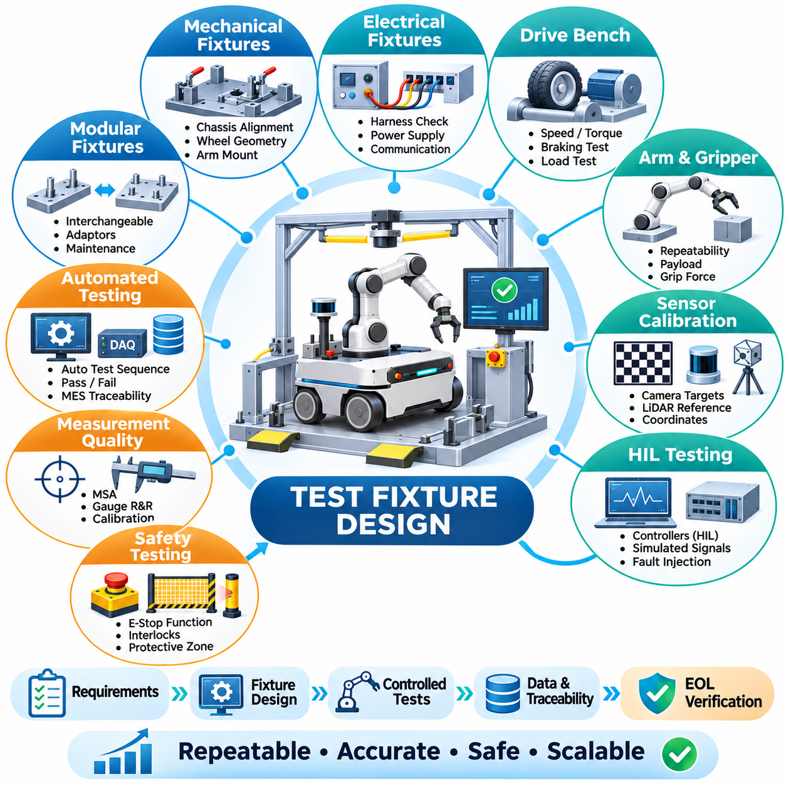{width="7.268055555555556in" height="7.268055555555556in"}

시험 치구 설계(Test Fixture Design)는 생산 과정에서 모바일 매니퓰레이터(Mobile Manipulator)를 검사하고 교정하며 검증하기 위한 표준화된 장비(Standardized Equipment)와 지원 구조(Supporting Structure)를 구축하는 핵심 제조 공학 활동(Manufacturing Engineering Activity)이다. 적절하게 설계된 시험 치구(Test Fixture)는 작업자 의존성(Operator Dependency), 검사 시간(Inspection Time) 및 생산 편차(Production Variability)를 줄이면서 반복 가능한 측정(Repeatable Measurement), 통제된 시험 조건(Controlled Testing Condition) 및 제조 제품에 대한 일관된 평가(Consistent Evaluation)를 가능하게 한다.

모바일 매니퓰레이터는 기계 구조(Mechanical Structure), 자율 이동 로봇(Autonomous Mobile Robot, AMR) 플랫폼, 로봇 팔(Robotic Arm), 전기 시스템(Electrical System), 인지 센서(Perception Sensor), 임베디드 컴퓨터(Embedded Computer) 및 인공지능 소프트웨어(Artificial Intelligence Software)를 통합한다. 각 하위 시스템(Subsystem)은 특정한 시험 조건(Testing Condition)과 검증 방법(Verification Method)을 요구한다. 따라서 시험 치구 아키텍처(Test Fixture Architecture)는 하위 시스템 시험(Subsystem Testing)과 최종 시스템 통합(Final System Integration) 전반에 걸쳐 기계적, 전기적, 전자적 및 소프트웨어 인터페이스(Software Interface)를 수용해야 한다.

시험 치구 개발(Test Fixture Development)은 제품 요구사항(Product Requirement), 제조 공정(Manufacturing Process), 핵심 치수(Critical Dimension) 및 기능적 인수 기준(Functional Acceptance Criteria)에 대한 체계적인 분석으로부터 시작되어야 한다. 제조 엔지니어(Manufacturing Engineer)는 측정 가능한 특성(Measurable Characteristic), 요구 측정 정확도(Required Measurement Accuracy), 시험 빈도(Testing Frequency), 환경 조건(Environmental Condition) 및 운영 제약조건(Operational Constraint)을 식별해야 한다. 이러한 요구사항은 적절한 치구 구조(Fixture Structure)와 측정 장비(Measurement Equipment)를 선정하기 위한 기술적 기반(Technical Foundation)을 수립한다.

기계적 시험 치구(Mechanical Test Fixture)는 치수 정확도(Dimensional Accuracy), 구조적 정렬(Structural Alignment), 장착 인터페이스(Mounting Interface) 및 조립 일관성(Assembly Consistency)을 평가하기 위한 안정적인 기준 위치(Reference Position)를 제공한다. 전용 치구(Dedicated Fixture)는 섀시 검사(Chassis Inspection), 구동 모듈 위치 결정(Drive Module Positioning), 휠 정렬(Wheel Alignment), 로봇 팔 장착 검증(Robotic Arm Mounting Verification) 및 센서 브래킷 검사(Sensor Bracket Inspection)를 지원할 수 있다. 치구 강성(Fixture Rigidity), 치수 안정성(Dimensional Stability) 및 반복 가능한 위치 결정(Repeatable Positioning)은 생산 과정에서 측정 불확도(Measurement Uncertainty)를 최소화하는 데 필수적이다.

전기적 시험 치구(Electrical Test Fixture)는 와이어링 하네스(Wiring Harness), 전력 분배 시스템(Power Distribution System), 배터리 인터페이스(Battery Interface), 통신 네트워크(Communication Network) 및 안전 관련 회로(Safety-Related Circuit)에 대한 통제된 검증(Controlled Verification)을 가능하게 한다. 표준화된 커넥터(Standardized Connector), 보호형 시험 단자(Protected Test Terminal), 프로그래밍 가능한 전원 공급 장치(Programmable Power Supply) 및 측정 계측기(Measurement Instrument)는 효율적인 전기 검사(Electrical Inspection)를 지원한다. 적절한 보호 메커니즘(Protection Mechanism)은 잘못된 연결(Incorrect Connection), 전기적 과부하(Electrical Overload), 단락(Short Circuit) 및 민감한 전자 부품(Sensitive Electronic Component)의 손상을 방지해야 한다.

구동 시스템 시험 치구(Drive System Test Fixture)는 이동 플랫폼(Mobile Platform)에 통합되기 전이나 통합된 이후에 견인 모터(Traction Motor), 조향 액추에이터(Steering Actuator), 모터 제어기(Motor Controller), 제동 시스템(Braking System) 및 휠 조립체(Wheel Assembly)에 대한 평가를 지원한다. 롤러 기반 시험 장비(Roller-Based Test Bench)와 통제된 부하 인가 메커니즘(Controlled Loading Mechanism)은 대표적인 작동 조건(Representative Operating Condition)을 재현할 수 있다. 측정 기능(Measurement Capability)에는 회전 속도(Rotational Speed), 조향각(Steering Angle), 토크(Torque), 소비 전류(Current Consumption), 진동(Vibration) 및 온도 모니터링(Temperature Monitoring)이 포함될 수 있다.

로봇 팔 시험 치구(Robotic Arm Test Fixture)는 매니퓰레이터 설치 정확도(Manipulator Installation Accuracy), 위치 결정 반복 정밀도(Positioning Repeatability), 동작 특성(Movement Characteristic) 및 말단 장치 기능(End-Effector Functionality)을 평가하기 위한 통제된 기준 환경(Controlled Reference Environment)을 구축한다. 기준 타깃(Reference Target), 교정된 측정 장치(Calibrated Measurement Device) 및 표준화된 시험 물체(Standardized Test Object)는 개별 생산 제품 간의 일관된 비교를 가능하게 한다. 치구 구성(Fixture Configuration)은 의도하지 않은 충돌(Unintended Collision)과 과도한 기계적 부하(Excessive Mechanical Loading)를 방지하면서 매니퓰레이터 작업 공간(Manipulator Workspace)을 수용해야 한다.

센서 교정 치구(Sensor Calibration Fixture)는 제조된 모바일 매니퓰레이터 전반에 걸쳐 일관된 인지 성능(Perception Performance)을 유지하는 데 필수적이다. 카메라 교정 타깃(Camera Calibration Target), 라이다 기준 구조(LiDAR Reference Structure), 깊이 측정 물체(Depth Measurement Object) 및 정밀하게 배치된 랜드마크(Precisely Positioned Landmark)는 알려진 기하학적 기준(Geometric Reference)을 제공한다. 이러한 치구는 내부 및 외부 매개변수 교정(Intrinsic and Extrinsic Calibration), 좌표 변환 검증(Coordinate Transformation Verification) 및 인지 시스템(Perception System)과 로봇 제어 아키텍처(Robotic Control Architecture) 간의 정렬을 지원한다.

말단 장치 시험 치구(End-Effector Test Fixture)는 대표적인 파지(Grasping), 인양(Lifting), 위치 결정(Positioning) 및 물체 상호작용(Object Interaction) 조건을 재현해야 한다. 정의된 치수(Dimension), 표면 특성(Surface Characteristic), 질량(Mass) 및 재료 특성(Material Property)을 가진 표준화된 시험 물체는 그리퍼 성능(Gripper Performance)에 대한 반복 가능한 평가를 가능하게 한다. 응용 분야에 따라 측정 장치(Measurement Device)는 파지력(Gripping Force), 적재물 유지 능력(Payload Retention), 위치 결정 정확도(Positioning Accuracy), 진공 압력(Vacuum Pressure) 및 기계적 반복 정밀도(Mechanical Repeatability)를 평가할 수 있다.

하드웨어 인 더 루프 시험 치구(Hardware-in-the-Loop Test Fixture, HIL Test Fixture)는 임베디드 제어기(Embedded Controller)와 로봇 제어 소프트웨어(Robotic Control Software)가 시뮬레이션된 센서(Simulated Sensor), 액추에이터(Actuator), 통신 네트워크 및 운영 환경(Operational Environment)과 상호작용할 수 있도록 한다. 이러한 치구는 완전한 물리적 로봇 조립체(Physical Robot Assembly)를 필요로 하지 않고 기능 검증(Functional Verification)을 지원한다. 자동화된 신호 생성(Automated Signal Generation), 고장 주입(Fault Injection) 및 응답 모니터링(Response Monitoring)은 최종 조립(Final Assembly) 이전에 통합 문제(Integration Problem)를 검출하기 위한 효율적인 방법을 제공한다.

안전 시험 치구(Safety Test Fixture)는 비상 정지 기능(Emergency Stop Function), 보호 정지 메커니즘(Protective Stopping Mechanism), 안전 센서(Safety Sensor) 및 안전 관련 제어 시스템(Safety-Related Control System)에 대한 통제된 검증을 지원해야 한다. 적절한 물리적 보호벽(Physical Barrier), 인터록 장치(Interlocking Device), 동작 제한 구역(Restricted Motion Area) 및 독립적인 보호 메커니즘(Independent Protective Mechanism)은 시험 과정에서 발생하는 위험(Testing Hazard)을 줄인다. 안전 관련 시험 절차(Safety-Related Testing Procedure)는 승인된 위험성 평가(Risk Assessment)와 적용 가능한 제품별 안전 요구사항(Product-Specific Safety Requirement)을 기반으로 도출되어야 한다.

측정 시스템 분석(Measurement System Analysis, MSA)은 치구 기반 측정 공정(Fixture-Based Measurement Process)의 정확도(Accuracy), 반복성(Repeatability), 재현성(Reproducibility) 및 안정성(Stability)을 평가하기 위한 체계적인 방법론을 제공한다. 측정기 반복성 및 재현성 분석(Gauge Repeatability and Reproducibility, Gauge R&R)은 측정 편차(Measurement Variation)가 장비, 작업자 또는 제조 제품 중 어느 요소에서 발생하는지 판단하는 데 기여한다. 주기적인 교정(Periodic Calibration)과 기준 표준 검증(Reference Standard Verification)은 생산 검사 결과(Production Inspection Result)에 대한 신뢰성을 유지한다.

자동화 시험 치구(Automated Test Fixture)는 표준화된 생산 검증(Standardized Production Verification)을 지원하기 위해 측정 계측기, 프로그래밍 가능한 제어기(Programmable Controller), 데이터 수집 시스템(Data Acquisition System, DAQ) 및 시험 소프트웨어(Testing Software)를 통합한다. 자동화된 시험 절차(Automated Testing Procedure)는 사전에 정의된 시험 순서(Test Sequence)를 실행하고 측정값(Measured Value)을 인수 임계값(Acceptance Threshold)과 비교하며 검사 보고서(Inspection Report)를 생성할 수 있다. 제조 실행 시스템(Manufacturing Execution System, MES)과의 통합은 시험 결과(Test Result), 로봇 일련번호(Robot Serial Number) 및 생산 형상(Production Configuration) 간의 추적성(Traceability)을 확보할 수 있도록 한다.

모듈형 치구 아키텍처(Modular Fixture Architecture)는 교체 가능한 어댑터(Interchangeable Adapter), 조절 가능한 장착 구조(Adjustable Mounting Structure) 및 구성 가능한 시험 매개변수(Configurable Testing Parameter)를 통해 다양한 모바일 매니퓰레이터 파생 모델(Product Variant)을 지원함으로써 제조 유연성(Manufacturing Flexibility)을 향상시킨다. 치구 표준화(Fixture Standardization)는 장비의 중복(Equipment Duplication)을 줄이고 유지보수(Maintenance)를 단순화하며 확장성(Scalability)을 향상시킨다. 생산 전반에 걸쳐 시험 일관성(Testing Consistency)을 유지하기 위해서는 예방 유지보수 일정(Preventive Maintenance Schedule), 통제된 치구 개정(Controlled Fixture Revision) 및 주기적인 검증 절차(Periodic Verification Procedure)가 필요하다.

시험 치구의 효과성(Test Fixture Effectiveness)은 시험 사이클 시간(Testing Cycle Time), 측정 반복성(Measurement Repeatability), 결함 검출 능력(Defect Detection Capability), 장비 가용성(Equipment Availability) 및 유지보수 비용(Maintenance Cost)을 포함하는 측정 가능한 지표(Measurable Indicator)를 통해 평가되어야 한다. 파일럿 생산 결과(Pilot Production Result)는 양산(Mass Production) 이전에 치구 최적화(Fixture Optimization)를 수행하기 위한 유용한 피드백을 제공한다. 궁극적으로 체계적인 시험 치구 설계는 생산 시험(Production Testing), 생산라인 종료 검증(End-of-Line Verification, EOL Verification), 제조 품질(Manufacturing Quality) 및 확장 가능한 모바일 매니퓰레이터 상용화(Scalable Mobile Manipulator Commercialization)를 위한 신뢰성 높은 기반을 구축한다.

## 07 Production Testing

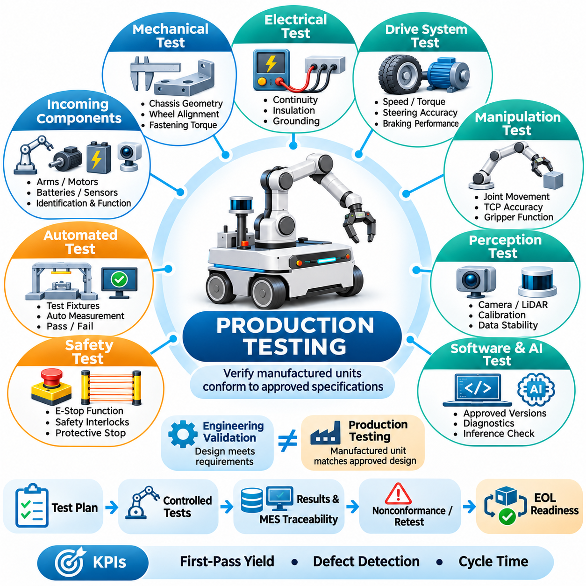{width="7.268055555555556in" height="7.268055555555556in"}

생산 시험(Production Testing)은 생산 공정(Production Process) 전반에 걸쳐 모바일 매니퓰레이터(Mobile Manipulator)의 품질(Quality), 기능성(Functionality) 및 형상(Configuration)을 검증하는 체계적인 제조 활동(Manufacturing Activity)이다. 이는 개별 부품(Individual Component), 기능적 조립체(Functional Assembly) 및 통합 로봇 시스템(Integrated Robotic System)에 대한 통제된 검증 절차(Controlled Verification Procedure)를 수립한다. 주요 목적은 제조 결함(Manufacturing Defect)을 검출하고 부적합 제품(Nonconforming Product)이 후속 공정으로 이동하는 것을 방지하며 일관된 생산 품질(Consistent Production Quality)을 확보하는 것이다.

제품 설계가 의도된 요구사항을 충족하는지 평가하는 엔지니어링 유효성 검증(Engineering Validation)과 달리, 생산 시험은 제조된 제품이 승인된 설계 사양(Approved Design Specification)을 준수하는지 검증한다. 따라서 시험 절차(Testing Procedure)는 반복성(Repeatability), 측정 정확도(Measurement Accuracy), 결함 검출(Defect Detection) 및 생산 효율성(Production Efficiency)을 중점적으로 고려해야 한다. 각 시험은 검증된 엔지니어링 요구사항(Validated Engineering Requirement)으로부터 도출된 측정 가능한 인수 기준(Measurable Acceptance Criteria)을 수립해야 한다.

생산 시험 계획(Production Test Planning)은 하드웨어 개발(Hardware Development)과 조립 공정 설계(Assembly Process Design) 단계에서부터 시작되어야 한다. 제조 엔지니어(Manufacturing Engineer)는 핵심 제품 특성(Critical Product Characteristic), 잠재적 고장 형태(Potential Failure Mode), 필요 시험 장비(Required Test Equipment), 시험 빈도(Testing Frequency) 및 검사 책임(Inspection Responsibility)을 식별해야 한다. 이를 통해 수립된 생산 시험 계획(Production Test Plan)은 제조 작업(Manufacturing Operation), 검증 절차(Verification Procedure), 인수 임계값(Acceptance Threshold) 및 시정조치 메커니즘(Corrective Action Mechanism) 간의 관계를 정의한다.

입고 부품 시험(Incoming Component Testing)은 외부에서 조달된 자재(Externally Sourced Material)와 기능적 조립체에 대한 초기 검증 단계(Initial Verification Stage)를 제공한다. 로봇 팔(Robotic Arm), 구동 모터(Drive Motor), 모터 제어기(Motor Controller), 배터리(Battery), 인지 센서(Perception Sensor), 임베디드 컴퓨터(Embedded Computer) 및 안전 장치(Safety Device)는 각각의 중요도(Criticality)에 따라 적절한 검사를 받아야 한다. 생산 투입 승인(Production Release) 이전에 공급업체 문서(Supplier Documentation), 부품 식별(Component Identification), 치수 특성(Dimensional Characteristic) 및 기능적 성능(Functional Performance)을 평가할 수 있다.

기계적 생산 시험(Mechanical Production Testing)은 제조된 모바일 매니퓰레이터의 구조적 건전성(Structural Integrity), 치수 정확도(Dimensional Accuracy) 및 조립 일관성(Assembly Consistency)을 검증한다. 핵심 검사 항목(Critical Inspection Item)에는 섀시 형상(Chassis Geometry), 휠 정렬(Wheel Alignment), 베어링 설치(Bearing Installation), 로봇 팔 장착 인터페이스(Robotic Arm Mounting Interface) 및 체결 토크(Fastening Torque)가 포함된다. 표준화된 측정 계측기(Standardized Measurement Instrument)와 시험 치구(Test Fixture)는 개별 작업자에 의해 발생하는 편차를 최소화하면서 일관된 평가(Consistent Evaluation)를 가능하게 한다.

전기적 생산 시험(Electrical Production Testing)은 전력 분배 시스템(Power Distribution System), 와이어링 하네스(Wiring Harness), 전기 인터페이스(Electrical Interface) 및 통신 네트워크(Communication Network)의 올바른 조립 상태와 기능성을 확인한다. 도통 시험(Continuity Testing), 절연 검증(Insulation Verification), 극성 검사(Polarity Inspection), 접지 측정(Grounding Measurement) 및 통제된 전원 인가 절차(Controlled Power-On Procedure)는 제조 결함을 식별하는 데 기여한다. 전기적 시험은 장비와 제조 작업자의 안전을 확보하기 위해 제한 없는 시스템 활성화(Unrestricted System Activation) 이전에 수행되어야 한다.

구동 시스템 생산 시험(Drive System Production Testing)은 통제된 작동 조건(Controlled Operating Condition)에서 견인 모터(Traction Motor), 조향 액추에이터(Steering Actuator), 제동 메커니즘(Braking Mechanism), 모터 제어기 및 휠 조립체(Wheel Assembly)를 평가한다. 시험 매개변수(Test Parameter)에는 회전 속도(Rotational Speed), 조향각 정확도(Steering Angle Accuracy), 소비 전류(Current Consumption), 토크 응답(Torque Response), 제동 성능(Braking Performance) 및 비정상 진동(Abnormal Vibration)이 포함될 수 있다. 표준화된 부하 조건(Standardized Load Condition)과 사전에 정의된 인수 한계(Acceptance Limit)는 제조된 이동 플랫폼(Mobile Platform) 간의 일관된 비교를 가능하게 한다.

매니퓰레이션 시스템 생산 시험(Manipulation System Production Testing)은 로봇 팔과 말단 장치(End Effector)의 설치 상태, 동작 및 기능적 성능을 검증한다. 관절 동작(Joint Movement), 기준 위치 정확도(Reference Position Accuracy), 공구 중심점 정렬(Tool Center Point Alignment, TCP Alignment), 파지 기능(Gripping Functionality) 및 통신 인터페이스(Communication Interface)가 평가되어야 한다. 대표적인 매니퓰레이션 작업 순서(Representative Manipulation Sequence)는 시스템 출하 승인(System Release) 이전에 조립 관련 편차(Assembly-Related Deviation), 교정 오류(Calibration Error), 기계적 간섭(Mechanical Interference) 및 비정상적인 액추에이터 동작(Abnormal Actuator Behavior)을 식별할 수 있다.

인지 시스템 생산 시험(Perception System Production Testing)은 카메라(Camera), 라이다 센서(LiDAR Sensor), 깊이 센서(Depth Sensor), 관성 측정 장치(Inertial Measurement Unit, IMU) 및 기타 감지 장치(Sensing Device)가 승인된 사양에 따라 작동하도록 보장한다. 시험은 장치 연결성(Device Connectivity), 데이터 수집 안정성(Data Acquisition Stability), 센서 정렬(Sensor Alignment), 교정 매개변수(Calibration Parameter) 및 타임스탬프 동기화(Timestamp Synchronization)를 검증해야 한다. 표준화된 기준 타깃(Standardized Reference Target)과 통제된 환경 조건(Controlled Environmental Condition)은 일관된 센서 성능 평가(Sensor Performance Evaluation)를 지원한다.

소프트웨어 및 인공지능 생산 시험(Software and Artificial Intelligence Production Testing)은 제조된 각 로봇에 승인된 소프트웨어 버전(Software Version), 펌웨어 릴리스(Firmware Release), 구성 매개변수(Configuration Parameter) 및 인공지능 모델 산출물(AI Model Artifact)이 포함되어 있는지 확인한다. 자동화된 검증(Automated Verification)은 소프트웨어 무결성(Software Integrity), 의존성 호환성(Dependency Compatibility), 장치 통신(Device Communication), 진단 기능(Diagnostic Function) 및 대표적인 추론 동작(Representative Inference Behavior)을 평가해야 한다. 생산 검사는 종합적인 인공지능 모델 유효성 검증(Comprehensive AI Model Validation)을 대체하는 것이 아니라 보완하는 역할을 수행한다.

안전 관련 생산 시험(Safety-Related Production Testing)은 제조된 모바일 매니퓰레이터가 승인된 보호 기능(Approved Protective Function)을 올바르게 구현하는지 검증한다. 비상 정지 장치(Emergency Stop Device), 보호 정지 메커니즘(Protective Stopping Mechanism), 안전 센서(Safety Sensor), 인터록(Interlock) 및 안전 관련 제어 회로(Safety-Related Control Circuit)는 적절한 기능 검사(Functional Check)를 받아야 한다. 시험은 승인된 위험성 평가(Approved Risk Assessment)로부터 도출된 통제된 절차를 따라야 하며, 일상적인 생산 검사가 공식적인 안전 유효성 검증(Formal Safety Validation)을 대체해서는 안 된다.

자동화 생산 시험(Automated Production Testing)은 프로그래밍 가능한 시험 순서(Programmable Test Sequence), 표준화된 치구(Standardized Fixture), 통합 측정 계측기(Integrated Measurement Instrument) 및 자동화된 결과 평가(Automated Result Evaluation)를 통해 제조 효율성(Manufacturing Efficiency)을 향상시킨다. 시험 소프트웨어(Testing Software)는 운영 데이터(Operational Data)를 수집하고 측정값(Measurement Value)을 사전에 정의된 인수 임계값과 비교하며 표준화된 보고서(Standardized Report)를 생성할 수 있다. 자동화 시험은 수동 검사 작업량(Manual Inspection Effort)을 줄이고 생산 교대조(Production Shift)와 제조 시설(Manufacturing Facility) 전반에 걸쳐 일관성을 향상시킨다.

생산 시험 추적성(Production Test Traceability)은 개별 로봇의 일련번호(Robot Serial Number), 설치된 부품(Installed Component), 소프트웨어 형상(Software Configuration), 측정 결과(Measurement Result) 및 검사 담당자(Inspection Personnel) 간의 문서화된 관계(Documented Relationship)를 수립한다. 제조 실행 시스템(Manufacturing Execution System, MES)과 품질 관리 플랫폼(Quality Management Platform)은 생산 공정 전반에 걸쳐 이러한 기록을 유지할 수 있다. 추적 가능한 시험 이력(Traceable Test History)은 결함 조사(Defect Investigation), 품질 보증 평가(Warranty Assessment), 형상 관리(Configuration Management) 및 수명주기 유지보수(Lifecycle Maintenance)를 지원한다.

생산 시험 중 식별된 부적합 제품(Nonconforming Product)은 분리되어야 하며 통제된 품질 관리 절차(Quality Management Procedure)를 통해 평가되어야 한다. 제조팀(Manufacturing Team)은 고장 원인(Failure Cause)을 조사하고 적절한 시정조치(Corrective Action)를 결정하며 승인된 수리(Repair) 또는 조정(Adjustment) 이후 문서화된 재시험(Documented Retesting)을 수행해야 한다. 통계적 공정 관리(Statistical Process Control, SPC)와 고장 추세 분석(Failure Trend Analysis)은 반복적으로 발생하는 제조 문제(Recurring Manufacturing Problem)를 식별하고 구조적인 결함(Systematic Defect)을 예방하는 데 기여한다.

생산 시험의 효과성(Production Testing Effectiveness)은 최초 합격률(First-Pass Yield, FPY), 결함 검출률(Defect Detection Rate), 시험 사이클 시간(Testing Cycle Time), 재작업 빈도(Rework Frequency) 및 시험 장비 가용성(Test Equipment Availability)을 포함하는 핵심 성과 지표(Key Performance Indicator, KPI)를 통해 평가되어야 한다. 생산 데이터(Production Data)를 기반으로 하는 지속적인 개선(Continuous Improvement)은 검증 범위(Verification Coverage)를 저하시키지 않으면서 시험 효율성(Testing Efficiency)을 향상시킬 수 있도록 한다. 궁극적으로 생산 시험은 최종 생산라인 종료 시험(End-of-Line Testing, EOL Testing)과 확장 가능한 모바일 매니퓰레이터 제조(Scalable Mobile Manipulator Manufacturing)를 위한 신뢰성 높은 기반을 구축한다.

## 08 End of Line Testing

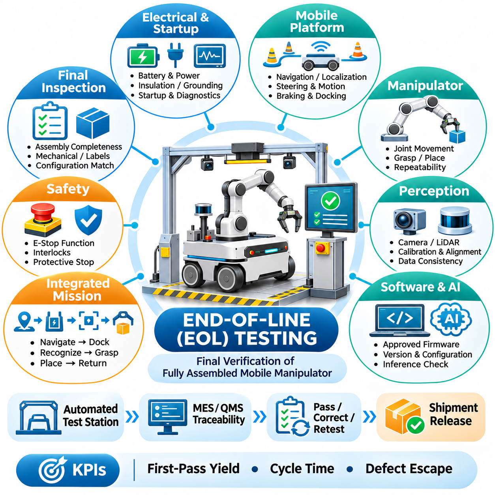{width="7.268055555555556in" height="7.268055555555556in"}

생산라인 종료 시험(End-of-Line Testing, EOL Testing)은 모바일 매니퓰레이터(Mobile Manipulator)가 출하(Shipment) 및 고객 현장 배포(Customer Deployment)를 승인받기 전에 수행되는 최종 제조 검증 단계(Final Manufacturing Verification Stage)이다. 이는 완전히 조립된 로봇 시스템의 기능성(Functionality), 성능(Performance), 안전성(Safety) 및 형상(Configuration)을 평가한다. 주요 목적은 제조된 각 제품이 승인된 제품 사양(Approved Product Specification)과 사전에 정의된 제조 인수 기준(Manufacturing Acceptance Criteria)을 충족하도록 보장하는 것이다.

개별 부품(Individual Component)과 기능적 조립체(Functional Assembly)에 중점을 두는 중간 생산 시험(Intermediate Production Testing)과 달리, 생산라인 종료 시험은 통합된 작동 조건(Integrated Operating Condition)에서 완전한 로봇 시스템을 평가한다. 기계 구조(Mechanical Structure), 전기 시스템(Electrical System), 자율주행(Autonomous Navigation), 로봇 매니퓰레이션(Robotic Manipulation), 인지 시스템(Perception System) 및 임베디드 소프트웨어(Embedded Software)는 상호 협력하여 작동해야 한다. 이러한 종합적인 검증(Comprehensive Verification)은 이전 제조 단계에서 검출되지 않았을 수 있는 통합 결함(Integration Defect)을 식별한다.

생산라인 종료 시험 계획(EOL Test Planning)은 표준화된 시험 순서(Standardized Test Sequence), 필요 장비(Required Equipment), 환경 조건(Environmental Condition), 인수 임계값(Acceptance Threshold) 및 검사 책임(Inspection Responsibility)을 수립해야 한다. 각 시험 사례(Test Case)는 승인된 엔지니어링 요구사항(Approved Engineering Requirement) 및 핵심 제품 특성(Critical Product Characteristic)과의 추적성(Traceability)을 유지해야 한다. 제조 엔지니어(Manufacturing Engineer)는 필수 기능 및 안전 요구사항(Safety Requirement)이 적절하게 평가되도록 보장하면서 검증 범위(Verification Coverage)와 생산 사이클 시간(Production Cycle Time) 간의 균형을 확보해야 한다.

초기 생산라인 종료 검사(Initial EOL Inspection)는 완성된 모바일 매니퓰레이터의 물리적 상태(Physical Condition), 조립 완전성(Assembly Completeness) 및 형상 정확성(Configuration Accuracy)을 확인해야 한다. 기계적 체결 부품(Mechanical Fastener), 보호 커버(Protective Cover), 전기 커넥터(Electrical Connector), 케이블 배치(Cable Routing), 센서 장착 구조(Sensor Mounting Structure), 식별 라벨(Identification Label) 및 외부 표면(External Surface)을 검사해야 한다. 형상 검증(Configuration Verification)은 설치된 하드웨어와 부속품(Accessory)이 승인된 제조 사양(Approved Manufacturing Specification) 및 고객 주문(Customer Order)에 부합하도록 보장한다.

전기 시스템 검증(Electrical System Verification)은 배터리 상태(Battery Status), 전력 분배 안정성(Power Distribution Stability), 전기 절연(Electrical Insulation), 접지 건전성(Grounding Integrity) 및 통신 네트워크 기능성(Communication Network Functionality)을 평가해야 한다. 통제된 시동 절차(Controlled Startup Procedure)는 임베디드 제어기(Embedded Controller), 컴퓨팅 플랫폼(Computing Platform), 모터 제어기(Motor Controller) 및 주변 장치(Peripheral Device)가 올바르게 초기화되는지 확인한다. 진단 모니터링(Diagnostic Monitoring)은 비정상적인 소비 전류(Abnormal Current Consumption), 전압 변동(Voltage Fluctuation), 통신 장애(Communication Failure) 및 예상하지 못한 시스템 오류(Unexpected System Error)를 식별하는 데 기여한다.

이동 플랫폼 생산라인 종료 시험(Mobile Platform EOL Testing)은 자율 이동(Autonomous Movement), 조향 정확도(Steering Accuracy), 가속(Acceleration), 감속(Deceleration), 제동 성능(Braking Performance) 및 기본 자율주행 능력(Fundamental Navigation Capability)을 평가한다. 표준화된 시험 환경(Standardized Test Environment)은 대표적인 주행 경로(Travel Path), 회전 구역(Turning Area), 도킹 위치(Docking Location) 및 기준 위치(Reference Position)를 제공해야 한다. 위치 결정 정확도(Positioning Accuracy), 동작 안정성(Motion Stability), 위치 추정 성능(Localization Performance) 및 장애물 대응(Obstacle Response)은 사전에 정의된 인수 기준에 따라 평가되어야 한다.

매니퓰레이터 생산라인 종료 시험(Manipulator EOL Testing)은 로봇 팔 동작(Robotic Arm Movement), 관절 초기화(Joint Initialization), 위치 결정 반복 정밀도(Positioning Repeatability), 작업 공간 접근성(Workspace Accessibility) 및 말단 장치 기능성(End-Effector Functionality)을 검증한다. 대표적인 매니퓰레이션 작업(Representative Manipulation Task)은 적용 가능한 경우 통제된 파지(Grasping), 인양(Lifting), 물체 운반(Object Transportation) 및 배치 작업(Placement Operation)을 포함해야 한다. 이러한 시험은 기계적 간섭(Mechanical Interference), 교정 편차(Calibration Deviation), 예상하지 못한 액추에이터 동작(Unexpected Actuator Behavior) 및 이동 플랫폼과 매니퓰레이터 간의 통합 장애(Integration Failure)를 식별한다.

인지 시스템 검증(Perception System Verification)은 카메라(Camera), 라이다 센서(LiDAR Sensor), 깊이 센서(Depth Sensor), 관성 측정 장치(Inertial Measurement Unit, IMU) 및 기타 감지 장치(Sensing Device)의 작동 기능성(Operational Functionality)을 평가한다. 표준화된 기준 타깃(Standardized Reference Target)과 알려진 환경 조건은 센서 정렬(Sensor Alignment), 데이터 수집(Data Acquisition), 좌표 변환(Coordinate Transformation) 및 시간 동기화(Temporal Synchronization)에 대한 검증을 지원한다. 인지 출력(Perception Output)은 승인된 교정 매개변수(Approved Calibration Parameter) 및 예상 작동 동작(Expected Operating Behavior)과 일관성을 유지해야 한다.

소프트웨어 및 인공지능 검증(Software and Artificial Intelligence Verification)은 완성된 모바일 매니퓰레이터에 승인된 펌웨어 릴리스(Firmware Release), 소프트웨어 패키지(Software Package), 구성 매개변수(Configuration Parameter) 및 인공지능 모델 버전(AI Model Version)이 포함되어 있도록 보장한다. 자동화된 진단 절차(Automated Diagnostic Procedure)는 소프트웨어 무결성(Software Integrity), 장치 통신(Device Communication), 시스템 초기화(System Initialization), 대표적인 추론 출력(Representative Inference Output) 및 컴퓨팅 자원 가용성(Computational Resource Availability)을 검증해야 한다. 생산 검증(Production Verification)은 종합적인 인공지능 모델 유효성 검증(Comprehensive AI Model Validation)과 구분되어야 한다.

통합 임무 시험(Integrated Mission Testing)은 자율주행, 매니퓰레이션 제어(Manipulation Control), 인지 처리(Perception Processing) 및 작업 오케스트레이션(Task Orchestration) 간의 협력 동작을 평가한다. 대표적인 임무(Representative Mission)는 작업 스테이션으로의 이동, 정밀 도킹(Precise Docking), 물체 인식(Object Recognition), 파지 실행(Grasp Execution), 물체 배치(Object Placement) 및 지정된 위치(Designated Location)로의 복귀를 포함할 수 있다. 임무 완료 결과(Mission Completion Result)는 개별 하위 시스템(Subsystem)이 완전한 로봇 아키텍처(Robotic Architecture) 내에서 유기적으로 작동한다는 증거를 제공한다.

안전 관련 생산라인 종료 시험(Safety-Related EOL Testing)은 제조된 각 로봇 시스템 내에서 승인된 보호 기능(Approved Protective Function)이 올바르게 구현되었는지 검증한다. 비상 정지 장치(Emergency Stop Device), 보호 정지 기능(Protective Stopping Function), 안전 센서(Safety Sensor), 인터록(Interlock) 및 지정된 고장 대응(Designated Fault Response)은 통제된 기능 검사(Controlled Functional Check)를 받아야 한다. 이러한 절차는 승인된 안전 사양(Safety Specification)과 위험성 평가(Risk Assessment)를 따라야 하며, 공식적인 안전 유효성 검증(Formal Safety Validation)이나 적용 가능한 적합성 평가 활동(Conformity Assessment Activity)을 대체해서는 안 된다.

자동화된 생산라인 종료 시험 스테이션(Automated EOL Test Station)은 표준화된 시험 치구(Standardized Test Fixture), 프로그래밍 가능한 계측기(Programmable Instrument), 통신 인터페이스(Communication Interface), 데이터 수집 시스템(Data Acquisition System, DAQ) 및 시험 관리 소프트웨어(Test Management Software)를 통합한다. 자동화된 시험 순서(Automated Test Sequence)는 측정값을 수집하고 결과를 인수 임계값과 비교하며 진단 정보(Diagnostic Information)를 기록하고 검사 보고서(Inspection Report)를 생성할 수 있다. 통제된 시험 환경(Controlled Test Environment)과 교정된 장비(Calibrated Equipment)는 측정 일관성(Measurement Consistency)을 향상시키고 작업자 의존적 편차(Operator-Dependent Variability)를 줄인다.

생산라인 종료 시험 데이터 관리(EOL Test Data Management)는 개별 로봇 일련번호(Robot Serial Number), 하드웨어 형상(Hardware Configuration), 소프트웨어 버전(Software Version), 교정 매개변수(Calibration Parameter), 측정 결과(Measurement Result) 및 최종 검사 판정(Final Inspection Decision) 간의 추적성을 수립한다. 제조 실행 시스템(Manufacturing Execution System, MES)과 품질 관리 시스템(Quality Management System, QMS)은 중앙집중식 생산 기록(Centralized Production Record)을 유지할 수 있다. 이러한 기록은 품질 보증 관리(Warranty Management), 고장 조사(Failure Investigation), 제품 리콜(Product Recall) 및 수명주기 유지보수 활동(Lifecycle Maintenance Activity)을 지원한다.

생산라인 종료 시험에서 불합격한 로봇은 적절한 시정조치(Corrective Action)가 완료될 때까지 출하 공정(Shipment Process)에 진입하지 못하도록 관리해야 한다. 부적합 제품(Nonconforming Product)은 문서화된 고장 분석(Documented Failure Analysis), 승인된 수리(Authorized Repair), 형상 수정(Configuration Correction) 및 관련 재시험(Relevant Retesting)을 거쳐야 한다. 최종 생산 출하 승인(Final Production Release)은 모든 필수 시험(Mandatory Test)이 통과되었으며 미해결 부적합 사항(Unresolved Nonconformity)이 적절하게 처리되었음을 확인한 이후에 이루어져야 한다.

생산라인 종료 시험의 효과성(EOL Testing Effectiveness)은 최초 합격률(First-Pass Yield, FPY), 시험 사이클 시간(Test Cycle Time), 결함 유출률(Defect Escape Rate), 재시험 빈도(Retesting Frequency) 및 장비 가용성(Equipment Availability)을 포함하는 핵심 성과 지표(Key Performance Indicator, KPI)를 통해 평가되어야 한다. 생산 및 현장 성능 데이터(Production and Field Performance Data)를 기반으로 하는 지속적인 개선(Continuous Improvement)은 검증 범위와 제조 효율성(Manufacturing Efficiency)을 강화한다. 궁극적으로 체계적인 생산라인 종료 시험은 신뢰성 높고 확장 가능한 모바일 매니퓰레이터 상용화(Scalable Mobile Manipulator Commercialization)를 위한 최종 제조 품질 관문(Final Manufacturing Quality Gate)을 제공한다.

## 09 Quality Control

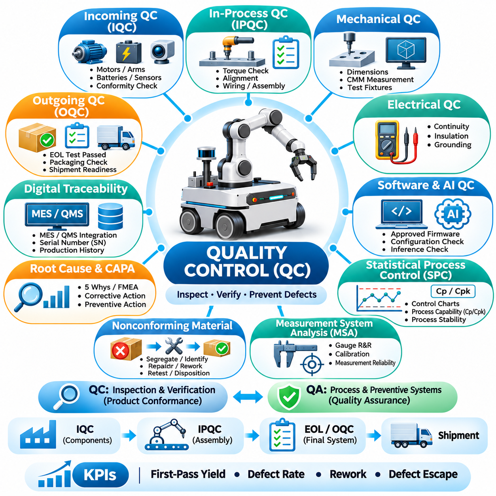{width="7.268055555555556in" height="7.268055555555556in"}

품질 관리(Quality Control, QC)는 모바일 매니퓰레이터(Mobile Manipulator)가 승인된 엔지니어링 사양(Approved Engineering Specification), 기능적 요구사항(Functional Requirement) 및 제조 인수 기준(Manufacturing Acceptance Criteria)을 일관되게 충족하도록 보장하는 체계적인 제조 관리 분야(Manufacturing Discipline)이다. 이는 자재 검사(Material Inspection), 공정 모니터링(Process Monitoring), 치수 검증(Dimensional Verification), 기능 시험(Functional Testing) 및 결함 관리(Defect Management)를 포함한다. 주요 목적은 제조 결함(Manufacturing Defect)을 예방하고 생산 공정 전반에 걸쳐 일관된 제품 품질(Consistent Product Quality)을 유지하는 것이다.

품질 목표(Quality Objective)를 달성하기 위한 조직적 프로세스(Organizational Process)와 예방적 프레임워크(Preventive Framework)를 수립하는 품질 보증(Quality Assurance, QA)과 달리, 품질 관리는 실제 제조된 제품에 대한 검사(Inspection)와 검증(Verification)에 중점을 둔다. 이러한 두 분야는 상호 보완적이며 신뢰성 높은 로봇 시스템 제조(Reliable Robotic System Manufacturing)에 필수적이다. 효과적인 품질 관리는 제조 공정(Manufacturing Process)이 적합 제품(Conforming Product)을 생산한다는 측정 가능한 증거(Measurable Evidence)를 제공한다.

품질 관리 계획(Quality Control Planning)은 핵심 제품 특성(Critical Product Characteristic), 검사 방법(Inspection Method), 측정 장비(Measurement Equipment), 샘플링 빈도(Sampling Frequency), 인수 기준(Acceptance Criteria) 및 담당 인력(Responsible Personnel)을 식별해야 한다. 제조 품질 관리 계획(Manufacturing Quality Control Plan)은 부품 조달(Component Procurement), 하위 조립체 생산(Subassembly Production), 시스템 통합(System Integration) 및 최종 검증(Final Verification) 전반에 걸쳐 검사 지점(Inspection Checkpoint)을 수립한다. 검사 요구사항(Inspection Requirement)은 승인된 엔지니어링 사양과의 추적성(Traceability)을 유지해야 한다.

입고 품질 관리(Incoming Quality Control, IQC)는 외부에서 조달된 부품(Externally Sourced Component)이 제조 공정에 투입되기 전에 품질과 적합성(Conformity)을 검증한다. 구동 모터(Drive Motor), 로봇 팔(Robotic Arm), 배터리(Battery), 전자 제어기(Electronic Controller), 센서(Sensor), 구조 부품(Structural Component) 및 와이어링 하네스(Wiring Harness)는 기능적 중요도(Functional Importance)와 관련 위험(Associated Risk)에 따라 적절한 검사를 받아야 한다. 공급업체 검사 기록(Supplier Inspection Record)과 부품 추적성(Component Traceability)은 효과적인 입고 품질 관리(Incoming Quality Management)를 지원한다.

공정 중 품질 관리(In-Process Quality Control, IPQC)는 제조 작업(Manufacturing Operation)과 조립 활동(Assembly Activity)을 모니터링하여 편차(Deviation)가 후속 생산 단계(Subsequent Production Stage)로 전파되기 전에 이를 식별한다. 핵심 검사 항목(Critical Inspection Item)에는 치수 공차(Dimensional Tolerance), 체결 토크(Fastening Torque), 전기적 연결(Electrical Connection), 부품 방향(Component Orientation), 센서 정렬(Sensor Alignment) 및 조립 완전성(Assembly Completeness)이 포함될 수 있다. 조기 결함 검출(Early Defect Detection)은 재작업 비용(Rework Cost)을 줄이고 제조 자원(Manufacturing Resource)의 불필요한 소비를 방지한다.

기계적 품질 관리(Mechanical Quality Control)는 구조적 건전성(Structural Integrity), 치수 정확도(Dimensional Accuracy), 표면 상태(Surface Condition), 재료 적합성(Material Conformity) 및 조립 일관성(Assembly Consistency)을 평가한다. 3차원 좌표 측정기(Coordinate Measuring Machine, CMM), 교정된 측정 계측기(Calibrated Measurement Instrument), 검사 게이지(Inspection Gauge) 및 전용 시험 치구(Dedicated Test Fixture)는 객관적인 측정(Objective Measurement)을 지원한다. 이동 플랫폼(Mobile Platform), 로봇 팔 및 말단 장치(End Effector) 간의 핵심 기계적 인터페이스(Critical Mechanical Interface)는 시스템 안정성(System Stability)과 위치 결정 정확도(Positioning Accuracy)를 유지하기 위해 특별한 주의가 요구된다.

전기적 품질 관리(Electrical Quality Control)는 전력 분배 시스템(Power Distribution System), 와이어링 하네스, 전기 인터페이스(Electrical Interface), 통신 네트워크(Communication Network) 및 보호 회로(Protective Circuit)가 올바르게 구현되었는지 검증한다. 검사 절차(Inspection Procedure)는 커넥터 설치(Connector Installation), 전기적 도통(Electrical Continuity), 절연 저항(Insulation Resistance), 접지 건전성(Grounding Integrity) 및 케이블 배치(Cable Routing)를 평가해야 한다. 장비 손상(Equipment Damage)과 안전 위험(Safety Hazard)을 방지하기 위해 제한 없는 시스템 작동(Unrestricted System Operation) 이전에 전기적 결함(Electrical Defect)을 식별하고 수정해야 한다.

소프트웨어 및 인공지능 품질 관리(Software and Artificial Intelligence Quality Control)는 제조된 모바일 매니퓰레이터에 승인된 소프트웨어 릴리스(Approved Software Release), 펌웨어 버전(Firmware Version), 구성 매개변수(Configuration Parameter) 및 인공지능 모델 산출물(AI Model Artifact)이 포함되도록 보장한다. 자동화된 검사 절차(Automated Inspection Procedure)는 소프트웨어 무결성(Software Integrity), 시스템 초기화(System Initialization), 장치 통신(Device Communication) 및 대표적인 추론 동작(Representative Inference Behavior)을 검증해야 한다. 형상 관리(Configuration Management)는 승인되지 않은 변경(Unauthorized Modification)을 방지하고 생산 제품 전반에 걸쳐 일관성을 유지한다.

통계적 공정 관리(Statistical Process Control, SPC)는 제조 공정의 안정성(Manufacturing Process Stability)을 모니터링하고 비정상적인 변동(Abnormal Variation)을 식별하기 위한 정량적 방법론(Quantitative Methodology)을 제공한다. 관리도(Control Chart), 공정 능력 지수(Process Capability Index) 및 통계적 분포 분석(Statistical Distribution Analysis)은 핵심 제조 특성(Critical Manufacturing Characteristic)에 대한 평가를 지원한다. 공정 능력 지수(Process Capability Indices, Cp and Cpk)는 안정적인 제조 공정이 지정된 공차 한계(Specified Tolerance Limit) 내에서 일관되게 운영될 수 있는지 판단하는 데 기여한다.

측정 시스템 분석(Measurement System Analysis, MSA)은 제조 검사(Manufacturing Inspection) 과정에서 사용되는 측정 공정(Measurement Process)의 적합성(Suitability)과 신뢰성(Reliability)을 평가한다. 측정기 반복성 및 재현성 분석(Gauge Repeatability and Reproducibility, Gauge R&R)은 장비 및 작업자와 관련된 측정 변동(Measurement Variation)을 정량화한다. 정기적인 교정(Regular Calibration), 기준 표준 검증(Reference Standard Verification) 및 통제된 환경 조건(Controlled Environmental Condition)은 측정 정확도(Measurement Accuracy)와 품질 관리 의사결정(Quality Control Decision)에 대한 신뢰성을 유지하는 데 기여한다.

부적합 자재 관리(Nonconforming Material Control)는 제조 인수 기준을 충족하지 못하는 부품 또는 시스템을 식별(Identification), 분리(Segregation), 문서화(Documentation) 및 평가(Evaluation)하기 위한 표준화된 절차(Standardized Procedure)를 수립한다. 부적합 제품(Nonconforming Product)이 통제되지 않은 생산 활동(Uncontrolled Production Activity)을 통해 후속 단계로 진행되지 않도록 방지해야 한다. 승인된 처리 결정(Authorized Disposition Decision)에는 재작업(Rework), 수리(Repair), 공급업체 반품(Supplier Return), 불합격 처리(Rejection) 또는 적용 가능한 요구사항이 허용하는 경우 승인된 특채(Approved Concession)가 포함될 수 있다.

근본 원인 분석(Root Cause Analysis, RCA)과 시정 및 예방 조치(Corrective and Preventive Action, CAPA)는 제조 결함을 조사하고 재발(Recurrence)을 방지하기 위한 체계적인 방법론(Systematic Methodology)을 제공한다. 5단계 원인 분석(Five Whys), 특성 요인도(Fishbone Diagram), 파레토 분석(Pareto Analysis) 및 고장 형태 및 영향 분석(Failure Mode and Effects Analysis, FMEA)과 같은 기법은 구조화된 조사(Structured Investigation)를 지원한다. 품질 관련 문제(Quality-Related Issue)가 공식적으로 종결되기 전에 시정조치(Corrective Action)의 효과성(Effectiveness)이 검증되어야 한다.

디지털 품질 관리(Digital Quality Control)는 검사 결과(Inspection Result), 측정 데이터(Measurement Data), 부품 추적성, 제조 매개변수(Manufacturing Parameter) 및 부적합 기록(Nonconformity Record)을 중앙집중식 정보 시스템(Centralized Information System) 내에서 통합한다. 품질 관리 시스템(Quality Management System, QMS)과 제조 실행 시스템(Manufacturing Execution System, MES)은 로봇 일련번호(Robot Serial Number)와 생산 이력(Production History) 간의 추적성을 확보할 수 있도록 한다. 자동화된 데이터 분석(Automated Data Analysis)은 결함 추세 식별(Defect Trend Identification), 공정 최적화(Process Optimization) 및 제조 품질 개선(Manufacturing Quality Improvement)을 지원한다.

출하 품질 관리(Outgoing Quality Control, OQC)는 제조된 모바일 매니퓰레이터의 출하가 승인되기 전에 수행되는 최종 품질 검증 활동(Final Quality Verification Activity)이다. 검사 담당자(Inspection Personnel)는 생산라인 종료 시험(End-of-Line Testing, EOL Testing)의 성공적인 완료, 제품 형상(Product Configuration), 문서 완전성(Documentation Completeness), 라벨 정확성(Labeling Accuracy), 포장 상태(Packaging Condition) 및 포함된 부속품(Included Accessory)을 확인해야 한다. 최종 출하 승인(Final Shipment Authorization)은 모든 필수 품질 및 안전 요구사항(Mandatory Quality and Safety Requirement)이 충족되었음을 보장해야 한다.

품질 관리의 효과성(Quality Control Effectiveness)은 최초 합격률(First-Pass Yield, FPY), 백만 기회당 결함 수(Defects Per Million Opportunities, DPMO), 불합격률(Rejection Rate), 재작업 비용(Rework Cost), 고객 반품률(Customer Return Rate) 및 결함 유출률(Defect Escape Rate)을 포함하는 핵심 성과 지표(Key Performance Indicator, KPI)를 통해 평가되어야 한다. 제조 및 현장 품질 데이터(Manufacturing and Field Quality Data)를 기반으로 하는 지속적인 개선(Continuous Improvement)은 공정 안정성(Process Stability)과 제품 신뢰성(Product Reliability)을 강화한다. 궁극적으로 체계적인 품질 관리는 비용 최적화(Cost Optimization), 확장 가능한 생산(Scalable Production) 및 지속 가능한 모바일 매니퓰레이터 상용화(Sustainable Mobile Manipulator Commercialization)를 지원한다.

## 10 Cost Optimization

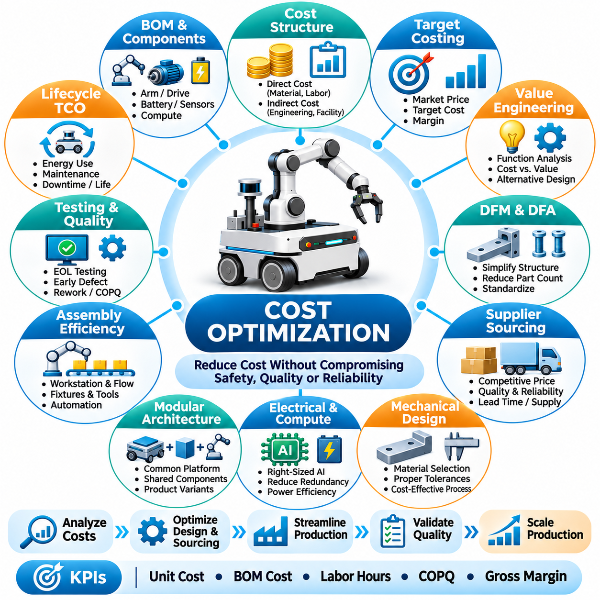{width="7.268055555555556in" height="7.268055555555556in"}

비용 최적화(Cost Optimization)는 기능적 성능(Functional Performance), 제품 품질(Product Quality), 운영 신뢰성(Operational Reliability) 및 안전성(Safety)을 유지하면서 모바일 매니퓰레이터(Mobile Manipulator)의 총비용(Total Cost)을 절감하기 위한 체계적인 제조 공학 활동(Manufacturing Engineering Activity)이다. 이는 부품 선정(Component Selection), 기계 설계(Mechanical Design), 공급업체 관리(Supplier Management), 조립 공정(Assembly Process), 시험 절차(Testing Procedure) 및 수명주기 비용(Lifecycle Expense)을 포함한다. 주요 목적은 상업적 경쟁력(Commercial Competitiveness)과 제조 수익성(Manufacturing Profitability)을 향상시키는 것이다.

제조 비용 분석(Manufacturing Cost Analysis)은 로봇 시스템 생산과 관련된 직접비(Direct Cost)와 간접비(Indirect Cost)에 대한 종합적인 평가로부터 시작되어야 한다. 직접비에는 자재(Material), 구매 부품(Purchased Component), 조립 인건비(Assembly Labor Cost) 및 생산 장비 사용 비용(Production Equipment Usage Cost)이 포함된다. 간접비에는 엔지니어링 지원(Engineering Support), 시설 운영(Facility Operation), 품질 관리(Quality Management), 재고 취급(Inventory Handling), 물류(Logistics) 및 관리 간접비(Administrative Overhead)가 포함된다. 이러한 비용 구조(Cost Structure)에 대한 이해는 효과적인 비용 최적화를 가능하게 한다.

자재 명세서 비용 최적화(Bill of Materials Cost Optimization, BOM Cost Optimization)는 고가 부품(Expensive Component)을 식별하고 엔지니어링 요구사항(Engineering Requirement)을 저하시키지 않으면서 비용을 절감할 수 있는 기회를 평가하는 데 중점을 둔다. 로봇 팔(Robotic Arm), 구동 모듈(Drive Module), 배터리(Battery), 인지 센서(Perception Sensor), 임베디드 컴퓨팅 플랫폼(Embedded Computing Platform) 및 안전 장치(Safety Device)는 일반적으로 주요 비용 구성 요소(Significant Cost Contributor)에 해당한다. 대체 부품(Alternative Component)은 기능 사양(Functional Specification), 신뢰성(Reliability), 호환성(Compatibility) 및 수명주기 요구사항(Lifecycle Requirement)을 기준으로 평가되어야 한다.

목표 원가 관리(Target Costing)는 예상 시장 가격(Anticipated Market Price), 예상 판매량(Expected Sales Volume) 및 목표 이익률(Desired Profit Margin)을 기반으로 허용 가능한 제조 원가 목표(Manufacturing Cost Objective)를 수립한다. 제품 개발(Product Development) 과정에서 원가 목표(Cost Target)는 기계적, 전기적, 전자적 및 소프트웨어 하위 시스템(Software Subsystem)에 각각 배분되어야 한다. 추정 제조 원가(Estimated Manufacturing Cost)와 실제 제조 원가(Actual Manufacturing Cost)에 대한 지속적인 모니터링(Continuous Monitoring)은 엔지니어링팀이 예산 편차(Budget Deviation)를 식별하고 적절한 설계 개선(Design Improvement)을 수행할 수 있도록 한다.

가치 공학(Value Engineering, VE)은 부품 기능성(Component Functionality), 제조 원가(Manufacturing Cost) 및 고객 가치(Customer Value) 간의 관계를 평가하기 위한 구조화된 방법론(Structured Methodology)을 제공한다. 불필요한 복잡성(Unnecessary Complexity)을 증가시키거나 운영 요구사항(Operational Requirement)을 초과하는 과도한 성능(Excessive Performance)을 제공하는 부품은 체계적으로 검토되어야 한다. 기능 분석(Functional Analysis)은 엔지니어링팀이 대체 재료(Alternative Material), 단순화된 구조(Simplified Structure) 및 경제적으로 효율적인 시스템 구성(Economically Efficient System Configuration)을 식별할 수 있도록 한다.

제조 용이성 설계(Design for Manufacturing, DFM)와 조립 용이성 설계(Design for Assembly, DFA)는 제조 복잡성(Manufacturing Complexity), 부품 수량(Component Quantity), 조립 작업(Assembly Operation) 및 생산 편차(Production Variability)를 줄임으로써 비용 최적화에 기여한다. 표준화된 체결 방식(Standardized Fastening Method), 단순화된 기계 구조(Simplified Mechanical Structure), 접근성이 높은 설치 인터페이스(Accessible Installation Interface) 및 모듈형 조립체(Modular Assembly)는 인력 요구량(Labor Requirement)을 줄인다. 이러한 설계 개선은 제조 결함(Manufacturing Defect)과 후속 재작업 비용(Rework Expense)을 최소화하는 데에도 기여한다.

공급업체 비용 최적화(Supplier Cost Optimization)는 조달 가격(Procurement Price), 부품 품질(Component Quality), 납품 신뢰성(Delivery Reliability), 생산 능력(Production Capacity) 및 장기적인 상업적 관계(Long-Term Commercial Relationship)를 평가하는 것을 포함한다. 경쟁적 조달(Competitive Sourcing), 구매 물량 기반 계약(Volume-Based Purchasing Agreement), 공급업체 통합(Supplier Consolidation) 및 현지화 전략(Localization Strategy)은 조달 비용(Procurement Expense)을 절감할 수 있다. 그러나 구매 의사결정(Purchasing Decision)은 단순히 최저 부품 가격(Lowest Component Price)에만 집중하기보다는 총취득비용(Total Acquisition Cost)을 고려해야 한다.

기계 제조 비용 최적화(Mechanical Manufacturing Cost Optimization)는 적절한 재료(Material), 제작 기술(Fabrication Technology), 가공 공차(Machining Tolerance) 및 구조적 구성(Structural Configuration)의 선정을 요구한다. 판금 가공(Sheet Metal Fabrication), 용접(Welding), 압출(Extrusion), 주조(Casting) 및 정밀 가공(Precision Machining)은 생산량(Production Volume)과 기능적 요구사항(Functional Requirement)에 따라 평가되어야 한다. 지나치게 엄격한 공차(Excessively Restrictive Tolerance)와 불필요한 가공 작업(Unnecessary Machining Operation)은 반드시 시스템 성능(System Performance)을 향상시키는 것은 아니면서 생산 비용(Production Cost)을 증가시킨다.

전기 및 컴퓨팅 아키텍처 최적화(Electrical and Computing Architecture Optimization)는 불필요한 하드웨어 중복(Hardware Redundancy), 배선 복잡성(Wiring Complexity), 전력 소비(Power Consumption) 및 과도한 연산 용량(Computational Capacity)을 줄이는 데 중점을 둔다. 표준화된 와이어링 하네스(Standardized Wiring Harness), 통합 제어기(Integrated Controller), 공통 통신 인터페이스(Common Communication Interface) 및 적절한 용량의 컴퓨팅 플랫폼(Appropriately Sized Computing Platform)은 제조 비용을 절감할 수 있다. 컴퓨팅 자원(Computing Resource)은 측정된 인공지능 추론 작업 부하(AI Inference Workload)와 실시간 제어 요구사항(Real-Time Control Requirement)에 따라 선정되어야 한다.

모듈형 제품 아키텍처(Modular Product Architecture)는 부품 표준화(Component Standardization), 공통 플랫폼 개발(Common Platform Development) 및 재사용 가능한 하위 시스템 구성(Reusable Subsystem Configuration)을 통해 비용 절감을 가능하게 한다. 서로 다른 모바일 매니퓰레이터 모델은 구동 모듈, 배터리 시스템(Battery System), 전기 아키텍처(Electrical Architecture), 컴퓨팅 플랫폼 및 소프트웨어 프레임워크(Software Framework)를 공유할 수 있다. 부품 공용화(Component Commonality)의 확대는 구매 효율성(Purchasing Efficiency)을 향상시키고 재고 관리(Inventory Management)를 단순화하며 엔지니어링 및 유지보수 비용(Maintenance Expense)을 절감한다.

조립 공정 최적화(Assembly Process Optimization)는 작업 스테이션 배치(Workstation Layout), 조립 순서(Assembly Sequence), 자재 접근성(Material Accessibility) 및 생산라인 균형화(Production Line Balancing)를 개선함으로써 직접 인건비(Direct Labor Cost)를 절감한다. 전용 치구(Dedicated Fixture), 표준화된 작업 지침(Standardized Work Instruction) 및 선택적 자동화(Selective Automation)는 작업 효율성(Operational Efficiency)과 조립 반복성(Assembly Repeatability)을 향상시킨다. 제조 엔지니어(Manufacturing Engineer)는 예상 생산량, 인건비 절감액(Labor Saving), 장비 비용(Equipment Cost) 및 예상 투자 회수 기간(Anticipated Payback Period)을 기준으로 자동화 투자(Automation Investment)를 평가해야 한다.

생산 시험 및 품질 관리 최적화(Production Testing and Quality Control Optimization)는 필수 검증 범위(Essential Verification Coverage)를 축소하지 않으면서 검사 비용(Inspection Expense)을 최소화해야 한다. 자동화 시험 치구(Automated Test Fixture), 표준화된 교정 절차(Standardized Calibration Procedure) 및 통합 생산라인 종료 시험(Integrated End-of-Line Testing, EOL Testing)은 시험 사이클 시간(Testing Cycle Time)과 수동 개입(Manual Intervention)을 줄일 수 있다. 조기 결함 검출(Early Defect Detection)은 폐기(Scrap), 재작업(Rework), 품질 보증 청구(Warranty Claim), 제품 반품(Product Return) 및 현장 서비스 활동(Field Service Activity)을 포함하는 저품질 비용(Cost of Poor Quality, COPQ)도 감소시킨다.

총소유비용(Total Cost of Ownership, TCO)은 초기 제조 비용(Initial Manufacturing Expense)을 넘어 에너지 소비(Energy Consumption), 유지보수(Maintenance), 예비 부품(Spare Part), 소프트웨어 지원(Software Support), 장비 가동 중단 시간(Equipment Downtime) 및 최종 제품 폐기(Product Retirement)를 포함하도록 비용 분석의 범위를 확장한다. 저가 부품(Low-Cost Component)이 조기 고장(Premature Failure)이나 비효율적인 운영(Inefficient Operation)을 유발할 경우 수명주기 비용이 증가할 수 있다. 따라서 수명주기 비용 분석(Lifecycle Cost Analysis)은 제조 경제성(Manufacturing Economics)과 장기적인 고객 가치(Long-Term Customer Value)를 모두 고려하는 균형 잡힌 의사결정(Balanced Decision-Making)을 지원한다.

규모의 경제(Economies of Scale)는 조달 물량 증가(Increased Procurement Volume), 장비 활용도 향상(Improved Equipment Utilization), 표준화된 생산 공정(Standardized Production Process) 및 더 많은 생산 수량에 대한 고정비(Fixed Cost) 분산을 통해 제조 비용 절감을 가능하게 한다. 파일럿 생산 데이터(Pilot Production Data)는 단계적인 제조 규모 확대(Progressive Manufacturing Expansion)를 위한 현실적인 비용 모델(Realistic Cost Model)을 개발하는 데 활용되어야 한다. 생산량 예측(Production Volume Forecast)은 시장 수요(Market Demand), 재고 위험 노출(Inventory Exposure) 및 자본 투자 요구사항(Capital Investment Requirement)을 고려해야 한다.

비용 최적화의 효과성(Cost Optimization Effectiveness)은 단위당 제조 원가(Unit Manufacturing Cost), 자재 명세서 비용(BOM Cost), 조립 작업 시간(Assembly Labor Hour), 조달 비용 절감액(Procurement Saving), 저품질 비용(Cost of Poor Quality) 및 매출총이익률(Gross Profit Margin)을 포함하는 핵심 성과 지표(Key Performance Indicator, KPI)를 통해 평가되어야 한다. 지속적인 비용 분석(Continuous Cost Analysis)과 부서 간 엔지니어링 검토(Cross-Functional Engineering Review)는 지속 가능한 개선 기회(Sustainable Improvement Opportunity)를 식별하는 데 기여한다. 궁극적으로 체계적인 비용 최적화는 필수 성능(Essential Performance), 신뢰성 및 안전성을 저하시키지 않으면서 확장 가능한 양산(Scalable Mass Production)과 경제적으로 지속 가능한 모바일 매니퓰레이터 상용화(Economically Sustainable Mobile Manipulator Commercialization)를 지원한다.

## 11 Mass Production Ramp Up

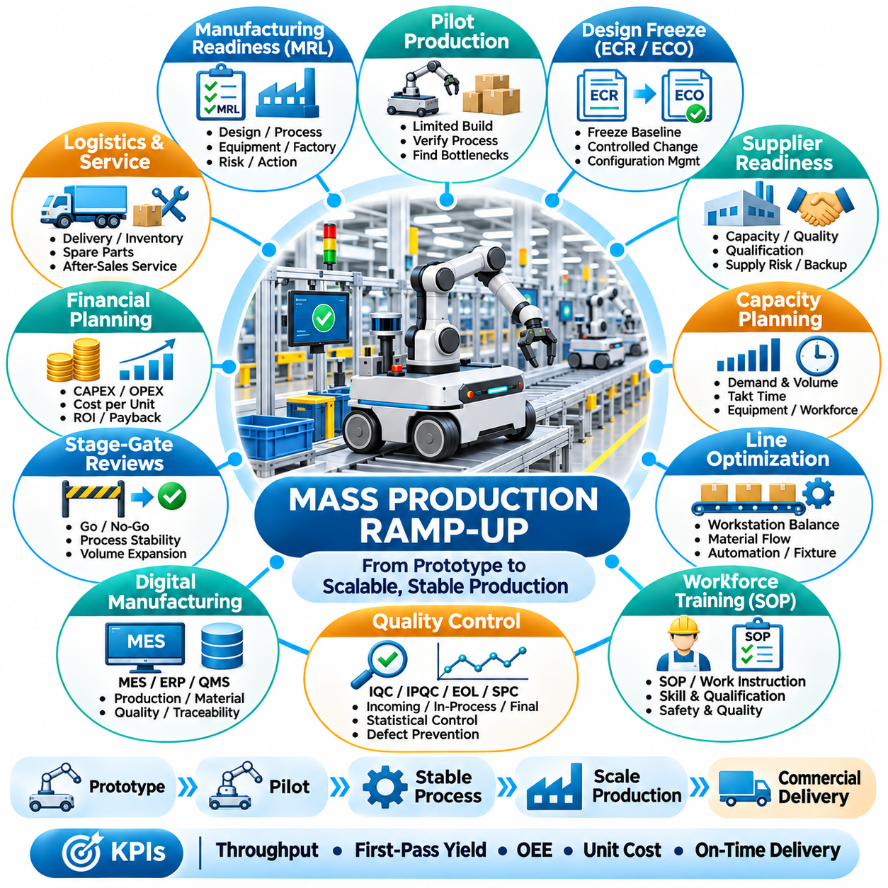{width="7.268055555555556in" height="7.268055555555556in"}

양산 확대(Mass Production Ramp-Up)는 검증된 모바일 매니퓰레이터(Mobile Manipulator)의 시제품(Prototype)과 파일럿 생산 제품(Pilot Production Unit)을 상업적으로 확장 가능한 제품(Commercially Scalable Product)으로 전환하는 구조화된 제조 전환 과정(Structured Manufacturing Transition)이다. 이는 제조 생산 능력(Manufacturing Capacity), 작업 인력 역량(Workforce Capability), 공급업체 네트워크(Supplier Network), 조립 작업(Assembly Operation) 및 품질 관리 시스템(Quality Control System)의 단계적 확대를 포함한다. 주요 목적은 일관된 제품 품질(Product Quality)과 제조 효율성(Manufacturing Efficiency)을 유지하면서 안정적인 생산량(Stable Production Volume)을 확보하는 것이다.

시제품 개발(Prototype Development)에서 양산(Mass Production)으로의 전환은 엔지니어링 및 제조 우선순위(Engineering and Manufacturing Priority)의 근본적인 변화를 요구한다. 시제품 개발은 기능적 실현 가능성(Functional Feasibility), 설계 유연성(Design Flexibility) 및 기술적 실험(Technical Experimentation)을 강조하는 반면, 양산은 반복성(Repeatability), 공정 안정성(Process Stability), 비용 효율성(Cost Efficiency) 및 제품 일관성(Product Consistency)을 강조한다. 엔지니어링팀은 제조 생산량을 크게 확대하기 전에 핵심 설계 불확실성(Critical Design Uncertainty)을 해결해야 한다.

제조 준비도 평가(Manufacturing Readiness Assessment)는 제품 설계 성숙도(Product Design Maturity), 부품 가용성(Component Availability), 공급업체 역량(Supplier Capability), 조립 절차(Assembly Procedure), 생산 장비(Production Equipment) 및 품질 관리 시스템(Quality Management System)을 평가해야 한다. 제조 준비도 수준(Manufacturing Readiness Level, MRL)은 생산 성숙도(Production Maturity)를 평가하기 위한 구조화된 프레임워크(Structured Framework)를 제공한다. 식별된 제조 위험(Manufacturing Risk)은 후속 생산 단계(Subsequent Production Stage)로 진행하기 전에 문서화된 시정조치(Documented Corrective Action)를 통해 해결되어야 한다.

파일럿 생산(Pilot Production)은 시제품 제작(Prototype Fabrication)과 상업적 양산(Commercial Mass Production) 사이의 중간 제조 단계(Intermediate Manufacturing Stage)를 의미한다. 제한된 생산 수량(Limited Production Quantity)은 제조 엔지니어(Manufacturing Engineer)가 조립 순서(Assembly Sequence), 제조 치공구의 효과성(Tooling Effectiveness), 장비 성능(Equipment Performance), 작업 인력 역량 및 부품 일관성(Component Consistency)을 평가할 수 있도록 한다. 파일럿 생산 결과(Pilot Production Result)는 제조 병목 현상(Manufacturing Bottleneck)을 식별하고 현실적인 생산 능력 목표(Production Capacity Target)를 수립하기 위한 필수 정보를 제공한다.

설계 동결(Design Freeze)과 형상 관리(Configuration Management)는 통제된 양산 확대를 위한 필수 선행 조건(Essential Prerequisite)이다. 승인된 기계 도면(Approved Mechanical Drawing), 전기 회로도(Electrical Schematic), 제조 자재 명세서(Manufacturing Bill of Materials, MBOM), 소프트웨어 릴리스(Software Release) 및 조립 지침(Assembly Instruction)은 일관된 생산 기준선(Production Baseline)을 수립해야 한다. 이후의 변경 사항은 통제되지 않은 제품 편차(Uncontrolled Product Variation)를 방지하기 위해 공식적인 엔지니어링 변경 요청(Engineering Change Request, ECR)과 엔지니어링 변경 지시(Engineering Change Order, ECO)를 통해 관리되어야 한다.

제조 생산량이 증가함에 따라 공급업체 준비도(Supplier Readiness)는 더욱 중요해진다. 로봇 팔(Robotic Arm), 구동 모듈(Drive Module), 배터리(Battery), 인지 센서(Perception Sensor), 임베디드 컴퓨터(Embedded Computer) 및 안전 장치(Safety Device)의 공급업체는 충분한 생산 능력(Adequate Production Capacity)과 일관된 부품 품질(Consistent Component Quality)을 입증해야 한다. 장기 조달 계약(Long-Term Procurement Agreement), 공급업체 적격성 평가(Supplier Qualification), 대체 조달 전략(Alternative Sourcing Strategy) 및 재고 계획(Inventory Planning)은 자재 부족(Material Shortage)과 공급 중단(Supply Disruption)을 최소화하는 데 기여한다.

생산 능력 계획(Production Capacity Planning)은 예상 시장 수요(Anticipated Market Demand)를 충족하는 데 필요한 작업 인력(Workforce), 장비(Equipment), 시설(Facility), 제조 자원(Manufacturing Resource) 및 운영 일정(Operating Schedule)을 결정한다. 생산 엔지니어(Production Engineer)는 작업 스테이션 생산 능력(Workstation Capacity), 택트 타임(Takt Time), 조립 사이클 시간(Assembly Cycle Time), 장비 활용도(Equipment Utilization) 및 자재 가용성(Material Availability)을 평가해야 한다. 점진적인 생산 능력 확대(Gradual Capacity Expansion)는 불필요한 자본 투자(Capital Investment)를 줄이는 동시에 추가적인 규모 확대 이전에 제조 공정이 안정화될 수 있도록 한다.

양산 확대 과정에서의 생산라인 최적화(Production Line Optimization)는 조립 작업의 균형화(Assembly Operation Balancing), 제조 병목 현상 감소, 자재 흐름(Material Flow) 개선 및 불필요한 생산 지연(Production Delay)의 최소화에 중점을 둔다. 표준화된 작업 스테이션(Standardized Workstation), 모듈형 조립 공정(Modular Assembly Process), 전용 치구(Dedicated Fixture) 및 선택적 자동화(Selective Automation)는 제조 효율성 향상에 기여한다. 실제 생산 데이터(Actual Production Data)에 대한 지속적인 분석은 엔지니어링팀이 작업 스테이션 구성(Workstation Configuration)과 자원 배분(Resource Allocation)을 개선할 수 있도록 한다.

작업 인력 개발(Workforce Development)은 확장 가능한 모바일 매니퓰레이터 제조(Scalable Mobile Manipulator Manufacturing)를 위한 핵심 요구사항(Critical Requirement)이다. 생산 인력(Production Personnel)은 기계 조립(Mechanical Assembly), 전기 시스템 통합(Electrical Integration), 소프트웨어 설치(Software Installation), 시스템 교정(System Calibration), 생산 시험(Production Testing) 및 안전 절차(Safety Procedure)에 대한 체계적인 교육(Structured Training)을 받아야 한다. 표준 작업 절차(Standard Operating Procedure, SOP), 역량 평가(Competency Assessment) 및 작업자 자격 인증 프로그램(Operator Qualification Program)은 작업 인력 규모가 확대됨에 따라 제조 일관성(Manufacturing Consistency)을 유지하는 데 기여한다.

품질 관리 시스템은 생산량 증가로 인해 결함률(Defect Rate)이 높아지는 것을 방지하기 위해 제조 생산 능력과 함께 확대되어야 한다. 입고 품질 관리(Incoming Quality Control, IQC), 공정 중 품질 관리(In-Process Quality Control, IPQC) 및 생산라인 종료 시험(End-of-Line Testing, EOL Testing)은 표준화된 제조 절차(Standardized Manufacturing Procedure) 내에서 운영되어야 한다. 통계적 공정 관리(Statistical Process Control, SPC)는 공정 불안정성(Process Instability)의 조기 검출(Early Detection)을 가능하게 하며 체계적인 제조 품질 개선(Systematic Manufacturing Quality Improvement)을 지원한다.

디지털 제조 인프라(Digital Manufacturing Infrastructure)는 생산 일정 관리(Production Scheduling), 자재 관리(Material Management), 조립 지침(Assembly Instruction), 장비 모니터링(Equipment Monitoring) 및 품질 기록(Quality Record)을 통합함으로써 양산을 지원한다. 제조 실행 시스템(Manufacturing Execution System, MES), 전사적 자원 관리(Enterprise Resource Planning, ERP) 및 품질 관리 시스템(Quality Management System, QMS)은 상호 연계된 정보 흐름(Coordinated Information Flow)을 수립한다. 디지털 추적성(Digital Traceability)은 개별 로봇을 부품 이력(Component History) 및 승인된 생산 형상(Approved Production Configuration)과 연계할 수 있도록 한다.

양산 확대는 통제되지 않은 생산 수량 증가(Uncontrolled Production Quantity Increase)보다는 단계적인 제조 이정표(Progressive Manufacturing Milestone)에 따라 진행되어야 한다. 생산 단계 간의 전환은 입증된 공정 안정성(Demonstrated Process Stability), 허용 가능한 결함률(Acceptable Defect Rate), 공급업체 준비도 및 충분한 제조 생산 능력에 근거해야 한다. 단계별 승인 검토(Stage-Gate Review)는 생산 확대(Production Expansion)를 승인하거나 추가적인 시정조치(Additional Corrective Action)를 수행하기 위한 구조화된 의사결정 체계(Structured Decision Mechanism)를 제공한다.

양산 확대 과정에서의 재무 관리(Financial Management)는 자본적 지출(Capital Expenditure, CAPEX), 운영 비용(Operating Expense, OPEX), 조달 약정(Procurement Commitment), 재고 수준(Inventory Level) 및 운전자본(Working Capital)에 대한 신중한 모니터링을 요구한다. 생산량 증가는 규모의 경제(Economies of Scale)를 통해 단위당 제조 원가(Unit Manufacturing Cost)를 절감할 수 있지만, 과도한 생산 능력 확대(Excessive Capacity Expansion)는 재무적 위험 노출(Financial Exposure)을 발생시킬 수 있다. 따라서 제조 투자(Manufacturing Investment)는 검증된 시장 수요(Validated Market Demand) 및 현실적인 매출 예측(Realistic Revenue Forecast)과 일치하도록 관리되어야 한다.

양산 준비(Mass Production Preparation)는 확장 가능한 물류 체계(Scalable Logistics), 예비 부품 가용성(Spare Parts Availability), 기술 지원 역량(Technical Support Capability), 유지보수 절차(Maintenance Procedure) 및 품질 보증 관리 시스템(Warranty Management System)도 수립해야 한다. 제품 출하량(Product Shipment)의 증가는 운영 수명주기(Operational Lifecycle) 전반에 걸쳐 추가적인 책임(Additional Responsibility)을 발생시킨다. 제조(Manufacturing), 영업(Sales), 현장 배포(Deployment) 및 서비스 조직(Service Organization) 간의 협력은 상업적 사업 확대(Commercial Expansion)가 충분한 운영 자원(Operational Resource)에 의해 지속적으로 지원되도록 보장한다.

양산 확대의 효과성(Mass Production Ramp-Up Effectiveness)은 생산 처리량(Production Throughput), 최초 합격률(First-Pass Yield, FPY), 종합 설비 효율(Overall Equipment Effectiveness, OEE), 단위당 제조 원가(Unit Manufacturing Cost), 정시 납품률(On-Time Delivery, OTD) 및 고객 반품률(Customer Return Rate)을 포함하는 핵심 성과 지표(Key Performance Indicator, KPI)를 통해 평가되어야 한다. 제조 및 현장 성능 데이터(Manufacturing and Field Performance Data)를 기반으로 하는 지속적인 개선(Continuous Improvement)은 운영 안정성(Operational Stability)을 강화한다. 궁극적으로 체계적으로 통제된 생산 규모 확대(Controlled Production Scaling)는 신뢰성 높고 수익성이 있으며 지속 가능한 모바일 매니퓰레이터 상용화(Sustainable Mobile Manipulator Commercialization)를 위한 기반을 수립한다.

## 12 Global Supply Chain

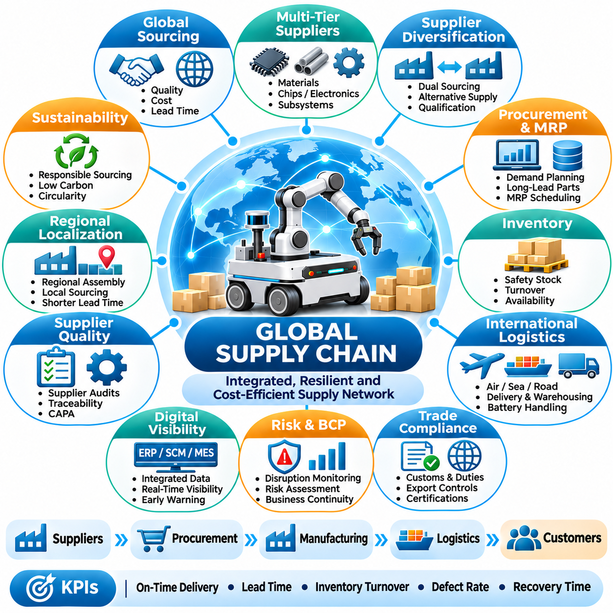{width="7.268055555555556in" height="7.268055555555556in"}

글로벌 공급망 관리(Global Supply Chain Management)는 부품과 완성된 모바일 매니퓰레이터(Mobile Manipulator)의 국제 조달(International Procurement), 생산(Production), 운송(Transportation), 보관(Storage) 및 유통(Distribution)을 조정하는 전략적 제조 관리 분야(Strategic Manufacturing Discipline)이다. 이는 부품 제조업체(Component Manufacturer), 기술 공급업체(Technology Supplier), 조립 시설(Assembly Facility), 물류 서비스 제공업체(Logistics Provider) 및 지역별 유통 네트워크(Regional Distribution Network)를 연결한다. 주요 목적은 공급 연속성(Supply Continuity), 비용 효율성(Cost Efficiency) 및 신뢰성 높은 제품 납품(Reliable Product Delivery)을 보장하는 것이다.

모바일 매니퓰레이터 제조는 기계 부품(Mechanical Component), 전자 장치(Electronic Device), 로봇 팔(Robotic Arm), 구동 모듈(Drive Module), 배터리(Battery), 인지 센서(Perception Sensor) 및 임베디드 컴퓨팅 플랫폼(Embedded Computing Platform)을 포함하는 복잡한 국제 공급 네트워크(International Supply Network)에 의존한다. 이러한 부품은 서로 다른 국가와 전문 제조 지역(Specialized Manufacturing Region)에서 생산될 수 있다. 효과적인 공급망 관리(Supply Chain Management)는 지리적 의존성(Geographical Dependency), 공급업체 역량(Supplier Capability) 및 조달 리드 타임(Procurement Lead Time)에 대한 종합적인 가시성(Comprehensive Visibility)을 요구한다.

글로벌 소싱 전략(Global Sourcing Strategy)은 기술적 역량(Technical Capability), 제조 품질(Manufacturing Quality), 생산 능력(Production Capacity), 조달 비용(Procurement Cost), 납품 신뢰성(Delivery Reliability) 및 지리적 위치(Geographical Location)를 기준으로 공급업체를 평가해야 한다. 공급업체 선정(Supplier Selection)은 운송 비용(Transportation Cost), 관세(Customs Duty), 재고 비용(Inventory Expense) 및 잠재적인 공급 중단(Potential Supply Disruption)을 포함하는 총취득비용(Total Acquisition Cost)을 고려해야 한다. 전략적 소싱(Strategic Sourcing)은 제조업체가 경제적 효율성(Economic Efficiency)과 운영 회복탄력성(Operational Resilience) 간의 균형을 확보할 수 있도록 한다.

다계층 공급망 관리(Multi-Tier Supply Chain Management)는 공급업체 가시성(Supplier Visibility)을 직접적인 부품 제조업체뿐만 아니라 상위 공급망의 원자재 생산업체(Upstream Material Producer), 반도체 제조업체(Semiconductor Manufacturer) 및 전문 하위 시스템 공급업체(Specialized Subsystem Supplier)까지 확장한다. 핵심 상위 공급업체(Critical Upstream Supplier)에 대한 의존성은 복수의 직접 공급업체(Direct Supplier)가 확보되어 있더라도 심각한 생산 취약성(Production Vulnerability)을 발생시킬 수 있다. 공급망 매핑(Supply Chain Mapping)은 숨겨진 의존성(Hidden Dependency)을 식별하고 잠재적인 자재 부족(Material Shortage)을 예측하는 데 기여한다.

공급업체 다변화(Supplier Diversification)는 개별 공급업체, 특정 지리적 지역(Geographical Region) 또는 운송 경로(Transportation Route)에 대한 과도한 의존성(Excessive Dependency)과 관련된 제조 위험(Manufacturing Risk)을 줄인다. 이중 조달(Dual Sourcing), 대체 부품 적격성 평가(Alternative Component Qualification) 및 지역 공급업체 개발(Regional Supplier Development)은 추가적인 조달 유연성(Procurement Flexibility)을 제공한다. 대체 공급업체(Alternative Supplier)는 생산에 참여하기 전에 승인된 엔지니어링 사양(Approved Engineering Specification), 품질 요구사항(Quality Requirement) 및 형상 관리 절차(Configuration Management Procedure)를 충족해야 한다.

글로벌 조달 계획(Global Procurement Planning)은 예상 생산량(Anticipated Production Volume), 공급업체 리드 타임(Supplier Lead Time), 최소 주문 수량(Minimum Order Quantity, MOQ), 자재 가용성(Material Availability) 및 재고 요구사항(Inventory Requirement) 간의 조정을 요구한다. 로봇 액추에이터(Robotic Actuator), 고성능 컴퓨팅 모듈(Advanced Computing Module), 정밀 센서(Precision Sensor) 및 특수 전자 장치(Specialized Electronic Device)와 같은 장기 조달 부품(Long-Lead Component)은 조기 조달 계획(Early Procurement Planning)을 필요로 한다. 정확한 수요 예측(Accurate Demand Forecasting)은 자재 부족, 과잉 재고(Excess Inventory) 및 긴급 구매 비용(Emergency Purchasing Expense)을 줄인다.

글로벌 공급망 내의 재고 관리(Inventory Management)는 자재 가용성, 운전자본 요구사항(Working Capital Requirement), 보관 비용(Storage Expense) 및 공급 중단 위험(Supply Disruption Risk) 간의 균형을 확보하는 것을 목표로 한다. 안전 재고 정책(Safety Stock Policy)은 부품 중요도(Component Criticality), 수요 변동성(Demand Variability), 공급업체 신뢰성(Supplier Reliability) 및 재고 보충 리드 타임(Replenishment Lead Time)을 반영해야 한다. 자재 소요량 계획(Material Requirements Planning, MRP)은 분산된 제조 시설(Distributed Manufacturing Facility) 전반에 걸쳐 조율된 조달 일정 관리(Procurement Scheduling)와 재고 보충(Inventory Replenishment)을 지원한다.

국제 물류 관리(International Logistics Management)는 운송 방식(Transportation Mode), 선적 일정(Shipping Schedule), 통관(Customs Clearance), 창고 관리(Warehousing) 및 지역별 유통 활동(Regional Distribution Activity)을 조정한다. 항공 화물 운송(Air Freight), 해상 화물 운송(Ocean Freight), 철도 운송(Railway Transportation) 및 도로 운송(Road Transportation)은 납품 긴급성(Delivery Urgency), 화물 특성(Shipment Characteristic) 및 운송 비용(Transportation Expense)에 따라 평가되어야 한다. 민감한 전자 장비(Sensitive Electronic Equipment), 로봇 조립체(Robotic Assembly) 및 리튬이온 배터리(Lithium-Ion Battery)에 대해서는 전문적인 취급 절차(Specialized Handling Procedure)가 요구된다.

글로벌 무역 규정 준수(Global Trade Compliance)는 제조업체가 적용 가능한 세관 규정(Customs Regulation), 수입 관세(Import Duty), 수출 통제(Export Control), 제품 인증 요구사항(Product Certification Requirement) 및 국제 운송 제한사항(International Transportation Restriction)에 대응하도록 요구한다. 고성능 컴퓨팅 하드웨어(Advanced Computing Hardware), 특수 센서(Specialized Sensor), 배터리 및 로봇 기술(Robotic Technology)은 관할 지역별 규정(Jurisdiction-Specific Regulation)의 적용을 받을 수 있다. 규정 준수 문서(Compliance Documentation)와 통제된 조달 절차(Controlled Procurement Procedure)는 규제 위험(Regulatory Risk)과 예상하지 못한 선적 지연(Unexpected Shipment Delay)을 줄이는 데 기여한다.

공급망 위험 관리(Supply Chain Risk Management)는 잠재적인 공급 중단을 식별(Identification), 평가(Evaluation), 모니터링(Monitoring) 및 완화(Mitigation)하기 위한 체계적인 절차(Systematic Procedure)를 수립한다. 관련 위험에는 지정학적 갈등(Geopolitical Conflict), 자연재해(Natural Disaster), 반도체 공급 부족(Semiconductor Shortage), 운송 중단(Transportation Interruption), 환율 변동(Currency Fluctuation) 및 공급업체의 재무적 불안정성(Supplier Financial Instability)이 포함된다. 사업 연속성 계획(Business Continuity Planning, BCP)과 시나리오 기반 위험성 평가(Scenario-Based Risk Assessment)는 불확실한 글로벌 환경에서 제조 회복탄력성(Manufacturing Resilience)을 지원한다.

디지털 공급망 관리(Digital Supply Chain Management)는 조달 정보(Procurement Information), 공급업체 성과 기록(Supplier Performance Record), 재고 현황(Inventory Status), 생산 일정(Production Schedule) 및 물류 데이터(Logistics Data)를 상호 연결된 정보 시스템(Interconnected Information System) 내에서 통합한다. 전사적 자원 관리(Enterprise Resource Planning, ERP), 공급망 관리(Supply Chain Management, SCM) 및 제조 실행 시스템(Manufacturing Execution System, MES)은 상호 조율된 의사결정(Coordinated Decision-Making)을 지원한다. 실시간 공급망 가시성(Real-Time Supply Chain Visibility)은 자재 부족과 납품 일정 편차(Delivery Deviation)의 조기 식별을 가능하게 한다.

공급업체 품질 관리(Supplier Quality Management)는 지리적으로 분산된 제조 시설(Geographically Distributed Manufacturing Facility)과 조달 네트워크(Procurement Network) 전반에 걸쳐 일관된 부품 품질(Consistent Component Quality)을 유지해야 한다. 공급업체 감사(Supplier Audit), 표준화된 검사 요구사항(Standardized Inspection Requirement), 자재 추적성(Material Traceability) 및 문서화된 시정조치(Documented Corrective Action)는 신뢰성 높은 부품 통합(Reliable Component Integration)을 지원한다. 엔지니어링 변경 통보(Engineering Change Notification)는 승인되지 않은 자재 대체(Unauthorized Material Substitution)와 호환되지 않는 부품 형상(Incompatible Component Configuration)을 방지하기 위해 체계적으로 전달되어야 한다.

지역별 제조(Regional Manufacturing) 및 현지화 전략(Localization Strategy)은 운송 비용을 절감하고 납품 리드 타임(Delivery Lead Time)을 단축하며 지역별 고객 요구사항(Regional Customer Requirement)에 대한 대응성(Responsiveness)을 향상시키고 지리적 공급 위험(Geographical Supply Risk)을 완화할 수 있다. 제조업체는 시장 수요(Market Demand), 인프라 가용성(Infrastructure Availability) 및 장기적인 제조 경제성(Long-Term Manufacturing Economics)에 따라 중앙집중식 생산(Centralized Production), 지역별 조립 시설(Regional Assembly Facility), 위탁 제조(Contract Manufacturing) 및 현지 부품 조달(Localized Component Sourcing)을 평가해야 한다.

지속 가능한 공급망 관리(Sustainable Supply Chain Management)는 환경적 영향(Environmental Impact), 책임 있는 자재 조달(Responsible Material Sourcing), 에너지 소비(Energy Consumption), 운송 과정의 배출량(Transportation Emission) 및 부품 수명주기 관리(Component Lifecycle Management)를 고려한다. 제조업체는 공급업체의 환경 관리 활동(Supplier Environmental Practice), 재료 재활용 가능성(Material Recyclability), 포장 효율성(Packaging Efficiency) 및 규제 준수(Regulatory Compliance)를 평가해야 한다. 책임 있는 조달(Responsible Sourcing)과 순환 경제 원칙(Circular Economy Principle)은 장기적인 제조 지속 가능성(Manufacturing Sustainability)과 기업의 책무성(Corporate Accountability)을 지원한다.

글로벌 공급망 성과(Global Supply Chain Performance)는 공급업체 정시 납품률(Supplier On-Time Delivery), 조달 리드 타임(Procurement Lead Time), 재고 회전율(Inventory Turnover), 공급업체 결함률(Supplier Defect Rate), 물류 비용(Logistics Cost) 및 공급 중단 복구 시간(Supply Disruption Recovery Time)을 포함하는 핵심 성과 지표(Key Performance Indicator, KPI)를 통해 평가되어야 한다. 공급업체 협력(Supplier Collaboration), 디지털 통합(Digital Integration) 및 위험 모니터링(Risk Monitoring)을 통한 지속적인 개선(Continuous Improvement)은 제조 경쟁력(Manufacturing Competitiveness)을 강화한다. 궁극적으로 회복탄력성을 갖춘 글로벌 공급망(Resilient Global Supply Chain)은 확장 가능한 양산(Scalable Mass Production)과 지속 가능한 모바일 매니퓰레이터 상용화(Sustainable Mobile Manipulator Commercialization)를 위한 기반을 수립한다.
