**Volume 05. Mobile Manipulator Projects and Development Manual**


# Chapter 09. Quality Assurance

##  

## 01 QA Framework

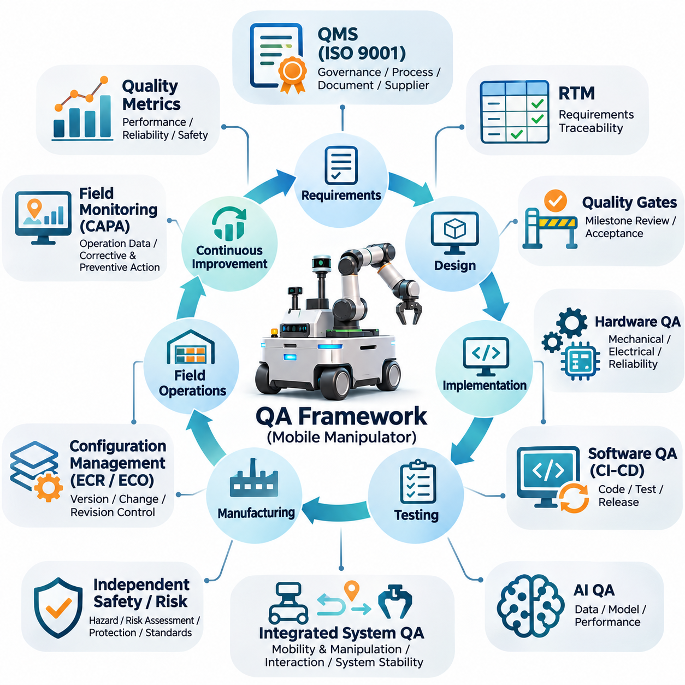{width="7.268055555555556in" height="7.268055555555556in"}

A Quality Assurance (QA) framework for mobile manipulator development establishes a systematic approach to ensuring product quality, operational reliability, functional safety, and engineering consistency throughout the product lifecycle. Unlike conventional industrial equipment, mobile manipulators integrate autonomous mobility, robotic manipulation, artificial intelligence, embedded computing, and distributed software, requiring a multidisciplinary quality management approach.

Quality assurance should be established during the initial stages of product development rather than introduced after prototype completion. Quality objectives must be derived from customer expectations, functional requirements, operational scenarios, regulatory obligations, and commercialization targets. Early quality planning reduces development uncertainty, minimizes expensive engineering modifications, and prevents systematic defects from propagating into manufacturing and field deployment.

The QA framework encompasses requirements verification, design verification, design validation, software quality assurance, artificial intelligence quality assurance, and safety compliance. These activities must operate within an integrated governance structure that defines engineering responsibilities, documentation requirements, approval authorities, and acceptance criteria. Each development activity should generate measurable evidence demonstrating compliance with established quality objectives.

A Quality Management System (QMS) provides the organizational foundation for implementing the QA framework. Principles established by ISO 9001 can support document management, process standardization, supplier qualification, risk assessment, and continuous improvement. The QMS should accommodate the unique characteristics of robotic systems while maintaining sufficient flexibility to support experimental research, prototype development, and commercial production.

Requirements traceability represents a fundamental component of quality assurance. Every customer requirement, functional specification, safety constraint, and performance target should be assigned a unique identifier and associated with corresponding design elements and verification activities. A Requirements Traceability Matrix (RTM) enables engineering teams to identify missing implementations, incomplete testing, and inconsistencies between development objectives and actual system capabilities.

Quality gates should be established at major development milestones, including requirements approval, architecture confirmation, prototype completion, system integration, field validation, and production readiness. Progression through each quality gate requires documented evidence that predefined acceptance criteria have been satisfied. Unresolved issues must undergo formal risk assessment, corrective action planning, and approval before subsequent development activities proceed.

Hardware quality assurance addresses mechanical structures, robotic manipulators, drive systems, electrical components, battery assemblies, sensors, and communication interfaces. Engineering reviews should evaluate structural integrity, mechanical tolerances, thermal behavior, electromagnetic compatibility, and component reliability. Supplier quality records and manufacturing inspection results must be maintained to ensure consistency across individual robotic platforms.

Software quality assurance focuses on architectural consistency, source code reliability, interface compatibility, execution stability, and cybersecurity. Development teams should establish coding standards, peer review procedures, static analysis, automated testing, and configuration management practices. Continuous Integration and Continuous Deployment (CI/CD) pipelines can provide systematic verification whenever software components or system dependencies are modified.

Artificial intelligence quality assurance requires additional mechanisms because learning-based algorithms exhibit statistical and context-dependent behavior. Training datasets, annotation quality, model architectures, hyperparameters, and evaluation procedures must be systematically controlled. AI models responsible for object detection, pose estimation, grasp prediction, and autonomous decision-making should demonstrate acceptable performance across representative operating conditions.

Integrated system quality assessment must address interactions between autonomous mobility and robotic manipulation. Accurate navigation does not necessarily guarantee successful manipulation, just as high manipulator repeatability does not eliminate positioning errors introduced by the mobile platform. Verification activities should therefore examine localization uncertainty, docking accuracy, coordinate transformations, vibration, communication latency, and combined system stability.

Safety assurance must remain an independent and mandatory element of the overall framework. Hazard identification, risk assessment, protective functions, emergency stopping, collision avoidance, and safe operating states should be evaluated throughout development. Applicable standards, including ISO 12100, ISO 3691-4, ISO 10218, and ISO 13849, should be selected according to the intended application, system configuration, and regulatory environment.

Configuration management ensures that quality evidence remains associated with the correct product configuration. Mechanical drawings, Bills of Materials (BOMs), firmware versions, software releases, AI model checkpoints, calibration parameters, and test reports should be maintained under controlled revision management. Engineering Change Requests (ECRs) and Engineering Change Orders (ECOs) provide formal mechanisms for evaluating and authorizing product modifications.

Field quality monitoring extends quality assurance beyond laboratory testing and manufacturing inspection. Operational telemetry, mission completion records, manipulation failures, maintenance histories, and customer feedback provide valuable evidence of real-world product behavior. Corrective and Preventive Action (CAPA) processes should transform recurring defects and operational incidents into systematic improvements in hardware, software, AI models, and engineering procedures.

The QA framework should ultimately establish a closed-loop quality management architecture connecting requirements, design, implementation, testing, manufacturing, and field operations. Quality metrics such as defect density, first-pass yield, mission success rate, failure frequency, and corrective action effectiveness enable objective evaluation. Through continuous improvement, organizations can advance mobile manipulators from experimental prototypes toward reliable, scalable, and commercially sustainable robotic products.

모바일 매니퓰레이터(Mobile Manipulator) 개발을 위한 품질 보증 프레임워크(Quality Assurance Framework, QA Framework)는 제품 수명주기(Product Lifecycle) 전반에 걸쳐 제품 품질(Product Quality), 운영 신뢰성(Operational Reliability), 기능 안전성(Functional Safety) 및 엔지니어링 일관성(Engineering Consistency)을 보장하기 위한 체계적인 접근 방식을 확립한다. 기존 산업 장비와 달리 모바일 매니퓰레이터는 자율 이동(Autonomous Mobility), 로봇 조작(Robotic Manipulation), 인공지능(Artificial Intelligence), 임베디드 컴퓨팅(Embedded Computing) 및 분산 소프트웨어(Distributed Software)를 통합하므로 다학제적 품질 관리 접근 방식(Multidisciplinary Quality Management Approach)이 필요하다.

품질 보증(Quality Assurance)은 프로토타입(Prototype)이 완성된 이후에 도입하는 것이 아니라 제품 개발(Product Development)의 초기 단계부터 확립해야 한다. 품질 목표(Quality Objectives)는 고객 기대사항(Customer Expectations), 기능 요구사항(Functional Requirements), 운영 시나리오(Operational Scenarios), 규제 의무사항(Regulatory Obligations) 및 상용화 목표(Commercialization Targets)를 기반으로 도출해야 한다. 초기 품질 계획(Early Quality Planning)은 개발 불확실성을 줄이고, 비용이 많이 발생하는 엔지니어링 변경을 최소화하며, 체계적 결함(Systematic Defects)이 제조 및 현장 배포 단계로 확산되는 것을 방지한다.

품질 보증 프레임워크(QA Framework)는 요구사항 검증(Requirements Verification), 설계 검증(Design Verification), 설계 유효성 확인(Design Validation), 소프트웨어 품질 보증(Software Quality Assurance), 인공지능 품질 보증(AI Quality Assurance) 및 안전 규정 준수(Safety Compliance)를 포함한다. 이러한 활동은 엔지니어링 책임, 문서화 요구사항, 승인 권한 및 인수 기준(Acceptance Criteria)을 정의하는 통합 거버넌스 구조(Integrated Governance Structure) 내에서 운영되어야 한다. 각각의 개발 활동은 수립된 품질 목표의 충족 여부를 입증할 수 있는 측정 가능한 증거(Measurable Evidence)를 생성해야 한다.

품질 관리 시스템(Quality Management System, QMS)은 품질 보증 프레임워크를 구현하기 위한 조직적 기반을 제공한다. ISO 9001에서 제시하는 원칙은 문서 관리(Document Management), 프로세스 표준화(Process Standardization), 공급업체 적격성 평가(Supplier Qualification), 위험 평가(Risk Assessment) 및 지속적 개선(Continuous Improvement)을 지원할 수 있다. 품질 관리 시스템은 로봇 시스템(Robotic System)의 고유한 특성을 수용하는 동시에 실험적 연구(Experimental Research), 프로토타입 개발(Prototype Development) 및 상용 생산(Commercial Production)을 지원할 수 있는 충분한 유연성을 유지해야 한다.

요구사항 추적성(Requirements Traceability)은 품질 보증의 핵심 구성 요소이다. 모든 고객 요구사항(Customer Requirements), 기능 사양(Functional Specifications), 안전 제약조건(Safety Constraints) 및 성능 목표(Performance Targets)에는 고유 식별자(Unique Identifier)를 부여하고 해당 설계 요소(Design Elements) 및 검증 활동(Verification Activities)과 연결해야 한다. 요구사항 추적성 매트릭스(Requirements Traceability Matrix, RTM)는 엔지니어링 팀이 누락된 구현 사항, 불완전한 시험 및 개발 목표와 실제 시스템 역량 사이의 불일치를 식별할 수 있도록 지원한다.

품질 게이트(Quality Gate)는 요구사항 승인(Requirements Approval), 아키텍처 확정(Architecture Confirmation), 프로토타입 완성(Prototype Completion), 시스템 통합(System Integration), 현장 유효성 확인(Field Validation) 및 생산 준비(Production Readiness)를 포함하는 주요 개발 마일스톤(Development Milestones)에 설정해야 한다. 각 품질 게이트를 통과하기 위해서는 사전에 정의된 인수 기준을 충족했음을 입증하는 문서화된 증거(Documented Evidence)가 필요하다. 해결되지 않은 문제는 후속 개발 활동을 진행하기 전에 공식적인 위험 평가, 시정 조치 계획(Corrective Action Planning) 및 승인 절차를 거쳐야 한다.

하드웨어 품질 보증(Hardware Quality Assurance)은 기계 구조물(Mechanical Structures), 로봇 매니퓰레이터(Robotic Manipulators), 구동 시스템(Drive Systems), 전기 부품(Electrical Components), 배터리 어셈블리(Battery Assemblies), 센서(Sensors) 및 통신 인터페이스(Communication Interfaces)를 대상으로 한다. 엔지니어링 검토(Engineering Review)는 구조적 무결성(Structural Integrity), 기계적 공차(Mechanical Tolerance), 열적 거동(Thermal Behavior), 전자기 적합성(Electromagnetic Compatibility, EMC) 및 부품 신뢰성(Component Reliability)을 평가해야 한다. 개별 로봇 플랫폼 간의 일관성을 보장하기 위해 공급업체 품질 기록과 제조 검사 결과를 유지해야 한다.

소프트웨어 품질 보증(Software Quality Assurance, SQA)은 아키텍처 일관성(Architectural Consistency), 소스 코드 신뢰성(Source Code Reliability), 인터페이스 호환성(Interface Compatibility), 실행 안정성(Execution Stability) 및 사이버 보안(Cybersecurity)에 중점을 둔다. 개발팀은 코딩 표준(Coding Standards), 동료 검토 절차(Peer Review Procedures), 정적 분석(Static Analysis), 자동화 시험(Automated Testing) 및 형상 관리(Configuration Management) 체계를 확립해야 한다. 지속적 통합 및 지속적 배포(Continuous Integration and Continuous Deployment, CI/CD) 파이프라인은 소프트웨어 구성 요소 또는 시스템 종속성이 변경될 때마다 체계적인 검증을 수행할 수 있도록 지원한다.

인공지능 품질 보증(AI Quality Assurance)은 학습 기반 알고리즘(Learning-Based Algorithms)이 통계적이며 상황 의존적인 동작 특성을 나타내기 때문에 추가적인 품질 보증 메커니즘을 필요로 한다. 학습 데이터셋(Training Datasets), 주석 품질(Annotation Quality), 모델 아키텍처(Model Architectures), 하이퍼파라미터(Hyperparameters) 및 평가 절차(Evaluation Procedures)는 체계적으로 관리해야 한다. 객체 검출(Object Detection), 자세 추정(Pose Estimation), 파지 예측(Grasp Prediction) 및 자율 의사결정(Autonomous Decision-Making)을 담당하는 인공지능 모델은 대표적인 운영 조건 전반에서 허용 가능한 성능을 입증해야 한다.

통합 시스템 품질 평가(Integrated System Quality Assessment)는 자율 이동과 로봇 조작 사이의 상호작용(Interaction)을 고려해야 한다. 정확한 자율주행(Navigation)이 반드시 성공적인 로봇 조작을 보장하는 것은 아니며, 매니퓰레이터의 높은 반복 정밀도(Repeatability) 역시 모바일 플랫폼에서 발생하는 위치 오차(Positioning Error)를 제거하지는 못한다. 따라서 검증 활동은 위치 추정 불확실성(Localization Uncertainty), 도킹 정확도(Docking Accuracy), 좌표 변환(Coordinate Transformation), 진동(Vibration), 통신 지연시간(Communication Latency) 및 통합 시스템 안정성(Combined System Stability)을 평가해야 한다.

안전 보증(Safety Assurance)은 전체 품질 보증 프레임워크에서 독립적이고 필수적인 요소로 유지되어야 한다. 위험원 식별(Hazard Identification), 위험 평가(Risk Assessment), 보호 기능(Protective Functions), 비상 정지(Emergency Stop), 충돌 회피(Collision Avoidance) 및 안전 운영 상태(Safe Operating States)는 개발 전 과정에서 평가해야 한다. ISO 12100, ISO 3691-4, ISO 10218 및 ISO 13849를 포함하는 적용 가능한 표준(Applicable Standards)은 의도된 적용 분야(Intended Application), 시스템 구성(System Configuration) 및 규제 환경(Regulatory Environment)에 따라 선정해야 한다.

형상 관리(Configuration Management)는 품질 증거(Quality Evidence)가 올바른 제품 구성(Product Configuration)과 연결된 상태로 유지되도록 보장한다. 기계 설계 도면(Mechanical Drawings), 자재 명세서(Bill of Materials, BOM), 펌웨어 버전(Firmware Versions), 소프트웨어 릴리스(Software Releases), 인공지능 모델 체크포인트(AI Model Checkpoints), 보정 파라미터(Calibration Parameters) 및 시험 보고서(Test Reports)는 통제된 개정 관리(Revision Management) 체계하에서 유지해야 한다. 엔지니어링 변경 요청(Engineering Change Request, ECR)과 엔지니어링 변경 지시(Engineering Change Order, ECO)는 제품 변경 사항을 평가하고 승인하기 위한 공식적인 메커니즘을 제공한다.

현장 품질 모니터링(Field Quality Monitoring)은 품질 보증의 범위를 실험실 시험(Laboratory Testing)과 제조 검사(Manufacturing Inspection) 이후까지 확장한다. 운영 원격 측정 데이터(Operational Telemetry), 임무 완료 기록(Mission Completion Records), 조작 실패(Manipulation Failures), 유지보수 이력(Maintenance Histories) 및 고객 피드백(Customer Feedback)은 실제 환경에서의 제품 동작을 평가하는 중요한 증거를 제공한다. 시정 및 예방 조치(Corrective and Preventive Action, CAPA) 프로세스는 반복적으로 발생하는 결함과 운영 사고를 하드웨어, 소프트웨어, 인공지능 모델 및 엔지니어링 절차의 체계적인 개선으로 전환해야 한다.

궁극적으로 품질 보증 프레임워크는 요구사항, 설계, 구현, 시험, 제조 및 현장 운영을 연결하는 폐루프 품질 관리 아키텍처(Closed-Loop Quality Management Architecture)를 확립해야 한다. 결함 밀도(Defect Density), 최초 통과 수율(First-Pass Yield, FPY), 임무 성공률(Mission Success Rate), 고장 발생 빈도(Failure Frequency) 및 시정 조치 효과성(Corrective Action Effectiveness)과 같은 품질 지표(Quality Metrics)는 객관적인 평가를 가능하게 한다. 조직은 지속적 개선(Continuous Improvement)을 통해 모바일 매니퓰레이터를 실험적 프로토타입에서 높은 신뢰성(Reliability), 확장성(Scalability) 및 상업적 지속 가능성(Commercial Sustainability)을 갖춘 로봇 제품으로 발전시킬 수 있다.

##  

## 02 Requirement Verification

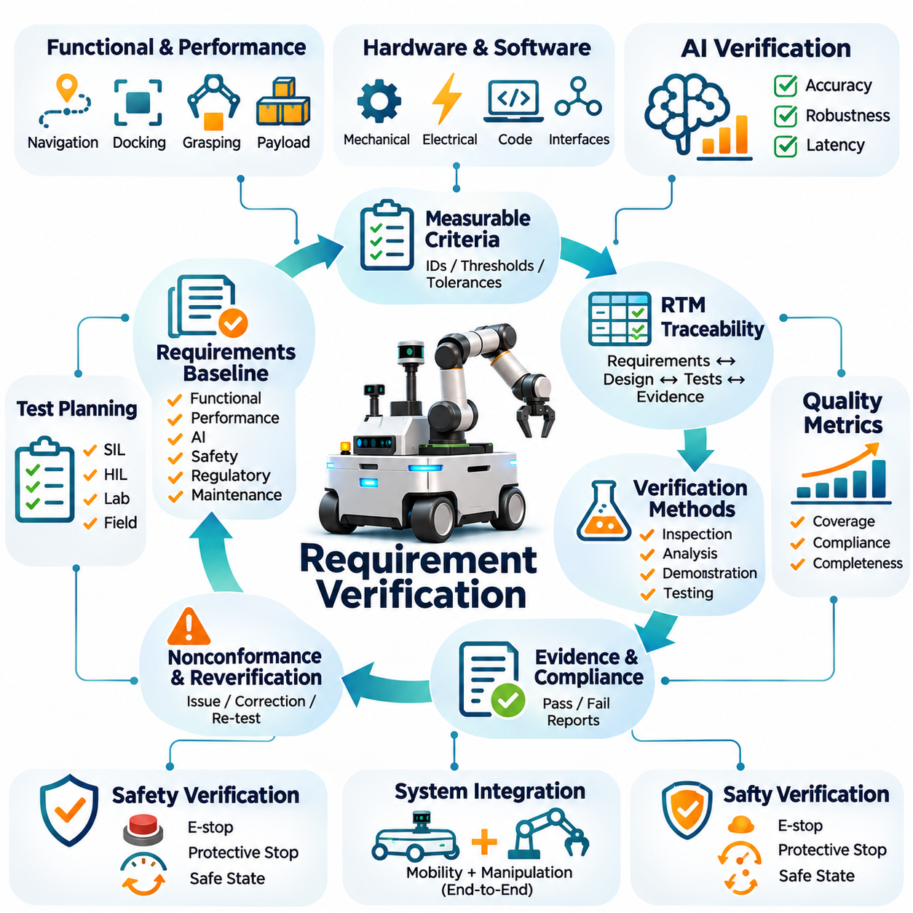{width="7.268055555555556in" height="7.268055555555556in"}

Requirement verification is a systematic engineering process that establishes whether a mobile manipulator satisfies its specified requirements through objective and measurable evidence. Within the Quality Assurance (QA) framework, this process connects customer expectations, system specifications, engineering implementations, and verification results. It ensures that development activities remain aligned with approved product requirements throughout the product lifecycle.

The verification process begins with establishing a controlled requirements baseline. Functional requirements, performance requirements, artificial intelligence requirements, safety requirements, regulatory requirements, and maintenance requirements must be documented and approved. Each requirement should contain a unique identifier, an unambiguous description, measurable acceptance criteria, verification conditions, and designated engineering responsibilities.

Requirements must be formulated to support objective verification rather than subjective interpretation. Statements such as high navigation accuracy, reliable grasping, or fast task execution should be translated into measurable engineering specifications. Numerical thresholds, permissible tolerances, environmental limitations, operational constraints, and measurement procedures provide a consistent foundation for determining whether individual requirements have been satisfied.

A Requirements Traceability Matrix (RTM) establishes bidirectional relationships between requirements, system architecture, subsystem specifications, implementation artifacts, and verification activities. Each requirement should be associated with corresponding test cases, analysis reports, inspection records, or demonstration results. This traceability enables engineering teams to identify missing implementations, insufficient verification coverage, and unauthorized changes.

Requirement verification can be performed through inspection, analysis, demonstration, and testing. Inspection evaluates documentation, physical configurations, and implementation characteristics, while analysis uses engineering calculations, simulations, and mathematical models. Demonstration confirms observable system behavior under specified conditions, whereas testing produces quantitative evidence through controlled experiments and measurement procedures.

Functional requirement verification evaluates whether the mobile manipulator performs its intended system capabilities. Representative functions include autonomous navigation, obstacle avoidance, precision docking, object recognition, grasp execution, material transportation, automatic charging, and mission recovery. Verification must address normal operating conditions, exceptional situations, subsystem interactions, and transitions between autonomous and manual operating modes.

Performance requirement verification establishes whether the system satisfies specified quantitative targets under predefined operating conditions. Relevant parameters include localization accuracy, docking precision, manipulator repeatability, payload capacity, grasp success rate, mission completion time, battery endurance, and communication latency. Measurement uncertainty, environmental variability, and statistical confidence should be considered when determining compliance.

Hardware requirement verification addresses mechanical structures, electrical systems, robotic arms, drive mechanisms, sensors, battery assemblies, and embedded computing platforms. Engineering teams should verify dimensional tolerances, structural load limits, power consumption, operating temperatures, electrical protection, and electromagnetic compatibility. Verification evidence must correspond to the actual hardware configuration and approved component specifications.

Software requirement verification evaluates whether implemented algorithms, communication interfaces, control functions, and application services satisfy their allocated requirements. Unit testing, integration testing, interface verification, static analysis, and regression testing provide complementary verification mechanisms. Particular attention should be given to execution timing, resource utilization, exception handling, communication failures, and deterministic behavior where required.

Artificial intelligence requirement verification must account for the statistical and context-dependent behavior of learning-based systems. Object detection, pose estimation, grasp prediction, and autonomous decision-making models should be evaluated using representative and independent datasets. Acceptance criteria should address model accuracy, inference latency, robustness, uncertainty estimation, and performance degradation under unfamiliar operating conditions.

Safety requirement verification establishes whether protective mechanisms satisfy the safety specifications derived from hazard identification and risk assessment. Emergency stopping, protective stopping, speed limitation, collision prevention, and safe-state transitions must be evaluated under defined conditions. Safety-related verification should include representative fault scenarios and applicable standards, without treating ordinary AI performance as evidence of functional safety.

Integrated requirement verification evaluates system-level capabilities that cannot be adequately assessed through independent subsystem testing. Mobile base positioning errors, manipulator calibration deviations, sensor synchronization, communication delays, and payload-induced instability may collectively influence task performance. End-to-end verification scenarios should therefore reproduce representative operational sequences involving coordinated mobility and manipulation.

Verification planning must define test environments, required equipment, measurement accuracy, sample sizes, execution procedures, and acceptance criteria before verification activities begin. Software-in-the-Loop (SIL), Hardware-in-the-Loop (HIL), simulation, laboratory testing, and physical field experiments can provide complementary evidence. The verification method should be selected according to requirement criticality, technical complexity, and operational risk.

Verification results must be recorded within a controlled documentation system containing requirement identifiers, test procedures, system configurations, measured results, deviations, and compliance decisions. Failed requirements should generate formal nonconformance records and corrective actions. Following engineering modifications, affected requirements must undergo reverification, supported by regression testing to identify unintended consequences elsewhere in the system.

Requirement verification should ultimately operate as a continuous quality assurance mechanism rather than an isolated activity performed immediately before product release. Verification coverage, requirement compliance rates, unresolved nonconformities, and evidence completeness provide measurable indicators of development maturity. Maintaining this closed-loop process supports reliable manufacturing, field deployment, regulatory compliance, and long-term product quality.

요구사항 검증(Requirement Verification)은 모바일 매니퓰레이터(Mobile Manipulator)가 명시된 요구사항을 충족하는지를 객관적이고 측정 가능한 증거(Objective and Measurable Evidence)를 통해 확인하는 체계적인 엔지니어링 프로세스이다. 품질 보증 프레임워크(Quality Assurance Framework, QA Framework) 내에서 이러한 프로세스는 고객 기대사항(Customer Expectations), 시스템 사양(System Specifications), 엔지니어링 구현(Engineering Implementation) 및 검증 결과(Verification Results)를 연결한다. 이를 통해 제품 수명주기(Product Lifecycle) 전반에 걸쳐 개발 활동이 승인된 제품 요구사항(Product Requirements)과 일치하도록 보장한다.

검증 프로세스(Verification Process)는 통제된 요구사항 기준선(Requirements Baseline)을 확립하는 것에서 시작한다. 기능 요구사항(Functional Requirements), 성능 요구사항(Performance Requirements), 인공지능 요구사항(AI Requirements), 안전 요구사항(Safety Requirements), 규제 요구사항(Regulatory Requirements) 및 유지보수 요구사항(Maintenance Requirements)은 문서화하고 승인해야 한다. 각각의 요구사항에는 고유 식별자(Unique Identifier), 명확한 설명(Unambiguous Description), 측정 가능한 인수 기준(Measurable Acceptance Criteria), 검증 조건(Verification Conditions) 및 지정된 엔지니어링 책임(Engineering Responsibilities)이 포함되어야 한다.

요구사항은 주관적인 해석(Subjective Interpretation)이 아니라 객관적인 검증(Objective Verification)을 지원할 수 있도록 작성되어야 한다. 높은 자율주행 정확도(Navigation Accuracy), 신뢰성 있는 파지(Reliable Grasping) 또는 신속한 작업 실행(Fast Task Execution)과 같은 표현은 측정 가능한 엔지니어링 사양(Engineering Specifications)으로 변환해야 한다. 수치적 임계값(Numerical Thresholds), 허용 공차(Permissible Tolerances), 환경적 제한사항(Environmental Limitations), 운영 제약조건(Operational Constraints) 및 측정 절차(Measurement Procedures)는 개별 요구사항의 충족 여부를 판단하기 위한 일관된 기반을 제공한다.

요구사항 추적성 매트릭스(Requirements Traceability Matrix, RTM)는 요구사항, 시스템 아키텍처(System Architecture), 하위 시스템 사양(Subsystem Specifications), 구현 산출물(Implementation Artifacts) 및 검증 활동(Verification Activities) 사이의 양방향 관계(Bidirectional Relationships)를 확립한다. 각각의 요구사항은 해당 시험 사례(Test Cases), 분석 보고서(Analysis Reports), 검사 기록(Inspection Records) 또는 시연 결과(Demonstration Results)와 연결되어야 한다. 이러한 추적성(Traceability)은 엔지니어링 팀이 누락된 구현 사항, 불충분한 검증 범위(Verification Coverage) 및 승인되지 않은 변경사항(Unauthorized Changes)을 식별할 수 있도록 지원한다.

요구사항 검증은 검사(Inspection), 분석(Analysis), 시연(Demonstration) 및 시험(Testing)을 통해 수행할 수 있다. 검사는 문서, 물리적 구성(Physical Configuration) 및 구현 특성(Implementation Characteristics)을 평가하며, 분석은 엔지니어링 계산(Engineering Calculations), 시뮬레이션(Simulation) 및 수학적 모델(Mathematical Models)을 활용한다. 시연은 명시된 조건에서 관찰 가능한 시스템 동작(System Behavior)을 확인하는 반면, 시험은 통제된 실험(Controlled Experiments)과 측정 절차(Measurement Procedures)를 통해 정량적 증거(Quantitative Evidence)를 생성한다.

기능 요구사항 검증(Functional Requirement Verification)은 모바일 매니퓰레이터가 의도된 시스템 기능(System Capabilities)을 수행하는지를 평가한다. 대표적인 기능에는 자율주행(Autonomous Navigation), 장애물 회피(Obstacle Avoidance), 정밀 도킹(Precision Docking), 객체 인식(Object Recognition), 파지 실행(Grasp Execution), 물류 운송(Material Transportation), 자동 충전(Automatic Charging) 및 임무 복구(Mission Recovery)가 포함된다. 검증은 정상 운영 조건(Normal Operating Conditions), 예외 상황(Exceptional Situations), 하위 시스템 상호작용(Subsystem Interactions) 및 자율 운영 모드와 수동 운영 모드 사이의 전환(Mode Transition)을 고려해야 한다.

성능 요구사항 검증(Performance Requirement Verification)은 시스템이 사전에 정의된 운영 조건에서 명시된 정량적 목표(Quantitative Targets)를 충족하는지를 확인한다. 관련 성능 파라미터(Performance Parameters)에는 위치 추정 정확도(Localization Accuracy), 도킹 정밀도(Docking Precision), 매니퓰레이터 반복 정밀도(Manipulator Repeatability), 가반하중(Payload Capacity), 파지 성공률(Grasp Success Rate), 임무 완료 시간(Mission Completion Time), 배터리 지속시간(Battery Endurance) 및 통신 지연시간(Communication Latency)이 포함된다. 요구사항의 충족 여부를 판단할 때는 측정 불확실성(Measurement Uncertainty), 환경적 변동성(Environmental Variability) 및 통계적 신뢰도(Statistical Confidence)를 고려해야 한다.

하드웨어 요구사항 검증(Hardware Requirement Verification)은 기계 구조물(Mechanical Structures), 전기 시스템(Electrical Systems), 로봇 팔(Robotic Arms), 구동 메커니즘(Drive Mechanisms), 센서(Sensors), 배터리 어셈블리(Battery Assemblies) 및 임베디드 컴퓨팅 플랫폼(Embedded Computing Platforms)을 대상으로 한다. 엔지니어링 팀은 치수 공차(Dimensional Tolerances), 구조적 하중 한계(Structural Load Limits), 전력 소비량(Power Consumption), 작동 온도(Operating Temperature), 전기적 보호(Electrical Protection) 및 전자기 적합성(Electromagnetic Compatibility, EMC)을 검증해야 한다. 검증 증거(Verification Evidence)는 실제 하드웨어 구성(Hardware Configuration) 및 승인된 부품 사양(Component Specifications)과 일치해야 한다.

소프트웨어 요구사항 검증(Software Requirement Verification)은 구현된 알고리즘(Algorithms), 통신 인터페이스(Communication Interfaces), 제어 기능(Control Functions) 및 애플리케이션 서비스(Application Services)가 할당된 요구사항을 충족하는지를 평가한다. 단위 시험(Unit Testing), 통합 시험(Integration Testing), 인터페이스 검증(Interface Verification), 정적 분석(Static Analysis) 및 회귀 시험(Regression Testing)은 상호 보완적인 검증 메커니즘(Verification Mechanisms)을 제공한다. 특히 실행 타이밍(Execution Timing), 자원 활용률(Resource Utilization), 예외 처리(Exception Handling), 통신 장애(Communication Failures) 및 필요한 경우 결정론적 동작(Deterministic Behavior)에 주의를 기울여야 한다.

인공지능 요구사항 검증(AI Requirement Verification)은 학습 기반 시스템(Learning-Based Systems)의 통계적이고 상황 의존적인 동작 특성(Statistical and Context-Dependent Behavior)을 고려해야 한다. 객체 검출(Object Detection), 자세 추정(Pose Estimation), 파지 예측(Grasp Prediction) 및 자율 의사결정(Autonomous Decision-Making) 모델은 대표성과 독립성을 갖춘 데이터셋(Representative and Independent Datasets)을 활용하여 평가해야 한다. 인수 기준(Acceptance Criteria)은 모델 정확도(Model Accuracy), 추론 지연시간(Inference Latency), 강건성(Robustness), 불확실성 추정(Uncertainty Estimation) 및 익숙하지 않은 운영 조건에서의 성능 저하(Performance Degradation)를 고려해야 한다.

안전 요구사항 검증(Safety Requirement Verification)은 보호 메커니즘(Protective Mechanisms)이 위험원 식별(Hazard Identification)과 위험 평가(Risk Assessment)를 통해 도출된 안전 사양(Safety Specifications)을 충족하는지를 확인한다. 비상 정지(Emergency Stop), 보호 정지(Protective Stop), 속도 제한(Speed Limitation), 충돌 방지(Collision Prevention) 및 안전 상태 전환(Safe-State Transition)은 정의된 조건에서 평가해야 한다. 안전 관련 검증(Safety-Related Verification)은 대표적인 고장 시나리오(Fault Scenarios)와 적용 가능한 표준(Applicable Standards)을 포함해야 하며, 일반적인 인공지능 성능(AI Performance)을 기능 안전성(Functional Safety)의 입증 증거로 간주해서는 안 된다.

통합 요구사항 검증(Integrated Requirement Verification)은 독립적인 하위 시스템 시험(Subsystem Testing)만으로 충분히 평가할 수 없는 시스템 수준의 역량(System-Level Capabilities)을 평가한다. 모바일 베이스 위치 오차(Mobile Base Positioning Errors), 매니퓰레이터 보정 편차(Manipulator Calibration Deviations), 센서 동기화(Sensor Synchronization), 통신 지연(Communication Delays) 및 가반하중으로 인한 불안정성(Payload-Induced Instability)은 복합적으로 작업 성능(Task Performance)에 영향을 미칠 수 있다. 따라서 종단 간 검증 시나리오(End-to-End Verification Scenarios)는 이동과 조작이 협조적으로 수행되는 대표적인 운영 시퀀스(Operational Sequences)를 재현해야 한다.

검증 계획(Verification Planning)은 검증 활동을 시작하기 전에 시험 환경(Test Environments), 필요 장비(Required Equipment), 측정 정확도(Measurement Accuracy), 표본 크기(Sample Sizes), 실행 절차(Execution Procedures) 및 인수 기준(Acceptance Criteria)을 정의해야 한다. 소프트웨어 인 더 루프(Software-in-the-Loop, SIL), 하드웨어 인 더 루프(Hardware-in-the-Loop, HIL), 시뮬레이션(Simulation), 실험실 시험(Laboratory Testing) 및 실제 현장 실험(Physical Field Experiments)은 상호 보완적인 검증 증거를 제공할 수 있다. 검증 방법(Verification Method)은 요구사항의 중요도(Requirement Criticality), 기술적 복잡성(Technical Complexity) 및 운영 위험(Operational Risk)에 따라 선정해야 한다.

검증 결과(Verification Results)는 요구사항 식별자(Requirement Identifiers), 시험 절차(Test Procedures), 시스템 구성(System Configurations), 측정 결과(Measured Results), 편차(Deviations) 및 준수 여부 판정(Compliance Decisions)을 포함하는 통제된 문서 관리 시스템(Controlled Documentation System)에 기록해야 한다. 충족하지 못한 요구사항에 대해서는 공식적인 부적합 기록(Nonconformance Records)과 시정 조치(Corrective Actions)를 생성해야 한다. 엔지니어링 변경(Engineering Modifications) 이후에는 영향을 받는 요구사항에 대한 재검증(Reverification)을 수행해야 하며, 시스템의 다른 영역에서 발생할 수 있는 의도하지 않은 영향을 식별하기 위해 회귀 시험(Regression Testing)을 병행해야 한다.

궁극적으로 요구사항 검증은 제품 출시(Product Release) 직전에 수행되는 독립적인 활동이 아니라 지속적인 품질 보증 메커니즘(Continuous Quality Assurance Mechanism)으로 운영되어야 한다. 검증 범위(Verification Coverage), 요구사항 충족률(Requirement Compliance Rates), 미해결 부적합 사항(Unresolved Nonconformities) 및 증거 완전성(Evidence Completeness)은 개발 성숙도(Development Maturity)를 평가하기 위한 측정 가능한 지표를 제공한다. 이러한 폐루프 프로세스(Closed-Loop Process)를 유지함으로써 신뢰성 있는 제조(Manufacturing), 현장 배포(Field Deployment), 규제 준수(Regulatory Compliance) 및 장기적인 제품 품질(Long-Term Product Quality)을 확보할 수 있다.

##  

## 03 Design Verification

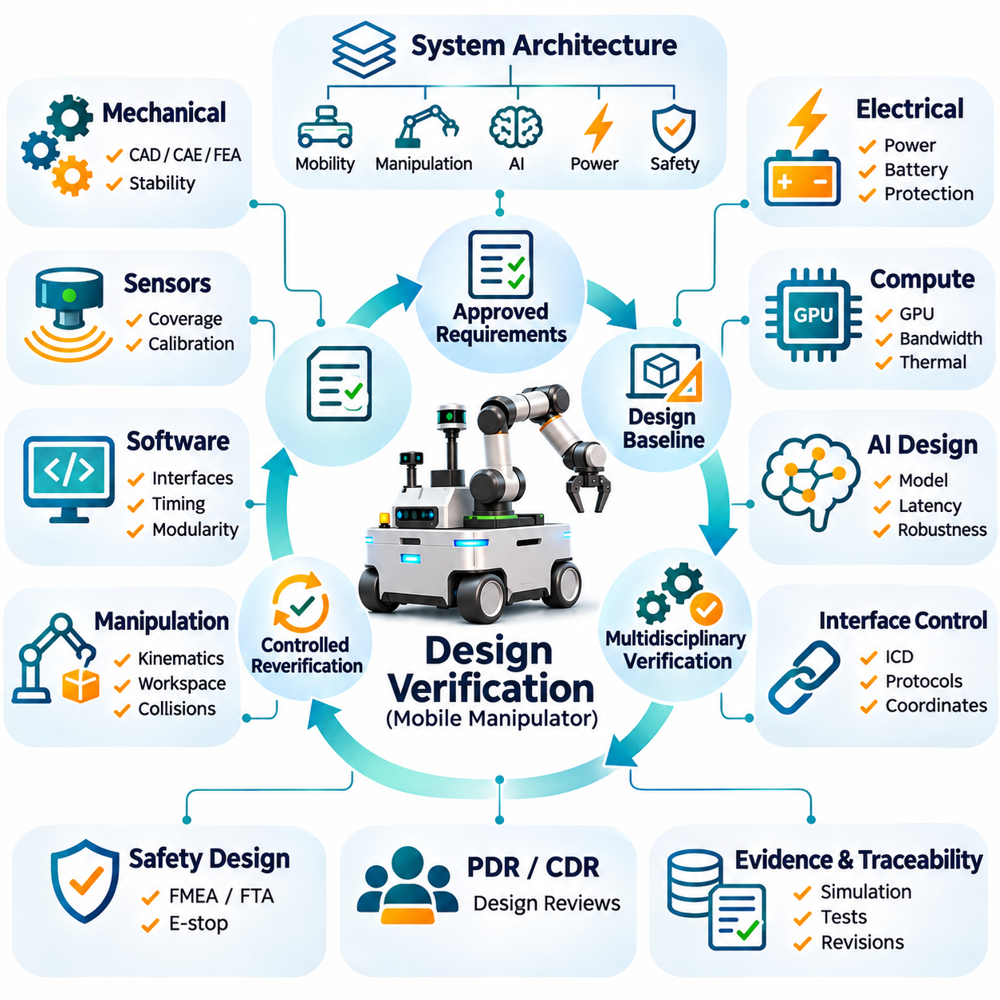{width="7.268055555555556in" height="7.268055555555556in"}

Design verification is a systematic engineering process that determines whether the design of a mobile manipulator satisfies approved system requirements, technical specifications, and engineering constraints. Within the Quality Assurance (QA) framework, design verification establishes objective evidence that architectural decisions, subsystem designs, component selections, and implementation strategies are technically consistent with established development objectives.

The design verification process begins with establishing a controlled design baseline containing system architecture documents, mechanical drawings, electrical schematics, software specifications, interface definitions, and engineering analysis results. Each design element should be traceable to corresponding requirements and verification criteria. Configuration management ensures that verification activities are performed against authorized and identifiable design revisions.

System architecture verification evaluates whether the proposed architecture adequately supports autonomous mobility, robotic manipulation, artificial intelligence, communication, power distribution, and safety functions. Engineering teams should examine functional allocation, subsystem dependencies, interface compatibility, computational resource distribution, and fault isolation mechanisms. Architectural deficiencies must be identified before substantial implementation and integration activities begin.

Mechanical design verification addresses structural integrity, dimensional accuracy, material selection, mechanical tolerances, load distribution, and system stability. Computer-Aided Design (CAD), Computer-Aided Engineering (CAE), and Finite Element Analysis (FEA) provide analytical mechanisms for evaluating structural behavior. Particular attention should be given to manipulator mounting stiffness, dynamic loading, center-of-gravity displacement, vibration, and overturning risks.

Electrical design verification evaluates power distribution, battery management, motor drive circuits, electrical protection, grounding, wiring harness architecture, and electromagnetic compatibility. Engineering analysis should confirm that electrical components operate within their specified voltage, current, temperature, and power limits. Verification must also address transient loads, short-circuit protection, connector reliability, insulation requirements, and emergency power isolation.

Sensor architecture verification establishes whether selected sensors and their installation configurations satisfy perception, localization, environmental monitoring, and manipulation requirements. Sensor positioning, field-of-view coverage, measurement accuracy, installation tolerances, synchronization mechanisms, and calibration accessibility must be evaluated. Potential interference, occlusion, environmental degradation, and systematic measurement errors should be identified through engineering analysis.

Computing architecture verification examines processing capabilities, memory capacity, data transmission bandwidth, storage requirements, thermal management, and computational resource allocation. The selected embedded processors and graphics processing units must support concurrent navigation, perception, manipulation, and communication workloads. Worst-case execution conditions should be analyzed to identify computational bottlenecks and insufficient processing margins.

Software design verification evaluates architectural decomposition, algorithm specifications, communication interfaces, execution models, and exception-handling mechanisms. Software design reviews, static analysis, interface modeling, and simulated execution provide complementary verification methods. Engineering teams should confirm that the software architecture supports modularity, maintainability, scalability, resource isolation, and predictable execution of time-critical control functions.

Artificial intelligence design verification focuses on the suitability of model architectures, input representations, data processing pipelines, training strategies, and inference configurations. The proposed AI architecture must support required perception accuracy, inference latency, computational efficiency, and robustness objectives. Model selection decisions should consider deployment hardware limitations, uncertainty estimation, environmental variability, and potential out-of-distribution conditions.

Manipulation system design verification evaluates robotic arm selection, kinematic configurations, workspace coverage, end-effector geometry, payload limitations, and motion control strategies. Forward kinematics, inverse kinematics, dynamic modeling, and collision simulation provide analytical evidence of design feasibility. Verification should examine singularities, joint limitations, grasping constraints, trajectory feasibility, and interactions between the manipulator and mobile platform.

Interface design verification ensures that mechanical, electrical, software, communication, and data interfaces remain compatible across independently developed subsystems. Interface Control Documents (ICDs) should define physical connections, coordinate conventions, communication protocols, data structures, timing requirements, and error-handling behavior. Interface verification reduces integration failures caused by incompatible assumptions or incomplete subsystem specifications.

Safety design verification evaluates whether the proposed design incorporates protective measures derived from hazard identification and risk assessment. Safety controllers, emergency stopping circuits, protective devices, speed limitations, and safe-state transitions should be examined against allocated safety requirements. Failure Mode and Effects Analysis (FMEA), Fault Tree Analysis (FTA), and applicable functional safety calculations support systematic evaluation of design-related risks.

Formal design reviews provide structured checkpoints for evaluating engineering completeness and technical readiness. Preliminary Design Reviews (PDRs) examine architectural feasibility and major design decisions, while Critical Design Reviews (CDRs) assess detailed implementation readiness. Review participants should represent relevant engineering disciplines and quality assurance functions, with identified deficiencies documented, assigned, and resolved through controlled engineering processes.

Design verification evidence should include engineering calculations, simulation results, inspection records, interface assessments, prototype test results, and formal review documentation. Each verification record must identify the applicable requirement, design revision, verification method, acceptance criteria, and compliance decision. Design modifications require impact analysis and targeted reverification to prevent previously resolved technical issues from reappearing.

Design verification ultimately establishes confidence that the mobile manipulator has been designed correctly according to approved specifications, rather than proving that it satisfies every intended operational need. The latter objective belongs to design validation. By integrating traceability, multidisciplinary engineering analysis, configuration management, and corrective action, design verification reduces technical uncertainty and supports reliable system integration, manufacturing readiness, and subsequent field validation.

설계 검증(Design Verification)은 모바일 매니퓰레이터(Mobile Manipulator)의 설계가 승인된 시스템 요구사항(System Requirements), 기술 사양(Technical Specifications) 및 엔지니어링 제약조건(Engineering Constraints)을 충족하는지를 판단하는 체계적인 엔지니어링 프로세스이다. 품질 보증 프레임워크(Quality Assurance Framework, QA Framework) 내에서 설계 검증은 아키텍처 의사결정(Architectural Decisions), 하위 시스템 설계(Subsystem Designs), 부품 선정(Component Selection) 및 구현 전략(Implementation Strategies)이 수립된 개발 목표(Development Objectives)와 기술적으로 일치한다는 객관적인 증거(Objective Evidence)를 확보한다.

설계 검증 프로세스(Design Verification Process)는 시스템 아키텍처 문서(System Architecture Documents), 기계 설계 도면(Mechanical Drawings), 전기 회로도(Electrical Schematics), 소프트웨어 사양(Software Specifications), 인터페이스 정의(Interface Definitions) 및 엔지니어링 분석 결과(Engineering Analysis Results)를 포함하는 통제된 설계 기준선(Design Baseline)을 확립하는 것에서 시작한다. 각각의 설계 요소(Design Elements)는 해당 요구사항 및 검증 기준(Verification Criteria)에 대한 추적성(Traceability)을 확보해야 한다. 형상 관리(Configuration Management)는 승인되고 식별 가능한 설계 개정본(Design Revisions)을 기준으로 검증 활동이 수행되도록 보장한다.

시스템 아키텍처 검증(System Architecture Verification)은 제안된 아키텍처가 자율 이동(Autonomous Mobility), 로봇 조작(Robotic Manipulation), 인공지능(Artificial Intelligence), 통신(Communication), 전력 분배(Power Distribution) 및 안전 기능(Safety Functions)을 적절하게 지원하는지를 평가한다. 엔지니어링 팀은 기능 할당(Functional Allocation), 하위 시스템 종속성(Subsystem Dependencies), 인터페이스 호환성(Interface Compatibility), 컴퓨팅 자원 분배(Computational Resource Distribution) 및 고장 격리 메커니즘(Fault Isolation Mechanisms)을 검토해야 한다. 본격적인 구현 및 통합 활동(Integration Activities)을 시작하기 전에 아키텍처의 결함(Architectural Deficiencies)을 식별해야 한다.

기계 설계 검증(Mechanical Design Verification)은 구조적 무결성(Structural Integrity), 치수 정확도(Dimensional Accuracy), 재료 선정(Material Selection), 기계적 공차(Mechanical Tolerances), 하중 분포(Load Distribution) 및 시스템 안정성(System Stability)을 대상으로 한다. 컴퓨터 지원 설계(Computer-Aided Design, CAD), 컴퓨터 지원 엔지니어링(Computer-Aided Engineering, CAE) 및 유한요소해석(Finite Element Analysis, FEA)은 구조적 거동(Structural Behavior)을 평가하기 위한 분석 메커니즘을 제공한다. 특히 매니퓰레이터 장착 강성(Manipulator Mounting Stiffness), 동적 하중(Dynamic Loading), 무게중심 변위(Center-of-Gravity Displacement), 진동(Vibration) 및 전복 위험(Overturning Risks)에 주의를 기울여야 한다.

전기 설계 검증(Electrical Design Verification)은 전력 분배(Power Distribution), 배터리 관리(Battery Management), 모터 구동 회로(Motor Drive Circuits), 전기적 보호(Electrical Protection), 접지(Grounding), 와이어링 하네스 아키텍처(Wiring Harness Architecture) 및 전자기 적합성(Electromagnetic Compatibility, EMC)을 평가한다. 엔지니어링 분석(Engineering Analysis)은 전기 부품이 명시된 전압(Voltage), 전류(Current), 온도(Temperature) 및 전력(Power) 한계 내에서 동작하는지를 확인해야 한다. 또한 과도 하중(Transient Loads), 단락 보호(Short-Circuit Protection), 커넥터 신뢰성(Connector Reliability), 절연 요구사항(Insulation Requirements) 및 비상 전력 차단(Emergency Power Isolation)을 검증해야 한다.

센서 아키텍처 검증(Sensor Architecture Verification)은 선정된 센서와 설치 구성이 인지(Perception), 위치 추정(Localization), 환경 모니터링(Environmental Monitoring) 및 로봇 조작(Manipulation) 요구사항을 충족하는지를 확인한다. 센서 배치(Sensor Positioning), 시야각 범위(Field-of-View Coverage), 측정 정확도(Measurement Accuracy), 설치 공차(Installation Tolerances), 동기화 메커니즘(Synchronization Mechanisms) 및 보정 접근성(Calibration Accessibility)을 평가해야 한다. 잠재적인 간섭(Interference), 가려짐(Occlusion), 환경적 요인에 따른 성능 저하(Environmental Degradation) 및 계통적 측정 오차(Systematic Measurement Errors)는 엔지니어링 분석을 통해 식별해야 한다.

컴퓨팅 아키텍처 검증(Computing Architecture Verification)은 처리 역량(Processing Capabilities), 메모리 용량(Memory Capacity), 데이터 전송 대역폭(Data Transmission Bandwidth), 저장장치 요구사항(Storage Requirements), 열 관리(Thermal Management) 및 컴퓨팅 자원 할당(Computational Resource Allocation)을 검토한다. 선정된 임베디드 프로세서(Embedded Processors)와 그래픽 처리 장치(Graphics Processing Units, GPUs)는 자율주행, 인지, 조작 및 통신 워크로드(Workloads)의 동시 실행을 지원해야 한다. 컴퓨팅 병목현상(Computational Bottlenecks)과 불충분한 처리 여유(Processing Margins)를 식별하기 위해 최악의 실행 조건(Worst-Case Execution Conditions)을 분석해야 한다.

소프트웨어 설계 검증(Software Design Verification)은 아키텍처 분해(Architectural Decomposition), 알고리즘 사양(Algorithm Specifications), 통신 인터페이스(Communication Interfaces), 실행 모델(Execution Models) 및 예외 처리 메커니즘(Exception-Handling Mechanisms)을 평가한다. 소프트웨어 설계 검토(Software Design Review), 정적 분석(Static Analysis), 인터페이스 모델링(Interface Modeling) 및 모의 실행(Simulated Execution)은 상호 보완적인 검증 방법을 제공한다. 엔지니어링 팀은 소프트웨어 아키텍처가 모듈화(Modularity), 유지보수성(Maintainability), 확장성(Scalability), 자원 격리(Resource Isolation) 및 시간에 민감한 제어 기능(Time-Critical Control Functions)의 예측 가능한 실행을 지원하는지 확인해야 한다.

인공지능 설계 검증(AI Design Verification)은 모델 아키텍처(Model Architectures), 입력 표현(Input Representations), 데이터 처리 파이프라인(Data Processing Pipelines), 학습 전략(Training Strategies) 및 추론 구성(Inference Configurations)의 적합성에 중점을 둔다. 제안된 인공지능 아키텍처는 요구되는 인지 정확도(Perception Accuracy), 추론 지연시간(Inference Latency), 컴퓨팅 효율성(Computational Efficiency) 및 강건성(Robustness) 목표를 충족할 수 있어야 한다. 모델 선정 의사결정(Model Selection Decisions)은 배포 하드웨어의 한계(Deployment Hardware Limitations), 불확실성 추정(Uncertainty Estimation), 환경적 변동성(Environmental Variability) 및 잠재적인 분포 외 조건(Out-of-Distribution Conditions)을 고려해야 한다.

조작 시스템 설계 검증(Manipulation System Design Verification)은 로봇 팔 선정(Robotic Arm Selection), 기구학적 구성(Kinematic Configurations), 작업 공간 범위(Workspace Coverage), 엔드 이펙터 형상(End-Effector Geometry), 가반하중 제한(Payload Limitations) 및 모션 제어 전략(Motion Control Strategies)을 평가한다. 순기구학(Forward Kinematics), 역기구학(Inverse Kinematics), 동역학 모델링(Dynamic Modeling) 및 충돌 시뮬레이션(Collision Simulation)은 설계 실현 가능성(Design Feasibility)에 대한 분석적 증거를 제공한다. 검증 과정에서는 특이점(Singularities), 관절 제한(Joint Limitations), 파지 제약조건(Grasping Constraints), 궤적 실현 가능성(Trajectory Feasibility) 및 매니퓰레이터와 모바일 플랫폼 사이의 상호작용(Interactions)을 검토해야 한다.

인터페이스 설계 검증(Interface Design Verification)은 독립적으로 개발된 하위 시스템 간의 기계적(Mechanical), 전기적(Electrical), 소프트웨어(Software), 통신(Communication) 및 데이터(Data) 인터페이스가 상호 호환성을 유지하도록 보장한다. 인터페이스 제어 문서(Interface Control Documents, ICDs)는 물리적 연결(Physical Connections), 좌표 규약(Coordinate Conventions), 통신 프로토콜(Communication Protocols), 데이터 구조(Data Structures), 타이밍 요구사항(Timing Requirements) 및 오류 처리 동작(Error-Handling Behavior)을 정의해야 한다. 인터페이스 검증은 서로 일치하지 않는 설계 가정이나 불완전한 하위 시스템 사양으로 인해 발생하는 통합 실패(Integration Failures)를 감소시킨다.

안전 설계 검증(Safety Design Verification)은 제안된 설계가 위험원 식별(Hazard Identification) 및 위험 평가(Risk Assessment)를 통해 도출된 보호 조치(Protective Measures)를 포함하는지를 평가한다. 안전 제어기(Safety Controllers), 비상 정지 회로(Emergency Stopping Circuits), 보호 장치(Protective Devices), 속도 제한(Speed Limitations) 및 안전 상태 전환(Safe-State Transitions)은 할당된 안전 요구사항(Safety Requirements)을 기준으로 검토해야 한다. 고장 형태 및 영향 분석(Failure Mode and Effects Analysis, FMEA), 결함수 분석(Fault Tree Analysis, FTA) 및 적용 가능한 기능 안전 계산(Functional Safety Calculations)은 설계 관련 위험(Design-Related Risks)의 체계적인 평가를 지원한다.

공식 설계 검토(Formal Design Review)는 엔지니어링 완전성(Engineering Completeness)과 기술적 준비도(Technical Readiness)를 평가하기 위한 체계적인 점검 단계(Structured Checkpoints)를 제공한다. 예비 설계 검토(Preliminary Design Review, PDR)는 아키텍처 실현 가능성(Architectural Feasibility)과 주요 설계 의사결정을 검토하며, 상세 설계 검토(Critical Design Review, CDR)는 세부 구현 준비도(Detailed Implementation Readiness)를 평가한다. 검토 참여자는 관련 엔지니어링 분야와 품질 보증 기능을 대표해야 하며, 식별된 결함은 문서화하고 담당자를 지정한 후 통제된 엔지니어링 프로세스(Controlled Engineering Processes)를 통해 해결해야 한다.

설계 검증 증거(Design Verification Evidence)는 엔지니어링 계산(Engineering Calculations), 시뮬레이션 결과(Simulation Results), 검사 기록(Inspection Records), 인터페이스 평가(Interface Assessments), 프로토타입 시험 결과(Prototype Test Results) 및 공식 검토 문서(Formal Review Documentation)를 포함해야 한다. 각각의 검증 기록(Verification Records)은 적용되는 요구사항, 설계 개정본(Design Revision), 검증 방법(Verification Method), 인수 기준(Acceptance Criteria) 및 준수 여부 판정(Compliance Decision)을 명시해야 한다. 설계 변경(Design Modifications)은 이전에 해결된 기술적 문제가 다시 발생하는 것을 방지하기 위해 영향 분석(Impact Analysis)과 대상별 재검증(Targeted Reverification)을 필요로 한다.

궁극적으로 설계 검증(Design Verification)은 모바일 매니퓰레이터가 의도된 모든 운영 요구를 충족한다는 사실을 입증하기보다는 승인된 사양에 따라 올바르게 설계되었다는 신뢰를 확보하는 과정이다. 의도된 운영 요구의 충족 여부를 입증하는 것은 설계 유효성 확인(Design Validation)의 목적에 해당한다. 추적성(Traceability), 다학제적 엔지니어링 분석(Multidisciplinary Engineering Analysis), 형상 관리(Configuration Management) 및 시정 조치(Corrective Action)를 통합함으로써 설계 검증은 기술적 불확실성(Technical Uncertainty)을 감소시키고 신뢰성 있는 시스템 통합(System Integration), 제조 준비도(Manufacturing Readiness) 및 후속 현장 유효성 확인(Field Validation)을 지원한다.

##  

## 04 Design Validation

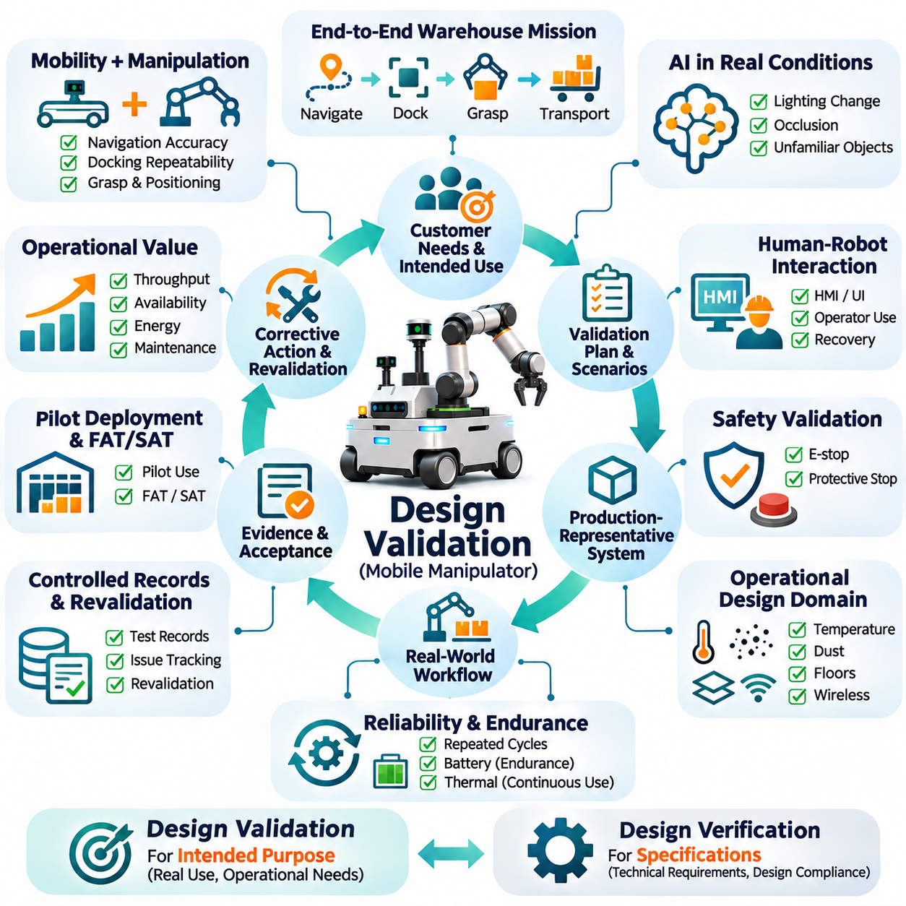{width="7.268055555555556in" height="7.268055555555556in"}

Design validation is a systematic engineering process that determines whether a mobile manipulator satisfies its intended operational needs, customer expectations, and application-specific objectives. Unlike design verification, which evaluates compliance with approved technical specifications, design validation establishes whether the completed system represents an appropriate solution for its intended operating environment and practical use cases.

Within the Quality Assurance (QA) framework, design validation connects engineering development with operational requirements and commercialization objectives. Validation activities should begin during early product development and continue through prototype evaluation, system integration, pilot deployment, and production readiness. Early validation reduces the possibility of developing technically compliant products that fail to satisfy actual customer needs.

Design validation planning requires a comprehensive understanding of intended applications, environmental characteristics, operator interactions, and operational constraints. Representative scenarios should be derived from customer requirements, workflow descriptions, and anticipated field conditions. Each validation scenario must define operational objectives, initial conditions, execution procedures, measurable acceptance criteria, and expected system behavior.

Validation should be performed using production-representative systems whenever possible, including approved mechanical structures, electrical components, embedded processors, software releases, and artificial intelligence models. Prototype configurations may support preliminary validation, but their limitations must be documented. Differences between validation configurations and final production configurations require impact assessment and additional validation where necessary.

Operational scenario validation evaluates the ability of mobile manipulators to execute complete workflows rather than isolated technical functions. A representative warehouse scenario may include receiving a mission, navigating toward a workstation, detecting objects, performing precision docking, executing grasping operations, transporting materials, and reporting task completion. The entire operational sequence must be evaluated under realistic conditions.

Mobility and manipulation validation must address the combined behavior of the autonomous mobile platform and robotic arm. Navigation accuracy, docking repeatability, manipulator reachability, grasp stability, and positioning uncertainty collectively influence task execution. Validation should establish whether the integrated system can compensate for permissible positioning deviations while maintaining operational accuracy, stability, and consistent manipulation performance.

Artificial intelligence validation evaluates the effectiveness of perception, object recognition, pose estimation, grasp prediction, and autonomous decision-making under representative operating conditions. Environmental variations, unfamiliar objects, partial occlusions, illumination changes, and sensor degradation should be incorporated into validation scenarios. Model accuracy alone is insufficient when AI outputs influence physical robotic actions.

Human-Robot Interaction (HRI) validation determines whether operators, maintenance personnel, and surrounding workers can interact with mobile manipulators safely and effectively. Human-Machine Interfaces (HMIs), mission management tools, warning indicators, manual intervention procedures, and recovery instructions must support practical operational needs. Usability assessment should consider operator workload, training requirements, and foreseeable human errors.

Safety validation establishes whether implemented protective measures provide adequate risk reduction within the intended application. Emergency stopping, protective stopping, restricted operating zones, speed limitations, and coordinated movement restrictions should be evaluated under representative conditions. Validation must address foreseeable misuse, unexpected human interactions, and relevant system failures without relying solely on normal operational testing.

Environmental validation examines system performance under the physical conditions expected during actual deployment. Temperature fluctuations, humidity, dust, floor irregularities, vibration, electromagnetic interference, lighting variations, and wireless communication limitations may affect operational behavior. Environmental conditions should reflect the defined Operational Design Domain (ODD) and application-specific operating boundaries.

Reliability and endurance validation determine whether the mobile manipulator can maintain acceptable operational performance during repeated tasks and extended operating periods. Continuous mission execution, battery charging cycles, manipulator movements, thermal loading, and communication interruptions provide representative operational stresses. Validation should identify progressive performance degradation, recurring failures, and maintenance-related limitations.

Design validation must also consider operational efficiency, maintainability, and economic suitability. Mission completion time, material handling throughput, energy consumption, system availability, maintenance duration, and operator intervention frequency provide practical evaluation criteria. These parameters help determine whether the proposed robotic solution delivers measurable operational value compared with existing processes or alternative automation technologies.

Pilot deployments and customer acceptance activities provide important opportunities to validate the mobile manipulator within representative facilities. Feedback from operators, maintenance teams, production managers, and system integrators should be systematically collected. Factory Acceptance Testing (FAT) and Site Acceptance Testing (SAT) can contribute validation evidence when their procedures address intended operational needs and agreed acceptance criteria.

Validation results must be maintained within a controlled documentation system that records operational scenarios, product configurations, environmental conditions, measured performance, observed failures, and acceptance decisions. Identified deficiencies should generate corrective actions and engineering change requests. Subsequent revalidation must demonstrate that modifications resolve operational problems without introducing unacceptable risks or performance degradation.

Design validation ultimately establishes confidence that the mobile manipulator is suitable for its intended purpose rather than merely compliant with engineering specifications. By connecting customer requirements, representative workflows, operational evidence, safety assessment, and continuous improvement, design validation supports product acceptance, technology readiness, manufacturing decisions, scalable field deployment, and sustainable commercialization.

설계 유효성 확인(Design Validation)은 모바일 매니퓰레이터(Mobile Manipulator)가 의도된 운영 요구(Operational Needs), 고객 기대사항(Customer Expectations) 및 응용 분야별 목표(Application-Specific Objectives)를 충족하는지를 판단하는 체계적인 엔지니어링 프로세스이다. 승인된 기술 사양(Technical Specifications)의 준수 여부를 평가하는 설계 검증(Design Verification)과 달리, 설계 유효성 확인은 완성된 시스템이 의도된 운영 환경(Operational Environment)과 실제 활용 사례(Practical Use Cases)에 적합한 솔루션인지를 확인한다.

품질 보증 프레임워크(Quality Assurance Framework, QA Framework) 내에서 설계 유효성 확인은 엔지니어링 개발(Engineering Development)을 운영 요구사항(Operational Requirements) 및 상용화 목표(Commercialization Objectives)와 연결한다. 유효성 확인 활동(Validation Activities)은 제품 개발 초기 단계부터 시작하여 프로토타입 평가(Prototype Evaluation), 시스템 통합(System Integration), 파일럿 배포(Pilot Deployment) 및 생산 준비(Production Readiness) 단계까지 지속되어야 한다. 초기 유효성 확인(Early Validation)은 기술적으로 사양을 충족하지만 실제 고객 요구를 만족시키지 못하는 제품이 개발될 가능성을 감소시킨다.

설계 유효성 확인 계획(Design Validation Planning)은 의도된 응용 분야(Intended Applications), 환경적 특성(Environmental Characteristics), 운영자 상호작용(Operator Interactions) 및 운영 제약조건(Operational Constraints)에 대한 종합적인 이해를 필요로 한다. 대표적인 시나리오(Representative Scenarios)는 고객 요구사항(Customer Requirements), 작업 흐름 설명(Workflow Descriptions) 및 예상 현장 조건(Anticipated Field Conditions)을 기반으로 도출해야 한다. 각각의 유효성 확인 시나리오(Validation Scenarios)는 운영 목표(Operational Objectives), 초기 조건(Initial Conditions), 실행 절차(Execution Procedures), 측정 가능한 인수 기준(Measurable Acceptance Criteria) 및 예상 시스템 동작(Expected System Behavior)을 정의해야 한다.

유효성 확인은 가능한 한 승인된 기계 구조물(Mechanical Structures), 전기 부품(Electrical Components), 임베디드 프로세서(Embedded Processors), 소프트웨어 릴리스(Software Releases) 및 인공지능 모델(AI Models)을 포함하는 양산 대표 시스템(Production-Representative Systems)을 활용하여 수행해야 한다. 프로토타입 구성(Prototype Configurations)은 예비 유효성 확인(Preliminary Validation)을 지원할 수 있지만, 해당 구성의 한계는 문서화해야 한다. 유효성 확인 구성(Validation Configurations)과 최종 양산 구성(Final Production Configurations) 사이의 차이점에 대해서는 영향 평가(Impact Assessment)를 수행하고 필요한 경우 추가적인 유효성 확인을 실시해야 한다.

운영 시나리오 유효성 확인(Operational Scenario Validation)은 모바일 매니퓰레이터가 개별적인 기술 기능(Technical Functions)이 아니라 완전한 작업 흐름(Complete Workflows)을 실행할 수 있는지를 평가한다. 대표적인 물류창고 시나리오(Warehouse Scenario)는 임무 수신(Mission Reception), 작업 스테이션으로의 자율주행(Navigation), 객체 검출(Object Detection), 정밀 도킹(Precision Docking), 파지 작업(Grasping Operations), 물류 운송(Material Transportation) 및 작업 완료 보고(Task Completion Reporting)를 포함할 수 있다. 전체 운영 시퀀스(Operational Sequence)는 현실적인 운영 조건(Realistic Conditions)에서 평가해야 한다.

이동 및 조작 유효성 확인(Mobility and Manipulation Validation)은 자율 이동 플랫폼(Autonomous Mobile Platform)과 로봇 팔(Robotic Arm)의 통합 동작(Combined Behavior)을 고려해야 한다. 자율주행 정확도(Navigation Accuracy), 도킹 반복 정밀도(Docking Repeatability), 매니퓰레이터 도달 가능성(Manipulator Reachability), 파지 안정성(Grasp Stability) 및 위치 불확실성(Positioning Uncertainty)은 복합적으로 작업 실행(Task Execution)에 영향을 미친다. 유효성 확인은 통합 시스템(Integrated System)이 운영 정확도(Operational Accuracy), 안정성(Stability) 및 일관된 조작 성능(Consistent Manipulation Performance)을 유지하면서 허용 가능한 위치 편차(Positioning Deviations)를 보상할 수 있는지를 확인해야 한다.

인공지능 유효성 확인(AI Validation)은 대표적인 운영 조건(Representative Operating Conditions)에서 인지(Perception), 객체 인식(Object Recognition), 자세 추정(Pose Estimation), 파지 예측(Grasp Prediction) 및 자율 의사결정(Autonomous Decision-Making)의 효과성을 평가한다. 환경적 변화(Environmental Variations), 익숙하지 않은 객체(Unfamiliar Objects), 부분적 가려짐(Partial Occlusion), 조명 변화(Illumination Changes) 및 센서 성능 저하(Sensor Degradation)를 유효성 확인 시나리오에 포함해야 한다. 인공지능 출력(AI Outputs)이 물리적인 로봇 동작(Physical Robotic Actions)에 영향을 미치는 경우 모델 정확도(Model Accuracy)만으로는 충분하지 않다.

인간-로봇 상호작용 유효성 확인(Human-Robot Interaction Validation, HRI Validation)은 운영자(Operators), 유지보수 담당자(Maintenance Personnel) 및 주변 작업자(Surrounding Workers)가 모바일 매니퓰레이터와 안전하고 효과적으로 상호작용할 수 있는지를 판단한다. 인간-기계 인터페이스(Human-Machine Interfaces, HMIs), 임무 관리 도구(Mission Management Tools), 경고 표시 장치(Warning Indicators), 수동 개입 절차(Manual Intervention Procedures) 및 복구 지침(Recovery Instructions)은 실제 운영 요구를 지원해야 한다. 사용성 평가(Usability Assessment)는 운영자 작업 부하(Operator Workload), 교육 요구사항(Training Requirements) 및 예측 가능한 인적 오류(Foreseeable Human Errors)를 고려해야 한다.

안전 유효성 확인(Safety Validation)은 구현된 보호 조치(Protective Measures)가 의도된 응용 분야에서 적절한 위험 감소(Risk Reduction)를 제공하는지를 확인한다. 비상 정지(Emergency Stop), 보호 정지(Protective Stop), 제한 운영 구역(Restricted Operating Zones), 속도 제한(Speed Limitations) 및 협조 동작 제한(Coordinated Movement Restrictions)은 대표적인 운영 조건에서 평가해야 한다. 유효성 확인은 정상 운영 시험(Normal Operational Testing)에만 의존하지 않고 예측 가능한 오사용(Foreseeable Misuse), 예상치 못한 인간 상호작용(Unexpected Human Interactions) 및 관련 시스템 고장(System Failures)을 고려해야 한다.

환경 유효성 확인(Environmental Validation)은 실제 현장 배포(Field Deployment)에서 예상되는 물리적 조건(Physical Conditions)하의 시스템 성능(System Performance)을 평가한다. 온도 변동(Temperature Fluctuations), 습도(Humidity), 분진(Dust), 바닥 불균일성(Floor Irregularities), 진동(Vibration), 전자기 간섭(Electromagnetic Interference, EMI), 조명 변화(Lighting Variations) 및 무선 통신 제한(Wireless Communication Limitations)은 운영 동작(Operational Behavior)에 영향을 미칠 수 있다. 환경 조건(Environmental Conditions)은 정의된 운영 설계 영역(Operational Design Domain, ODD) 및 응용 분야별 운영 경계(Application-Specific Operating Boundaries)를 반영해야 한다.

신뢰성 및 내구성 유효성 확인(Reliability and Endurance Validation)은 모바일 매니퓰레이터가 반복 작업(Repeated Tasks)과 장시간 운영(Extended Operating Periods) 중에도 허용 가능한 운영 성능(Operational Performance)을 유지할 수 있는지를 판단한다. 연속적인 임무 실행(Continuous Mission Execution), 배터리 충전 사이클(Battery Charging Cycles), 매니퓰레이터 동작(Manipulator Movements), 열적 부하(Thermal Loading) 및 통신 중단(Communication Interruptions)은 대표적인 운영 스트레스(Operational Stresses)를 제공한다. 유효성 확인은 점진적인 성능 저하(Progressive Performance Degradation), 반복적인 고장(Recurring Failures) 및 유지보수 관련 한계(Maintenance-Related Limitations)를 식별해야 한다.

설계 유효성 확인은 운영 효율성(Operational Efficiency), 유지보수성(Maintainability) 및 경제적 적합성(Economic Suitability)도 고려해야 한다. 임무 완료 시간(Mission Completion Time), 물류 처리량(Material Handling Throughput), 에너지 소비량(Energy Consumption), 시스템 가용성(System Availability), 유지보수 소요 시간(Maintenance Duration) 및 운영자 개입 빈도(Operator Intervention Frequency)는 실질적인 평가 기준(Evaluation Criteria)을 제공한다. 이러한 파라미터는 제안된 로봇 솔루션(Robotic Solution)이 기존 프로세스(Existing Processes) 또는 대체 자동화 기술(Alternative Automation Technologies)과 비교하여 측정 가능한 운영 가치(Operational Value)를 제공하는지를 판단하는 데 도움이 된다.

파일럿 배포(Pilot Deployment)와 고객 인수 활동(Customer Acceptance Activities)은 대표적인 운영 시설(Representative Facilities) 내에서 모바일 매니퓰레이터의 유효성을 확인할 수 있는 중요한 기회를 제공한다. 운영자, 유지보수팀(Maintenance Teams), 생산 관리자(Production Managers) 및 시스템 통합업체(System Integrators)의 피드백(Feedback)은 체계적으로 수집해야 한다. 공장 인수 시험(Factory Acceptance Testing, FAT)과 현장 인수 시험(Site Acceptance Testing, SAT)은 해당 시험 절차가 의도된 운영 요구와 합의된 인수 기준(Agreed Acceptance Criteria)을 반영하는 경우 유효성 확인 증거(Validation Evidence)를 제공할 수 있다.

유효성 확인 결과(Validation Results)는 운영 시나리오(Operational Scenarios), 제품 구성(Product Configurations), 환경 조건(Environmental Conditions), 측정된 성능(Measured Performance), 관찰된 고장(Observed Failures) 및 인수 판정(Acceptance Decisions)을 기록하는 통제된 문서 관리 시스템(Controlled Documentation System) 내에서 유지해야 한다. 식별된 결함(Identified Deficiencies)에 대해서는 시정 조치(Corrective Actions)와 엔지니어링 변경 요청(Engineering Change Requests, ECRs)을 생성해야 한다. 후속 재유효성 확인(Revalidation)은 변경사항이 허용할 수 없는 위험이나 성능 저하를 유발하지 않으면서 기존 운영 문제(Operational Problems)를 해결했음을 입증해야 한다.

궁극적으로 설계 유효성 확인(Design Validation)은 모바일 매니퓰레이터가 단순히 엔지니어링 사양(Engineering Specifications)을 준수하는 것을 넘어 의도된 목적(Intended Purpose)에 적합하다는 신뢰를 확보하는 과정이다. 고객 요구사항(Customer Requirements), 대표적인 작업 흐름(Representative Workflows), 운영 증거(Operational Evidence), 안전 평가(Safety Assessment) 및 지속적 개선(Continuous Improvement)을 연결함으로써 설계 유효성 확인은 제품 인수(Product Acceptance), 기술 준비도(Technology Readiness), 제조 의사결정(Manufacturing Decisions), 확장 가능한 현장 배포(Scalable Field Deployment) 및 지속 가능한 상용화(Sustainable Commercialization)를 지원한다.

##  

## 05 Software Quality Assurance

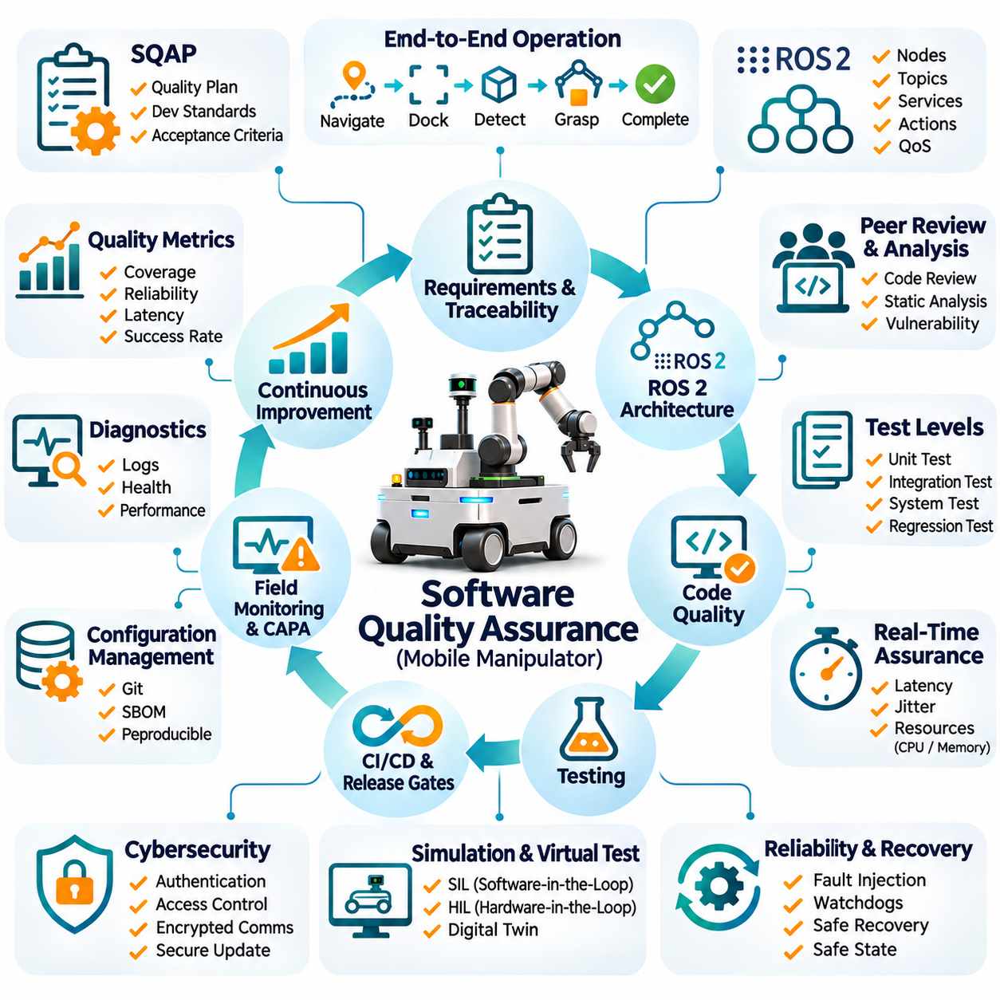{width="7.268055555555556in" height="7.268055555555556in"}

Software Quality Assurance (SQA) is a systematic engineering discipline that ensures software components within a mobile manipulator satisfy established functional, performance, reliability, maintainability, and safety requirements. Because mobile manipulators integrate autonomous navigation, robotic manipulation, artificial intelligence, embedded control, and distributed communication, software quality must be managed across the entire product lifecycle.

Software quality assurance begins with establishing a Software Quality Assurance Plan (SQAP) that defines development standards, verification strategies, testing procedures, documentation requirements, and engineering responsibilities. Quality objectives should be aligned with system requirements and operational risks. The plan should establish measurable acceptance criteria and formal approval procedures for software components and integrated releases.

Software requirements management provides the foundation for establishing consistent software quality. Each software requirement should be traceable to corresponding system requirements, architectural components, implementation modules, and verification activities. Bidirectional traceability enables engineering teams to identify missing functionality, incomplete implementation, inconsistent interfaces, and unintended consequences resulting from requirement changes.

Software architecture quality assurance evaluates modularity, component dependencies, interface consistency, scalability, maintainability, and fault isolation. In ROS 2-based mobile manipulators, architectural verification should examine node organization, topic communication, service interfaces, action servers, Quality of Service (QoS) configurations, and lifecycle management. Architectural deficiencies should be resolved before large-scale software integration.

Source code quality assurance requires standardized coding conventions, structured peer reviews, static code analysis, and automated verification. Programming languages such as C++, Python, and embedded C should follow appropriate language-specific development guidelines. Code reviews should identify logical errors, memory management problems, concurrency issues, duplicated functionality, cybersecurity vulnerabilities, and insufficient exception-handling mechanisms.

Software testing should encompass unit testing, integration testing, functional testing, system testing, and regression testing. Individual modules must be evaluated independently before their interactions are examined within integrated software environments. Automated testing frameworks improve verification consistency and enable repeated evaluation whenever source code, software dependencies, communication interfaces, or operational configurations are modified.

Continuous Integration and Continuous Deployment (CI/CD) pipelines provide an automated infrastructure for maintaining software quality throughout development. Source code commits should trigger compilation, static analysis, dependency checks, automated testing, and software packaging. Deployment to physical robots must require appropriate approval gates, configuration compatibility checks, release authorization, and verified rollback mechanisms.

Real-time software quality assurance is particularly important because mobile manipulators execute time-sensitive control and communication functions. Navigation controllers, motion planners, motor interfaces, and robotic arm controllers must operate within specified timing constraints. Execution latency, scheduling jitter, deadline violations, processor utilization, memory consumption, and communication delays should be evaluated under representative and worst-case workloads.

Software reliability assessment must examine abnormal operating conditions and unexpected system behavior. Communication interruptions, process crashes, sensor failures, corrupted messages, resource exhaustion, and unavailable external services should be incorporated into fault injection scenarios. Exception-handling mechanisms, watchdog processes, controlled recovery procedures, and safe-state transitions must be verified against specified requirements.

Simulation-based software quality assurance enables systematic evaluation before deployment on physical robotic platforms. Software-in-the-Loop (SIL), Hardware-in-the-Loop (HIL), and digital twin environments support repeated testing of navigation algorithms, manipulation sequences, task planning, and failure recovery. Simulation evidence should be complemented by physical testing to identify discrepancies between modeled and actual operating conditions.

Cybersecurity assurance must address unauthorized access, communication security, software integrity, dependency vulnerabilities, and protection of operational data. Authentication, authorization, encrypted communication, secure update mechanisms, and access control policies should be systematically evaluated. Security testing must consider onboard computing platforms, fleet management servers, remote operation interfaces, and third-party software dependencies.

Software configuration management ensures that source code, firmware, libraries, middleware, container images, configuration parameters, and deployment packages remain identifiable and reproducible. Version control systems such as Git support controlled collaboration and revision tracking. A Software Bill of Materials (SBOM) provides additional visibility into software dependencies, component versions, licensing obligations, and potential security vulnerabilities.

Integrated software quality assurance must evaluate coordination between autonomous mobility, robotic manipulation, perception, mission orchestration, and fleet management. End-to-end testing should examine operational sequences involving navigation, docking, object recognition, grasp execution, and task completion. Particular attention should be given to inconsistent system states, unsynchronized commands, invalid coordinate transformations, and incomplete recovery sequences.

Software release management requires documented verification evidence, known defect assessments, compatibility information, and formal acceptance decisions. Field monitoring should collect diagnostic logs, execution failures, resource utilization, communication errors, and mission performance data. Corrective and Preventive Action (CAPA) processes should translate identified software deficiencies into controlled engineering modifications and subsequent regression testing.

Software quality assurance ultimately establishes a closed-loop engineering process connecting requirements, architecture, implementation, testing, deployment, and operational monitoring. Quality metrics such as defect density, code coverage, regression test pass rate, software failure frequency, and recovery effectiveness support objective assessment. Continuous improvement enables reliable, maintainable, secure, and scalable mobile manipulator software throughout commercial operation.

소프트웨어 품질 보증(Software Quality Assurance, SQA)은 모바일 매니퓰레이터(Mobile Manipulator) 내의 소프트웨어 구성 요소(Software Components)가 수립된 기능(Functional), 성능(Performance), 신뢰성(Reliability), 유지보수성(Maintainability) 및 안전 요구사항(Safety Requirements)을 충족하도록 보장하는 체계적인 엔지니어링 분야이다. 모바일 매니퓰레이터는 자율주행(Autonomous Navigation), 로봇 조작(Robotic Manipulation), 인공지능(Artificial Intelligence), 임베디드 제어(Embedded Control) 및 분산 통신(Distributed Communication)을 통합하므로 전체 제품 수명주기(Product Lifecycle)에 걸쳐 소프트웨어 품질을 관리해야 한다.

소프트웨어 품질 보증은 개발 표준(Development Standards), 검증 전략(Verification Strategies), 시험 절차(Testing Procedures), 문서화 요구사항(Documentation Requirements) 및 엔지니어링 책임(Engineering Responsibilities)을 정의하는 소프트웨어 품질 보증 계획(Software Quality Assurance Plan, SQAP)을 수립하는 것에서 시작한다. 품질 목표(Quality Objectives)는 시스템 요구사항(System Requirements) 및 운영 위험(Operational Risks)과 일치해야 한다. 해당 계획은 소프트웨어 구성 요소와 통합 릴리스(Integrated Releases)에 대한 측정 가능한 인수 기준(Measurable Acceptance Criteria) 및 공식 승인 절차(Formal Approval Procedures)를 수립해야 한다.

소프트웨어 요구사항 관리(Software Requirements Management)는 일관된 소프트웨어 품질(Software Quality)을 확립하기 위한 기반을 제공한다. 각각의 소프트웨어 요구사항(Software Requirements)은 해당 시스템 요구사항, 아키텍처 구성 요소(Architectural Components), 구현 모듈(Implementation Modules) 및 검증 활동(Verification Activities)에 대한 추적성(Traceability)을 확보해야 한다. 양방향 추적성(Bidirectional Traceability)은 엔지니어링 팀이 누락된 기능(Missing Functionality), 불완전한 구현(Incomplete Implementation), 일관되지 않은 인터페이스(Inconsistent Interfaces) 및 요구사항 변경으로 인해 발생하는 의도하지 않은 결과(Unintended Consequences)를 식별할 수 있도록 지원한다.

소프트웨어 아키텍처 품질 보증(Software Architecture Quality Assurance)은 모듈화(Modularity), 구성 요소 종속성(Component Dependencies), 인터페이스 일관성(Interface Consistency), 확장성(Scalability), 유지보수성(Maintainability) 및 고장 격리(Fault Isolation)를 평가한다. ROS 2 기반 모바일 매니퓰레이터에서 아키텍처 검증(Architecture Verification)은 노드 구성(Node Organization), 토픽 통신(Topic Communication), 서비스 인터페이스(Service Interfaces), 액션 서버(Action Servers), 서비스 품질(Quality of Service, QoS) 구성 및 수명주기 관리(Lifecycle Management)를 검토해야 한다. 대규모 소프트웨어 통합(Software Integration)을 진행하기 전에 아키텍처 결함(Architectural Deficiencies)을 해결해야 한다.

소스 코드 품질 보증(Source Code Quality Assurance)은 표준화된 코딩 규칙(Standardized Coding Conventions), 체계적인 동료 검토(Structured Peer Reviews), 정적 코드 분석(Static Code Analysis) 및 자동화 검증(Automated Verification)을 필요로 한다. C++, Python 및 임베디드 C(Embedded C)와 같은 프로그래밍 언어(Programming Languages)는 해당 언어에 적합한 개발 지침(Language-Specific Development Guidelines)을 준수해야 한다. 코드 검토(Code Review)는 논리적 오류(Logical Errors), 메모리 관리 문제(Memory Management Problems), 동시성 문제(Concurrency Issues), 중복 기능(Duplicated Functionality), 사이버 보안 취약점(Cybersecurity Vulnerabilities) 및 불충분한 예외 처리 메커니즘(Exception-Handling Mechanisms)을 식별해야 한다.

소프트웨어 시험(Software Testing)은 단위 시험(Unit Testing), 통합 시험(Integration Testing), 기능 시험(Functional Testing), 시스템 시험(System Testing) 및 회귀 시험(Regression Testing)을 포함해야 한다. 개별 모듈(Individual Modules)은 통합 소프트웨어 환경(Integrated Software Environments) 내에서 상호작용을 검토하기 전에 독립적으로 평가해야 한다. 자동화 시험 프레임워크(Automated Testing Frameworks)는 검증 일관성(Verification Consistency)을 향상시키고 소스 코드(Source Code), 소프트웨어 종속성(Software Dependencies), 통신 인터페이스(Communication Interfaces) 또는 운영 구성(Operational Configurations)이 변경될 때마다 반복적인 평가를 수행할 수 있도록 지원한다.

지속적 통합 및 지속적 배포(Continuous Integration and Continuous Deployment, CI/CD) 파이프라인은 개발 전 과정에서 소프트웨어 품질을 유지하기 위한 자동화 인프라(Automated Infrastructure)를 제공한다. 소스 코드 커밋(Source Code Commits)은 컴파일(Compilation), 정적 분석(Static Analysis), 종속성 검사(Dependency Checks), 자동화 시험(Automated Testing) 및 소프트웨어 패키징(Software Packaging)을 자동으로 실행하도록 구성해야 한다. 실제 로봇(Physical Robots)에 소프트웨어를 배포하기 위해서는 적절한 승인 게이트(Approval Gates), 구성 호환성 검사(Configuration Compatibility Checks), 릴리스 승인(Release Authorization) 및 검증된 롤백 메커니즘(Verified Rollback Mechanisms)이 필요하다.

실시간 소프트웨어 품질 보증(Real-Time Software Quality Assurance)은 모바일 매니퓰레이터가 시간에 민감한 제어 및 통신 기능(Time-Sensitive Control and Communication Functions)을 실행하기 때문에 특히 중요하다. 자율주행 제어기(Navigation Controllers), 모션 플래너(Motion Planners), 모터 인터페이스(Motor Interfaces) 및 로봇 팔 제어기(Robotic Arm Controllers)는 명시된 타이밍 제약조건(Timing Constraints) 내에서 동작해야 한다. 실행 지연시간(Execution Latency), 스케줄링 지터(Scheduling Jitter), 마감시간 위반(Deadline Violations), 프로세서 활용률(Processor Utilization), 메모리 사용량(Memory Consumption) 및 통신 지연(Communication Delays)은 대표적인 워크로드와 최악 조건의 워크로드(Worst-Case Workloads)에서 평가해야 한다.

소프트웨어 신뢰성 평가(Software Reliability Assessment)는 비정상 운영 조건(Abnormal Operating Conditions)과 예상하지 못한 시스템 동작(Unexpected System Behavior)을 검토해야 한다. 통신 중단(Communication Interruptions), 프로세스 충돌(Process Crashes), 센서 고장(Sensor Failures), 손상된 메시지(Corrupted Messages), 자원 고갈(Resource Exhaustion) 및 외부 서비스 이용 불가(Unavailable External Services)는 고장 주입 시나리오(Fault Injection Scenarios)에 포함해야 한다. 예외 처리 메커니즘(Exception-Handling Mechanisms), 워치독 프로세스(Watchdog Processes), 통제된 복구 절차(Controlled Recovery Procedures) 및 안전 상태 전환(Safe-State Transitions)은 명시된 요구사항을 기준으로 검증해야 한다.

시뮬레이션 기반 소프트웨어 품질 보증(Simulation-Based Software Quality Assurance)은 실제 로봇 플랫폼(Physical Robotic Platforms)에 배포하기 전에 체계적인 평가를 수행할 수 있도록 지원한다. 소프트웨어 인 더 루프(Software-in-the-Loop, SIL), 하드웨어 인 더 루프(Hardware-in-the-Loop, HIL) 및 디지털 트윈 환경(Digital Twin Environments)은 자율주행 알고리즘(Navigation Algorithms), 조작 시퀀스(Manipulation Sequences), 작업 계획(Task Planning) 및 고장 복구(Failure Recovery)에 대한 반복 시험을 지원한다. 모델링된 운영 조건과 실제 운영 조건 사이의 차이점(Discrepancies)을 식별하기 위해 시뮬레이션 증거(Simulation Evidence)는 실제 시스템 시험(Physical Testing)을 통해 보완해야 한다.

사이버 보안 보증(Cybersecurity Assurance)은 승인되지 않은 접근(Unauthorized Access), 통신 보안(Communication Security), 소프트웨어 무결성(Software Integrity), 종속성 취약점(Dependency Vulnerabilities) 및 운영 데이터 보호(Operational Data Protection)를 고려해야 한다. 인증(Authentication), 인가(Authorization), 암호화 통신(Encrypted Communication), 보안 업데이트 메커니즘(Secure Update Mechanisms) 및 접근 제어 정책(Access Control Policies)을 체계적으로 평가해야 한다. 보안 시험(Security Testing)은 온보드 컴퓨팅 플랫폼(Onboard Computing Platforms), 플릿 관리 서버(Fleet Management Servers), 원격 운영 인터페이스(Remote Operation Interfaces) 및 서드파티 소프트웨어 종속성(Third-Party Software Dependencies)을 고려해야 한다.

소프트웨어 형상 관리(Software Configuration Management)는 소스 코드(Source Code), 펌웨어(Firmware), 라이브러리(Libraries), 미들웨어(Middleware), 컨테이너 이미지(Container Images), 구성 파라미터(Configuration Parameters) 및 배포 패키지(Deployment Packages)의 식별 가능성(Identifiability)과 재현 가능성(Reproducibility)을 유지하도록 보장한다. Git과 같은 버전 관리 시스템(Version Control Systems)은 통제된 협업(Controlled Collaboration)과 개정 이력 추적(Revision Tracking)을 지원한다. 소프트웨어 자재 명세서(Software Bill of Materials, SBOM)는 소프트웨어 종속성, 구성 요소 버전(Component Versions), 라이선스 의무사항(Licensing Obligations) 및 잠재적인 보안 취약점(Potential Security Vulnerabilities)에 대한 추가적인 가시성(Visibility)을 제공한다.

통합 소프트웨어 품질 보증(Integrated Software Quality Assurance)은 자율 이동(Autonomous Mobility), 로봇 조작(Robotic Manipulation), 인지(Perception), 임무 오케스트레이션(Mission Orchestration) 및 플릿 관리(Fleet Management) 사이의 협조 동작(Coordination)을 평가해야 한다. 종단 간 시험(End-to-End Testing)은 자율주행(Navigation), 도킹(Docking), 객체 인식(Object Recognition), 파지 실행(Grasp Execution) 및 작업 완료(Task Completion)를 포함하는 운영 시퀀스(Operational Sequences)를 검토해야 한다. 특히 일관되지 않은 시스템 상태(Inconsistent System States), 동기화되지 않은 명령(Unsynchronized Commands), 유효하지 않은 좌표 변환(Invalid Coordinate Transformations) 및 불완전한 복구 시퀀스(Incomplete Recovery Sequences)에 주의를 기울여야 한다.

소프트웨어 릴리스 관리(Software Release Management)는 문서화된 검증 증거(Documented Verification Evidence), 알려진 결함에 대한 평가(Known Defect Assessments), 호환성 정보(Compatibility Information) 및 공식 인수 판정(Formal Acceptance Decisions)을 필요로 한다. 현장 모니터링(Field Monitoring)은 진단 로그(Diagnostic Logs), 실행 실패(Execution Failures), 자원 활용률(Resource Utilization), 통신 오류(Communication Errors) 및 임무 성능 데이터(Mission Performance Data)를 수집해야 한다. 시정 및 예방 조치(Corrective and Preventive Action, CAPA) 프로세스는 식별된 소프트웨어 결함(Software Deficiencies)을 통제된 엔지니어링 변경(Controlled Engineering Modifications)과 후속 회귀 시험(Subsequent Regression Testing)으로 연결해야 한다.

궁극적으로 소프트웨어 품질 보증(Software Quality Assurance)은 요구사항(Requirements), 아키텍처(Architecture), 구현(Implementation), 시험(Testing), 배포(Deployment) 및 운영 모니터링(Operational Monitoring)을 연결하는 폐루프 엔지니어링 프로세스(Closed-Loop Engineering Process)를 확립한다. 결함 밀도(Defect Density), 코드 커버리지(Code Coverage), 회귀 시험 통과율(Regression Test Pass Rate), 소프트웨어 고장 발생 빈도(Software Failure Frequency) 및 복구 효과성(Recovery Effectiveness)과 같은 품질 지표(Quality Metrics)는 객관적인 평가(Objective Assessment)를 지원한다. 지속적 개선(Continuous Improvement)을 통해 상용 운영(Commercial Operation) 전반에 걸쳐 신뢰성(Reliability), 유지보수성(Maintainability), 보안성(Security) 및 확장성(Scalability)을 갖춘 모바일 매니퓰레이터 소프트웨어를 확보할 수 있다.

##  

## 06 AI Quality Assurance

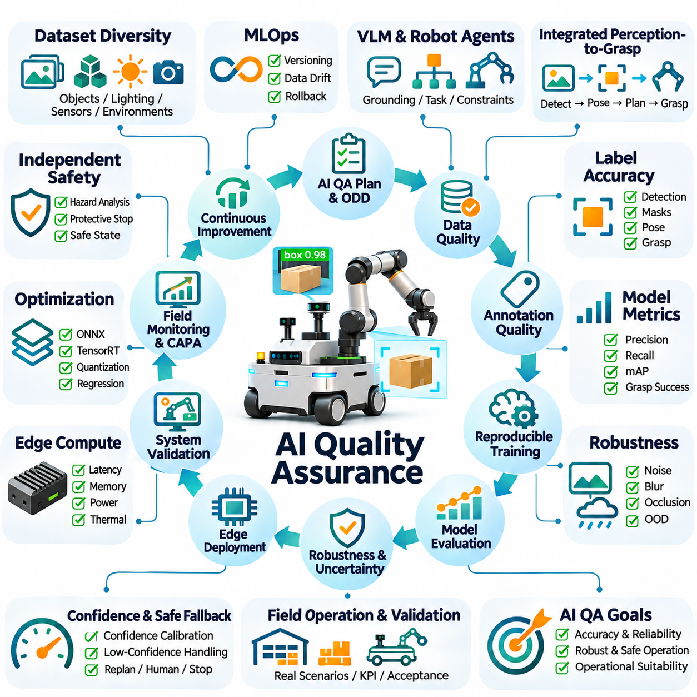{width="7.268055555555556in" height="7.268055555555556in"}

Artificial Intelligence Quality Assurance (AI QA) is a systematic engineering discipline that ensures AI components within a mobile manipulator satisfy established requirements for accuracy, reliability, robustness, computational efficiency, and operational suitability. Unlike conventional software, AI systems exhibit statistical and context-dependent behavior, requiring quality assurance throughout data preparation, model development, deployment, and field operation.

AI quality assurance begins with establishing an AI Quality Assurance Plan that defines quality objectives, evaluation methodologies, acceptance criteria, documentation requirements, and engineering responsibilities. These elements should reflect the intended application and Operational Design Domain (ODD). Quality planning must also consider the operational consequences of incorrect predictions, uncertain decisions, and inappropriate robotic actions.

Data quality assurance establishes the foundation for reliable AI model development. Training, validation, and test datasets must be evaluated for accuracy, completeness, consistency, diversity, and representativeness. Data collection should encompass variations in object geometry, illumination, background conditions, sensor characteristics, and operational environments. Dataset deficiencies may introduce systematic errors that persist throughout deployment.

Annotation quality assurance ensures that object detection labels, segmentation masks, pose annotations, grasp configurations, and other supervisory information accurately represent physical objects and operational conditions. Annotation guidelines, independent reviews, inter-annotator agreement, and automated consistency checks should be established. Incorrect or inconsistent annotations must be identified and corrected before model training.

AI model quality assurance evaluates the suitability of model architectures, training strategies, hyperparameter configurations, and optimization procedures. Model development should maintain reproducible experimental environments, controlled dataset versions, and documented training configurations. Independent test datasets must remain separated from training and model selection activities to prevent data leakage and misleading performance estimates.

Performance evaluation should employ metrics appropriate to individual AI functions. Object detection may be assessed using precision, recall, and mean Average Precision (mAP), while pose estimation requires translational and rotational error measurements. Grasp detection should consider physical grasp success rates. Model-level metrics must be supplemented by system-level measurements reflecting actual manipulation and mission performance.

Robustness assurance evaluates AI model behavior under environmental variations, sensor noise, partial occlusion, motion blur, illumination changes, and unfamiliar object configurations. Stress testing and controlled perturbation experiments help identify operational boundaries and performance limitations. AI systems should demonstrate acceptable behavior within their intended operating conditions and respond appropriately when those conditions are exceeded.

Uncertainty estimation and Out-of-Distribution (OOD) detection are particularly important when AI predictions influence physical robotic actions. Confidence calibration should determine whether prediction confidence corresponds to observed correctness. Low-confidence predictions and unfamiliar input conditions should trigger defined responses, including additional perception, alternative grasp planning, human intervention, or controlled task termination.

Computational quality assurance evaluates inference latency, processing throughput, memory consumption, power utilization, and thermal behavior on target deployment hardware. AI models operating on embedded processors or edge computing platforms must satisfy timing and resource constraints while sharing computational resources with navigation, manipulation, and communication processes. Average inference speed alone is insufficient for deployment approval.

AI deployment quality assurance verifies that model conversion, quantization, compression, inference optimization, and runtime configuration preserve acceptable operational performance. Deployment frameworks such as ONNX Runtime and TensorRT may introduce numerical differences or execution constraints. Optimized models must undergo comparative evaluation and regression testing on the actual target hardware before receiving production approval.

Integrated AI quality assurance examines interactions between perception models, coordinate transformations, grasp planning, motion planning, and robotic control. Accurate object detection does not necessarily guarantee successful manipulation because pose uncertainty, calibration errors, and communication delays may affect physical execution. End-to-end testing must establish whether AI outputs contribute to reliable and consistent operational outcomes.

Advanced AI components, including Vision-Language Models (VLMs), robot agents, and embodied AI systems, require additional quality assurance mechanisms. Evaluation should examine instruction interpretation, environmental grounding, task decomposition, reasoning consistency, and inappropriate action generation. Generated commands must remain subject to validated execution constraints, workspace restrictions, and independent safety mechanisms.

AI safety assurance must address the physical consequences of erroneous predictions and autonomous decisions. Hazard analysis should examine missed detections, incorrect object identification, inaccurate pose estimation, unstable grasp selection, and unexpected task execution. Independent protective functions must remain effective when AI components fail. High statistical model accuracy cannot substitute for verified functional safety measures.

Machine Learning Operations (MLOps) provides the infrastructure for maintaining AI quality throughout the product lifecycle. Dataset versioning, experiment tracking, model registries, automated evaluation, deployment authorization, and rollback mechanisms enable controlled model management. Field monitoring should identify data drift, performance degradation, recurring prediction errors, and changes in operational conditions that require further investigation.

AI quality assurance ultimately establishes a closed-loop process connecting data governance, model development, performance evaluation, system integration, deployment, and operational monitoring. Quality metrics should include prediction accuracy, inference latency, failure frequency, uncertainty calibration, and model regression rates. Corrective and Preventive Action (CAPA) and controlled model updates support continuous improvement and dependable commercial operation.

인공지능 품질 보증(Artificial Intelligence Quality Assurance, AI QA)은 모바일 매니퓰레이터(Mobile Manipulator) 내의 인공지능 구성 요소(AI Components)가 수립된 정확도(Accuracy), 신뢰성(Reliability), 강건성(Robustness), 컴퓨팅 효율성(Computational Efficiency) 및 운영 적합성(Operational Suitability) 요구사항을 충족하도록 보장하는 체계적인 엔지니어링 분야이다. 기존 소프트웨어(Conventional Software)와 달리 인공지능 시스템은 통계적이고 상황 의존적인 동작 특성(Statistical and Context-Dependent Behavior)을 나타내므로 데이터 준비(Data Preparation), 모델 개발(Model Development), 배포(Deployment) 및 현장 운영(Field Operation) 전반에 걸쳐 품질 보증이 필요하다.

인공지능 품질 보증은 품질 목표(Quality Objectives), 평가 방법론(Evaluation Methodologies), 인수 기준(Acceptance Criteria), 문서화 요구사항(Documentation Requirements) 및 엔지니어링 책임(Engineering Responsibilities)을 정의하는 인공지능 품질 보증 계획(AI Quality Assurance Plan)을 수립하는 것에서 시작한다. 이러한 요소는 의도된 응용 분야(Intended Application)와 운영 설계 영역(Operational Design Domain, ODD)을 반영해야 한다. 품질 계획(Quality Planning)은 잘못된 예측(Incorrect Predictions), 불확실한 의사결정(Uncertain Decisions) 및 부적절한 로봇 동작(Inappropriate Robotic Actions)으로 인해 발생할 수 있는 운영상의 결과도 고려해야 한다.

데이터 품질 보증(Data Quality Assurance)은 신뢰성 있는 인공지능 모델 개발을 위한 기반을 확립한다. 학습 데이터셋(Training Dataset), 검증 데이터셋(Validation Dataset) 및 시험 데이터셋(Test Dataset)은 정확성(Accuracy), 완전성(Completeness), 일관성(Consistency), 다양성(Diversity) 및 대표성(Representativeness)을 기준으로 평가해야 한다. 데이터 수집(Data Collection)은 객체 형상(Object Geometry), 조명(Illumination), 배경 조건(Background Conditions), 센서 특성(Sensor Characteristics) 및 운영 환경(Operational Environments)의 다양한 변화를 포함해야 한다. 데이터셋 결함(Dataset Deficiencies)은 배포 이후에도 지속되는 계통적 오차(Systematic Errors)를 유발할 수 있다.

주석 품질 보증(Annotation Quality Assurance)은 객체 검출 레이블(Object Detection Labels), 분할 마스크(Segmentation Masks), 자세 주석(Pose Annotations), 파지 구성(Grasp Configurations) 및 기타 지도학습 정보(Supervisory Information)가 물리적 객체(Physical Objects)와 운영 조건(Operational Conditions)을 정확하게 반영하도록 보장한다. 주석 작성 지침(Annotation Guidelines), 독립적 검토(Independent Reviews), 주석 작업자 간 일치도(Inter-Annotator Agreement) 및 자동화된 일관성 검사(Automated Consistency Checks)를 확립해야 한다. 잘못되거나 일관되지 않은 주석(Annotations)은 모델 학습(Model Training) 이전에 식별하고 수정해야 한다.

인공지능 모델 품질 보증(AI Model Quality Assurance)은 모델 아키텍처(Model Architectures), 학습 전략(Training Strategies), 하이퍼파라미터 구성(Hyperparameter Configurations) 및 최적화 절차(Optimization Procedures)의 적합성을 평가한다. 모델 개발 과정에서는 재현 가능한 실험 환경(Reproducible Experimental Environments), 통제된 데이터셋 버전(Controlled Dataset Versions) 및 문서화된 학습 구성(Documented Training Configurations)을 유지해야 한다. 데이터 누출(Data Leakage)과 잘못된 성능 추정(Misleading Performance Estimates)을 방지하기 위해 독립적인 시험 데이터셋(Independent Test Datasets)은 학습 및 모델 선정(Model Selection) 활동으로부터 분리되어야 한다.

성능 평가(Performance Evaluation)는 개별 인공지능 기능(AI Functions)에 적합한 평가지표(Metrics)를 활용해야 한다. 객체 검출(Object Detection)은 정밀도(Precision), 재현율(Recall) 및 평균 정밀도의 평균(mean Average Precision, mAP)을 활용하여 평가할 수 있으며, 자세 추정(Pose Estimation)은 병진 오차(Translational Error)와 회전 오차(Rotational Error)의 측정을 필요로 한다. 파지 검출(Grasp Detection)은 실제 물리적 파지 성공률(Physical Grasp Success Rate)을 고려해야 한다. 모델 수준 지표(Model-Level Metrics)는 실제 조작 성능(Manipulation Performance)과 임무 성능(Mission Performance)을 반영하는 시스템 수준 측정(System-Level Measurements)을 통해 보완해야 한다.

강건성 보증(Robustness Assurance)은 환경적 변화(Environmental Variations), 센서 잡음(Sensor Noise), 부분적 가려짐(Partial Occlusion), 모션 블러(Motion Blur), 조명 변화(Illumination Changes) 및 익숙하지 않은 객체 구성(Unfamiliar Object Configurations)에서 인공지능 모델의 동작을 평가한다. 스트레스 시험(Stress Testing)과 통제된 교란 실험(Controlled Perturbation Experiments)은 운영 경계(Operational Boundaries) 및 성능 한계(Performance Limitations)를 식별하는 데 도움이 된다. 인공지능 시스템은 의도된 운영 조건 내에서 허용 가능한 동작을 입증하고, 해당 조건을 벗어나는 경우에도 적절하게 대응할 수 있어야 한다.

불확실성 추정(Uncertainty Estimation)과 분포 외 데이터 검출(Out-of-Distribution Detection, OOD Detection)은 인공지능 예측(AI Predictions)이 물리적인 로봇 동작(Physical Robotic Actions)에 영향을 미치는 경우 특히 중요하다. 신뢰도 보정(Confidence Calibration)은 예측 신뢰도(Prediction Confidence)가 실제 관찰된 예측의 정확성과 일치하는지를 판단해야 한다. 낮은 신뢰도의 예측(Low-Confidence Predictions)과 익숙하지 않은 입력 조건(Unfamiliar Input Conditions)은 추가 인지(Additional Perception), 대체 파지 계획(Alternative Grasp Planning), 인간 개입(Human Intervention) 또는 통제된 작업 종료(Controlled Task Termination)를 포함하는 사전에 정의된 대응 절차를 실행하도록 해야 한다.

컴퓨팅 품질 보증(Computational Quality Assurance)은 대상 배포 하드웨어(Target Deployment Hardware)에서의 추론 지연시간(Inference Latency), 처리량(Processing Throughput), 메모리 사용량(Memory Consumption), 전력 사용량(Power Utilization) 및 열적 거동(Thermal Behavior)을 평가한다. 임베디드 프로세서(Embedded Processors) 또는 엣지 컴퓨팅 플랫폼(Edge Computing Platforms)에서 동작하는 인공지능 모델은 자율주행(Navigation), 로봇 조작(Manipulation) 및 통신 프로세스(Communication Processes)와 컴퓨팅 자원(Computational Resources)을 공유하면서 타이밍 제약조건(Timing Constraints)과 자원 제약조건(Resource Constraints)을 충족해야 한다. 평균 추론 속도(Average Inference Speed)만으로는 배포 승인(Deployment Approval)을 결정하기에 충분하지 않다.

인공지능 배포 품질 보증(AI Deployment Quality Assurance)은 모델 변환(Model Conversion), 양자화(Quantization), 압축(Compression), 추론 최적화(Inference Optimization) 및 런타임 구성(Runtime Configuration)이 허용 가능한 운영 성능(Operational Performance)을 유지하는지를 검증한다. ONNX Runtime 및 TensorRT와 같은 배포 프레임워크(Deployment Frameworks)는 수치적 차이(Numerical Differences) 또는 실행 제약조건(Execution Constraints)을 유발할 수 있다. 최적화된 모델(Optimized Models)은 양산 승인(Production Approval)을 받기 전에 실제 대상 하드웨어에서 비교 평가(Comparative Evaluation)와 회귀 시험(Regression Testing)을 거쳐야 한다.

통합 인공지능 품질 보증(Integrated AI Quality Assurance)은 인지 모델(Perception Models), 좌표 변환(Coordinate Transformations), 파지 계획(Grasp Planning), 모션 계획(Motion Planning) 및 로봇 제어(Robotic Control) 사이의 상호작용(Interactions)을 검토한다. 정확한 객체 검출이 반드시 성공적인 로봇 조작을 보장하는 것은 아니며, 자세 불확실성(Pose Uncertainty), 보정 오차(Calibration Errors) 및 통신 지연(Communication Delays)이 물리적 실행(Physical Execution)에 영향을 미칠 수 있다. 종단 간 시험(End-to-End Testing)은 인공지능 출력(AI Outputs)이 신뢰성 있고 일관된 운영 결과(Operational Outcomes)를 달성하는 데 기여하는지를 확인해야 한다.

시각-언어 모델(Vision-Language Models, VLMs), 로봇 에이전트(Robot Agents) 및 체화 인공지능 시스템(Embodied AI Systems)을 포함하는 고도화된 인공지능 구성 요소는 추가적인 품질 보증 메커니즘(Quality Assurance Mechanisms)을 필요로 한다. 평가 과정에서는 명령 해석(Instruction Interpretation), 환경 기반 정합성(Environmental Grounding), 작업 분해(Task Decomposition), 추론 일관성(Reasoning Consistency) 및 부적절한 행동 생성(Inappropriate Action Generation)을 검토해야 한다. 생성된 명령(Generated Commands)은 유효성이 확인된 실행 제약조건(Validated Execution Constraints), 작업 공간 제한(Workspace Restrictions) 및 독립적인 안전 메커니즘(Independent Safety Mechanisms)의 통제를 받아야 한다.

인공지능 안전 보증(AI Safety Assurance)은 잘못된 예측(Erroneous Predictions)과 자율 의사결정(Autonomous Decisions)으로 인해 발생할 수 있는 물리적 결과(Physical Consequences)를 고려해야 한다. 위험원 분석(Hazard Analysis)은 검출 누락(Missed Detections), 잘못된 객체 식별(Incorrect Object Identification), 부정확한 자세 추정(Inaccurate Pose Estimation), 불안정한 파지 선정(Unstable Grasp Selection) 및 예상하지 못한 작업 실행(Unexpected Task Execution)을 검토해야 한다. 인공지능 구성 요소에 고장이 발생하더라도 독립적인 보호 기능(Independent Protective Functions)은 유효하게 유지되어야 한다. 높은 통계적 모델 정확도(Statistical Model Accuracy)는 검증된 기능 안전 조치(Verified Functional Safety Measures)를 대체할 수 없다.

기계학습 운영(Machine Learning Operations, MLOps)은 제품 수명주기(Product Lifecycle) 전반에 걸쳐 인공지능 품질을 유지하기 위한 인프라(Infrastructure)를 제공한다. 데이터셋 버전 관리(Dataset Versioning), 실험 추적(Experiment Tracking), 모델 레지스트리(Model Registries), 자동화 평가(Automated Evaluation), 배포 승인(Deployment Authorization) 및 롤백 메커니즘(Rollback Mechanisms)은 통제된 모델 관리(Controlled Model Management)를 가능하게 한다. 현장 모니터링(Field Monitoring)은 데이터 분포 변화(Data Drift), 성능 저하(Performance Degradation), 반복적인 예측 오류(Recurring Prediction Errors) 및 추가적인 조사가 필요한 운영 조건의 변화(Changes in Operational Conditions)를 식별해야 한다.

궁극적으로 인공지능 품질 보증(AI Quality Assurance)은 데이터 거버넌스(Data Governance), 모델 개발(Model Development), 성능 평가(Performance Evaluation), 시스템 통합(System Integration), 배포(Deployment) 및 운영 모니터링(Operational Monitoring)을 연결하는 폐루프 프로세스(Closed-Loop Process)를 확립한다. 품질 지표(Quality Metrics)는 예측 정확도(Prediction Accuracy), 추론 지연시간(Inference Latency), 고장 발생 빈도(Failure Frequency), 불확실성 보정(Uncertainty Calibration) 및 모델 성능 회귀율(Model Regression Rates)을 포함해야 한다. 시정 및 예방 조치(Corrective and Preventive Action, CAPA)와 통제된 모델 업데이트(Controlled Model Updates)는 지속적 개선(Continuous Improvement)과 신뢰성 있는 상용 운영(Dependable Commercial Operation)을 지원한다.

##  

## 07 Safety Compliance

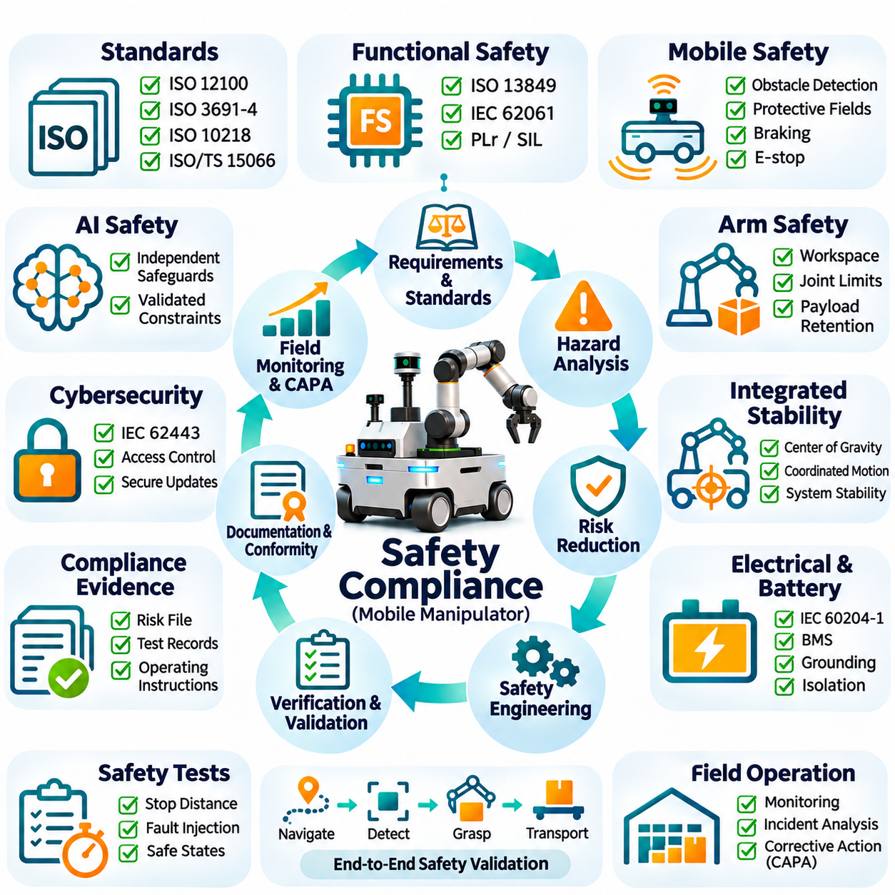{width="7.268055555555556in" height="7.268055555555556in"}

Safety compliance is a systematic quality assurance discipline that ensures mobile manipulators satisfy applicable safety requirements, regulatory obligations, and recognized engineering standards. Because these robotic systems integrate autonomous mobility, robotic manipulation, artificial intelligence, and human interaction, safety compliance must address both individual subsystem hazards and risks arising from integrated system operation.

Safety compliance management begins with identifying applicable regulations, international standards, customer requirements, and operational restrictions. The intended application, deployment location, system configuration, and human interaction characteristics determine the relevant compliance obligations. A Safety Compliance Matrix should establish traceability between applicable requirements, engineering implementations, verification procedures, and supporting evidence.

International safety standards provide an important foundation for mobile manipulator development. ISO 12100 addresses machinery risk assessment and risk reduction, while ISO 3691-4 covers safety requirements for driverless industrial trucks and their systems. The ISO 10218 series addresses industrial robot safety, and ISO/TS 15066 provides guidance for collaborative applications. Applicability must be assessed for each complete robotic system.

Hazard identification and risk assessment should be performed throughout the development lifecycle. Potential hazards include unintended movement, collisions, crushing, trapping, falling payloads, electrical failures, battery-related incidents, and unexpected autonomous decisions. Risk assessment must consider normal operation, foreseeable misuse, maintenance activities, system failures, and interactions between the robotic arm and mobile platform.

Risk reduction should follow a structured hierarchy that prioritizes inherently safe design measures, safeguarding, complementary protective measures, and information for use. Mechanical stability, restricted movement ranges, appropriate speed limits, protective devices, and clearly defined operating boundaries contribute to risk reduction. Residual risks must be documented and communicated through operating instructions, warning indicators, and personnel training.

Functional safety compliance evaluates whether safety-related control systems provide the required level of risk reduction. ISO 13849 and IEC 62061 provide methodologies for developing and assessing safety-related control functions in machinery. Required Performance Levels (PLr) or Safety Integrity Levels (SIL) should be determined through applicable risk assessment procedures and supported by suitable architectural and reliability evidence.

Mobile platform safety compliance addresses autonomous navigation, obstacle detection, protective field configuration, braking performance, speed monitoring, and emergency stopping. Verification must consider payload variations, floor conditions, travel directions, stopping distances, and sensor coverage. Safety-related protective devices should remain effective throughout the defined operating environment, including foreseeable abnormal operating conditions.

Manipulator safety compliance evaluates robotic arm movements, joint limitations, workspace restrictions, tool operation, payload retention, and potential human exposure. Collaborative applications may require safety-rated monitored stopping, speed and separation monitoring, hand guiding, or power and force limiting. The suitability of each protective approach must be established through application-specific risk assessment and validation.

Integrated safety compliance is particularly important because combining an autonomous mobile robot with a robotic arm introduces additional system-level hazards. Extended manipulator configurations may alter the center of gravity, protective field requirements, and collision boundaries. Safety mechanisms must address coordinated mobility and manipulation, preventing hazardous simultaneous movements and maintaining stability across permitted operating configurations.

Electrical and battery safety compliance addresses power distribution, electrical insulation, grounding, overcurrent protection, thermal management, and emergency power isolation. Applicable requirements may include IEC 60204-1 and relevant battery safety standards. Battery Management Systems (BMS), charging interfaces, protective circuits, and electrical enclosures must be evaluated against operational stresses and foreseeable electrical fault conditions.

Artificial intelligence safety compliance must consider the consequences of inaccurate perception, incorrect object identification, unreliable grasp predictions, and inappropriate autonomous decisions. Conventional AI performance metrics cannot independently demonstrate functional safety. Learning-based components should operate within validated execution constraints, supported by independently implemented safety functions that provide the required risk reduction.

Software and cybersecurity compliance should address failures or unauthorized actions that could compromise safety-related behavior. Communication integrity, access control, secure software updates, configuration management, and fault recovery mechanisms contribute to operational protection. Relevant provisions of the IEC 62443 series may support industrial cybersecurity engineering, with particular attention to remote operation and fleet management interfaces.

Safety verification and validation must generate objective evidence demonstrating that protective functions satisfy specified safety requirements and provide adequate risk reduction. Emergency stopping, protective stopping, safe speed monitoring, fault detection, and safe-state transitions should undergo controlled testing. Fault injection, stopping distance measurements, and representative operational scenarios support comprehensive safety assessment.

Safety compliance documentation should maintain risk assessment reports, safety requirements, engineering drawings, functional safety calculations, verification records, validation reports, and operating instructions. Regulatory conformity assessment must follow the requirements of the target market. Product modifications affecting safety functions require impact assessment, updated documentation, and appropriate reverification or revalidation before release.

Safety compliance ultimately establishes a continuous quality management process connecting regulatory requirements, hazard analysis, risk reduction, engineering implementation, verification, validation, and field monitoring. Operational incidents, near misses, and safety-related failures must support Corrective and Preventive Action (CAPA). This lifecycle approach strengthens regulatory conformity, operational safety, product reliability, and sustainable commercialization.

안전 규정 준수(Safety Compliance)는 모바일 매니퓰레이터(Mobile Manipulator)가 적용 가능한 안전 요구사항(Safety Requirements), 규제 의무사항(Regulatory Obligations) 및 공인된 엔지니어링 표준(Recognized Engineering Standards)을 충족하도록 보장하는 체계적인 품질 보증 분야(Quality Assurance Discipline)이다. 이러한 로봇 시스템은 자율 이동(Autonomous Mobility), 로봇 조작(Robotic Manipulation), 인공지능(Artificial Intelligence) 및 인간 상호작용(Human Interaction)을 통합하므로 안전 규정 준수는 개별 하위 시스템의 위험원(Subsystem Hazards)과 통합 시스템 운영(Integrated System Operation)에서 발생하는 위험(Risks)을 모두 고려해야 한다.

안전 규정 준수 관리(Safety Compliance Management)는 적용 가능한 규제(Applicable Regulations), 국제 표준(International Standards), 고객 요구사항(Customer Requirements) 및 운영 제한사항(Operational Restrictions)을 식별하는 것에서 시작한다. 의도된 응용 분야(Intended Application), 배포 위치(Deployment Location), 시스템 구성(System Configuration) 및 인간 상호작용 특성(Human Interaction Characteristics)은 관련 규정 준수 의무사항(Compliance Obligations)을 결정한다. 안전 규정 준수 매트릭스(Safety Compliance Matrix)는 적용 가능한 요구사항, 엔지니어링 구현(Engineering Implementations), 검증 절차(Verification Procedures) 및 뒷받침하는 증거(Supporting Evidence) 사이의 추적성(Traceability)을 확립해야 한다.

국제 안전 표준(International Safety Standards)은 모바일 매니퓰레이터 개발을 위한 중요한 기반을 제공한다. ISO 12100은 기계류 위험 평가(Machinery Risk Assessment) 및 위험 감소(Risk Reduction)를 다루며, ISO 3691-4는 무인 산업용 운반차(Driverless Industrial Trucks) 및 관련 시스템의 안전 요구사항을 다룬다. ISO 10218 시리즈는 산업용 로봇 안전(Industrial Robot Safety)을 다루며, ISO/TS 15066은 협동 응용 분야(Collaborative Applications)에 대한 지침을 제공한다. 각 표준의 적용 가능성(Applicability)은 개별 완성 로봇 시스템(Complete Robotic System)을 기준으로 평가해야 한다.

위험원 식별(Hazard Identification)과 위험 평가(Risk Assessment)는 전체 개발 수명주기(Development Lifecycle)에 걸쳐 수행해야 한다. 잠재적인 위험원(Potential Hazards)에는 의도하지 않은 움직임(Unintended Movement), 충돌(Collision), 압착(Crushing), 끼임(Trapping), 적재물 낙하(Falling Payloads), 전기적 고장(Electrical Failures), 배터리 관련 사고(Battery-Related Incidents) 및 예상하지 못한 자율 의사결정(Unexpected Autonomous Decisions)이 포함된다. 위험 평가는 정상 운영(Normal Operation), 예측 가능한 오사용(Foreseeable Misuse), 유지보수 활동(Maintenance Activities), 시스템 고장(System Failures) 및 로봇 팔과 모바일 플랫폼 사이의 상호작용을 고려해야 한다.

위험 감소(Risk Reduction)는 본질적으로 안전한 설계 조치(Inherently Safe Design Measures), 안전 방호(Safeguarding), 보완적 보호 조치(Complementary Protective Measures) 및 사용 정보(Information for Use)를 우선순위에 따라 적용하는 체계적인 계층 구조(Structured Hierarchy)를 따라야 한다. 기계적 안정성(Mechanical Stability), 제한된 동작 범위(Restricted Movement Ranges), 적절한 속도 제한(Speed Limits), 보호 장치(Protective Devices) 및 명확하게 정의된 운영 경계(Operating Boundaries)는 위험 감소에 기여한다. 잔여 위험(Residual Risks)은 문서화하고 운영 지침(Operating Instructions), 경고 표시 장치(Warning Indicators) 및 작업자 교육(Personnel Training)을 통해 전달해야 한다.

기능 안전 규정 준수(Functional Safety Compliance)는 안전 관련 제어 시스템(Safety-Related Control Systems)이 요구되는 수준의 위험 감소를 제공하는지를 평가한다. ISO 13849 및 IEC 62061은 기계류의 안전 관련 제어 기능(Safety-Related Control Functions)을 개발하고 평가하기 위한 방법론(Methodologies)을 제공한다. 요구 성능 수준(Required Performance Level, PLr) 또는 안전 무결성 수준(Safety Integrity Level, SIL)은 적용 가능한 위험 평가 절차(Risk Assessment Procedures)를 통해 결정해야 하며, 적절한 아키텍처 및 신뢰성 증거(Architectural and Reliability Evidence)를 통해 뒷받침되어야 한다.

모바일 플랫폼 안전 규정 준수(Mobile Platform Safety Compliance)는 자율주행(Autonomous Navigation), 장애물 검출(Obstacle Detection), 보호 영역 구성(Protective Field Configuration), 제동 성능(Braking Performance), 속도 모니터링(Speed Monitoring) 및 비상 정지(Emergency Stopping)를 다룬다. 검증(Verification)은 가반하중 변화(Payload Variations), 바닥 조건(Floor Conditions), 이동 방향(Travel Directions), 정지 거리(Stopping Distances) 및 센서 감지 범위(Sensor Coverage)를 고려해야 한다. 안전 관련 보호 장치(Safety-Related Protective Devices)는 예측 가능한 비정상 운영 조건(Foreseeable Abnormal Operating Conditions)을 포함하여 정의된 운영 환경 전반에서 유효하게 작동해야 한다.

매니퓰레이터 안전 규정 준수(Manipulator Safety Compliance)는 로봇 팔 동작(Robotic Arm Movements), 관절 제한(Joint Limitations), 작업 공간 제한(Workspace Restrictions), 도구 작동(Tool Operation), 적재물 유지(Payload Retention) 및 인간의 잠재적 위험 노출(Potential Human Exposure)을 평가한다. 협동 응용 분야에서는 안전 등급 감시 정지(Safety-Rated Monitored Stop), 속도 및 이격 거리 모니터링(Speed and Separation Monitoring), 수동 유도(Hand Guiding) 또는 동력 및 힘 제한(Power and Force Limiting)이 필요할 수 있다. 각각의 보호 방식(Protective Approach)에 대한 적합성은 응용 분야별 위험 평가(Application-Specific Risk Assessment) 및 유효성 확인(Validation)을 통해 확립해야 한다.

통합 안전 규정 준수(Integrated Safety Compliance)는 자율 이동 로봇(Autonomous Mobile Robot, AMR)과 로봇 팔(Robotic Arm)의 결합으로 인해 추가적인 시스템 수준 위험원(System-Level Hazards)이 발생한다는 점에서 특히 중요하다. 매니퓰레이터가 확장된 구성(Extended Manipulator Configurations)은 무게중심(Center of Gravity), 보호 영역 요구사항(Protective Field Requirements) 및 충돌 경계(Collision Boundaries)를 변화시킬 수 있다. 안전 메커니즘(Safety Mechanisms)은 이동 및 조작의 협조 동작(Coordinated Mobility and Manipulation)을 고려하고, 위험한 동시 동작(Hazardous Simultaneous Movements)을 방지하며 허용된 운영 구성(Permitted Operating Configurations) 전반에서 안정성을 유지해야 한다.

전기 및 배터리 안전 규정 준수(Electrical and Battery Safety Compliance)는 전력 분배(Power Distribution), 전기 절연(Electrical Insulation), 접지(Grounding), 과전류 보호(Overcurrent Protection), 열 관리(Thermal Management) 및 비상 전원 차단(Emergency Power Isolation)을 다룬다. 적용 가능한 요구사항에는 IEC 60204-1 및 관련 배터리 안전 표준(Battery Safety Standards)이 포함될 수 있다. 배터리 관리 시스템(Battery Management System, BMS), 충전 인터페이스(Charging Interfaces), 보호 회로(Protective Circuits) 및 전기 인클로저(Electrical Enclosures)는 운영 스트레스(Operational Stresses)와 예측 가능한 전기적 고장 조건(Electrical Fault Conditions)을 기준으로 평가해야 한다.

인공지능 안전 규정 준수(AI Safety Compliance)는 부정확한 인지(Inaccurate Perception), 잘못된 객체 식별(Incorrect Object Identification), 신뢰할 수 없는 파지 예측(Unreliable Grasp Predictions) 및 부적절한 자율 의사결정(Inappropriate Autonomous Decisions)으로 인해 발생할 수 있는 결과를 고려해야 한다. 기존의 인공지능 성능 지표(AI Performance Metrics)만으로는 기능 안전(Functional Safety)을 입증할 수 없다. 학습 기반 구성 요소(Learning-Based Components)는 유효성이 확인된 실행 제약조건(Validated Execution Constraints) 내에서 동작해야 하며, 요구되는 위험 감소를 제공하는 독립적으로 구현된 안전 기능(Independently Implemented Safety Functions)의 지원을 받아야 한다.

소프트웨어 및 사이버 보안 규정 준수(Software and Cybersecurity Compliance)는 안전 관련 동작(Safety-Related Behavior)을 저해할 수 있는 고장 또는 승인되지 않은 행위(Unauthorized Actions)를 고려해야 한다. 통신 무결성(Communication Integrity), 접근 제어(Access Control), 보안 소프트웨어 업데이트(Secure Software Updates), 형상 관리(Configuration Management) 및 고장 복구 메커니즘(Fault Recovery Mechanisms)은 운영 보호(Operational Protection)에 기여한다. IEC 62443 시리즈의 관련 규정은 산업용 사이버 보안 엔지니어링(Industrial Cybersecurity Engineering)을 지원할 수 있으며, 특히 원격 운영(Remote Operation) 및 플릿 관리 인터페이스(Fleet Management Interfaces)에 주의를 기울여야 한다.

안전 검증 및 유효성 확인(Safety Verification and Validation)은 보호 기능(Protective Functions)이 명시된 안전 요구사항을 충족하고 적절한 위험 감소를 제공한다는 사실을 입증하는 객관적인 증거(Objective Evidence)를 생성해야 한다. 비상 정지(Emergency Stopping), 보호 정지(Protective Stopping), 안전 속도 모니터링(Safe Speed Monitoring), 고장 검출(Fault Detection) 및 안전 상태 전환(Safe-State Transitions)은 통제된 시험(Controlled Testing)을 거쳐야 한다. 고장 주입(Fault Injection), 정지 거리 측정(Stopping Distance Measurements) 및 대표적인 운영 시나리오(Representative Operational Scenarios)는 종합적인 안전 평가(Comprehensive Safety Assessment)를 지원한다.

안전 규정 준수 문서화(Safety Compliance Documentation)는 위험 평가 보고서(Risk Assessment Reports), 안전 요구사항(Safety Requirements), 엔지니어링 도면(Engineering Drawings), 기능 안전 계산(Functional Safety Calculations), 검증 기록(Verification Records), 유효성 확인 보고서(Validation Reports) 및 운영 지침(Operating Instructions)을 유지해야 한다. 규제 적합성 평가(Regulatory Conformity Assessment)는 목표 시장(Target Market)의 요구사항을 따라야 한다. 안전 기능에 영향을 미치는 제품 변경(Product Modifications)은 제품 출시(Release) 이전에 영향 평가(Impact Assessment), 문서 업데이트(Documentation Updates) 및 적절한 재검증(Reverification) 또는 재유효성 확인(Revalidation)을 필요로 한다.

궁극적으로 안전 규정 준수(Safety Compliance)는 규제 요구사항(Regulatory Requirements), 위험원 분석(Hazard Analysis), 위험 감소(Risk Reduction), 엔지니어링 구현(Engineering Implementation), 검증(Verification), 유효성 확인(Validation) 및 현장 모니터링(Field Monitoring)을 연결하는 지속적인 품질 관리 프로세스(Continuous Quality Management Process)를 확립한다. 운영 사고(Operational Incidents), 아차 사고(Near Misses) 및 안전 관련 고장(Safety-Related Failures)은 시정 및 예방 조치(Corrective and Preventive Action, CAPA)의 근거로 활용해야 한다. 이러한 수명주기 기반 접근 방식(Lifecycle Approach)은 규제 적합성(Regulatory Conformity), 운영 안전성(Operational Safety), 제품 신뢰성(Product Reliability) 및 지속 가능한 상용화(Sustainable Commercialization)를 강화한다.

##  

## 08 Field Quality Monitoring

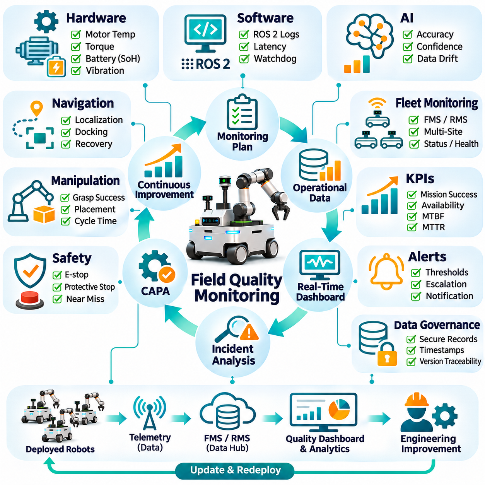{width="7.268055555555556in" height="7.268055555555556in"}

Field quality monitoring is a systematic quality assurance process that evaluates the operational performance, reliability, safety, and functional consistency of mobile manipulators after deployment in actual working environments. Unlike laboratory testing and controlled validation, field quality monitoring examines continuous system behavior under real-world operating conditions, environmental variations, equipment degradation, and changing customer requirements.

Field quality monitoring begins with establishing a structured monitoring plan that defines operational parameters, data collection methods, performance indicators, acceptance thresholds, and engineering responsibilities. Monitoring objectives should be aligned with system requirements, field validation results, and customer expectations. Critical quality indicators must be identified according to their potential effects on operational reliability and safety.

Operational data collection provides the foundation for effective field quality monitoring. Mobile manipulators should continuously record navigation status, localization accuracy, manipulation results, sensor measurements, battery conditions, computational resource utilization, and communication performance. Collected data should include synchronized timestamps, robot identification, software versions, and operational context to support reliable historical analysis.

Hardware quality monitoring evaluates the physical condition and operational behavior of mechanical, electrical, and electronic components. Motor temperatures, actuator currents, joint torques, battery degradation, mechanical vibration, and sensor abnormalities provide valuable indicators of component deterioration. Continuous observation of these parameters enables early identification of potential hardware failures and supports condition-based maintenance.

Software quality monitoring focuses on application stability, process availability, communication errors, execution latency, memory consumption, and unexpected system behavior. ROS 2 diagnostic messages, application logs, watchdog events, and system performance records provide important operational evidence. Recurring software exceptions and abnormal resource utilization should be investigated before they develop into significant operational failures.

Artificial intelligence quality monitoring evaluates the consistency and reliability of AI models under changing operational conditions. Object detection accuracy, pose estimation errors, prediction confidence, inference latency, and grasp success rates should be monitored using available ground truth and operational feedback. Changes in environmental conditions, object characteristics, and sensor behavior may indicate data drift or model performance degradation.

Navigation quality monitoring examines localization stability, trajectory tracking accuracy, obstacle avoidance behavior, docking performance, and autonomous recovery effectiveness. Operational records should identify repeated localization failures, excessive route deviations, unnecessary protective stops, and unstable navigation behavior. These observations support systematic improvements to autonomous mobility algorithms and environmental configurations.

Manipulation quality monitoring evaluates grasp execution, object handling accuracy, placement precision, motion consistency, and task completion rates. Failed grasp attempts, dropped objects, excessive contact forces, unexpected joint movements, and extended manipulation cycles should be recorded with relevant contextual information. Correlating manipulation failures with perception and control data supports more accurate identification of underlying causes.

Safety-related field quality monitoring requires continuous observation of emergency stops, protective stops, safety sensor activations, speed limit violations, and unexpected human-robot interactions. Operational incidents and near misses must be documented and classified according to their potential severity. Monitoring systems should support timely investigation without replacing independently implemented and validated safety functions.

Fleet-level quality monitoring enables centralized assessment of multiple mobile manipulators deployed across different customer sites. Fleet Management Systems (FMS) and Robot Management Systems (RMS) can aggregate operational records, diagnostic information, maintenance histories, and mission performance data. Comparative analysis should account for differences in robot configurations, workloads, environmental conditions, and operating durations.

Key Performance Indicators (KPIs) provide quantitative measurements for evaluating field quality. Relevant indicators include mission success rate, grasp success rate, operational availability, Mean Time Between Failures (MTBF), Mean Time To Repair (MTTR), and autonomous recovery success rate. Statistical analysis should normalize failure frequencies against operating hours or completed missions to support meaningful comparisons across deployed systems.

Real-time quality dashboards and automated alerting mechanisms enable engineering and operational teams to identify abnormal conditions promptly. Warning thresholds should distinguish temporary performance variations from persistent quality degradation and critical failures. Alarm prioritization, event correlation, and escalation procedures help reduce unnecessary notifications while ensuring that significant operational problems receive appropriate attention.

Field quality incidents should be documented through standardized reporting procedures that capture failure symptoms, environmental conditions, affected components, system configurations, and operational consequences. Diagnostic evidence should be preserved for subsequent failure analysis and root cause investigation. Confirmed quality deficiencies must be transferred into Corrective and Preventive Action (CAPA) processes with defined responsibilities and closure criteria.

Field quality data management requires secure storage, controlled access, appropriate retention policies, and reliable configuration traceability. Operational information collected from customer facilities must comply with applicable privacy, cybersecurity, and contractual requirements. Data integrity and synchronization should be maintained across onboard systems, remote monitoring platforms, and centralized quality management databases to ensure trustworthy analysis.

Field quality monitoring ultimately establishes a closed-loop quality assurance process connecting product development, manufacturing, deployment, maintenance, failure analysis, and continuous improvement. Operational evidence should guide hardware design modifications, software updates, AI model refinement, and preventive maintenance strategies. This lifecycle approach improves product maturity, customer satisfaction, operational reliability, and scalable commercialization.

현장 품질 모니터링(Field Quality Monitoring)은 모바일 매니퓰레이터(Mobile Manipulator)가 실제 작업 환경(Actual Working Environments)에 배포된 이후 운영 성능(Operational Performance), 신뢰성(Reliability), 안전성(Safety) 및 기능적 일관성(Functional Consistency)을 평가하는 체계적인 품질 보증 프로세스(Quality Assurance Process)이다. 실험실 시험(Laboratory Testing) 및 통제된 유효성 확인(Controlled Validation)과 달리 현장 품질 모니터링은 실제 운영 조건(Real-World Operating Conditions), 환경적 변화(Environmental Variations), 장비 성능 저하(Equipment Degradation) 및 변화하는 고객 요구사항(Customer Requirements)에서 지속적인 시스템 동작을 검토한다.

현장 품질 모니터링은 운영 파라미터(Operational Parameters), 데이터 수집 방법(Data Collection Methods), 성능 지표(Performance Indicators), 허용 임계값(Acceptance Thresholds) 및 엔지니어링 책임(Engineering Responsibilities)을 정의하는 체계적인 모니터링 계획(Structured Monitoring Plan)을 수립하는 것에서 시작한다. 모니터링 목표(Monitoring Objectives)는 시스템 요구사항(System Requirements), 현장 유효성 확인 결과(Field Validation Results) 및 고객 기대사항(Customer Expectations)과 일치해야 한다. 핵심 품질 지표(Critical Quality Indicators)는 운영 신뢰성(Operational Reliability)과 안전성에 미칠 수 있는 잠재적 영향을 기준으로 식별해야 한다.

운영 데이터 수집(Operational Data Collection)은 효과적인 현장 품질 모니터링을 위한 기반을 제공한다. 모바일 매니퓰레이터는 자율주행 상태(Navigation Status), 위치 추정 정확도(Localization Accuracy), 조작 결과(Manipulation Results), 센서 측정값(Sensor Measurements), 배터리 상태(Battery Conditions), 컴퓨팅 자원 활용률(Computational Resource Utilization) 및 통신 성능(Communication Performance)을 지속적으로 기록해야 한다. 수집된 데이터는 신뢰성 있는 이력 분석(Historical Analysis)을 지원하기 위해 동기화된 타임스탬프(Synchronized Timestamps), 로봇 식별 정보(Robot Identification), 소프트웨어 버전(Software Versions) 및 운영 맥락(Operational Context)을 포함해야 한다.

하드웨어 품질 모니터링(Hardware Quality Monitoring)은 기계적, 전기적 및 전자적 구성 요소(Mechanical, Electrical, and Electronic Components)의 물리적 상태(Physical Condition)와 운영 동작(Operational Behavior)을 평가한다. 모터 온도(Motor Temperatures), 액추에이터 전류(Actuator Currents), 관절 토크(Joint Torques), 배터리 열화(Battery Degradation), 기계적 진동(Mechanical Vibration) 및 센서 이상(Sensor Abnormalities)은 구성 요소의 성능 저하(Component Deterioration)를 판단하는 중요한 지표를 제공한다. 이러한 파라미터를 지속적으로 관찰하면 잠재적인 하드웨어 고장(Hardware Failures)을 조기에 식별하고 상태 기반 유지보수(Condition-Based Maintenance)를 지원할 수 있다.

소프트웨어 품질 모니터링(Software Quality Monitoring)은 애플리케이션 안정성(Application Stability), 프로세스 가용성(Process Availability), 통신 오류(Communication Errors), 실행 지연시간(Execution Latency), 메모리 사용량(Memory Consumption) 및 예상하지 못한 시스템 동작(Unexpected System Behavior)에 중점을 둔다. ROS 2 진단 메시지(Diagnostic Messages), 애플리케이션 로그(Application Logs), 워치독 이벤트(Watchdog Events) 및 시스템 성능 기록(System Performance Records)은 중요한 운영 증거(Operational Evidence)를 제공한다. 반복적으로 발생하는 소프트웨어 예외(Software Exceptions)와 비정상적인 자원 활용률(Abnormal Resource Utilization)은 심각한 운영 고장(Operational Failures)으로 발전하기 전에 조사해야 한다.

인공지능 품질 모니터링(Artificial Intelligence Quality Monitoring)은 변화하는 운영 조건에서 인공지능 모델(AI Models)의 일관성(Consistency)과 신뢰성을 평가한다. 객체 검출 정확도(Object Detection Accuracy), 자세 추정 오차(Pose Estimation Errors), 예측 신뢰도(Prediction Confidence), 추론 지연시간(Inference Latency) 및 파지 성공률(Grasp Success Rates)은 활용 가능한 정답 데이터(Ground Truth)와 운영 피드백(Operational Feedback)을 기반으로 모니터링해야 한다. 환경 조건(Environmental Conditions), 객체 특성(Object Characteristics) 및 센서 동작(Sensor Behavior)의 변화는 데이터 분포 변화(Data Drift) 또는 모델 성능 저하(Model Performance Degradation)를 나타낼 수 있다.

자율주행 품질 모니터링(Navigation Quality Monitoring)은 위치 추정 안정성(Localization Stability), 궤적 추종 정확도(Trajectory Tracking Accuracy), 장애물 회피 동작(Obstacle Avoidance Behavior), 도킹 성능(Docking Performance) 및 자율 복구 효과성(Autonomous Recovery Effectiveness)을 검토한다. 운영 기록(Operational Records)은 반복적인 위치 추정 실패(Localization Failures), 과도한 경로 이탈(Excessive Route Deviations), 불필요한 보호 정지(Unnecessary Protective Stops) 및 불안정한 자율주행 동작(Unstable Navigation Behavior)을 식별해야 한다. 이러한 관찰 결과는 자율 이동 알고리즘(Autonomous Mobility Algorithms)과 환경 구성(Environmental Configurations)의 체계적인 개선을 지원한다.

조작 품질 모니터링(Manipulation Quality Monitoring)은 파지 실행(Grasp Execution), 객체 취급 정확도(Object Handling Accuracy), 배치 정밀도(Placement Precision), 모션 일관성(Motion Consistency) 및 작업 완료율(Task Completion Rates)을 평가한다. 파지 시도 실패(Failed Grasp Attempts), 객체 낙하(Dropped Objects), 과도한 접촉력(Excessive Contact Forces), 예상하지 못한 관절 동작(Unexpected Joint Movements) 및 조작 사이클 시간 증가(Extended Manipulation Cycles)는 관련 상황 정보(Contextual Information)와 함께 기록해야 한다. 조작 실패(Manipulation Failures)와 인지 및 제어 데이터(Perception and Control Data) 사이의 상관관계 분석은 근본적인 원인(Underlying Causes)을 더욱 정확하게 식별할 수 있도록 지원한다.

안전 관련 현장 품질 모니터링(Safety-Related Field Quality Monitoring)은 비상 정지(Emergency Stops), 보호 정지(Protective Stops), 안전 센서 활성화(Safety Sensor Activations), 속도 제한 위반(Speed Limit Violations) 및 예상하지 못한 인간-로봇 상호작용(Unexpected Human-Robot Interactions)에 대한 지속적인 관찰을 필요로 한다. 운영 사고(Operational Incidents)와 아차 사고(Near Misses)는 문서화하고 잠재적인 심각도(Potential Severity)에 따라 분류해야 한다. 모니터링 시스템(Monitoring Systems)은 독립적으로 구현되고 유효성이 확인된 안전 기능(Independently Implemented and Validated Safety Functions)을 대체하지 않으면서 적시에 조사를 수행할 수 있도록 지원해야 한다.

플릿 수준 품질 모니터링(Fleet-Level Quality Monitoring)은 서로 다른 고객 현장(Customer Sites)에 배포된 다수의 모바일 매니퓰레이터에 대한 중앙 집중식 평가(Centralized Assessment)를 가능하게 한다. 플릿 관리 시스템(Fleet Management System, FMS)과 로봇 관리 시스템(Robot Management System, RMS)은 운영 기록(Operational Records), 진단 정보(Diagnostic Information), 유지보수 이력(Maintenance Histories) 및 임무 성능 데이터(Mission Performance Data)를 통합할 수 있다. 비교 분석(Comparative Analysis)은 로봇 구성(Robot Configurations), 작업 부하(Workloads), 환경 조건 및 운영 시간(Operating Durations)의 차이를 고려해야 한다.

핵심 성과 지표(Key Performance Indicators, KPIs)는 현장 품질을 평가하기 위한 정량적 측정값(Quantitative Measurements)을 제공한다. 관련 지표에는 임무 성공률(Mission Success Rate), 파지 성공률(Grasp Success Rate), 운영 가용성(Operational Availability), 평균 고장 간격(Mean Time Between Failures, MTBF), 평균 수리 시간(Mean Time To Repair, MTTR) 및 자율 복구 성공률(Autonomous Recovery Success Rate)이 포함된다. 통계적 분석(Statistical Analysis)은 배포된 시스템 간의 유의미한 비교를 지원하기 위해 운영 시간(Operating Hours) 또는 완료된 임무 수(Completed Missions)를 기준으로 고장 발생 빈도(Failure Frequencies)를 정규화(Normalization)해야 한다.

실시간 품질 대시보드(Real-Time Quality Dashboards)와 자동화 경고 메커니즘(Automated Alerting Mechanisms)은 엔지니어링 및 운영 팀(Engineering and Operational Teams)이 비정상적인 상태(Abnormal Conditions)를 신속하게 식별할 수 있도록 지원한다. 경고 임계값(Warning Thresholds)은 일시적인 성능 변화(Temporary Performance Variations), 지속적인 품질 저하(Persistent Quality Degradation) 및 중대한 고장(Critical Failures)을 구분해야 한다. 경보 우선순위 지정(Alarm Prioritization), 이벤트 상관관계 분석(Event Correlation) 및 단계별 대응 절차(Escalation Procedures)는 불필요한 알림을 줄이는 동시에 중요한 운영 문제에 적절하게 대응할 수 있도록 지원한다.

현장 품질 문제(Field Quality Incidents)는 고장 증상(Failure Symptoms), 환경 조건(Environmental Conditions), 영향을 받는 구성 요소(Affected Components), 시스템 구성(System Configurations) 및 운영상의 결과(Operational Consequences)를 기록하는 표준화된 보고 절차(Standardized Reporting Procedures)를 통해 문서화해야 한다. 진단 증거(Diagnostic Evidence)는 후속 고장 분석(Failure Analysis)과 근본 원인 조사(Root Cause Investigation)를 위해 보존해야 한다. 확인된 품질 결함(Confirmed Quality Deficiencies)은 명확하게 정의된 책임(Defined Responsibilities)과 종결 기준(Closure Criteria)을 포함하는 시정 및 예방 조치(Corrective and Preventive Action, CAPA) 프로세스로 이관해야 한다.

현장 품질 데이터 관리(Field Quality Data Management)는 안전한 데이터 저장(Secure Storage), 통제된 접근(Controlled Access), 적절한 데이터 보존 정책(Retention Policies) 및 신뢰성 있는 형상 추적성(Configuration Traceability)을 필요로 한다. 고객 시설(Customer Facilities)에서 수집된 운영 정보(Operational Information)는 적용 가능한 개인정보 보호(Privacy), 사이버 보안(Cybersecurity) 및 계약 요구사항(Contractual Requirements)을 준수해야 한다. 신뢰할 수 있는 분석(Trustworthy Analysis)을 보장하기 위해 온보드 시스템(Onboard Systems), 원격 모니터링 플랫폼(Remote Monitoring Platforms) 및 중앙 집중식 품질 관리 데이터베이스(Centralized Quality Management Databases) 전반에서 데이터 무결성(Data Integrity)과 동기화(Data Synchronization)를 유지해야 한다.

궁극적으로 현장 품질 모니터링(Field Quality Monitoring)은 제품 개발(Product Development), 제조(Manufacturing), 배포(Deployment), 유지보수(Maintenance), 고장 분석(Failure Analysis) 및 지속적 개선(Continuous Improvement)을 연결하는 폐루프 품질 보증 프로세스(Closed-Loop Quality Assurance Process)를 확립한다. 운영 증거(Operational Evidence)는 하드웨어 설계 변경(Hardware Design Modifications), 소프트웨어 업데이트(Software Updates), 인공지능 모델 개선(AI Model Refinement) 및 예방 유지보수 전략(Preventive Maintenance Strategies)의 수립 방향을 제시해야 한다. 이러한 수명주기 기반 접근 방식(Lifecycle Approach)은 제품 성숙도(Product Maturity), 고객 만족도(Customer Satisfaction), 운영 신뢰성(Operational Reliability) 및 확장 가능한 상용화(Scalable Commercialization)를 향상시킨다.

##  

## 09 Failure Analysis

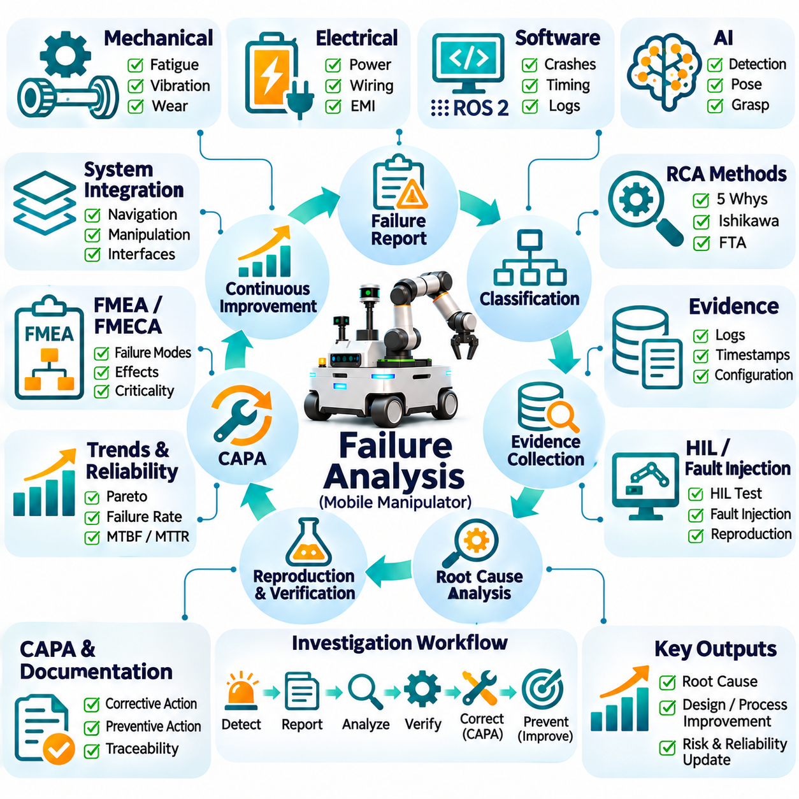{width="7.268055555555556in" height="7.268055555555556in"}

Failure analysis is a systematic engineering process that identifies the causes, mechanisms, and operational consequences of failures occurring within mobile manipulators. Because these systems integrate mechanical structures, electrical components, embedded software, artificial intelligence, autonomous mobility, and robotic manipulation, failure analysis must examine both individual component deficiencies and interactions among interconnected subsystems.

Failure analysis begins with establishing a structured investigation process that defines failure reporting procedures, evidence collection methods, classification criteria, analytical techniques, and engineering responsibilities. Investigations may originate from development testing, manufacturing inspections, field validation, or commercial operation. Each reported failure should receive a unique identification number to ensure traceability throughout the investigation.

Failure classification provides a consistent framework for determining the nature, severity, frequency, and operational impact of identified problems. Failures may be categorized as mechanical, electrical, electronic, software, communication, artificial intelligence, or system integration failures. Additional classifications distinguish intermittent failures, persistent failures, progressive degradation, and sudden failures requiring immediate intervention.

Evidence collection is essential for establishing a reliable understanding of failure conditions. Engineering teams should preserve diagnostic logs, sensor measurements, controller commands, environmental information, software versions, and affected hardware components. Synchronized timestamps and configuration records enable reconstruction of operational sequences, while appropriate evidence preservation prevents the loss or alteration of critical information.

Root Cause Analysis (RCA) distinguishes observable failure symptoms from the fundamental conditions responsible for their occurrence. Techniques such as the Five Whys, Ishikawa diagrams, Fault Tree Analysis (FTA), and causal chain analysis support systematic investigation. Identified root causes must be supported by objective evidence rather than assumptions, and investigations should consider multiple contributing factors where appropriate.

Mechanical failure analysis examines structural deformation, material fatigue, excessive vibration, bearing deterioration, transmission wear, and fastening deficiencies. Mobile manipulators experience dynamic loading generated by platform acceleration, braking, payload movement, and robotic arm operation. Physical inspections, dimensional measurements, material examination, and stress analysis help determine the mechanisms responsible for mechanical failures.

Electrical and electronic failure analysis evaluates power distribution abnormalities, wiring harness damage, connector degradation, insulation failures, electromagnetic interference, and controller malfunction. Voltage fluctuations, excessive current consumption, abnormal temperature increases, and intermittent communication losses may indicate electrical deficiencies. Investigations should examine component specifications, circuit protection, installation quality, and environmental exposure.

Software failure analysis investigates application crashes, logical errors, memory management problems, timing violations, concurrency defects, and communication inconsistencies. In ROS 2-based systems, diagnostic records, node states, message sequences, and execution traces provide essential evidence. Reproducing software failures within controlled environments helps isolate defective modules and identify interactions responsible for unexpected system behavior.

Artificial intelligence failure analysis examines incorrect object detection, inaccurate pose estimation, unreliable grasp predictions, and inappropriate autonomous decisions. Investigations should consider dataset limitations, annotation errors, environmental changes, sensor degradation, model uncertainty, and deployment configurations. Recorded input data and model outputs should be analyzed together to distinguish perception failures from downstream execution problems.

Integrated system failure analysis addresses problems arising from interactions between autonomous navigation, robotic manipulation, perception, task planning, and fleet management. A positioning error in the mobile platform may propagate into inaccurate grasp execution even when the manipulator operates correctly. Analyzing shared resources, interface contracts, coordinate transformations, and synchronization mechanisms helps identify cross-subsystem failure propagation.

Failure Mode and Effects Analysis (FMEA) supports the systematic identification of potential failure modes, their causes, and their consequences. Failure Mode, Effects, and Criticality Analysis (FMECA) extends this approach through criticality assessment. Actual failure investigation results should be incorporated into existing analytical records to improve risk assessments, detection mechanisms, engineering priorities, and preventive design strategies.

Failure reproduction and hypothesis verification establish whether suspected causes can consistently explain observed system behavior. Controlled experiments, simulation environments, component substitution, Hardware-in-the-Loop (HIL) testing, and fault injection may support verification. Experimental conditions should reproduce relevant operational stresses while maintaining appropriate safety controls and preventing unnecessary damage to equipment.

Failure trend analysis evaluates recurring defects, component reliability, operational exposure, and relationships between failure frequency and system configurations. Pareto analysis helps identify dominant failure categories, while statistical reliability techniques support assessments of degradation and failure distribution. Comparisons should account for operating hours, duty cycles, payload conditions, environmental differences, and maintenance histories.

Failure analysis documentation should include failure descriptions, investigation evidence, analytical methods, confirmed root causes, contributing factors, operational consequences, and recommended engineering actions. Unresolved hypotheses and investigative limitations must also be documented. Confirmed deficiencies should enter the Corrective and Preventive Action (CAPA) process, where modifications and their effectiveness are systematically verified.

Failure analysis ultimately establishes a closed-loop quality assurance process connecting operational failures with engineering knowledge, risk management, design optimization, and continuous improvement. Investigation results should guide hardware modifications, software corrections, AI model refinement, manufacturing controls, and maintenance strategies. This lifecycle approach reduces failure recurrence and strengthens product reliability, operational safety, and commercial maturity.

고장 분석(Failure Analysis)은 모바일 매니퓰레이터(Mobile Manipulator)에서 발생하는 고장의 원인(Causes), 발생 메커니즘(Mechanisms) 및 운영상의 결과(Operational Consequences)를 식별하는 체계적인 엔지니어링 프로세스(Systematic Engineering Process)이다. 이러한 시스템은 기계 구조(Mechanical Structures), 전기적 구성 요소(Electrical Components), 임베디드 소프트웨어(Embedded Software), 인공지능(Artificial Intelligence), 자율 이동(Autonomous Mobility) 및 로봇 조작(Robotic Manipulation)을 통합하므로 고장 분석은 개별 구성 요소의 결함(Component Deficiencies)과 상호 연결된 하위 시스템(Interconnected Subsystems) 사이의 상호작용을 모두 검토해야 한다.

고장 분석은 고장 보고 절차(Failure Reporting Procedures), 증거 수집 방법(Evidence Collection Methods), 분류 기준(Classification Criteria), 분석 기법(Analytical Techniques) 및 엔지니어링 책임(Engineering Responsibilities)을 정의하는 체계적인 조사 프로세스(Structured Investigation Process)를 확립하는 것에서 시작한다. 조사는 개발 시험(Development Testing), 제조 검사(Manufacturing Inspections), 현장 유효성 확인(Field Validation) 또는 상용 운영(Commercial Operation)에서 시작될 수 있다. 보고된 각각의 고장에는 전체 조사 과정에서 추적성(Traceability)을 확보하기 위해 고유 식별 번호(Unique Identification Number)를 부여해야 한다.

고장 분류(Failure Classification)는 식별된 문제의 특성(Nature), 심각도(Severity), 발생 빈도(Frequency) 및 운영 영향(Operational Impact)을 판단하기 위한 일관된 프레임워크(Consistent Framework)를 제공한다. 고장은 기계적 고장(Mechanical Failures), 전기적 고장(Electrical Failures), 전자적 고장(Electronic Failures), 소프트웨어 고장(Software Failures), 통신 고장(Communication Failures), 인공지능 고장(AI Failures) 또는 시스템 통합 고장(System Integration Failures)으로 분류할 수 있다. 추가적인 분류는 간헐적 고장(Intermittent Failures), 지속적 고장(Persistent Failures), 점진적 성능 저하(Progressive Degradation) 및 즉각적인 개입(Immediate Intervention)이 필요한 돌발적 고장(Sudden Failures)을 구분한다.

증거 수집(Evidence Collection)은 고장 발생 조건(Failure Conditions)을 신뢰성 있게 이해하기 위해 필수적이다. 엔지니어링 팀은 진단 로그(Diagnostic Logs), 센서 측정값(Sensor Measurements), 제어기 명령(Controller Commands), 환경 정보(Environmental Information), 소프트웨어 버전(Software Versions) 및 영향을 받은 하드웨어 구성 요소(Affected Hardware Components)를 보존해야 한다. 동기화된 타임스탬프(Synchronized Timestamps)와 형상 기록(Configuration Records)은 운영 시퀀스(Operational Sequences)의 재구성(Reconstruction)을 가능하게 하며, 적절한 증거 보존(Evidence Preservation)은 핵심 정보(Critical Information)의 손실 또는 변경을 방지한다.

근본 원인 분석(Root Cause Analysis, RCA)은 관찰 가능한 고장 증상(Observable Failure Symptoms)과 고장 발생의 근본적인 조건(Fundamental Conditions)을 구분한다. 5번의 왜 기법(Five Whys), 이시카와 다이어그램(Ishikawa Diagrams), 결함 트리 분석(Fault Tree Analysis, FTA) 및 인과관계 사슬 분석(Causal Chain Analysis)과 같은 기법은 체계적인 조사(Systematic Investigation)를 지원한다. 식별된 근본 원인(Root Causes)은 가정(Assumptions)이 아닌 객관적인 증거(Objective Evidence)를 통해 뒷받침되어야 하며, 조사 과정에서는 필요한 경우 복수의 기여 요인(Multiple Contributing Factors)을 고려해야 한다.

기계적 고장 분석(Mechanical Failure Analysis)은 구조적 변형(Structural Deformation), 재료 피로(Material Fatigue), 과도한 진동(Excessive Vibration), 베어링 열화(Bearing Deterioration), 동력 전달 장치 마모(Transmission Wear) 및 체결 결함(Fastening Deficiencies)을 검토한다. 모바일 매니퓰레이터는 플랫폼 가속(Platform Acceleration), 제동(Braking), 적재물 이동(Payload Movement) 및 로봇 팔 작동(Robotic Arm Operation)으로 인해 발생하는 동적 하중(Dynamic Loading)을 경험한다. 물리적 검사(Physical Inspections), 치수 측정(Dimensional Measurements), 재료 검사(Material Examination) 및 응력 분석(Stress Analysis)은 기계적 고장을 유발하는 메커니즘을 규명하는 데 도움이 된다.

전기 및 전자 고장 분석(Electrical and Electronic Failure Analysis)은 전력 분배 이상(Power Distribution Abnormalities), 와이어링 하네스 손상(Wiring Harness Damage), 커넥터 열화(Connector Degradation), 절연 고장(Insulation Failures), 전자기 간섭(Electromagnetic Interference) 및 제어기 오작동(Controller Malfunction)을 평가한다. 전압 변동(Voltage Fluctuations), 과도한 전류 소비(Excessive Current Consumption), 비정상적인 온도 상승(Abnormal Temperature Increases) 및 간헐적인 통신 손실(Intermittent Communication Losses)은 전기적 결함(Electrical Deficiencies)을 나타낼 수 있다. 조사 과정에서는 구성 요소 사양(Component Specifications), 회로 보호(Circuit Protection), 설치 품질(Installation Quality) 및 환경적 노출(Environmental Exposure)을 검토해야 한다.

소프트웨어 고장 분석(Software Failure Analysis)은 애플리케이션 충돌(Application Crashes), 논리적 오류(Logical Errors), 메모리 관리 문제(Memory Management Problems), 타이밍 위반(Timing Violations), 동시성 결함(Concurrency Defects) 및 통신 불일치(Communication Inconsistencies)를 조사한다. ROS 2 기반 시스템에서는 진단 기록(Diagnostic Records), 노드 상태(Node States), 메시지 시퀀스(Message Sequences) 및 실행 추적 기록(Execution Traces)이 필수적인 증거를 제공한다. 통제된 환경(Controlled Environments)에서 소프트웨어 고장을 재현(Reproduction)하는 것은 결함이 있는 모듈(Defective Modules)을 격리하고 예상하지 못한 시스템 동작(Unexpected System Behavior)을 유발하는 상호작용을 식별하는 데 도움이 된다.

인공지능 고장 분석(Artificial Intelligence Failure Analysis)은 잘못된 객체 검출(Incorrect Object Detection), 부정확한 자세 추정(Inaccurate Pose Estimation), 신뢰할 수 없는 파지 예측(Unreliable Grasp Predictions) 및 부적절한 자율 의사결정(Inappropriate Autonomous Decisions)을 검토한다. 조사 과정에서는 데이터셋 한계(Dataset Limitations), 주석 오류(Annotation Errors), 환경 변화(Environmental Changes), 센서 성능 저하(Sensor Degradation), 모델 불확실성(Model Uncertainty) 및 배포 구성(Deployment Configurations)을 고려해야 한다. 기록된 입력 데이터(Recorded Input Data)와 모델 출력(Model Outputs)은 인지 실패(Perception Failures)와 후속 실행 문제(Downstream Execution Problems)를 구분하기 위해 함께 분석해야 한다.

통합 시스템 고장 분석(Integrated System Failure Analysis)은 자율주행(Autonomous Navigation), 로봇 조작(Robotic Manipulation), 인지(Perception), 작업 계획(Task Planning) 및 플릿 관리(Fleet Management) 사이의 상호작용에서 발생하는 문제를 다룬다. 모바일 플랫폼의 위치 결정 오차(Positioning Error)는 매니퓰레이터가 정상적으로 작동하더라도 부정확한 파지 실행(Inaccurate Grasp Execution)으로 전파될 수 있다. 공유 자원(Shared Resources), 인터페이스 계약(Interface Contracts), 좌표 변환(Coordinate Transformations) 및 동기화 메커니즘(Synchronization Mechanisms)에 대한 분석은 하위 시스템 간 고장 전파(Cross-Subsystem Failure Propagation)를 식별하는 데 도움이 된다.

고장 형태 및 영향 분석(Failure Mode and Effects Analysis, FMEA)은 잠재적인 고장 형태(Potential Failure Modes), 발생 원인 및 그 결과를 체계적으로 식별하는 것을 지원한다. 고장 형태, 영향 및 치명도 분석(Failure Mode, Effects, and Criticality Analysis, FMECA)은 치명도 평가(Criticality Assessment)를 통해 이러한 접근 방식을 확장한다. 실제 고장 조사 결과(Actual Failure Investigation Results)는 위험 평가(Risk Assessments), 검출 메커니즘(Detection Mechanisms), 엔지니어링 우선순위(Engineering Priorities) 및 예방적 설계 전략(Preventive Design Strategies)을 개선하기 위해 기존 분석 기록(Existing Analytical Records)에 반영해야 한다.

고장 재현 및 가설 검증(Failure Reproduction and Hypothesis Verification)은 추정된 원인(Suspected Causes)이 관찰된 시스템 동작(Observed System Behavior)을 일관되게 설명할 수 있는지를 확인한다. 통제된 실험(Controlled Experiments), 시뮬레이션 환경(Simulation Environments), 구성 요소 대체(Component Substitution), 하드웨어 인 더 루프 시험(Hardware-in-the-Loop Testing, HIL Testing) 및 고장 주입(Fault Injection)은 검증을 지원할 수 있다. 실험 조건(Experimental Conditions)은 적절한 안전 통제(Safety Controls)를 유지하고 장비의 불필요한 손상(Unnecessary Equipment Damage)을 방지하면서 관련 운영 스트레스(Operational Stresses)를 재현해야 한다.

고장 추세 분석(Failure Trend Analysis)은 반복적으로 발생하는 결함(Recurring Defects), 구성 요소 신뢰성(Component Reliability), 운영 노출(Operational Exposure) 및 고장 발생 빈도(Failure Frequency)와 시스템 구성(System Configurations) 사이의 관계를 평가한다. 파레토 분석(Pareto Analysis)은 주요 고장 범주(Dominant Failure Categories)를 식별하는 데 도움이 되며, 통계적 신뢰성 분석 기법(Statistical Reliability Techniques)은 성능 저하(Degradation)와 고장 분포(Failure Distribution)에 대한 평가를 지원한다. 비교 분석에서는 운영 시간(Operating Hours), 듀티 사이클(Duty Cycles), 가반하중 조건(Payload Conditions), 환경적 차이(Environmental Differences) 및 유지보수 이력(Maintenance Histories)을 고려해야 한다.

고장 분석 문서화(Failure Analysis Documentation)는 고장 설명(Failure Descriptions), 조사 증거(Investigation Evidence), 분석 방법(Analytical Methods), 확인된 근본 원인(Confirmed Root Causes), 기여 요인(Contributing Factors), 운영상의 결과(Operational Consequences) 및 권장 엔지니어링 조치(Recommended Engineering Actions)를 포함해야 한다. 해결되지 않은 가설(Unresolved Hypotheses)과 조사 한계(Investigative Limitations)도 문서화해야 한다. 확인된 결함(Confirmed Deficiencies)은 시정 및 예방 조치(Corrective and Preventive Action, CAPA) 프로세스로 이관해야 하며, 해당 프로세스에서 변경 사항(Modifications)과 그 효과성(Effectiveness)을 체계적으로 검증해야 한다.

궁극적으로 고장 분석(Failure Analysis)은 운영 중 발생하는 고장(Operational Failures)을 엔지니어링 지식(Engineering Knowledge), 위험 관리(Risk Management), 설계 최적화(Design Optimization) 및 지속적 개선(Continuous Improvement)과 연결하는 폐루프 품질 보증 프로세스(Closed-Loop Quality Assurance Process)를 확립한다. 조사 결과(Investigation Results)는 하드웨어 변경(Hardware Modifications), 소프트웨어 수정(Software Corrections), 인공지능 모델 개선(AI Model Refinement), 제조 관리(Manufacturing Controls) 및 유지보수 전략(Maintenance Strategies)의 수립 방향을 제시해야 한다. 이러한 수명주기 기반 접근 방식(Lifecycle Approach)은 고장 재발(Failure Recurrence)을 감소시키고 제품 신뢰성(Product Reliability), 운영 안전성(Operational Safety) 및 상용화 성숙도(Commercial Maturity)를 강화한다.

##  

## 10 CAPA Process

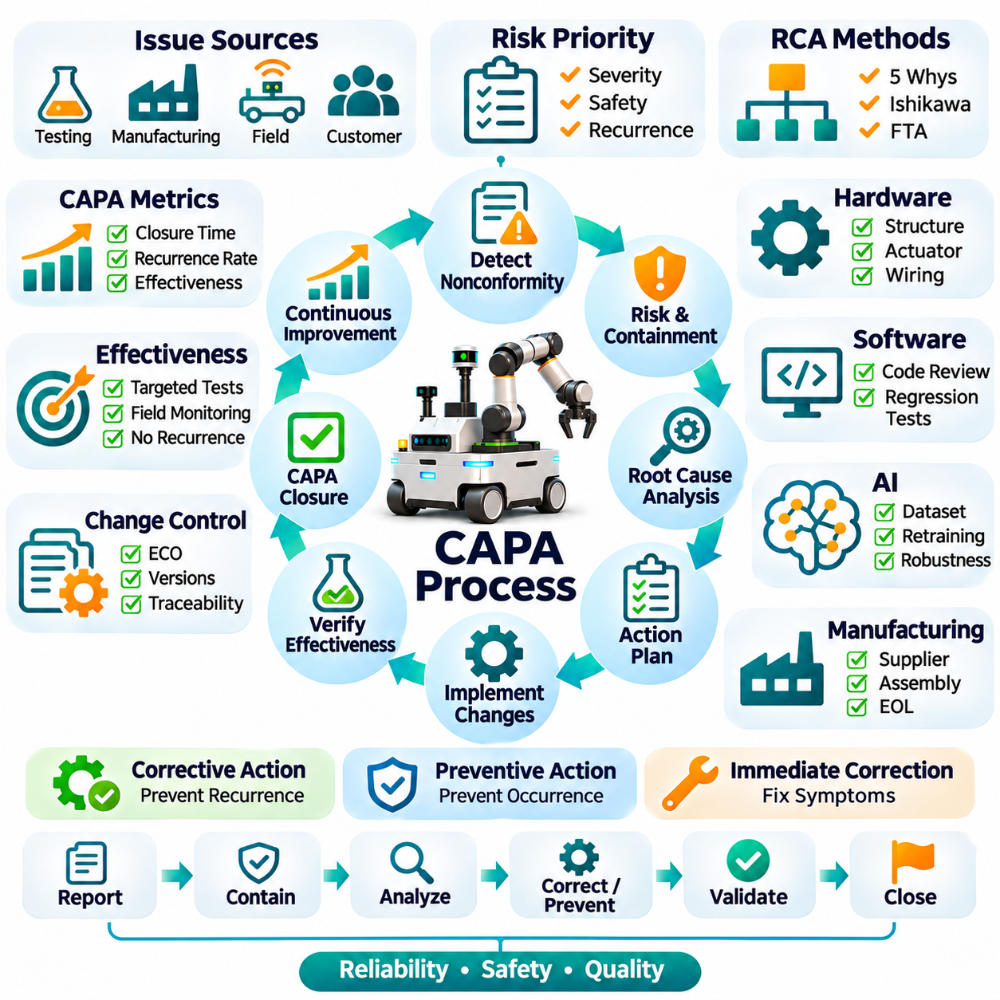{width="7.268055555555556in" height="7.268055555555556in"}

Corrective and Preventive Action (CAPA) is a systematic quality management process designed to eliminate the causes of identified nonconformities and prevent potential quality problems within mobile manipulator systems. CAPA connects failure analysis, engineering modifications, risk management, and continuous improvement, ensuring that quality deficiencies are addressed through sustainable solutions rather than temporary operational corrections.

The CAPA process begins with identifying quality issues through development testing, manufacturing inspections, field quality monitoring, customer complaints, maintenance records, and internal quality audits. Each identified nonconformity should be registered within a centralized quality management system. Initial documentation must capture the problem description, affected systems, operating conditions, available evidence, and operational consequences.

Corrective actions address the causes of existing nonconformities to prevent their recurrence, while preventive actions address the causes of potential nonconformities before they occur. Both approaches should be distinguished from immediate corrections that resolve observable symptoms without eliminating underlying causes. Establishing this distinction enables engineering teams to develop effective and sustainable quality improvement strategies.

Initial CAPA assessment should determine the severity, operational impact, recurrence probability, and potential safety consequences of identified deficiencies. Risk-based prioritization enables engineering resources to be allocated according to the significance of each quality issue. Critical failures may require immediate containment measures, including operational restrictions, product isolation, deployment suspension, or controlled system shutdown.

Root Cause Analysis (RCA) provides the analytical foundation for developing effective corrective and preventive actions. Engineering teams should investigate mechanical, electrical, software, artificial intelligence, manufacturing, and system integration factors associated with identified nonconformities. Techniques such as the Five Whys, Ishikawa analysis, and Fault Tree Analysis (FTA) support evidence-based identification of underlying causes.

Corrective action planning translates confirmed root causes into structured engineering activities. Each action plan should define implementation methods, responsible personnel, required resources, completion schedules, verification procedures, and measurable acceptance criteria. Proposed modifications must undergo technical review and impact assessment to ensure that resolving one deficiency does not introduce additional failures or safety hazards.

Hardware-related CAPA activities may involve structural modifications, component replacement, actuator improvements, wiring harness redesign, connector reinforcement, or battery protection enhancements. Engineering teams should evaluate proposed changes against mechanical loads, electrical requirements, environmental conditions, and manufacturing constraints. Updated designs must undergo appropriate verification before production implementation.

Software-related CAPA activities address logical errors, communication failures, timing violations, memory management deficiencies, and inadequate recovery mechanisms. Corrective modifications should follow established software development and configuration management procedures. Source code reviews, automated testing, integration testing, and regression testing provide objective evidence that identified software deficiencies have been effectively resolved.

Artificial intelligence-related CAPA activities may require dataset expansion, annotation correction, model retraining, confidence calibration, or inference configuration improvements. Corrective actions should address the relationship between model deficiencies and actual robotic behavior. Updated AI models must undergo independent performance evaluation, robustness testing, and system-level validation before authorization for operational deployment.

Preventive action planning focuses on identifying potential quality deficiencies through risk assessments, failure trends, predictive maintenance information, supplier evaluations, and engineering reviews. Failure Mode and Effects Analysis (FMEA) provides a structured approach for identifying vulnerabilities before operational failures occur. Preventive measures may include design improvements, enhanced inspections, and additional diagnostic capabilities.

Manufacturing-related CAPA activities address assembly inconsistencies, component defects, supplier quality problems, production process deviations, and insufficient inspection procedures. Corrective and preventive measures should be incorporated into manufacturing instructions, inspection criteria, supplier requirements, and End-of-Line (EOL) testing procedures. Process changes must be evaluated for consistency, effectiveness, and reproducibility.

CAPA implementation must follow controlled engineering change management procedures to maintain product configuration integrity. Changes affecting hardware components, firmware, software, AI models, or operating parameters should be documented and approved before deployment. Engineering Change Orders (ECOs), version control systems, and configuration baselines enable traceability between identified quality issues and implemented solutions.

Effectiveness verification determines whether implemented actions have eliminated the identified causes or adequately controlled potential quality risks. Verification should include targeted testing, regression testing, operational monitoring, and comparison with established quality baselines. Sufficient observation periods and representative operating conditions are necessary to demonstrate sustained improvement rather than temporary problem resolution.

CAPA closure requires documented evidence demonstrating that planned actions have been completed, acceptance criteria have been satisfied, and effectiveness has been adequately verified. Quality records should preserve original nonconformity descriptions, investigation results, implementation details, approval decisions, and supporting verification evidence. Ineffective actions must trigger renewed investigation and revised corrective strategies.

The CAPA process ultimately establishes a closed-loop quality assurance mechanism connecting nonconformity identification, containment, root cause analysis, engineering implementation, effectiveness verification, and organizational learning. CAPA metrics, including recurrence rates, closure times, and action effectiveness, support continuous improvement. This lifecycle approach strengthens product reliability, operational safety, and sustainable commercialization.

시정 및 예방 조치(Corrective and Preventive Action, CAPA)는 모바일 매니퓰레이터 시스템(Mobile Manipulator Systems)에서 식별된 부적합 사항(Nonconformities)의 원인을 제거하고 잠재적인 품질 문제(Potential Quality Problems)를 예방하기 위해 설계된 체계적인 품질 관리 프로세스(Systematic Quality Management Process)이다. CAPA는 고장 분석(Failure Analysis), 엔지니어링 변경(Engineering Modifications), 위험 관리(Risk Management) 및 지속적 개선(Continuous Improvement)을 연결하며, 일시적인 운영상 수정(Temporary Operational Corrections)이 아닌 지속 가능한 해결책(Sustainable Solutions)을 통해 품질 결함(Quality Deficiencies)을 해결하도록 보장한다.

CAPA 프로세스(CAPA Process)는 개발 시험(Development Testing), 제조 검사(Manufacturing Inspections), 현장 품질 모니터링(Field Quality Monitoring), 고객 불만(Customer Complaints), 유지보수 기록(Maintenance Records) 및 내부 품질 감사(Internal Quality Audits)를 통해 품질 문제(Quality Issues)를 식별하는 것에서 시작한다. 식별된 각각의 부적합 사항은 중앙 집중식 품질 관리 시스템(Centralized Quality Management System)에 등록해야 한다. 초기 문서화(Initial Documentation)는 문제 설명(Problem Description), 영향을 받는 시스템(Affected Systems), 운영 조건(Operating Conditions), 활용 가능한 증거(Available Evidence) 및 운영상의 결과(Operational Consequences)를 포함해야 한다.

시정 조치(Corrective Action)는 기존 부적합 사항(Existing Nonconformities)의 원인을 해결하여 재발(Recurrence)을 방지하는 반면, 예방 조치(Preventive Action)는 잠재적인 부적합 사항(Potential Nonconformities)이 발생하기 전에 그 원인을 해결한다. 두 접근 방식은 근본적인 원인(Underlying Causes)을 제거하지 않고 관찰 가능한 증상(Observable Symptoms)만을 해결하는 즉각적인 수정(Immediate Corrections)과 구분해야 한다. 이러한 차이를 명확하게 확립함으로써 엔지니어링 팀은 효과적이고 지속 가능한 품질 개선 전략(Quality Improvement Strategies)을 개발할 수 있다.

초기 CAPA 평가(Initial CAPA Assessment)는 식별된 결함의 심각도(Severity), 운영 영향(Operational Impact), 재발 확률(Recurrence Probability) 및 잠재적인 안전상 결과(Potential Safety Consequences)를 판단해야 한다. 위험 기반 우선순위 지정(Risk-Based Prioritization)은 각각의 품질 문제의 중요도에 따라 엔지니어링 자원(Engineering Resources)을 할당할 수 있도록 지원한다. 중대한 고장(Critical Failures)은 운영 제한(Operational Restrictions), 제품 격리(Product Isolation), 배포 중단(Deployment Suspension) 또는 통제된 시스템 종료(Controlled System Shutdown)를 포함하는 즉각적인 확산 방지 조치(Immediate Containment Measures)를 필요로 할 수 있다.

근본 원인 분석(Root Cause Analysis, RCA)은 효과적인 시정 및 예방 조치를 개발하기 위한 분석적 기반(Analytical Foundation)을 제공한다. 엔지니어링 팀은 식별된 부적합 사항과 관련된 기계적(Mechanical), 전기적(Electrical), 소프트웨어(Software), 인공지능(Artificial Intelligence), 제조(Manufacturing) 및 시스템 통합(System Integration) 요인을 조사해야 한다. 5번의 왜 기법(Five Whys), 이시카와 분석(Ishikawa Analysis) 및 결함 트리 분석(Fault Tree Analysis, FTA)과 같은 기법은 증거 기반 근본 원인 식별(Evidence-Based Identification of Underlying Causes)을 지원한다.

시정 조치 계획(Corrective Action Planning)은 확인된 근본 원인(Confirmed Root Causes)을 체계적인 엔지니어링 활동(Structured Engineering Activities)으로 전환한다. 각각의 조치 계획(Action Plan)은 구현 방법(Implementation Methods), 책임 담당자(Responsible Personnel), 필요 자원(Required Resources), 완료 일정(Completion Schedules), 검증 절차(Verification Procedures) 및 측정 가능한 인수 기준(Measurable Acceptance Criteria)을 정의해야 한다. 제안된 변경 사항(Proposed Modifications)은 하나의 결함을 해결하는 과정에서 추가적인 고장(Additional Failures)이나 안전 위험원(Safety Hazards)이 발생하지 않도록 기술 검토(Technical Review) 및 영향 평가(Impact Assessment)를 거쳐야 한다.

하드웨어 관련 CAPA 활동(Hardware-Related CAPA Activities)은 구조적 변경(Structural Modifications), 구성 요소 교체(Component Replacement), 액추에이터 개선(Actuator Improvements), 와이어링 하네스 재설계(Wiring Harness Redesign), 커넥터 보강(Connector Reinforcement) 또는 배터리 보호 기능 강화(Battery Protection Enhancements)를 포함할 수 있다. 엔지니어링 팀은 기계적 하중(Mechanical Loads), 전기적 요구사항(Electrical Requirements), 환경 조건(Environmental Conditions) 및 제조 제약조건(Manufacturing Constraints)을 기준으로 제안된 변경 사항을 평가해야 한다. 개선된 설계(Updated Designs)는 생산 적용(Production Implementation) 이전에 적절한 검증(Verification)을 거쳐야 한다.

소프트웨어 관련 CAPA 활동(Software-Related CAPA Activities)은 논리적 오류(Logical Errors), 통신 고장(Communication Failures), 타이밍 위반(Timing Violations), 메모리 관리 결함(Memory Management Deficiencies) 및 불충분한 복구 메커니즘(Inadequate Recovery Mechanisms)을 다룬다. 시정 목적의 변경 사항(Corrective Modifications)은 수립된 소프트웨어 개발(Software Development) 및 형상 관리 절차(Configuration Management Procedures)를 따라야 한다. 소스 코드 검토(Source Code Reviews), 자동화 시험(Automated Testing), 통합 시험(Integration Testing) 및 회귀 시험(Regression Testing)은 식별된 소프트웨어 결함(Software Deficiencies)이 효과적으로 해결되었음을 입증하는 객관적인 증거(Objective Evidence)를 제공한다.

인공지능 관련 CAPA 활동(Artificial Intelligence-Related CAPA Activities)은 데이터셋 확장(Dataset Expansion), 주석 수정(Annotation Correction), 모델 재학습(Model Retraining), 신뢰도 보정(Confidence Calibration) 또는 추론 구성 개선(Inference Configuration Improvements)을 필요로 할 수 있다. 시정 조치는 모델 결함(Model Deficiencies)과 실제 로봇 동작(Actual Robotic Behavior) 사이의 관계를 고려해야 한다. 개선된 인공지능 모델(Updated AI Models)은 운영 배포(Operational Deployment) 승인을 받기 전에 독립적인 성능 평가(Independent Performance Evaluation), 강건성 시험(Robustness Testing) 및 시스템 수준 유효성 확인(System-Level Validation)을 거쳐야 한다.

예방 조치 계획(Preventive Action Planning)은 위험 평가(Risk Assessments), 고장 추세(Failure Trends), 예측 유지보수 정보(Predictive Maintenance Information), 공급업체 평가(Supplier Evaluations) 및 엔지니어링 검토(Engineering Reviews)를 통해 잠재적인 품질 결함(Potential Quality Deficiencies)을 식별하는 데 중점을 둔다. 고장 형태 및 영향 분석(Failure Mode and Effects Analysis, FMEA)은 운영 고장(Operational Failures)이 발생하기 전에 취약점(Vulnerabilities)을 식별하기 위한 체계적인 접근 방식(Structured Approach)을 제공한다. 예방 조치(Preventive Measures)는 설계 개선(Design Improvements), 검사 강화(Enhanced Inspections) 및 추가적인 진단 기능(Additional Diagnostic Capabilities)을 포함할 수 있다.

제조 관련 CAPA 활동(Manufacturing-Related CAPA Activities)은 조립 불일치(Assembly Inconsistencies), 구성 요소 결함(Component Defects), 공급업체 품질 문제(Supplier Quality Problems), 생산 공정 편차(Production Process Deviations) 및 불충분한 검사 절차(Insufficient Inspection Procedures)를 다룬다. 시정 및 예방 조치는 제조 작업 지침(Manufacturing Instructions), 검사 기준(Inspection Criteria), 공급업체 요구사항(Supplier Requirements) 및 생산 공정 최종 시험(End-of-Line Testing, EOL Testing) 절차에 반영해야 한다. 공정 변경(Process Changes)은 일관성(Consistency), 효과성(Effectiveness) 및 재현성(Reproducibility)을 기준으로 평가해야 한다.

CAPA 구현(CAPA Implementation)은 제품 형상 무결성(Product Configuration Integrity)을 유지하기 위해 통제된 엔지니어링 변경 관리 절차(Controlled Engineering Change Management Procedures)를 따라야 한다. 하드웨어 구성 요소(Hardware Components), 펌웨어(Firmware), 소프트웨어(Software), 인공지능 모델(AI Models) 또는 운영 파라미터(Operating Parameters)에 영향을 미치는 변경 사항은 배포 이전에 문서화하고 승인해야 한다. 엔지니어링 변경 지시서(Engineering Change Orders, ECOs), 버전 관리 시스템(Version Control Systems) 및 형상 기준선(Configuration Baselines)은 식별된 품질 문제와 구현된 해결책(Implemented Solutions) 사이의 추적성(Traceability)을 확보할 수 있도록 지원한다.

효과성 검증(Effectiveness Verification)은 구현된 조치가 식별된 원인을 제거했거나 잠재적인 품질 위험(Potential Quality Risks)을 적절하게 통제했는지를 판단한다. 검증은 특정 문제에 대한 집중 시험(Targeted Testing), 회귀 시험(Regression Testing), 운영 모니터링(Operational Monitoring) 및 수립된 품질 기준선(Quality Baselines)과의 비교를 포함해야 한다. 일시적인 문제 해결(Temporary Problem Resolution)이 아닌 지속적인 개선(Sustained Improvement)을 입증하기 위해서는 충분한 관찰 기간(Sufficient Observation Periods)과 대표적인 운영 조건(Representative Operating Conditions)이 필요하다.

CAPA 종결(CAPA Closure)은 계획된 조치(Planned Actions)가 완료되었고, 인수 기준(Acceptance Criteria)이 충족되었으며, 효과성(Effectiveness)이 적절하게 검증되었음을 입증하는 문서화된 증거(Documented Evidence)를 필요로 한다. 품질 기록(Quality Records)은 최초 부적합 사항 설명(Original Nonconformity Descriptions), 조사 결과(Investigation Results), 구현 세부사항(Implementation Details), 승인 결정(Approval Decisions) 및 이를 뒷받침하는 검증 증거(Supporting Verification Evidence)를 보존해야 한다. 효과가 없는 조치(Ineffective Actions)는 재조사(Renewed Investigation) 및 수정된 시정 전략(Revised Corrective Strategies)의 수립으로 이어져야 한다.

궁극적으로 CAPA 프로세스(CAPA Process)는 부적합 사항 식별(Nonconformity Identification), 확산 방지(Containment), 근본 원인 분석(Root Cause Analysis), 엔지니어링 구현(Engineering Implementation), 효과성 검증(Effectiveness Verification) 및 조직 학습(Organizational Learning)을 연결하는 폐루프 품질 보증 메커니즘(Closed-Loop Quality Assurance Mechanism)을 확립한다. 재발률(Recurrence Rates), 종결 소요 시간(Closure Times) 및 조치 효과성(Action Effectiveness)을 포함하는 CAPA 지표(CAPA Metrics)는 지속적 개선(Continuous Improvement)을 지원한다. 이러한 수명주기 기반 접근 방식(Lifecycle Approach)은 제품 신뢰성(Product Reliability), 운영 안전성(Operational Safety) 및 지속 가능한 상용화(Sustainable Commercialization)를 강화한다.

##  

## 11 Continuous Improvement

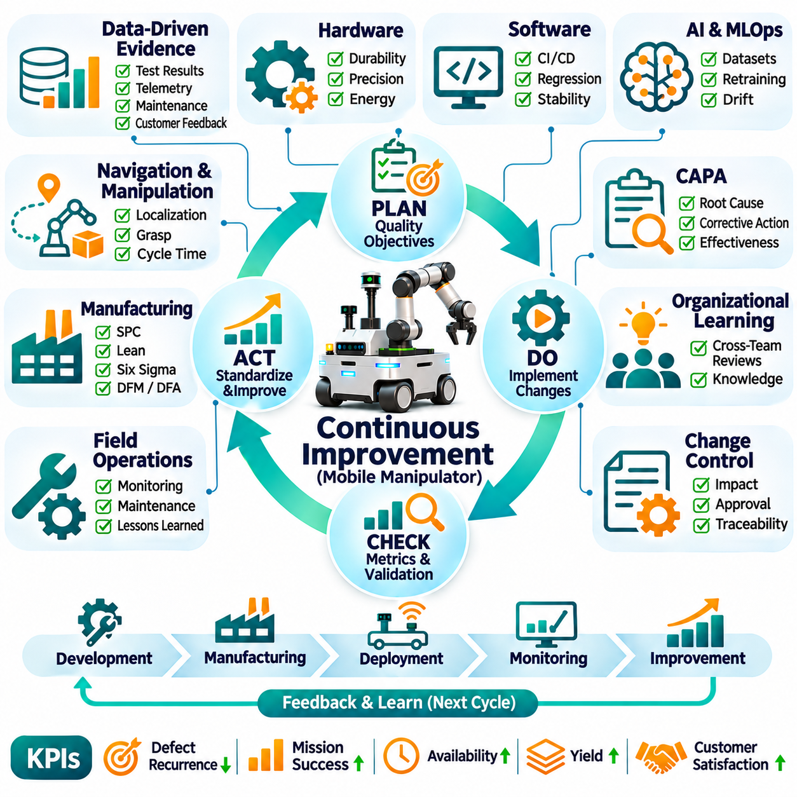{width="7.268055555555556in" height="7.268055555555556in"}

Continuous improvement is a systematic quality management approach that enhances the performance, reliability, safety, and operational efficiency of mobile manipulator systems throughout their product lifecycle. It integrates engineering development, manufacturing, field operation, maintenance, and customer feedback into a recurring improvement process that addresses existing deficiencies while identifying opportunities for future optimization.

The foundation of continuous improvement is the establishment of measurable quality objectives aligned with product requirements, organizational strategies, and customer expectations. Engineering teams should define improvement targets for hardware reliability, software stability, artificial intelligence performance, manipulation accuracy, and operational availability. These objectives provide a consistent basis for evaluating improvement activities and outcomes.

The Plan-Do-Check-Act (PDCA) cycle provides a structured methodology for implementing continuous improvement. The planning stage identifies improvement opportunities and establishes measurable objectives, while the execution stage implements proposed solutions. The checking stage evaluates results against established criteria, and the action stage standardizes successful improvements or initiates additional investigation when expected outcomes are not achieved.

Data-driven continuous improvement depends on the systematic collection and analysis of information generated throughout the product lifecycle. Development test results, manufacturing inspection records, operational telemetry, maintenance histories, and customer feedback provide valuable engineering evidence. Statistical analysis and performance trend evaluation help identify recurring deficiencies, emerging risks, and opportunities for systematic optimization.

Hardware continuous improvement focuses on enhancing structural durability, mechanical precision, electrical reliability, energy efficiency, and component maintainability. Operational evidence should guide improvements to mobile platforms, manipulators, actuators, battery systems, sensors, and wiring harnesses. Engineering modifications must undergo controlled design verification and applicable reliability testing to ensure that improvements do not introduce additional deficiencies.

Software continuous improvement addresses system stability, computational efficiency, communication reliability, execution latency, and autonomous recovery capabilities. Development teams should analyze software defects, diagnostic records, resource utilization, and operational exceptions to identify improvement opportunities. Continuous Integration and Continuous Delivery (CI/CD), automated regression testing, and code reviews support controlled software evolution.

Artificial intelligence continuous improvement requires systematic refinement of datasets, model architectures, training methodologies, and deployment configurations. Field observations may reveal previously unidentified object characteristics, environmental variations, or prediction uncertainties. Machine Learning Operations (MLOps) processes enable controlled model retraining, performance evaluation, version management, and validated deployment of improved AI models.

Manipulation and navigation improvement activities should address the integrated performance of perception, motion planning, trajectory execution, and autonomous mobility. Grasp failures, positioning errors, excessive manipulation cycle times, and recovery events provide evidence for engineering optimization. Improvement strategies should consider interactions between the mobile platform and robotic arm rather than evaluating individual capabilities independently.

Manufacturing continuous improvement focuses on reducing production defects, assembly variability, material waste, rework requirements, and unnecessary production costs. Statistical Process Control (SPC), Lean Manufacturing, and Six Sigma methodologies provide structured approaches for improving process consistency. Manufacturing feedback should also guide Design for Manufacturing (DFM) and Design for Assembly (DFA) activities during subsequent product revisions.

Field operation and maintenance improvements should be based on actual deployment experience across warehouses, factories, hospitals, and service environments. Operational difficulties, equipment degradation, maintenance frequency, and operator interventions reveal opportunities for improving product usability and serviceability. Lessons learned from field operations should support preventive maintenance strategies, diagnostic enhancements, and updated operating procedures.

Corrective and Preventive Action (CAPA) provides an essential mechanism for connecting identified quality deficiencies with continuous improvement initiatives. Confirmed root causes should be translated into engineering modifications, process improvements, and preventive controls. Effectiveness verification must demonstrate sustained improvement, while recurring deficiencies should trigger additional investigation and reassessment of existing improvement strategies.

Organizational continuous improvement requires effective collaboration among engineering, manufacturing, quality assurance, field operations, and project management teams. Regular quality reviews should evaluate improvement priorities, technical risks, resource requirements, and implementation progress. Engineering knowledge, successful solutions, and lessons learned should be preserved within centralized knowledge management systems for future development projects.

Continuous improvement must be supported by controlled engineering change management and configuration traceability. Hardware revisions, software updates, AI model replacements, and manufacturing process modifications should undergo appropriate impact assessment, approval, verification, and validation. Standardizing successful improvements across applicable product configurations and deployed fleets ensures consistent quality enhancement without compromising operational safety.

The effectiveness of continuous improvement should be evaluated through measurable indicators such as defect recurrence rates, mission success rates, operational availability, maintenance costs, production yield, and customer satisfaction. Improvement results should be compared with established baselines under representative conditions. This closed-loop lifecycle approach strengthens product maturity, organizational learning, engineering efficiency, and sustainable commercialization.

지속적 개선(Continuous Improvement)은 모바일 매니퓰레이터 시스템(Mobile Manipulator Systems)의 전체 제품 수명주기(Product Lifecycle)에 걸쳐 성능(Performance), 신뢰성(Reliability), 안전성(Safety) 및 운영 효율성(Operational Efficiency)을 향상시키는 체계적인 품질 관리 접근 방식(Systematic Quality Management Approach)이다. 지속적 개선은 엔지니어링 개발(Engineering Development), 제조(Manufacturing), 현장 운영(Field Operation), 유지보수(Maintenance) 및 고객 피드백(Customer Feedback)을 반복적인 개선 프로세스(Recurring Improvement Process)로 통합하여 기존 결함(Existing Deficiencies)을 해결하는 동시에 향후 최적화 기회(Future Optimization Opportunities)를 식별한다.

지속적 개선의 기반은 제품 요구사항(Product Requirements), 조직 전략(Organizational Strategies) 및 고객 기대사항(Customer Expectations)과 일치하는 측정 가능한 품질 목표(Measurable Quality Objectives)를 수립하는 것이다. 엔지니어링 팀은 하드웨어 신뢰성(Hardware Reliability), 소프트웨어 안정성(Software Stability), 인공지능 성능(Artificial Intelligence Performance), 조작 정확도(Manipulation Accuracy) 및 운영 가용성(Operational Availability)에 대한 개선 목표(Improvement Targets)를 정의해야 한다. 이러한 목표는 개선 활동(Improvement Activities)과 그 결과(Outcomes)를 평가하기 위한 일관된 기준(Consistent Basis)을 제공한다.

계획-실행-점검-조치 사이클(Plan-Do-Check-Act Cycle, PDCA Cycle)은 지속적 개선을 구현하기 위한 체계적인 방법론(Structured Methodology)을 제공한다. 계획 단계(Planning Stage)는 개선 기회(Improvement Opportunities)를 식별하고 측정 가능한 목표(Measurable Objectives)를 수립하며, 실행 단계(Execution Stage)는 제안된 해결책(Proposed Solutions)을 구현한다. 점검 단계(Checking Stage)는 수립된 기준(Established Criteria)에 따라 결과를 평가하며, 조치 단계(Action Stage)는 성공적인 개선 사항(Successful Improvements)을 표준화하거나 기대한 결과(Expected Outcomes)가 달성되지 않은 경우 추가 조사(Additional Investigation)를 시작한다.

데이터 기반 지속적 개선(Data-Driven Continuous Improvement)은 제품 수명주기 전반에서 생성되는 정보를 체계적으로 수집하고 분석하는 것에 의존한다. 개발 시험 결과(Development Test Results), 제조 검사 기록(Manufacturing Inspection Records), 운영 원격 측정 데이터(Operational Telemetry), 유지보수 이력(Maintenance Histories) 및 고객 피드백은 중요한 엔지니어링 증거(Engineering Evidence)를 제공한다. 통계적 분석(Statistical Analysis)과 성능 추세 평가(Performance Trend Evaluation)는 반복적으로 발생하는 결함(Recurring Deficiencies), 새롭게 발생하는 위험(Emerging Risks) 및 체계적인 최적화 기회(Systematic Optimization Opportunities)를 식별하는 데 도움이 된다.

하드웨어 지속적 개선(Hardware Continuous Improvement)은 구조적 내구성(Structural Durability), 기계적 정밀도(Mechanical Precision), 전기적 신뢰성(Electrical Reliability), 에너지 효율성(Energy Efficiency) 및 구성 요소 유지보수성(Component Maintainability)을 향상시키는 데 중점을 둔다. 운영 증거(Operational Evidence)는 모바일 플랫폼(Mobile Platforms), 매니퓰레이터(Manipulators), 액추에이터(Actuators), 배터리 시스템(Battery Systems), 센서(Sensors) 및 와이어링 하네스(Wiring Harnesses)의 개선 방향을 제시해야 한다. 엔지니어링 변경 사항(Engineering Modifications)은 개선 과정에서 추가적인 결함이 발생하지 않도록 통제된 설계 검증(Controlled Design Verification)과 적용 가능한 신뢰성 시험(Reliability Testing)을 거쳐야 한다.

소프트웨어 지속적 개선(Software Continuous Improvement)은 시스템 안정성(System Stability), 컴퓨팅 효율성(Computational Efficiency), 통신 신뢰성(Communication Reliability), 실행 지연시간(Execution Latency) 및 자율 복구 기능(Autonomous Recovery Capabilities)을 다룬다. 개발 팀은 개선 기회를 식별하기 위해 소프트웨어 결함(Software Defects), 진단 기록(Diagnostic Records), 자원 활용률(Resource Utilization) 및 운영 예외(Operational Exceptions)를 분석해야 한다. 지속적 통합 및 지속적 제공(Continuous Integration and Continuous Delivery, CI/CD), 자동화 회귀 시험(Automated Regression Testing) 및 코드 검토(Code Reviews)는 통제된 소프트웨어 발전(Controlled Software Evolution)을 지원한다.

인공지능 지속적 개선(Artificial Intelligence Continuous Improvement)은 데이터셋(Datasets), 모델 아키텍처(Model Architectures), 학습 방법론(Training Methodologies) 및 배포 구성(Deployment Configurations)의 체계적인 개선을 필요로 한다. 현장 관찰(Field Observations)을 통해 이전에 식별되지 않았던 객체 특성(Object Characteristics), 환경적 변화(Environmental Variations) 또는 예측 불확실성(Prediction Uncertainties)이 발견될 수 있다. 머신러닝 운영(Machine Learning Operations, MLOps) 프로세스는 통제된 모델 재학습(Controlled Model Retraining), 성능 평가(Performance Evaluation), 버전 관리(Version Management) 및 유효성이 확인된 개선 인공지능 모델의 배포(Validated Deployment of Improved AI Models)를 가능하게 한다.

조작 및 자율주행 개선 활동(Manipulation and Navigation Improvement Activities)은 인지(Perception), 모션 계획(Motion Planning), 궤적 실행(Trajectory Execution) 및 자율 이동(Autonomous Mobility)의 통합 성능(Integrated Performance)을 다루어야 한다. 파지 실패(Grasp Failures), 위치 결정 오차(Positioning Errors), 과도한 조작 사이클 시간(Excessive Manipulation Cycle Times) 및 복구 이벤트(Recovery Events)는 엔지니어링 최적화(Engineering Optimization)를 위한 증거를 제공한다. 개선 전략(Improvement Strategies)은 개별 기능을 독립적으로 평가하는 것이 아니라 모바일 플랫폼과 로봇 팔(Robotic Arm) 사이의 상호작용(Interactions)을 고려해야 한다.

제조 지속적 개선(Manufacturing Continuous Improvement)은 생산 결함(Production Defects), 조립 편차(Assembly Variability), 자재 낭비(Material Waste), 재작업 요구사항(Rework Requirements) 및 불필요한 생산 비용(Unnecessary Production Costs)을 감소시키는 데 중점을 둔다. 통계적 공정 관리(Statistical Process Control, SPC), 린 제조(Lean Manufacturing) 및 식스 시그마(Six Sigma) 방법론은 공정 일관성(Process Consistency)을 향상시키기 위한 체계적인 접근 방식을 제공한다. 제조 피드백(Manufacturing Feedback)은 후속 제품 개정(Subsequent Product Revisions) 과정에서 제조 용이성 설계(Design for Manufacturing, DFM)와 조립 용이성 설계(Design for Assembly, DFA) 활동의 방향도 제시해야 한다.

현장 운영 및 유지보수 개선(Field Operation and Maintenance Improvements)은 물류 창고(Warehouses), 공장(Factories), 병원(Hospitals) 및 서비스 환경(Service Environments)에서의 실제 배포 경험(Actual Deployment Experience)을 기반으로 해야 한다. 운영상의 어려움(Operational Difficulties), 장비 성능 저하(Equipment Degradation), 유지보수 빈도(Maintenance Frequency) 및 작업자 개입(Operator Interventions)은 제품 사용성(Product Usability)과 정비성(Serviceability)을 개선할 수 있는 기회를 보여준다. 현장 운영에서 얻은 교훈(Lessons Learned)은 예방 유지보수 전략(Preventive Maintenance Strategies), 진단 기능 강화(Diagnostic Enhancements) 및 운영 절차 개선(Updated Operating Procedures)을 지원해야 한다.

시정 및 예방 조치(Corrective and Preventive Action, CAPA)는 식별된 품질 결함(Identified Quality Deficiencies)과 지속적 개선 활동(Continuous Improvement Initiatives)을 연결하는 필수적인 메커니즘(Essential Mechanism)을 제공한다. 확인된 근본 원인(Confirmed Root Causes)은 엔지니어링 변경(Engineering Modifications), 공정 개선(Process Improvements) 및 예방적 통제(Preventive Controls)로 전환되어야 한다. 효과성 검증(Effectiveness Verification)은 지속적인 개선(Sustained Improvement)을 입증해야 하며, 반복적으로 발생하는 결함은 추가 조사(Additional Investigation)와 기존 개선 전략(Existing Improvement Strategies)에 대한 재평가(Reassessment)로 이어져야 한다.

조직 차원의 지속적 개선(Organizational Continuous Improvement)은 엔지니어링(Engineering), 제조(Manufacturing), 품질 보증(Quality Assurance), 현장 운영(Field Operations) 및 프로젝트 관리(Project Management) 팀 사이의 효과적인 협업(Effective Collaboration)을 필요로 한다. 정기적인 품질 검토(Regular Quality Reviews)는 개선 우선순위(Improvement Priorities), 기술적 위험(Technical Risks), 필요 자원(Resource Requirements) 및 구현 진행 상황(Implementation Progress)을 평가해야 한다. 엔지니어링 지식(Engineering Knowledge), 성공적인 해결책(Successful Solutions) 및 경험을 통해 얻은 교훈(Lessons Learned)은 향후 개발 프로젝트(Future Development Projects)를 위해 중앙 집중식 지식 관리 시스템(Centralized Knowledge Management Systems)에 보존해야 한다.

지속적 개선은 통제된 엔지니어링 변경 관리(Controlled Engineering Change Management)와 형상 추적성(Configuration Traceability)을 통해 지원되어야 한다. 하드웨어 개정(Hardware Revisions), 소프트웨어 업데이트(Software Updates), 인공지능 모델 교체(AI Model Replacements) 및 제조 공정 변경(Manufacturing Process Modifications)은 적절한 영향 평가(Impact Assessment), 승인(Approval), 검증(Verification) 및 유효성 확인(Validation)을 거쳐야 한다. 적용 가능한 제품 구성(Product Configurations)과 배포된 로봇 플릿(Deployed Fleets) 전반에 걸쳐 성공적인 개선 사항을 표준화하는 것은 운영 안전성(Operational Safety)을 저해하지 않으면서 일관된 품질 향상(Consistent Quality Enhancement)을 보장한다.

지속적 개선의 효과성(Effectiveness of Continuous Improvement)은 결함 재발률(Defect Recurrence Rates), 임무 성공률(Mission Success Rates), 운영 가용성(Operational Availability), 유지보수 비용(Maintenance Costs), 생산 수율(Production Yield) 및 고객 만족도(Customer Satisfaction)와 같은 측정 가능한 지표(Measurable Indicators)를 통해 평가해야 한다. 개선 결과(Improvement Results)는 대표적인 운영 조건(Representative Conditions)에서 수립된 기준선(Established Baselines)과 비교해야 한다. 이러한 폐루프 수명주기 접근 방식(Closed-Loop Lifecycle Approach)은 제품 성숙도(Product Maturity), 조직 학습(Organizational Learning), 엔지니어링 효율성(Engineering Efficiency) 및 지속 가능한 상용화(Sustainable Commercialization)를 강화한다.

##  

## 12 Quality Metrics

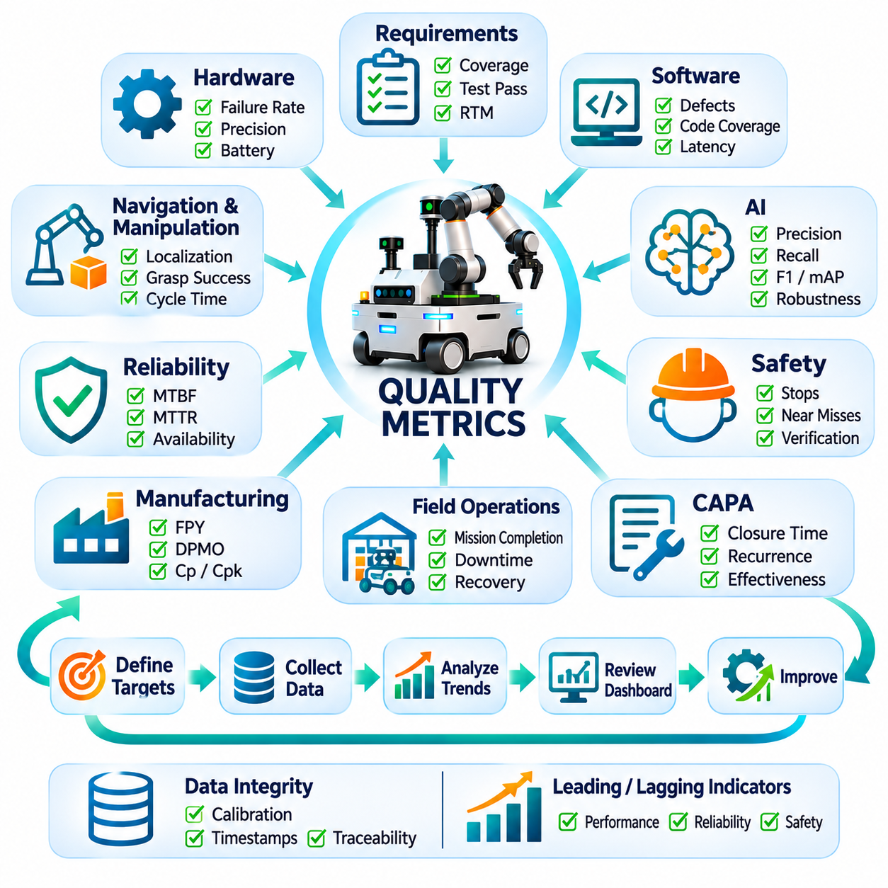{width="7.268055555555556in" height="7.268055555555556in"}

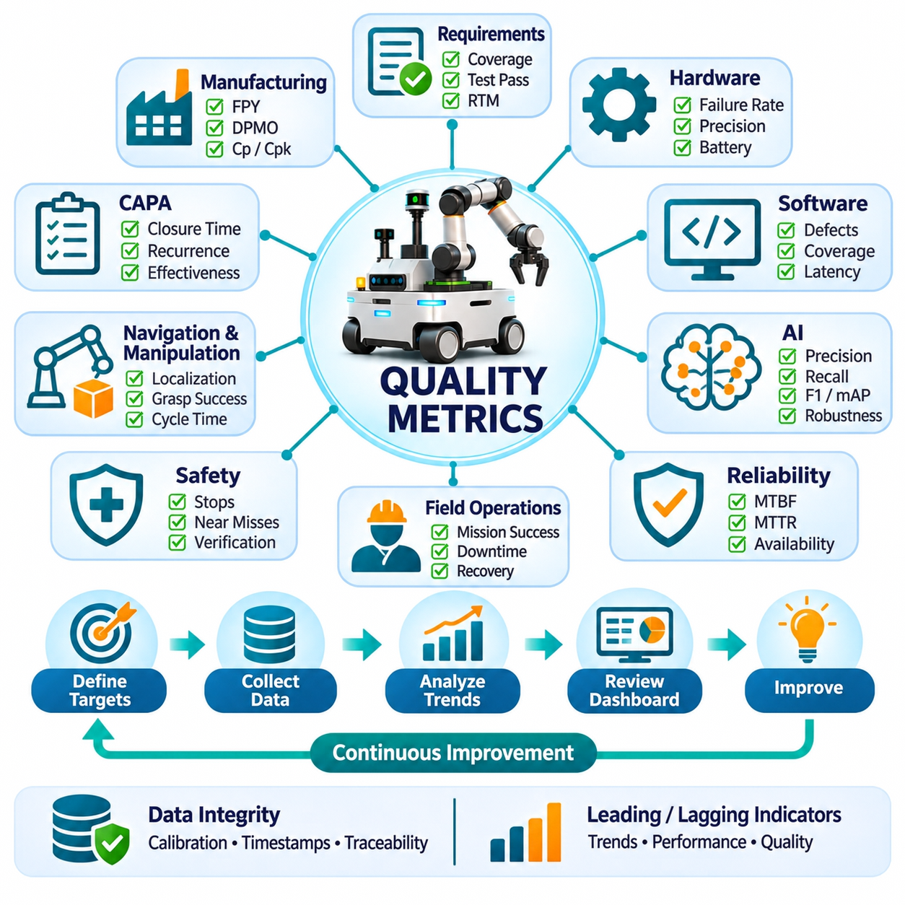{width="7.268055555555556in" height="7.268055555555556in"}

Quality metrics are quantitative indicators used to evaluate the performance, reliability, safety, consistency, and operational effectiveness of mobile manipulator systems throughout their product lifecycle. They provide an objective foundation for quality assurance by translating engineering requirements, verification results, manufacturing performance, and field observations into measurable evidence that supports systematic decision-making.

The development of quality metrics begins with defining measurable objectives aligned with system requirements, customer expectations, operational scenarios, and applicable safety requirements. Each metric should specify its measurement method, calculation procedure, data source, evaluation frequency, acceptance threshold, and responsible personnel. Consistent definitions enable reliable comparisons across development stages and product configurations.

Requirement verification metrics evaluate the extent to which defined system requirements have been successfully verified. Requirement coverage, verification completion rate, test pass rate, and unresolved nonconformities provide important indicators of development maturity. Requirement Traceability Matrices (RTMs) establish relationships between individual requirements, verification procedures, test results, and supporting engineering evidence.

Hardware quality metrics evaluate the reliability, durability, precision, and functional consistency of mechanical, electrical, and electronic components. Relevant indicators include component failure rates, dimensional tolerances, actuator positioning errors, structural deformation, battery degradation, and thermal stability. Measurements should account for representative payload conditions, duty cycles, environmental exposure, and operating durations.

Software quality metrics assess functional correctness, application stability, computational efficiency, maintainability, and communication reliability. Defect density, code coverage, regression test pass rate, execution latency, memory utilization, and system recovery success rate provide useful engineering indicators. These metrics should be evaluated alongside defect severity and operational consequences rather than relying exclusively on numerical defect counts.

Artificial intelligence quality metrics evaluate model accuracy, robustness, computational performance, and consistency under representative operating conditions. Object detection metrics include Precision, Recall, F1-score, and mean Average Precision (mAP), while pose estimation may use translational and rotational errors. Inference latency, prediction uncertainty, and distribution shift indicators support assessments of operational suitability.

Navigation and manipulation quality metrics evaluate the integrated capabilities of autonomous mobile platforms and robotic arms. Localization error, trajectory tracking error, docking accuracy, grasp success rate, placement precision, and manipulation cycle time provide measurable performance indicators. End-to-end mission success rates help determine whether individual subsystem capabilities translate into reliable task execution.

Reliability and maintainability metrics characterize system failures, maintenance requirements, and operational availability. Mean Time Between Failures (MTBF) represents the average operating time between failures of repairable systems, while Mean Time To Repair (MTTR) measures average repair duration. Operational availability measures the proportion of required service time during which equipment remains available for its intended functions.

Safety quality metrics evaluate the effectiveness of implemented safety measures and identify emerging operational risks. Relevant indicators include safety requirement verification coverage, protective stop frequency, hazardous incident rates, near-miss reports, and safety-related fault detection performance. These measurements support risk management but cannot independently establish safety compliance or demonstrate the absence of unacceptable risks.

Manufacturing quality metrics assess production consistency, assembly accuracy, supplier performance, and process effectiveness. First Pass Yield (FPY), Defects Per Million Opportunities (DPMO), rejection rates, rework rates, and warranty return rates provide quantitative manufacturing indicators. Process capability indices, including Cp and Cpk, support assessments of stable manufacturing processes against established specification limits.

Field quality metrics evaluate operational performance after mobile manipulators have been deployed in actual customer environments. Mission completion rates, unplanned downtime, operator intervention frequency, autonomous recovery success rates, and maintenance costs provide evidence of product maturity. Comparisons should normalize operational exposure and consider differences in workloads, environmental conditions, and system configurations.

Corrective and Preventive Action (CAPA) metrics evaluate the responsiveness and effectiveness of quality improvement activities. Relevant indicators include average CAPA closure time, overdue action rates, defect recurrence rates, root cause investigation completion rates, and verified action effectiveness. These measurements help determine whether engineering teams are systematically eliminating underlying deficiencies rather than repeatedly correcting symptoms.

Quality data management requires standardized measurement procedures, calibrated instruments, synchronized timestamps, reliable data collection, and configuration traceability. Statistical Process Control (SPC), trend analysis, confidence intervals, and comparative assessments support the identification of meaningful performance changes. Missing data, measurement uncertainty, and insufficient sample sizes must be considered when interpreting quality results.

Quality dashboards should consolidate engineering, manufacturing, field operation, maintenance, and customer satisfaction metrics into a consistent reporting framework. Leading indicators help identify emerging quality risks, while lagging indicators measure observed failures and operational outcomes. Regular quality reviews should evaluate deviations from established targets, prioritize improvement activities, and assign responsibility for corrective measures.

Quality metrics ultimately provide the quantitative foundation for closed-loop quality assurance and continuous improvement. Metric results should guide engineering optimization, risk reduction, resource allocation, manufacturing improvements, and product lifecycle decisions. By connecting measurable quality objectives with verified operational outcomes, organizations can strengthen product maturity, customer satisfaction, reliability, and sustainable commercialization.

품질 지표(Quality Metrics)는 모바일 매니퓰레이터 시스템(Mobile Manipulator Systems)의 전체 제품 수명주기(Product Lifecycle)에 걸쳐 성능(Performance), 신뢰성(Reliability), 안전성(Safety), 일관성(Consistency) 및 운영 효과성(Operational Effectiveness)을 평가하기 위해 사용되는 정량적 지표(Quantitative Indicators)이다. 품질 지표는 엔지니어링 요구사항(Engineering Requirements), 검증 결과(Verification Results), 제조 성능(Manufacturing Performance) 및 현장 관찰(Field Observations)을 측정 가능한 증거(Measurable Evidence)로 전환하여 체계적인 의사결정(Systematic Decision-Making)을 지원하는 객관적인 품질 보증 기반(Objective Foundation for Quality Assurance)을 제공한다.

품질 지표의 개발(Development of Quality Metrics)은 시스템 요구사항(System Requirements), 고객 기대사항(Customer Expectations), 운영 시나리오(Operational Scenarios) 및 적용 가능한 안전 요구사항(Applicable Safety Requirements)과 일치하는 측정 가능한 목표(Measurable Objectives)를 정의하는 것에서 시작한다. 각각의 지표는 측정 방법(Measurement Method), 계산 절차(Calculation Procedure), 데이터 출처(Data Source), 평가 빈도(Evaluation Frequency), 허용 임계값(Acceptance Threshold) 및 책임 담당자(Responsible Personnel)를 명시해야 한다. 일관된 정의(Consistent Definitions)는 개발 단계(Development Stages)와 제품 구성(Product Configurations) 전반에 걸쳐 신뢰성 있는 비교(Reliable Comparisons)를 가능하게 한다.

요구사항 검증 지표(Requirement Verification Metrics)는 정의된 시스템 요구사항이 성공적으로 검증된 정도를 평가한다. 요구사항 커버리지(Requirement Coverage), 검증 완료율(Verification Completion Rate), 시험 통과율(Test Pass Rate) 및 미해결 부적합 사항(Unresolved Nonconformities)은 개발 성숙도(Development Maturity)를 판단하기 위한 중요한 지표를 제공한다. 요구사항 추적성 매트릭스(Requirement Traceability Matrix, RTM)는 개별 요구사항(Individual Requirements), 검증 절차(Verification Procedures), 시험 결과(Test Results) 및 이를 뒷받침하는 엔지니어링 증거(Supporting Engineering Evidence) 사이의 관계를 확립한다.

하드웨어 품질 지표(Hardware Quality Metrics)는 기계적, 전기적 및 전자적 구성 요소(Mechanical, Electrical, and Electronic Components)의 신뢰성(Reliability), 내구성(Durability), 정밀도(Precision) 및 기능적 일관성(Functional Consistency)을 평가한다. 관련 지표에는 구성 요소 고장률(Component Failure Rates), 치수 공차(Dimensional Tolerances), 액추에이터 위치 결정 오차(Actuator Positioning Errors), 구조적 변형(Structural Deformation), 배터리 열화(Battery Degradation) 및 열적 안정성(Thermal Stability)이 포함된다. 측정 과정에서는 대표적인 가반하중 조건(Representative Payload Conditions), 듀티 사이클(Duty Cycles), 환경적 노출(Environmental Exposure) 및 운영 시간(Operating Durations)을 고려해야 한다.

소프트웨어 품질 지표(Software Quality Metrics)는 기능적 정확성(Functional Correctness), 애플리케이션 안정성(Application Stability), 컴퓨팅 효율성(Computational Efficiency), 유지보수성(Maintainability) 및 통신 신뢰성(Communication Reliability)을 평가한다. 결함 밀도(Defect Density), 코드 커버리지(Code Coverage), 회귀 시험 통과율(Regression Test Pass Rate), 실행 지연시간(Execution Latency), 메모리 활용률(Memory Utilization) 및 시스템 복구 성공률(System Recovery Success Rate)은 유용한 엔지니어링 지표(Engineering Indicators)를 제공한다. 이러한 지표는 단순히 수치화된 결함 수(Numerical Defect Counts)에만 의존하지 않고 결함 심각도(Defect Severity) 및 운영상의 결과(Operational Consequences)와 함께 평가해야 한다.

인공지능 품질 지표(Artificial Intelligence Quality Metrics)는 대표적인 운영 조건(Representative Operating Conditions)에서 모델 정확도(Model Accuracy), 강건성(Robustness), 컴퓨팅 성능(Computational Performance) 및 일관성(Consistency)을 평가한다. 객체 검출 지표(Object Detection Metrics)에는 정밀도(Precision), 재현율(Recall), F1 점수(F1-score) 및 평균 정밀도의 평균값(mean Average Precision, mAP)이 포함되며, 자세 추정(Pose Estimation)에서는 병진 오차(Translational Errors)와 회전 오차(Rotational Errors)를 사용할 수 있다. 추론 지연시간(Inference Latency), 예측 불확실성(Prediction Uncertainty) 및 분포 변화 지표(Distribution Shift Indicators)는 운영 적합성(Operational Suitability)에 대한 평가를 지원한다.

자율주행 및 조작 품질 지표(Navigation and Manipulation Quality Metrics)는 자율 이동 플랫폼(Autonomous Mobile Platforms)과 로봇 팔(Robotic Arms)의 통합 기능(Integrated Capabilities)을 평가한다. 위치 추정 오차(Localization Error), 궤적 추종 오차(Trajectory Tracking Error), 도킹 정확도(Docking Accuracy), 파지 성공률(Grasp Success Rate), 배치 정밀도(Placement Precision) 및 조작 사이클 시간(Manipulation Cycle Time)은 측정 가능한 성능 지표(Measurable Performance Indicators)를 제공한다. 종단 간 임무 성공률(End-to-End Mission Success Rates)은 개별 하위 시스템 기능(Individual Subsystem Capabilities)이 신뢰성 있는 작업 실행(Reliable Task Execution)으로 이어지는지를 판단하는 데 도움이 된다.

신뢰성 및 유지보수성 지표(Reliability and Maintainability Metrics)는 시스템 고장(System Failures), 유지보수 요구사항(Maintenance Requirements) 및 운영 가용성(Operational Availability)의 특성을 정량적으로 나타낸다. 평균 고장 간격(Mean Time Between Failures, MTBF)은 수리 가능한 시스템(Repairable Systems)에서 고장과 고장 사이의 평균 운영 시간(Average Operating Time)을 나타내며, 평균 수리 시간(Mean Time To Repair, MTTR)은 평균적인 수리 소요 시간(Average Repair Duration)을 측정한다. 운영 가용성은 요구되는 서비스 시간(Required Service Time) 중 장비가 의도된 기능(Intended Functions)을 수행할 수 있는 상태로 유지되는 시간의 비율을 측정한다.

안전 품질 지표(Safety Quality Metrics)는 구현된 안전 조치(Implemented Safety Measures)의 효과성을 평가하고 새롭게 발생하는 운영 위험(Emerging Operational Risks)을 식별한다. 관련 지표에는 안전 요구사항 검증 커버리지(Safety Requirement Verification Coverage), 보호 정지 빈도(Protective Stop Frequency), 위험 사고 발생률(Hazardous Incident Rates), 아차 사고 보고(Near-Miss Reports) 및 안전 관련 고장 검출 성능(Safety-Related Fault Detection Performance)이 포함된다. 이러한 측정값은 위험 관리(Risk Management)를 지원하지만, 그 자체만으로 안전 적합성(Safety Compliance)을 확립하거나 허용할 수 없는 위험(Unacceptable Risks)이 존재하지 않음을 입증할 수는 없다.

제조 품질 지표(Manufacturing Quality Metrics)는 생산 일관성(Production Consistency), 조립 정확도(Assembly Accuracy), 공급업체 성과(Supplier Performance) 및 공정 효과성(Process Effectiveness)을 평가한다. 최초 통과 수율(First Pass Yield, FPY), 백만 기회당 결함 수(Defects Per Million Opportunities, DPMO), 불합격률(Rejection Rates), 재작업률(Rework Rates) 및 보증 기간 내 반품률(Warranty Return Rates)은 정량적 제조 지표(Quantitative Manufacturing Indicators)를 제공한다. Cp와 Cpk를 포함하는 공정 능력 지수(Process Capability Indices)는 수립된 규격 한계(Specification Limits)를 기준으로 안정적인 제조 공정(Stable Manufacturing Processes)의 능력을 평가하는 데 활용된다.

현장 품질 지표(Field Quality Metrics)는 모바일 매니퓰레이터가 실제 고객 환경(Actual Customer Environments)에 배포된 이후의 운영 성능을 평가한다. 임무 완료율(Mission Completion Rates), 비계획 가동 중단 시간(Unplanned Downtime), 작업자 개입 빈도(Operator Intervention Frequency), 자율 복구 성공률(Autonomous Recovery Success Rates) 및 유지보수 비용(Maintenance Costs)은 제품 성숙도(Product Maturity)에 대한 증거를 제공한다. 비교 분석에서는 운영 노출량(Operational Exposure)을 기준으로 정규화(Normalization)를 수행하고 작업 부하(Workloads), 환경 조건(Environmental Conditions) 및 시스템 구성(System Configurations)의 차이를 고려해야 한다.

시정 및 예방 조치 지표(Corrective and Preventive Action Metrics, CAPA Metrics)는 품질 개선 활동(Quality Improvement Activities)의 대응성(Responsiveness)과 효과성(Effectiveness)을 평가한다. 관련 지표에는 평균 CAPA 종결 소요 시간(Average CAPA Closure Time), 조치 기한 초과율(Overdue Action Rates), 결함 재발률(Defect Recurrence Rates), 근본 원인 조사 완료율(Root Cause Investigation Completion Rates) 및 검증된 조치 효과성(Verified Action Effectiveness)이 포함된다. 이러한 측정값은 엔지니어링 팀이 단순히 증상을 반복적으로 수정하는 것이 아니라 근본적인 결함(Underlying Deficiencies)을 체계적으로 제거하고 있는지를 판단하는 데 도움이 된다.

품질 데이터 관리(Quality Data Management)는 표준화된 측정 절차(Standardized Measurement Procedures), 교정된 측정 장비(Calibrated Instruments), 동기화된 타임스탬프(Synchronized Timestamps), 신뢰성 있는 데이터 수집(Reliable Data Collection) 및 형상 추적성(Configuration Traceability)을 필요로 한다. 통계적 공정 관리(Statistical Process Control, SPC), 추세 분석(Trend Analysis), 신뢰 구간(Confidence Intervals) 및 비교 평가(Comparative Assessments)는 유의미한 성능 변화(Meaningful Performance Changes)를 식별하는 데 도움이 된다. 품질 결과(Quality Results)를 해석할 때는 누락된 데이터(Missing Data), 측정 불확실성(Measurement Uncertainty) 및 불충분한 표본 크기(Insufficient Sample Sizes)를 고려해야 한다.

품질 대시보드(Quality Dashboards)는 엔지니어링(Engineering), 제조(Manufacturing), 현장 운영(Field Operation), 유지보수(Maintenance) 및 고객 만족도(Customer Satisfaction) 지표를 일관된 보고 프레임워크(Consistent Reporting Framework)로 통합해야 한다. 선행 지표(Leading Indicators)는 새롭게 발생하는 품질 위험(Emerging Quality Risks)을 식별하는 데 도움이 되며, 후행 지표(Lagging Indicators)는 실제로 관찰된 고장(Observed Failures)과 운영 결과(Operational Outcomes)를 측정한다. 정기적인 품질 검토(Regular Quality Reviews)는 수립된 목표(Established Targets)로부터의 편차를 평가하고 개선 활동(Improvement Activities)의 우선순위를 결정하며 시정 조치(Corrective Measures)에 대한 책임을 할당해야 한다.

궁극적으로 품질 지표(Quality Metrics)는 폐루프 품질 보증(Closed-Loop Quality Assurance)과 지속적 개선(Continuous Improvement)을 위한 정량적 기반(Quantitative Foundation)을 제공한다. 지표 측정 결과(Metric Results)는 엔지니어링 최적화(Engineering Optimization), 위험 감소(Risk Reduction), 자원 할당(Resource Allocation), 제조 개선(Manufacturing Improvements) 및 제품 수명주기 의사결정(Product Lifecycle Decisions)의 방향을 제시해야 한다. 측정 가능한 품질 목표(Measurable Quality Objectives)와 검증된 운영 결과(Verified Operational Outcomes)를 연결함으로써 조직은 제품 성숙도(Product Maturity), 고객 만족도(Customer Satisfaction), 신뢰성(Reliability) 및 지속 가능한 상용화(Sustainable Commercialization)를 강화할 수 있다.
