**Volume 05. Mobile Manipulator Projects and Development Manual**

# Chapter 09. Quality Assurance

## 01 QA Framework

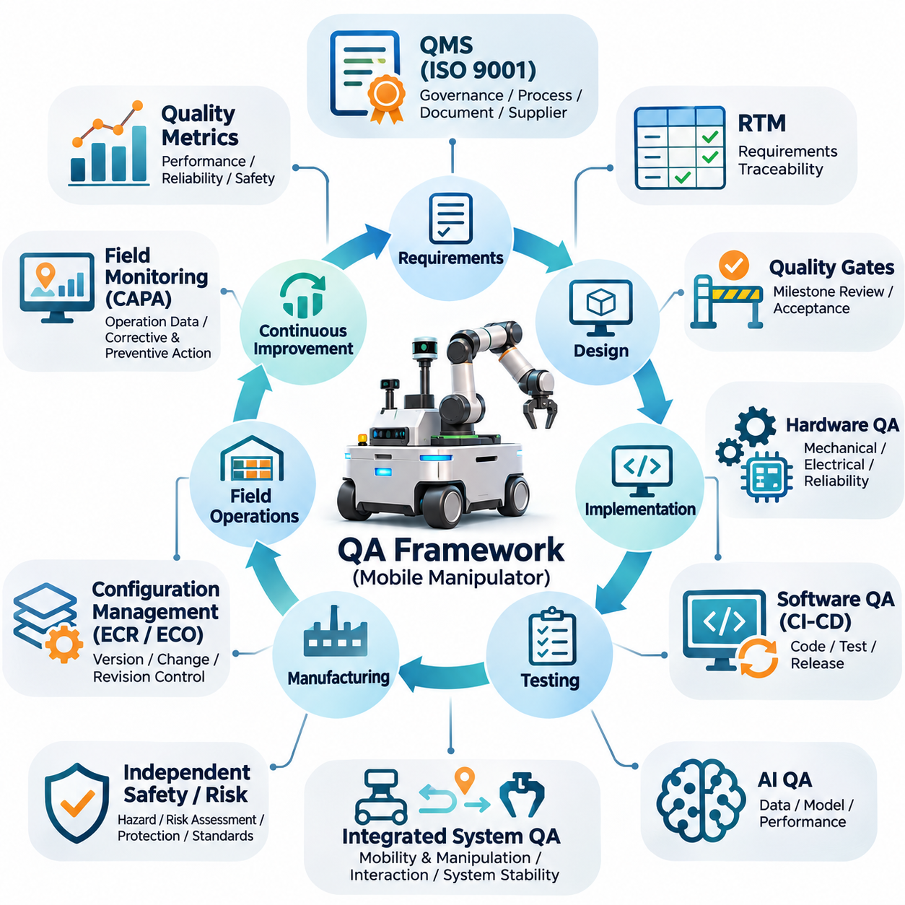{width="7.268055555555556in" height="7.268055555555556in"}

A Quality Assurance (QA) framework for mobile manipulator development establishes a systematic approach to ensuring product quality, operational reliability, functional safety, and engineering consistency throughout the product lifecycle. Unlike conventional industrial equipment, mobile manipulators integrate autonomous mobility, robotic manipulation, artificial intelligence, embedded computing, and distributed software, requiring a multidisciplinary quality management approach.

Quality assurance should be established during the initial stages of product development rather than introduced after prototype completion. Quality objectives must be derived from customer expectations, functional requirements, operational scenarios, regulatory obligations, and commercialization targets. Early quality planning reduces development uncertainty, minimizes expensive engineering modifications, and prevents systematic defects from propagating into manufacturing and field deployment.

The QA framework encompasses requirements verification, design verification, design validation, software quality assurance, artificial intelligence quality assurance, and safety compliance. These activities must operate within an integrated governance structure that defines engineering responsibilities, documentation requirements, approval authorities, and acceptance criteria. Each development activity should generate measurable evidence demonstrating compliance with established quality objectives.

A Quality Management System (QMS) provides the organizational foundation for implementing the QA framework. Principles established by ISO 9001 can support document management, process standardization, supplier qualification, risk assessment, and continuous improvement. The QMS should accommodate the unique characteristics of robotic systems while maintaining sufficient flexibility to support experimental research, prototype development, and commercial production.

Requirements traceability represents a fundamental component of quality assurance. Every customer requirement, functional specification, safety constraint, and performance target should be assigned a unique identifier and associated with corresponding design elements and verification activities. A Requirements Traceability Matrix (RTM) enables engineering teams to identify missing implementations, incomplete testing, and inconsistencies between development objectives and actual system capabilities.

Quality gates should be established at major development milestones, including requirements approval, architecture confirmation, prototype completion, system integration, field validation, and production readiness. Progression through each quality gate requires documented evidence that predefined acceptance criteria have been satisfied. Unresolved issues must undergo formal risk assessment, corrective action planning, and approval before subsequent development activities proceed.

Hardware quality assurance addresses mechanical structures, robotic manipulators, drive systems, electrical components, battery assemblies, sensors, and communication interfaces. Engineering reviews should evaluate structural integrity, mechanical tolerances, thermal behavior, electromagnetic compatibility, and component reliability. Supplier quality records and manufacturing inspection results must be maintained to ensure consistency across individual robotic platforms.

Software quality assurance focuses on architectural consistency, source code reliability, interface compatibility, execution stability, and cybersecurity. Development teams should establish coding standards, peer review procedures, static analysis, automated testing, and configuration management practices. Continuous Integration and Continuous Deployment (CI/CD) pipelines can provide systematic verification whenever software components or system dependencies are modified.

Artificial intelligence quality assurance requires additional mechanisms because learning-based algorithms exhibit statistical and context-dependent behavior. Training datasets, annotation quality, model architectures, hyperparameters, and evaluation procedures must be systematically controlled. AI models responsible for object detection, pose estimation, grasp prediction, and autonomous decision-making should demonstrate acceptable performance across representative operating conditions.

Integrated system quality assessment must address interactions between autonomous mobility and robotic manipulation. Accurate navigation does not necessarily guarantee successful manipulation, just as high manipulator repeatability does not eliminate positioning errors introduced by the mobile platform. Verification activities should therefore examine localization uncertainty, docking accuracy, coordinate transformations, vibration, communication latency, and combined system stability.

Safety assurance must remain an independent and mandatory element of the overall framework. Hazard identification, risk assessment, protective functions, emergency stopping, collision avoidance, and safe operating states should be evaluated throughout development. Applicable standards, including ISO 12100, ISO 3691-4, ISO 10218, and ISO 13849, should be selected according to the intended application, system configuration, and regulatory environment.

Configuration management ensures that quality evidence remains associated with the correct product configuration. Mechanical drawings, Bills of Materials (BOMs), firmware versions, software releases, AI model checkpoints, calibration parameters, and test reports should be maintained under controlled revision management. Engineering Change Requests (ECRs) and Engineering Change Orders (ECOs) provide formal mechanisms for evaluating and authorizing product modifications.

Field quality monitoring extends quality assurance beyond laboratory testing and manufacturing inspection. Operational telemetry, mission completion records, manipulation failures, maintenance histories, and customer feedback provide valuable evidence of real-world product behavior. Corrective and Preventive Action (CAPA) processes should transform recurring defects and operational incidents into systematic improvements in hardware, software, AI models, and engineering procedures.

The QA framework should ultimately establish a closed-loop quality management architecture connecting requirements, design, implementation, testing, manufacturing, and field operations. Quality metrics such as defect density, first-pass yield, mission success rate, failure frequency, and corrective action effectiveness enable objective evaluation. Through continuous improvement, organizations can advance mobile manipulators from experimental prototypes toward reliable, scalable, and commercially sustainable robotic products.

## 02 Requirement Verification

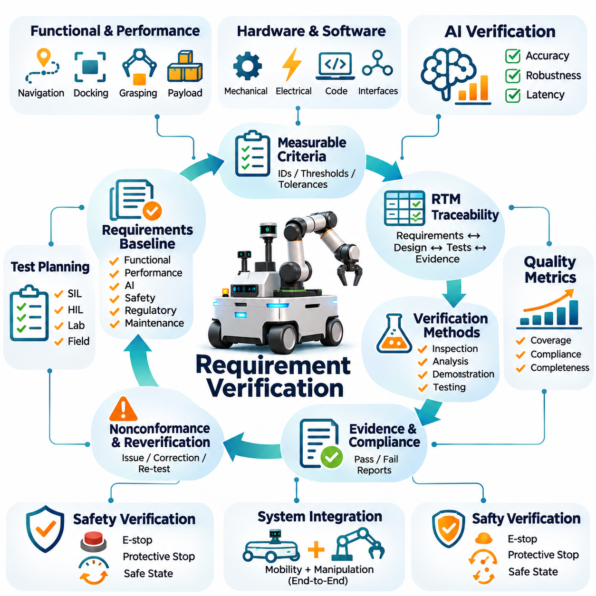{width="7.268055555555556in" height="7.268055555555556in"}

Requirement verification is a systematic engineering process that establishes whether a mobile manipulator satisfies its specified requirements through objective and measurable evidence. Within the Quality Assurance (QA) framework, this process connects customer expectations, system specifications, engineering implementations, and verification results. It ensures that development activities remain aligned with approved product requirements throughout the product lifecycle.

The verification process begins with establishing a controlled requirements baseline. Functional requirements, performance requirements, artificial intelligence requirements, safety requirements, regulatory requirements, and maintenance requirements must be documented and approved. Each requirement should contain a unique identifier, an unambiguous description, measurable acceptance criteria, verification conditions, and designated engineering responsibilities.

Requirements must be formulated to support objective verification rather than subjective interpretation. Statements such as high navigation accuracy, reliable grasping, or fast task execution should be translated into measurable engineering specifications. Numerical thresholds, permissible tolerances, environmental limitations, operational constraints, and measurement procedures provide a consistent foundation for determining whether individual requirements have been satisfied.

A Requirements Traceability Matrix (RTM) establishes bidirectional relationships between requirements, system architecture, subsystem specifications, implementation artifacts, and verification activities. Each requirement should be associated with corresponding test cases, analysis reports, inspection records, or demonstration results. This traceability enables engineering teams to identify missing implementations, insufficient verification coverage, and unauthorized changes.

Requirement verification can be performed through inspection, analysis, demonstration, and testing. Inspection evaluates documentation, physical configurations, and implementation characteristics, while analysis uses engineering calculations, simulations, and mathematical models. Demonstration confirms observable system behavior under specified conditions, whereas testing produces quantitative evidence through controlled experiments and measurement procedures.

Functional requirement verification evaluates whether the mobile manipulator performs its intended system capabilities. Representative functions include autonomous navigation, obstacle avoidance, precision docking, object recognition, grasp execution, material transportation, automatic charging, and mission recovery. Verification must address normal operating conditions, exceptional situations, subsystem interactions, and transitions between autonomous and manual operating modes.

Performance requirement verification establishes whether the system satisfies specified quantitative targets under predefined operating conditions. Relevant parameters include localization accuracy, docking precision, manipulator repeatability, payload capacity, grasp success rate, mission completion time, battery endurance, and communication latency. Measurement uncertainty, environmental variability, and statistical confidence should be considered when determining compliance.

Hardware requirement verification addresses mechanical structures, electrical systems, robotic arms, drive mechanisms, sensors, battery assemblies, and embedded computing platforms. Engineering teams should verify dimensional tolerances, structural load limits, power consumption, operating temperatures, electrical protection, and electromagnetic compatibility. Verification evidence must correspond to the actual hardware configuration and approved component specifications.

Software requirement verification evaluates whether implemented algorithms, communication interfaces, control functions, and application services satisfy their allocated requirements. Unit testing, integration testing, interface verification, static analysis, and regression testing provide complementary verification mechanisms. Particular attention should be given to execution timing, resource utilization, exception handling, communication failures, and deterministic behavior where required.

Artificial intelligence requirement verification must account for the statistical and context-dependent behavior of learning-based systems. Object detection, pose estimation, grasp prediction, and autonomous decision-making models should be evaluated using representative and independent datasets. Acceptance criteria should address model accuracy, inference latency, robustness, uncertainty estimation, and performance degradation under unfamiliar operating conditions.

Safety requirement verification establishes whether protective mechanisms satisfy the safety specifications derived from hazard identification and risk assessment. Emergency stopping, protective stopping, speed limitation, collision prevention, and safe-state transitions must be evaluated under defined conditions. Safety-related verification should include representative fault scenarios and applicable standards, without treating ordinary AI performance as evidence of functional safety.

Integrated requirement verification evaluates system-level capabilities that cannot be adequately assessed through independent subsystem testing. Mobile base positioning errors, manipulator calibration deviations, sensor synchronization, communication delays, and payload-induced instability may collectively influence task performance. End-to-end verification scenarios should therefore reproduce representative operational sequences involving coordinated mobility and manipulation.

Verification planning must define test environments, required equipment, measurement accuracy, sample sizes, execution procedures, and acceptance criteria before verification activities begin. Software-in-the-Loop (SIL), Hardware-in-the-Loop (HIL), simulation, laboratory testing, and physical field experiments can provide complementary evidence. The verification method should be selected according to requirement criticality, technical complexity, and operational risk.

Verification results must be recorded within a controlled documentation system containing requirement identifiers, test procedures, system configurations, measured results, deviations, and compliance decisions. Failed requirements should generate formal nonconformance records and corrective actions. Following engineering modifications, affected requirements must undergo reverification, supported by regression testing to identify unintended consequences elsewhere in the system.

Requirement verification should ultimately operate as a continuous quality assurance mechanism rather than an isolated activity performed immediately before product release. Verification coverage, requirement compliance rates, unresolved nonconformities, and evidence completeness provide measurable indicators of development maturity. Maintaining this closed-loop process supports reliable manufacturing, field deployment, regulatory compliance, and long-term product quality.

## 03 Design Verification

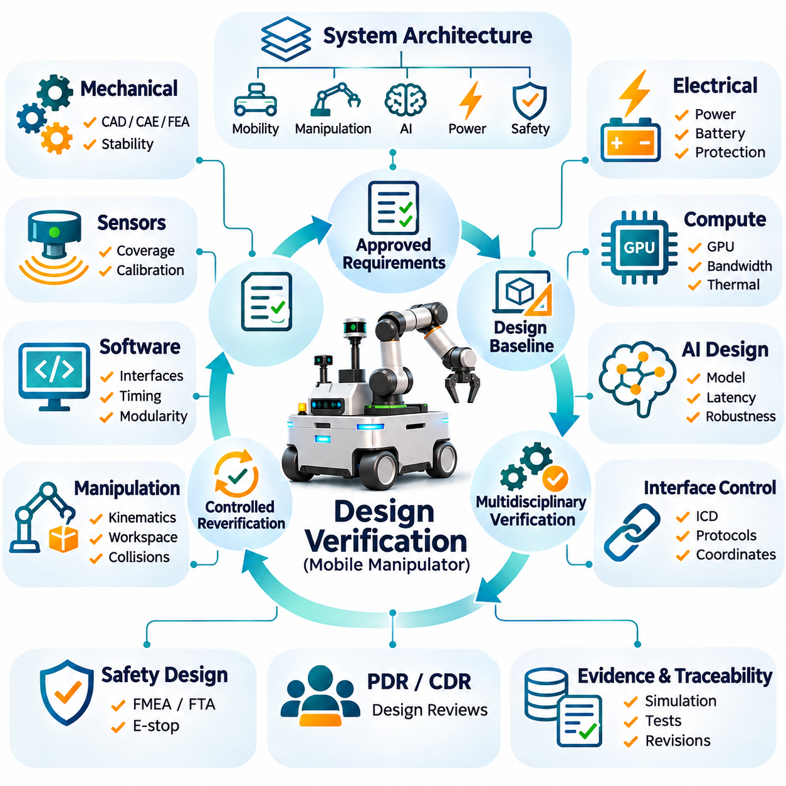{width="7.268055555555556in" height="7.268055555555556in"}

Design verification is a systematic engineering process that determines whether the design of a mobile manipulator satisfies approved system requirements, technical specifications, and engineering constraints. Within the Quality Assurance (QA) framework, design verification establishes objective evidence that architectural decisions, subsystem designs, component selections, and implementation strategies are technically consistent with established development objectives.

The design verification process begins with establishing a controlled design baseline containing system architecture documents, mechanical drawings, electrical schematics, software specifications, interface definitions, and engineering analysis results. Each design element should be traceable to corresponding requirements and verification criteria. Configuration management ensures that verification activities are performed against authorized and identifiable design revisions.

System architecture verification evaluates whether the proposed architecture adequately supports autonomous mobility, robotic manipulation, artificial intelligence, communication, power distribution, and safety functions. Engineering teams should examine functional allocation, subsystem dependencies, interface compatibility, computational resource distribution, and fault isolation mechanisms. Architectural deficiencies must be identified before substantial implementation and integration activities begin.

Mechanical design verification addresses structural integrity, dimensional accuracy, material selection, mechanical tolerances, load distribution, and system stability. Computer-Aided Design (CAD), Computer-Aided Engineering (CAE), and Finite Element Analysis (FEA) provide analytical mechanisms for evaluating structural behavior. Particular attention should be given to manipulator mounting stiffness, dynamic loading, center-of-gravity displacement, vibration, and overturning risks.

Electrical design verification evaluates power distribution, battery management, motor drive circuits, electrical protection, grounding, wiring harness architecture, and electromagnetic compatibility. Engineering analysis should confirm that electrical components operate within their specified voltage, current, temperature, and power limits. Verification must also address transient loads, short-circuit protection, connector reliability, insulation requirements, and emergency power isolation.

Sensor architecture verification establishes whether selected sensors and their installation configurations satisfy perception, localization, environmental monitoring, and manipulation requirements. Sensor positioning, field-of-view coverage, measurement accuracy, installation tolerances, synchronization mechanisms, and calibration accessibility must be evaluated. Potential interference, occlusion, environmental degradation, and systematic measurement errors should be identified through engineering analysis.

Computing architecture verification examines processing capabilities, memory capacity, data transmission bandwidth, storage requirements, thermal management, and computational resource allocation. The selected embedded processors and graphics processing units must support concurrent navigation, perception, manipulation, and communication workloads. Worst-case execution conditions should be analyzed to identify computational bottlenecks and insufficient processing margins.

Software design verification evaluates architectural decomposition, algorithm specifications, communication interfaces, execution models, and exception-handling mechanisms. Software design reviews, static analysis, interface modeling, and simulated execution provide complementary verification methods. Engineering teams should confirm that the software architecture supports modularity, maintainability, scalability, resource isolation, and predictable execution of time-critical control functions.

Artificial intelligence design verification focuses on the suitability of model architectures, input representations, data processing pipelines, training strategies, and inference configurations. The proposed AI architecture must support required perception accuracy, inference latency, computational efficiency, and robustness objectives. Model selection decisions should consider deployment hardware limitations, uncertainty estimation, environmental variability, and potential out-of-distribution conditions.

Manipulation system design verification evaluates robotic arm selection, kinematic configurations, workspace coverage, end-effector geometry, payload limitations, and motion control strategies. Forward kinematics, inverse kinematics, dynamic modeling, and collision simulation provide analytical evidence of design feasibility. Verification should examine singularities, joint limitations, grasping constraints, trajectory feasibility, and interactions between the manipulator and mobile platform.

Interface design verification ensures that mechanical, electrical, software, communication, and data interfaces remain compatible across independently developed subsystems. Interface Control Documents (ICDs) should define physical connections, coordinate conventions, communication protocols, data structures, timing requirements, and error-handling behavior. Interface verification reduces integration failures caused by incompatible assumptions or incomplete subsystem specifications.

Safety design verification evaluates whether the proposed design incorporates protective measures derived from hazard identification and risk assessment. Safety controllers, emergency stopping circuits, protective devices, speed limitations, and safe-state transitions should be examined against allocated safety requirements. Failure Mode and Effects Analysis (FMEA), Fault Tree Analysis (FTA), and applicable functional safety calculations support systematic evaluation of design-related risks.

Formal design reviews provide structured checkpoints for evaluating engineering completeness and technical readiness. Preliminary Design Reviews (PDRs) examine architectural feasibility and major design decisions, while Critical Design Reviews (CDRs) assess detailed implementation readiness. Review participants should represent relevant engineering disciplines and quality assurance functions, with identified deficiencies documented, assigned, and resolved through controlled engineering processes.

Design verification evidence should include engineering calculations, simulation results, inspection records, interface assessments, prototype test results, and formal review documentation. Each verification record must identify the applicable requirement, design revision, verification method, acceptance criteria, and compliance decision. Design modifications require impact analysis and targeted reverification to prevent previously resolved technical issues from reappearing.

Design verification ultimately establishes confidence that the mobile manipulator has been designed correctly according to approved specifications, rather than proving that it satisfies every intended operational need. The latter objective belongs to design validation. By integrating traceability, multidisciplinary engineering analysis, configuration management, and corrective action, design verification reduces technical uncertainty and supports reliable system integration, manufacturing readiness, and subsequent field validation.

## 04 Design Validation

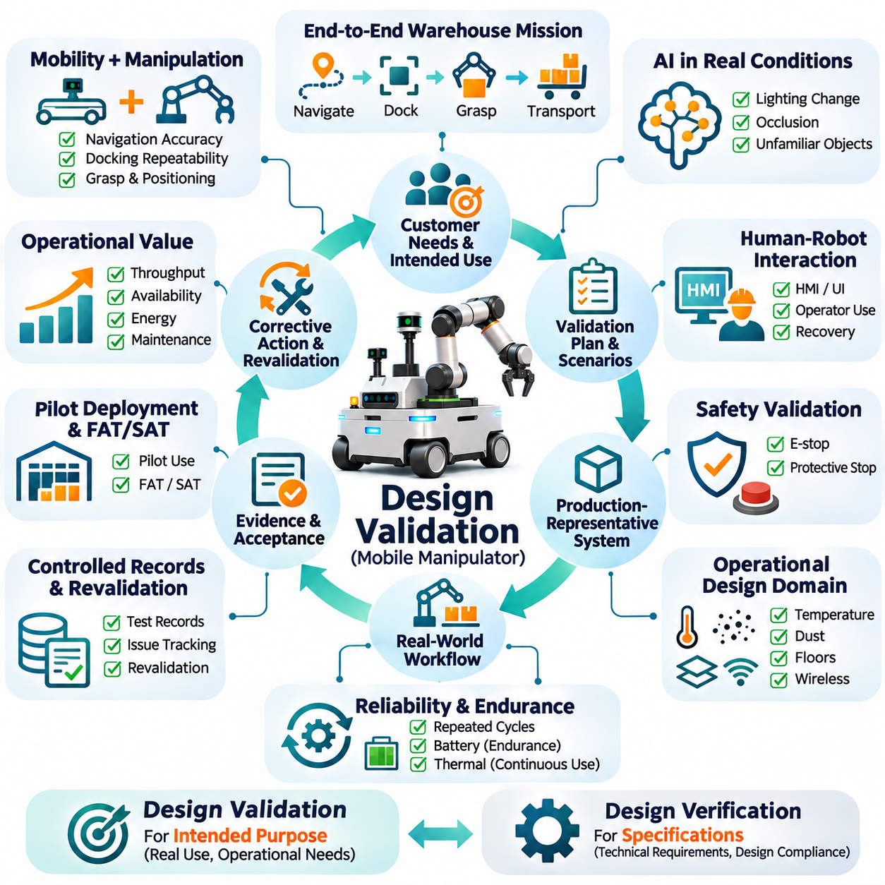{width="7.268055555555556in" height="7.268055555555556in"}

Design validation is a systematic engineering process that determines whether a mobile manipulator satisfies its intended operational needs, customer expectations, and application-specific objectives. Unlike design verification, which evaluates compliance with approved technical specifications, design validation establishes whether the completed system represents an appropriate solution for its intended operating environment and practical use cases.

Within the Quality Assurance (QA) framework, design validation connects engineering development with operational requirements and commercialization objectives. Validation activities should begin during early product development and continue through prototype evaluation, system integration, pilot deployment, and production readiness. Early validation reduces the possibility of developing technically compliant products that fail to satisfy actual customer needs.

Design validation planning requires a comprehensive understanding of intended applications, environmental characteristics, operator interactions, and operational constraints. Representative scenarios should be derived from customer requirements, workflow descriptions, and anticipated field conditions. Each validation scenario must define operational objectives, initial conditions, execution procedures, measurable acceptance criteria, and expected system behavior.

Validation should be performed using production-representative systems whenever possible, including approved mechanical structures, electrical components, embedded processors, software releases, and artificial intelligence models. Prototype configurations may support preliminary validation, but their limitations must be documented. Differences between validation configurations and final production configurations require impact assessment and additional validation where necessary.

Operational scenario validation evaluates the ability of mobile manipulators to execute complete workflows rather than isolated technical functions. A representative warehouse scenario may include receiving a mission, navigating toward a workstation, detecting objects, performing precision docking, executing grasping operations, transporting materials, and reporting task completion. The entire operational sequence must be evaluated under realistic conditions.

Mobility and manipulation validation must address the combined behavior of the autonomous mobile platform and robotic arm. Navigation accuracy, docking repeatability, manipulator reachability, grasp stability, and positioning uncertainty collectively influence task execution. Validation should establish whether the integrated system can compensate for permissible positioning deviations while maintaining operational accuracy, stability, and consistent manipulation performance.

Artificial intelligence validation evaluates the effectiveness of perception, object recognition, pose estimation, grasp prediction, and autonomous decision-making under representative operating conditions. Environmental variations, unfamiliar objects, partial occlusions, illumination changes, and sensor degradation should be incorporated into validation scenarios. Model accuracy alone is insufficient when AI outputs influence physical robotic actions.

Human-Robot Interaction (HRI) validation determines whether operators, maintenance personnel, and surrounding workers can interact with mobile manipulators safely and effectively. Human-Machine Interfaces (HMIs), mission management tools, warning indicators, manual intervention procedures, and recovery instructions must support practical operational needs. Usability assessment should consider operator workload, training requirements, and foreseeable human errors.

Safety validation establishes whether implemented protective measures provide adequate risk reduction within the intended application. Emergency stopping, protective stopping, restricted operating zones, speed limitations, and coordinated movement restrictions should be evaluated under representative conditions. Validation must address foreseeable misuse, unexpected human interactions, and relevant system failures without relying solely on normal operational testing.

Environmental validation examines system performance under the physical conditions expected during actual deployment. Temperature fluctuations, humidity, dust, floor irregularities, vibration, electromagnetic interference, lighting variations, and wireless communication limitations may affect operational behavior. Environmental conditions should reflect the defined Operational Design Domain (ODD) and application-specific operating boundaries.

Reliability and endurance validation determine whether the mobile manipulator can maintain acceptable operational performance during repeated tasks and extended operating periods. Continuous mission execution, battery charging cycles, manipulator movements, thermal loading, and communication interruptions provide representative operational stresses. Validation should identify progressive performance degradation, recurring failures, and maintenance-related limitations.

Design validation must also consider operational efficiency, maintainability, and economic suitability. Mission completion time, material handling throughput, energy consumption, system availability, maintenance duration, and operator intervention frequency provide practical evaluation criteria. These parameters help determine whether the proposed robotic solution delivers measurable operational value compared with existing processes or alternative automation technologies.

Pilot deployments and customer acceptance activities provide important opportunities to validate the mobile manipulator within representative facilities. Feedback from operators, maintenance teams, production managers, and system integrators should be systematically collected. Factory Acceptance Testing (FAT) and Site Acceptance Testing (SAT) can contribute validation evidence when their procedures address intended operational needs and agreed acceptance criteria.

Validation results must be maintained within a controlled documentation system that records operational scenarios, product configurations, environmental conditions, measured performance, observed failures, and acceptance decisions. Identified deficiencies should generate corrective actions and engineering change requests. Subsequent revalidation must demonstrate that modifications resolve operational problems without introducing unacceptable risks or performance degradation.

Design validation ultimately establishes confidence that the mobile manipulator is suitable for its intended purpose rather than merely compliant with engineering specifications. By connecting customer requirements, representative workflows, operational evidence, safety assessment, and continuous improvement, design validation supports product acceptance, technology readiness, manufacturing decisions, scalable field deployment, and sustainable commercialization.

## 05 Software Quality Assurance

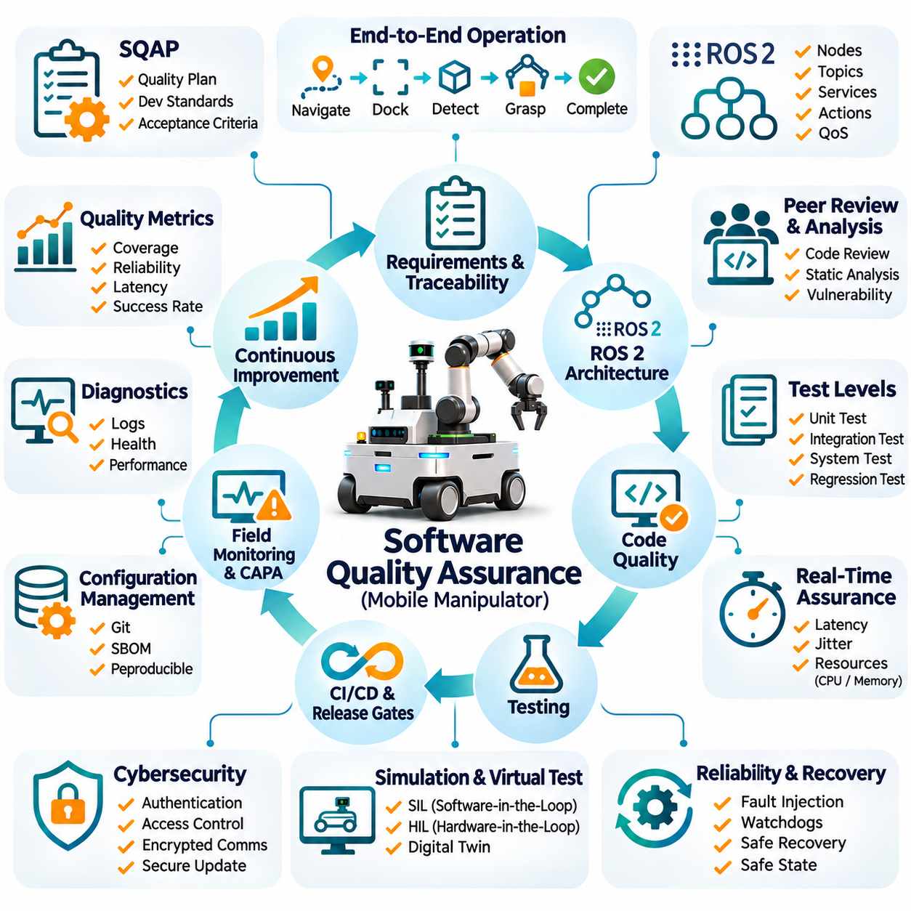{width="7.268055555555556in" height="7.268055555555556in"}

Software Quality Assurance (SQA) is a systematic engineering discipline that ensures software components within a mobile manipulator satisfy established functional, performance, reliability, maintainability, and safety requirements. Because mobile manipulators integrate autonomous navigation, robotic manipulation, artificial intelligence, embedded control, and distributed communication, software quality must be managed across the entire product lifecycle.

Software quality assurance begins with establishing a Software Quality Assurance Plan (SQAP) that defines development standards, verification strategies, testing procedures, documentation requirements, and engineering responsibilities. Quality objectives should be aligned with system requirements and operational risks. The plan should establish measurable acceptance criteria and formal approval procedures for software components and integrated releases.

Software requirements management provides the foundation for establishing consistent software quality. Each software requirement should be traceable to corresponding system requirements, architectural components, implementation modules, and verification activities. Bidirectional traceability enables engineering teams to identify missing functionality, incomplete implementation, inconsistent interfaces, and unintended consequences resulting from requirement changes.

Software architecture quality assurance evaluates modularity, component dependencies, interface consistency, scalability, maintainability, and fault isolation. In ROS 2-based mobile manipulators, architectural verification should examine node organization, topic communication, service interfaces, action servers, Quality of Service (QoS) configurations, and lifecycle management. Architectural deficiencies should be resolved before large-scale software integration.

Source code quality assurance requires standardized coding conventions, structured peer reviews, static code analysis, and automated verification. Programming languages such as C++, Python, and embedded C should follow appropriate language-specific development guidelines. Code reviews should identify logical errors, memory management problems, concurrency issues, duplicated functionality, cybersecurity vulnerabilities, and insufficient exception-handling mechanisms.

Software testing should encompass unit testing, integration testing, functional testing, system testing, and regression testing. Individual modules must be evaluated independently before their interactions are examined within integrated software environments. Automated testing frameworks improve verification consistency and enable repeated evaluation whenever source code, software dependencies, communication interfaces, or operational configurations are modified.

Continuous Integration and Continuous Deployment (CI/CD) pipelines provide an automated infrastructure for maintaining software quality throughout development. Source code commits should trigger compilation, static analysis, dependency checks, automated testing, and software packaging. Deployment to physical robots must require appropriate approval gates, configuration compatibility checks, release authorization, and verified rollback mechanisms.

Real-time software quality assurance is particularly important because mobile manipulators execute time-sensitive control and communication functions. Navigation controllers, motion planners, motor interfaces, and robotic arm controllers must operate within specified timing constraints. Execution latency, scheduling jitter, deadline violations, processor utilization, memory consumption, and communication delays should be evaluated under representative and worst-case workloads.

Software reliability assessment must examine abnormal operating conditions and unexpected system behavior. Communication interruptions, process crashes, sensor failures, corrupted messages, resource exhaustion, and unavailable external services should be incorporated into fault injection scenarios. Exception-handling mechanisms, watchdog processes, controlled recovery procedures, and safe-state transitions must be verified against specified requirements.

Simulation-based software quality assurance enables systematic evaluation before deployment on physical robotic platforms. Software-in-the-Loop (SIL), Hardware-in-the-Loop (HIL), and digital twin environments support repeated testing of navigation algorithms, manipulation sequences, task planning, and failure recovery. Simulation evidence should be complemented by physical testing to identify discrepancies between modeled and actual operating conditions.

Cybersecurity assurance must address unauthorized access, communication security, software integrity, dependency vulnerabilities, and protection of operational data. Authentication, authorization, encrypted communication, secure update mechanisms, and access control policies should be systematically evaluated. Security testing must consider onboard computing platforms, fleet management servers, remote operation interfaces, and third-party software dependencies.

Software configuration management ensures that source code, firmware, libraries, middleware, container images, configuration parameters, and deployment packages remain identifiable and reproducible. Version control systems such as Git support controlled collaboration and revision tracking. A Software Bill of Materials (SBOM) provides additional visibility into software dependencies, component versions, licensing obligations, and potential security vulnerabilities.

Integrated software quality assurance must evaluate coordination between autonomous mobility, robotic manipulation, perception, mission orchestration, and fleet management. End-to-end testing should examine operational sequences involving navigation, docking, object recognition, grasp execution, and task completion. Particular attention should be given to inconsistent system states, unsynchronized commands, invalid coordinate transformations, and incomplete recovery sequences.

Software release management requires documented verification evidence, known defect assessments, compatibility information, and formal acceptance decisions. Field monitoring should collect diagnostic logs, execution failures, resource utilization, communication errors, and mission performance data. Corrective and Preventive Action (CAPA) processes should translate identified software deficiencies into controlled engineering modifications and subsequent regression testing.

Software quality assurance ultimately establishes a closed-loop engineering process connecting requirements, architecture, implementation, testing, deployment, and operational monitoring. Quality metrics such as defect density, code coverage, regression test pass rate, software failure frequency, and recovery effectiveness support objective assessment. Continuous improvement enables reliable, maintainable, secure, and scalable mobile manipulator software throughout commercial operation.

## 06 AI Quality Assurance

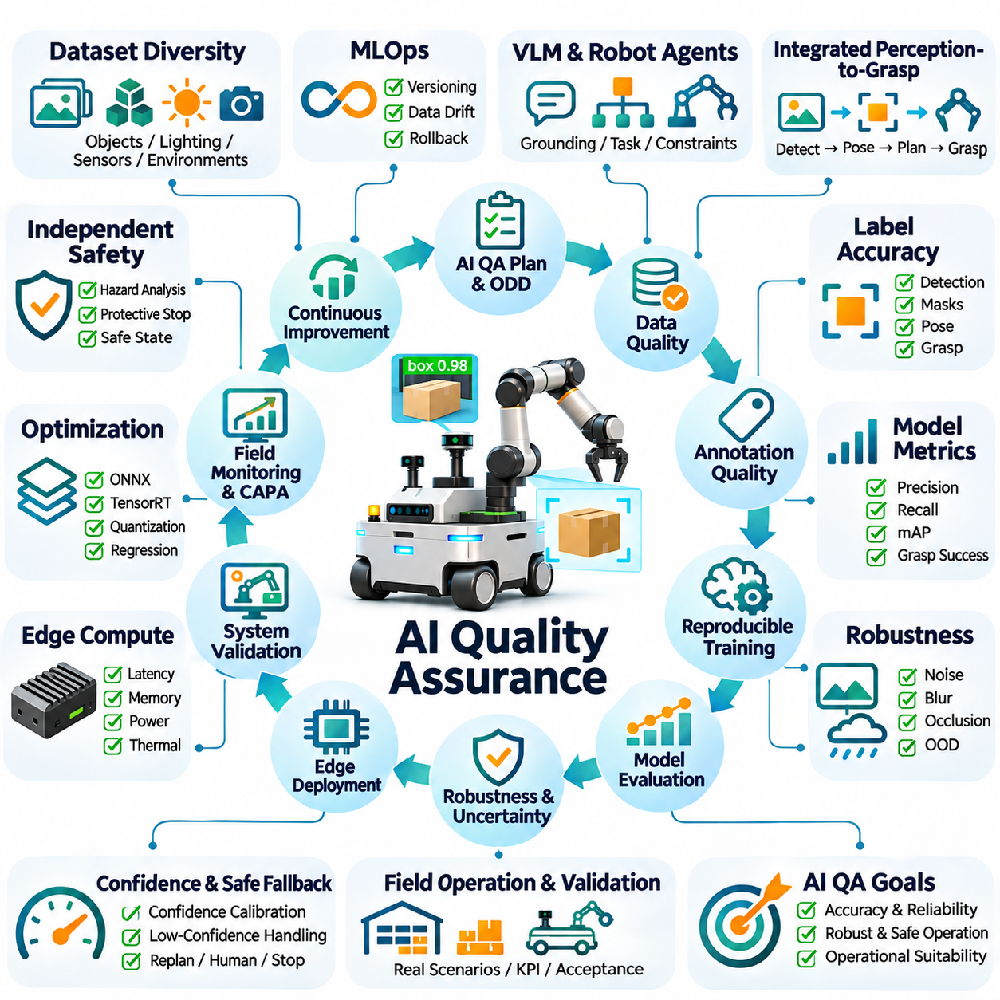{width="7.268055555555556in" height="7.268055555555556in"}

Artificial Intelligence Quality Assurance (AI QA) is a systematic engineering discipline that ensures AI components within a mobile manipulator satisfy established requirements for accuracy, reliability, robustness, computational efficiency, and operational suitability. Unlike conventional software, AI systems exhibit statistical and context-dependent behavior, requiring quality assurance throughout data preparation, model development, deployment, and field operation.

AI quality assurance begins with establishing an AI Quality Assurance Plan that defines quality objectives, evaluation methodologies, acceptance criteria, documentation requirements, and engineering responsibilities. These elements should reflect the intended application and Operational Design Domain (ODD). Quality planning must also consider the operational consequences of incorrect predictions, uncertain decisions, and inappropriate robotic actions.

Data quality assurance establishes the foundation for reliable AI model development. Training, validation, and test datasets must be evaluated for accuracy, completeness, consistency, diversity, and representativeness. Data collection should encompass variations in object geometry, illumination, background conditions, sensor characteristics, and operational environments. Dataset deficiencies may introduce systematic errors that persist throughout deployment.

Annotation quality assurance ensures that object detection labels, segmentation masks, pose annotations, grasp configurations, and other supervisory information accurately represent physical objects and operational conditions. Annotation guidelines, independent reviews, inter-annotator agreement, and automated consistency checks should be established. Incorrect or inconsistent annotations must be identified and corrected before model training.

AI model quality assurance evaluates the suitability of model architectures, training strategies, hyperparameter configurations, and optimization procedures. Model development should maintain reproducible experimental environments, controlled dataset versions, and documented training configurations. Independent test datasets must remain separated from training and model selection activities to prevent data leakage and misleading performance estimates.

Performance evaluation should employ metrics appropriate to individual AI functions. Object detection may be assessed using precision, recall, and mean Average Precision (mAP), while pose estimation requires translational and rotational error measurements. Grasp detection should consider physical grasp success rates. Model-level metrics must be supplemented by system-level measurements reflecting actual manipulation and mission performance.

Robustness assurance evaluates AI model behavior under environmental variations, sensor noise, partial occlusion, motion blur, illumination changes, and unfamiliar object configurations. Stress testing and controlled perturbation experiments help identify operational boundaries and performance limitations. AI systems should demonstrate acceptable behavior within their intended operating conditions and respond appropriately when those conditions are exceeded.

Uncertainty estimation and Out-of-Distribution (OOD) detection are particularly important when AI predictions influence physical robotic actions. Confidence calibration should determine whether prediction confidence corresponds to observed correctness. Low-confidence predictions and unfamiliar input conditions should trigger defined responses, including additional perception, alternative grasp planning, human intervention, or controlled task termination.

Computational quality assurance evaluates inference latency, processing throughput, memory consumption, power utilization, and thermal behavior on target deployment hardware. AI models operating on embedded processors or edge computing platforms must satisfy timing and resource constraints while sharing computational resources with navigation, manipulation, and communication processes. Average inference speed alone is insufficient for deployment approval.

AI deployment quality assurance verifies that model conversion, quantization, compression, inference optimization, and runtime configuration preserve acceptable operational performance. Deployment frameworks such as ONNX Runtime and TensorRT may introduce numerical differences or execution constraints. Optimized models must undergo comparative evaluation and regression testing on the actual target hardware before receiving production approval.

Integrated AI quality assurance examines interactions between perception models, coordinate transformations, grasp planning, motion planning, and robotic control. Accurate object detection does not necessarily guarantee successful manipulation because pose uncertainty, calibration errors, and communication delays may affect physical execution. End-to-end testing must establish whether AI outputs contribute to reliable and consistent operational outcomes.

Advanced AI components, including Vision-Language Models (VLMs), robot agents, and embodied AI systems, require additional quality assurance mechanisms. Evaluation should examine instruction interpretation, environmental grounding, task decomposition, reasoning consistency, and inappropriate action generation. Generated commands must remain subject to validated execution constraints, workspace restrictions, and independent safety mechanisms.

AI safety assurance must address the physical consequences of erroneous predictions and autonomous decisions. Hazard analysis should examine missed detections, incorrect object identification, inaccurate pose estimation, unstable grasp selection, and unexpected task execution. Independent protective functions must remain effective when AI components fail. High statistical model accuracy cannot substitute for verified functional safety measures.

Machine Learning Operations (MLOps) provides the infrastructure for maintaining AI quality throughout the product lifecycle. Dataset versioning, experiment tracking, model registries, automated evaluation, deployment authorization, and rollback mechanisms enable controlled model management. Field monitoring should identify data drift, performance degradation, recurring prediction errors, and changes in operational conditions that require further investigation.

AI quality assurance ultimately establishes a closed-loop process connecting data governance, model development, performance evaluation, system integration, deployment, and operational monitoring. Quality metrics should include prediction accuracy, inference latency, failure frequency, uncertainty calibration, and model regression rates. Corrective and Preventive Action (CAPA) and controlled model updates support continuous improvement and dependable commercial operation.

## 07 Safety Compliance

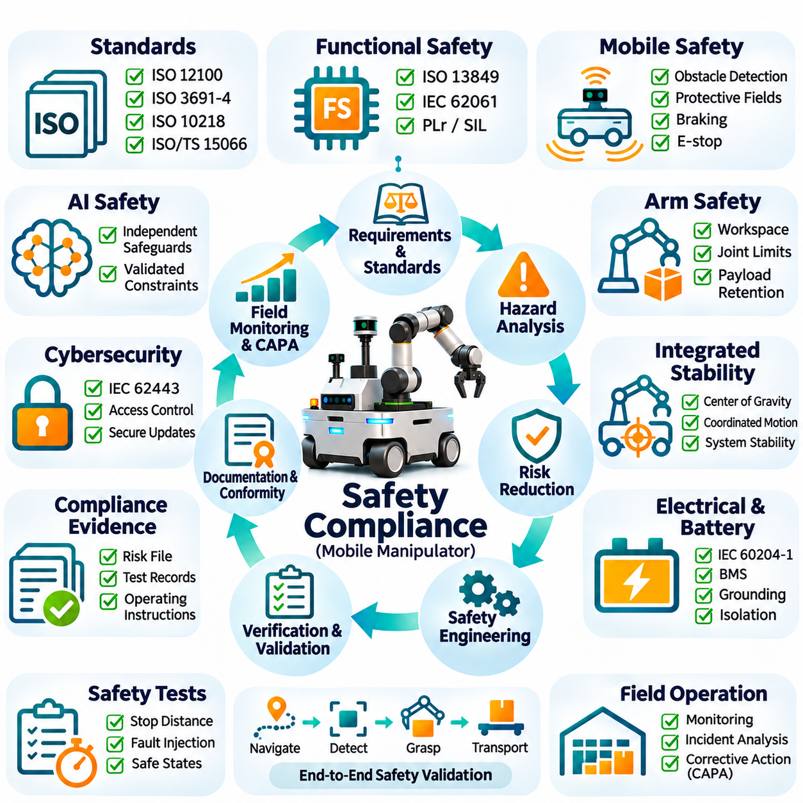{width="7.268055555555556in" height="7.268055555555556in"}

Safety compliance is a systematic quality assurance discipline that ensures mobile manipulators satisfy applicable safety requirements, regulatory obligations, and recognized engineering standards. Because these robotic systems integrate autonomous mobility, robotic manipulation, artificial intelligence, and human interaction, safety compliance must address both individual subsystem hazards and risks arising from integrated system operation.

Safety compliance management begins with identifying applicable regulations, international standards, customer requirements, and operational restrictions. The intended application, deployment location, system configuration, and human interaction characteristics determine the relevant compliance obligations. A Safety Compliance Matrix should establish traceability between applicable requirements, engineering implementations, verification procedures, and supporting evidence.

International safety standards provide an important foundation for mobile manipulator development. ISO 12100 addresses machinery risk assessment and risk reduction, while ISO 3691-4 covers safety requirements for driverless industrial trucks and their systems. The ISO 10218 series addresses industrial robot safety, and ISO/TS 15066 provides guidance for collaborative applications. Applicability must be assessed for each complete robotic system.

Hazard identification and risk assessment should be performed throughout the development lifecycle. Potential hazards include unintended movement, collisions, crushing, trapping, falling payloads, electrical failures, battery-related incidents, and unexpected autonomous decisions. Risk assessment must consider normal operation, foreseeable misuse, maintenance activities, system failures, and interactions between the robotic arm and mobile platform.

Risk reduction should follow a structured hierarchy that prioritizes inherently safe design measures, safeguarding, complementary protective measures, and information for use. Mechanical stability, restricted movement ranges, appropriate speed limits, protective devices, and clearly defined operating boundaries contribute to risk reduction. Residual risks must be documented and communicated through operating instructions, warning indicators, and personnel training.

Functional safety compliance evaluates whether safety-related control systems provide the required level of risk reduction. ISO 13849 and IEC 62061 provide methodologies for developing and assessing safety-related control functions in machinery. Required Performance Levels (PLr) or Safety Integrity Levels (SIL) should be determined through applicable risk assessment procedures and supported by suitable architectural and reliability evidence.

Mobile platform safety compliance addresses autonomous navigation, obstacle detection, protective field configuration, braking performance, speed monitoring, and emergency stopping. Verification must consider payload variations, floor conditions, travel directions, stopping distances, and sensor coverage. Safety-related protective devices should remain effective throughout the defined operating environment, including foreseeable abnormal operating conditions.

Manipulator safety compliance evaluates robotic arm movements, joint limitations, workspace restrictions, tool operation, payload retention, and potential human exposure. Collaborative applications may require safety-rated monitored stopping, speed and separation monitoring, hand guiding, or power and force limiting. The suitability of each protective approach must be established through application-specific risk assessment and validation.

Integrated safety compliance is particularly important because combining an autonomous mobile robot with a robotic arm introduces additional system-level hazards. Extended manipulator configurations may alter the center of gravity, protective field requirements, and collision boundaries. Safety mechanisms must address coordinated mobility and manipulation, preventing hazardous simultaneous movements and maintaining stability across permitted operating configurations.

Electrical and battery safety compliance addresses power distribution, electrical insulation, grounding, overcurrent protection, thermal management, and emergency power isolation. Applicable requirements may include IEC 60204-1 and relevant battery safety standards. Battery Management Systems (BMS), charging interfaces, protective circuits, and electrical enclosures must be evaluated against operational stresses and foreseeable electrical fault conditions.

Artificial intelligence safety compliance must consider the consequences of inaccurate perception, incorrect object identification, unreliable grasp predictions, and inappropriate autonomous decisions. Conventional AI performance metrics cannot independently demonstrate functional safety. Learning-based components should operate within validated execution constraints, supported by independently implemented safety functions that provide the required risk reduction.

Software and cybersecurity compliance should address failures or unauthorized actions that could compromise safety-related behavior. Communication integrity, access control, secure software updates, configuration management, and fault recovery mechanisms contribute to operational protection. Relevant provisions of the IEC 62443 series may support industrial cybersecurity engineering, with particular attention to remote operation and fleet management interfaces.

Safety verification and validation must generate objective evidence demonstrating that protective functions satisfy specified safety requirements and provide adequate risk reduction. Emergency stopping, protective stopping, safe speed monitoring, fault detection, and safe-state transitions should undergo controlled testing. Fault injection, stopping distance measurements, and representative operational scenarios support comprehensive safety assessment.

Safety compliance documentation should maintain risk assessment reports, safety requirements, engineering drawings, functional safety calculations, verification records, validation reports, and operating instructions. Regulatory conformity assessment must follow the requirements of the target market. Product modifications affecting safety functions require impact assessment, updated documentation, and appropriate reverification or revalidation before release.

Safety compliance ultimately establishes a continuous quality management process connecting regulatory requirements, hazard analysis, risk reduction, engineering implementation, verification, validation, and field monitoring. Operational incidents, near misses, and safety-related failures must support Corrective and Preventive Action (CAPA). This lifecycle approach strengthens regulatory conformity, operational safety, product reliability, and sustainable commercialization.

## 08 Field Quality Monitoring

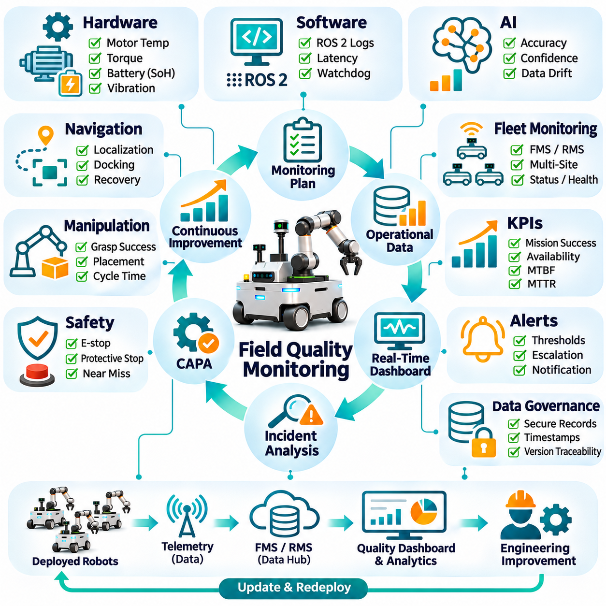{width="7.268055555555556in" height="7.268055555555556in"}

Field quality monitoring is a systematic quality assurance process that evaluates the operational performance, reliability, safety, and functional consistency of mobile manipulators after deployment in actual working environments. Unlike laboratory testing and controlled validation, field quality monitoring examines continuous system behavior under real-world operating conditions, environmental variations, equipment degradation, and changing customer requirements.

Field quality monitoring begins with establishing a structured monitoring plan that defines operational parameters, data collection methods, performance indicators, acceptance thresholds, and engineering responsibilities. Monitoring objectives should be aligned with system requirements, field validation results, and customer expectations. Critical quality indicators must be identified according to their potential effects on operational reliability and safety.

Operational data collection provides the foundation for effective field quality monitoring. Mobile manipulators should continuously record navigation status, localization accuracy, manipulation results, sensor measurements, battery conditions, computational resource utilization, and communication performance. Collected data should include synchronized timestamps, robot identification, software versions, and operational context to support reliable historical analysis.

Hardware quality monitoring evaluates the physical condition and operational behavior of mechanical, electrical, and electronic components. Motor temperatures, actuator currents, joint torques, battery degradation, mechanical vibration, and sensor abnormalities provide valuable indicators of component deterioration. Continuous observation of these parameters enables early identification of potential hardware failures and supports condition-based maintenance.

Software quality monitoring focuses on application stability, process availability, communication errors, execution latency, memory consumption, and unexpected system behavior. ROS 2 diagnostic messages, application logs, watchdog events, and system performance records provide important operational evidence. Recurring software exceptions and abnormal resource utilization should be investigated before they develop into significant operational failures.

Artificial intelligence quality monitoring evaluates the consistency and reliability of AI models under changing operational conditions. Object detection accuracy, pose estimation errors, prediction confidence, inference latency, and grasp success rates should be monitored using available ground truth and operational feedback. Changes in environmental conditions, object characteristics, and sensor behavior may indicate data drift or model performance degradation.

Navigation quality monitoring examines localization stability, trajectory tracking accuracy, obstacle avoidance behavior, docking performance, and autonomous recovery effectiveness. Operational records should identify repeated localization failures, excessive route deviations, unnecessary protective stops, and unstable navigation behavior. These observations support systematic improvements to autonomous mobility algorithms and environmental configurations.

Manipulation quality monitoring evaluates grasp execution, object handling accuracy, placement precision, motion consistency, and task completion rates. Failed grasp attempts, dropped objects, excessive contact forces, unexpected joint movements, and extended manipulation cycles should be recorded with relevant contextual information. Correlating manipulation failures with perception and control data supports more accurate identification of underlying causes.

Safety-related field quality monitoring requires continuous observation of emergency stops, protective stops, safety sensor activations, speed limit violations, and unexpected human-robot interactions. Operational incidents and near misses must be documented and classified according to their potential severity. Monitoring systems should support timely investigation without replacing independently implemented and validated safety functions.

Fleet-level quality monitoring enables centralized assessment of multiple mobile manipulators deployed across different customer sites. Fleet Management Systems (FMS) and Robot Management Systems (RMS) can aggregate operational records, diagnostic information, maintenance histories, and mission performance data. Comparative analysis should account for differences in robot configurations, workloads, environmental conditions, and operating durations.

Key Performance Indicators (KPIs) provide quantitative measurements for evaluating field quality. Relevant indicators include mission success rate, grasp success rate, operational availability, Mean Time Between Failures (MTBF), Mean Time To Repair (MTTR), and autonomous recovery success rate. Statistical analysis should normalize failure frequencies against operating hours or completed missions to support meaningful comparisons across deployed systems.

Real-time quality dashboards and automated alerting mechanisms enable engineering and operational teams to identify abnormal conditions promptly. Warning thresholds should distinguish temporary performance variations from persistent quality degradation and critical failures. Alarm prioritization, event correlation, and escalation procedures help reduce unnecessary notifications while ensuring that significant operational problems receive appropriate attention.

Field quality incidents should be documented through standardized reporting procedures that capture failure symptoms, environmental conditions, affected components, system configurations, and operational consequences. Diagnostic evidence should be preserved for subsequent failure analysis and root cause investigation. Confirmed quality deficiencies must be transferred into Corrective and Preventive Action (CAPA) processes with defined responsibilities and closure criteria.

Field quality data management requires secure storage, controlled access, appropriate retention policies, and reliable configuration traceability. Operational information collected from customer facilities must comply with applicable privacy, cybersecurity, and contractual requirements. Data integrity and synchronization should be maintained across onboard systems, remote monitoring platforms, and centralized quality management databases to ensure trustworthy analysis.

Field quality monitoring ultimately establishes a closed-loop quality assurance process connecting product development, manufacturing, deployment, maintenance, failure analysis, and continuous improvement. Operational evidence should guide hardware design modifications, software updates, AI model refinement, and preventive maintenance strategies. This lifecycle approach improves product maturity, customer satisfaction, operational reliability, and scalable commercialization.

## 09 Failure Analysis

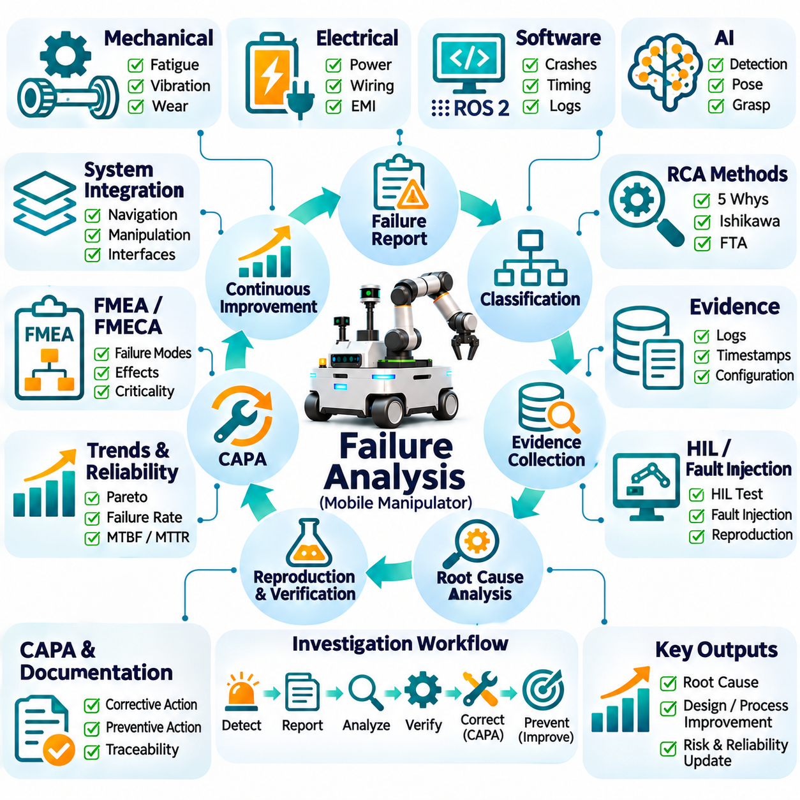{width="7.268055555555556in" height="7.268055555555556in"}

Failure analysis is a systematic engineering process that identifies the causes, mechanisms, and operational consequences of failures occurring within mobile manipulators. Because these systems integrate mechanical structures, electrical components, embedded software, artificial intelligence, autonomous mobility, and robotic manipulation, failure analysis must examine both individual component deficiencies and interactions among interconnected subsystems.

Failure analysis begins with establishing a structured investigation process that defines failure reporting procedures, evidence collection methods, classification criteria, analytical techniques, and engineering responsibilities. Investigations may originate from development testing, manufacturing inspections, field validation, or commercial operation. Each reported failure should receive a unique identification number to ensure traceability throughout the investigation.

Failure classification provides a consistent framework for determining the nature, severity, frequency, and operational impact of identified problems. Failures may be categorized as mechanical, electrical, electronic, software, communication, artificial intelligence, or system integration failures. Additional classifications distinguish intermittent failures, persistent failures, progressive degradation, and sudden failures requiring immediate intervention.

Evidence collection is essential for establishing a reliable understanding of failure conditions. Engineering teams should preserve diagnostic logs, sensor measurements, controller commands, environmental information, software versions, and affected hardware components. Synchronized timestamps and configuration records enable reconstruction of operational sequences, while appropriate evidence preservation prevents the loss or alteration of critical information.

Root Cause Analysis (RCA) distinguishes observable failure symptoms from the fundamental conditions responsible for their occurrence. Techniques such as the Five Whys, Ishikawa diagrams, Fault Tree Analysis (FTA), and causal chain analysis support systematic investigation. Identified root causes must be supported by objective evidence rather than assumptions, and investigations should consider multiple contributing factors where appropriate.

Mechanical failure analysis examines structural deformation, material fatigue, excessive vibration, bearing deterioration, transmission wear, and fastening deficiencies. Mobile manipulators experience dynamic loading generated by platform acceleration, braking, payload movement, and robotic arm operation. Physical inspections, dimensional measurements, material examination, and stress analysis help determine the mechanisms responsible for mechanical failures.

Electrical and electronic failure analysis evaluates power distribution abnormalities, wiring harness damage, connector degradation, insulation failures, electromagnetic interference, and controller malfunction. Voltage fluctuations, excessive current consumption, abnormal temperature increases, and intermittent communication losses may indicate electrical deficiencies. Investigations should examine component specifications, circuit protection, installation quality, and environmental exposure.

Software failure analysis investigates application crashes, logical errors, memory management problems, timing violations, concurrency defects, and communication inconsistencies. In ROS 2-based systems, diagnostic records, node states, message sequences, and execution traces provide essential evidence. Reproducing software failures within controlled environments helps isolate defective modules and identify interactions responsible for unexpected system behavior.

Artificial intelligence failure analysis examines incorrect object detection, inaccurate pose estimation, unreliable grasp predictions, and inappropriate autonomous decisions. Investigations should consider dataset limitations, annotation errors, environmental changes, sensor degradation, model uncertainty, and deployment configurations. Recorded input data and model outputs should be analyzed together to distinguish perception failures from downstream execution problems.

Integrated system failure analysis addresses problems arising from interactions between autonomous navigation, robotic manipulation, perception, task planning, and fleet management. A positioning error in the mobile platform may propagate into inaccurate grasp execution even when the manipulator operates correctly. Analyzing shared resources, interface contracts, coordinate transformations, and synchronization mechanisms helps identify cross-subsystem failure propagation.

Failure Mode and Effects Analysis (FMEA) supports the systematic identification of potential failure modes, their causes, and their consequences. Failure Mode, Effects, and Criticality Analysis (FMECA) extends this approach through criticality assessment. Actual failure investigation results should be incorporated into existing analytical records to improve risk assessments, detection mechanisms, engineering priorities, and preventive design strategies.

Failure reproduction and hypothesis verification establish whether suspected causes can consistently explain observed system behavior. Controlled experiments, simulation environments, component substitution, Hardware-in-the-Loop (HIL) testing, and fault injection may support verification. Experimental conditions should reproduce relevant operational stresses while maintaining appropriate safety controls and preventing unnecessary damage to equipment.

Failure trend analysis evaluates recurring defects, component reliability, operational exposure, and relationships between failure frequency and system configurations. Pareto analysis helps identify dominant failure categories, while statistical reliability techniques support assessments of degradation and failure distribution. Comparisons should account for operating hours, duty cycles, payload conditions, environmental differences, and maintenance histories.

Failure analysis documentation should include failure descriptions, investigation evidence, analytical methods, confirmed root causes, contributing factors, operational consequences, and recommended engineering actions. Unresolved hypotheses and investigative limitations must also be documented. Confirmed deficiencies should enter the Corrective and Preventive Action (CAPA) process, where modifications and their effectiveness are systematically verified.

Failure analysis ultimately establishes a closed-loop quality assurance process connecting operational failures with engineering knowledge, risk management, design optimization, and continuous improvement. Investigation results should guide hardware modifications, software corrections, AI model refinement, manufacturing controls, and maintenance strategies. This lifecycle approach reduces failure recurrence and strengthens product reliability, operational safety, and commercial maturity.

## 10 CAPA Process

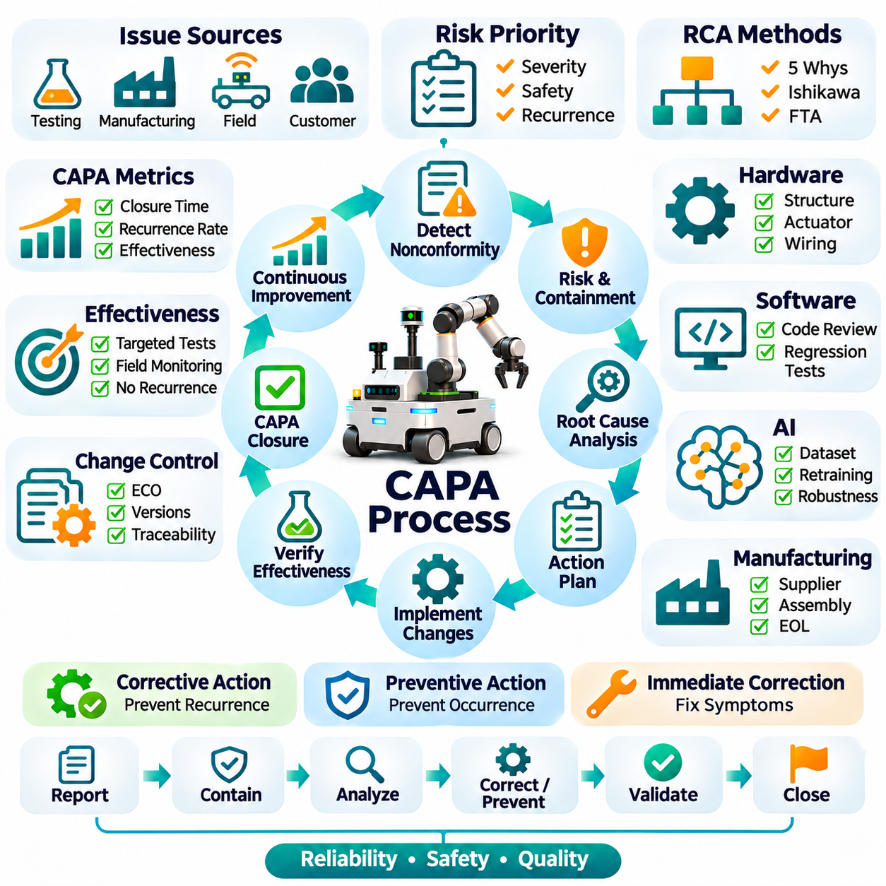{width="7.268055555555556in" height="7.268055555555556in"}

Corrective and Preventive Action (CAPA) is a systematic quality management process designed to eliminate the causes of identified nonconformities and prevent potential quality problems within mobile manipulator systems. CAPA connects failure analysis, engineering modifications, risk management, and continuous improvement, ensuring that quality deficiencies are addressed through sustainable solutions rather than temporary operational corrections.

The CAPA process begins with identifying quality issues through development testing, manufacturing inspections, field quality monitoring, customer complaints, maintenance records, and internal quality audits. Each identified nonconformity should be registered within a centralized quality management system. Initial documentation must capture the problem description, affected systems, operating conditions, available evidence, and operational consequences.

Corrective actions address the causes of existing nonconformities to prevent their recurrence, while preventive actions address the causes of potential nonconformities before they occur. Both approaches should be distinguished from immediate corrections that resolve observable symptoms without eliminating underlying causes. Establishing this distinction enables engineering teams to develop effective and sustainable quality improvement strategies.

Initial CAPA assessment should determine the severity, operational impact, recurrence probability, and potential safety consequences of identified deficiencies. Risk-based prioritization enables engineering resources to be allocated according to the significance of each quality issue. Critical failures may require immediate containment measures, including operational restrictions, product isolation, deployment suspension, or controlled system shutdown.

Root Cause Analysis (RCA) provides the analytical foundation for developing effective corrective and preventive actions. Engineering teams should investigate mechanical, electrical, software, artificial intelligence, manufacturing, and system integration factors associated with identified nonconformities. Techniques such as the Five Whys, Ishikawa analysis, and Fault Tree Analysis (FTA) support evidence-based identification of underlying causes.

Corrective action planning translates confirmed root causes into structured engineering activities. Each action plan should define implementation methods, responsible personnel, required resources, completion schedules, verification procedures, and measurable acceptance criteria. Proposed modifications must undergo technical review and impact assessment to ensure that resolving one deficiency does not introduce additional failures or safety hazards.

Hardware-related CAPA activities may involve structural modifications, component replacement, actuator improvements, wiring harness redesign, connector reinforcement, or battery protection enhancements. Engineering teams should evaluate proposed changes against mechanical loads, electrical requirements, environmental conditions, and manufacturing constraints. Updated designs must undergo appropriate verification before production implementation.

Software-related CAPA activities address logical errors, communication failures, timing violations, memory management deficiencies, and inadequate recovery mechanisms. Corrective modifications should follow established software development and configuration management procedures. Source code reviews, automated testing, integration testing, and regression testing provide objective evidence that identified software deficiencies have been effectively resolved.

Artificial intelligence-related CAPA activities may require dataset expansion, annotation correction, model retraining, confidence calibration, or inference configuration improvements. Corrective actions should address the relationship between model deficiencies and actual robotic behavior. Updated AI models must undergo independent performance evaluation, robustness testing, and system-level validation before authorization for operational deployment.

Preventive action planning focuses on identifying potential quality deficiencies through risk assessments, failure trends, predictive maintenance information, supplier evaluations, and engineering reviews. Failure Mode and Effects Analysis (FMEA) provides a structured approach for identifying vulnerabilities before operational failures occur. Preventive measures may include design improvements, enhanced inspections, and additional diagnostic capabilities.

Manufacturing-related CAPA activities address assembly inconsistencies, component defects, supplier quality problems, production process deviations, and insufficient inspection procedures. Corrective and preventive measures should be incorporated into manufacturing instructions, inspection criteria, supplier requirements, and End-of-Line (EOL) testing procedures. Process changes must be evaluated for consistency, effectiveness, and reproducibility.

CAPA implementation must follow controlled engineering change management procedures to maintain product configuration integrity. Changes affecting hardware components, firmware, software, AI models, or operating parameters should be documented and approved before deployment. Engineering Change Orders (ECOs), version control systems, and configuration baselines enable traceability between identified quality issues and implemented solutions.

Effectiveness verification determines whether implemented actions have eliminated the identified causes or adequately controlled potential quality risks. Verification should include targeted testing, regression testing, operational monitoring, and comparison with established quality baselines. Sufficient observation periods and representative operating conditions are necessary to demonstrate sustained improvement rather than temporary problem resolution.

CAPA closure requires documented evidence demonstrating that planned actions have been completed, acceptance criteria have been satisfied, and effectiveness has been adequately verified. Quality records should preserve original nonconformity descriptions, investigation results, implementation details, approval decisions, and supporting verification evidence. Ineffective actions must trigger renewed investigation and revised corrective strategies.

The CAPA process ultimately establishes a closed-loop quality assurance mechanism connecting nonconformity identification, containment, root cause analysis, engineering implementation, effectiveness verification, and organizational learning. CAPA metrics, including recurrence rates, closure times, and action effectiveness, support continuous improvement. This lifecycle approach strengthens product reliability, operational safety, and sustainable commercialization.

## 11 Continuous Improvement

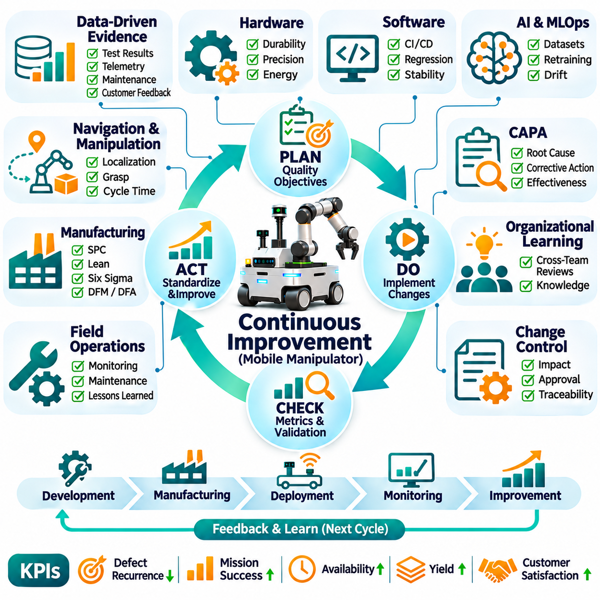{width="7.268055555555556in" height="7.268055555555556in"}

Continuous improvement is a systematic quality management approach that enhances the performance, reliability, safety, and operational efficiency of mobile manipulator systems throughout their product lifecycle. It integrates engineering development, manufacturing, field operation, maintenance, and customer feedback into a recurring improvement process that addresses existing deficiencies while identifying opportunities for future optimization.

The foundation of continuous improvement is the establishment of measurable quality objectives aligned with product requirements, organizational strategies, and customer expectations. Engineering teams should define improvement targets for hardware reliability, software stability, artificial intelligence performance, manipulation accuracy, and operational availability. These objectives provide a consistent basis for evaluating improvement activities and outcomes.

The Plan-Do-Check-Act (PDCA) cycle provides a structured methodology for implementing continuous improvement. The planning stage identifies improvement opportunities and establishes measurable objectives, while the execution stage implements proposed solutions. The checking stage evaluates results against established criteria, and the action stage standardizes successful improvements or initiates additional investigation when expected outcomes are not achieved.

Data-driven continuous improvement depends on the systematic collection and analysis of information generated throughout the product lifecycle. Development test results, manufacturing inspection records, operational telemetry, maintenance histories, and customer feedback provide valuable engineering evidence. Statistical analysis and performance trend evaluation help identify recurring deficiencies, emerging risks, and opportunities for systematic optimization.

Hardware continuous improvement focuses on enhancing structural durability, mechanical precision, electrical reliability, energy efficiency, and component maintainability. Operational evidence should guide improvements to mobile platforms, manipulators, actuators, battery systems, sensors, and wiring harnesses. Engineering modifications must undergo controlled design verification and applicable reliability testing to ensure that improvements do not introduce additional deficiencies.

Software continuous improvement addresses system stability, computational efficiency, communication reliability, execution latency, and autonomous recovery capabilities. Development teams should analyze software defects, diagnostic records, resource utilization, and operational exceptions to identify improvement opportunities. Continuous Integration and Continuous Delivery (CI/CD), automated regression testing, and code reviews support controlled software evolution.

Artificial intelligence continuous improvement requires systematic refinement of datasets, model architectures, training methodologies, and deployment configurations. Field observations may reveal previously unidentified object characteristics, environmental variations, or prediction uncertainties. Machine Learning Operations (MLOps) processes enable controlled model retraining, performance evaluation, version management, and validated deployment of improved AI models.

Manipulation and navigation improvement activities should address the integrated performance of perception, motion planning, trajectory execution, and autonomous mobility. Grasp failures, positioning errors, excessive manipulation cycle times, and recovery events provide evidence for engineering optimization. Improvement strategies should consider interactions between the mobile platform and robotic arm rather than evaluating individual capabilities independently.

Manufacturing continuous improvement focuses on reducing production defects, assembly variability, material waste, rework requirements, and unnecessary production costs. Statistical Process Control (SPC), Lean Manufacturing, and Six Sigma methodologies provide structured approaches for improving process consistency. Manufacturing feedback should also guide Design for Manufacturing (DFM) and Design for Assembly (DFA) activities during subsequent product revisions.

Field operation and maintenance improvements should be based on actual deployment experience across warehouses, factories, hospitals, and service environments. Operational difficulties, equipment degradation, maintenance frequency, and operator interventions reveal opportunities for improving product usability and serviceability. Lessons learned from field operations should support preventive maintenance strategies, diagnostic enhancements, and updated operating procedures.

Corrective and Preventive Action (CAPA) provides an essential mechanism for connecting identified quality deficiencies with continuous improvement initiatives. Confirmed root causes should be translated into engineering modifications, process improvements, and preventive controls. Effectiveness verification must demonstrate sustained improvement, while recurring deficiencies should trigger additional investigation and reassessment of existing improvement strategies.

Organizational continuous improvement requires effective collaboration among engineering, manufacturing, quality assurance, field operations, and project management teams. Regular quality reviews should evaluate improvement priorities, technical risks, resource requirements, and implementation progress. Engineering knowledge, successful solutions, and lessons learned should be preserved within centralized knowledge management systems for future development projects.

Continuous improvement must be supported by controlled engineering change management and configuration traceability. Hardware revisions, software updates, AI model replacements, and manufacturing process modifications should undergo appropriate impact assessment, approval, verification, and validation. Standardizing successful improvements across applicable product configurations and deployed fleets ensures consistent quality enhancement without compromising operational safety.

The effectiveness of continuous improvement should be evaluated through measurable indicators such as defect recurrence rates, mission success rates, operational availability, maintenance costs, production yield, and customer satisfaction. Improvement results should be compared with established baselines under representative conditions. This closed-loop lifecycle approach strengthens product maturity, organizational learning, engineering efficiency, and sustainable commercialization.

## 12 Quality Metrics

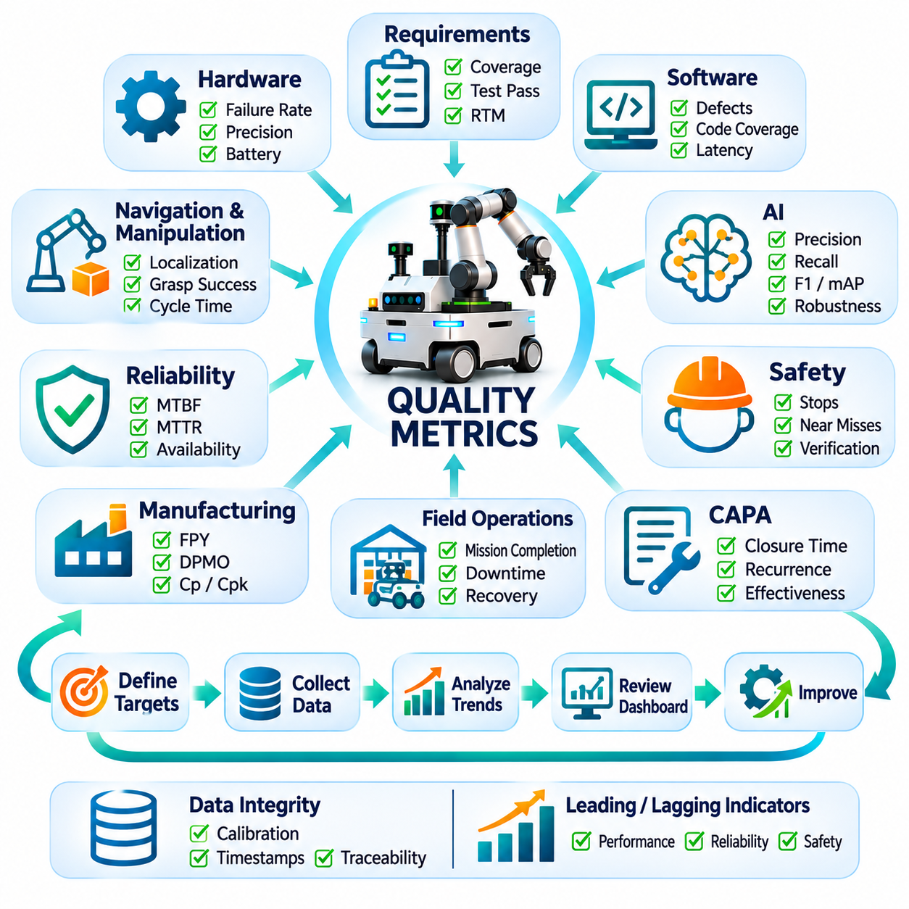{width="7.268055555555556in" height="7.268055555555556in"}

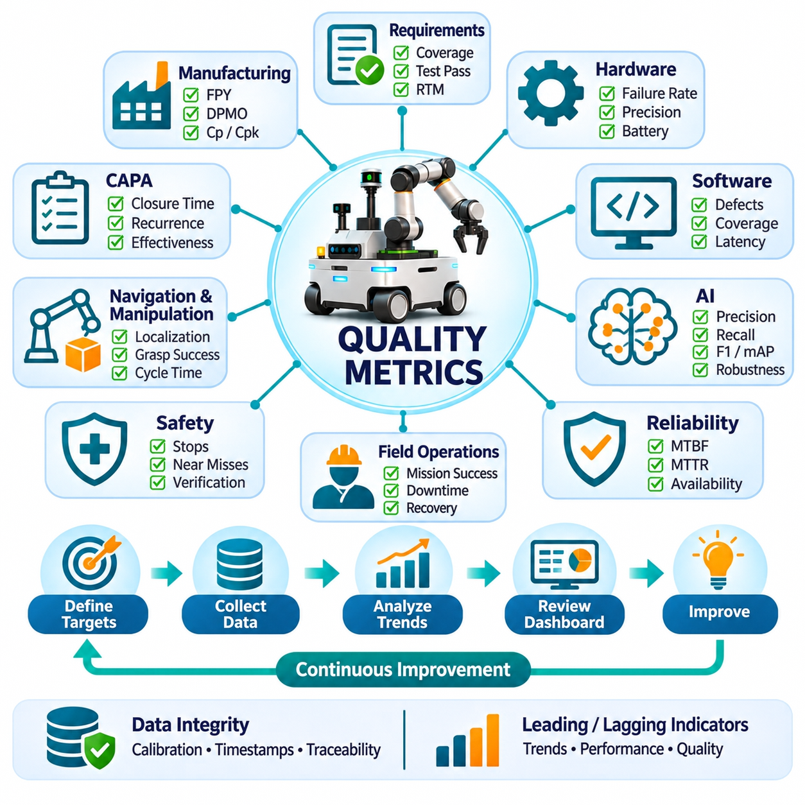{width="7.268055555555556in" height="7.268055555555556in"}

Quality metrics are quantitative indicators used to evaluate the performance, reliability, safety, consistency, and operational effectiveness of mobile manipulator systems throughout their product lifecycle. They provide an objective foundation for quality assurance by translating engineering requirements, verification results, manufacturing performance, and field observations into measurable evidence that supports systematic decision-making.

The development of quality metrics begins with defining measurable objectives aligned with system requirements, customer expectations, operational scenarios, and applicable safety requirements. Each metric should specify its measurement method, calculation procedure, data source, evaluation frequency, acceptance threshold, and responsible personnel. Consistent definitions enable reliable comparisons across development stages and product configurations.

Requirement verification metrics evaluate the extent to which defined system requirements have been successfully verified. Requirement coverage, verification completion rate, test pass rate, and unresolved nonconformities provide important indicators of development maturity. Requirement Traceability Matrices (RTMs) establish relationships between individual requirements, verification procedures, test results, and supporting engineering evidence.

Hardware quality metrics evaluate the reliability, durability, precision, and functional consistency of mechanical, electrical, and electronic components. Relevant indicators include component failure rates, dimensional tolerances, actuator positioning errors, structural deformation, battery degradation, and thermal stability. Measurements should account for representative payload conditions, duty cycles, environmental exposure, and operating durations.

Software quality metrics assess functional correctness, application stability, computational efficiency, maintainability, and communication reliability. Defect density, code coverage, regression test pass rate, execution latency, memory utilization, and system recovery success rate provide useful engineering indicators. These metrics should be evaluated alongside defect severity and operational consequences rather than relying exclusively on numerical defect counts.

Artificial intelligence quality metrics evaluate model accuracy, robustness, computational performance, and consistency under representative operating conditions. Object detection metrics include Precision, Recall, F1-score, and mean Average Precision (mAP), while pose estimation may use translational and rotational errors. Inference latency, prediction uncertainty, and distribution shift indicators support assessments of operational suitability.

Navigation and manipulation quality metrics evaluate the integrated capabilities of autonomous mobile platforms and robotic arms. Localization error, trajectory tracking error, docking accuracy, grasp success rate, placement precision, and manipulation cycle time provide measurable performance indicators. End-to-end mission success rates help determine whether individual subsystem capabilities translate into reliable task execution.

Reliability and maintainability metrics characterize system failures, maintenance requirements, and operational availability. Mean Time Between Failures (MTBF) represents the average operating time between failures of repairable systems, while Mean Time To Repair (MTTR) measures average repair duration. Operational availability measures the proportion of required service time during which equipment remains available for its intended functions.

Safety quality metrics evaluate the effectiveness of implemented safety measures and identify emerging operational risks. Relevant indicators include safety requirement verification coverage, protective stop frequency, hazardous incident rates, near-miss reports, and safety-related fault detection performance. These measurements support risk management but cannot independently establish safety compliance or demonstrate the absence of unacceptable risks.

Manufacturing quality metrics assess production consistency, assembly accuracy, supplier performance, and process effectiveness. First Pass Yield (FPY), Defects Per Million Opportunities (DPMO), rejection rates, rework rates, and warranty return rates provide quantitative manufacturing indicators. Process capability indices, including Cp and Cpk, support assessments of stable manufacturing processes against established specification limits.

Field quality metrics evaluate operational performance after mobile manipulators have been deployed in actual customer environments. Mission completion rates, unplanned downtime, operator intervention frequency, autonomous recovery success rates, and maintenance costs provide evidence of product maturity. Comparisons should normalize operational exposure and consider differences in workloads, environmental conditions, and system configurations.

Corrective and Preventive Action (CAPA) metrics evaluate the responsiveness and effectiveness of quality improvement activities. Relevant indicators include average CAPA closure time, overdue action rates, defect recurrence rates, root cause investigation completion rates, and verified action effectiveness. These measurements help determine whether engineering teams are systematically eliminating underlying deficiencies rather than repeatedly correcting symptoms.

Quality data management requires standardized measurement procedures, calibrated instruments, synchronized timestamps, reliable data collection, and configuration traceability. Statistical Process Control (SPC), trend analysis, confidence intervals, and comparative assessments support the identification of meaningful performance changes. Missing data, measurement uncertainty, and insufficient sample sizes must be considered when interpreting quality results.

Quality dashboards should consolidate engineering, manufacturing, field operation, maintenance, and customer satisfaction metrics into a consistent reporting framework. Leading indicators help identify emerging quality risks, while lagging indicators measure observed failures and operational outcomes. Regular quality reviews should evaluate deviations from established targets, prioritize improvement activities, and assign responsibility for corrective measures.

Quality metrics ultimately provide the quantitative foundation for closed-loop quality assurance and continuous improvement. Metric results should guide engineering optimization, risk reduction, resource allocation, manufacturing improvements, and product lifecycle decisions. By connecting measurable quality objectives with verified operational outcomes, organizations can strengthen product maturity, customer satisfaction, reliability, and sustainable commercialization.
