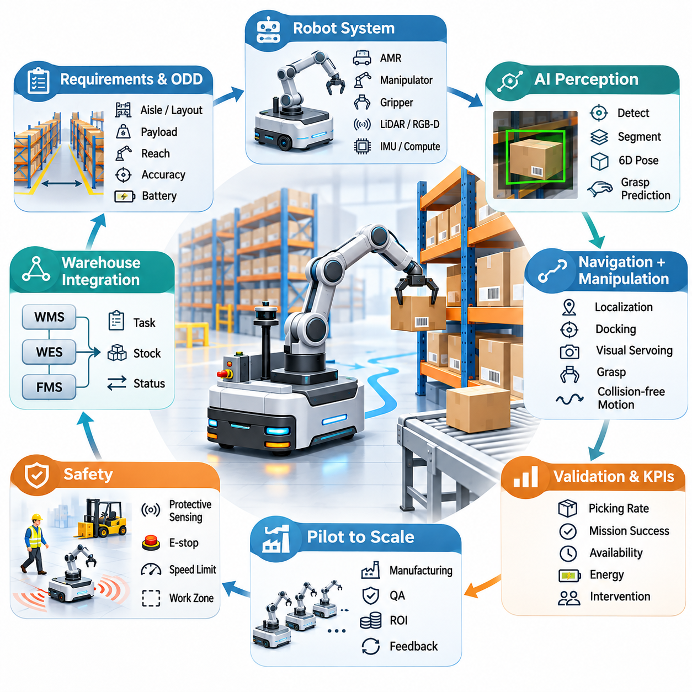
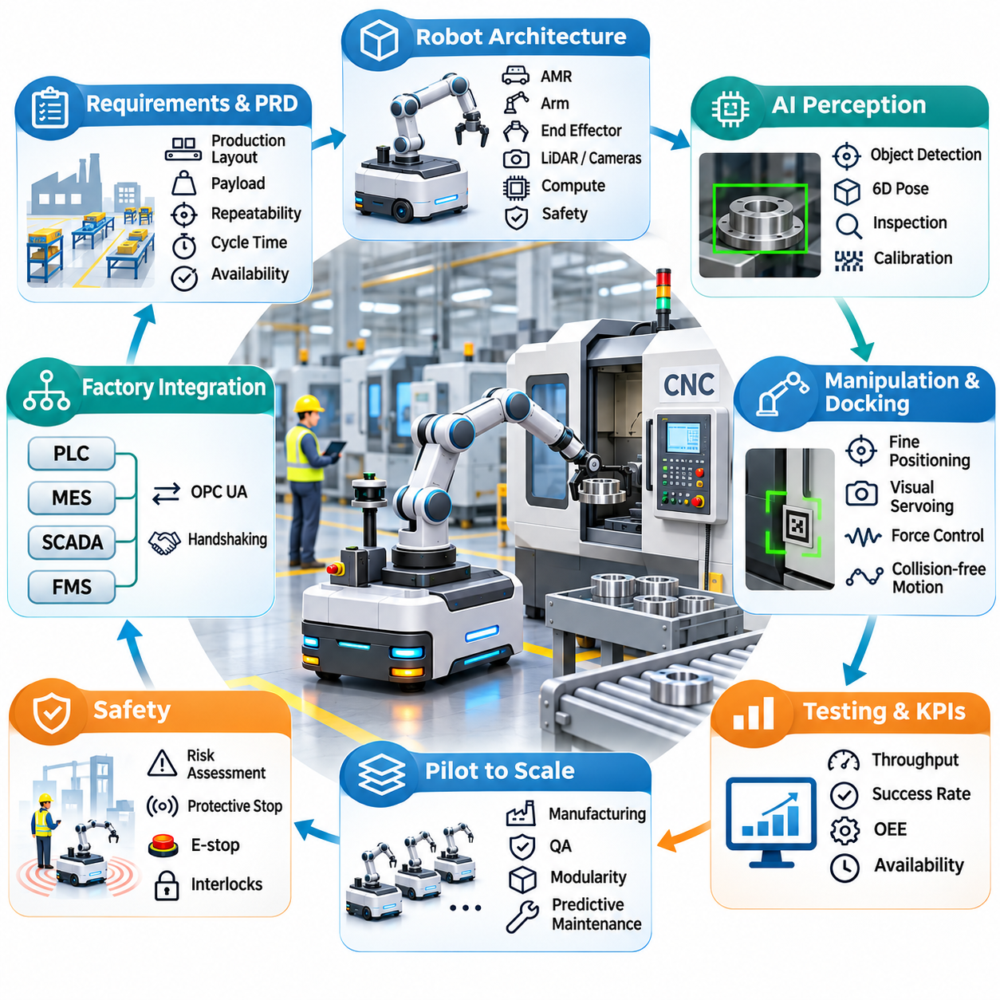
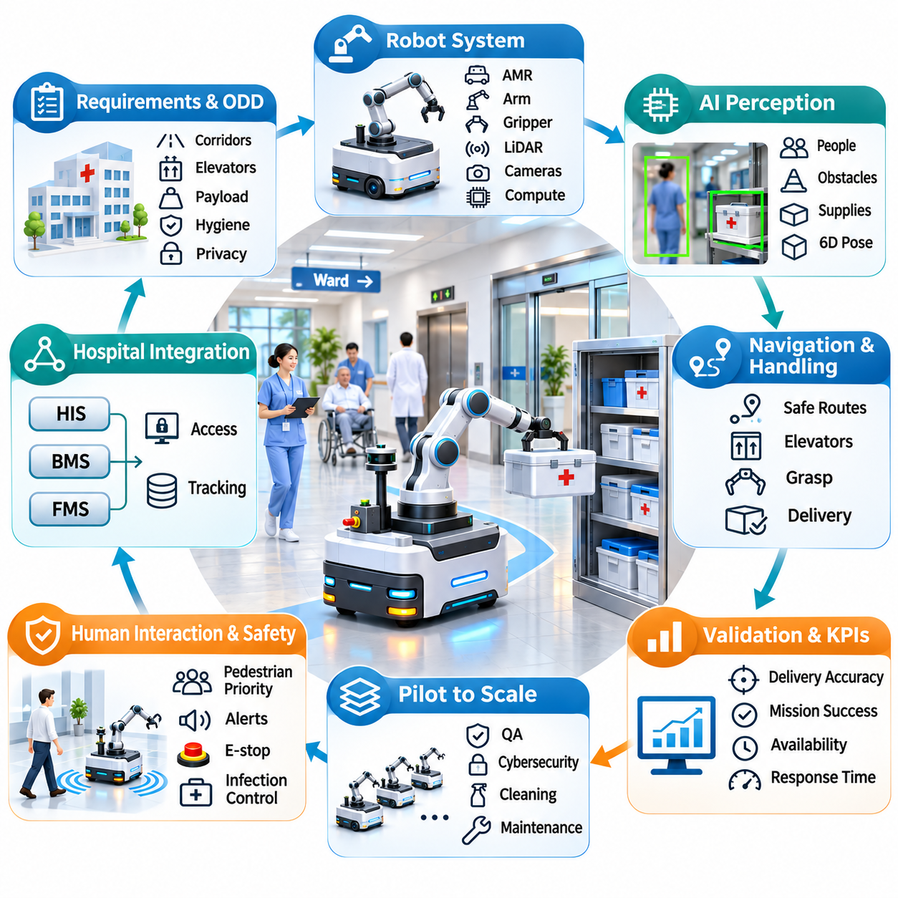
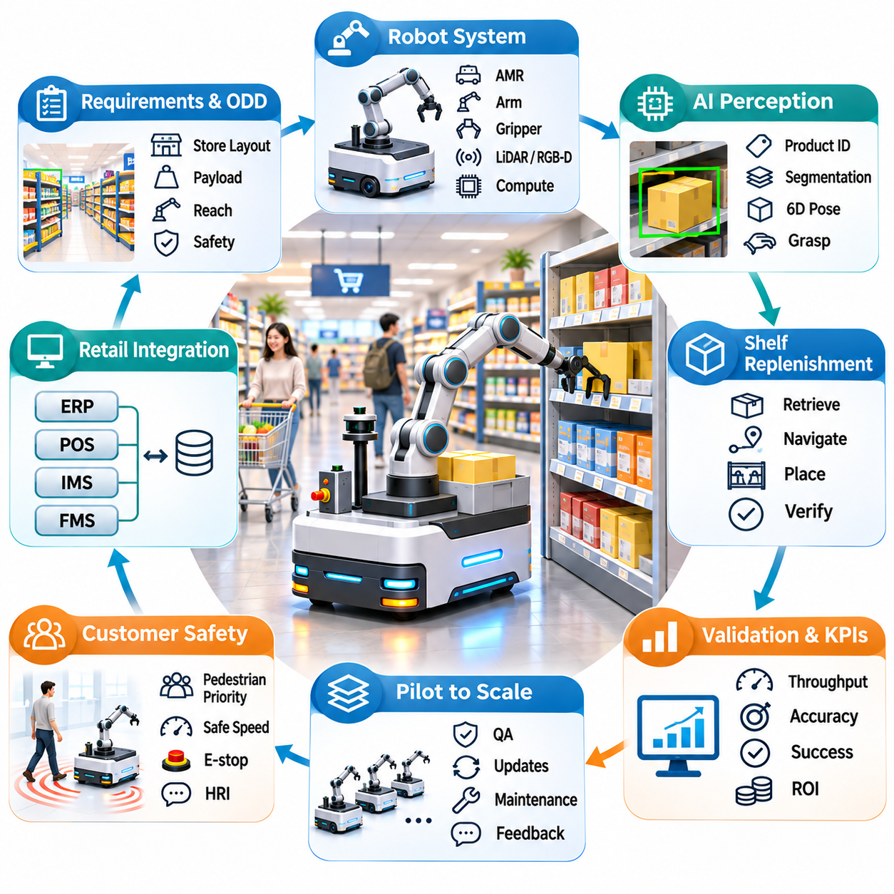
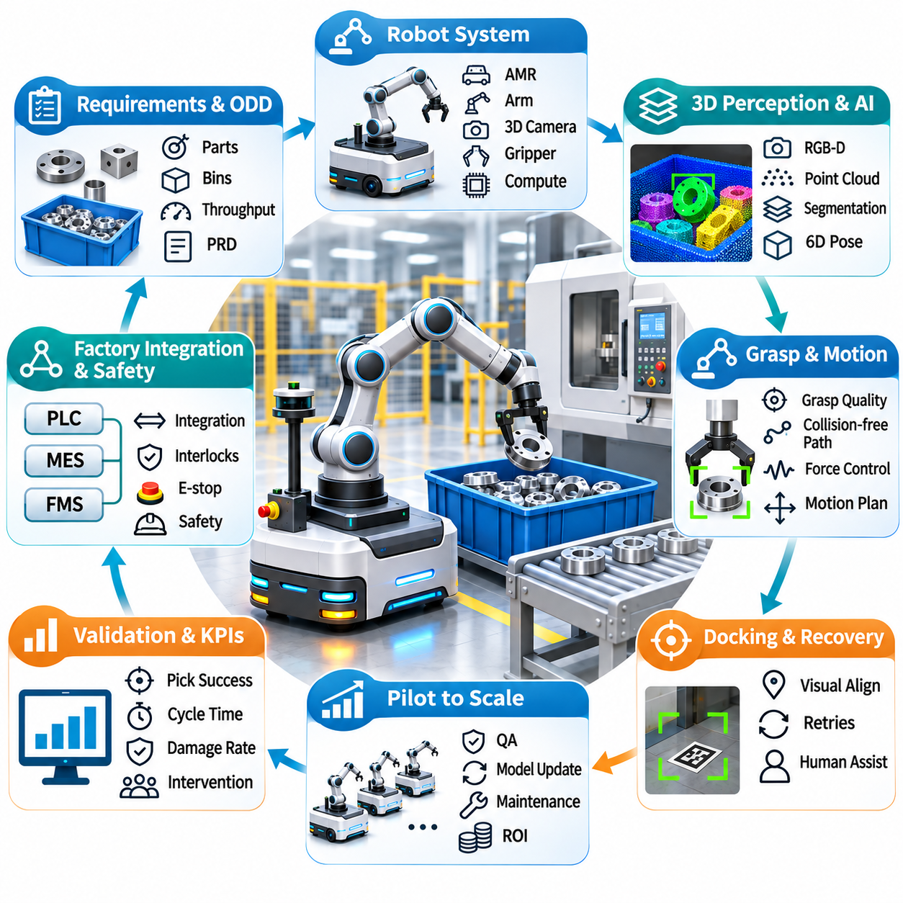
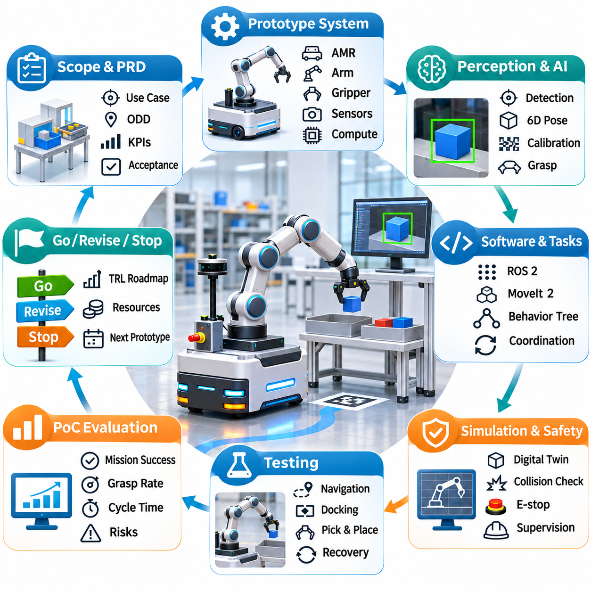
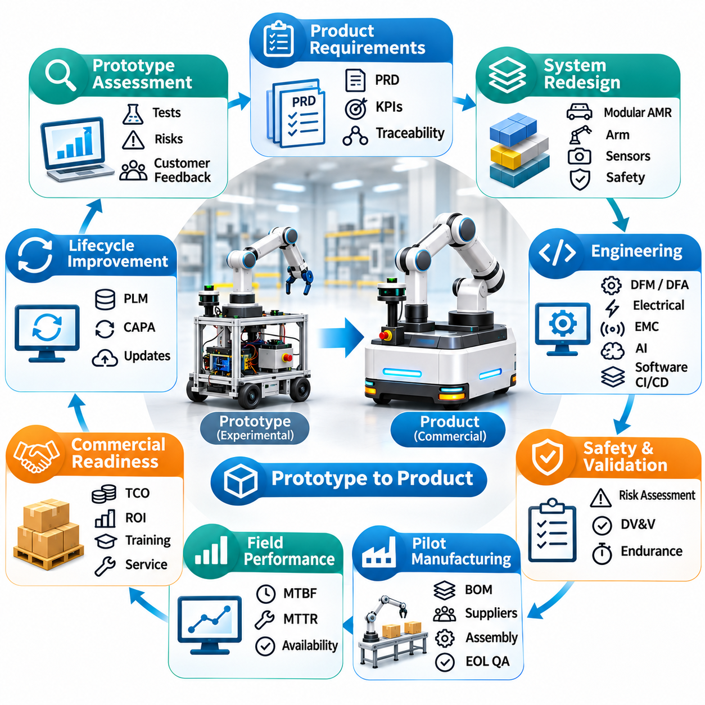
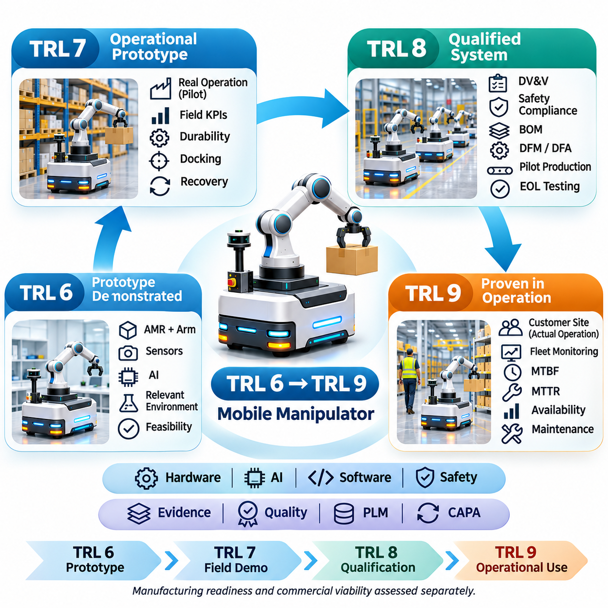
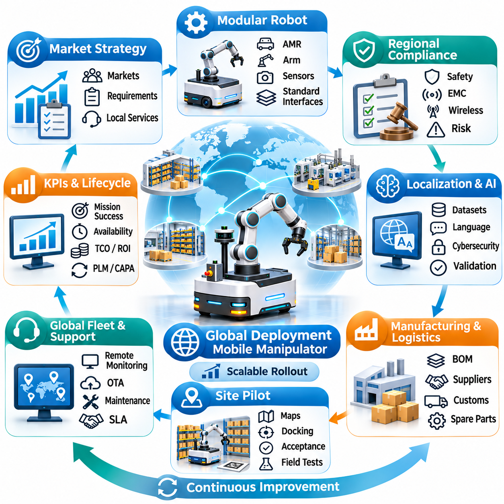
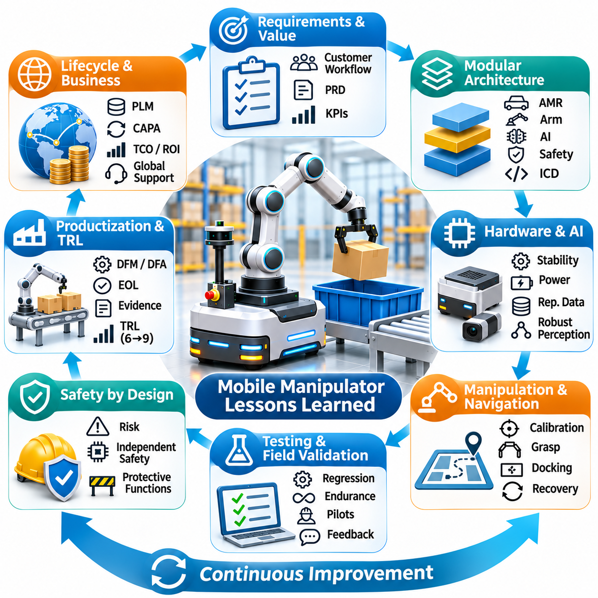

**Volume 05. Mobile Manipulator Projects and Development Manual**


# Chapter 10. Case Studies

##  

## 01 Warehouse Mobile Manipulator Project

{width="7.268055555555556in" height="7.268055555555556in"}

A warehouse mobile manipulator project represents a practical application of autonomous mobility, robotic manipulation, artificial intelligence, and industrial automation within a unified system. Its primary objective is to automate material handling, inventory management, order fulfillment, and product transportation. The following illustrative project integrates the development methodologies established throughout this manual rather than presenting results from a specific commercial installation.

The project begins with an analysis of warehouse operations, customer requirements, and existing logistics processes. Engineers investigate storage configurations, aisle dimensions, product characteristics, inventory turnover, and material transportation patterns. These observations establish the operational design domain (ODD), which defines the environmental conditions, physical constraints, and operational boundaries within which the mobile manipulator must function.

System requirements are translated into measurable engineering specifications through a Product Requirement Document (PRD). Typical requirements include payload capacity, manipulation reach, positioning accuracy, picking success rate, transportation speed, battery endurance, and operational availability. Each requirement is associated with acceptance criteria and verification procedures to maintain traceability throughout the development lifecycle.

The system architecture integrates an Autonomous Mobile Robot (AMR), a multi-axis robotic manipulator, intelligent end effectors, perception sensors, embedded computing platforms, and warehouse communication interfaces. The mobile platform provides autonomous transportation, while the robotic arm performs object manipulation. Coordinated operation between these subsystems enables the robot to execute complex logistics missions without continuous human intervention.

Mechanical development focuses on structural rigidity, payload distribution, platform stability, and manipulation workspace. Engineers evaluate the combined center of gravity across different manipulator configurations and loading conditions. Dynamic analysis identifies potential instability during acceleration, braking, cornering, and extended arm movements. The mechanical architecture must accommodate these operating conditions while maintaining sufficient maneuverability within narrow warehouse aisles.

The perception architecture typically combines two-dimensional or three-dimensional LiDAR, RGB cameras, depth cameras, inertial measurement units, and wheel encoders. Environmental perception supports localization, obstacle detection, and autonomous navigation, while manipulation-oriented sensors provide detailed information about target objects. Accurate sensor calibration and time synchronization establish consistent spatial relationships between the mobile platform, robotic arm, and surrounding environment.

Artificial intelligence development addresses object detection, segmentation, six-dimensional pose estimation, and grasp prediction. Training datasets incorporate representative warehouse products, packaging materials, lighting variations, occlusions, and storage arrangements. Synthetic data generation and domain randomization can supplement real-world observations. Model validation must demonstrate reliable perception under conditions that reflect the intended warehouse operation.

The manipulation subsystem transforms perception results into physically executable actions. Grasp planning evaluates candidate contact points, object geometry, gripper accessibility, and grasp stability. Motion planning subsequently generates collision-free trajectories within the available workspace. Force-aware control and grasp verification improve handling reliability, particularly when manipulating fragile packages, deformable materials, or objects with uncertain physical properties.

An important engineering challenge is the coordination of mobile navigation and robotic manipulation. The AMR must approach storage racks, picking stations, or conveyor systems with sufficient positioning accuracy to establish a feasible manipulation workspace. Fine positioning and visual servoing can compensate for residual localization errors. Manipulation should begin only after the system confirms platform stability, target accessibility, and compliance with applicable safety conditions.

Warehouse integration requires communication with Warehouse Management Systems (WMS), Warehouse Execution Systems (WES), and Fleet Management Systems (FMS). These applications coordinate inventory records, picking requests, mission assignments, and resource availability. Standardized communication interfaces allow the mobile manipulator to receive tasks, report execution status, request assistance, and confirm successful material transactions.

Safety architecture addresses the combined hazards associated with autonomous vehicle movement and robotic arm operation. Protective devices, safety-rated monitoring, emergency stopping functions, speed limitations, and workspace restrictions are established through systematic risk assessment. Particular attention is given to shared environments where workers, forklifts, conventional AMRs, and mobile manipulators operate within overlapping areas.

System validation progresses from component-level testing to integrated warehouse operations. Functional tests evaluate navigation, docking, object recognition, grasp execution, and material delivery. Integrated scenarios introduce blocked aisles, unavailable products, communication interruptions, unsuccessful grasps, and simultaneous robot missions. Long-duration testing reveals reliability limitations and identifies recurring operational failures that isolated laboratory experiments may overlook.

Pilot deployment provides the foundation for evaluating commercial feasibility under representative working conditions. Key Performance Indicators (KPIs) include successful picks per hour, mission completion rate, grasp success rate, system availability, energy consumption, and human intervention frequency. Economic evaluation considers equipment investment, integration costs, maintenance expenses, operational savings, and the expected Return on Investment (ROI).

Transitioning from pilot deployment to commercial production requires manufacturing readiness, configuration management, supplier qualification, and repeatable quality assurance procedures. Field observations should be incorporated into mechanical improvements, software revisions, AI model updates, and maintenance strategies. Ultimately, the warehouse mobile manipulator project demonstrates how coordinated systems engineering can transform autonomous robotic capabilities into scalable industrial logistics solutions.

물류창고 모바일 매니퓰레이터 프로젝트(Warehouse Mobile Manipulator Project)는 자율 이동(Autonomous Mobility), 로봇 조작(Robotic Manipulation), 인공지능(Artificial Intelligence), 산업 자동화(Industrial Automation)를 하나의 통합 시스템으로 구현하는 실용적인 응용 사례이다. 주요 목적은 자재 처리, 재고 관리, 주문 이행 및 제품 운송을 자동화하는 것이다. 본 예시 프로젝트는 특정 상용 설치 사례의 결과를 제시하는 것이 아니라 본 매뉴얼 전반에서 정립한 개발 방법론(Development Methodology)을 통합하여 설명한다.

프로젝트는 물류창고 운영(Warehouse Operations), 고객 요구사항(Customer Requirements), 기존 물류 프로세스(Logistics Process)에 대한 분석으로 시작된다. 엔지니어는 보관 구조, 통로의 크기, 제품 특성, 재고 회전율 및 자재 운송 패턴을 조사한다. 이러한 분석을 기반으로 운영 설계 영역(Operational Design Domain, ODD)을 수립하며, 이는 모바일 매니퓰레이터가 작동해야 하는 환경 조건, 물리적 제약사항 및 운영 범위를 정의한다.

시스템 요구사항(System Requirements)은 제품 요구사항 정의서(Product Requirement Document, PRD)를 통해 측정 가능한 엔지니어링 사양(Engineering Specifications)으로 변환된다. 대표적인 요구사항에는 적재 용량, 조작 도달 범위, 위치 정밀도, 피킹 성공률, 운송 속도, 배터리 지속 시간 및 운영 가용성이 포함된다. 각각의 요구사항은 개발 수명주기(Development Lifecycle) 전반에서 추적성(Traceability)을 유지할 수 있도록 인수 기준(Acceptance Criteria) 및 검증 절차(Verification Procedure)와 연계된다.

시스템 아키텍처(System Architecture)는 자율 이동 로봇(Autonomous Mobile Robot, AMR), 다축 로봇 매니퓰레이터(Multi-Axis Robotic Manipulator), 지능형 말단 장치(Intelligent End Effector), 인지 센서(Perception Sensor), 임베디드 컴퓨팅 플랫폼(Embedded Computing Platform) 및 물류창고 통신 인터페이스(Warehouse Communication Interface)를 통합한다. 이동 플랫폼은 자율 운송을 담당하고 로봇 팔은 객체 조작을 수행한다. 이러한 하위 시스템 간의 협조 동작(Coordinated Operation)은 지속적인 인간의 개입 없이 복잡한 물류 임무를 수행할 수 있도록 한다.

기구 개발(Mechanical Development)은 구조적 강성(Structural Rigidity), 하중 분포(Payload Distribution), 플랫폼 안정성(Platform Stability), 조작 작업공간(Manipulation Workspace)에 중점을 둔다. 엔지니어는 다양한 매니퓰레이터 자세와 하중 조건에서 시스템 전체의 무게중심(Center of Gravity)을 평가한다. 동역학 분석(Dynamic Analysis)을 통해 가속, 제동, 선회 및 로봇 팔의 확장 동작에서 발생할 수 있는 잠재적인 불안정성을 식별한다. 기구 아키텍처는 이러한 작동 조건을 수용하면서 좁은 물류창고 통로에서도 충분한 기동성(Maneuverability)을 확보해야 한다.

인지 아키텍처(Perception Architecture)는 일반적으로 2차원 또는 3차원 라이다(LiDAR), RGB 카메라(RGB Camera), 깊이 카메라(Depth Camera), 관성 측정 장치(Inertial Measurement Unit, IMU) 및 휠 엔코더(Wheel Encoder)를 결합한다. 환경 인지(Environmental Perception)는 위치 추정, 장애물 검출 및 자율주행을 지원하며, 조작용 센서는 대상 객체에 대한 상세한 정보를 제공한다. 정밀한 센서 보정(Sensor Calibration)과 시간 동기화(Time Synchronization)는 이동 플랫폼, 로봇 팔 및 주변 환경 사이의 일관된 공간적 관계를 확립한다.

인공지능 개발(AI Development)은 객체 검출(Object Detection), 영상 분할(Segmentation), 6차원 자세 추정(6D Pose Estimation) 및 파지 예측(Grasp Prediction)을 다룬다. 학습 데이터세트(Training Dataset)는 대표적인 물류창고 제품, 포장 재료, 조명 변화, 가려짐 현상(Occlusion) 및 보관 배치를 포함한다. 합성 데이터 생성(Synthetic Data Generation)과 도메인 무작위화(Domain Randomization)는 실제 환경에서 수집한 데이터를 보완할 수 있다. 모델 검증(Model Validation)은 목표 물류창고의 운영 조건을 반영하는 환경에서 신뢰성 있는 인지 성능을 입증해야 한다.

조작 하위 시스템(Manipulation Subsystem)은 인지 결과를 물리적으로 실행 가능한 동작으로 변환한다. 파지 계획(Grasp Planning)은 후보 접촉 지점, 객체의 기하학적 형상, 그리퍼 접근성 및 파지 안정성을 평가한다. 이후 모션 계획(Motion Planning)은 가용 작업공간 내에서 충돌 없는 궤적(Collision-Free Trajectory)을 생성한다. 힘 인식 제어(Force-Aware Control)와 파지 검증(Grasp Verification)은 특히 파손되기 쉬운 포장 제품, 변형 가능한 재료 또는 물리적 특성이 불확실한 객체를 취급할 때 조작 신뢰성을 향상시킨다.

중요한 엔지니어링 과제 중 하나는 자율주행(Autonomous Navigation)과 로봇 조작(Robotic Manipulation) 사이의 협조 제어이다. 자율 이동 로봇은 실행 가능한 조작 작업공간을 확보할 수 있도록 충분한 위치 정밀도로 보관 랙(Storage Rack), 피킹 스테이션(Picking Station) 또는 컨베이어 시스템(Conveyor System)에 접근해야 한다. 정밀 위치 제어(Fine Positioning)와 비주얼 서보잉(Visual Servoing)은 잔여 위치 추정 오차를 보상할 수 있다. 조작 동작은 플랫폼 안정성, 대상 객체의 접근 가능성 및 적용되는 안전 조건의 충족 여부를 확인한 이후에 시작해야 한다.

물류창고 시스템 통합(Warehouse System Integration)은 물류창고 관리 시스템(Warehouse Management System, WMS), 물류창고 실행 시스템(Warehouse Execution System, WES) 및 다중 로봇 관제 시스템(Fleet Management System, FMS)과의 통신을 요구한다. 이러한 애플리케이션은 재고 기록, 피킹 요청, 임무 할당 및 자원 가용성을 조정한다. 표준화된 통신 인터페이스(Standardized Communication Interface)는 모바일 매니퓰레이터가 작업을 수신하고, 실행 상태를 보고하며, 지원을 요청하고, 자재 처리 작업의 성공적인 완료를 확인할 수 있도록 한다.

안전 아키텍처(Safety Architecture)는 자율 이동 플랫폼의 움직임과 로봇 팔의 작동에서 발생하는 복합적인 위험요소를 다룬다. 보호 장치(Protective Device), 안전 등급 모니터링(Safety-Rated Monitoring), 비상 정지 기능(Emergency Stop Function), 속도 제한(Speed Limitation) 및 작업공간 제한(Workspace Restriction)은 체계적인 위험성 평가(Risk Assessment)를 통해 수립된다. 특히 작업자, 지게차, 일반적인 자율 이동 로봇 및 모바일 매니퓰레이터가 서로 중첩되는 영역에서 작동하는 공유 작업환경(Shared Work Environment)에 특별한 주의를 기울여야 한다.

시스템 검증(System Validation)은 구성요소 수준의 시험(Component-Level Testing)에서 통합 물류창고 운영 시험으로 발전한다. 기능 시험(Functional Testing)은 자율주행, 도킹, 객체 인식, 파지 실행 및 자재 배송을 평가한다. 통합 시험 시나리오(Integrated Test Scenario)에는 통로 차단, 대상 제품의 부재, 통신 중단, 파지 실패 및 다중 로봇의 동시 임무 수행이 포함된다. 장시간 시험(Long-Duration Testing)은 신뢰성의 한계를 드러내고 개별 실험실 시험에서 발견하지 못할 수 있는 반복적인 운영 장애를 식별한다.

파일럿 배치(Pilot Deployment)는 대표적인 실제 작업 조건에서 상업적 실현 가능성(Commercial Feasibility)을 평가하기 위한 기반을 제공한다. 핵심 성과 지표(Key Performance Indicator, KPI)에는 시간당 성공적인 피킹 횟수, 임무 완료율, 파지 성공률, 시스템 가용성, 에너지 소비량 및 인간 개입 빈도가 포함된다. 경제성 평가(Economic Evaluation)는 장비 투자 비용, 시스템 통합 비용, 유지보수 비용, 운영 비용 절감 효과 및 예상 투자 수익률(Return on Investment, ROI)을 고려한다.

파일럿 배치에서 상용 제품 생산(Commercial Production)으로 전환하기 위해서는 제조 준비도(Manufacturing Readiness), 형상 관리(Configuration Management), 공급업체 적격성 평가(Supplier Qualification) 및 반복 가능한 품질 보증 절차(Quality Assurance Procedure)가 필요하다. 현장에서 확보한 관찰 결과는 기구 개선, 소프트웨어 개정, 인공지능 모델 업데이트 및 유지보수 전략에 반영되어야 한다. 궁극적으로 물류창고 모바일 매니퓰레이터 프로젝트는 체계적으로 통합된 시스템 엔지니어링(Systems Engineering)을 통해 자율 로봇의 기술적 역량을 확장 가능한 산업 물류 솔루션(Scalable Industrial Logistics Solution)으로 발전시킬 수 있음을 보여준다.

##  

## 02 Factory Automation Project

{width="7.268055555555556in" height="7.268055555555556in"}

A factory automation project involving mobile manipulators integrates autonomous mobility, robotic manipulation, artificial intelligence, and industrial control technologies to establish flexible manufacturing environments. Unlike conventional stationary robotic systems, mobile manipulators can operate across multiple production stations and dynamically adapt to changing manufacturing requirements. This illustrative case presents a representative engineering development approach rather than a documented commercial installation.

The project begins with a comprehensive analysis of existing manufacturing processes, production layouts, material flows, equipment interfaces, and manual operations. Engineers identify repetitive tasks, production bottlenecks, ergonomic challenges, and opportunities for automation. These investigations establish the operational requirements and determine where mobile manipulation can provide measurable improvements in manufacturing productivity, flexibility, and efficiency.

The Product Requirement Document (PRD) translates manufacturing objectives into measurable technical specifications. Requirements typically include payload capacity, positioning accuracy, manipulation repeatability, production cycle time, equipment compatibility, and operational availability. Environmental conditions, safety constraints, communication protocols, and maintenance requirements must also be defined to ensure compatibility with existing factory infrastructure.

The system architecture integrates an Autonomous Mobile Robot (AMR), a multi-axis robotic manipulator, application-specific end effectors, perception sensors, industrial computing platforms, and safety controllers. The mobile platform provides flexible transportation between manufacturing stations, while the robotic arm executes material handling, machine tending, assembly assistance, and inspection tasks. Centralized mission coordination manages interactions between these functional subsystems.

Mechanical development emphasizes structural rigidity, load distribution, vibration resistance, and positioning stability. Manufacturing applications may require precise manipulation of mechanical components, electronic assemblies, tools, and production materials. Engineers analyze manipulator reaction forces, dynamic loading, and platform deformation to ensure that mobile operation does not compromise the accuracy and repeatability required by industrial processes.

The perception architecture combines LiDAR-based navigation, industrial cameras, depth sensors, and application-specific measurement devices. Artificial intelligence models perform object detection, component identification, six-dimensional pose estimation, and visual inspection. Hand-eye calibration and coordinate transformation establish accurate spatial relationships between the robotic manipulator, perception sensors, mobile platform, and manufacturing equipment.

Artificial intelligence development requires representative datasets covering component variations, surface reflections, illumination changes, manufacturing tolerances, and partially occluded objects. Synthetic data generation and simulation can supplement real-world training samples. Model optimization must balance recognition accuracy, inference latency, computational resource consumption, and robustness to environmental variations encountered during continuous factory operation.

Manipulation development addresses machine loading and unloading, component assembly, tool handling, and automated inspection. Grasp planning algorithms evaluate object geometry, accessibility, and physical properties, while motion planning generates feasible and collision-free trajectories. Force-torque sensing, impedance control, and compliant manipulation enable the system to accommodate dimensional variations and perform contact-intensive operations without damaging production equipment.

Precise docking represents a critical requirement when mobile manipulators interact with manufacturing machines and assembly fixtures. Conventional navigation accuracy may be insufficient for precision manipulation tasks. Fine positioning, fiducial markers, visual servoing, and local coordinate registration can compensate for residual positioning errors. Mechanical docking mechanisms may provide additional stability and repeatability for applications involving strict dimensional tolerances.

Factory integration requires interoperability with Programmable Logic Controllers (PLCs), Manufacturing Execution Systems (MES), Supervisory Control and Data Acquisition (SCADA) systems, and Fleet Management Systems (FMS). Industrial communication protocols such as OPC UA, EtherCAT, and PROFINET support different integration layers. Explicit interface definitions and equipment handshaking establish reliable coordination between autonomous robots and existing production machinery.

Safety engineering addresses hazards arising from mobile platform movement, manipulator operation, human interaction, and automated manufacturing equipment. Risk assessment considers crushing, collision, unexpected motion, dropped objects, and unauthorized access to hazardous areas. Safety-rated monitoring, protective stopping, emergency stop functions, speed restrictions, and equipment interlocks must operate independently of non-safety-rated artificial intelligence decisions.

System testing progresses through component verification, subsystem integration, functional testing, and production-oriented validation. Test scenarios include inaccurate docking, unexpected component positions, failed grasps, machine unavailability, communication interruptions, and emergency stopping. Digital twins and simulation environments support early verification, while physical testing establishes whether the integrated system satisfies defined manufacturing and safety requirements.

Pilot deployment introduces mobile manipulators into selected production processes under controlled operational conditions. Key Performance Indicators (KPIs) include production throughput, mission completion rate, manipulation success rate, positioning repeatability, equipment availability, and human intervention frequency. Overall Equipment Effectiveness (OEE), integration costs, maintenance expenses, and operational savings provide additional indicators of economic feasibility.

Commercial deployment requires standardized hardware configurations, controlled software releases, qualified suppliers, manufacturing documentation, and repeatable quality assurance procedures. Modular architectures allow the same mobile manipulation platform to support different production tasks through interchangeable end effectors and configurable software. Operational data collection, predictive maintenance, and continuous improvement support long-term reliability and scalable factory automation.

모바일 매니퓰레이터(Mobile Manipulator)를 활용한 공장 자동화 프로젝트(Factory Automation Project)는 자율 이동(Autonomous Mobility), 로봇 조작(Robotic Manipulation), 인공지능(Artificial Intelligence) 및 산업 제어 기술(Industrial Control Technology)을 통합하여 유연한 제조 환경(Flexible Manufacturing Environment)을 구축하는 것을 목적으로 한다. 기존의 고정형 로봇 시스템과 달리 모바일 매니퓰레이터는 여러 생산 스테이션에서 작동할 수 있으며, 변화하는 제조 요구사항에 동적으로 적응할 수 있다. 본 예시 사례는 문서화된 특정 상용 설치 사례가 아니라 대표적인 엔지니어링 개발 접근법(Engineering Development Approach)을 제시한다.

프로젝트는 기존 제조 프로세스(Manufacturing Process), 생산 레이아웃(Production Layout), 자재 흐름(Material Flow), 장비 인터페이스(Equipment Interface) 및 수작업 공정에 대한 종합적인 분석으로 시작된다. 엔지니어는 반복 작업, 생산 병목 현상(Production Bottleneck), 인간공학적 문제(Ergonomic Challenge) 및 자동화 기회를 식별한다. 이러한 조사를 통해 운영 요구사항(Operational Requirements)을 수립하고 모바일 조작(Mobile Manipulation)이 제조 생산성, 유연성 및 효율성 측면에서 측정 가능한 개선 효과를 제공할 수 있는 영역을 결정한다.

제품 요구사항 정의서(Product Requirement Document, PRD)는 제조 목표를 측정 가능한 기술 사양(Technical Specifications)으로 변환한다. 대표적인 요구사항에는 적재 용량(Payload Capacity), 위치 정밀도(Positioning Accuracy), 조작 반복 정밀도(Manipulation Repeatability), 생산 주기 시간(Production Cycle Time), 장비 호환성(Equipment Compatibility) 및 운영 가용성(Operational Availability)이 포함된다. 기존 공장 인프라와의 호환성을 확보하기 위해 환경 조건, 안전 제약사항, 통신 프로토콜 및 유지보수 요구사항도 정의해야 한다.

시스템 아키텍처(System Architecture)는 자율 이동 로봇(Autonomous Mobile Robot, AMR), 다축 로봇 매니퓰레이터(Multi-Axis Robotic Manipulator), 응용 분야별 말단 장치(Application-Specific End Effector), 인지 센서(Perception Sensor), 산업용 컴퓨팅 플랫폼(Industrial Computing Platform) 및 안전 제어기(Safety Controller)를 통합한다. 이동 플랫폼은 제조 스테이션 간의 유연한 운송을 제공하며, 로봇 팔은 자재 처리, 기계 투입 및 회수 작업(Machine Tending), 조립 지원 및 검사 작업을 수행한다. 중앙 집중형 임무 조정(Centralized Mission Coordination)은 이러한 기능적 하위 시스템 간의 상호작용을 관리한다.

기구 개발(Mechanical Development)은 구조적 강성(Structural Rigidity), 하중 분포(Load Distribution), 내진동성(Vibration Resistance) 및 위치 안정성(Positioning Stability)에 중점을 둔다. 제조 응용 분야에서는 기계 부품, 전자 조립품, 공구 및 생산 자재에 대한 정밀한 조작이 요구될 수 있다. 엔지니어는 매니퓰레이터의 반력(Reaction Force), 동적 하중(Dynamic Loading) 및 플랫폼 변형(Platform Deformation)을 분석하여 이동형 시스템의 작동이 산업 공정에서 요구하는 정밀도와 반복 정밀도를 저하시키지 않도록 설계한다.

인지 아키텍처(Perception Architecture)는 라이다 기반 자율주행(LiDAR-Based Navigation), 산업용 카메라(Industrial Camera), 깊이 센서(Depth Sensor) 및 응용 분야별 측정 장치(Measurement Device)를 결합한다. 인공지능 모델(AI Model)은 객체 검출(Object Detection), 부품 식별(Component Identification), 6차원 자세 추정(6D Pose Estimation) 및 비전 검사(Visual Inspection)를 수행한다. 손-눈 보정(Hand-Eye Calibration)과 좌표 변환(Coordinate Transformation)은 로봇 매니퓰레이터, 인지 센서, 이동 플랫폼 및 제조 장비 사이의 정확한 공간적 관계를 확립한다.

인공지능 개발(AI Development)에는 부품의 다양성, 표면 반사(Surface Reflection), 조명 변화(Illumination Variation), 제조 공차(Manufacturing Tolerance) 및 부분적으로 가려진 객체(Partially Occluded Object)를 포함하는 대표성 있는 데이터세트가 필요하다. 합성 데이터 생성(Synthetic Data Generation)과 시뮬레이션(Simulation)은 실제 환경에서 수집한 학습 샘플을 보완할 수 있다. 모델 최적화(Model Optimization)는 인식 정확도, 추론 지연시간(Inference Latency), 컴퓨팅 자원 소비량 및 지속적인 공장 운영 과정에서 발생하는 환경 변화에 대한 강건성(Robustness) 사이의 균형을 확보해야 한다.

조작 개발(Manipulation Development)은 기계 장비의 자재 투입 및 배출(Machine Loading and Unloading), 부품 조립(Component Assembly), 공구 취급(Tool Handling) 및 자동 검사(Automated Inspection)를 다룬다. 파지 계획 알고리즘(Grasp Planning Algorithm)은 객체의 기하학적 형상, 접근 가능성 및 물리적 특성을 평가하며, 모션 계획(Motion Planning)은 실행 가능하고 충돌 없는 궤적을 생성한다. 힘-토크 센싱(Force-Torque Sensing), 임피던스 제어(Impedance Control) 및 순응형 조작(Compliant Manipulation)은 시스템이 치수 편차에 적응하고 생산 장비를 손상시키지 않으면서 물리적 접촉이 빈번한 작업을 수행할 수 있도록 한다.

정밀 도킹(Precise Docking)은 모바일 매니퓰레이터가 제조 장비 및 조립 지그(Assembly Fixture)와 상호작용할 때 핵심적인 요구사항이다. 일반적인 자율주행 정밀도는 정밀 조작 작업(Precision Manipulation Task)을 수행하기에 충분하지 않을 수 있다. 정밀 위치 제어(Fine Positioning), 기준 마커(Fiducial Marker), 비주얼 서보잉(Visual Servoing) 및 국부 좌표 정합(Local Coordinate Registration)은 잔여 위치 오차를 보상할 수 있다. 엄격한 치수 공차(Dimensional Tolerance)가 요구되는 응용 분야에서는 기계식 도킹 메커니즘(Mechanical Docking Mechanism)을 통해 추가적인 안정성과 반복 정밀도를 확보할 수 있다.

공장 시스템 통합(Factory System Integration)은 프로그래머블 로직 제어기(Programmable Logic Controller, PLC), 제조 실행 시스템(Manufacturing Execution System, MES), 감시 제어 및 데이터 수집 시스템(Supervisory Control and Data Acquisition, SCADA), 다중 로봇 관제 시스템(Fleet Management System, FMS)과의 상호운용성(Interoperability)을 요구한다. OPC UA, EtherCAT 및 PROFINET과 같은 산업용 통신 프로토콜(Industrial Communication Protocol)은 서로 다른 시스템 통합 계층을 지원한다. 명확한 인터페이스 정의(Interface Definition)와 장비 핸드셰이킹(Equipment Handshaking)은 자율 로봇과 기존 생산 장비 사이의 신뢰성 있는 협조 동작을 확립한다.

안전 엔지니어링(Safety Engineering)은 이동 플랫폼의 움직임, 매니퓰레이터 작동, 인간과의 상호작용 및 자동화된 제조 장비에서 발생하는 위험요소를 다룬다. 위험성 평가(Risk Assessment)는 압착, 충돌, 예기치 않은 움직임, 객체 낙하 및 위험 구역에 대한 무단 접근을 고려한다. 안전 등급 모니터링(Safety-Rated Monitoring), 보호 정지(Protective Stop), 비상 정지 기능(Emergency Stop Function), 속도 제한(Speed Restriction) 및 장비 인터록(Equipment Interlock)은 안전 등급을 충족하지 않는 인공지능의 의사결정(Non-Safety-Rated AI Decision)과 독립적으로 작동해야 한다.

시스템 시험(System Testing)은 구성요소 검증(Component Verification), 하위 시스템 통합(Subsystem Integration), 기능 시험(Functional Testing) 및 생산 중심 검증(Production-Oriented Validation)의 순서로 진행된다. 시험 시나리오에는 부정확한 도킹, 예상하지 못한 부품 위치, 파지 실패, 장비 사용 불가 상태, 통신 중단 및 비상 정지가 포함된다. 디지털 트윈(Digital Twin)과 시뮬레이션 환경(Simulation Environment)은 개발 초기 단계의 검증을 지원하며, 물리적 시험(Physical Testing)은 통합 시스템이 정의된 제조 요구사항 및 안전 요구사항을 충족하는지 확인한다.

파일럿 배치(Pilot Deployment)는 통제된 운영 조건에서 선택된 생산 공정에 모바일 매니퓰레이터를 도입하는 과정이다. 핵심 성과 지표(Key Performance Indicator, KPI)에는 생산 처리량(Production Throughput), 임무 완료율(Mission Completion Rate), 조작 성공률(Manipulation Success Rate), 위치 반복 정밀도(Positioning Repeatability), 장비 가용성(Equipment Availability) 및 인간 개입 빈도(Human Intervention Frequency)가 포함된다. 종합 설비 효율(Overall Equipment Effectiveness, OEE), 시스템 통합 비용, 유지보수 비용 및 운영 비용 절감 효과는 경제적 실현 가능성(Economic Feasibility)을 판단하기 위한 추가적인 지표를 제공한다.

상용 배치(Commercial Deployment)를 위해서는 표준화된 하드웨어 구성(Standardized Hardware Configuration), 통제된 소프트웨어 릴리스(Controlled Software Release), 적격 공급업체(Qualified Supplier), 제조 문서(Manufacturing Documentation) 및 반복 가능한 품질 보증 절차(Quality Assurance Procedure)가 필요하다. 모듈형 아키텍처(Modular Architecture)는 교체 가능한 말단 장치(Interchangeable End Effector)와 구성 가능한 소프트웨어(Configurable Software)를 통해 동일한 모바일 조작 플랫폼이 다양한 생산 작업을 지원할 수 있도록 한다. 운영 데이터 수집(Operational Data Collection), 예지 보전(Predictive Maintenance) 및 지속적인 개선(Continuous Improvement)은 장기적인 신뢰성과 확장 가능한 공장 자동화(Scalable Factory Automation)를 뒷받침한다.

##  

## 03 Hospital Logistics Project

{width="7.268055555555556in" height="7.268055555555556in"}

A hospital logistics project involving mobile manipulators integrates autonomous mobility, robotic manipulation, artificial intelligence, and healthcare information systems to improve the efficiency of internal hospital operations. The primary objective is to automate repetitive logistics activities while maintaining patient safety, operational reliability, and hygiene requirements. This illustrative case presents a representative development methodology rather than a verified hospital deployment.

The project begins with an analysis of hospital workflows, material transportation requirements, clinical environments, and existing logistics infrastructure. Engineers investigate the movement of medical supplies, pharmaceutical products, laboratory samples, surgical instruments, and other authorized materials. These observations establish the operational design domain (ODD), including corridors, elevators, storage facilities, nursing stations, and restricted clinical areas.

The Product Requirement Document (PRD) translates healthcare logistics objectives into measurable engineering specifications. Representative requirements include payload capacity, transportation accuracy, manipulation reliability, mission completion time, battery endurance, acoustic noise, and operational availability. Additional requirements address infection prevention, patient privacy, access control, emergency response, and compatibility with hospital infrastructure.

The system architecture integrates an Autonomous Mobile Robot (AMR), a multi-axis robotic manipulator, application-specific end effectors, perception sensors, embedded computing platforms, and healthcare communication interfaces. The mobile platform provides autonomous transportation between hospital departments, while the robotic arm performs authorized material handling, container transfer, storage retrieval, and interaction with designated logistics equipment.

Mechanical development emphasizes compact dimensions, structural stability, maneuverability, and hygienic design. Hospital environments frequently contain narrow corridors, crowded waiting areas, automatic doors, and shared elevators. External surfaces should support established cleaning and disinfection procedures. Engineers must also evaluate payload distribution, manipulator reach, acoustic emissions, and platform stability during transportation and object manipulation.

The perception architecture combines LiDAR, RGB cameras, depth sensors, inertial measurement units, and wheel encoders to support navigation and environmental awareness. Perception algorithms identify pedestrians, wheelchairs, hospital beds, medical equipment, and temporary obstacles. Because hospital environments are highly dynamic, the system must continuously update its environmental representation and adjust navigation behavior to accommodate unpredictable human movements.

Artificial intelligence development addresses object detection, semantic segmentation, pose estimation, grasp prediction, and contextual environmental understanding. Representative datasets should include medical containers, supply packages, storage cabinets, varying illumination, and partially occluded objects. AI models must be evaluated for recognition accuracy, inference latency, environmental robustness, and failure behavior without unnecessarily collecting identifiable patient information.

Manipulation development focuses on handling standardized medical supply containers, sealed packages, laboratory sample carriers, and other approved logistics materials. Grasp planning considers object geometry, surface characteristics, weight distribution, and handling restrictions. Motion planning and compliant control establish reliable manipulation trajectories, while grasp verification and container identification help prevent material damage, incorrect transfers, and accidental object release.

Autonomous navigation must accommodate the complex spatial organization and changing operational conditions of healthcare facilities. The mobile manipulator may need to travel between floors, request elevator services, pass through automatic doors, and approach designated delivery stations. Dynamic route planning, semantic mapping, and infrastructure integration enable efficient transportation while respecting restricted areas, emergency access routes, and pedestrian priority.

Hospital system integration requires interoperability with Hospital Information Systems (HIS), inventory management platforms, logistics management applications, Building Management Systems (BMS), and Fleet Management Systems (FMS). Secure communication interfaces support mission assignment, delivery confirmation, material tracking, and equipment coordination. Access permissions and transaction records establish accountability throughout the automated logistics process.

Human--Robot Interaction (HRI) represents a particularly important consideration in healthcare environments. Patients, visitors, nurses, physicians, and maintenance personnel may have different levels of familiarity with autonomous robotic systems. Intuitive visual indicators, appropriate audible notifications, predictable motion, and accessible user interfaces help communicate robotic intentions. The system should support authorized manual intervention without compromising safety or logistics integrity.

Safety engineering addresses hazards associated with autonomous movement, manipulation, human interaction, contamination, and unexpected environmental changes. Risk assessment must consider vulnerable patients, crowded corridors, restricted clinical areas, and emergency transportation activities. Safety-rated protective functions, emergency stopping, speed limitations, and manipulation interlocks should operate independently of non-safety-rated AI decisions.

System validation progresses from component verification and laboratory integration to controlled hospital pilot operations. Test scenarios include blocked corridors, unavailable elevators, incorrect delivery locations, failed grasps, communication interruptions, and unexpected pedestrian movements. Additional validation addresses cleaning compatibility, cybersecurity, material traceability, and recovery from operational failures without disrupting essential healthcare services.

Pilot deployment evaluates operational effectiveness through measurable Key Performance Indicators (KPIs), including mission completion rate, delivery accuracy, transportation time, manipulation success rate, system availability, and human intervention frequency. Economic assessment considers labor time savings, infrastructure integration costs, equipment investment, maintenance expenses, and the potential reduction of repetitive nonclinical workloads for healthcare personnel.

Commercial deployment requires standardized hardware configurations, controlled software releases, validated cleaning procedures, cybersecurity management, and repeatable quality assurance processes. Modular system architectures enable adaptation to different hospital layouts and logistics requirements. Continuous operational monitoring, preventive maintenance, and systematic field feedback support long-term reliability and the scalable implementation of autonomous healthcare logistics solutions.

모바일 매니퓰레이터(Mobile Manipulator)를 활용한 병원 물류 프로젝트(Hospital Logistics Project)는 자율 이동(Autonomous Mobility), 로봇 조작(Robotic Manipulation), 인공지능(Artificial Intelligence) 및 의료 정보 시스템(Healthcare Information System)을 통합하여 병원 내부 운영의 효율성을 향상시키는 것을 목적으로 한다. 주요 목적은 환자 안전, 운영 신뢰성 및 위생 요구사항을 유지하면서 반복적인 물류 활동을 자동화하는 것이다. 본 예시 사례는 실제 검증된 병원 배치 사례가 아니라 대표적인 개발 방법론(Development Methodology)을 제시한다.

프로젝트는 병원 업무 흐름(Hospital Workflow), 자재 운송 요구사항(Material Transportation Requirements), 임상 환경(Clinical Environment) 및 기존 물류 인프라(Logistics Infrastructure)에 대한 분석으로 시작된다. 엔지니어는 의료용품, 의약품, 실험실 검체, 수술 기구 및 기타 승인된 물품의 이동 과정을 조사한다. 이러한 관찰을 통해 복도, 엘리베이터, 보관 시설, 간호 스테이션 및 출입이 제한된 임상 구역을 포함하는 운영 설계 영역(Operational Design Domain, ODD)을 수립한다.

제품 요구사항 정의서(Product Requirement Document, PRD)는 의료 물류 목표를 측정 가능한 엔지니어링 사양(Engineering Specifications)으로 변환한다. 대표적인 요구사항에는 적재 용량(Payload Capacity), 운송 정확도(Transportation Accuracy), 조작 신뢰성(Manipulation Reliability), 임무 완료 시간(Mission Completion Time), 배터리 지속 시간(Battery Endurance), 소음(Acoustic Noise) 및 운영 가용성(Operational Availability)이 포함된다. 추가적인 요구사항은 감염 예방(Infection Prevention), 환자 개인정보 보호(Patient Privacy), 접근 제어(Access Control), 비상 대응(Emergency Response) 및 병원 인프라와의 호환성을 다룬다.

시스템 아키텍처(System Architecture)는 자율 이동 로봇(Autonomous Mobile Robot, AMR), 다축 로봇 매니퓰레이터(Multi-Axis Robotic Manipulator), 응용 분야별 말단 장치(Application-Specific End Effector), 인지 센서(Perception Sensor), 임베디드 컴퓨팅 플랫폼(Embedded Computing Platform) 및 의료 통신 인터페이스(Healthcare Communication Interface)를 통합한다. 이동 플랫폼은 병원 부서 간의 자율 운송을 제공하며, 로봇 팔은 승인된 자재 처리, 용기 이송, 보관 물품 인출 및 지정된 물류 장비와의 상호작용을 수행한다.

기구 개발(Mechanical Development)은 소형화 설계(Compact Design), 구조적 안정성(Structural Stability), 기동성(Maneuverability) 및 위생 설계(Hygienic Design)에 중점을 둔다. 병원 환경에는 좁은 복도, 혼잡한 대기 공간, 자동문 및 공용 엘리베이터가 존재하는 경우가 많다. 외부 표면은 확립된 세척 및 소독 절차(Cleaning and Disinfection Procedure)를 지원하도록 설계되어야 한다. 엔지니어는 운송 및 객체 조작 과정에서 하중 분포, 매니퓰레이터 도달 범위, 소음 방출 및 플랫폼 안정성도 평가해야 한다.

인지 아키텍처(Perception Architecture)는 자율주행 및 환경 인식(Environmental Awareness)을 지원하기 위해 라이다(LiDAR), RGB 카메라(RGB Camera), 깊이 센서(Depth Sensor), 관성 측정 장치(Inertial Measurement Unit, IMU) 및 휠 엔코더(Wheel Encoder)를 결합한다. 인지 알고리즘(Perception Algorithm)은 보행자, 휠체어, 병원 침대, 의료 장비 및 일시적인 장애물을 식별한다. 병원 환경은 매우 동적이므로 시스템은 환경 표현(Environmental Representation)을 지속적으로 갱신하고 예측하기 어려운 인간의 움직임에 대응하도록 자율주행 행동을 조정해야 한다.

인공지능 개발(AI Development)은 객체 검출(Object Detection), 의미론적 분할(Semantic Segmentation), 자세 추정(Pose Estimation), 파지 예측(Grasp Prediction) 및 맥락 기반 환경 이해(Contextual Environmental Understanding)를 다룬다. 대표성 있는 데이터세트에는 의료용 용기, 의료용품 포장, 보관 캐비닛, 다양한 조명 조건 및 부분적으로 가려진 객체가 포함되어야 한다. 인공지능 모델은 환자를 식별할 수 있는 정보를 불필요하게 수집하지 않으면서 인식 정확도, 추론 지연시간(Inference Latency), 환경 강건성(Environmental Robustness) 및 실패 시 동작 특성(Failure Behavior)에 대해 평가되어야 한다.

조작 개발(Manipulation Development)은 표준화된 의료용품 용기, 밀봉 포장물, 실험실 검체 운반 용기 및 기타 승인된 물류 자재의 취급에 중점을 둔다. 파지 계획(Grasp Planning)은 객체의 기하학적 형상, 표면 특성, 중량 분포 및 취급 제한사항을 고려한다. 모션 계획(Motion Planning)과 순응 제어(Compliant Control)는 신뢰성 있는 조작 궤적(Manipulation Trajectory)을 생성하며, 파지 검증(Grasp Verification)과 용기 식별(Container Identification)은 자재 손상, 잘못된 이송 및 우발적인 객체 낙하를 방지하는 데 기여한다.

자율주행(Autonomous Navigation)은 의료 시설의 복잡한 공간 구성과 변화하는 운영 조건에 대응할 수 있어야 한다. 모바일 매니퓰레이터는 서로 다른 층 사이를 이동하고, 엘리베이터 이용을 요청하며, 자동문을 통과하고, 지정된 배송 스테이션에 접근해야 할 수 있다. 동적 경로 계획(Dynamic Route Planning), 의미론적 지도 구축(Semantic Mapping) 및 인프라 통합(Infrastructure Integration)은 출입 제한 구역, 비상 접근 경로 및 보행자 우선 원칙을 준수하면서 효율적인 운송을 가능하게 한다.

병원 시스템 통합(Hospital System Integration)은 병원 정보 시스템(Hospital Information System, HIS), 재고 관리 플랫폼(Inventory Management Platform), 물류 관리 애플리케이션(Logistics Management Application), 건물 관리 시스템(Building Management System, BMS) 및 다중 로봇 관제 시스템(Fleet Management System, FMS)과의 상호운용성(Interoperability)을 요구한다. 보안 통신 인터페이스(Secure Communication Interface)는 임무 할당, 배송 확인, 자재 추적 및 장비 간 협조 동작을 지원한다. 접근 권한(Access Permission)과 거래 기록(Transaction Record)은 자동화된 물류 프로세스 전반에서 책임 추적성(Accountability)을 확보한다.

인간-로봇 상호작용(Human--Robot Interaction, HRI)은 의료 환경에서 특히 중요한 고려사항이다. 환자, 방문객, 간호사, 의사 및 유지보수 담당자는 자율 로봇 시스템에 대해 서로 다른 수준의 이해도와 친숙도를 가질 수 있다. 직관적인 시각적 표시 장치(Visual Indicator), 적절한 음향 알림(Audible Notification), 예측 가능한 움직임(Predictable Motion) 및 접근성이 높은 사용자 인터페이스(User Interface)는 로봇의 동작 의도를 전달하는 데 기여한다. 시스템은 안전성이나 물류 무결성(Logistics Integrity)을 저하시키지 않으면서 승인된 수동 개입(Manual Intervention)을 지원해야 한다.

안전 엔지니어링(Safety Engineering)은 자율 이동, 로봇 조작, 인간과의 상호작용, 오염 및 예기치 않은 환경 변화와 관련된 위험요소를 다룬다. 위험성 평가(Risk Assessment)는 취약한 환자, 혼잡한 복도, 출입이 제한된 임상 구역 및 응급 운송 활동을 고려해야 한다. 안전 등급 보호 기능(Safety-Rated Protective Function), 비상 정지(Emergency Stop), 속도 제한(Speed Limitation) 및 조작 인터록(Manipulation Interlock)은 안전 등급을 충족하지 않는 인공지능 의사결정(Non-Safety-Rated AI Decision)과 독립적으로 작동해야 한다.

시스템 검증(System Validation)은 구성요소 검증(Component Verification)과 실험실 통합 시험(Laboratory Integration)에서 통제된 병원 파일럿 운영(Hospital Pilot Operation)으로 발전한다. 시험 시나리오에는 복도 차단, 엘리베이터 사용 불가, 잘못된 배송 위치, 파지 실패, 통신 중단 및 예기치 않은 보행자 움직임이 포함된다. 추가적인 검증은 세척 호환성(Cleaning Compatibility), 사이버 보안(Cybersecurity), 자재 추적성(Material Traceability) 및 필수 의료 서비스를 방해하지 않는 운영 장애 복구(Operational Failure Recovery)를 다룬다.

파일럿 배치(Pilot Deployment)는 측정 가능한 핵심 성과 지표(Key Performance Indicator, KPI)를 통해 운영 효과성(Operational Effectiveness)을 평가한다. 대표적인 지표에는 임무 완료율(Mission Completion Rate), 배송 정확도(Delivery Accuracy), 운송 시간(Transportation Time), 조작 성공률(Manipulation Success Rate), 시스템 가용성(System Availability) 및 인간 개입 빈도(Human Intervention Frequency)가 포함된다. 경제성 평가(Economic Assessment)는 노동시간 절감, 인프라 통합 비용, 장비 투자 비용, 유지보수 비용 및 의료 종사자의 반복적인 비임상 업무 부담(Nonclinical Workload)을 줄일 수 있는 가능성을 고려한다.

상용 배치(Commercial Deployment)를 위해서는 표준화된 하드웨어 구성(Standardized Hardware Configuration), 통제된 소프트웨어 릴리스(Controlled Software Release), 검증된 세척 절차(Validated Cleaning Procedure), 사이버 보안 관리(Cybersecurity Management) 및 반복 가능한 품질 보증 프로세스(Quality Assurance Process)가 필요하다. 모듈형 시스템 아키텍처(Modular System Architecture)는 서로 다른 병원 레이아웃과 물류 요구사항에 적응할 수 있도록 한다. 지속적인 운영 모니터링(Continuous Operational Monitoring), 예방 정비(Preventive Maintenance) 및 체계적인 현장 피드백(Systematic Field Feedback)은 장기적인 신뢰성과 확장 가능한 자율 의료 물류 솔루션(Scalable Autonomous Healthcare Logistics Solution)의 구현을 뒷받침한다.

##  

## 04 Retail Service Project

{width="7.268055555555556in" height="7.268055555555556in"}

A retail service project involving mobile manipulators integrates autonomous mobility, robotic manipulation, artificial intelligence, and digital retail infrastructure to improve customer service and store operations. Typical applications include shelf replenishment, inventory inspection, product retrieval, and merchandise transportation. This illustrative case follows the development framework of this manual rather than presenting a verified commercial deployment.

The project begins with an analysis of retail operations, store layouts, customer behavior, merchandise characteristics, and employee workflows. Engineers identify repetitive activities, labor-intensive processes, inventory discrepancies, and opportunities for automation. These observations establish the operational design domain (ODD), including sales floors, storage areas, checkout stations, product displays, and designated customer service locations.

The Product Requirement Document (PRD) translates retail business objectives into measurable engineering specifications. Representative requirements include payload capacity, manipulation reach, product recognition accuracy, navigation reliability, service response time, battery endurance, and operational availability. Additional requirements address customer safety, accessibility, acoustic noise, physical appearance, and compatibility with existing retail infrastructure.

The system architecture integrates an Autonomous Mobile Robot (AMR), a multi-axis robotic manipulator, interchangeable end effectors, perception sensors, embedded computing platforms, and retail communication interfaces. The mobile platform provides autonomous transportation throughout the store, while the robotic arm performs product retrieval, shelf replenishment, merchandise arrangement, and authorized material handling operations.

Mechanical development emphasizes compact dimensions, structural stability, maneuverability, and consumer-friendly industrial design. Retail environments frequently contain narrow aisles, densely arranged merchandise, temporary promotional displays, and unpredictable pedestrian movements. Engineers must evaluate payload distribution, manipulator reach, platform stability, and external enclosure design to ensure reliable operation without obstructing customer activities.

The perception architecture combines LiDAR, RGB cameras, depth sensors, inertial measurement units, and wheel encoders to establish environmental awareness and manipulation capabilities. Semantic perception identifies shelves, merchandise, shopping carts, customers, and temporary obstacles. Accurate sensor calibration and spatial registration enable the mobile manipulator to associate recognized products with physical locations and accessible manipulation targets.

Artificial intelligence development addresses product recognition, object detection, instance segmentation, six-dimensional pose estimation, and grasp prediction. Representative datasets incorporate diverse packaging materials, product dimensions, surface reflections, illumination variations, and partial occlusions. Continuous changes in merchandise portfolios require controlled dataset expansion, model retraining, and regression testing to maintain recognition reliability.

Manipulation development focuses on handling consumer products with varying dimensions, shapes, weights, and material properties. Adaptive grippers, suction-based end effectors, and force-aware control can accommodate different packaging characteristics. Grasp planning evaluates contact accessibility and stability, while motion planning generates collision-free trajectories that minimize the risk of damaging merchandise or disturbing adjacent products.

Shelf replenishment represents a major operational application of retail mobile manipulators. The system identifies designated products, retrieves merchandise from authorized storage locations, navigates to assigned shelves, and performs controlled placement. Visual inspection verifies product identity, shelf position, and placement completion. Uncertain recognition results or unsuccessful manipulation attempts should trigger bounded recovery procedures or employee assistance.

Autonomous navigation in retail environments requires dynamic route planning, human-aware motion control, and continuous environmental monitoring. The mobile manipulator must accommodate customers who stop unexpectedly, shopping carts occupying aisles, and frequently changing store configurations. Semantic mapping, adaptive speed control, and dynamic obstacle avoidance support efficient movement while maintaining pedestrian priority and safe separation distances.

Human--Robot Interaction (HRI) plays an important role in customer-facing retail environments. Interactive displays, speech recognition, natural language processing, and Vision-Language Models (VLMs) can support product inquiries and service requests. Customer-facing AI should communicate its capabilities and limitations clearly, while physical actions remain constrained by validated task policies, operational permissions, and independent safety mechanisms.

Retail system integration requires interoperability with Enterprise Resource Planning (ERP), Point of Sale (POS), Inventory Management Systems (IMS), and Fleet Management Systems (FMS). Secure communication interfaces support inventory synchronization, mission assignment, replenishment requests, and operational reporting. Transaction verification and access control help prevent inconsistent inventory records, duplicate operations, and unauthorized merchandise handling.

Safety engineering and system validation address the risks associated with autonomous movement, robotic manipulation, customer interaction, and merchandise handling. Risk assessment considers collisions, crushing hazards, dropped products, and unexpected human movements. Integrated testing evaluates protective stopping, failed grasps, blocked aisles, communication interruptions, incorrect product identification, and recovery under representative retail conditions.

Pilot deployment evaluates operational effectiveness through measurable Key Performance Indicators (KPIs), including replenishment throughput, product recognition accuracy, manipulation success rate, inventory accuracy, mission completion rate, and human intervention frequency. Economic assessment considers equipment investment, integration costs, maintenance expenses, labor time savings, merchandise losses, and the expected Return on Investment (ROI).

Commercial deployment requires standardized hardware configurations, controlled software releases, cybersecurity management, supplier qualification, and repeatable quality assurance procedures. Modular system architectures support adaptation to different store formats and merchandise categories. Continuous operational monitoring, predictive maintenance, and systematic customer feedback contribute to long-term reliability and scalable intelligent retail automation.

모바일 매니퓰레이터(Mobile Manipulator)를 활용한 소매 서비스 프로젝트(Retail Service Project)는 자율 이동(Autonomous Mobility), 로봇 조작(Robotic Manipulation), 인공지능(Artificial Intelligence) 및 디지털 소매 인프라(Digital Retail Infrastructure)를 통합하여 고객 서비스와 매장 운영의 효율성을 향상시키는 것을 목적으로 한다. 대표적인 응용 분야에는 상품 진열대 보충(Shelf Replenishment), 재고 검사(Inventory Inspection), 상품 인출(Product Retrieval) 및 상품 운송(Merchandise Transportation)이 포함된다. 본 예시 사례는 실제 검증된 상용 배치 사례가 아니라 본 매뉴얼의 개발 프레임워크(Development Framework)를 기반으로 설명한다.

프로젝트는 소매 운영(Retail Operations), 매장 레이아웃(Store Layout), 고객 행동(Customer Behavior), 상품 특성(Merchandise Characteristics) 및 직원 업무 흐름(Employee Workflow)에 대한 분석으로 시작된다. 엔지니어는 반복적인 활동, 노동집약적 프로세스(Labor-Intensive Process), 재고 불일치(Inventory Discrepancy) 및 자동화 기회를 식별한다. 이러한 관찰을 통해 판매 공간, 보관 구역, 계산대, 상품 진열대 및 지정된 고객 서비스 위치를 포함하는 운영 설계 영역(Operational Design Domain, ODD)을 수립한다.

제품 요구사항 정의서(Product Requirement Document, PRD)는 소매 비즈니스 목표를 측정 가능한 엔지니어링 사양(Engineering Specifications)으로 변환한다. 대표적인 요구사항에는 적재 용량(Payload Capacity), 조작 도달 범위(Manipulation Reach), 상품 인식 정확도(Product Recognition Accuracy), 자율주행 신뢰성(Navigation Reliability), 서비스 응답 시간(Service Response Time), 배터리 지속 시간(Battery Endurance) 및 운영 가용성(Operational Availability)이 포함된다. 추가적인 요구사항은 고객 안전, 접근성, 소음, 외관 및 기존 소매 인프라와의 호환성을 다룬다.

시스템 아키텍처(System Architecture)는 자율 이동 로봇(Autonomous Mobile Robot, AMR), 다축 로봇 매니퓰레이터(Multi-Axis Robotic Manipulator), 교체 가능한 말단 장치(Interchangeable End Effector), 인지 센서(Perception Sensor), 임베디드 컴퓨팅 플랫폼(Embedded Computing Platform) 및 소매 통신 인터페이스(Retail Communication Interface)를 통합한다. 이동 플랫폼은 매장 전체에서 자율 운송을 제공하며, 로봇 팔은 상품 인출, 진열대 보충, 상품 정렬(Merchandise Arrangement) 및 승인된 자재 처리 작업을 수행한다.

기구 개발(Mechanical Development)은 소형화 설계(Compact Design), 구조적 안정성(Structural Stability), 기동성(Maneuverability) 및 소비자 친화적인 산업 디자인(Consumer-Friendly Industrial Design)에 중점을 둔다. 소매 환경에는 좁은 통로, 밀집된 상품 배치, 임시 판촉 진열대 및 예측하기 어려운 보행자 움직임이 자주 발생한다. 엔지니어는 고객의 활동을 방해하지 않으면서 신뢰성 있는 운영을 보장하기 위해 하중 분포(Payload Distribution), 매니퓰레이터 도달 범위(Manipulator Reach), 플랫폼 안정성(Platform Stability) 및 외부 인클로저 설계(External Enclosure Design)를 평가해야 한다.

인지 아키텍처(Perception Architecture)는 환경 인식(Environmental Awareness)과 조작 능력(Manipulation Capability)을 확보하기 위해 라이다(LiDAR), RGB 카메라(RGB Camera), 깊이 센서(Depth Sensor), 관성 측정 장치(Inertial Measurement Unit, IMU) 및 휠 엔코더(Wheel Encoder)를 결합한다. 의미론적 인지(Semantic Perception)는 진열대, 상품, 쇼핑 카트, 고객 및 일시적인 장애물을 식별한다. 정밀한 센서 보정(Sensor Calibration)과 공간 정합(Spatial Registration)은 모바일 매니퓰레이터가 인식된 상품을 물리적 위치 및 접근 가능한 조작 대상과 연계할 수 있도록 한다.

인공지능 개발(AI Development)은 상품 인식(Product Recognition), 객체 검출(Object Detection), 인스턴스 분할(Instance Segmentation), 6차원 자세 추정(6D Pose Estimation) 및 파지 예측(Grasp Prediction)을 다룬다. 대표성 있는 데이터세트에는 다양한 포장 재료, 상품 크기, 표면 반사(Surface Reflection), 조명 변화(Illumination Variation) 및 부분적인 가려짐 현상(Partial Occlusion)이 포함된다. 지속적으로 변화하는 상품 구성에 대응하여 인식 신뢰성을 유지하기 위해서는 체계적인 데이터세트 확장(Dataset Expansion), 모델 재학습(Model Retraining) 및 회귀 시험(Regression Testing)이 필요하다.

조작 개발(Manipulation Development)은 다양한 크기, 형상, 중량 및 재료 특성을 가진 소비재(Consumer Product)의 취급에 중점을 둔다. 적응형 그리퍼(Adaptive Gripper), 흡착 기반 말단 장치(Suction-Based End Effector) 및 힘 인식 제어(Force-Aware Control)는 다양한 상품 포장 특성에 대응할 수 있다. 파지 계획(Grasp Planning)은 접촉 지점의 접근 가능성과 파지 안정성을 평가하며, 모션 계획(Motion Planning)은 상품의 손상이나 인접 상품의 배치 교란 위험을 최소화하는 충돌 없는 궤적(Collision-Free Trajectory)을 생성한다.

상품 진열대 보충(Shelf Replenishment)은 소매용 모바일 매니퓰레이터의 주요 운영 응용 분야이다. 시스템은 지정된 상품을 식별하고, 승인된 보관 위치에서 상품을 인출하며, 할당된 진열대까지 자율주행한 후 제어된 배치 작업(Controlled Placement)을 수행한다. 비전 검사(Visual Inspection)는 상품 식별 정보, 진열대 위치 및 배치 완료 여부를 검증한다. 불확실한 인식 결과 또는 조작 실패가 발생하면 제한된 범위의 복구 절차(Bounded Recovery Procedure)를 실행하거나 매장 직원에게 지원을 요청해야 한다.

소매 환경에서의 자율주행(Autonomous Navigation)은 동적 경로 계획(Dynamic Route Planning), 인간 인식 모션 제어(Human-Aware Motion Control) 및 지속적인 환경 모니터링(Continuous Environmental Monitoring)을 요구한다. 모바일 매니퓰레이터는 갑작스럽게 멈추는 고객, 통로를 점유하는 쇼핑 카트 및 빈번하게 변경되는 매장 구성에 대응해야 한다. 의미론적 지도 구축(Semantic Mapping), 적응형 속도 제어(Adaptive Speed Control) 및 동적 장애물 회피(Dynamic Obstacle Avoidance)는 보행자 우선 원칙과 안전 이격 거리(Safe Separation Distance)를 유지하면서 효율적인 이동을 지원한다.

인간-로봇 상호작용(Human--Robot Interaction, HRI)은 고객 대면형 소매 환경(Customer-Facing Retail Environment)에서 중요한 역할을 수행한다. 대화형 디스플레이(Interactive Display), 음성 인식(Speech Recognition), 자연어 처리(Natural Language Processing, NLP) 및 비전-언어 모델(Vision-Language Model, VLM)은 상품 문의와 서비스 요청을 지원할 수 있다. 고객 대면형 인공지능(Customer-Facing AI)은 자신의 기능적 역량과 한계를 명확하게 전달해야 하며, 물리적 동작은 검증된 작업 정책(Validated Task Policy), 운영 권한(Operational Permission) 및 독립적인 안전 메커니즘(Independent Safety Mechanism)에 의해 제한되어야 한다.

소매 시스템 통합(Retail System Integration)은 전사적 자원 관리(Enterprise Resource Planning, ERP), 판매 시점 정보 관리(Point of Sale, POS), 재고 관리 시스템(Inventory Management System, IMS) 및 다중 로봇 관제 시스템(Fleet Management System, FMS)과의 상호운용성(Interoperability)을 요구한다. 보안 통신 인터페이스(Secure Communication Interface)는 재고 동기화(Inventory Synchronization), 임무 할당(Mission Assignment), 상품 보충 요청(Replenishment Request) 및 운영 보고(Operational Reporting)를 지원한다. 거래 검증(Transaction Verification)과 접근 제어(Access Control)는 재고 기록의 불일치, 중복 작업 및 승인되지 않은 상품 취급을 방지하는 데 기여한다.

안전 엔지니어링(Safety Engineering)과 시스템 검증(System Validation)은 자율 이동, 로봇 조작, 고객과의 상호작용 및 상품 취급과 관련된 위험요소를 다룬다. 위험성 평가(Risk Assessment)는 충돌, 압착 위험(Crushing Hazard), 상품 낙하 및 예기치 않은 인간의 움직임을 고려한다. 통합 시험(Integrated Testing)은 실제 소매 환경을 대표하는 조건에서 보호 정지(Protective Stop), 파지 실패(Grasp Failure), 통로 차단(Blocked Aisle), 통신 중단(Communication Interruption), 잘못된 상품 식별(Incorrect Product Identification) 및 장애 복구(Recovery)를 평가한다.

파일럿 배치(Pilot Deployment)는 측정 가능한 핵심 성과 지표(Key Performance Indicator, KPI)를 통해 운영 효과성(Operational Effectiveness)을 평가한다. 대표적인 지표에는 상품 보충 처리량(Replenishment Throughput), 상품 인식 정확도(Product Recognition Accuracy), 조작 성공률(Manipulation Success Rate), 재고 정확도(Inventory Accuracy), 임무 완료율(Mission Completion Rate) 및 인간 개입 빈도(Human Intervention Frequency)가 포함된다. 경제성 평가(Economic Assessment)는 장비 투자 비용, 시스템 통합 비용, 유지보수 비용, 노동시간 절감 효과, 상품 손실(Merchandise Loss) 및 예상 투자 수익률(Return on Investment, ROI)을 고려한다.

상용 배치(Commercial Deployment)를 위해서는 표준화된 하드웨어 구성(Standardized Hardware Configuration), 통제된 소프트웨어 릴리스(Controlled Software Release), 사이버 보안 관리(Cybersecurity Management), 공급업체 적격성 평가(Supplier Qualification) 및 반복 가능한 품질 보증 절차(Quality Assurance Procedure)가 필요하다. 모듈형 시스템 아키텍처(Modular System Architecture)는 다양한 매장 유형과 상품 범주에 대한 적응을 지원한다. 지속적인 운영 모니터링(Continuous Operational Monitoring), 예지 보전(Predictive Maintenance) 및 체계적인 고객 피드백(Systematic Customer Feedback)은 장기적인 신뢰성과 확장 가능한 지능형 소매 자동화(Scalable Intelligent Retail Automation)의 구현에 기여한다.

##  

## 05 Bin Picking Project

{width="7.268055555555556in" height="7.268055555555556in"}

A bin picking project involving mobile manipulators integrates autonomous mobility, three-dimensional perception, artificial intelligence, and robotic manipulation to automate the retrieval of randomly arranged objects from containers. Typical applications include machine tending, component sorting, material feeding, and industrial assembly. This illustrative case follows the development framework of this manual rather than presenting a verified commercial installation.

The project begins with an analysis of target objects, container geometries, production workflows, material transportation patterns, and existing manual picking operations. Engineers investigate object dimensions, weight distributions, surface characteristics, arrangement complexity, and required production throughput. These observations establish the operational design domain (ODD) and identify the technical constraints associated with unstructured object manipulation.

The Product Requirement Document (PRD) translates operational objectives into measurable engineering specifications. Representative requirements include picking success rate, object recognition accuracy, six-dimensional pose estimation accuracy, manipulation cycle time, payload capacity, and system availability. Additional requirements address acceptable object damage rates, container accessibility, autonomous transportation, error recovery, and compatibility with manufacturing infrastructure.

The system architecture integrates an Autonomous Mobile Robot (AMR), a multi-axis robotic manipulator, three-dimensional vision sensors, intelligent end effectors, embedded computing platforms, and industrial communication interfaces. The mobile platform enables transportation between different picking and delivery stations, while the manipulator performs object extraction and placement. Mission orchestration coordinates these subsystems throughout the operational workflow.

Mechanical development emphasizes structural rigidity, platform stability, manipulation workspace, and accessibility to containers of different dimensions. Engineers evaluate the manipulator reach, joint limitations, payload distribution, and potential interference between the robot arm and container walls. End effector selection considers object geometry, material characteristics, surface accessibility, and the required gripping force under representative operating conditions.

The perception architecture typically combines RGB-D cameras, structured light sensors, stereo vision systems, or industrial three-dimensional scanners. These devices generate depth images and point clouds representing randomly arranged objects within containers. Sensor calibration, hand-eye calibration, and coordinate transformations establish accurate spatial relationships between the perception system, robotic manipulator, mobile platform, and target objects.

Artificial intelligence development addresses object detection, instance segmentation, six-dimensional pose estimation, and grasp prediction. Representative training datasets incorporate overlapping objects, partial occlusions, reflective surfaces, complex geometries, and varying container fill levels. Synthetic data generation and domain randomization can supplement real-world observations by producing diverse object arrangements and challenging perception scenarios.

Six-dimensional pose estimation determines the three-dimensional position and orientation of individual objects within a container. Model-based and learning-based approaches can utilize RGB images, depth information, and point cloud representations. Pose refinement improves geometric alignment between estimated objects and their physical counterparts. Estimation uncertainty must be considered when selecting manipulation targets and generating feasible grasp configurations.

Grasp planning evaluates candidate grasp positions, approach directions, contact surfaces, object accessibility, and expected grasp stability. Deep learning models can predict grasp quality directly from depth images or point clouds. Candidate grasps are subsequently filtered using collision constraints, inverse kinematics, gripper limitations, and manipulator workspace boundaries. The objective is to identify physically executable grasps rather than relying exclusively on AI confidence scores.

Motion planning generates collision-free trajectories for approaching, grasping, extracting, and transporting selected objects. The planning environment must account for container walls, neighboring objects, robot arm geometry, and changing object arrangements. Force-torque sensing, compliant control, and grasp verification can improve extraction reliability when components are tightly packed, mechanically entangled, or subject to uncertain contact conditions.

Mobile bin picking introduces additional challenges associated with autonomous navigation, docking accuracy, and coordinate registration. The mobile platform must approach each picking station with sufficient accuracy to establish a feasible manipulation workspace. Local visual registration and fine positioning can compensate for residual navigation errors. Manipulation should begin only after platform stability, container accessibility, and operational safety conditions have been confirmed.

Error recovery is essential because randomly arranged objects may produce unsuccessful grasps, inaccurate pose estimates, unexpected collisions, or inaccessible configurations. The system should detect abnormal conditions, evaluate alternative grasp candidates, and update its representation of the container after each attempt. Recovery procedures must impose retry limits and request authorized human assistance when autonomous recovery is unsuccessful or unsafe.

System integration connects the bin picking platform with Programmable Logic Controllers (PLCs), Manufacturing Execution Systems (MES), and Fleet Management Systems (FMS). Safety-rated protective functions and equipment interlocks address hazards associated with autonomous movement and robotic manipulation. Integrated testing evaluates perception failures, grasp reliability, container interference, docking errors, communication interruptions, and emergency stopping behavior.

Pilot deployment evaluates operational effectiveness through measurable Key Performance Indicators (KPIs), including first-attempt picking success rate, overall picking success rate, average cycle time, successful picks per hour, object damage rate, and human intervention frequency. Economic assessment considers equipment investment, integration costs, maintenance expenses, production throughput improvements, and the expected Return on Investment (ROI).

Commercial deployment requires standardized hardware configurations, controlled AI model releases, qualified suppliers, and repeatable quality assurance procedures. Modular perception and manipulation architectures facilitate adaptation to different object categories and manufacturing environments. Continuous operational data collection, model refinement, preventive maintenance, and systematic field feedback support reliable and scalable industrial bin picking automation.

모바일 매니퓰레이터(Mobile Manipulator)를 활용한 빈 피킹 프로젝트(Bin Picking Project)는 자율 이동(Autonomous Mobility), 3차원 인지(Three-Dimensional Perception), 인공지능(Artificial Intelligence) 및 로봇 조작(Robotic Manipulation)을 통합하여 컨테이너 내부에 무작위로 배치된 객체의 인출 작업을 자동화하는 것을 목적으로 한다. 대표적인 응용 분야에는 기계 투입 및 회수 작업(Machine Tending), 부품 분류(Component Sorting), 자재 공급(Material Feeding) 및 산업용 조립(Industrial Assembly)이 포함된다. 본 예시 사례는 실제 검증된 상용 설치 사례가 아니라 본 매뉴얼의 개발 프레임워크(Development Framework)를 기반으로 설명한다.

프로젝트는 대상 객체(Target Object), 컨테이너의 기하학적 형상(Container Geometry), 생산 업무 흐름(Production Workflow), 자재 운송 패턴(Material Transportation Pattern) 및 기존 수동 피킹 작업(Manual Picking Operation)에 대한 분석으로 시작된다. 엔지니어는 객체의 크기, 중량 분포(Weight Distribution), 표면 특성(Surface Characteristics), 배치 복잡성(Arrangement Complexity) 및 요구되는 생산 처리량(Production Throughput)을 조사한다. 이러한 관찰을 통해 운영 설계 영역(Operational Design Domain, ODD)을 수립하고 비정형 객체 조작(Unstructured Object Manipulation)과 관련된 기술적 제약사항을 식별한다.

제품 요구사항 정의서(Product Requirement Document, PRD)는 운영 목표를 측정 가능한 엔지니어링 사양(Engineering Specifications)으로 변환한다. 대표적인 요구사항에는 피킹 성공률(Picking Success Rate), 객체 인식 정확도(Object Recognition Accuracy), 6차원 자세 추정 정확도(6D Pose Estimation Accuracy), 조작 주기 시간(Manipulation Cycle Time), 적재 용량(Payload Capacity) 및 시스템 가용성(System Availability)이 포함된다. 추가적인 요구사항은 허용 가능한 객체 손상률(Object Damage Rate), 컨테이너 접근성(Container Accessibility), 자율 운송(Autonomous Transportation), 오류 복구(Error Recovery) 및 제조 인프라와의 호환성을 다룬다.

시스템 아키텍처(System Architecture)는 자율 이동 로봇(Autonomous Mobile Robot, AMR), 다축 로봇 매니퓰레이터(Multi-Axis Robotic Manipulator), 3차원 비전 센서(Three-Dimensional Vision Sensor), 지능형 말단 장치(Intelligent End Effector), 임베디드 컴퓨팅 플랫폼(Embedded Computing Platform) 및 산업용 통신 인터페이스(Industrial Communication Interface)를 통합한다. 이동 플랫폼은 서로 다른 피킹 및 배송 스테이션 사이의 운송을 지원하며, 매니퓰레이터는 객체 인출(Object Extraction) 및 배치(Placement)를 수행한다. 임무 오케스트레이션(Mission Orchestration)은 전체 운영 업무 흐름에서 이러한 하위 시스템의 협조 동작을 관리한다.

기구 개발(Mechanical Development)은 구조적 강성(Structural Rigidity), 플랫폼 안정성(Platform Stability), 조작 작업공간(Manipulation Workspace) 및 다양한 크기의 컨테이너에 대한 접근성에 중점을 둔다. 엔지니어는 매니퓰레이터의 도달 범위(Manipulator Reach), 관절 제한(Joint Limitation), 하중 분포(Payload Distribution) 및 로봇 팔과 컨테이너 벽면 사이에서 발생할 수 있는 잠재적인 간섭(Interference)을 평가한다. 말단 장치 선정(End Effector Selection)은 대표적인 운영 조건에서 객체의 기하학적 형상, 재료 특성, 표면 접근성 및 요구되는 파지력(Gripping Force)을 고려한다.

인지 아키텍처(Perception Architecture)는 일반적으로 RGB-D 카메라(RGB-D Camera), 구조광 센서(Structured Light Sensor), 스테레오 비전 시스템(Stereo Vision System) 또는 산업용 3차원 스캐너(Industrial 3D Scanner)를 결합한다. 이러한 장치는 컨테이너 내부에 무작위로 배치된 객체를 표현하는 깊이 영상(Depth Image)과 포인트 클라우드(Point Cloud)를 생성한다. 센서 보정(Sensor Calibration), 손-눈 보정(Hand-Eye Calibration) 및 좌표 변환(Coordinate Transformation)은 인지 시스템, 로봇 매니퓰레이터, 이동 플랫폼 및 대상 객체 사이의 정확한 공간적 관계를 확립한다.

인공지능 개발(AI Development)은 객체 검출(Object Detection), 인스턴스 분할(Instance Segmentation), 6차원 자세 추정(6D Pose Estimation) 및 파지 예측(Grasp Prediction)을 다룬다. 대표성 있는 학습 데이터세트(Training Dataset)에는 중첩된 객체(Overlapping Object), 부분적인 가려짐 현상(Partial Occlusion), 반사 표면(Reflective Surface), 복잡한 기하학적 형상 및 다양한 컨테이너 충전 수준(Container Fill Level)이 포함된다. 합성 데이터 생성(Synthetic Data Generation)과 도메인 무작위화(Domain Randomization)는 다양한 객체 배치와 인지가 어려운 시나리오를 생성하여 실제 환경에서 수집한 데이터를 보완할 수 있다.

6차원 자세 추정(6D Pose Estimation)은 컨테이너 내부에 존재하는 개별 객체의 3차원 위치(Position)와 방향(Orientation)을 결정한다. 모델 기반 접근법(Model-Based Approach)과 학습 기반 접근법(Learning-Based Approach)은 RGB 영상, 깊이 정보(Depth Information) 및 포인트 클라우드 표현(Point Cloud Representation)을 활용할 수 있다. 자세 정제(Pose Refinement)는 추정된 객체와 실제 물리적 객체 사이의 기하학적 정합(Geometric Alignment)을 향상시킨다. 조작 대상을 선정하고 실행 가능한 파지 구성(Grasp Configuration)을 생성할 때는 자세 추정의 불확실성(Estimation Uncertainty)을 고려해야 한다.

파지 계획(Grasp Planning)은 후보 파지 위치(Candidate Grasp Position), 접근 방향(Approach Direction), 접촉 표면(Contact Surface), 객체 접근성(Object Accessibility) 및 예상 파지 안정성(Grasp Stability)을 평가한다. 딥러닝 모델(Deep Learning Model)은 깊이 영상 또는 포인트 클라우드에서 파지 품질(Grasp Quality)을 직접 예측할 수 있다. 이후 후보 파지 동작은 충돌 제약조건(Collision Constraint), 역기구학(Inverse Kinematics), 그리퍼 제한사항(Gripper Limitation) 및 매니퓰레이터 작업공간 경계(Workspace Boundary)를 기반으로 필터링된다. 목적은 인공지능의 신뢰도 점수(AI Confidence Score)에만 의존하지 않고 물리적으로 실행 가능한 파지 동작을 식별하는 것이다.

모션 계획(Motion Planning)은 선택된 객체에 대한 접근, 파지, 인출 및 운송을 수행하기 위한 충돌 없는 궤적(Collision-Free Trajectory)을 생성한다. 계획 환경(Planning Environment)은 컨테이너 벽면, 인접 객체, 로봇 팔의 기하학적 형상 및 지속적으로 변화하는 객체 배치를 고려해야 한다. 힘-토크 센싱(Force-Torque Sensing), 순응 제어(Compliant Control) 및 파지 검증(Grasp Verification)은 부품이 밀집되어 있거나 기계적으로 얽혀 있는 경우 또는 접촉 조건이 불확실한 상황에서 객체 인출 신뢰성(Extraction Reliability)을 향상시킬 수 있다.

이동형 빈 피킹(Mobile Bin Picking)은 자율주행(Autonomous Navigation), 도킹 정밀도(Docking Accuracy) 및 좌표 정합(Coordinate Registration)과 관련된 추가적인 기술적 과제를 발생시킨다. 이동 플랫폼은 실행 가능한 조작 작업공간을 확보할 수 있도록 충분한 위치 정밀도로 각 피킹 스테이션에 접근해야 한다. 국부 비전 정합(Local Visual Registration)과 정밀 위치 제어(Fine Positioning)는 잔여 자율주행 오차(Residual Navigation Error)를 보상할 수 있다. 조작 동작은 플랫폼 안정성, 컨테이너 접근성 및 운영 안전 조건(Operational Safety Condition)이 충족되었음을 확인한 이후에 시작해야 한다.

오류 복구(Error Recovery)는 무작위로 배치된 객체로 인해 파지 실패(Grasp Failure), 부정확한 자세 추정(Inaccurate Pose Estimation), 예기치 않은 충돌(Unexpected Collision) 또는 접근 불가능한 객체 배치(Inaccessible Configuration)가 발생할 수 있으므로 필수적이다. 시스템은 비정상 상태를 검출하고 대체 파지 후보(Alternative Grasp Candidate)를 평가하며, 각 피킹 시도 이후 컨테이너 내부에 대한 환경 표현(Environmental Representation)을 갱신해야 한다. 복구 절차(Recovery Procedure)는 재시도 횟수 제한(Retry Limit)을 설정하고 자율 복구(Autonomous Recovery)가 실패하거나 안전하지 않은 경우 승인된 작업자에게 지원을 요청해야 한다.

시스템 통합(System Integration)은 빈 피킹 플랫폼을 프로그래머블 로직 제어기(Programmable Logic Controller, PLC), 제조 실행 시스템(Manufacturing Execution System, MES) 및 다중 로봇 관제 시스템(Fleet Management System, FMS)과 연결한다. 안전 등급 보호 기능(Safety-Rated Protective Function)과 장비 인터록(Equipment Interlock)은 자율 이동 및 로봇 조작과 관련된 위험요소를 다룬다. 통합 시험(Integrated Testing)은 인지 실패(Perception Failure), 파지 신뢰성(Grasp Reliability), 컨테이너 간섭(Container Interference), 도킹 오차(Docking Error), 통신 중단(Communication Interruption) 및 비상 정지 동작(Emergency Stopping Behavior)을 평가한다.

파일럿 배치(Pilot Deployment)는 측정 가능한 핵심 성과 지표(Key Performance Indicator, KPI)를 통해 운영 효과성(Operational Effectiveness)을 평가한다. 대표적인 지표에는 최초 시도 피킹 성공률(First-Attempt Picking Success Rate), 전체 피킹 성공률(Overall Picking Success Rate), 평균 주기 시간(Average Cycle Time), 시간당 성공적인 피킹 횟수(Successful Picks per Hour), 객체 손상률(Object Damage Rate) 및 인간 개입 빈도(Human Intervention Frequency)가 포함된다. 경제성 평가(Economic Assessment)는 장비 투자 비용, 시스템 통합 비용, 유지보수 비용, 생산 처리량 향상 효과 및 예상 투자 수익률(Return on Investment, ROI)을 고려한다.

상용 배치(Commercial Deployment)를 위해서는 표준화된 하드웨어 구성(Standardized Hardware Configuration), 통제된 인공지능 모델 릴리스(Controlled AI Model Release), 적격 공급업체(Qualified Supplier) 및 반복 가능한 품질 보증 절차(Quality Assurance Procedure)가 필요하다. 모듈형 인지 및 조작 아키텍처(Modular Perception and Manipulation Architecture)는 다양한 객체 범주와 제조 환경에 대한 적응을 용이하게 한다. 지속적인 운영 데이터 수집(Continuous Operational Data Collection), 모델 정제(Model Refinement), 예방 정비(Preventive Maintenance) 및 체계적인 현장 피드백(Systematic Field Feedback)은 신뢰성 있고 확장 가능한 산업용 빈 피킹 자동화(Scalable Industrial Bin Picking Automation)의 구현을 뒷받침한다.

##  

## 06 Mobile Manipulator PoC Project

{width="7.268055555555556in" height="7.268055555555556in"}

A mobile manipulator Proof of Concept (PoC) project establishes the technical feasibility of integrating autonomous mobility, robotic manipulation, artificial intelligence, and intelligent task execution within a unified robotic platform. Its primary objective is to identify critical engineering challenges before committing significant resources to full-scale product development. This illustrative case presents a representative development methodology rather than verified project results.

The project begins with the identification of a specific industrial application, representative operational scenarios, and essential functional requirements. Engineers define the target objects, manipulation tasks, transportation distances, environmental conditions, and interaction requirements. Unlike commercial product development, the PoC concentrates on validating fundamental technological capabilities within a clearly defined and limited operational scope.

The Product Requirement Document (PRD) establishes preliminary engineering specifications and measurable acceptance criteria. Representative requirements include autonomous navigation accuracy, docking repeatability, object recognition accuracy, grasp success rate, manipulation cycle time, and mission completion rate. These requirements should distinguish essential feasibility objectives from advanced capabilities that can be addressed during subsequent development phases.

The preliminary system architecture integrates an Autonomous Mobile Robot (AMR), a multi-axis robotic manipulator, an application-specific end effector, perception sensors, embedded computing platforms, and communication interfaces. Commercially available components can accelerate initial development and reduce engineering uncertainty. Modular interfaces enable individual subsystems to be replaced or upgraded without extensive architectural modifications.

Hardware development focuses on establishing a functional prototype with sufficient structural rigidity, payload capacity, electrical stability, and manipulation workspace. Engineers evaluate the mechanical mounting structure, center of gravity, manipulator reaction forces, battery capacity, and power distribution requirements. Rapid prototyping techniques and commercially available modules can reduce development costs while enabling early physical integration.

The perception subsystem integrates navigation sensors and manipulation-oriented vision devices to establish environmental awareness and object localization capabilities. LiDAR, RGB-D cameras, wheel encoders, and inertial measurement units provide representative sensing configurations. Sensor calibration, hand-eye calibration, and coordinate transformation must be established before meaningful evaluations of integrated manipulation accuracy can be performed.

Artificial intelligence development concentrates on validating essential perception capabilities using representative objects and environmental conditions. Pretrained object detection, segmentation, pose estimation, and grasp detection models can reduce initial training requirements. Preliminary datasets should capture relevant object variations, illumination changes, and occlusions. Evaluation identifies limitations that require additional data collection or model refinement.

Software development establishes communication and coordination between autonomous navigation, robotic manipulation, perception, and mission execution subsystems. Robot Operating System 2 (ROS 2), MoveIt 2, and behavior trees can provide a practical foundation for rapid integration. Clearly defined software interfaces, execution states, diagnostic messages, and error-handling procedures facilitate independent subsystem development and systematic troubleshooting.

Manipulation development validates the fundamental sequence of object recognition, grasp planning, trajectory generation, grasp execution, and controlled placement. Engineers initially utilize standardized objects and controlled environments before introducing greater operational complexity. Collision checking, inverse kinematics, grasp verification, and compliant control establish the basic capabilities required for reliable physical task execution.

Coordinated operation between the mobile platform and robotic arm represents a central objective of the PoC project. The robot must navigate to a designated workstation, establish an appropriate manipulation position, recognize the target object, execute the assigned task, and confirm completion. Fine positioning, local visual registration, and explicit subsystem handshaking can address preliminary docking and coordination limitations.

Simulation and digital twin technologies support early evaluation of mechanical configurations, manipulator reachability, collision constraints, and operational scenarios. Virtual experiments allow engineers to investigate alternative architectures before modifying physical prototypes. However, simulation results must be compared with physical measurements to identify discrepancies associated with friction, sensor noise, structural deformation, and actuator behavior.

Safety engineering remains essential even when the prototype is intended exclusively for controlled experimental operation. Preliminary risk assessment identifies hazards associated with autonomous movement, manipulator operation, electrical systems, and unexpected software behavior. Emergency stopping, protective monitoring, restricted workspaces, and supervised testing procedures must be established before integrated physical experiments are conducted.

System testing progresses from component verification and subsystem integration to end-to-end functional demonstrations. Representative scenarios evaluate autonomous navigation, docking, object recognition, grasp execution, material transportation, and mission recovery. Repeated experiments under defined conditions help distinguish systematic engineering limitations from random failures. Test configurations, software versions, and experimental observations must be documented.

PoC evaluation utilizes measurable Key Performance Indicators (KPIs) to determine whether the integrated system satisfies preliminary feasibility objectives. Results should include mission completion rate, manipulation success rate, positioning accuracy, cycle time, recovery effectiveness, and computational resource utilization. Performance limitations, unresolved technical risks, and estimated development costs provide the basis for subsequent engineering decisions.

The final PoC review determines whether the project should proceed to advanced prototype development, undergo architectural revision, or be discontinued. Technical findings are translated into updated requirements, risk mitigation strategies, resource estimates, and a Technology Readiness Level (TRL) advancement roadmap. A successful PoC establishes credible evidence of technical feasibility without implying manufacturing readiness or commercial product maturity.

모바일 매니퓰레이터 개념 검증 프로젝트(Mobile Manipulator Proof of Concept Project, PoC)는 자율 이동(Autonomous Mobility), 로봇 조작(Robotic Manipulation), 인공지능(Artificial Intelligence) 및 지능형 작업 실행(Intelligent Task Execution)을 하나의 통합 로봇 플랫폼으로 구현할 수 있는 기술적 실현 가능성(Technical Feasibility)을 확립하는 과정이다. 주요 목적은 본격적인 제품 개발에 상당한 자원을 투입하기 전에 핵심 엔지니어링 과제를 식별하는 것이다. 본 예시 사례는 실제 검증된 프로젝트 결과가 아니라 대표적인 개발 방법론(Development Methodology)을 제시한다.

프로젝트는 특정 산업 응용 분야(Industrial Application), 대표적인 운영 시나리오(Operational Scenario) 및 필수 기능 요구사항(Functional Requirements)을 식별하는 것으로 시작된다. 엔지니어는 대상 객체, 조작 작업, 운송 거리, 환경 조건 및 상호작용 요구사항을 정의한다. 상용 제품 개발(Commercial Product Development)과 달리 개념 검증(PoC)은 명확하게 정의되고 제한된 운영 범위(Operational Scope) 내에서 핵심 기술 역량(Fundamental Technological Capability)을 검증하는 데 집중한다.

제품 요구사항 정의서(Product Requirement Document, PRD)는 예비 엔지니어링 사양(Preliminary Engineering Specifications)과 측정 가능한 인수 기준(Acceptance Criteria)을 수립한다. 대표적인 요구사항에는 자율주행 정밀도(Navigation Accuracy), 도킹 반복 정밀도(Docking Repeatability), 객체 인식 정확도(Object Recognition Accuracy), 파지 성공률(Grasp Success Rate), 조작 주기 시간(Manipulation Cycle Time) 및 임무 완료율(Mission Completion Rate)이 포함된다. 이러한 요구사항은 필수적인 기술적 실현 가능성 검증 목표와 후속 개발 단계에서 다룰 수 있는 고도화 기능을 구분해야 한다.

예비 시스템 아키텍처(Preliminary System Architecture)는 자율 이동 로봇(Autonomous Mobile Robot, AMR), 다축 로봇 매니퓰레이터(Multi-Axis Robotic Manipulator), 응용 분야별 말단 장치(Application-Specific End Effector), 인지 센서(Perception Sensor), 임베디드 컴퓨팅 플랫폼(Embedded Computing Platform) 및 통신 인터페이스(Communication Interface)를 통합한다. 상용 구성요소(Commercially Available Component)는 초기 개발을 가속화하고 엔지니어링 불확실성을 줄일 수 있다. 모듈형 인터페이스(Modular Interface)는 광범위한 아키텍처 변경 없이 개별 하위 시스템을 교체하거나 업그레이드할 수 있도록 한다.

하드웨어 개발(Hardware Development)은 충분한 구조적 강성(Structural Rigidity), 적재 용량(Payload Capacity), 전기적 안정성(Electrical Stability) 및 조작 작업공간(Manipulation Workspace)을 갖춘 기능형 시제품(Functional Prototype)을 구축하는 데 중점을 둔다. 엔지니어는 기계적 장착 구조(Mechanical Mounting Structure), 무게중심(Center of Gravity), 매니퓰레이터 반력(Manipulator Reaction Force), 배터리 용량(Battery Capacity) 및 전력 분배 요구사항(Power Distribution Requirements)을 평가한다. 신속 시제품 제작 기술(Rapid Prototyping Technique)과 상용 모듈은 초기 물리적 통합(Physical Integration)을 가능하게 하면서 개발 비용을 절감할 수 있다.

인지 하위 시스템(Perception Subsystem)은 환경 인식(Environmental Awareness)과 객체 위치 추정(Object Localization) 역량을 확보하기 위해 자율주행 센서(Navigation Sensor)와 조작 지향형 비전 장치(Manipulation-Oriented Vision Device)를 통합한다. 라이다(LiDAR), RGB-D 카메라(RGB-D Camera), 휠 엔코더(Wheel Encoder) 및 관성 측정 장치(Inertial Measurement Unit, IMU)는 대표적인 센서 구성을 제공한다. 통합 조작 정밀도(Integrated Manipulation Accuracy)에 대한 유의미한 평가를 수행하기 전에 센서 보정(Sensor Calibration), 손-눈 보정(Hand-Eye Calibration) 및 좌표 변환(Coordinate Transformation)이 확립되어야 한다.

인공지능 개발(AI Development)은 대표적인 객체와 환경 조건을 활용하여 필수적인 인지 역량(Perception Capability)을 검증하는 데 집중한다. 사전 학습된 모델(Pretrained Model)을 활용한 객체 검출(Object Detection), 영상 분할(Segmentation), 자세 추정(Pose Estimation) 및 파지 검출(Grasp Detection)은 초기 학습 요구사항을 줄일 수 있다. 예비 데이터세트(Preliminary Dataset)는 관련 객체의 다양성, 조명 변화(Illumination Variation) 및 가려짐 현상(Occlusion)을 반영해야 한다. 성능 평가(Evaluation)는 추가적인 데이터 수집(Data Collection) 또는 모델 정제(Model Refinement)가 필요한 기술적 한계를 식별한다.

소프트웨어 개발(Software Development)은 자율주행(Autonomous Navigation), 로봇 조작(Robotic Manipulation), 인지(Perception) 및 임무 실행(Mission Execution) 하위 시스템 간의 통신과 협조 동작을 확립한다. 로봇 운영체제 2(Robot Operating System 2, ROS 2), MoveIt 2 및 행동 트리(Behavior Tree)는 신속한 시스템 통합을 위한 실용적인 기반을 제공할 수 있다. 명확하게 정의된 소프트웨어 인터페이스(Software Interface), 실행 상태(Execution State), 진단 메시지(Diagnostic Message) 및 오류 처리 절차(Error-Handling Procedure)는 독립적인 하위 시스템 개발과 체계적인 문제 해결(Systematic Troubleshooting)을 용이하게 한다.

조작 개발(Manipulation Development)은 객체 인식(Object Recognition), 파지 계획(Grasp Planning), 궤적 생성(Trajectory Generation), 파지 실행(Grasp Execution) 및 제어된 배치(Controlled Placement)로 구성되는 기본적인 작업 순서를 검증한다. 엔지니어는 초기 단계에서 표준화된 객체와 통제된 환경(Controlled Environment)을 활용한 후 점진적으로 운영 복잡성을 증가시킨다. 충돌 검사(Collision Checking), 역기구학(Inverse Kinematics), 파지 검증(Grasp Verification) 및 순응 제어(Compliant Control)는 신뢰성 있는 물리적 작업 실행(Physical Task Execution)에 필요한 기본 역량을 확립한다.

이동 플랫폼과 로봇 팔 사이의 협조 동작(Coordinated Operation)은 개념 검증 프로젝트(PoC Project)의 핵심 목표 중 하나이다. 로봇은 지정된 작업 스테이션(Workstation)으로 자율주행하고, 적절한 조작 위치를 확보하며, 대상 객체를 인식하고, 할당된 작업을 실행한 후 완료 여부를 확인해야 한다. 정밀 위치 제어(Fine Positioning), 국부 비전 정합(Local Visual Registration) 및 명시적인 하위 시스템 핸드셰이킹(Subsystem Handshaking)은 초기 도킹 및 협조 제어 과정에서 발생하는 기술적 한계를 보완할 수 있다.

시뮬레이션(Simulation)과 디지털 트윈 기술(Digital Twin Technology)은 기구 구성(Mechanical Configuration), 매니퓰레이터 도달 가능성(Manipulator Reachability), 충돌 제약조건(Collision Constraint) 및 운영 시나리오에 대한 초기 평가를 지원한다. 가상 실험(Virtual Experiment)은 엔지니어가 물리적 시제품을 변경하기 전에 대안 아키텍처(Alternative Architecture)를 조사할 수 있도록 한다. 그러나 마찰(Friction), 센서 노이즈(Sensor Noise), 구조적 변형(Structural Deformation) 및 액추에이터 동작 특성(Actuator Behavior)과 관련된 차이를 식별하기 위해 시뮬레이션 결과를 실제 물리적 측정값과 비교해야 한다.

안전 엔지니어링(Safety Engineering)은 시제품이 통제된 실험 환경에서만 사용될 목적으로 개발되는 경우에도 필수적이다. 예비 위험성 평가(Preliminary Risk Assessment)는 자율 이동, 매니퓰레이터 작동, 전기 시스템 및 예기치 않은 소프트웨어 동작과 관련된 위험요소를 식별한다. 비상 정지(Emergency Stop), 보호 모니터링(Protective Monitoring), 제한된 작업공간(Restricted Workspace) 및 감독하의 시험 절차(Supervised Testing Procedure)는 통합 물리적 실험(Integrated Physical Experiment)을 수행하기 전에 확립되어야 한다.

시스템 시험(System Testing)은 구성요소 검증(Component Verification)과 하위 시스템 통합(Subsystem Integration)에서 종단 간 기능 실증(End-to-End Functional Demonstration)으로 발전한다. 대표적인 시험 시나리오는 자율주행, 도킹, 객체 인식, 파지 실행, 자재 운송 및 임무 복구(Mission Recovery)를 평가한다. 정의된 조건에서 반복적으로 수행되는 실험은 구조적인 엔지니어링 한계와 무작위 장애(Random Failure)를 구분하는 데 기여한다. 시험 구성(Test Configuration), 소프트웨어 버전(Software Version) 및 실험 관찰 결과(Experimental Observation)는 반드시 문서화되어야 한다.

개념 검증 평가(PoC Evaluation)는 통합 시스템이 예비 기술적 실현 가능성 목표를 충족하는지 판단하기 위해 측정 가능한 핵심 성과 지표(Key Performance Indicator, KPI)를 활용한다. 평가 결과에는 임무 완료율(Mission Completion Rate), 조작 성공률(Manipulation Success Rate), 위치 정밀도(Positioning Accuracy), 주기 시간(Cycle Time), 복구 효과성(Recovery Effectiveness) 및 컴퓨팅 자원 활용률(Computational Resource Utilization)이 포함되어야 한다. 성능 한계(Performance Limitation), 해결되지 않은 기술적 위험요소(Technical Risk) 및 예상 개발 비용(Estimated Development Cost)은 후속 엔지니어링 의사결정의 기반을 제공한다.

최종 개념 검증 검토(Final PoC Review)는 프로젝트를 고도화된 시제품 개발(Advanced Prototype Development) 단계로 진행할 것인지, 아키텍처 개정(Architectural Revision)을 수행할 것인지 또는 개발을 중단할 것인지를 결정한다. 기술적 분석 결과(Technical Findings)는 갱신된 요구사항, 위험 완화 전략(Risk Mitigation Strategy), 자원 소요량 추정(Resource Estimation) 및 기술 성숙도(Technology Readiness Level, TRL) 향상 로드맵으로 전환된다. 성공적인 개념 검증(PoC)은 제조 준비도(Manufacturing Readiness) 또는 상용 제품 성숙도(Commercial Product Maturity)를 확보했음을 의미하는 것이 아니라 기술적 실현 가능성에 대한 신뢰할 수 있는 근거를 확립하는 과정이다.

##  

## 07 Prototype to Product Case

{width="7.268055555555556in" height="7.268055555555556in"}

The transition from prototype to product represents a critical stage in mobile manipulator development, where experimentally validated technologies are transformed into reliable, manufacturable, and commercially viable robotic systems. Unlike prototype development, product development requires systematic consideration of production efficiency, operational reliability, safety compliance, and lifecycle management. This illustrative case follows the development framework established in this manual.

The transition begins with a comprehensive evaluation of the existing prototype, including its functional capabilities, performance limitations, architectural weaknesses, and unresolved technical risks. Engineers analyze experimental results, field observations, customer feedback, and component reliability. These findings establish the technical baseline for product development and identify engineering changes required to satisfy commercial operational requirements.

The Product Requirement Document (PRD) must be refined to reflect commercial expectations rather than experimental feasibility objectives. Requirements typically include operational availability, manipulation repeatability, mission completion rate, battery endurance, environmental resistance, maintenance accessibility, and product lifetime. Each requirement must be associated with measurable acceptance criteria, verification procedures, and traceability records.

System architecture optimization focuses on eliminating unnecessary experimental components, standardizing interfaces, and establishing clearly defined subsystem responsibilities. The Autonomous Mobile Robot (AMR), robotic manipulator, perception sensors, embedded computing platforms, and safety controllers must operate as an integrated product. Modular architecture facilitates component replacement, configuration management, application customization, and future technological upgrades.

Mechanical redesign addresses structural durability, manufacturing tolerances, vibration resistance, thermal management, and maintenance accessibility. Prototype structures frequently prioritize rapid fabrication rather than production efficiency. Design for Manufacturing (DFM) and Design for Assembly (DFA) methodologies reduce component complexity, simplify assembly operations, improve dimensional consistency, and establish repeatable mechanical configurations.

Electrical system development transforms experimental wiring arrangements into standardized and production-ready electrical architectures. Engineers optimize power distribution, wiring harnesses, communication networks, electrical protection, grounding, and electromagnetic compatibility (EMC). Component selection must consider operating temperature, lifecycle availability, power consumption, supplier reliability, and compatibility with applicable industrial requirements.

Artificial intelligence development transitions from experimental model performance toward dependable operational behavior. Training datasets must represent realistic environmental variations, object characteristics, and operational disturbances. Model optimization addresses inference latency, computational efficiency, recognition reliability, and uncertainty management. Controlled model releases and regression testing prevent uncontrolled performance degradation during product evolution.

Software productization requires stable interfaces, comprehensive diagnostic capabilities, structured error handling, cybersecurity protection, and reliable update mechanisms. Navigation, manipulation, perception, and mission orchestration software must support continuous operation and predictable recovery behavior. Continuous Integration and Continuous Deployment (CI/CD), automated testing, and version control establish repeatable software release procedures.

Safety engineering becomes increasingly important as the system moves from supervised laboratory experiments toward commercial operation. Comprehensive risk assessment identifies hazards associated with autonomous movement, robotic manipulation, electrical failures, and human interaction. Safety-rated protective functions, independent monitoring, emergency stopping, and validated operational restrictions must satisfy applicable standards and regulatory requirements.

Design Verification and Validation (DV&V) establish objective evidence that the redesigned product satisfies engineering specifications and intended operational requirements. Verification evaluates individual components and integrated subsystems, while validation examines representative customer applications. Environmental testing, endurance testing, manipulation reliability assessment, and fault injection help identify weaknesses that may emerge during prolonged operation.

Pilot production establishes repeatable manufacturing processes before large-scale commercialization. Engineers develop assembly instructions, production tooling, calibration procedures, inspection criteria, and End-of-Line (EOL) testing. Bill of Materials (BOM) management, supplier qualification, component traceability, and engineering change control ensure that manufactured units remain consistent with approved product configurations and quality requirements.

Field validation evaluates production-intent mobile manipulators under representative customer operating conditions. Key Performance Indicators (KPIs) include mission completion rate, manipulation success rate, system availability, Mean Time Between Failures (MTBF), Mean Time to Repair (MTTR), and human intervention frequency. Field observations provide essential evidence for evaluating product reliability, maintenance requirements, and commercial readiness.

Cost optimization balances manufacturing expenses, component performance, operational reliability, and customer value. Engineers analyze material costs, assembly labor, supplier pricing, software development expenses, warranty reserves, and maintenance requirements. Total Cost of Ownership (TCO) and Return on Investment (ROI) assessments help establish commercially sustainable pricing strategies without compromising essential safety or performance requirements.

Commercial readiness requires more than successful technical demonstrations or pilot production. Product documentation, installation procedures, operator training, maintenance manuals, spare parts availability, and technical support infrastructure must be established. Manufacturing readiness and regulatory compliance should be assessed independently of Technology Readiness Level (TRL) to ensure that technical maturity translates into sustainable commercial operations.

The successful transition from prototype to product establishes a foundation for scalable manufacturing, market deployment, and continuous product improvement. Operational data collection, corrective and preventive action (CAPA), predictive maintenance, and controlled software and AI updates support long-term reliability. Product Lifecycle Management (PLM) integrates these activities to maintain technical consistency, customer satisfaction, and commercial competitiveness.

시제품에서 제품으로의 전환(Prototype to Product Transition)은 실험적으로 검증된 기술을 신뢰성 있고 제조 가능하며 상업적 실현 가능성을 갖춘 로봇 시스템으로 발전시키는 모바일 매니퓰레이터(Mobile Manipulator) 개발의 핵심 단계이다. 시제품 개발(Prototype Development)과 달리 제품 개발(Product Development)은 생산 효율성(Production Efficiency), 운영 신뢰성(Operational Reliability), 안전 규정 준수(Safety Compliance) 및 수명주기 관리(Lifecycle Management)에 대한 체계적인 고려를 요구한다. 본 예시 사례는 본 매뉴얼에서 확립한 개발 프레임워크(Development Framework)를 기반으로 설명한다.

전환 과정은 기존 시제품의 기능적 역량(Functional Capability), 성능 한계(Performance Limitation), 아키텍처 취약점(Architectural Weakness) 및 해결되지 않은 기술적 위험요소(Technical Risk)에 대한 종합적인 평가로 시작된다. 엔지니어는 실험 결과, 현장 관찰 결과(Field Observation), 고객 피드백(Customer Feedback) 및 구성요소 신뢰성(Component Reliability)을 분석한다. 이러한 분석 결과는 제품 개발을 위한 기술적 기준선(Technical Baseline)을 확립하고 상용 운영 요구사항(Commercial Operational Requirements)을 충족하기 위해 필요한 엔지니어링 변경사항을 식별한다.

제품 요구사항 정의서(Product Requirement Document, PRD)는 실험적인 기술적 실현 가능성 목표가 아니라 상업적 기대사항을 반영하도록 구체화되어야 한다. 대표적인 요구사항에는 운영 가용성(Operational Availability), 조작 반복 정밀도(Manipulation Repeatability), 임무 완료율(Mission Completion Rate), 배터리 지속 시간(Battery Endurance), 환경 내구성(Environmental Resistance), 유지보수 접근성(Maintenance Accessibility) 및 제품 수명(Product Lifetime)이 포함된다. 각각의 요구사항은 측정 가능한 인수 기준(Acceptance Criteria), 검증 절차(Verification Procedure) 및 추적성 기록(Traceability Record)과 연계되어야 한다.

시스템 아키텍처 최적화(System Architecture Optimization)는 불필요한 실험용 구성요소를 제거하고 인터페이스를 표준화하며 하위 시스템의 책임 범위(Subsystem Responsibility)를 명확하게 정의하는 데 중점을 둔다. 자율 이동 로봇(Autonomous Mobile Robot, AMR), 로봇 매니퓰레이터(Robotic Manipulator), 인지 센서(Perception Sensor), 임베디드 컴퓨팅 플랫폼(Embedded Computing Platform) 및 안전 제어기(Safety Controller)는 하나의 통합 제품으로 작동해야 한다. 모듈형 아키텍처(Modular Architecture)는 구성요소 교체, 형상 관리(Configuration Management), 응용 분야별 맞춤화(Application Customization) 및 향후 기술 업그레이드를 용이하게 한다.

기구 재설계(Mechanical Redesign)는 구조적 내구성(Structural Durability), 제조 공차(Manufacturing Tolerance), 내진동성(Vibration Resistance), 열 관리(Thermal Management) 및 유지보수 접근성을 다룬다. 시제품 구조는 생산 효율성보다 신속한 제작(Rapid Fabrication)을 우선시하는 경우가 많다. 제조 용이성 설계(Design for Manufacturing, DFM)와 조립 용이성 설계(Design for Assembly, DFA) 방법론은 구성요소의 복잡성을 줄이고 조립 작업을 단순화하며 치수 일관성(Dimensional Consistency)을 향상시키고 반복 제작이 가능한 기구 구성(Mechanical Configuration)을 확립한다.

전기 시스템 개발(Electrical System Development)은 실험적인 배선 구성을 표준화되고 양산 가능한 전기 아키텍처(Production-Ready Electrical Architecture)로 전환한다. 엔지니어는 전력 분배(Power Distribution), 와이어링 하네스(Wiring Harness), 통신 네트워크(Communication Network), 전기적 보호(Electrical Protection), 접지(Grounding) 및 전자기 적합성(Electromagnetic Compatibility, EMC)을 최적화한다. 구성요소 선정(Component Selection)은 작동 온도(Operating Temperature), 수명주기 전반의 부품 공급 가능성(Lifecycle Availability), 전력 소비량(Power Consumption), 공급업체 신뢰성(Supplier Reliability) 및 적용되는 산업 요구사항과의 호환성을 고려해야 한다.

인공지능 개발(AI Development)은 실험적인 모델 성능(Model Performance) 중심에서 신뢰할 수 있는 운영 동작(Operational Behavior) 중심으로 전환된다. 학습 데이터세트(Training Dataset)는 실제 환경의 변화, 객체 특성 및 운영 교란 요인(Operational Disturbance)을 대표할 수 있어야 한다. 모델 최적화(Model Optimization)는 추론 지연시간(Inference Latency), 연산 효율성(Computational Efficiency), 인식 신뢰성(Recognition Reliability) 및 불확실성 관리(Uncertainty Management)를 다룬다. 통제된 모델 릴리스(Controlled Model Release)와 회귀 시험(Regression Testing)은 제품 발전 과정에서 통제되지 않은 성능 저하(Performance Degradation)를 방지한다.

소프트웨어 제품화(Software Productization)는 안정적인 인터페이스, 종합적인 진단 기능(Diagnostic Capability), 구조화된 오류 처리(Structured Error Handling), 사이버 보안 보호(Cybersecurity Protection) 및 신뢰성 있는 업데이트 메커니즘(Update Mechanism)을 요구한다. 자율주행(Navigation), 조작(Manipulation), 인지(Perception) 및 임무 오케스트레이션(Mission Orchestration) 소프트웨어는 지속적인 운영(Continuous Operation)과 예측 가능한 복구 동작(Predictable Recovery Behavior)을 지원해야 한다. 지속적 통합 및 지속적 배포(Continuous Integration and Continuous Deployment, CI/CD), 자동화 시험(Automated Testing) 및 버전 관리(Version Control)는 반복 가능한 소프트웨어 릴리스 절차(Software Release Procedure)를 확립한다.

안전 엔지니어링(Safety Engineering)은 시스템이 감독하의 실험실 시험에서 상용 운영(Commercial Operation)으로 전환됨에 따라 더욱 중요해진다. 종합적인 위험성 평가(Comprehensive Risk Assessment)는 자율 이동, 로봇 조작, 전기적 고장(Electrical Failure) 및 인간과의 상호작용(Human Interaction)과 관련된 위험요소를 식별한다. 안전 등급 보호 기능(Safety-Rated Protective Function), 독립적인 모니터링(Independent Monitoring), 비상 정지(Emergency Stop) 및 검증된 운영 제한사항(Validated Operational Restriction)은 적용되는 표준(Standards)과 규제 요구사항(Regulatory Requirements)을 충족해야 한다.

설계 검증 및 유효성 확인(Design Verification and Validation, DV&V)은 재설계된 제품이 엔지니어링 사양(Engineering Specifications)과 의도된 운영 요구사항을 충족한다는 객관적인 근거(Objective Evidence)를 확립한다. 설계 검증(Verification)은 개별 구성요소와 통합 하위 시스템을 평가하며, 유효성 확인(Validation)은 대표적인 고객 응용 환경을 평가한다. 환경 시험(Environmental Testing), 내구 시험(Endurance Testing), 조작 신뢰성 평가(Manipulation Reliability Assessment) 및 고장 주입 시험(Fault Injection)은 장시간 운영 과정에서 나타날 수 있는 취약점을 식별하는 데 기여한다.

파일럿 생산(Pilot Production)은 대규모 상용화(Large-Scale Commercialization)에 앞서 반복 가능한 제조 프로세스(Manufacturing Process)를 확립한다. 엔지니어는 조립 작업 지침서(Assembly Instruction), 생산용 치공구(Production Tooling), 보정 절차(Calibration Procedure), 검사 기준(Inspection Criteria) 및 생산라인 최종 시험(End-of-Line Testing, EOL)을 개발한다. 자재 명세서 관리(Bill of Materials Management, BOM Management), 공급업체 적격성 평가(Supplier Qualification), 구성요소 추적성(Component Traceability) 및 엔지니어링 변경 관리(Engineering Change Control)는 생산된 제품이 승인된 제품 구성과 품질 요구사항에 일관되게 부합하도록 보장한다.

현장 검증(Field Validation)은 실제 양산 사양을 지향하는 모바일 매니퓰레이터(Production-Intent Mobile Manipulator)를 대표적인 고객 운영 조건에서 평가한다. 핵심 성과 지표(Key Performance Indicator, KPI)에는 임무 완료율(Mission Completion Rate), 조작 성공률(Manipulation Success Rate), 시스템 가용성(System Availability), 평균 고장 간격(Mean Time Between Failures, MTBF), 평균 수리 시간(Mean Time to Repair, MTTR) 및 인간 개입 빈도(Human Intervention Frequency)가 포함된다. 현장 관찰 결과는 제품 신뢰성(Product Reliability), 유지보수 요구사항(Maintenance Requirements) 및 상용화 준비도(Commercial Readiness)를 평가하기 위한 필수적인 근거를 제공한다.

비용 최적화(Cost Optimization)는 제조 비용(Manufacturing Cost), 구성요소 성능(Component Performance), 운영 신뢰성 및 고객 가치(Customer Value) 사이의 균형을 확보하는 과정이다. 엔지니어는 재료비(Material Cost), 조립 인건비(Assembly Labor Cost), 공급업체 가격(Supplier Pricing), 소프트웨어 개발 비용(Software Development Cost), 보증 충당금(Warranty Reserve) 및 유지보수 요구사항을 분석한다. 총소유비용(Total Cost of Ownership, TCO)과 투자 수익률(Return on Investment, ROI)에 대한 평가는 필수적인 안전 또는 성능 요구사항을 저하시키지 않으면서 상업적으로 지속 가능한 가격 전략(Pricing Strategy)을 수립하는 데 기여한다.

상용화 준비도(Commercial Readiness)는 성공적인 기술 실증(Technical Demonstration)이나 파일럿 생산 이상의 요소를 요구한다. 제품 문서(Product Documentation), 설치 절차(Installation Procedure), 운영자 교육(Operator Training), 유지보수 매뉴얼(Maintenance Manual), 예비 부품 가용성(Spare Parts Availability) 및 기술 지원 인프라(Technical Support Infrastructure)가 확립되어야 한다. 제조 준비도(Manufacturing Readiness)와 규제 준수(Regulatory Compliance)는 기술 성숙도(Technology Readiness Level, TRL)와 독립적으로 평가되어 기술적 성숙성이 지속 가능한 상업적 운영(Sustainable Commercial Operation)으로 이어질 수 있도록 해야 한다.

시제품에서 제품으로의 성공적인 전환은 확장 가능한 제조(Scalable Manufacturing), 시장 배치(Market Deployment) 및 지속적인 제품 개선(Continuous Product Improvement)을 위한 기반을 확립한다. 운영 데이터 수집(Operational Data Collection), 시정 및 예방 조치(Corrective and Preventive Action, CAPA), 예지 보전(Predictive Maintenance) 및 통제된 소프트웨어와 인공지능 업데이트(Controlled Software and AI Update)는 장기적인 신뢰성(Long-Term Reliability)을 뒷받침한다. 제품 수명주기 관리(Product Lifecycle Management, PLM)는 이러한 활동을 통합하여 기술적 일관성(Technical Consistency), 고객 만족도(Customer Satisfaction) 및 상업적 경쟁력(Commercial Competitiveness)을 지속적으로 유지한다.

##  

## 08 TRL6 to TRL9 Case

{width="7.268055555555556in" height="7.268055555555556in"}

The progression from Technology Readiness Level 6 (TRL 6) to Technology Readiness Level 9 (TRL 9) represents the transformation of a demonstrated mobile manipulator prototype into a system proven through actual operational use. This process requires coordinated advancement in hardware, artificial intelligence, software, safety, manufacturing, and operational reliability. This illustrative case follows the development framework of this manual rather than reporting an actual commercial project.

At TRL 6, an integrated mobile manipulator prototype demonstrates essential technological capabilities within a relevant environment. The Autonomous Mobile Robot (AMR), robotic manipulator, perception sensors, embedded computing platform, and mission orchestration software operate together under representative conditions. Demonstrations establish system feasibility while identifying remaining limitations in reliability, environmental robustness, and operational flexibility.

The initial maturity assessment examines existing engineering specifications, prototype configurations, experimental results, and unresolved technical risks. Engineers establish a requirements traceability matrix linking functional, performance, safety, and maintenance requirements with corresponding verification evidence. Identified technology gaps are translated into engineering improvement tasks, measurable acceptance criteria, and development milestones.

The transition from TRL 6 to TRL 7 emphasizes system prototype demonstration within an actual operational environment. Representative applications may include warehouse material handling, factory machine tending, and autonomous component transportation. Environmental variability, operational disturbances, human interaction, and integration with existing industrial equipment introduce challenges that cannot be fully reproduced through laboratory experiments.

Hardware development during this transition addresses structural durability, battery endurance, thermal stability, sensor mounting reliability, and electrical system robustness. Engineers investigate mechanical wear, vibration, electromagnetic compatibility, and component degradation under realistic operating conditions. Design modifications improve platform stability, manipulation repeatability, maintenance accessibility, and overall system reliability.

Artificial intelligence development focuses on improving recognition accuracy, pose estimation reliability, grasp prediction, and robustness against environmental variations. Operational datasets collected from pilot environments support targeted model refinement and failure analysis. Model version control, uncertainty estimation, regression testing, and controlled deployment procedures establish a reliable foundation for continuous AI development.

Software and manipulation development improve autonomous navigation, docking repeatability, task planning, collision avoidance, and error recovery. The integrated system must respond predictably to unsuccessful grasps, localization errors, communication interruptions, and unexpected environmental changes. Diagnostic functions and structured operational logs enable engineers to identify failure mechanisms and evaluate recovery effectiveness.

TRL 7 field demonstrations evaluate the integrated prototype under representative operational workloads and customer workflows. Key Performance Indicators (KPIs) include mission completion rate, manipulation success rate, positioning accuracy, system availability, cycle time, and human intervention frequency. Repeated experiments and long-duration operation provide evidence for assessing technical maturity and identifying outstanding engineering risks.

The transition from TRL 7 to TRL 8 focuses on completing the actual system and demonstrating its qualification through systematic testing. Product configurations, hardware architectures, software interfaces, AI model versions, and engineering specifications are progressively stabilized. Design Verification and Validation (DV&V) establish objective evidence that the completed system satisfies its defined technical and operational requirements.

Safety engineering and regulatory compliance become essential elements of system qualification. Comprehensive risk assessments evaluate hazards associated with autonomous mobility, robotic manipulation, electrical systems, and human-robot interaction. Safety-rated protective functions, emergency stopping, fault detection, and operational restrictions must be validated against applicable standards and intended operating conditions.

Manufacturing preparation progresses alongside TRL advancement through standardized Bills of Materials (BOMs), supplier qualification, production tooling, assembly instructions, and calibration procedures. Design for Manufacturing (DFM) and Design for Assembly (DFA) improve production consistency. Pilot production and End-of-Line (EOL) testing establish repeatable quality controls, although manufacturing readiness requires a separate assessment.

At TRL 8, the completed mobile manipulator system has been qualified through testing and demonstration against defined requirements. Engineering documentation, qualification reports, safety evidence, and configuration records support the maturity assessment. However, achieving TRL 8 does not independently establish commercial profitability, mass production capability, or proven reliability across every potential customer environment.

The transition from TRL 8 to TRL 9 requires evidence of successful operation of the actual system in its intended operational environment. Deployed mobile manipulators perform assigned tasks within established customer workflows while operational performance and reliability are monitored. Maintenance records, failure histories, intervention frequency, and mission completion statistics support the assessment of actual system performance.

Long-term operational evaluation incorporates Mean Time Between Failures (MTBF), Mean Time to Repair (MTTR), system availability, maintenance costs, and Total Cost of Ownership (TCO). Fleet management, remote diagnostics, preventive maintenance, and controlled software updates support sustained operation. Commercial performance must be evaluated separately using customer acceptance, deployment costs, and Return on Investment (ROI).

Successful progression to TRL 9 establishes evidence that the mobile manipulator has been proven through actual operational use within its intended application. Product Lifecycle Management (PLM), continuous quality monitoring, and corrective and preventive action (CAPA) sustain system performance beyond initial qualification. Further expansion into new environments or substantially modified configurations may require additional validation and technology maturity assessment.

기술 성숙도 6단계(Technology Readiness Level 6, TRL 6)에서 기술 성숙도 9단계(Technology Readiness Level 9, TRL 9)로의 발전은 실증된 모바일 매니퓰레이터 시제품(Mobile Manipulator Prototype)을 실제 운영을 통해 입증된 시스템으로 전환하는 과정이다. 이러한 과정은 하드웨어(Hardware), 인공지능(Artificial Intelligence), 소프트웨어(Software), 안전성(Safety), 제조(Manufacturing) 및 운영 신뢰성(Operational Reliability)의 유기적인 발전을 요구한다. 본 예시 사례는 실제 상용 프로젝트에 대한 보고가 아니라 본 매뉴얼의 개발 프레임워크(Development Framework)를 기반으로 설명한다.

TRL 6 단계에서는 통합 모바일 매니퓰레이터 시제품이 관련 환경(Relevant Environment) 내에서 필수적인 기술 역량(Technological Capability)을 실증한다. 자율 이동 로봇(Autonomous Mobile Robot, AMR), 로봇 매니퓰레이터(Robotic Manipulator), 인지 센서(Perception Sensor), 임베디드 컴퓨팅 플랫폼(Embedded Computing Platform) 및 임무 오케스트레이션 소프트웨어(Mission Orchestration Software)는 대표적인 운영 조건에서 통합적으로 작동한다. 이러한 실증은 시스템의 실현 가능성(System Feasibility)을 확립하는 동시에 신뢰성, 환경 강건성(Environmental Robustness) 및 운영 유연성(Operational Flexibility) 측면에서 남아 있는 한계를 식별한다.

초기 성숙도 평가(Initial Maturity Assessment)는 기존 엔지니어링 사양(Engineering Specifications), 시제품 구성(Prototype Configuration), 실험 결과(Experimental Result) 및 해결되지 않은 기술적 위험요소(Technical Risk)를 검토한다. 엔지니어는 기능, 성능, 안전 및 유지보수 요구사항을 해당 검증 근거(Verification Evidence)와 연결하는 요구사항 추적성 매트릭스(Requirements Traceability Matrix, RTM)를 구축한다. 식별된 기술 격차(Technology Gap)는 엔지니어링 개선 작업(Engineering Improvement Task), 측정 가능한 인수 기준(Acceptance Criteria) 및 개발 마일스톤(Development Milestone)으로 전환된다.

TRL 6에서 TRL 7로의 전환은 실제 운영 환경(Actual Operational Environment) 내에서 시스템 시제품 실증(System Prototype Demonstration)을 수행하는 데 중점을 둔다. 대표적인 응용 분야에는 물류창고 자재 취급(Warehouse Material Handling), 공장 기계 투입 및 회수 작업(Factory Machine Tending) 및 자율 부품 운송(Autonomous Component Transportation)이 포함될 수 있다. 환경 변동성(Environmental Variability), 운영 교란 요인(Operational Disturbance), 인간과의 상호작용(Human Interaction) 및 기존 산업 장비와의 통합은 실험실 시험만으로 완전히 재현할 수 없는 기술적 과제를 발생시킨다.

이러한 전환 과정에서 하드웨어 개발(Hardware Development)은 구조적 내구성(Structural Durability), 배터리 지속 시간(Battery Endurance), 열적 안정성(Thermal Stability), 센서 장착 신뢰성(Sensor Mounting Reliability) 및 전기 시스템 강건성(Electrical System Robustness)을 다룬다. 엔지니어는 실제적인 운영 조건에서 기계적 마모(Mechanical Wear), 진동(Vibration), 전자기 적합성(Electromagnetic Compatibility, EMC) 및 구성요소 성능 열화(Component Degradation)를 조사한다. 설계 변경(Design Modification)은 플랫폼 안정성(Platform Stability), 조작 반복 정밀도(Manipulation Repeatability), 유지보수 접근성(Maintenance Accessibility) 및 전체 시스템 신뢰성(System Reliability)을 향상시킨다.

인공지능 개발(AI Development)은 인식 정확도(Recognition Accuracy), 자세 추정 신뢰성(Pose Estimation Reliability), 파지 예측(Grasp Prediction) 및 환경 변화에 대한 강건성(Robustness)을 향상시키는 데 중점을 둔다. 파일럿 환경(Pilot Environment)에서 수집된 운영 데이터세트(Operational Dataset)는 특정 문제를 대상으로 하는 모델 정제(Model Refinement)와 고장 분석(Failure Analysis)을 지원한다. 모델 버전 관리(Model Version Control), 불확실성 추정(Uncertainty Estimation), 회귀 시험(Regression Testing) 및 통제된 배포 절차(Controlled Deployment Procedure)는 지속적인 인공지능 개발을 위한 신뢰성 있는 기반을 확립한다.

소프트웨어 및 조작 개발(Software and Manipulation Development)은 자율주행(Autonomous Navigation), 도킹 반복 정밀도(Docking Repeatability), 작업 계획(Task Planning), 충돌 회피(Collision Avoidance) 및 오류 복구(Error Recovery)를 개선한다. 통합 시스템은 파지 실패(Unsuccessful Grasp), 위치 추정 오차(Localization Error), 통신 중단(Communication Interruption) 및 예기치 않은 환경 변화에 예측 가능한 방식으로 대응해야 한다. 진단 기능(Diagnostic Function)과 구조화된 운영 로그(Structured Operational Log)는 엔지니어가 고장 발생 메커니즘(Failure Mechanism)을 식별하고 복구 효과성(Recovery Effectiveness)을 평가할 수 있도록 한다.

TRL 7 단계의 현장 실증(Field Demonstration)은 대표적인 운영 작업 부하(Operational Workload)와 고객 업무 흐름(Customer Workflow)에서 통합 시제품을 평가한다. 핵심 성과 지표(Key Performance Indicator, KPI)에는 임무 완료율(Mission Completion Rate), 조작 성공률(Manipulation Success Rate), 위치 정밀도(Positioning Accuracy), 시스템 가용성(System Availability), 주기 시간(Cycle Time) 및 인간 개입 빈도(Human Intervention Frequency)가 포함된다. 반복 실험(Repeated Experiment)과 장시간 운영(Long-Duration Operation)은 기술적 성숙도를 평가하고 해결되지 않은 엔지니어링 위험요소(Engineering Risk)를 식별하기 위한 근거를 제공한다.

TRL 7에서 TRL 8로의 전환은 실제 시스템(Actual System)을 완성하고 체계적인 시험(Systematic Testing)을 통해 시스템의 적격성(System Qualification)을 입증하는 데 중점을 둔다. 제품 구성(Product Configuration), 하드웨어 아키텍처(Hardware Architecture), 소프트웨어 인터페이스(Software Interface), 인공지능 모델 버전(AI Model Version) 및 엔지니어링 사양은 점진적으로 안정화된다. 설계 검증 및 유효성 확인(Design Verification and Validation, DV&V)은 완성된 시스템이 정의된 기술적 요구사항(Technical Requirements)과 운영 요구사항(Operational Requirements)을 충족한다는 객관적인 근거(Objective Evidence)를 확립한다.

안전 엔지니어링(Safety Engineering)과 규제 준수(Regulatory Compliance)는 시스템 적격성 평가(System Qualification)의 필수 요소가 된다. 종합적인 위험성 평가(Comprehensive Risk Assessment)는 자율 이동, 로봇 조작, 전기 시스템 및 인간-로봇 상호작용(Human-Robot Interaction, HRI)과 관련된 위험요소를 평가한다. 안전 등급 보호 기능(Safety-Rated Protective Function), 비상 정지(Emergency Stop), 고장 검출(Fault Detection) 및 운영 제한사항(Operational Restriction)은 적용되는 표준(Standards)과 의도된 운영 조건(Intended Operating Condition)을 기준으로 유효성이 검증되어야 한다.

제조 준비(Manufacturing Preparation)는 표준화된 자재 명세서(Bill of Materials, BOM), 공급업체 적격성 평가(Supplier Qualification), 생산용 치공구(Production Tooling), 조립 작업 지침서(Assembly Instruction) 및 보정 절차(Calibration Procedure)를 통해 기술 성숙도 향상과 병행하여 진행된다. 제조 용이성 설계(Design for Manufacturing, DFM)와 조립 용이성 설계(Design for Assembly, DFA)는 생산 일관성(Production Consistency)을 향상시킨다. 파일럿 생산(Pilot Production)과 생산라인 최종 시험(End-of-Line Testing, EOL)은 반복 가능한 품질 관리(Quality Control) 체계를 확립하지만, 제조 준비도(Manufacturing Readiness)는 별도의 평가를 요구한다.

TRL 8 단계에서는 완성된 모바일 매니퓰레이터 시스템이 정의된 요구사항을 기준으로 시험과 실증을 통해 적격성을 확보한 상태에 도달한다. 엔지니어링 문서(Engineering Documentation), 적격성 평가 보고서(Qualification Report), 안전성 입증 자료(Safety Evidence) 및 형상 기록(Configuration Record)은 기술 성숙도 평가(Maturity Assessment)를 지원한다. 그러나 TRL 8의 달성 자체가 상업적 수익성(Commercial Profitability), 대량 생산 역량(Mass Production Capability) 또는 모든 잠재적 고객 환경에서의 입증된 신뢰성(Proven Reliability)을 보장하는 것은 아니다.

TRL 8에서 TRL 9로의 전환은 실제 시스템이 의도된 운영 환경(Intended Operational Environment)에서 성공적으로 작동했다는 근거를 요구한다. 현장에 배치된 모바일 매니퓰레이터(Deployed Mobile Manipulator)는 확립된 고객 업무 흐름 내에서 할당된 작업을 수행하며, 운영 성능(Operational Performance)과 신뢰성은 지속적으로 모니터링된다. 유지보수 기록(Maintenance Record), 고장 이력(Failure History), 작업자 개입 빈도(Intervention Frequency) 및 임무 완료 통계(Mission Completion Statistics)는 실제 시스템 성능(Actual System Performance)에 대한 평가를 뒷받침한다.

장기 운영 평가(Long-Term Operational Evaluation)는 평균 고장 간격(Mean Time Between Failures, MTBF), 평균 수리 시간(Mean Time to Repair, MTTR), 시스템 가용성(System Availability), 유지보수 비용(Maintenance Cost) 및 총소유비용(Total Cost of Ownership, TCO)을 포함한다. 다중 로봇 관제(Fleet Management), 원격 진단(Remote Diagnostics), 예방 정비(Preventive Maintenance) 및 통제된 소프트웨어 업데이트(Controlled Software Update)는 지속적인 운영(Sustained Operation)을 지원한다. 상업적 성과(Commercial Performance)는 고객 수용성(Customer Acceptance), 배치 비용(Deployment Cost) 및 투자 수익률(Return on Investment, ROI)을 활용하여 별도로 평가해야 한다.

TRL 9로의 성공적인 발전은 모바일 매니퓰레이터가 의도된 응용 분야(Intended Application)에서 실제 운영을 통해 입증되었다는 근거를 확립한다. 제품 수명주기 관리(Product Lifecycle Management, PLM), 지속적인 품질 모니터링(Continuous Quality Monitoring) 및 시정 및 예방 조치(Corrective and Preventive Action, CAPA)는 초기 적격성 확보 이후에도 시스템 성능을 지속적으로 유지하도록 지원한다. 새로운 운영 환경으로의 확장이나 상당한 수준의 시스템 구성 변경이 이루어지는 경우에는 추가적인 유효성 확인(Additional Validation)과 기술 성숙도 평가(Technology Maturity Assessment)가 요구될 수 있다.

##  

## 09 Global Deployment Case

{width="7.268055555555556in" height="7.268055555555556in"}

Global deployment of mobile manipulators represents the transition from localized commercial operation to coordinated implementation across multiple countries, industries, and customer environments. This process requires technological adaptability, regulatory compliance, standardized manufacturing, international logistics, and sustainable operational support. This illustrative case follows the development framework of this manual rather than reporting an actual international deployment.

The global deployment strategy begins with an assessment of target markets, regional industrial requirements, customer expectations, and existing automation infrastructure. Engineers and business development teams investigate labor conditions, operational environments, regulatory frameworks, and local service capabilities. These assessments establish deployment priorities and identify regional requirements that may influence product configurations and engineering specifications.

Product standardization establishes a common technological foundation for international deployment while accommodating regional customization. The Autonomous Mobile Robot (AMR), robotic manipulator, perception sensors, embedded computing platforms, and safety controllers should utilize standardized interfaces. Modular system architecture enables application-specific end effectors, communication protocols, and environmental protection configurations without extensive system redesign.

Regional regulatory compliance represents a fundamental requirement for international commercialization. Mobile manipulators must satisfy applicable machinery safety regulations, electrical protection requirements, electromagnetic compatibility standards, and wireless communication requirements. Engineering teams establish regional compliance matrices, technical documentation, risk assessments, and conformity assessment procedures before authorizing deployment in individual markets.

Environmental adaptability becomes increasingly important when mobile manipulators operate across geographically diverse locations. Temperature variations, humidity, dust exposure, floor conditions, lighting characteristics, and electrical infrastructure may influence system performance. Environmental testing and regional field validation establish whether existing hardware configurations and operational restrictions remain appropriate for each intended deployment environment.

Artificial intelligence development must address variations in operating environments, object characteristics, equipment configurations, and human behavior across international customer sites. Regionally representative datasets support model evaluation and targeted refinement. Controlled model deployment, dataset traceability, uncertainty estimation, and regression testing reduce the risk of performance degradation when systems encounter previously unseen operational conditions.

Software localization extends beyond translating operator interfaces into different languages. International deployment requires configurable measurement units, regional time zones, operational terminology, notification formats, and communication settings. Standardized software architectures should accommodate regional customization while maintaining consistent navigation, manipulation, mission orchestration, diagnostic functions, and cybersecurity protection mechanisms.

Manufacturing and supply chain management establish the production capacity required to support international customer demand. Standardized Bills of Materials (BOMs), qualified suppliers, alternative component sourcing, and controlled engineering changes improve production continuity. International logistics planning must address transportation costs, customs procedures, import restrictions, battery transportation requirements, and regional spare parts availability.

Site preparation evaluates facility layouts, wireless network coverage, charging infrastructure, workstation interfaces, and existing material handling systems before robot installation. Engineers establish operational maps, docking locations, restricted areas, and human-robot interaction procedures. Standardized site acceptance protocols reduce deployment variability while allowing customer-specific modifications to satisfy local operational and safety requirements.

Pilot deployment in each target region provides evidence that the mobile manipulator can operate effectively within local customer workflows. Representative experiments evaluate navigation reliability, manipulation accuracy, mission completion, equipment integration, and operational recovery. Field observations identify regional limitations and establish corrective engineering actions before expanding deployment to additional facilities.

Global fleet management provides centralized visibility into geographically distributed mobile manipulators while supporting independent local operation. Remote monitoring systems collect operational status, mission histories, diagnostic information, and maintenance notifications. Regional network limitations, cybersecurity requirements, data residency obligations, and communication interruptions must be considered when designing distributed fleet management architectures.

International maintenance and technical support require coordinated service networks, trained local personnel, spare parts distribution, and standardized troubleshooting procedures. Remote diagnostics and predictive maintenance can reduce unnecessary service visits and equipment downtime. Maintenance documentation, operator training, and service-level agreements (SLAs) establish consistent support expectations across different geographic markets.

Software and AI lifecycle management must maintain configuration consistency across internationally deployed robotic systems. Over-the-Air (OTA) updates, controlled release procedures, staged deployment, and rollback mechanisms support reliable product evolution. Update schedules should accommodate regional operating hours, customer production requirements, network bandwidth limitations, and applicable cybersecurity and data protection regulations.

Global operational performance is evaluated through standardized Key Performance Indicators (KPIs), including mission completion rate, manipulation success rate, system availability, maintenance response time, and human intervention frequency. Economic assessments incorporate regional labor costs, installation expenses, logistics costs, Total Cost of Ownership (TCO), and Return on Investment (ROI). Comparable indicators support evidence-based international expansion decisions.

Successful global deployment requires a sustainable combination of technological maturity, manufacturing readiness, regulatory compliance, customer acceptance, and regional service capabilities. Product Lifecycle Management (PLM), continuous quality monitoring, and corrective and preventive action (CAPA) integrate operational feedback into future product development. A standardized yet adaptable deployment framework enables scalable international commercialization of mobile manipulator systems.

모바일 매니퓰레이터의 글로벌 배치(Global Deployment of Mobile Manipulators)는 지역적으로 제한된 상용 운영(Localized Commercial Operation)에서 여러 국가, 산업 및 고객 환경에 걸친 통합적인 시스템 구축으로 전환하는 과정이다. 이러한 과정은 기술적 적응성(Technological Adaptability), 규제 준수(Regulatory Compliance), 표준화된 제조(Standardized Manufacturing), 국제 물류(International Logistics) 및 지속 가능한 운영 지원(Sustainable Operational Support)을 요구한다. 본 예시 사례는 실제 국제 배치 프로젝트에 대한 보고가 아니라 본 매뉴얼의 개발 프레임워크(Development Framework)를 기반으로 설명한다.

글로벌 배치 전략(Global Deployment Strategy)은 목표 시장(Target Market), 지역별 산업 요구사항(Regional Industrial Requirements), 고객 기대사항(Customer Expectations) 및 기존 자동화 인프라(Automation Infrastructure)에 대한 평가로 시작된다. 엔지니어와 사업 개발팀(Business Development Team)은 노동 환경(Labor Conditions), 운영 환경(Operational Environment), 규제 프레임워크(Regulatory Framework) 및 현지 서비스 역량(Local Service Capability)을 조사한다. 이러한 평가는 배치 우선순위(Deployment Priority)를 확립하고 제품 구성(Product Configuration)과 엔지니어링 사양(Engineering Specifications)에 영향을 미칠 수 있는 지역별 요구사항을 식별한다.

제품 표준화(Product Standardization)는 지역별 맞춤화(Regional Customization)를 수용하면서 국제 배치를 위한 공통 기술 기반(Common Technological Foundation)을 확립한다. 자율 이동 로봇(Autonomous Mobile Robot, AMR), 로봇 매니퓰레이터(Robotic Manipulator), 인지 센서(Perception Sensor), 임베디드 컴퓨팅 플랫폼(Embedded Computing Platform) 및 안전 제어기(Safety Controller)는 표준화된 인터페이스(Standardized Interface)를 활용해야 한다. 모듈형 시스템 아키텍처(Modular System Architecture)는 광범위한 시스템 재설계 없이 응용 분야별 말단 장치(Application-Specific End Effector), 통신 프로토콜(Communication Protocol) 및 환경 보호 구성(Environmental Protection Configuration)을 적용할 수 있도록 한다.

지역별 규제 준수(Regional Regulatory Compliance)는 국제 상용화(International Commercialization)를 위한 기본적인 요구사항이다. 모바일 매니퓰레이터는 적용되는 기계 안전 규정(Machinery Safety Regulation), 전기적 보호 요구사항(Electrical Protection Requirements), 전자기 적합성 표준(Electromagnetic Compatibility Standards, EMC) 및 무선 통신 요구사항(Wireless Communication Requirements)을 충족해야 한다. 엔지니어링 팀은 개별 시장에서의 배치를 승인하기 전에 지역별 규제 준수 매트릭스(Regional Compliance Matrix), 기술 문서(Technical Documentation), 위험성 평가(Risk Assessment) 및 적합성 평가 절차(Conformity Assessment Procedure)를 확립한다.

환경 적응성(Environmental Adaptability)은 모바일 매니퓰레이터가 지리적으로 다양한 지역에서 운영될 때 더욱 중요해진다. 온도 변화(Temperature Variation), 습도(Humidity), 분진 노출(Dust Exposure), 바닥 상태(Floor Condition), 조명 특성(Lighting Characteristics) 및 전기 인프라(Electrical Infrastructure)는 시스템 성능에 영향을 미칠 수 있다. 환경 시험(Environmental Testing)과 지역별 현장 검증(Regional Field Validation)은 기존 하드웨어 구성과 운영 제한사항(Operational Restriction)이 각각의 목표 배치 환경(Intended Deployment Environment)에서도 적절한지를 확인한다.

인공지능 개발(AI Development)은 국제 고객 현장 전반에서 발생하는 운영 환경, 객체 특성(Object Characteristics), 장비 구성(Equipment Configuration) 및 인간 행동(Human Behavior)의 차이를 고려해야 한다. 지역별 대표성을 갖춘 데이터세트(Regionally Representative Dataset)는 모델 평가(Model Evaluation)와 특정 문제를 대상으로 하는 모델 정제(Targeted Model Refinement)를 지원한다. 통제된 모델 배포(Controlled Model Deployment), 데이터세트 추적성(Dataset Traceability), 불확실성 추정(Uncertainty Estimation) 및 회귀 시험(Regression Testing)은 시스템이 이전에 경험하지 못한 운영 조건에 직면했을 때 발생할 수 있는 성능 저하(Performance Degradation)의 위험을 줄인다.

소프트웨어 현지화(Software Localization)는 운영자 인터페이스(Operator Interface)를 다양한 언어로 번역하는 것 이상의 범위를 포함한다. 국제 배치는 설정 가능한 측정 단위(Measurement Unit), 지역별 시간대(Regional Time Zone), 운영 용어(Operational Terminology), 알림 형식(Notification Format) 및 통신 설정(Communication Setting)을 요구한다. 표준화된 소프트웨어 아키텍처(Standardized Software Architecture)는 일관된 자율주행(Navigation), 조작(Manipulation), 임무 오케스트레이션(Mission Orchestration), 진단 기능(Diagnostic Function) 및 사이버 보안 보호 메커니즘(Cybersecurity Protection Mechanism)을 유지하면서 지역별 맞춤화를 수용할 수 있어야 한다.

제조 및 공급망 관리(Manufacturing and Supply Chain Management)는 국제 고객 수요(International Customer Demand)를 지원하는 데 필요한 생산 역량(Production Capacity)을 확립한다. 표준화된 자재 명세서(Bill of Materials, BOM), 적격 공급업체(Qualified Supplier), 대체 부품 조달(Alternative Component Sourcing) 및 통제된 엔지니어링 변경(Controlled Engineering Change)은 생산 연속성(Production Continuity)을 향상시킨다. 국제 물류 계획(International Logistics Planning)은 운송 비용(Transportation Cost), 통관 절차(Customs Procedure), 수입 제한사항(Import Restriction), 배터리 운송 요구사항(Battery Transportation Requirements) 및 지역별 예비 부품 가용성(Regional Spare Parts Availability)을 고려해야 한다.

현장 준비(Site Preparation)는 로봇을 설치하기 전에 시설 배치(Facility Layout), 무선 네트워크 커버리지(Wireless Network Coverage), 충전 인프라(Charging Infrastructure), 작업 스테이션 인터페이스(Workstation Interface) 및 기존 자재 취급 시스템(Material Handling System)을 평가한다. 엔지니어는 운영 지도(Operational Map), 도킹 위치(Docking Location), 제한 구역(Restricted Area) 및 인간-로봇 상호작용 절차(Human-Robot Interaction Procedure)를 확립한다. 표준화된 현장 인수 프로토콜(Standardized Site Acceptance Protocol)은 배치 과정의 편차(Deployment Variability)를 줄이는 동시에 현지 운영 및 안전 요구사항을 충족하기 위한 고객별 맞춤 변경을 허용한다.

각 목표 지역에서의 파일럿 배치(Pilot Deployment)는 모바일 매니퓰레이터가 현지 고객 업무 흐름(Local Customer Workflow) 내에서 효과적으로 운영될 수 있다는 근거를 제공한다. 대표적인 실험은 자율주행 신뢰성(Navigation Reliability), 조작 정밀도(Manipulation Accuracy), 임무 완료(Mission Completion), 장비 통합(Equipment Integration) 및 운영 복구(Operational Recovery)를 평가한다. 현장 관찰 결과(Field Observation)는 지역별 기술적 한계(Regional Limitation)를 식별하고 추가 시설로 배치를 확대하기 전에 필요한 엔지니어링 시정 조치(Corrective Engineering Action)를 수립한다.

글로벌 다중 로봇 관제(Global Fleet Management)는 지리적으로 분산된 모바일 매니퓰레이터에 대한 중앙 집중식 가시성(Centralized Visibility)을 제공하는 동시에 독립적인 현지 운영(Independent Local Operation)을 지원한다. 원격 모니터링 시스템(Remote Monitoring System)은 운영 상태(Operational Status), 임무 이력(Mission History), 진단 정보(Diagnostic Information) 및 유지보수 알림(Maintenance Notification)을 수집한다. 분산형 다중 로봇 관제 아키텍처(Distributed Fleet Management Architecture)를 설계할 때는 지역별 네트워크 제약사항(Regional Network Limitation), 사이버 보안 요구사항(Cybersecurity Requirements), 데이터 저장 지역 준수 의무(Data Residency Obligation) 및 통신 중단(Communication Interruption)을 고려해야 한다.

국제 유지보수 및 기술 지원(International Maintenance and Technical Support)은 유기적으로 연계된 서비스 네트워크(Service Network), 교육받은 현지 인력(Trained Local Personnel), 예비 부품 공급(Spare Parts Distribution) 및 표준화된 문제 해결 절차(Standardized Troubleshooting Procedure)를 요구한다. 원격 진단(Remote Diagnostics)과 예지 보전(Predictive Maintenance)은 불필요한 서비스 방문과 장비 가동 중단 시간(Equipment Downtime)을 줄일 수 있다. 유지보수 문서(Maintenance Documentation), 운영자 교육(Operator Training) 및 서비스 수준 협약(Service-Level Agreement, SLA)은 지리적으로 서로 다른 시장에서 일관된 기술 지원 수준에 대한 기대사항을 확립한다.

소프트웨어 및 인공지능 수명주기 관리(Software and AI Lifecycle Management)는 국제적으로 배치된 로봇 시스템 전반에서 형상 일관성(Configuration Consistency)을 유지해야 한다. 무선 업데이트(Over-the-Air Update, OTA), 통제된 릴리스 절차(Controlled Release Procedure), 단계적 배포(Staged Deployment) 및 롤백 메커니즘(Rollback Mechanism)은 신뢰성 있는 제품 발전(Product Evolution)을 지원한다. 업데이트 일정(Update Schedule)은 지역별 운영 시간(Regional Operating Hours), 고객 생산 요구사항(Customer Production Requirements), 네트워크 대역폭 제한(Network Bandwidth Limitation) 및 적용되는 사이버 보안과 데이터 보호 규정(Data Protection Regulation)을 고려해야 한다.

글로벌 운영 성능(Global Operational Performance)은 임무 완료율(Mission Completion Rate), 조작 성공률(Manipulation Success Rate), 시스템 가용성(System Availability), 유지보수 대응 시간(Maintenance Response Time) 및 인간 개입 빈도(Human Intervention Frequency)를 포함하는 표준화된 핵심 성과 지표(Key Performance Indicator, KPI)를 통해 평가된다. 경제성 평가(Economic Assessment)는 지역별 인건비(Regional Labor Cost), 설치 비용(Installation Cost), 물류 비용(Logistics Cost), 총소유비용(Total Cost of Ownership, TCO) 및 투자 수익률(Return on Investment, ROI)을 반영한다. 상호 비교 가능한 지표(Comparable Indicator)는 객관적인 근거를 기반으로 하는 국제 시장 확장 의사결정(Evidence-Based International Expansion Decision)을 지원한다.

성공적인 글로벌 배치는 기술적 성숙도(Technological Maturity), 제조 준비도(Manufacturing Readiness), 규제 준수(Regulatory Compliance), 고객 수용성(Customer Acceptance) 및 지역별 서비스 역량(Regional Service Capability)의 지속 가능한 결합을 요구한다. 제품 수명주기 관리(Product Lifecycle Management, PLM), 지속적인 품질 모니터링(Continuous Quality Monitoring) 및 시정 및 예방 조치(Corrective and Preventive Action, CAPA)는 운영 피드백(Operational Feedback)을 향후 제품 개발에 통합한다. 표준화되면서도 유연한 적응성을 갖춘 배치 프레임워크(Deployment Framework)는 모바일 매니퓰레이터 시스템의 확장 가능한 국제 상용화(Scalable International Commercialization)를 가능하게 한다.

##  

## 10 Lessons Learned

{width="7.268055555555556in" height="7.268055555555556in"}

Lessons learned from mobile manipulator development provide a systematic foundation for improving future engineering projects, reducing technical risks, and accelerating commercialization. The preceding case studies encompass industrial applications, proof-of-concept development, productization, technology maturity advancement, and global deployment. The following lessons synthesize these illustrative scenarios rather than documented field results.

One of the most important lessons is that successful development begins with clearly defined customer requirements and operational scenarios rather than technology selection alone. Engineers must understand target workflows, environmental constraints, expected performance, and economic objectives before establishing system specifications. Incomplete requirements frequently lead to unnecessary design iterations, integration difficulties, and increased development costs.

System architecture should be established early to ensure effective coordination between autonomous mobility, robotic manipulation, perception, artificial intelligence, and safety functions. Modular architectures and standardized Interface Control Documents (ICDs) facilitate independent subsystem development and subsequent integration. Architectural decisions should consider future scalability, component availability, maintenance accessibility, and configuration management.

Hardware development demonstrates the importance of evaluating mechanical, electrical, and computational requirements as interconnected engineering problems. Manipulator reaction forces, center of gravity, payload distribution, battery capacity, vibration, and thermal conditions directly influence system performance. Early simulation, physical prototyping, and multidisciplinary design reviews help identify potential weaknesses before expensive manufacturing commitments are made.

Artificial intelligence development must prioritize operational reliability rather than benchmark accuracy alone. Models trained under controlled conditions may exhibit significant performance degradation when exposed to unfamiliar objects, lighting variations, occlusions, or sensor disturbances. Representative datasets, uncertainty estimation, failure analysis, and continuous model validation are essential for establishing dependable perception and manipulation capabilities.

Robotic manipulation performance depends on the combined effectiveness of perception, calibration, grasp planning, motion planning, and control systems. High object recognition accuracy does not necessarily guarantee successful physical manipulation. Engineers must evaluate complete task execution sequences, including object accessibility, collision constraints, grasp stability, extraction forces, placement accuracy, and recovery from unsuccessful manipulation attempts.

The integration of autonomous navigation and robotic manipulation represents a particularly important engineering challenge. Navigation accuracy alone may be insufficient to satisfy precision manipulation requirements. Local visual registration, fine positioning, coordinate calibration, and explicit subsystem handshaking help establish reliable transitions between transportation and manipulation tasks while minimizing accumulated positioning errors.

Testing strategies should progressively advance from component verification and subsystem integration toward complete operational validation. Successful laboratory demonstrations cannot substitute for systematic testing under representative environmental conditions. Automated regression testing, fault injection, endurance testing, and requirements traceability provide objective evidence of system maturity and reduce the probability of recurring engineering defects.

Field validation reveals operational challenges that are frequently overlooked during laboratory development. Human behavior, facility layouts, communication interruptions, environmental disturbances, and unexpected workflow changes can significantly affect robotic performance. Pilot deployments should therefore incorporate structured operational data collection, measurable performance indicators, customer feedback, and systematic procedures for implementing corrective actions.

Safety engineering must be integrated throughout the development lifecycle rather than introduced immediately before commercial deployment. Risk assessments should address autonomous movement, manipulator operation, electrical failures, unexpected AI behavior, and human-robot interaction. Independent safety functions, validated protective mechanisms, and controlled recovery procedures remain essential even when advanced AI capabilities improve operational autonomy.

The transition from prototype development to commercial products requires a fundamental change in engineering priorities. Experimental flexibility must gradually give way to standardized configurations, repeatable manufacturing processes, qualified suppliers, and controlled engineering changes. Design for Manufacturing (DFM), Design for Assembly (DFA), and End-of-Line (EOL) testing establish the foundation for consistent product quality and scalable production.

Technology Readiness Level (TRL) advancement should be supported by documented evidence rather than subjective assessments or successful demonstrations alone. Technical maturity, manufacturing readiness, regulatory compliance, and commercial viability represent distinct dimensions of product readiness. A system that achieves advanced technological maturity may still require substantial investment in production infrastructure, service networks, and economic optimization.

Effective project management requires realistic scheduling, resource allocation, cost control, and continuous risk assessment. Engineering milestones should be associated with measurable deliverables and predefined acceptance criteria. Cross-functional communication, structured design reviews, and early identification of technical dependencies help prevent development delays and maintain alignment between engineering objectives and commercial expectations.

Commercial success depends on measurable customer value throughout the product lifecycle. Mission completion rates, system availability, maintenance costs, human intervention frequency, Total Cost of Ownership (TCO), and Return on Investment (ROI) provide essential evaluation criteria. Global deployment further demonstrates the importance of regional adaptability, regulatory compliance, standardized technical support, and sustainable supply chain management.

The overriding lesson is that mobile manipulator development must be treated as an integrated systems engineering and lifecycle management discipline rather than an isolated robotics research activity. Product Lifecycle Management (PLM), continuous improvement, operational feedback, and corrective and preventive action (CAPA) transform accumulated engineering knowledge into reusable organizational capabilities, supporting future innovation and sustainable commercialization.

모바일 매니퓰레이터 개발 과정에서 도출된 교훈(Lessons Learned)은 향후 엔지니어링 프로젝트의 개선, 기술적 위험요소(Technical Risk)의 감소 및 상용화 가속화(Commercialization Acceleration)를 위한 체계적인 기반을 제공한다. 앞서 살펴본 사례 연구(Case Study)는 산업 응용 분야(Industrial Application), 개념 검증 개발(Proof-of-Concept Development), 제품화(Productization), 기술 성숙도 향상(Technology Maturity Advancement) 및 글로벌 배치(Global Deployment)를 포괄한다. 다음의 교훈은 문서화된 실제 현장 결과가 아니라 이러한 예시 시나리오를 종합하여 도출한 것이다.

가장 중요한 교훈 중 하나는 성공적인 개발이 단순한 기술 선정(Technology Selection)이 아니라 명확하게 정의된 고객 요구사항(Customer Requirements)과 운영 시나리오(Operational Scenario)에서 시작된다는 것이다. 엔지니어는 시스템 사양(System Specifications)을 수립하기 전에 대상 업무 흐름(Target Workflow), 환경적 제약조건(Environmental Constraint), 기대 성능(Expected Performance) 및 경제적 목표(Economic Objective)를 이해해야 한다. 불완전한 요구사항(Incomplete Requirements)은 불필요한 반복 설계(Design Iteration), 시스템 통합의 어려움(Integration Difficulty) 및 개발 비용(Development Cost)의 증가를 초래하는 경우가 많다.

시스템 아키텍처(System Architecture)는 자율 이동(Autonomous Mobility), 로봇 조작(Robotic Manipulation), 인지(Perception), 인공지능(Artificial Intelligence) 및 안전 기능(Safety Function) 사이의 효과적인 협조 동작을 보장하기 위해 개발 초기 단계에서 확립되어야 한다. 모듈형 아키텍처(Modular Architecture)와 표준화된 인터페이스 제어 문서(Interface Control Document, ICD)는 독립적인 하위 시스템 개발(Subsystem Development)과 후속 시스템 통합을 용이하게 한다. 아키텍처 설계 의사결정(Architectural Decision)은 향후 확장성(Scalability), 구성요소 가용성(Component Availability), 유지보수 접근성(Maintenance Accessibility) 및 형상 관리(Configuration Management)를 고려해야 한다.

하드웨어 개발(Hardware Development)은 기계적, 전기적 및 컴퓨팅 요구사항(Computational Requirements)을 상호 연결된 엔지니어링 문제로 평가하는 것이 중요하다는 점을 보여준다. 매니퓰레이터 반력(Manipulator Reaction Force), 무게중심(Center of Gravity), 하중 분포(Payload Distribution), 배터리 용량(Battery Capacity), 진동(Vibration) 및 열적 조건(Thermal Condition)은 시스템 성능에 직접적인 영향을 미친다. 초기 시뮬레이션(Early Simulation), 물리적 시제품 제작(Physical Prototyping) 및 다분야 설계 검토(Multidisciplinary Design Review)는 상당한 제조 비용을 투입하기 전에 잠재적인 취약점을 식별하는 데 기여한다.

인공지능 개발(AI Development)은 단순한 벤치마크 정확도(Benchmark Accuracy)보다 운영 신뢰성(Operational Reliability)을 우선시해야 한다. 통제된 조건에서 학습된 모델(Trained Model)은 익숙하지 않은 객체, 조명 변화(Lighting Variation), 가려짐 현상(Occlusion) 또는 센서 교란(Sensor Disturbance)에 노출될 경우 상당한 성능 저하(Performance Degradation)를 나타낼 수 있다. 대표성을 갖춘 데이터세트(Representative Dataset), 불확실성 추정(Uncertainty Estimation), 고장 분석(Failure Analysis) 및 지속적인 모델 검증(Continuous Model Validation)은 신뢰할 수 있는 인지 및 조작 역량(Perception and Manipulation Capability)을 확립하는 데 필수적이다.

로봇 조작 성능(Robotic Manipulation Performance)은 인지(Perception), 보정(Calibration), 파지 계획(Grasp Planning), 모션 계획(Motion Planning) 및 제어 시스템(Control System)의 종합적인 효과성에 의해 결정된다. 높은 객체 인식 정확도(Object Recognition Accuracy)가 반드시 성공적인 물리적 조작(Physical Manipulation)을 보장하는 것은 아니다. 엔지니어는 객체 접근성(Object Accessibility), 충돌 제약조건(Collision Constraint), 파지 안정성(Grasp Stability), 인출력(Extraction Force), 배치 정밀도(Placement Accuracy) 및 조작 실패 이후의 복구(Recovery)를 포함하는 전체 작업 실행 순서(Task Execution Sequence)를 평가해야 한다.

자율주행(Autonomous Navigation)과 로봇 조작(Robotic Manipulation)의 통합은 특히 중요한 엔지니어링 과제(Engineering Challenge)이다. 자율주행 정밀도(Navigation Accuracy)만으로는 정밀 조작 요구사항(Precision Manipulation Requirements)을 충족하기에 충분하지 않을 수 있다. 국부 비전 정합(Local Visual Registration), 정밀 위치 제어(Fine Positioning), 좌표 보정(Coordinate Calibration) 및 명시적인 하위 시스템 핸드셰이킹(Subsystem Handshaking)은 누적 위치 오차(Accumulated Positioning Error)를 최소화하면서 운송 작업과 조작 작업 사이의 신뢰성 있는 전환을 확립하는 데 기여한다.

시험 전략(Test Strategy)은 구성요소 검증(Component Verification)과 하위 시스템 통합(Subsystem Integration)에서 전체 운영 유효성 확인(Operational Validation)으로 점진적으로 발전해야 한다. 성공적인 실험실 실증(Laboratory Demonstration)은 대표적인 환경 조건에서 수행되는 체계적인 시험(Systematic Testing)을 대체할 수 없다. 자동화된 회귀 시험(Automated Regression Testing), 고장 주입 시험(Fault Injection), 내구 시험(Endurance Testing) 및 요구사항 추적성(Requirements Traceability)은 시스템 성숙도(System Maturity)에 대한 객관적인 근거(Objective Evidence)를 제공하고 엔지니어링 결함(Engineering Defect)이 반복적으로 발생할 가능성을 줄인다.

현장 검증(Field Validation)은 실험실 개발(Laboratory Development) 과정에서 간과되기 쉬운 운영상의 과제(Operational Challenge)를 드러낸다. 인간 행동(Human Behavior), 시설 배치(Facility Layout), 통신 중단(Communication Interruption), 환경적 교란(Environmental Disturbance) 및 예기치 않은 업무 흐름 변화(Workflow Change)는 로봇 성능에 상당한 영향을 미칠 수 있다. 따라서 파일럿 배치(Pilot Deployment)는 구조화된 운영 데이터 수집(Structured Operational Data Collection), 측정 가능한 성과 지표(Performance Indicator), 고객 피드백(Customer Feedback) 및 시정 조치(Corrective Action)를 실행하기 위한 체계적인 절차를 포함해야 한다.

안전 엔지니어링(Safety Engineering)은 상용 배치(Commercial Deployment) 직전에 도입되는 것이 아니라 전체 개발 수명주기(Development Lifecycle)에 걸쳐 통합되어야 한다. 위험성 평가(Risk Assessment)는 자율 이동, 매니퓰레이터 작동, 전기적 고장(Electrical Failure), 예기치 않은 인공지능 동작(Unexpected AI Behavior) 및 인간-로봇 상호작용(Human-Robot Interaction, HRI)을 다루어야 한다. 고도화된 인공지능 역량이 운영 자율성(Operational Autonomy)을 향상시키는 경우에도 독립적인 안전 기능(Independent Safety Function), 유효성이 검증된 보호 메커니즘(Validated Protective Mechanism) 및 통제된 복구 절차(Controlled Recovery Procedure)는 여전히 필수적이다.

시제품 개발(Prototype Development)에서 상용 제품(Commercial Product)으로의 전환은 엔지니어링 우선순위(Engineering Priority)의 근본적인 변화를 요구한다. 실험적 유연성(Experimental Flexibility)은 점진적으로 표준화된 구성(Standardized Configuration), 반복 가능한 제조 프로세스(Repeatable Manufacturing Process), 적격 공급업체(Qualified Supplier) 및 통제된 엔지니어링 변경(Controlled Engineering Change)으로 전환되어야 한다. 제조 용이성 설계(Design for Manufacturing, DFM), 조립 용이성 설계(Design for Assembly, DFA) 및 생산라인 최종 시험(End-of-Line Testing, EOL)은 일관된 제품 품질(Product Quality)과 확장 가능한 생산(Scalable Production)을 위한 기반을 확립한다.

기술 성숙도(Technology Readiness Level, TRL)의 향상은 주관적인 평가(Subjective Assessment)나 성공적인 실증만이 아니라 문서화된 근거(Documented Evidence)를 통해 뒷받침되어야 한다. 기술적 성숙도(Technical Maturity), 제조 준비도(Manufacturing Readiness), 규제 준수(Regulatory Compliance) 및 상업적 실현 가능성(Commercial Viability)은 제품 준비도(Product Readiness)를 구성하는 서로 구별되는 평가 영역이다. 높은 수준의 기술 성숙도를 달성한 시스템이라도 생산 인프라(Production Infrastructure), 서비스 네트워크(Service Network) 및 경제성 최적화(Economic Optimization)에 상당한 추가 투자가 필요할 수 있다.

효과적인 프로젝트 관리(Project Management)는 현실적인 일정 계획(Realistic Scheduling), 자원 배분(Resource Allocation), 비용 관리(Cost Control) 및 지속적인 위험성 평가(Continuous Risk Assessment)를 요구한다. 엔지니어링 마일스톤(Engineering Milestone)은 측정 가능한 산출물(Measurable Deliverable)과 사전에 정의된 인수 기준(Predefined Acceptance Criteria)에 연계되어야 한다. 부문 간 의사소통(Cross-Functional Communication), 구조화된 설계 검토(Structured Design Review) 및 기술적 의존관계(Technical Dependency)의 조기 식별은 개발 지연(Development Delay)을 방지하고 엔지니어링 목표와 상업적 기대사항(Commercial Expectations) 사이의 일관성을 유지하는 데 기여한다.

상업적 성공(Commercial Success)은 전체 제품 수명주기(Product Lifecycle)에 걸쳐 측정 가능한 고객 가치(Customer Value)를 제공하는 데 달려 있다. 임무 완료율(Mission Completion Rate), 시스템 가용성(System Availability), 유지보수 비용(Maintenance Cost), 인간 개입 빈도(Human Intervention Frequency), 총소유비용(Total Cost of Ownership, TCO) 및 투자 수익률(Return on Investment, ROI)은 필수적인 평가 기준(Evaluation Criteria)을 제공한다. 글로벌 배치(Global Deployment)는 지역별 적응성(Regional Adaptability), 규제 준수(Regulatory Compliance), 표준화된 기술 지원(Standardized Technical Support) 및 지속 가능한 공급망 관리(Sustainable Supply Chain Management)의 중요성을 추가적으로 보여준다.

가장 핵심적인 교훈은 모바일 매니퓰레이터 개발을 독립적인 로봇 연구 활동(Robotics Research Activity)이 아니라 통합 시스템 엔지니어링(Integrated Systems Engineering)과 수명주기 관리(Lifecycle Management)의 영역으로 접근해야 한다는 것이다. 제품 수명주기 관리(Product Lifecycle Management, PLM), 지속적인 개선(Continuous Improvement), 운영 피드백(Operational Feedback) 및 시정 및 예방 조치(Corrective and Preventive Action, CAPA)는 축적된 엔지니어링 지식(Accumulated Engineering Knowledge)을 재사용 가능한 조직 역량(Reusable Organizational Capability)으로 전환함으로써 미래의 기술 혁신(Future Innovation)과 지속 가능한 상용화(Sustainable Commercialization)를 지원한다.
