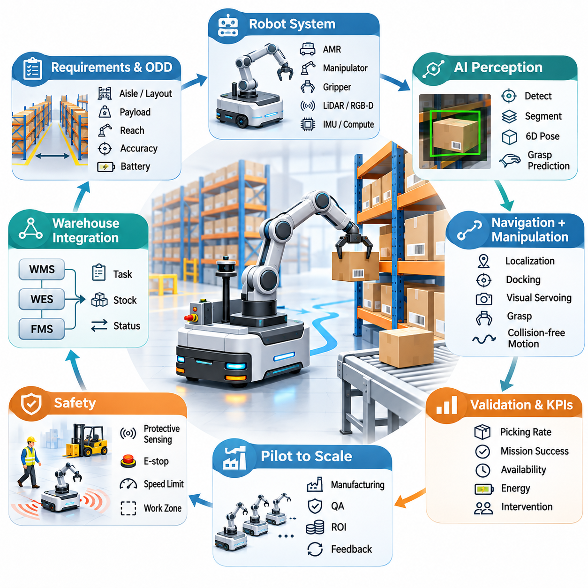
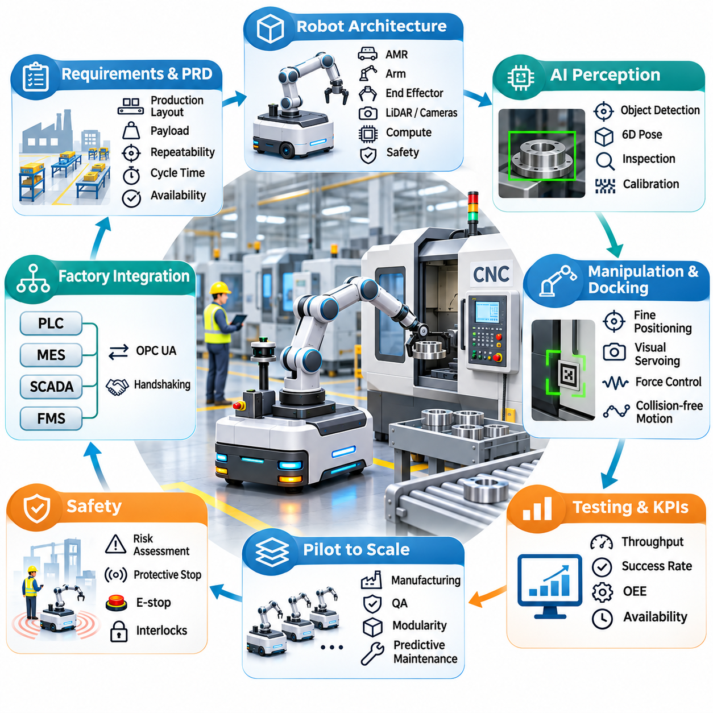
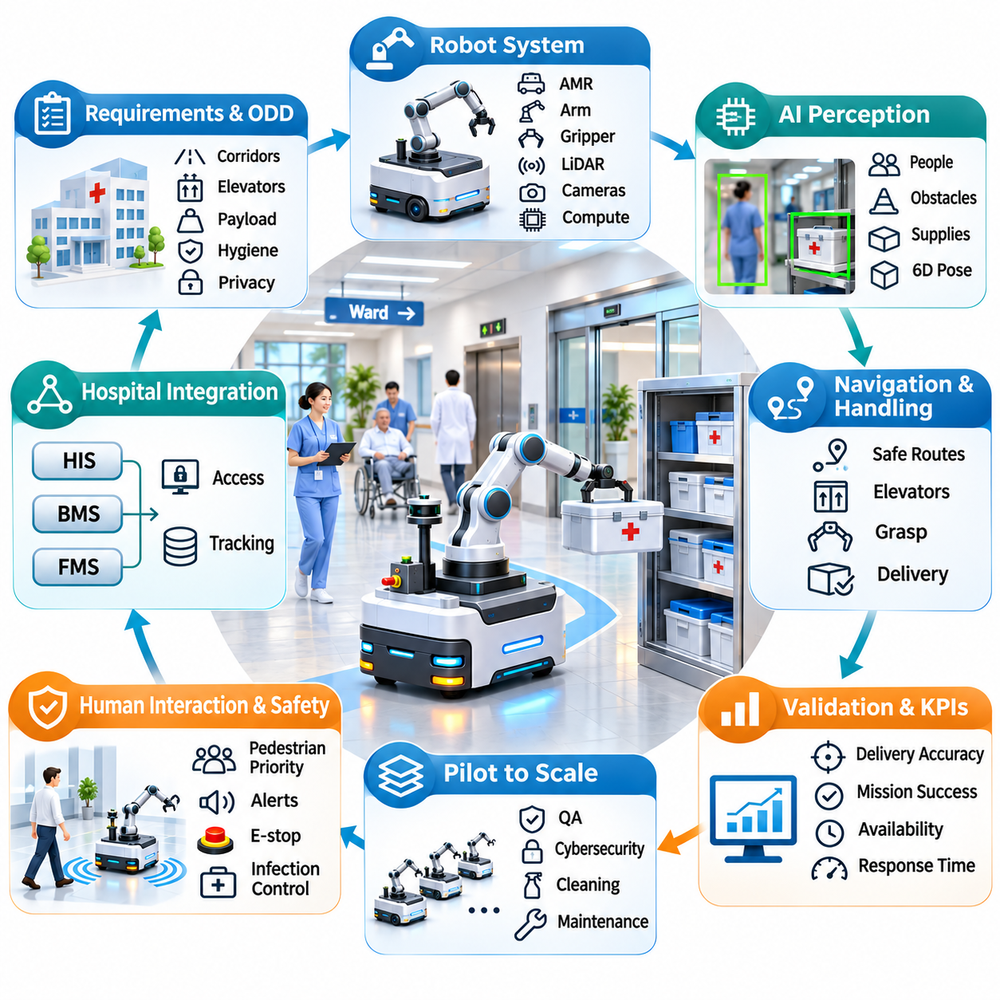
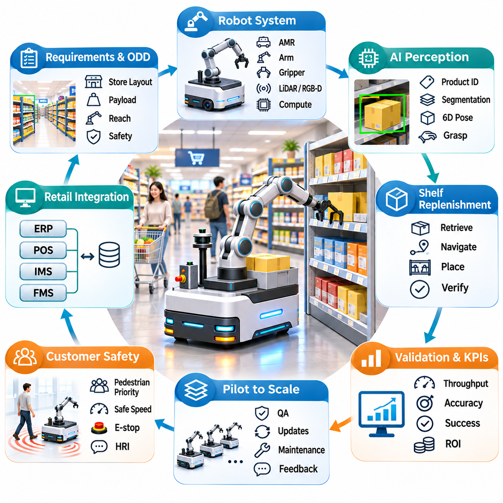
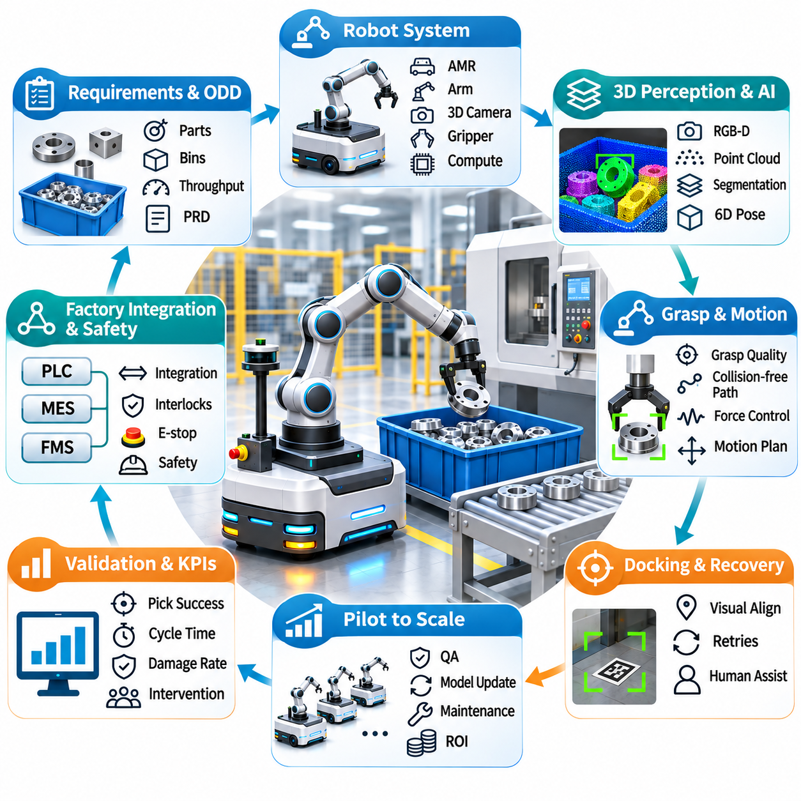
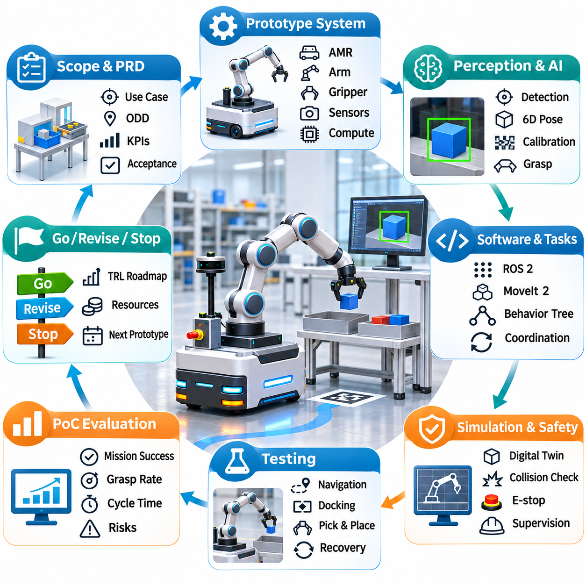
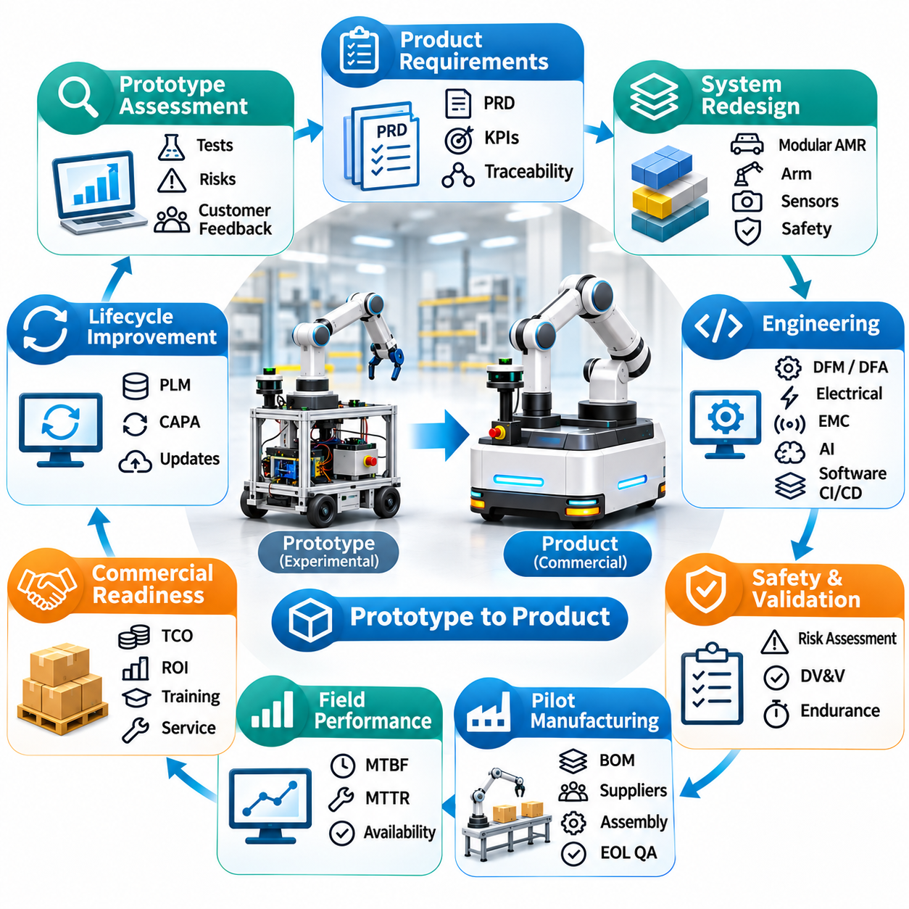
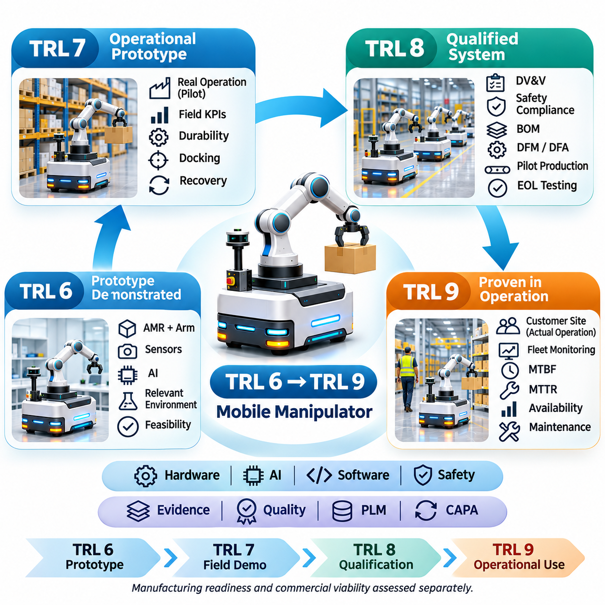
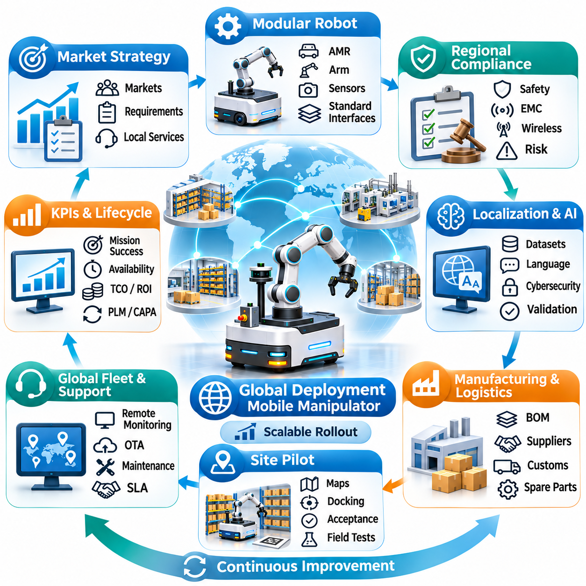
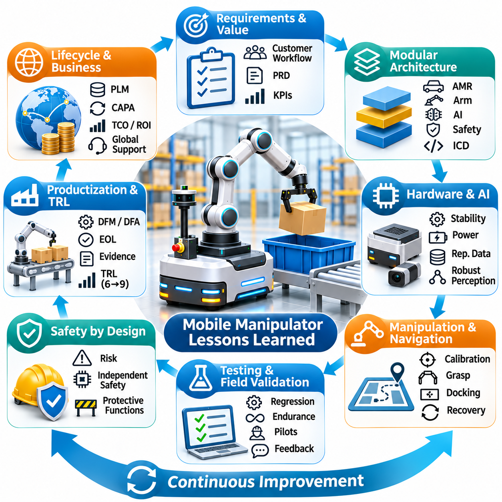

**Volume 05. Mobile Manipulator Projects and Development Manual**

# Chapter 10. Case Studies

## 01 Warehouse Mobile Manipulator Project

{width="7.268055555555556in" height="7.268055555555556in"}

A warehouse mobile manipulator project represents a practical application of autonomous mobility, robotic manipulation, artificial intelligence, and industrial automation within a unified system. Its primary objective is to automate material handling, inventory management, order fulfillment, and product transportation. The following illustrative project integrates the development methodologies established throughout this manual rather than presenting results from a specific commercial installation.

The project begins with an analysis of warehouse operations, customer requirements, and existing logistics processes. Engineers investigate storage configurations, aisle dimensions, product characteristics, inventory turnover, and material transportation patterns. These observations establish the operational design domain (ODD), which defines the environmental conditions, physical constraints, and operational boundaries within which the mobile manipulator must function.

System requirements are translated into measurable engineering specifications through a Product Requirement Document (PRD). Typical requirements include payload capacity, manipulation reach, positioning accuracy, picking success rate, transportation speed, battery endurance, and operational availability. Each requirement is associated with acceptance criteria and verification procedures to maintain traceability throughout the development lifecycle.

The system architecture integrates an Autonomous Mobile Robot (AMR), a multi-axis robotic manipulator, intelligent end effectors, perception sensors, embedded computing platforms, and warehouse communication interfaces. The mobile platform provides autonomous transportation, while the robotic arm performs object manipulation. Coordinated operation between these subsystems enables the robot to execute complex logistics missions without continuous human intervention.

Mechanical development focuses on structural rigidity, payload distribution, platform stability, and manipulation workspace. Engineers evaluate the combined center of gravity across different manipulator configurations and loading conditions. Dynamic analysis identifies potential instability during acceleration, braking, cornering, and extended arm movements. The mechanical architecture must accommodate these operating conditions while maintaining sufficient maneuverability within narrow warehouse aisles.

The perception architecture typically combines two-dimensional or three-dimensional LiDAR, RGB cameras, depth cameras, inertial measurement units, and wheel encoders. Environmental perception supports localization, obstacle detection, and autonomous navigation, while manipulation-oriented sensors provide detailed information about target objects. Accurate sensor calibration and time synchronization establish consistent spatial relationships between the mobile platform, robotic arm, and surrounding environment.

Artificial intelligence development addresses object detection, segmentation, six-dimensional pose estimation, and grasp prediction. Training datasets incorporate representative warehouse products, packaging materials, lighting variations, occlusions, and storage arrangements. Synthetic data generation and domain randomization can supplement real-world observations. Model validation must demonstrate reliable perception under conditions that reflect the intended warehouse operation.

The manipulation subsystem transforms perception results into physically executable actions. Grasp planning evaluates candidate contact points, object geometry, gripper accessibility, and grasp stability. Motion planning subsequently generates collision-free trajectories within the available workspace. Force-aware control and grasp verification improve handling reliability, particularly when manipulating fragile packages, deformable materials, or objects with uncertain physical properties.

An important engineering challenge is the coordination of mobile navigation and robotic manipulation. The AMR must approach storage racks, picking stations, or conveyor systems with sufficient positioning accuracy to establish a feasible manipulation workspace. Fine positioning and visual servoing can compensate for residual localization errors. Manipulation should begin only after the system confirms platform stability, target accessibility, and compliance with applicable safety conditions.

Warehouse integration requires communication with Warehouse Management Systems (WMS), Warehouse Execution Systems (WES), and Fleet Management Systems (FMS). These applications coordinate inventory records, picking requests, mission assignments, and resource availability. Standardized communication interfaces allow the mobile manipulator to receive tasks, report execution status, request assistance, and confirm successful material transactions.

Safety architecture addresses the combined hazards associated with autonomous vehicle movement and robotic arm operation. Protective devices, safety-rated monitoring, emergency stopping functions, speed limitations, and workspace restrictions are established through systematic risk assessment. Particular attention is given to shared environments where workers, forklifts, conventional AMRs, and mobile manipulators operate within overlapping areas.

System validation progresses from component-level testing to integrated warehouse operations. Functional tests evaluate navigation, docking, object recognition, grasp execution, and material delivery. Integrated scenarios introduce blocked aisles, unavailable products, communication interruptions, unsuccessful grasps, and simultaneous robot missions. Long-duration testing reveals reliability limitations and identifies recurring operational failures that isolated laboratory experiments may overlook.

Pilot deployment provides the foundation for evaluating commercial feasibility under representative working conditions. Key Performance Indicators (KPIs) include successful picks per hour, mission completion rate, grasp success rate, system availability, energy consumption, and human intervention frequency. Economic evaluation considers equipment investment, integration costs, maintenance expenses, operational savings, and the expected Return on Investment (ROI).

Transitioning from pilot deployment to commercial production requires manufacturing readiness, configuration management, supplier qualification, and repeatable quality assurance procedures. Field observations should be incorporated into mechanical improvements, software revisions, AI model updates, and maintenance strategies. Ultimately, the warehouse mobile manipulator project demonstrates how coordinated systems engineering can transform autonomous robotic capabilities into scalable industrial logistics solutions.

## 02 Factory Automation Project

{width="7.268055555555556in" height="7.268055555555556in"}

A factory automation project involving mobile manipulators integrates autonomous mobility, robotic manipulation, artificial intelligence, and industrial control technologies to establish flexible manufacturing environments. Unlike conventional stationary robotic systems, mobile manipulators can operate across multiple production stations and dynamically adapt to changing manufacturing requirements. This illustrative case presents a representative engineering development approach rather than a documented commercial installation.

The project begins with a comprehensive analysis of existing manufacturing processes, production layouts, material flows, equipment interfaces, and manual operations. Engineers identify repetitive tasks, production bottlenecks, ergonomic challenges, and opportunities for automation. These investigations establish the operational requirements and determine where mobile manipulation can provide measurable improvements in manufacturing productivity, flexibility, and efficiency.

The Product Requirement Document (PRD) translates manufacturing objectives into measurable technical specifications. Requirements typically include payload capacity, positioning accuracy, manipulation repeatability, production cycle time, equipment compatibility, and operational availability. Environmental conditions, safety constraints, communication protocols, and maintenance requirements must also be defined to ensure compatibility with existing factory infrastructure.

The system architecture integrates an Autonomous Mobile Robot (AMR), a multi-axis robotic manipulator, application-specific end effectors, perception sensors, industrial computing platforms, and safety controllers. The mobile platform provides flexible transportation between manufacturing stations, while the robotic arm executes material handling, machine tending, assembly assistance, and inspection tasks. Centralized mission coordination manages interactions between these functional subsystems.

Mechanical development emphasizes structural rigidity, load distribution, vibration resistance, and positioning stability. Manufacturing applications may require precise manipulation of mechanical components, electronic assemblies, tools, and production materials. Engineers analyze manipulator reaction forces, dynamic loading, and platform deformation to ensure that mobile operation does not compromise the accuracy and repeatability required by industrial processes.

The perception architecture combines LiDAR-based navigation, industrial cameras, depth sensors, and application-specific measurement devices. Artificial intelligence models perform object detection, component identification, six-dimensional pose estimation, and visual inspection. Hand-eye calibration and coordinate transformation establish accurate spatial relationships between the robotic manipulator, perception sensors, mobile platform, and manufacturing equipment.

Artificial intelligence development requires representative datasets covering component variations, surface reflections, illumination changes, manufacturing tolerances, and partially occluded objects. Synthetic data generation and simulation can supplement real-world training samples. Model optimization must balance recognition accuracy, inference latency, computational resource consumption, and robustness to environmental variations encountered during continuous factory operation.

Manipulation development addresses machine loading and unloading, component assembly, tool handling, and automated inspection. Grasp planning algorithms evaluate object geometry, accessibility, and physical properties, while motion planning generates feasible and collision-free trajectories. Force-torque sensing, impedance control, and compliant manipulation enable the system to accommodate dimensional variations and perform contact-intensive operations without damaging production equipment.

Precise docking represents a critical requirement when mobile manipulators interact with manufacturing machines and assembly fixtures. Conventional navigation accuracy may be insufficient for precision manipulation tasks. Fine positioning, fiducial markers, visual servoing, and local coordinate registration can compensate for residual positioning errors. Mechanical docking mechanisms may provide additional stability and repeatability for applications involving strict dimensional tolerances.

Factory integration requires interoperability with Programmable Logic Controllers (PLCs), Manufacturing Execution Systems (MES), Supervisory Control and Data Acquisition (SCADA) systems, and Fleet Management Systems (FMS). Industrial communication protocols such as OPC UA, EtherCAT, and PROFINET support different integration layers. Explicit interface definitions and equipment handshaking establish reliable coordination between autonomous robots and existing production machinery.

Safety engineering addresses hazards arising from mobile platform movement, manipulator operation, human interaction, and automated manufacturing equipment. Risk assessment considers crushing, collision, unexpected motion, dropped objects, and unauthorized access to hazardous areas. Safety-rated monitoring, protective stopping, emergency stop functions, speed restrictions, and equipment interlocks must operate independently of non-safety-rated artificial intelligence decisions.

System testing progresses through component verification, subsystem integration, functional testing, and production-oriented validation. Test scenarios include inaccurate docking, unexpected component positions, failed grasps, machine unavailability, communication interruptions, and emergency stopping. Digital twins and simulation environments support early verification, while physical testing establishes whether the integrated system satisfies defined manufacturing and safety requirements.

Pilot deployment introduces mobile manipulators into selected production processes under controlled operational conditions. Key Performance Indicators (KPIs) include production throughput, mission completion rate, manipulation success rate, positioning repeatability, equipment availability, and human intervention frequency. Overall Equipment Effectiveness (OEE), integration costs, maintenance expenses, and operational savings provide additional indicators of economic feasibility.

Commercial deployment requires standardized hardware configurations, controlled software releases, qualified suppliers, manufacturing documentation, and repeatable quality assurance procedures. Modular architectures allow the same mobile manipulation platform to support different production tasks through interchangeable end effectors and configurable software. Operational data collection, predictive maintenance, and continuous improvement support long-term reliability and scalable factory automation.

## 03 Hospital Logistics Project

{width="7.268055555555556in" height="7.268055555555556in"}

A hospital logistics project involving mobile manipulators integrates autonomous mobility, robotic manipulation, artificial intelligence, and healthcare information systems to improve the efficiency of internal hospital operations. The primary objective is to automate repetitive logistics activities while maintaining patient safety, operational reliability, and hygiene requirements. This illustrative case presents a representative development methodology rather than a verified hospital deployment.

The project begins with an analysis of hospital workflows, material transportation requirements, clinical environments, and existing logistics infrastructure. Engineers investigate the movement of medical supplies, pharmaceutical products, laboratory samples, surgical instruments, and other authorized materials. These observations establish the operational design domain (ODD), including corridors, elevators, storage facilities, nursing stations, and restricted clinical areas.

The Product Requirement Document (PRD) translates healthcare logistics objectives into measurable engineering specifications. Representative requirements include payload capacity, transportation accuracy, manipulation reliability, mission completion time, battery endurance, acoustic noise, and operational availability. Additional requirements address infection prevention, patient privacy, access control, emergency response, and compatibility with hospital infrastructure.

The system architecture integrates an Autonomous Mobile Robot (AMR), a multi-axis robotic manipulator, application-specific end effectors, perception sensors, embedded computing platforms, and healthcare communication interfaces. The mobile platform provides autonomous transportation between hospital departments, while the robotic arm performs authorized material handling, container transfer, storage retrieval, and interaction with designated logistics equipment.

Mechanical development emphasizes compact dimensions, structural stability, maneuverability, and hygienic design. Hospital environments frequently contain narrow corridors, crowded waiting areas, automatic doors, and shared elevators. External surfaces should support established cleaning and disinfection procedures. Engineers must also evaluate payload distribution, manipulator reach, acoustic emissions, and platform stability during transportation and object manipulation.

The perception architecture combines LiDAR, RGB cameras, depth sensors, inertial measurement units, and wheel encoders to support navigation and environmental awareness. Perception algorithms identify pedestrians, wheelchairs, hospital beds, medical equipment, and temporary obstacles. Because hospital environments are highly dynamic, the system must continuously update its environmental representation and adjust navigation behavior to accommodate unpredictable human movements.

Artificial intelligence development addresses object detection, semantic segmentation, pose estimation, grasp prediction, and contextual environmental understanding. Representative datasets should include medical containers, supply packages, storage cabinets, varying illumination, and partially occluded objects. AI models must be evaluated for recognition accuracy, inference latency, environmental robustness, and failure behavior without unnecessarily collecting identifiable patient information.

Manipulation development focuses on handling standardized medical supply containers, sealed packages, laboratory sample carriers, and other approved logistics materials. Grasp planning considers object geometry, surface characteristics, weight distribution, and handling restrictions. Motion planning and compliant control establish reliable manipulation trajectories, while grasp verification and container identification help prevent material damage, incorrect transfers, and accidental object release.

Autonomous navigation must accommodate the complex spatial organization and changing operational conditions of healthcare facilities. The mobile manipulator may need to travel between floors, request elevator services, pass through automatic doors, and approach designated delivery stations. Dynamic route planning, semantic mapping, and infrastructure integration enable efficient transportation while respecting restricted areas, emergency access routes, and pedestrian priority.

Hospital system integration requires interoperability with Hospital Information Systems (HIS), inventory management platforms, logistics management applications, Building Management Systems (BMS), and Fleet Management Systems (FMS). Secure communication interfaces support mission assignment, delivery confirmation, material tracking, and equipment coordination. Access permissions and transaction records establish accountability throughout the automated logistics process.

Human--Robot Interaction (HRI) represents a particularly important consideration in healthcare environments. Patients, visitors, nurses, physicians, and maintenance personnel may have different levels of familiarity with autonomous robotic systems. Intuitive visual indicators, appropriate audible notifications, predictable motion, and accessible user interfaces help communicate robotic intentions. The system should support authorized manual intervention without compromising safety or logistics integrity.

Safety engineering addresses hazards associated with autonomous movement, manipulation, human interaction, contamination, and unexpected environmental changes. Risk assessment must consider vulnerable patients, crowded corridors, restricted clinical areas, and emergency transportation activities. Safety-rated protective functions, emergency stopping, speed limitations, and manipulation interlocks should operate independently of non-safety-rated AI decisions.

System validation progresses from component verification and laboratory integration to controlled hospital pilot operations. Test scenarios include blocked corridors, unavailable elevators, incorrect delivery locations, failed grasps, communication interruptions, and unexpected pedestrian movements. Additional validation addresses cleaning compatibility, cybersecurity, material traceability, and recovery from operational failures without disrupting essential healthcare services.

Pilot deployment evaluates operational effectiveness through measurable Key Performance Indicators (KPIs), including mission completion rate, delivery accuracy, transportation time, manipulation success rate, system availability, and human intervention frequency. Economic assessment considers labor time savings, infrastructure integration costs, equipment investment, maintenance expenses, and the potential reduction of repetitive nonclinical workloads for healthcare personnel.

Commercial deployment requires standardized hardware configurations, controlled software releases, validated cleaning procedures, cybersecurity management, and repeatable quality assurance processes. Modular system architectures enable adaptation to different hospital layouts and logistics requirements. Continuous operational monitoring, preventive maintenance, and systematic field feedback support long-term reliability and the scalable implementation of autonomous healthcare logistics solutions.

## 04 Retail Service Project

{width="7.268055555555556in" height="7.268055555555556in"}

A retail service project involving mobile manipulators integrates autonomous mobility, robotic manipulation, artificial intelligence, and digital retail infrastructure to improve customer service and store operations. Typical applications include shelf replenishment, inventory inspection, product retrieval, and merchandise transportation. This illustrative case follows the development framework of this manual rather than presenting a verified commercial deployment.

The project begins with an analysis of retail operations, store layouts, customer behavior, merchandise characteristics, and employee workflows. Engineers identify repetitive activities, labor-intensive processes, inventory discrepancies, and opportunities for automation. These observations establish the operational design domain (ODD), including sales floors, storage areas, checkout stations, product displays, and designated customer service locations.

The Product Requirement Document (PRD) translates retail business objectives into measurable engineering specifications. Representative requirements include payload capacity, manipulation reach, product recognition accuracy, navigation reliability, service response time, battery endurance, and operational availability. Additional requirements address customer safety, accessibility, acoustic noise, physical appearance, and compatibility with existing retail infrastructure.

The system architecture integrates an Autonomous Mobile Robot (AMR), a multi-axis robotic manipulator, interchangeable end effectors, perception sensors, embedded computing platforms, and retail communication interfaces. The mobile platform provides autonomous transportation throughout the store, while the robotic arm performs product retrieval, shelf replenishment, merchandise arrangement, and authorized material handling operations.

Mechanical development emphasizes compact dimensions, structural stability, maneuverability, and consumer-friendly industrial design. Retail environments frequently contain narrow aisles, densely arranged merchandise, temporary promotional displays, and unpredictable pedestrian movements. Engineers must evaluate payload distribution, manipulator reach, platform stability, and external enclosure design to ensure reliable operation without obstructing customer activities.

The perception architecture combines LiDAR, RGB cameras, depth sensors, inertial measurement units, and wheel encoders to establish environmental awareness and manipulation capabilities. Semantic perception identifies shelves, merchandise, shopping carts, customers, and temporary obstacles. Accurate sensor calibration and spatial registration enable the mobile manipulator to associate recognized products with physical locations and accessible manipulation targets.

Artificial intelligence development addresses product recognition, object detection, instance segmentation, six-dimensional pose estimation, and grasp prediction. Representative datasets incorporate diverse packaging materials, product dimensions, surface reflections, illumination variations, and partial occlusions. Continuous changes in merchandise portfolios require controlled dataset expansion, model retraining, and regression testing to maintain recognition reliability.

Manipulation development focuses on handling consumer products with varying dimensions, shapes, weights, and material properties. Adaptive grippers, suction-based end effectors, and force-aware control can accommodate different packaging characteristics. Grasp planning evaluates contact accessibility and stability, while motion planning generates collision-free trajectories that minimize the risk of damaging merchandise or disturbing adjacent products.

Shelf replenishment represents a major operational application of retail mobile manipulators. The system identifies designated products, retrieves merchandise from authorized storage locations, navigates to assigned shelves, and performs controlled placement. Visual inspection verifies product identity, shelf position, and placement completion. Uncertain recognition results or unsuccessful manipulation attempts should trigger bounded recovery procedures or employee assistance.

Autonomous navigation in retail environments requires dynamic route planning, human-aware motion control, and continuous environmental monitoring. The mobile manipulator must accommodate customers who stop unexpectedly, shopping carts occupying aisles, and frequently changing store configurations. Semantic mapping, adaptive speed control, and dynamic obstacle avoidance support efficient movement while maintaining pedestrian priority and safe separation distances.

Human--Robot Interaction (HRI) plays an important role in customer-facing retail environments. Interactive displays, speech recognition, natural language processing, and Vision-Language Models (VLMs) can support product inquiries and service requests. Customer-facing AI should communicate its capabilities and limitations clearly, while physical actions remain constrained by validated task policies, operational permissions, and independent safety mechanisms.

Retail system integration requires interoperability with Enterprise Resource Planning (ERP), Point of Sale (POS), Inventory Management Systems (IMS), and Fleet Management Systems (FMS). Secure communication interfaces support inventory synchronization, mission assignment, replenishment requests, and operational reporting. Transaction verification and access control help prevent inconsistent inventory records, duplicate operations, and unauthorized merchandise handling.

Safety engineering and system validation address the risks associated with autonomous movement, robotic manipulation, customer interaction, and merchandise handling. Risk assessment considers collisions, crushing hazards, dropped products, and unexpected human movements. Integrated testing evaluates protective stopping, failed grasps, blocked aisles, communication interruptions, incorrect product identification, and recovery under representative retail conditions.

Pilot deployment evaluates operational effectiveness through measurable Key Performance Indicators (KPIs), including replenishment throughput, product recognition accuracy, manipulation success rate, inventory accuracy, mission completion rate, and human intervention frequency. Economic assessment considers equipment investment, integration costs, maintenance expenses, labor time savings, merchandise losses, and the expected Return on Investment (ROI).

Commercial deployment requires standardized hardware configurations, controlled software releases, cybersecurity management, supplier qualification, and repeatable quality assurance procedures. Modular system architectures support adaptation to different store formats and merchandise categories. Continuous operational monitoring, predictive maintenance, and systematic customer feedback contribute to long-term reliability and scalable intelligent retail automation.

## 05 Bin Picking Project

{width="7.268055555555556in" height="7.268055555555556in"}

A bin picking project involving mobile manipulators integrates autonomous mobility, three-dimensional perception, artificial intelligence, and robotic manipulation to automate the retrieval of randomly arranged objects from containers. Typical applications include machine tending, component sorting, material feeding, and industrial assembly. This illustrative case follows the development framework of this manual rather than presenting a verified commercial installation.

The project begins with an analysis of target objects, container geometries, production workflows, material transportation patterns, and existing manual picking operations. Engineers investigate object dimensions, weight distributions, surface characteristics, arrangement complexity, and required production throughput. These observations establish the operational design domain (ODD) and identify the technical constraints associated with unstructured object manipulation.

The Product Requirement Document (PRD) translates operational objectives into measurable engineering specifications. Representative requirements include picking success rate, object recognition accuracy, six-dimensional pose estimation accuracy, manipulation cycle time, payload capacity, and system availability. Additional requirements address acceptable object damage rates, container accessibility, autonomous transportation, error recovery, and compatibility with manufacturing infrastructure.

The system architecture integrates an Autonomous Mobile Robot (AMR), a multi-axis robotic manipulator, three-dimensional vision sensors, intelligent end effectors, embedded computing platforms, and industrial communication interfaces. The mobile platform enables transportation between different picking and delivery stations, while the manipulator performs object extraction and placement. Mission orchestration coordinates these subsystems throughout the operational workflow.

Mechanical development emphasizes structural rigidity, platform stability, manipulation workspace, and accessibility to containers of different dimensions. Engineers evaluate the manipulator reach, joint limitations, payload distribution, and potential interference between the robot arm and container walls. End effector selection considers object geometry, material characteristics, surface accessibility, and the required gripping force under representative operating conditions.

The perception architecture typically combines RGB-D cameras, structured light sensors, stereo vision systems, or industrial three-dimensional scanners. These devices generate depth images and point clouds representing randomly arranged objects within containers. Sensor calibration, hand-eye calibration, and coordinate transformations establish accurate spatial relationships between the perception system, robotic manipulator, mobile platform, and target objects.

Artificial intelligence development addresses object detection, instance segmentation, six-dimensional pose estimation, and grasp prediction. Representative training datasets incorporate overlapping objects, partial occlusions, reflective surfaces, complex geometries, and varying container fill levels. Synthetic data generation and domain randomization can supplement real-world observations by producing diverse object arrangements and challenging perception scenarios.

Six-dimensional pose estimation determines the three-dimensional position and orientation of individual objects within a container. Model-based and learning-based approaches can utilize RGB images, depth information, and point cloud representations. Pose refinement improves geometric alignment between estimated objects and their physical counterparts. Estimation uncertainty must be considered when selecting manipulation targets and generating feasible grasp configurations.

Grasp planning evaluates candidate grasp positions, approach directions, contact surfaces, object accessibility, and expected grasp stability. Deep learning models can predict grasp quality directly from depth images or point clouds. Candidate grasps are subsequently filtered using collision constraints, inverse kinematics, gripper limitations, and manipulator workspace boundaries. The objective is to identify physically executable grasps rather than relying exclusively on AI confidence scores.

Motion planning generates collision-free trajectories for approaching, grasping, extracting, and transporting selected objects. The planning environment must account for container walls, neighboring objects, robot arm geometry, and changing object arrangements. Force-torque sensing, compliant control, and grasp verification can improve extraction reliability when components are tightly packed, mechanically entangled, or subject to uncertain contact conditions.

Mobile bin picking introduces additional challenges associated with autonomous navigation, docking accuracy, and coordinate registration. The mobile platform must approach each picking station with sufficient accuracy to establish a feasible manipulation workspace. Local visual registration and fine positioning can compensate for residual navigation errors. Manipulation should begin only after platform stability, container accessibility, and operational safety conditions have been confirmed.

Error recovery is essential because randomly arranged objects may produce unsuccessful grasps, inaccurate pose estimates, unexpected collisions, or inaccessible configurations. The system should detect abnormal conditions, evaluate alternative grasp candidates, and update its representation of the container after each attempt. Recovery procedures must impose retry limits and request authorized human assistance when autonomous recovery is unsuccessful or unsafe.

System integration connects the bin picking platform with Programmable Logic Controllers (PLCs), Manufacturing Execution Systems (MES), and Fleet Management Systems (FMS). Safety-rated protective functions and equipment interlocks address hazards associated with autonomous movement and robotic manipulation. Integrated testing evaluates perception failures, grasp reliability, container interference, docking errors, communication interruptions, and emergency stopping behavior.

Pilot deployment evaluates operational effectiveness through measurable Key Performance Indicators (KPIs), including first-attempt picking success rate, overall picking success rate, average cycle time, successful picks per hour, object damage rate, and human intervention frequency. Economic assessment considers equipment investment, integration costs, maintenance expenses, production throughput improvements, and the expected Return on Investment (ROI).

Commercial deployment requires standardized hardware configurations, controlled AI model releases, qualified suppliers, and repeatable quality assurance procedures. Modular perception and manipulation architectures facilitate adaptation to different object categories and manufacturing environments. Continuous operational data collection, model refinement, preventive maintenance, and systematic field feedback support reliable and scalable industrial bin picking automation.

## 06 Mobile Manipulator PoC Project

{width="7.268055555555556in" height="7.268055555555556in"}

A mobile manipulator Proof of Concept (PoC) project establishes the technical feasibility of integrating autonomous mobility, robotic manipulation, artificial intelligence, and intelligent task execution within a unified robotic platform. Its primary objective is to identify critical engineering challenges before committing significant resources to full-scale product development. This illustrative case presents a representative development methodology rather than verified project results.

The project begins with the identification of a specific industrial application, representative operational scenarios, and essential functional requirements. Engineers define the target objects, manipulation tasks, transportation distances, environmental conditions, and interaction requirements. Unlike commercial product development, the PoC concentrates on validating fundamental technological capabilities within a clearly defined and limited operational scope.

The Product Requirement Document (PRD) establishes preliminary engineering specifications and measurable acceptance criteria. Representative requirements include autonomous navigation accuracy, docking repeatability, object recognition accuracy, grasp success rate, manipulation cycle time, and mission completion rate. These requirements should distinguish essential feasibility objectives from advanced capabilities that can be addressed during subsequent development phases.

The preliminary system architecture integrates an Autonomous Mobile Robot (AMR), a multi-axis robotic manipulator, an application-specific end effector, perception sensors, embedded computing platforms, and communication interfaces. Commercially available components can accelerate initial development and reduce engineering uncertainty. Modular interfaces enable individual subsystems to be replaced or upgraded without extensive architectural modifications.

Hardware development focuses on establishing a functional prototype with sufficient structural rigidity, payload capacity, electrical stability, and manipulation workspace. Engineers evaluate the mechanical mounting structure, center of gravity, manipulator reaction forces, battery capacity, and power distribution requirements. Rapid prototyping techniques and commercially available modules can reduce development costs while enabling early physical integration.

The perception subsystem integrates navigation sensors and manipulation-oriented vision devices to establish environmental awareness and object localization capabilities. LiDAR, RGB-D cameras, wheel encoders, and inertial measurement units provide representative sensing configurations. Sensor calibration, hand-eye calibration, and coordinate transformation must be established before meaningful evaluations of integrated manipulation accuracy can be performed.

Artificial intelligence development concentrates on validating essential perception capabilities using representative objects and environmental conditions. Pretrained object detection, segmentation, pose estimation, and grasp detection models can reduce initial training requirements. Preliminary datasets should capture relevant object variations, illumination changes, and occlusions. Evaluation identifies limitations that require additional data collection or model refinement.

Software development establishes communication and coordination between autonomous navigation, robotic manipulation, perception, and mission execution subsystems. Robot Operating System 2 (ROS 2), MoveIt 2, and behavior trees can provide a practical foundation for rapid integration. Clearly defined software interfaces, execution states, diagnostic messages, and error-handling procedures facilitate independent subsystem development and systematic troubleshooting.

Manipulation development validates the fundamental sequence of object recognition, grasp planning, trajectory generation, grasp execution, and controlled placement. Engineers initially utilize standardized objects and controlled environments before introducing greater operational complexity. Collision checking, inverse kinematics, grasp verification, and compliant control establish the basic capabilities required for reliable physical task execution.

Coordinated operation between the mobile platform and robotic arm represents a central objective of the PoC project. The robot must navigate to a designated workstation, establish an appropriate manipulation position, recognize the target object, execute the assigned task, and confirm completion. Fine positioning, local visual registration, and explicit subsystem handshaking can address preliminary docking and coordination limitations.

Simulation and digital twin technologies support early evaluation of mechanical configurations, manipulator reachability, collision constraints, and operational scenarios. Virtual experiments allow engineers to investigate alternative architectures before modifying physical prototypes. However, simulation results must be compared with physical measurements to identify discrepancies associated with friction, sensor noise, structural deformation, and actuator behavior.

Safety engineering remains essential even when the prototype is intended exclusively for controlled experimental operation. Preliminary risk assessment identifies hazards associated with autonomous movement, manipulator operation, electrical systems, and unexpected software behavior. Emergency stopping, protective monitoring, restricted workspaces, and supervised testing procedures must be established before integrated physical experiments are conducted.

System testing progresses from component verification and subsystem integration to end-to-end functional demonstrations. Representative scenarios evaluate autonomous navigation, docking, object recognition, grasp execution, material transportation, and mission recovery. Repeated experiments under defined conditions help distinguish systematic engineering limitations from random failures. Test configurations, software versions, and experimental observations must be documented.

PoC evaluation utilizes measurable Key Performance Indicators (KPIs) to determine whether the integrated system satisfies preliminary feasibility objectives. Results should include mission completion rate, manipulation success rate, positioning accuracy, cycle time, recovery effectiveness, and computational resource utilization. Performance limitations, unresolved technical risks, and estimated development costs provide the basis for subsequent engineering decisions.

The final PoC review determines whether the project should proceed to advanced prototype development, undergo architectural revision, or be discontinued. Technical findings are translated into updated requirements, risk mitigation strategies, resource estimates, and a Technology Readiness Level (TRL) advancement roadmap. A successful PoC establishes credible evidence of technical feasibility without implying manufacturing readiness or commercial product maturity.

## 07 Prototype to Product Case

{width="7.268055555555556in" height="7.268055555555556in"}

The transition from prototype to product represents a critical stage in mobile manipulator development, where experimentally validated technologies are transformed into reliable, manufacturable, and commercially viable robotic systems. Unlike prototype development, product development requires systematic consideration of production efficiency, operational reliability, safety compliance, and lifecycle management. This illustrative case follows the development framework established in this manual.

The transition begins with a comprehensive evaluation of the existing prototype, including its functional capabilities, performance limitations, architectural weaknesses, and unresolved technical risks. Engineers analyze experimental results, field observations, customer feedback, and component reliability. These findings establish the technical baseline for product development and identify engineering changes required to satisfy commercial operational requirements.

The Product Requirement Document (PRD) must be refined to reflect commercial expectations rather than experimental feasibility objectives. Requirements typically include operational availability, manipulation repeatability, mission completion rate, battery endurance, environmental resistance, maintenance accessibility, and product lifetime. Each requirement must be associated with measurable acceptance criteria, verification procedures, and traceability records.

System architecture optimization focuses on eliminating unnecessary experimental components, standardizing interfaces, and establishing clearly defined subsystem responsibilities. The Autonomous Mobile Robot (AMR), robotic manipulator, perception sensors, embedded computing platforms, and safety controllers must operate as an integrated product. Modular architecture facilitates component replacement, configuration management, application customization, and future technological upgrades.

Mechanical redesign addresses structural durability, manufacturing tolerances, vibration resistance, thermal management, and maintenance accessibility. Prototype structures frequently prioritize rapid fabrication rather than production efficiency. Design for Manufacturing (DFM) and Design for Assembly (DFA) methodologies reduce component complexity, simplify assembly operations, improve dimensional consistency, and establish repeatable mechanical configurations.

Electrical system development transforms experimental wiring arrangements into standardized and production-ready electrical architectures. Engineers optimize power distribution, wiring harnesses, communication networks, electrical protection, grounding, and electromagnetic compatibility (EMC). Component selection must consider operating temperature, lifecycle availability, power consumption, supplier reliability, and compatibility with applicable industrial requirements.

Artificial intelligence development transitions from experimental model performance toward dependable operational behavior. Training datasets must represent realistic environmental variations, object characteristics, and operational disturbances. Model optimization addresses inference latency, computational efficiency, recognition reliability, and uncertainty management. Controlled model releases and regression testing prevent uncontrolled performance degradation during product evolution.

Software productization requires stable interfaces, comprehensive diagnostic capabilities, structured error handling, cybersecurity protection, and reliable update mechanisms. Navigation, manipulation, perception, and mission orchestration software must support continuous operation and predictable recovery behavior. Continuous Integration and Continuous Deployment (CI/CD), automated testing, and version control establish repeatable software release procedures.

Safety engineering becomes increasingly important as the system moves from supervised laboratory experiments toward commercial operation. Comprehensive risk assessment identifies hazards associated with autonomous movement, robotic manipulation, electrical failures, and human interaction. Safety-rated protective functions, independent monitoring, emergency stopping, and validated operational restrictions must satisfy applicable standards and regulatory requirements.

Design Verification and Validation (DV&V) establish objective evidence that the redesigned product satisfies engineering specifications and intended operational requirements. Verification evaluates individual components and integrated subsystems, while validation examines representative customer applications. Environmental testing, endurance testing, manipulation reliability assessment, and fault injection help identify weaknesses that may emerge during prolonged operation.

Pilot production establishes repeatable manufacturing processes before large-scale commercialization. Engineers develop assembly instructions, production tooling, calibration procedures, inspection criteria, and End-of-Line (EOL) testing. Bill of Materials (BOM) management, supplier qualification, component traceability, and engineering change control ensure that manufactured units remain consistent with approved product configurations and quality requirements.

Field validation evaluates production-intent mobile manipulators under representative customer operating conditions. Key Performance Indicators (KPIs) include mission completion rate, manipulation success rate, system availability, Mean Time Between Failures (MTBF), Mean Time to Repair (MTTR), and human intervention frequency. Field observations provide essential evidence for evaluating product reliability, maintenance requirements, and commercial readiness.

Cost optimization balances manufacturing expenses, component performance, operational reliability, and customer value. Engineers analyze material costs, assembly labor, supplier pricing, software development expenses, warranty reserves, and maintenance requirements. Total Cost of Ownership (TCO) and Return on Investment (ROI) assessments help establish commercially sustainable pricing strategies without compromising essential safety or performance requirements.

Commercial readiness requires more than successful technical demonstrations or pilot production. Product documentation, installation procedures, operator training, maintenance manuals, spare parts availability, and technical support infrastructure must be established. Manufacturing readiness and regulatory compliance should be assessed independently of Technology Readiness Level (TRL) to ensure that technical maturity translates into sustainable commercial operations.

The successful transition from prototype to product establishes a foundation for scalable manufacturing, market deployment, and continuous product improvement. Operational data collection, corrective and preventive action (CAPA), predictive maintenance, and controlled software and AI updates support long-term reliability. Product Lifecycle Management (PLM) integrates these activities to maintain technical consistency, customer satisfaction, and commercial competitiveness.

## 08 TRL6 to TRL9 Case

{width="7.268055555555556in" height="7.268055555555556in"}

The progression from Technology Readiness Level 6 (TRL 6) to Technology Readiness Level 9 (TRL 9) represents the transformation of a demonstrated mobile manipulator prototype into a system proven through actual operational use. This process requires coordinated advancement in hardware, artificial intelligence, software, safety, manufacturing, and operational reliability. This illustrative case follows the development framework of this manual rather than reporting an actual commercial project.

At TRL 6, an integrated mobile manipulator prototype demonstrates essential technological capabilities within a relevant environment. The Autonomous Mobile Robot (AMR), robotic manipulator, perception sensors, embedded computing platform, and mission orchestration software operate together under representative conditions. Demonstrations establish system feasibility while identifying remaining limitations in reliability, environmental robustness, and operational flexibility.

The initial maturity assessment examines existing engineering specifications, prototype configurations, experimental results, and unresolved technical risks. Engineers establish a requirements traceability matrix linking functional, performance, safety, and maintenance requirements with corresponding verification evidence. Identified technology gaps are translated into engineering improvement tasks, measurable acceptance criteria, and development milestones.

The transition from TRL 6 to TRL 7 emphasizes system prototype demonstration within an actual operational environment. Representative applications may include warehouse material handling, factory machine tending, and autonomous component transportation. Environmental variability, operational disturbances, human interaction, and integration with existing industrial equipment introduce challenges that cannot be fully reproduced through laboratory experiments.

Hardware development during this transition addresses structural durability, battery endurance, thermal stability, sensor mounting reliability, and electrical system robustness. Engineers investigate mechanical wear, vibration, electromagnetic compatibility, and component degradation under realistic operating conditions. Design modifications improve platform stability, manipulation repeatability, maintenance accessibility, and overall system reliability.

Artificial intelligence development focuses on improving recognition accuracy, pose estimation reliability, grasp prediction, and robustness against environmental variations. Operational datasets collected from pilot environments support targeted model refinement and failure analysis. Model version control, uncertainty estimation, regression testing, and controlled deployment procedures establish a reliable foundation for continuous AI development.

Software and manipulation development improve autonomous navigation, docking repeatability, task planning, collision avoidance, and error recovery. The integrated system must respond predictably to unsuccessful grasps, localization errors, communication interruptions, and unexpected environmental changes. Diagnostic functions and structured operational logs enable engineers to identify failure mechanisms and evaluate recovery effectiveness.

TRL 7 field demonstrations evaluate the integrated prototype under representative operational workloads and customer workflows. Key Performance Indicators (KPIs) include mission completion rate, manipulation success rate, positioning accuracy, system availability, cycle time, and human intervention frequency. Repeated experiments and long-duration operation provide evidence for assessing technical maturity and identifying outstanding engineering risks.

The transition from TRL 7 to TRL 8 focuses on completing the actual system and demonstrating its qualification through systematic testing. Product configurations, hardware architectures, software interfaces, AI model versions, and engineering specifications are progressively stabilized. Design Verification and Validation (DV&V) establish objective evidence that the completed system satisfies its defined technical and operational requirements.

Safety engineering and regulatory compliance become essential elements of system qualification. Comprehensive risk assessments evaluate hazards associated with autonomous mobility, robotic manipulation, electrical systems, and human-robot interaction. Safety-rated protective functions, emergency stopping, fault detection, and operational restrictions must be validated against applicable standards and intended operating conditions.

Manufacturing preparation progresses alongside TRL advancement through standardized Bills of Materials (BOMs), supplier qualification, production tooling, assembly instructions, and calibration procedures. Design for Manufacturing (DFM) and Design for Assembly (DFA) improve production consistency. Pilot production and End-of-Line (EOL) testing establish repeatable quality controls, although manufacturing readiness requires a separate assessment.

At TRL 8, the completed mobile manipulator system has been qualified through testing and demonstration against defined requirements. Engineering documentation, qualification reports, safety evidence, and configuration records support the maturity assessment. However, achieving TRL 8 does not independently establish commercial profitability, mass production capability, or proven reliability across every potential customer environment.

The transition from TRL 8 to TRL 9 requires evidence of successful operation of the actual system in its intended operational environment. Deployed mobile manipulators perform assigned tasks within established customer workflows while operational performance and reliability are monitored. Maintenance records, failure histories, intervention frequency, and mission completion statistics support the assessment of actual system performance.

Long-term operational evaluation incorporates Mean Time Between Failures (MTBF), Mean Time to Repair (MTTR), system availability, maintenance costs, and Total Cost of Ownership (TCO). Fleet management, remote diagnostics, preventive maintenance, and controlled software updates support sustained operation. Commercial performance must be evaluated separately using customer acceptance, deployment costs, and Return on Investment (ROI).

Successful progression to TRL 9 establishes evidence that the mobile manipulator has been proven through actual operational use within its intended application. Product Lifecycle Management (PLM), continuous quality monitoring, and corrective and preventive action (CAPA) sustain system performance beyond initial qualification. Further expansion into new environments or substantially modified configurations may require additional validation and technology maturity assessment.

## 09 Global Deployment Case

{width="7.268055555555556in" height="7.268055555555556in"}

Global deployment of mobile manipulators represents the transition from localized commercial operation to coordinated implementation across multiple countries, industries, and customer environments. This process requires technological adaptability, regulatory compliance, standardized manufacturing, international logistics, and sustainable operational support. This illustrative case follows the development framework of this manual rather than reporting an actual international deployment.

The global deployment strategy begins with an assessment of target markets, regional industrial requirements, customer expectations, and existing automation infrastructure. Engineers and business development teams investigate labor conditions, operational environments, regulatory frameworks, and local service capabilities. These assessments establish deployment priorities and identify regional requirements that may influence product configurations and engineering specifications.

Product standardization establishes a common technological foundation for international deployment while accommodating regional customization. The Autonomous Mobile Robot (AMR), robotic manipulator, perception sensors, embedded computing platforms, and safety controllers should utilize standardized interfaces. Modular system architecture enables application-specific end effectors, communication protocols, and environmental protection configurations without extensive system redesign.

Regional regulatory compliance represents a fundamental requirement for international commercialization. Mobile manipulators must satisfy applicable machinery safety regulations, electrical protection requirements, electromagnetic compatibility standards, and wireless communication requirements. Engineering teams establish regional compliance matrices, technical documentation, risk assessments, and conformity assessment procedures before authorizing deployment in individual markets.

Environmental adaptability becomes increasingly important when mobile manipulators operate across geographically diverse locations. Temperature variations, humidity, dust exposure, floor conditions, lighting characteristics, and electrical infrastructure may influence system performance. Environmental testing and regional field validation establish whether existing hardware configurations and operational restrictions remain appropriate for each intended deployment environment.

Artificial intelligence development must address variations in operating environments, object characteristics, equipment configurations, and human behavior across international customer sites. Regionally representative datasets support model evaluation and targeted refinement. Controlled model deployment, dataset traceability, uncertainty estimation, and regression testing reduce the risk of performance degradation when systems encounter previously unseen operational conditions.

Software localization extends beyond translating operator interfaces into different languages. International deployment requires configurable measurement units, regional time zones, operational terminology, notification formats, and communication settings. Standardized software architectures should accommodate regional customization while maintaining consistent navigation, manipulation, mission orchestration, diagnostic functions, and cybersecurity protection mechanisms.

Manufacturing and supply chain management establish the production capacity required to support international customer demand. Standardized Bills of Materials (BOMs), qualified suppliers, alternative component sourcing, and controlled engineering changes improve production continuity. International logistics planning must address transportation costs, customs procedures, import restrictions, battery transportation requirements, and regional spare parts availability.

Site preparation evaluates facility layouts, wireless network coverage, charging infrastructure, workstation interfaces, and existing material handling systems before robot installation. Engineers establish operational maps, docking locations, restricted areas, and human-robot interaction procedures. Standardized site acceptance protocols reduce deployment variability while allowing customer-specific modifications to satisfy local operational and safety requirements.

Pilot deployment in each target region provides evidence that the mobile manipulator can operate effectively within local customer workflows. Representative experiments evaluate navigation reliability, manipulation accuracy, mission completion, equipment integration, and operational recovery. Field observations identify regional limitations and establish corrective engineering actions before expanding deployment to additional facilities.

Global fleet management provides centralized visibility into geographically distributed mobile manipulators while supporting independent local operation. Remote monitoring systems collect operational status, mission histories, diagnostic information, and maintenance notifications. Regional network limitations, cybersecurity requirements, data residency obligations, and communication interruptions must be considered when designing distributed fleet management architectures.

International maintenance and technical support require coordinated service networks, trained local personnel, spare parts distribution, and standardized troubleshooting procedures. Remote diagnostics and predictive maintenance can reduce unnecessary service visits and equipment downtime. Maintenance documentation, operator training, and service-level agreements (SLAs) establish consistent support expectations across different geographic markets.

Software and AI lifecycle management must maintain configuration consistency across internationally deployed robotic systems. Over-the-Air (OTA) updates, controlled release procedures, staged deployment, and rollback mechanisms support reliable product evolution. Update schedules should accommodate regional operating hours, customer production requirements, network bandwidth limitations, and applicable cybersecurity and data protection regulations.

Global operational performance is evaluated through standardized Key Performance Indicators (KPIs), including mission completion rate, manipulation success rate, system availability, maintenance response time, and human intervention frequency. Economic assessments incorporate regional labor costs, installation expenses, logistics costs, Total Cost of Ownership (TCO), and Return on Investment (ROI). Comparable indicators support evidence-based international expansion decisions.

Successful global deployment requires a sustainable combination of technological maturity, manufacturing readiness, regulatory compliance, customer acceptance, and regional service capabilities. Product Lifecycle Management (PLM), continuous quality monitoring, and corrective and preventive action (CAPA) integrate operational feedback into future product development. A standardized yet adaptable deployment framework enables scalable international commercialization of mobile manipulator systems.

## 10 Lessons Learned

{width="7.268055555555556in" height="7.268055555555556in"}

Lessons learned from mobile manipulator development provide a systematic foundation for improving future engineering projects, reducing technical risks, and accelerating commercialization. The preceding case studies encompass industrial applications, proof-of-concept development, productization, technology maturity advancement, and global deployment. The following lessons synthesize these illustrative scenarios rather than documented field results.

One of the most important lessons is that successful development begins with clearly defined customer requirements and operational scenarios rather than technology selection alone. Engineers must understand target workflows, environmental constraints, expected performance, and economic objectives before establishing system specifications. Incomplete requirements frequently lead to unnecessary design iterations, integration difficulties, and increased development costs.

System architecture should be established early to ensure effective coordination between autonomous mobility, robotic manipulation, perception, artificial intelligence, and safety functions. Modular architectures and standardized Interface Control Documents (ICDs) facilitate independent subsystem development and subsequent integration. Architectural decisions should consider future scalability, component availability, maintenance accessibility, and configuration management.

Hardware development demonstrates the importance of evaluating mechanical, electrical, and computational requirements as interconnected engineering problems. Manipulator reaction forces, center of gravity, payload distribution, battery capacity, vibration, and thermal conditions directly influence system performance. Early simulation, physical prototyping, and multidisciplinary design reviews help identify potential weaknesses before expensive manufacturing commitments are made.

Artificial intelligence development must prioritize operational reliability rather than benchmark accuracy alone. Models trained under controlled conditions may exhibit significant performance degradation when exposed to unfamiliar objects, lighting variations, occlusions, or sensor disturbances. Representative datasets, uncertainty estimation, failure analysis, and continuous model validation are essential for establishing dependable perception and manipulation capabilities.

Robotic manipulation performance depends on the combined effectiveness of perception, calibration, grasp planning, motion planning, and control systems. High object recognition accuracy does not necessarily guarantee successful physical manipulation. Engineers must evaluate complete task execution sequences, including object accessibility, collision constraints, grasp stability, extraction forces, placement accuracy, and recovery from unsuccessful manipulation attempts.

The integration of autonomous navigation and robotic manipulation represents a particularly important engineering challenge. Navigation accuracy alone may be insufficient to satisfy precision manipulation requirements. Local visual registration, fine positioning, coordinate calibration, and explicit subsystem handshaking help establish reliable transitions between transportation and manipulation tasks while minimizing accumulated positioning errors.

Testing strategies should progressively advance from component verification and subsystem integration toward complete operational validation. Successful laboratory demonstrations cannot substitute for systematic testing under representative environmental conditions. Automated regression testing, fault injection, endurance testing, and requirements traceability provide objective evidence of system maturity and reduce the probability of recurring engineering defects.

Field validation reveals operational challenges that are frequently overlooked during laboratory development. Human behavior, facility layouts, communication interruptions, environmental disturbances, and unexpected workflow changes can significantly affect robotic performance. Pilot deployments should therefore incorporate structured operational data collection, measurable performance indicators, customer feedback, and systematic procedures for implementing corrective actions.

Safety engineering must be integrated throughout the development lifecycle rather than introduced immediately before commercial deployment. Risk assessments should address autonomous movement, manipulator operation, electrical failures, unexpected AI behavior, and human-robot interaction. Independent safety functions, validated protective mechanisms, and controlled recovery procedures remain essential even when advanced AI capabilities improve operational autonomy.

The transition from prototype development to commercial products requires a fundamental change in engineering priorities. Experimental flexibility must gradually give way to standardized configurations, repeatable manufacturing processes, qualified suppliers, and controlled engineering changes. Design for Manufacturing (DFM), Design for Assembly (DFA), and End-of-Line (EOL) testing establish the foundation for consistent product quality and scalable production.

Technology Readiness Level (TRL) advancement should be supported by documented evidence rather than subjective assessments or successful demonstrations alone. Technical maturity, manufacturing readiness, regulatory compliance, and commercial viability represent distinct dimensions of product readiness. A system that achieves advanced technological maturity may still require substantial investment in production infrastructure, service networks, and economic optimization.

Effective project management requires realistic scheduling, resource allocation, cost control, and continuous risk assessment. Engineering milestones should be associated with measurable deliverables and predefined acceptance criteria. Cross-functional communication, structured design reviews, and early identification of technical dependencies help prevent development delays and maintain alignment between engineering objectives and commercial expectations.

Commercial success depends on measurable customer value throughout the product lifecycle. Mission completion rates, system availability, maintenance costs, human intervention frequency, Total Cost of Ownership (TCO), and Return on Investment (ROI) provide essential evaluation criteria. Global deployment further demonstrates the importance of regional adaptability, regulatory compliance, standardized technical support, and sustainable supply chain management.

The overriding lesson is that mobile manipulator development must be treated as an integrated systems engineering and lifecycle management discipline rather than an isolated robotics research activity. Product Lifecycle Management (PLM), continuous improvement, operational feedback, and corrective and preventive action (CAPA) transform accumulated engineering knowledge into reusable organizational capabilities, supporting future innovation and sustainable commercialization.
