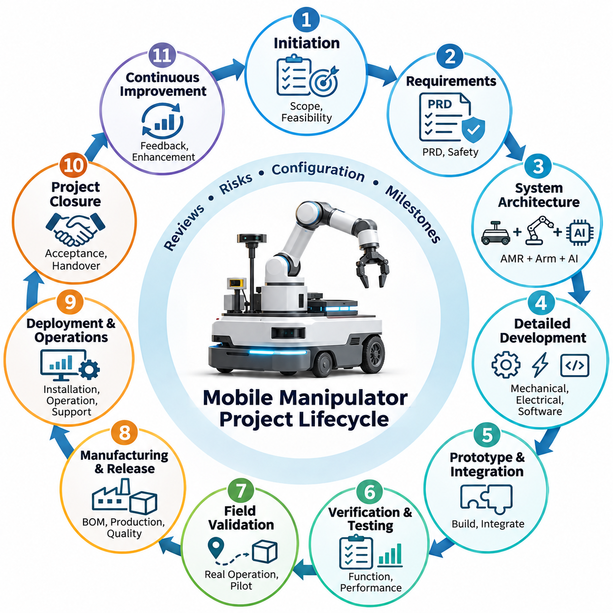
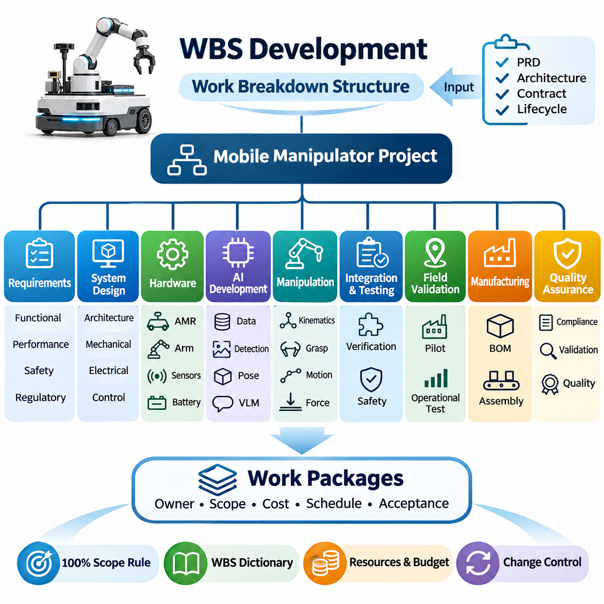
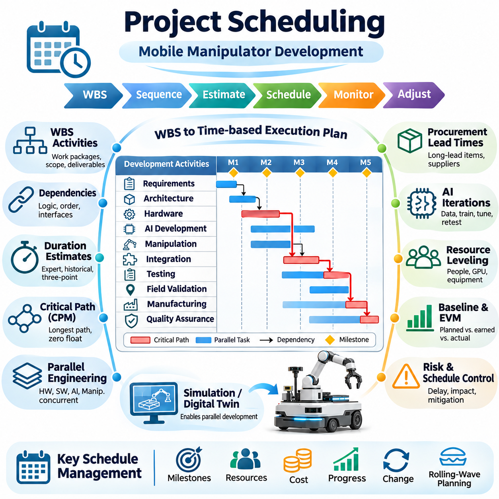
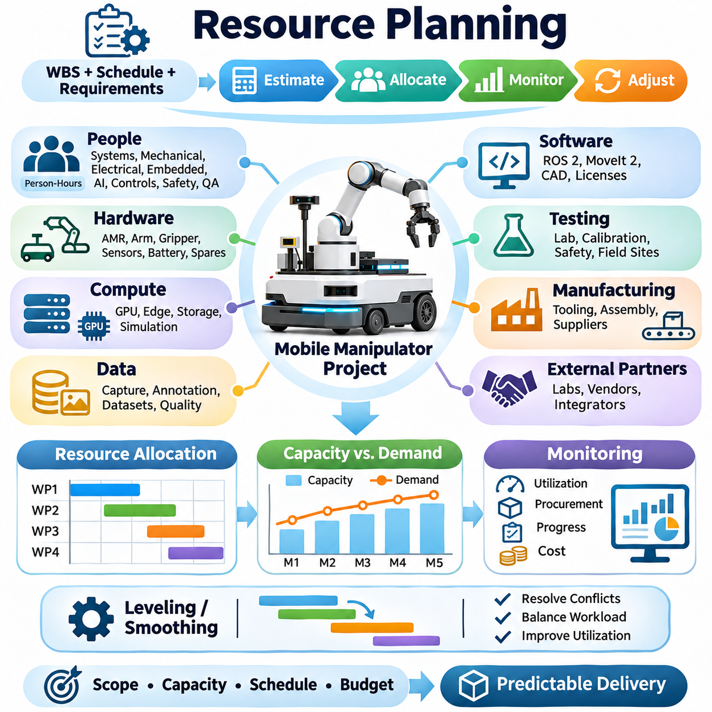
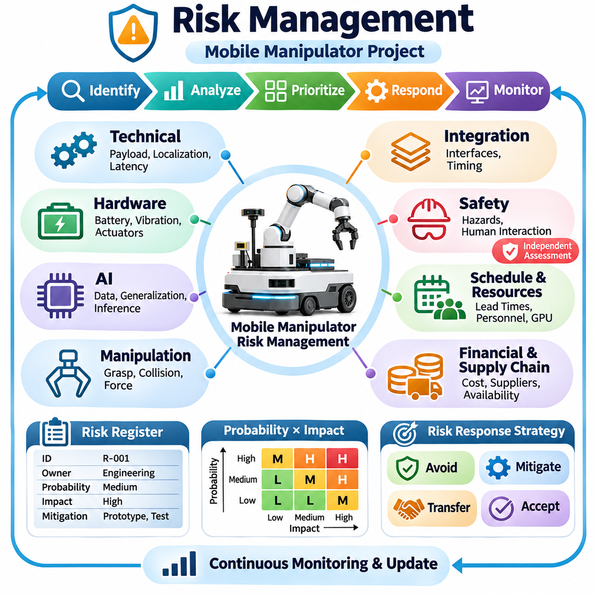
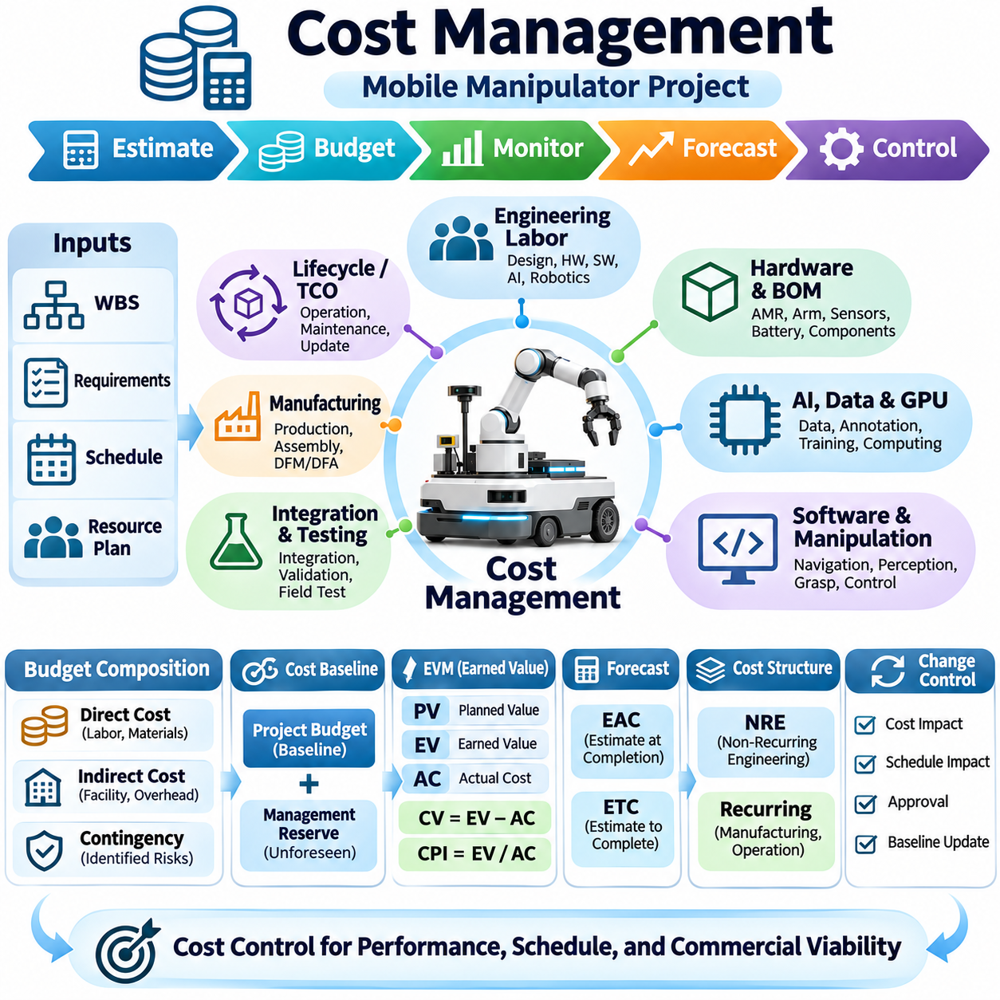
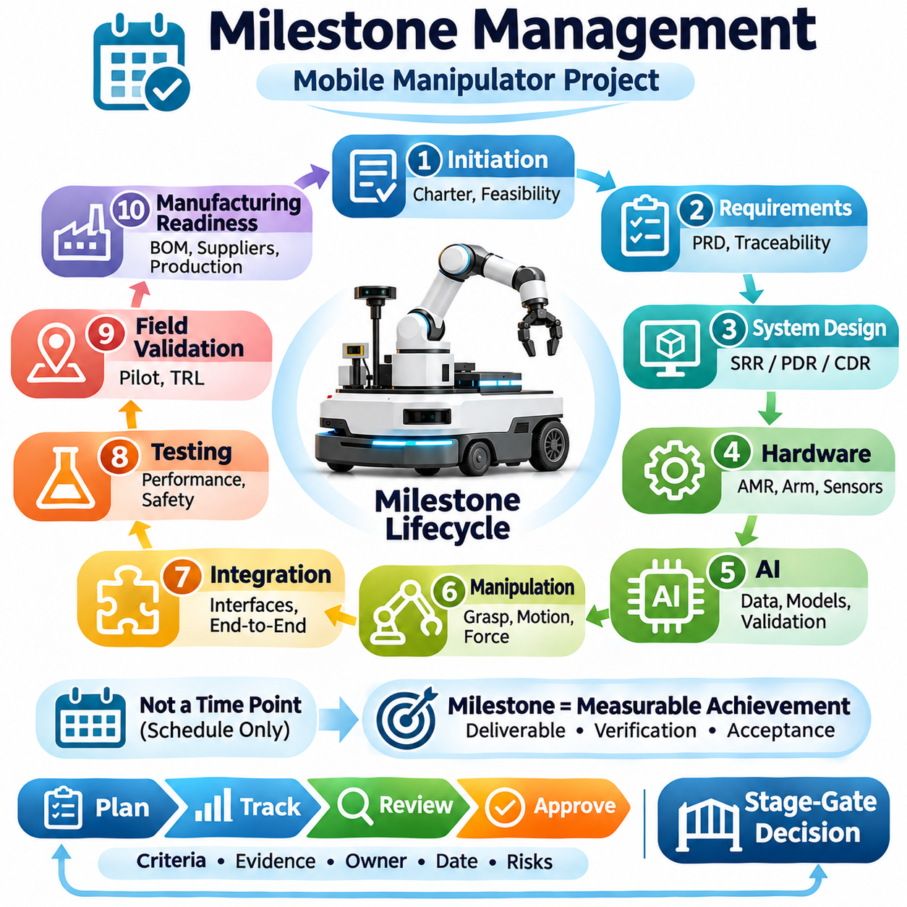
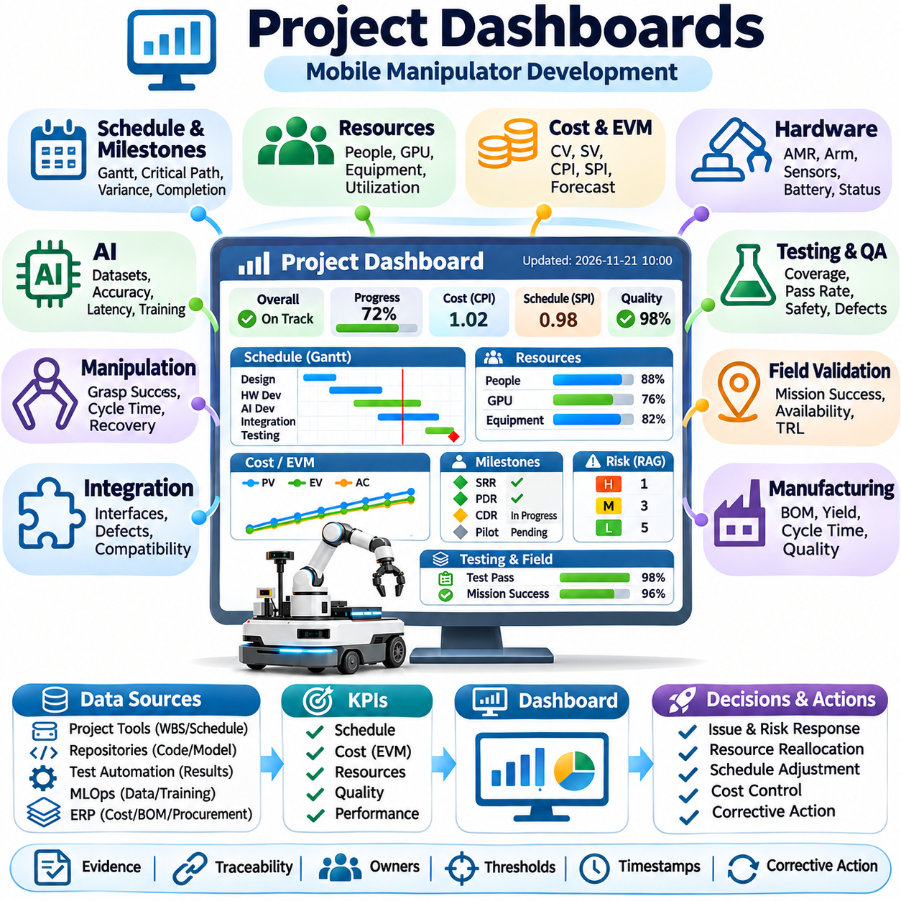
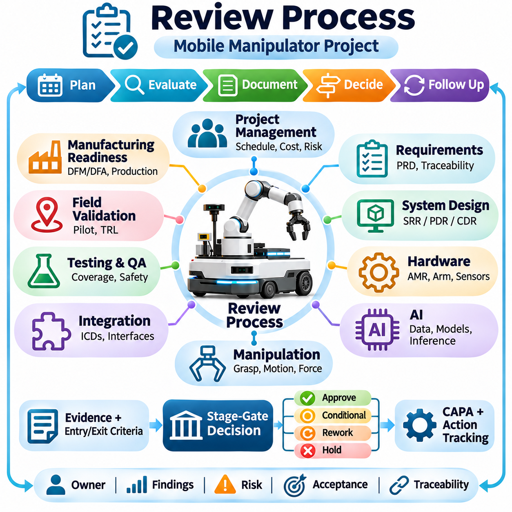
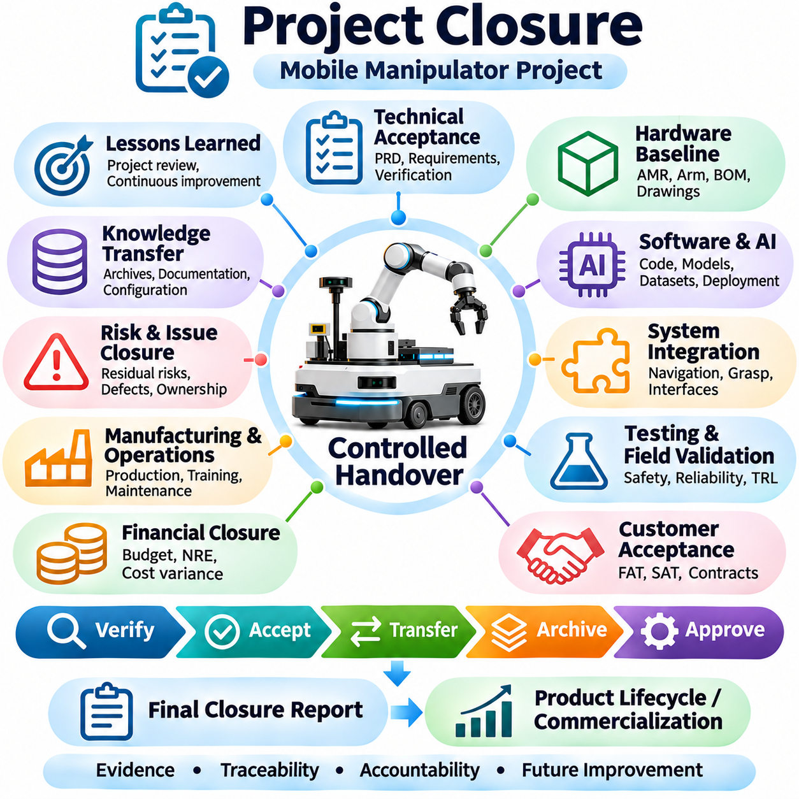

**Volume 05. Mobile Manipulator Projects and Development Manual**

# Chapter 11. Project Management

## 01 Project Lifecycle

{width="7.268055555555556in" height="7.268055555555556in"}

A mobile manipulator project follows a structured lifecycle that transforms an initial product concept into a fully integrated, tested, deployable, and maintainable robotic system. Unlike conventional robot development, a mobile manipulator combines an autonomous mobile robot (AMR), a robotic arm, end effectors, perception sensors, artificial intelligence, motion planning, and fleet management software. Project management must therefore coordinate multiple engineering disciplines while maintaining consistency across system requirements, hardware interfaces, software architecture, safety, and operational objectives.

The lifecycle begins with project initiation, where the business objectives, application environment, target customers, and expected outcomes are defined. The development team establishes the project scope, preliminary budget, expected schedule, technical feasibility, and major constraints. Typical considerations include payload capacity, navigation accuracy, manipulation precision, operating time, environmental conditions, and expected task completion rates. The initial feasibility assessment determines whether the proposed mobile manipulation concept can achieve the required performance within available technical and financial resources.

During the requirements definition phase, customer expectations are translated into measurable engineering specifications. Functional requirements describe what the system must accomplish, while performance requirements establish quantitative targets for navigation, localization, object detection, grasping, manipulation, and task execution. Safety, cybersecurity, maintainability, and regulatory requirements are also identified. These requirements form the foundation of the Product Requirement Document (PRD) and provide traceability throughout development, testing, and field validation.

The system concept and architecture phase establishes the overall technical configuration of the mobile manipulator. Engineers determine the AMR platform type, manipulator configuration, end-effector mechanism, sensor arrangement, computing resources, communication interfaces, and control architecture. Particular attention is given to the mechanical and electrical integration between the mobile base and robotic arm. The architecture must account for payload distribution, center of gravity, vibration, power consumption, workspace limitations, and communication latency. Preliminary design reviews confirm that the proposed architecture can satisfy the defined requirements.

The detailed design and development phase converts the approved architecture into engineering implementations. Mechanical engineers develop the chassis, mounting structures, manipulator interfaces, and end-effector mechanisms. Electrical engineers design power distribution, battery systems, wiring harnesses, embedded controllers, and sensor interfaces. Software and AI engineers implement navigation, perception, object detection, pose estimation, grasp planning, and manipulation control. Development activities may proceed concurrently, but interface specifications and configuration management must ensure that independently developed components remain compatible.

Prototype fabrication and subsystem integration establish the first physical implementation of the system. The AMR platform, robotic arm, sensors, computing hardware, batteries, and communication equipment are assembled and configured. Individual subsystems are initially evaluated before complete system integration. Engineers verify electrical connections, mechanical tolerances, communication protocols, coordinate transformations, and safety mechanisms. Integration activities frequently reveal issues that are difficult to identify during isolated component development, making early prototype evaluation essential for controlling technical risks.

The system verification and testing phase determines whether the integrated mobile manipulator satisfies its engineering specifications. Testing covers individual components, software modules, functional behavior, system performance, manipulation accuracy, navigation reliability, and operational safety. AI models are evaluated using representative datasets and real operating conditions, while manipulation tests examine grasp success, placement accuracy, repeatability, and recovery behavior. Verification results are compared against predefined acceptance criteria. Identified failures are documented, analyzed, and addressed through corrective engineering activities.

Field validation evaluates the system under actual operating conditions and representative customer workflows. Laboratory performance alone cannot demonstrate operational readiness because real environments introduce changing lighting, obstacles, surface conditions, object variations, communication interruptions, and unexpected human interactions. Pilot deployments provide operational data for evaluating mission success, task completion time, system availability, localization accuracy, and manipulation reliability. Feedback from operators and customers is incorporated into subsequent development iterations to improve usability, robustness, and overall product performance.

After successful validation, the project progresses toward manufacturing preparation and product release. Engineering designs are reviewed for manufacturability, assembly efficiency, serviceability, and production cost. The Bill of Materials (BOM), supplier specifications, manufacturing procedures, inspection criteria, and end-of-line testing processes are established. Production readiness reviews confirm that the product configuration is sufficiently mature for controlled manufacturing. Software versions, AI model configurations, hardware revisions, and calibration procedures must remain traceable to ensure consistent product quality across manufactured units.

Commercial deployment does not represent the end of the project lifecycle. Operational monitoring, preventive maintenance, software updates, AI model improvements, and customer support become essential activities during the product operation phase. Field performance data helps identify recurring failures, component degradation, changing environmental conditions, and opportunities for optimization. Maintenance records and operational feedback should be connected to engineering change management so that improvements can be incorporated into subsequent product releases without compromising system stability or safety.

Project closure formally evaluates whether the original objectives, technical deliverables, schedule, budget, and acceptance criteria have been achieved. The project team consolidates engineering documentation, test reports, validation results, manufacturing records, software releases, and outstanding issue records. Lessons learned are captured to improve future mobile manipulator development programs. Unresolved risks and long-term maintenance responsibilities are transferred to the appropriate operational or product support organization. A structured closure process preserves engineering knowledge and establishes a reliable foundation for future product generations.

Throughout the lifecycle, project management must operate as a continuous coordination process rather than a sequence of isolated engineering activities. Requirements changes, hardware delays, AI performance limitations, integration failures, and supplier constraints can affect multiple development workstreams simultaneously. Regular technical reviews, milestone assessments, risk evaluations, and configuration management provide the visibility needed to control these dependencies. Each major lifecycle transition should be supported by objective evidence demonstrating that the required technical and management conditions have been satisfied.

An effective mobile manipulator lifecycle combines stage-based project governance with iterative engineering development. Major milestones establish management control, while iterative prototyping, simulation, testing, and field feedback allow technical teams to refine the system as new information becomes available. This approach reduces late-stage integration risks, improves resource utilization, and supports predictable project execution. Ultimately, the lifecycle provides a consistent framework for transforming a mobile manipulation concept into a safe, reliable, manufacturable, and commercially sustainable robotic product.

## 02 WBS Development

{width="7.268055555555556in" height="7.268055555555556in"}

A Work Breakdown Structure (WBS) is a hierarchical representation of the complete scope of work required to develop, validate, manufacture, and deploy a mobile manipulator system. It decomposes complex project objectives into manageable deliverables, subsystems, work packages, and engineering activities. The WBS provides a common foundation for project scheduling, resource allocation, cost estimation, responsibility assignment, progress monitoring, and technical coordination throughout the project lifecycle.

The development of a WBS begins with a comprehensive understanding of the project scope, customer requirements, product objectives, and expected deliverables. The Product Requirement Document (PRD), system architecture, contractual obligations, and project lifecycle provide the primary inputs for defining the work structure. The WBS must encompass the complete development scope, including requirements engineering, hardware development, AI development, manipulation development, testing, and commercialization.

The highest level of the WBS represents the overall mobile manipulator development project. Subsequent levels divide the project into major engineering domains and lifecycle phases, such as requirements definition, system design, hardware development, artificial intelligence development, manipulation development, system testing, field validation, manufacturing, and quality assurance. This hierarchical organization establishes clear relationships between overall project objectives and individual engineering deliverables.

Hardware development can be decomposed into AMR base development, manipulator selection, mechanical design, end-effector development, battery system design, sensor integration, electrical architecture, wiring harness development, and embedded system development. Each engineering domain is further divided into design, procurement, fabrication, assembly, integration, and verification work packages. This decomposition helps identify technical dependencies, procurement constraints, and hardware integration requirements.

Artificial intelligence development requires a dedicated WBS structure covering data collection, data labeling, dataset preparation, model selection, training, performance evaluation, optimization, and deployment. Additional work packages may address object detection, pose estimation, grasp detection, Vision-Language Models (VLMs), robot agents, and embodied AI. Iterative development activities must include measurable deliverables to ensure that experimental progress contributes directly to system-level requirements.

Manipulation development encompasses kinematics, dynamics modeling, grasp planning, motion planning, force control, pick-and-place operations, bin picking, and task execution. Individual work packages should define expected algorithms, simulation environments, software interfaces, physical experiments, and performance evaluation criteria. Dependencies between perception, coordinate transformations, robotic arm control, and end-effector operation must be identified to prevent integration failures and unnecessary development delays.

A work package represents the lowest level of decomposition at which project scope, cost, duration, responsibility, and deliverables can be effectively managed. Each work package should have a unique identifier, a clearly defined scope, an assigned owner, estimated resource requirements, completion criteria, and associated dependencies. Excessive decomposition increases administrative overhead, while insufficient decomposition reduces visibility into technical progress and project performance.

The WBS should follow the 100 percent rule, which requires the combined scope of all subordinate elements to represent the complete scope of their parent element without unnecessary duplication. Project management, documentation, safety engineering, regulatory compliance, cybersecurity, configuration management, and quality assurance must also be included. These supporting activities are frequently underestimated despite their significant influence on development schedules, engineering costs, and product readiness.

A WBS dictionary complements the hierarchical structure by providing detailed descriptions of individual work packages. It records deliverables, technical specifications, acceptance criteria, assumptions, constraints, responsible organizations, required resources, and relevant engineering documents. For multidisciplinary mobile manipulator projects, the WBS dictionary reduces ambiguity between engineering teams, external suppliers, research institutions, manufacturing partners, and customer organizations.

The completed WBS serves as the foundation for project scheduling and resource planning. Work packages are translated into scheduled activities with estimated durations, predecessor relationships, successor relationships, and milestone targets. Critical Path Method (CPM) analysis helps identify activities that directly influence the project completion date. Resource allocation must consider engineering availability, GPU computing infrastructure, prototype equipment, testing facilities, and supplier lead times.

Cost management is closely connected to WBS development because individual work packages provide the basis for estimating labor, materials, equipment, software licenses, subcontracting, and validation expenses. Estimated costs are aggregated through the WBS hierarchy to establish the overall project budget and cost baseline. Earned Value Management (EVM) can subsequently compare planned value, earned value, and actual cost to evaluate project performance and identify emerging schedule or budget deviations.

WBS development must also incorporate system integration, verification, field validation, and manufacturing readiness. Integration work packages address mechanical compatibility, electrical connections, communication interfaces, sensor calibration, and coordinated system behavior. Verification and validation packages establish objective evidence of requirement fulfillment, while manufacturing packages address supplier qualification, production processes, assembly procedures, quality control, and production readiness.

The WBS must remain under formal configuration and change management throughout the project lifecycle. Changes in customer requirements, hardware specifications, AI performance targets, or operational environments may require modifications to existing work packages. Each proposed change should be evaluated for its impact on scope, schedule, cost, resources, technical dependencies, and associated risks. Approved changes must be reflected consistently across project schedules, budgets, responsibility assignments, and technical documentation.

Ultimately, an effective WBS transforms the complexity of mobile manipulator development into a transparent and controllable project execution framework. It connects strategic product objectives with measurable engineering deliverables while establishing accountability across multidisciplinary development teams. By maintaining consistent relationships between requirements, work packages, resources, milestones, and verification results, the WBS supports predictable development, effective risk management, and successful commercialization.

## 03 Project Scheduling

{width="7.268055555555556in" height="7.268055555555556in"}

Project scheduling is a systematic process for organizing, sequencing, and controlling development activities throughout the lifecycle of a mobile manipulator project. It translates the Work Breakdown Structure (WBS) into a time-based execution plan that defines when engineering activities begin, how long they require, and when specific deliverables must be completed. An effective schedule coordinates technical dependencies, resource availability, procurement, integration, and validation.

The scheduling process begins by identifying activities associated with each work package in the WBS. These activities should cover requirements definition, system architecture, hardware development, artificial intelligence development, manipulation development, system testing, field validation, manufacturing, and quality assurance. Each activity must have a defined scope, estimated duration, responsible organization, expected deliverables, and measurable completion criteria.

Activity sequencing establishes logical relationships between development tasks. For example, system architecture must reach sufficient maturity before detailed mechanical and electrical designs can be finalized. Sensor selection influences perception software development, while manipulator specifications affect kinematics, motion planning, and end-effector design. Identifying these dependencies prevents incompatible engineering decisions, unnecessary rework, and downstream schedule disruptions.

Duration estimation determines the time required to complete individual development activities under realistic resource and technical constraints. Estimation methods include expert judgment, historical project data, analogous estimation, parametric estimation, and three-point estimation. Hardware procurement, prototype fabrication, AI model training, software debugging, and regulatory testing often introduce uncertainty that must be reflected in activity durations and schedule contingency.

The Critical Path Method (CPM) identifies the longest sequence of dependent activities that determines the earliest possible project completion date. Activities on the critical path typically have zero total float when the schedule is calculated without additional deadline constraints. In mobile manipulator development, critical activities may include long-lead component procurement, prototype assembly, system integration, safety validation, and customer acceptance testing.

Parallel development enables mechanical, electrical, software, AI, and manipulation engineering teams to execute compatible activities simultaneously. Digital twins, simulation environments, interface specifications, and virtual prototypes allow software development to begin before physical hardware becomes available. However, concurrent engineering requires stable interface definitions, configuration management, and regular technical coordination to prevent integration delays caused by incompatible implementations.

Hardware development schedules must account for component selection, supplier qualification, procurement lead times, mechanical fabrication, electrical assembly, and prototype verification. Specialized components such as robotic arms, servo drives, industrial sensors, embedded computing platforms, and battery systems may require extended delivery periods. Early identification of long-lead items and alternative suppliers reduces the probability that procurement delays will affect critical integration milestones.

AI development schedules differ from conventional hardware schedules because model performance cannot always be predicted accurately before experimentation. Data collection, annotation, model training, hyperparameter optimization, and deployment testing frequently require multiple iterations. Scheduling should allocate time for experimental cycles, dataset improvements, GPU resource availability, and model regression testing while establishing measurable performance targets and decision points.

System integration scheduling coordinates the availability of mechanical assemblies, electrical systems, embedded controllers, perception modules, manipulation algorithms, and fleet management software. Subsystem readiness must be evaluated before integration activities begin. Incremental integration allows engineers to verify individual interfaces and coordinated behaviors progressively, reducing the likelihood of discovering major architectural problems immediately before system validation.

Testing and field validation require dedicated schedule allocations rather than being treated as residual activities after development. Functional testing, performance testing, AI validation, manipulation testing, safety assessment, reliability testing, and pilot deployment must be scheduled with sufficient time for defect correction and regression testing. Field validation also depends on customer site availability, operational conditions, installation readiness, and access to representative workflows.

Resource-constrained scheduling considers limitations in engineering personnel, computing infrastructure, prototype equipment, laboratory facilities, and manufacturing capacity. Activities that could theoretically proceed in parallel may require the same specialist or testing equipment. Resource leveling adjusts activity timing to resolve allocation conflicts, while resource smoothing attempts to improve utilization without extending the planned project completion date.

The approved schedule establishes a schedule baseline against which actual development progress is measured. Project managers monitor planned and actual start dates, completion dates, remaining durations, milestone achievement, and schedule variance. Gantt charts, dependency networks, project dashboards, and Earned Value Management (EVM) provide complementary mechanisms for identifying delays, evaluating their consequences, and communicating project status to stakeholders.

Schedule control requires continuous evaluation of technical risks, engineering changes, supplier delays, and unexpected integration problems. When deviations occur, project managers may consider activity resequencing, resource reallocation, fast tracking, or schedule compression. Recovery strategies must be assessed against additional costs, technical dependencies, quality requirements, and safety obligations. Approved changes should be documented and incorporated into the controlled schedule.

Ultimately, effective project scheduling combines milestone-based governance with iterative engineering execution. Rolling-wave planning allows near-term activities to be defined in detail while future activities remain adaptable to emerging technical information. By maintaining alignment between requirements, work packages, dependencies, resources, and verification milestones, project scheduling supports predictable development, controlled technical risks, manufacturing readiness, and successful mobile manipulator commercialization.

## 04 Resource Planning

{width="7.268055555555556in" height="7.268055555555556in"}

Resource planning is a systematic process for identifying, estimating, allocating, and managing the resources required throughout the lifecycle of a mobile manipulator development project. It ensures that engineering personnel, hardware components, computing infrastructure, development tools, testing facilities, manufacturing equipment, and financial resources are available at the appropriate time to support planned activities and achieve project objectives.

The resource planning process begins with the analysis of the Work Breakdown Structure (WBS), project schedule, system requirements, and expected engineering deliverables. Each work package must be evaluated to determine the required competencies, labor effort, equipment, materials, and supporting infrastructure. Resource requirements should be assigned to specific development activities to establish a traceable relationship between resource consumption and project progress.

Human resource planning is particularly important because mobile manipulator development requires multidisciplinary engineering expertise. Typical project teams include systems architects, mechanical engineers, electrical engineers, embedded software engineers, AI specialists, robotics engineers, control engineers, safety engineers, and quality assurance personnel. Project managers must evaluate both the availability and technical proficiency of personnel assigned to critical development activities.

Engineering labor requirements are commonly estimated using person-hours or person-months based on the complexity of individual work packages. Historical project data, technical experience, development productivity, and anticipated integration difficulties provide the basis for estimating engineering effort. Resource estimates should also consider technical meetings, documentation, design reviews, defect correction, training, and administrative activities rather than focusing exclusively on implementation.

Hardware resource planning encompasses the procurement and allocation of AMR platforms, robotic arms, end effectors, sensors, embedded computing devices, motor controllers, battery systems, and communication equipment. Prototype quantities must account for parallel development, subsystem verification, system integration, reliability testing, and unexpected component failures. Spare components and alternative suppliers should be considered for critical hardware with extended procurement lead times.

Computing resource planning supports artificial intelligence development, simulation, software compilation, digital twin environments, and robotic system validation. AI model development may require GPU servers, high-performance workstations, distributed training environments, and large-capacity data storage. Edge computing platforms must also be available for inference optimization, real-time performance evaluation, thermal testing, and hardware-specific deployment validation.

Data resources represent another important component of mobile manipulator development. Object detection, pose estimation, grasp detection, Vision-Language Models (VLMs), and embodied AI require representative training and validation datasets. Resource planning must therefore include data acquisition equipment, annotation personnel, synthetic data generation tools, storage infrastructure, dataset management systems, and mechanisms for maintaining data quality and version traceability.

Software resource planning covers development frameworks, simulation platforms, middleware, engineering applications, software licenses, and collaborative development environments. Robotics projects may depend on ROS 2, MoveIt 2, computer-aided design tools, physics simulators, and machine learning frameworks. Compatibility, licensing constraints, maintenance costs, software version management, and access permissions must be considered when allocating these resources across engineering teams.

Testing and validation resources must be planned independently from routine development resources. Dedicated laboratories, representative objects, calibration equipment, motion tracking systems, force measurement devices, safety testing equipment, and environmental test facilities are necessary for objective performance evaluation. Field validation additionally requires access to customer sites, operational infrastructure, installation personnel, representative workflows, and qualified safety supervisors.

Manufacturing resource planning becomes increasingly important as the project progresses from prototype development toward commercialization. Required resources include assembly facilities, production tooling, test fixtures, inspection instruments, manufacturing personnel, supplier capacity, and logistics infrastructure. Early coordination between engineering and manufacturing teams ensures that production requirements, assembly procedures, quality controls, and serviceability considerations are incorporated into product development.

Resource allocation must account for dependencies and competition between concurrent engineering activities. A single robotic arm, GPU server, prototype platform, or specialized engineer may be required by multiple work packages simultaneously. Resource leveling adjusts activity timing to resolve allocation conflicts, while resource smoothing improves utilization within available schedule flexibility. These techniques help balance workload, reduce idle capacity, and prevent resource-related bottlenecks.

External resource planning addresses capabilities that cannot be efficiently provided by the internal development organization. External resources may include specialized research institutions, component suppliers, contract manufacturers, certification laboratories, system integrators, and field deployment partners. Clearly defined responsibilities, contractual deliverables, interface specifications, acceptance criteria, and intellectual property arrangements are essential for maintaining effective collaboration.

Resource availability and utilization must be monitored continuously throughout the project lifecycle. Project managers should compare planned and actual engineering effort, equipment utilization, procurement status, computing consumption, and remaining resource capacity. Resource calendars, capacity forecasts, utilization indicators, and project dashboards help identify emerging shortages. Corrective actions may include resource reallocation, additional procurement, outsourcing, or schedule adjustments.

Ultimately, effective resource planning establishes a consistent relationship between project scope, engineering capacity, technical infrastructure, development schedules, and available budgets. Resource plans must remain adaptable to changing requirements, experimental results, integration challenges, and manufacturing demands. By maintaining realistic capacity estimates and proactive allocation strategies, mobile manipulator projects can reduce development risks, improve productivity, and achieve predictable commercialization outcomes.

## 05 Risk Management

{width="7.268055555555556in" height="7.268055555555556in"}

Risk management is a systematic process for identifying, analyzing, evaluating, mitigating, and monitoring uncertainties that may affect the successful development and commercialization of a mobile manipulator system. Because mobile manipulators combine mechanical systems, electrical architectures, autonomous navigation, robotic manipulation, and artificial intelligence, project risks must be evaluated across multiple engineering disciplines and throughout the entire project lifecycle.

The risk management process begins during project initiation and continues through requirements definition, system design, hardware development, AI development, integration, testing, field validation, and manufacturing. Potential risks should be identified using engineering experience, feasibility assessments, design reviews, historical project data, and stakeholder feedback. Early risk identification enables project teams to establish preventive measures before uncertainties develop into significant problems.

Technical risks arise when the proposed system architecture, hardware components, software algorithms, or control mechanisms cannot achieve the required performance. Typical examples include insufficient payload capacity, unstable vehicle dynamics, inaccurate localization, limited manipulator workspace, excessive communication latency, and inadequate computational performance. Technical feasibility studies, simulation, rapid prototyping, and incremental verification help reduce these uncertainties.

Hardware risks are associated with mechanical structures, electrical components, actuator reliability, battery performance, sensor integration, and environmental durability. The combination of an autonomous mobile robot (AMR) and a robotic arm introduces additional challenges related to center of gravity, structural vibration, dynamic loading, and power distribution. Failure Mode and Effects Analysis (FMEA), engineering calculations, and prototype testing support systematic hardware risk assessment.

Artificial intelligence risks originate from insufficient training data, inaccurate annotations, model generalization limitations, computational constraints, and changing operational environments. Object detection, pose estimation, grasp detection, and embodied AI models may perform differently under laboratory and field conditions. Representative datasets, uncertainty estimation, independent validation, model regression testing, and controlled fallback mechanisms are essential for reducing AI-related operational risks.

Manipulation risks involve unsuccessful grasping, inaccurate object placement, unexpected contact forces, collisions, unstable trajectories, and inadequate recovery behavior. These risks increase when manipulation tasks depend on uncertain object poses or inaccurate mobile platform positioning. Engineers should evaluate grasp robustness, coordinate transformation accuracy, motion planning constraints, force control performance, and recovery procedures under representative operating conditions.

System integration risks emerge from interactions between independently developed hardware and software components. Incompatible communication protocols, inconsistent coordinate frames, timing synchronization errors, electrical interference, and conflicting control commands may prevent reliable operation. Interface Control Documents (ICDs), configuration management, continuous integration, and incremental system testing provide mechanisms for identifying and resolving integration risks before final validation.

Safety risks require particular attention because mobile manipulators operate in physical environments where unintended movements may cause injury or equipment damage. Hazard identification must address mobile base motion, robotic arm movement, end-effector operation, electrical hazards, battery failures, and human-robot interaction. Formal safety risk assessments, protective measures, safety-related control functions, and validation must be applied independently of general project risk scoring.

Schedule and resource risks occur when development activities require more time, personnel, equipment, or computing capacity than originally estimated. Delayed component procurement, unavailable specialists, repeated AI training cycles, unsuccessful prototype iterations, and extended integration testing may affect critical project milestones. Realistic estimates, schedule contingency, resource capacity monitoring, and alternative execution strategies help maintain project continuity.

Financial and supply chain risks include material cost increases, exchange rate fluctuations, supplier dependency, component discontinuation, unexpected engineering expenses, and limited manufacturing capacity. Mobile manipulator projects may depend on specialized robotic arms, servo drives, industrial sensors, and high-performance computing platforms. Alternative sourcing, supplier qualification, cost contingency, and lifecycle availability assessments reduce exposure to external uncertainties.

Identified risks should be documented in a centralized risk register containing a unique identifier, risk description, potential causes, expected consequences, probability, impact, priority, responsible owner, and mitigation strategy. Qualitative risk assessment commonly uses a probability-impact matrix to prioritize risks, while quantitative techniques such as sensitivity analysis and Monte Carlo simulation can evaluate schedule uncertainty and financial exposure.

Risk response planning establishes appropriate strategies for addressing identified threats. Risk avoidance eliminates the source of uncertainty, mitigation reduces its probability or impact, transfer assigns certain consequences to another organization, and acceptance acknowledges the remaining exposure. Residual risks and secondary risks introduced by mitigation activities must also be evaluated. Each response should include a responsible owner, implementation schedule, and measurable effectiveness criteria.

Risk monitoring and control require continuous evaluation of changing project conditions, emerging threats, and mitigation effectiveness. Risk indicators, technical performance metrics, supplier reports, integration results, and project dashboards provide visibility into evolving uncertainties. High-priority risks should be reviewed during major design reviews and milestone assessments. Risks that materialize must be managed as project issues through corrective actions and escalation procedures.

Ultimately, effective risk management integrates preventive engineering, evidence-based decision-making, and continuous project governance. Risks should remain traceable to system requirements, work packages, project schedules, resource plans, and verification activities. By maintaining proactive risk identification and disciplined mitigation throughout development, mobile manipulator projects can improve safety, reliability, schedule predictability, cost control, manufacturing readiness, and commercial sustainability.

## 06 Cost Management

{width="7.268055555555556in" height="7.268055555555556in"}

Cost management is a systematic process for estimating, budgeting, monitoring, and controlling the financial resources required throughout the lifecycle of a mobile manipulator development project. It encompasses requirements engineering, system design, hardware development, artificial intelligence, software implementation, system integration, testing, field validation, and manufacturing. Effective cost management balances technical performance, product quality, development schedules, and commercial viability.

Cost estimation begins with the analysis of the Work Breakdown Structure (WBS), system requirements, project schedule, and resource plan. Each work package is evaluated to determine the expected labor, materials, equipment, software, subcontracting, and validation expenses. Estimation techniques include analogous estimation, parametric estimation, bottom-up estimation, and three-point estimation. Estimates should become progressively more accurate as engineering specifications mature.

Engineering labor costs typically represent a significant portion of mobile manipulator development expenses. Mechanical engineers, electrical engineers, software developers, AI specialists, robotics engineers, safety engineers, and project managers contribute different levels of effort. Labor costs are estimated using person-hours or person-months multiplied by applicable personnel rates, with appropriate allowances for indirect labor, technical coordination, and organizational overhead.

Hardware development costs include AMR platforms, robotic arms, end effectors, actuators, motor controllers, sensors, batteries, embedded computing devices, mechanical structures, and electrical components. The Bill of Materials (BOM) provides a structured foundation for estimating component expenses. Additional costs associated with prototype fabrication, machining, assembly, transportation, procurement, and replacement components must also be considered during budget preparation.

Artificial intelligence development introduces costs associated with data acquisition, annotation, model training, GPU computing infrastructure, data storage, software frameworks, and model deployment. Repeated experiments, hyperparameter optimization, dataset improvements, and performance validation may increase development expenses. AI budgets should account for both experimental computing consumption and the recurring costs of maintaining deployed models throughout product operation.

Software and manipulation development costs include navigation algorithms, perception modules, motion planning, grasp planning, force control, task orchestration, fleet management, and system interfaces. Expenditures may involve engineering labor, commercial software licenses, simulation platforms, development infrastructure, and external technical support. Reusable software architectures and standardized interfaces can reduce development costs across subsequent product generations.

System integration, testing, and field validation require dedicated financial allocations because unexpected technical issues frequently emerge during these phases. Expenses include calibration equipment, test fixtures, laboratory facilities, safety assessments, reliability testing, customer site installations, transportation, and engineering support. Budgets must provide sufficient financial capacity for defect correction, regression testing, prototype modifications, and repeated validation activities.

Project budgeting aggregates individual work package estimates into an approved financial plan. Direct costs are associated with specific development activities, while indirect costs include administrative support, facility expenses, shared infrastructure, and organizational overhead. Contingency reserves address identified uncertainties, while management reserves cover unforeseen work within the approved project scope. The cost baseline excludes management reserves but includes applicable contingency reserves.

Earned Value Management (EVM) provides a quantitative framework for evaluating project cost and schedule performance. Planned Value (PV) represents the budgeted value of scheduled work, Earned Value (EV) represents the budgeted value of completed work, and Actual Cost (AC) represents incurred expenditure. Cost Variance (CV = EV - AC) and the Cost Performance Index (CPI = EV / AC) help identify financial deviations from the approved cost baseline.

Cost forecasting estimates the expected financial outcome of the project based on actual expenditure, completed work, remaining activities, and anticipated risks. Estimate at Completion (EAC) represents the forecast total project cost, while Estimate to Complete (ETC) represents the expected cost of remaining work. Regular forecasting enables project managers to identify potential budget overruns and implement corrective measures before financial constraints disrupt development.

Manufacturing cost management becomes increasingly important as the project progresses toward commercialization. Production costs include materials, assembly labor, manufacturing overhead, production tooling, inspection, packaging, and logistics. Design for Manufacturing (DFM), Design for Assembly (DFA), component standardization, supplier optimization, and production volume planning help reduce recurring unit costs without compromising product performance or quality.

Lifecycle cost management extends financial evaluation beyond initial development and manufacturing expenses. Total Cost of Ownership (TCO) incorporates acquisition, installation, energy consumption, maintenance, spare parts, software updates, AI model maintenance, operational downtime, and equipment retirement. Evaluating lifecycle costs during system design supports engineering decisions that improve long-term operational efficiency and customer return on investment.

Cost control requires continuous monitoring of actual expenditure, procurement commitments, supplier quotations, engineering effort, and remaining budget capacity. Changes in technical requirements, hardware specifications, project schedules, or validation scope must undergo formal financial impact assessments. Approved changes should be incorporated into controlled budgets, while cost reduction initiatives must preserve mandatory performance, reliability, and safety requirements.

Ultimately, effective cost management connects financial planning with engineering execution, risk management, resource allocation, and product commercialization. Non-Recurring Engineering (NRE) costs must be distinguished from recurring production and operational expenses to evaluate development investment and commercial profitability. Maintaining transparent cost baselines, realistic forecasts, and disciplined expenditure control supports financially sustainable mobile manipulator development.

## 07 Milestone Management

{width="7.268055555555556in" height="7.268055555555556in"}

Milestone management is a systematic process for defining, scheduling, monitoring, and evaluating significant achievements throughout the lifecycle of a mobile manipulator development project. Unlike ordinary project activities, milestones represent measurable completion points, technical achievements, or decision-making events. They provide a structured framework for evaluating project progress, engineering maturity, organizational readiness, and alignment with commercial objectives.

Milestone planning begins with the analysis of project objectives, system requirements, the Work Breakdown Structure (WBS), development schedules, and expected engineering deliverables. Each milestone should represent a meaningful achievement rather than simply the expiration of a scheduled period. Milestones must be associated with clearly defined completion criteria, responsible personnel, target dates, technical dependencies, and required approval procedures.

The project initiation milestone establishes the strategic and organizational foundation for subsequent development activities. Typical deliverables include the project charter, preliminary system requirements, development objectives, feasibility assessment, project organization, initial budget, and implementation schedule. Approval of this milestone confirms that project stakeholders have reached a common understanding of the development scope and expected outcomes.

The requirements completion milestone confirms that functional, performance, operational, artificial intelligence, safety, and regulatory requirements have been sufficiently defined and reviewed. The Product Requirement Document (PRD), operational scenarios, acceptance criteria, and requirement traceability matrix provide supporting evidence. Establishing a controlled requirements baseline reduces ambiguity and supports consistent engineering decisions throughout subsequent development phases.

System design milestones typically include the System Requirements Review (SRR), Preliminary Design Review (PDR), and Critical Design Review (CDR). These reviews evaluate the progressive maturity of system architecture, mechanical design, electrical systems, computing infrastructure, control architecture, and safety mechanisms. Approved design documentation and Interface Control Documents (ICDs) establish the foundation for detailed implementation and prototype fabrication.

Hardware development milestones evaluate the completion and readiness of physical system components, including the autonomous mobile robot (AMR) platform, robotic arm, end effector, battery system, sensors, embedded computing devices, and electrical infrastructure. Milestone acceptance should be supported by engineering drawings, component specifications, prototype assembly records, subsystem verification results, and identified technical limitations.

Artificial intelligence development milestones represent measurable achievements in data preparation, model development, training, optimization, deployment, and validation. Object detection accuracy, pose estimation precision, grasp detection performance, inference latency, and model robustness may serve as acceptance criteria. AI milestones must demonstrate reproducible performance using controlled datasets and representative operating conditions rather than relying solely on experimental training results.

Manipulation development milestones evaluate the progressive maturity of robotic motion and task execution capabilities. Typical achievements include kinematic verification, motion planning completion, grasp planning validation, force control integration, pick-and-place operation, and autonomous error recovery. Acceptance criteria should address task success rates, positioning accuracy, cycle time, collision avoidance, manipulation stability, and recovery effectiveness.

System integration milestones confirm that independently developed subsystems can operate together within an integrated mobile manipulator architecture. Navigation, perception, manipulation, communication, task orchestration, and safety functions must demonstrate coordinated behavior. Integration milestones should include interface verification, synchronization testing, configuration identification, end-to-end functional demonstrations, and documented resolution of critical integration defects.

Testing and validation milestones establish objective evidence that the integrated system satisfies its specified requirements. Functional testing, performance testing, AI validation, manipulation testing, reliability testing, and safety validation contribute to the milestone acceptance process. Test reports, requirement coverage, defect status, and verification records must be reviewed before authorization is granted to proceed toward field deployment.

Field validation milestones evaluate system performance under representative operational conditions, including warehouses, factories, hospitals, and service environments. Operational reliability, mission success rates, manipulation accuracy, human-robot interaction, and long-duration operation provide important evaluation criteria. Technology Readiness Level (TRL) assessments may support milestone decisions when supported by documented evidence from relevant operational environments.

Manufacturing readiness milestones confirm that the mobile manipulator design can transition from prototype development toward repeatable production. Required deliverables may include a finalized Bill of Materials (BOM), approved suppliers, assembly procedures, production tooling, quality control plans, and end-of-line test procedures. Pilot production and manufacturing readiness reviews provide evidence of production capability, product consistency, and acceptable manufacturing costs.

Milestone monitoring requires continuous evaluation of planned completion dates, actual progress, technical dependencies, outstanding risks, and deliverable readiness. Project dashboards, milestone trend analysis, schedule forecasts, and periodic review meetings provide visibility into potential delays. When milestone deviations occur, corrective actions may include resource reallocation, dependency resolution, technical design modifications, or formally authorized schedule adjustments.

Ultimately, effective milestone management integrates engineering progress, schedule control, cost management, risk mitigation, and project governance within a unified decision-making framework. Stage-gate decisions should be based on verified deliverables, documented acceptance criteria, and stakeholder approval rather than schedule completion alone. This approach supports predictable development, disciplined commercialization, and sustainable mobile manipulator product evolution.

## 08 Project Dashboards

{width="7.268055555555556in" height="7.268055555555556in"}

Project dashboards provide a centralized framework for monitoring, analyzing, and communicating the status of mobile manipulator development projects. They consolidate information related to engineering progress, development schedules, resource utilization, financial performance, technical risks, quality assurance, and milestone achievements. Effective dashboards transform complex project data into actionable information that supports timely decision-making.

Dashboard development begins with the identification of project objectives, stakeholder requirements, reporting responsibilities, and Key Performance Indicators (KPIs). Each indicator should have a clearly defined measurement method, data source, reporting frequency, target value, and responsible owner. Dashboard information must remain aligned with the Work Breakdown Structure (WBS), system requirements, project milestones, and overall development strategy.

Project schedule dashboards monitor planned activities, actual progress, task dependencies, milestone completion, and critical path developments. Gantt charts, milestone trend analysis, schedule variance indicators, and completion forecasts provide visibility into emerging delays. Project managers can use this information to identify schedule deviations, evaluate their impact on downstream activities, and coordinate appropriate corrective actions.

Resource management dashboards provide visibility into engineering personnel allocation, equipment availability, prototype utilization, computing infrastructure, and laboratory capacity. Resource utilization indicators help identify excessive workloads, insufficient engineering capacity, and competition between concurrent development activities. Monitoring planned and actual resource consumption supports effective allocation and reduces development bottlenecks.

Financial dashboards monitor approved budgets, actual expenditures, procurement commitments, engineering labor costs, and remaining financial resources. Earned Value Management (EVM) indicators, including Cost Variance (CV), Schedule Variance (SV), Cost Performance Index (CPI), and Schedule Performance Index (SPI), provide quantitative measures of project performance. Financial forecasts help identify potential budget overruns before they become critical.

Hardware development dashboards track the engineering maturity of autonomous mobile robot (AMR) platforms, robotic arms, end effectors, sensors, battery systems, and embedded computing devices. Relevant indicators include design completion, component procurement status, prototype fabrication progress, assembly readiness, and subsystem verification results. Hardware-related issues should remain traceable to responsible engineering teams and affected milestones.

Artificial intelligence development dashboards monitor dataset preparation, annotation quality, model training, experimental results, inference performance, and deployment readiness. Indicators may include object detection accuracy, pose estimation error, grasp detection performance, inference latency, GPU utilization, and model robustness. Dataset versions, model checkpoints, experimental configurations, and validation results should remain traceable.

Manipulation development dashboards evaluate the progress and performance of robotic motion, grasp planning, trajectory generation, force control, and autonomous task execution. Representative indicators include grasp success rate, positioning accuracy, manipulation cycle time, collision frequency, and error recovery effectiveness. Performance trends help engineers identify algorithmic limitations, mechanical constraints, and integration problems.

System integration dashboards monitor interface compatibility, communication reliability, synchronization accuracy, software configuration, and subsystem interoperability. Integration status should be associated with identified interface requirements, outstanding defects, responsible teams, and verification evidence. Continuous monitoring helps prevent unresolved integration problems from accumulating before system-level testing and field deployment.

Testing and quality assurance dashboards consolidate information from unit testing, integration testing, functional testing, performance evaluation, reliability testing, and safety validation. Important indicators include test execution progress, test pass rates, requirement verification coverage, defect severity, and corrective action status. Safety-critical failures must remain independently visible and must not be concealed by aggregate performance indicators.

Field validation dashboards monitor mobile manipulator performance under representative operational conditions. Relevant indicators include mission success rate, operational availability, manipulation accuracy, intervention frequency, energy consumption, and long-duration reliability. Operational data collected from warehouses, factories, hospitals, and service environments supports system optimization, customer acceptance, and Technology Readiness Level (TRL) assessments.

Manufacturing dashboards provide visibility into production readiness, supplier performance, Bill of Materials (BOM) costs, assembly progress, inventory availability, and manufacturing quality. Indicators such as first-pass yield, production cycle time, component failure rates, and end-of-line test results support manufacturing optimization. These dashboards become increasingly important during the transition from prototype development to mass production.

Risk and milestone dashboards summarize identified risks, mitigation activities, outstanding issues, milestone readiness, and pending management decisions. Red-Amber-Green (RAG) status indicators can communicate deviations from established thresholds, while supporting information explains their causes and consequences. Milestone completion must be determined through verified deliverables and acceptance criteria rather than subjective progress estimates.

Dashboard architecture should integrate reliable data from project management platforms, requirements management systems, version control repositories, test automation frameworks, MLOps platforms, and enterprise resource planning systems. Automated data collection reduces manual reporting errors, while access control, data validation, update timestamps, and historical records strengthen information integrity, accountability, and organizational transparency.

Ultimately, effective project dashboards establish a unified information environment connecting engineering execution, schedule management, resource allocation, cost control, risk management, and commercial readiness. Dashboard reviews should result in documented decisions, corrective actions, assigned responsibilities, and measurable follow-up activities. This approach improves project governance, development predictability, and organizational efficiency.

## 09 Review Process

{width="7.268055555555556in" height="7.268055555555556in"}

The review process is a systematic mechanism for evaluating project progress, technical maturity, engineering deliverables, and organizational readiness throughout the lifecycle of a mobile manipulator development project. It ensures that development activities remain aligned with approved requirements, performance objectives, financial constraints, and commercialization strategies. Effective reviews support informed decision-making, accountability, and early identification of technical problems.

Review planning begins with the definition of review objectives, evaluation criteria, required documentation, participants, responsibilities, and scheduled review dates. Review activities should be aligned with the Work Breakdown Structure (WBS), project milestones, development schedules, and engineering deliverables. Each review must establish clear entry and exit criteria to ensure that assessments are conducted consistently and supported by sufficient technical evidence.

Project management reviews evaluate overall development progress, schedule performance, financial status, resource utilization, technical risks, and milestone readiness. Project dashboards provide quantitative information regarding planned and actual performance. These reviews enable project managers and stakeholders to identify deviations from approved baselines, resolve organizational constraints, prioritize corrective actions, and coordinate subsequent development activities.

Requirements reviews evaluate the completeness, consistency, feasibility, and verifiability of functional, performance, operational, artificial intelligence, safety, and regulatory requirements. The Product Requirement Document (PRD), operational scenarios, acceptance criteria, and requirement traceability matrix provide essential supporting information. Unresolved requirements, conflicting specifications, and ambiguous acceptance criteria must be addressed before establishing the requirements baseline.

System design reviews evaluate the technical architecture and engineering maturity of the mobile manipulator. Formal review activities may include the System Requirements Review (SRR), Preliminary Design Review (PDR), and Critical Design Review (CDR). Mechanical architecture, electrical systems, sensor configurations, computing infrastructure, control mechanisms, communication interfaces, and safety architecture are evaluated against established system requirements.

Hardware development reviews examine the readiness of autonomous mobile robot (AMR) platforms, robotic arms, end effectors, sensors, battery systems, electrical assemblies, and embedded computing devices. Engineering drawings, simulation results, component specifications, Bill of Materials (BOM), prototype fabrication records, and subsystem verification reports provide objective evidence for evaluating hardware design quality, reliability, and integration readiness.

Artificial intelligence development reviews evaluate dataset quality, annotation consistency, model architecture, training methodology, experimental reproducibility, inference performance, and deployment readiness. Object detection accuracy, pose estimation error, grasp detection performance, inference latency, and model robustness provide measurable evaluation criteria. AI reviews should also examine dataset bias, operational limitations, model versioning, and failure scenarios.

Manipulation development reviews focus on the engineering maturity of robotic motion, grasp planning, trajectory generation, force control, task execution, and autonomous error recovery. Evaluation criteria include positioning accuracy, grasp success rate, manipulation cycle time, collision avoidance, and recovery effectiveness. Simulation results and physical robot experiments should demonstrate that manipulation capabilities satisfy predefined operational requirements.

System integration reviews evaluate interoperability between navigation, perception, manipulation, communication, task orchestration, and safety subsystems. Interface Control Documents (ICDs), integration test results, communication logs, software configurations, and synchronization measurements provide supporting evidence. Reviews must identify unresolved interface inconsistencies, timing problems, architectural limitations, and dependencies that could affect overall system performance.

Testing and quality assurance reviews examine verification coverage, test execution progress, test pass rates, defect classifications, reliability assessments, and safety validation results. Requirements must remain traceable to corresponding test procedures and verification evidence. Critical defects, unresolved safety hazards, and incomplete mandatory validation activities must receive appropriate corrective actions before authorizing progression to subsequent development stages.

Field validation reviews evaluate mobile manipulator performance under representative operational conditions, including warehouses, factories, hospitals, and service environments. Operational availability, mission success rate, manipulation accuracy, human-robot interaction, and long-duration reliability provide important evaluation criteria. Technology Readiness Level (TRL) assessments should be supported by documented operational evidence and clearly defined validation outcomes.

Manufacturing readiness reviews evaluate whether the developed system can transition from prototype fabrication toward repeatable production. Review activities examine supplier readiness, component availability, production costs, assembly procedures, manufacturing tooling, quality control processes, and end-of-line testing. Design for Manufacturing (DFM) and Design for Assembly (DFA) assessments help identify opportunities to improve production efficiency and product consistency.

Formal review outcomes should be documented through meeting minutes, technical findings, approval decisions, action items, responsible personnel, and target completion dates. Findings should be classified according to severity, technical impact, safety implications, and project risk. Corrective and Preventive Action (CAPA) processes, configuration management, and change control support systematic resolution and verification of outstanding review issues.

Stage-gate reviews establish formal decision points between major development phases. Review authorities may approve progression, grant conditional approval, require additional engineering activities, or suspend progression until mandatory criteria are satisfied. Decisions must reflect verified deliverables, residual risks, financial feasibility, and technical readiness. Conditional approvals must not bypass mandatory safety, regulatory, or contractual requirements.

Ultimately, an effective review process integrates technical evaluation, project governance, quality assurance, risk management, and continuous improvement within a unified management framework. Cross-functional participation, objective evaluation criteria, transparent reporting, and systematic follow-up strengthen organizational accountability. These practices reduce development uncertainty and support reliable, scalable, and commercially sustainable mobile manipulator products.

## 10 Project Closure

{width="7.268055555555556in" height="7.268055555555556in"}

Project closure is the systematic process of formally completing a mobile manipulator development project, confirming the fulfillment of approved objectives, and transferring engineering deliverables to the appropriate operational organizations. It encompasses technical acceptance, financial reconciliation, contractual completion, documentation, knowledge transfer, and organizational learning. Effective project closure establishes a controlled transition from development to commercialization.

Project closure planning should begin during the initial stages of project development rather than after engineering activities have been completed. Closure criteria must be aligned with project objectives, system requirements, contractual obligations, milestones, and expected deliverables. Establishing these criteria in advance enables project managers to evaluate completion objectively and prevents unresolved responsibilities from affecting subsequent product lifecycle activities.

Technical closure requires confirmation that the developed mobile manipulator satisfies its approved functional, performance, operational, artificial intelligence, safety, and regulatory requirements. The Product Requirement Document (PRD), requirement traceability matrix, verification reports, and validation results provide essential supporting evidence. Outstanding technical deviations must be resolved or formally documented through authorized acceptance procedures.

Hardware closure involves the finalization of mechanical structures, electrical systems, autonomous mobile robot (AMR) platforms, robotic arms, end effectors, sensors, battery systems, and embedded computing devices. Engineering drawings, component specifications, Bill of Materials (BOM), assembly procedures, and configuration records must be consolidated. Approved hardware configurations establish a controlled baseline for manufacturing, maintenance, and future engineering modifications.

Software and artificial intelligence closure requires the consolidation of source code, software architectures, trained models, datasets, configuration files, deployment packages, and validation records. Software dependencies, model checkpoints, experimental configurations, and operational limitations must remain traceable. Version-controlled repositories and reproducible deployment procedures support future maintenance, software updates, AI retraining, and product enhancement.

Manipulation and system integration closure confirms that navigation, perception, robotic motion, grasp planning, force control, task orchestration, communication, and safety functions operate together according to approved requirements. Integration test results, calibration records, performance measurements, and Interface Control Documents (ICDs) provide supporting evidence. Remaining integration limitations must be communicated to the organizations responsible for subsequent operations.

Testing and field validation closure consolidates functional test reports, performance evaluations, reliability assessments, AI validation results, manipulation experiments, and safety verification records. Operational data collected during pilot deployments should demonstrate system performance under representative conditions. Technology Readiness Level (TRL) assessments and customer acceptance results help establish whether the system is ready for its intended next lifecycle stage.

Customer and contractual closure involves confirming that agreed deliverables, technical specifications, acceptance criteria, documentation, training obligations, and contractual responsibilities have been fulfilled. Formal acceptance may involve Factory Acceptance Testing (FAT), Site Acceptance Testing (SAT), and documented customer approval. Outstanding contractual obligations, warranty conditions, and post-delivery support responsibilities must be clearly identified and assigned.

Financial closure evaluates the final economic performance of the project by reconciling approved budgets, actual expenditures, procurement commitments, subcontracting expenses, and outstanding payments. Financial records should distinguish Non-Recurring Engineering (NRE) costs from recurring manufacturing and operational expenses. Final cost variance analysis provides valuable information for estimating future development budgets and evaluating commercial profitability.

Manufacturing and operational handover establishes the transition from engineering development to production, deployment, technical support, and maintenance. Production organizations must receive approved design documentation, supplier information, assembly instructions, quality control procedures, and end-of-line test specifications. Operational teams require installation guidelines, maintenance manuals, diagnostic procedures, software deployment packages, and appropriate technical training.

Risk and issue closure requires a comprehensive review of outstanding technical risks, unresolved defects, operational limitations, and corrective action commitments. The risk register and issue tracking system should be updated to reflect final resolution status, accepted residual risks, and transferred responsibilities. Mandatory safety and regulatory requirements must not be bypassed simply because the scheduled project completion date has been reached.

Knowledge transfer and documentation management preserve the engineering knowledge accumulated throughout the project lifecycle. Design decisions, experimental results, technical challenges, failure analyses, optimization strategies, and implementation experience should be systematically archived. Controlled access to engineering repositories, technical documentation, and configuration baselines enables organizational continuity and reduces duplicated effort in future projects.

Lessons learned activities evaluate the effectiveness of project planning, resource allocation, engineering methodologies, supplier coordination, risk management, system integration, and validation strategies. Both successful approaches and unsuccessful development activities should be analyzed objectively. Documented findings support continuous improvement, more accurate project estimation, standardized development processes, and increased organizational engineering maturity.

The final project closure report consolidates project objectives, completed deliverables, milestone achievements, schedule performance, financial results, quality indicators, customer acceptance, residual risks, and lessons learned. Formal approval by authorized stakeholders establishes the official completion of the project. Remaining lifecycle responsibilities, including warranty support, maintenance, and product improvement, must be transferred to designated organizations.

Ultimately, effective project closure connects engineering achievements with product lifecycle management, organizational learning, quality assurance, and commercial sustainability. Project completion does not necessarily indicate the end of product development, particularly for AI-enabled robotic systems requiring continuous updates and operational improvements. Structured closure preserves engineering value and establishes a reliable foundation for future mobile manipulator generations.
