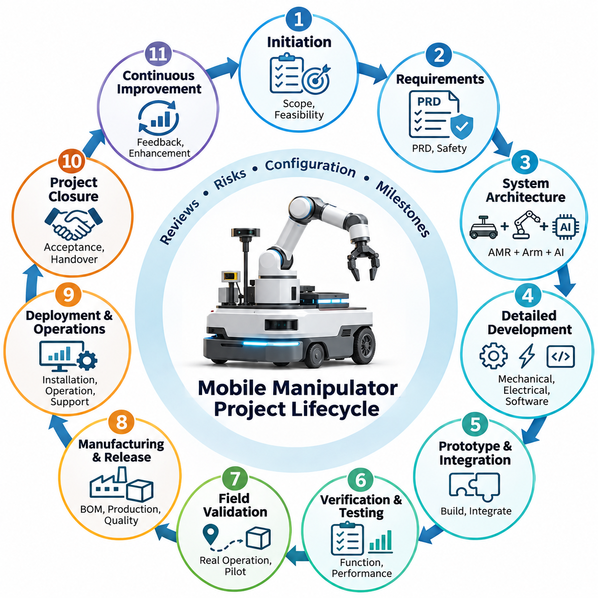
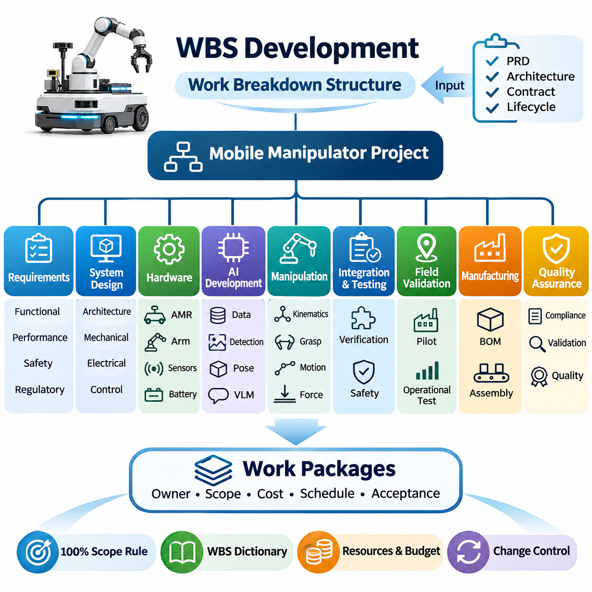
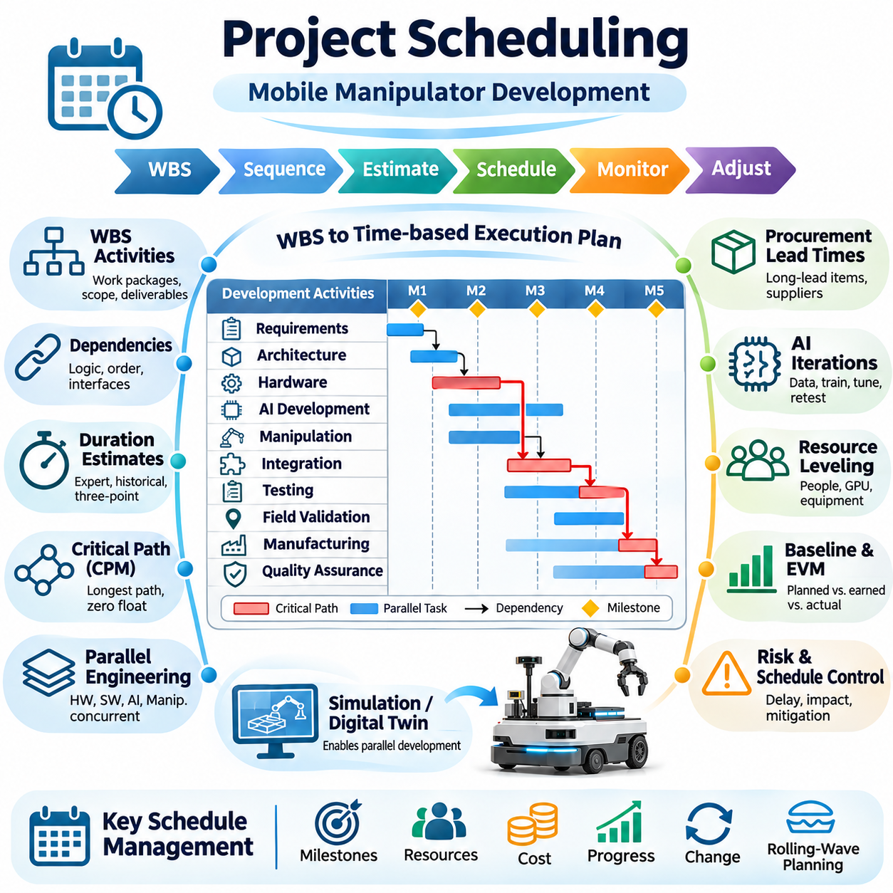
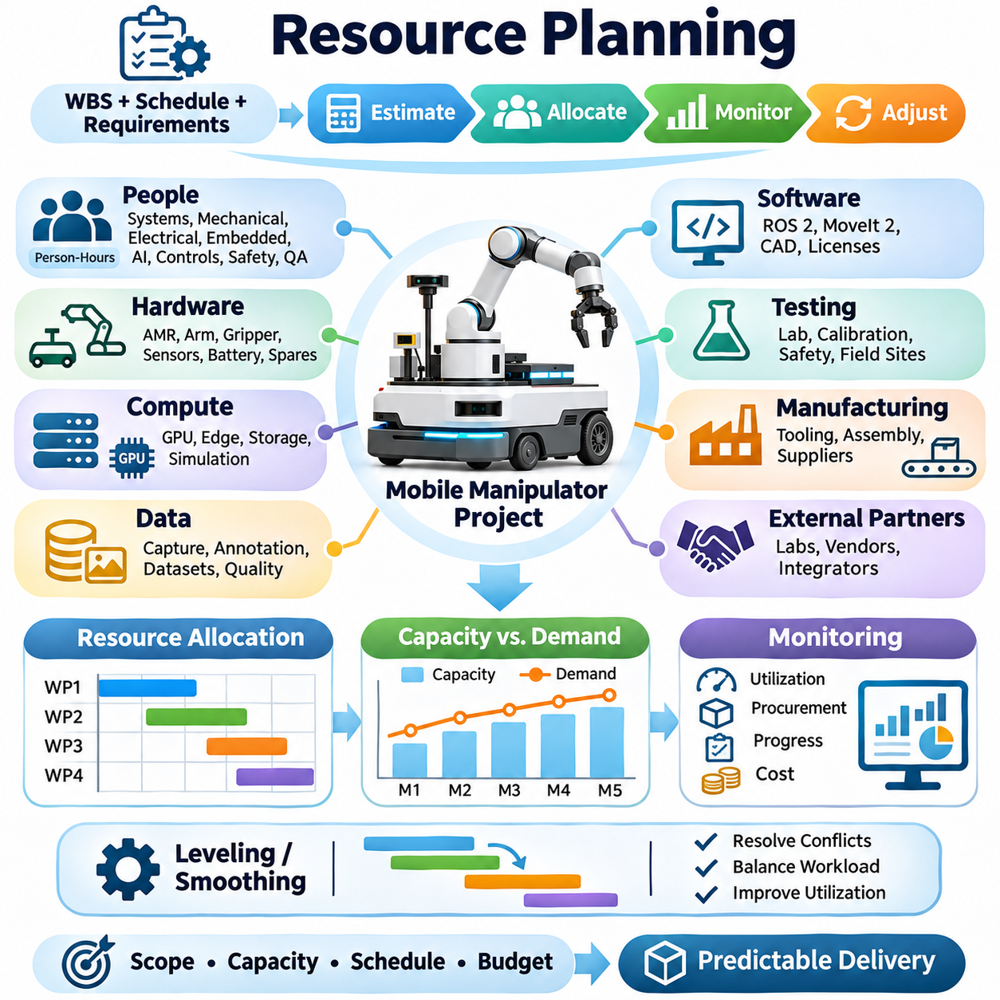
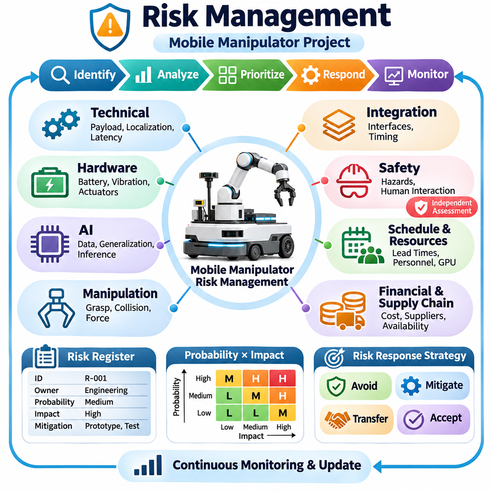
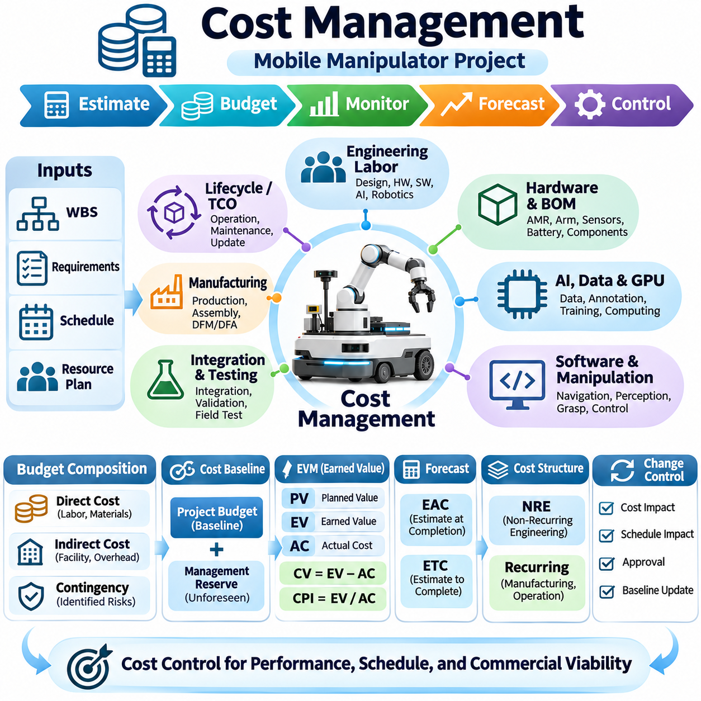
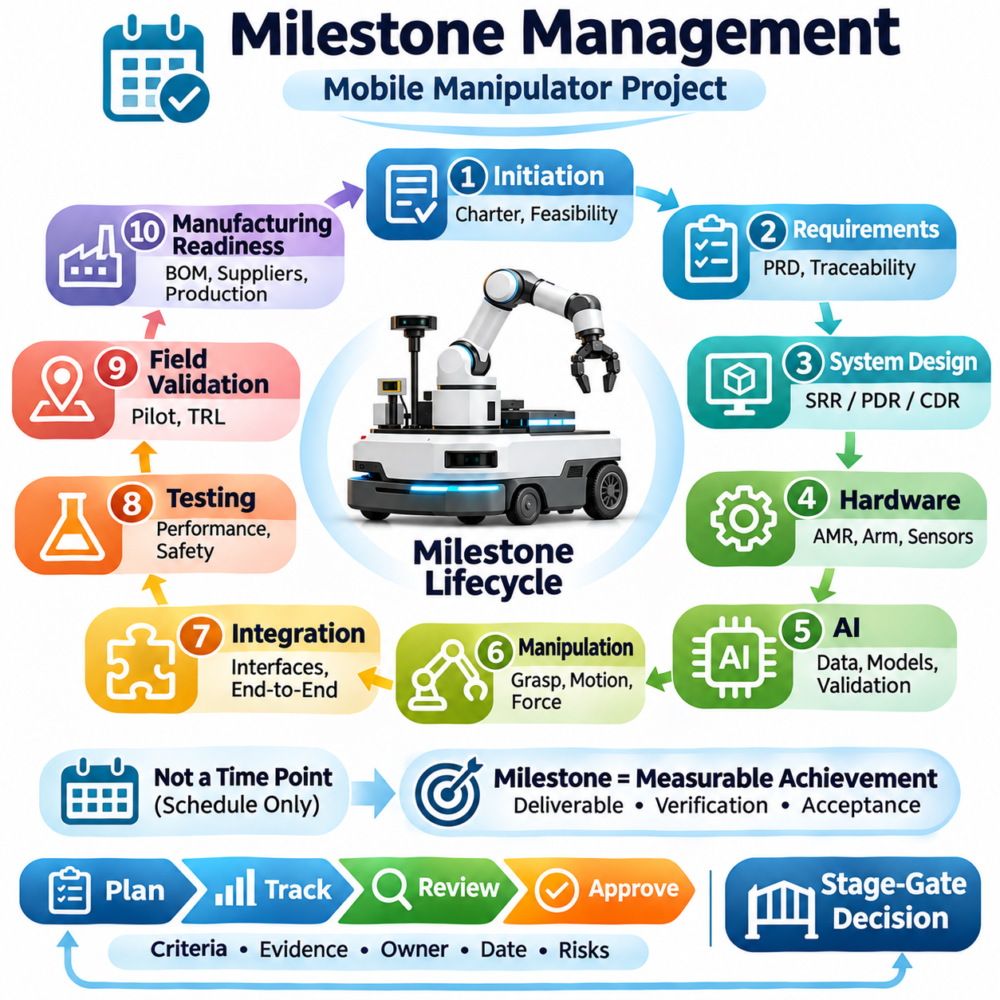
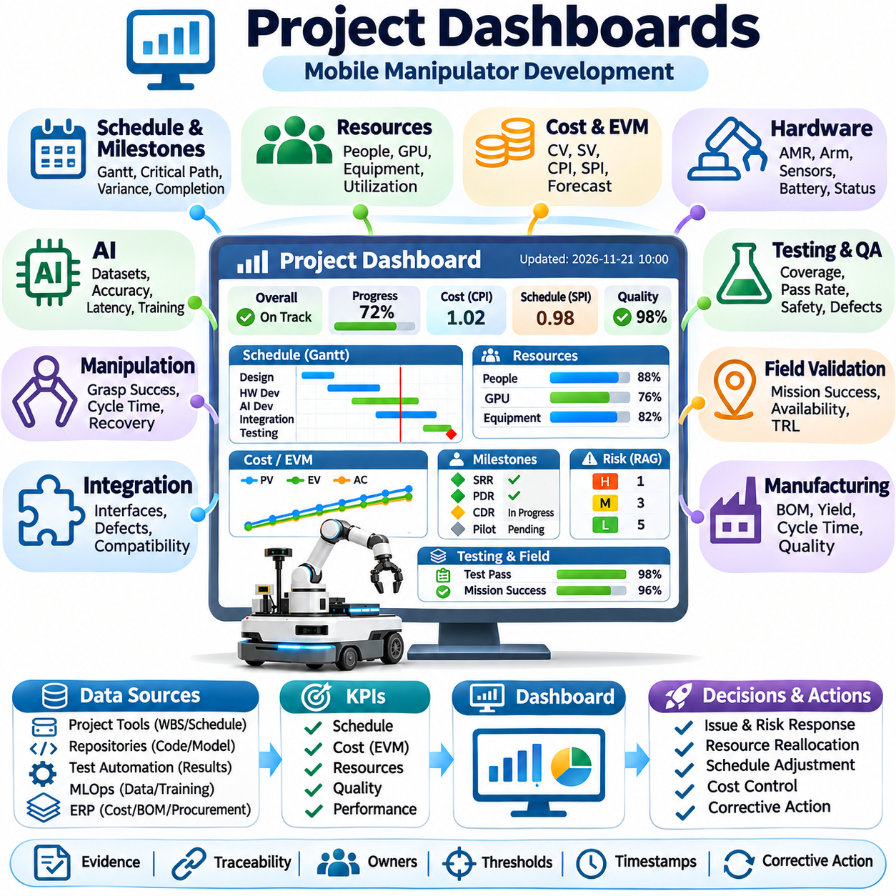
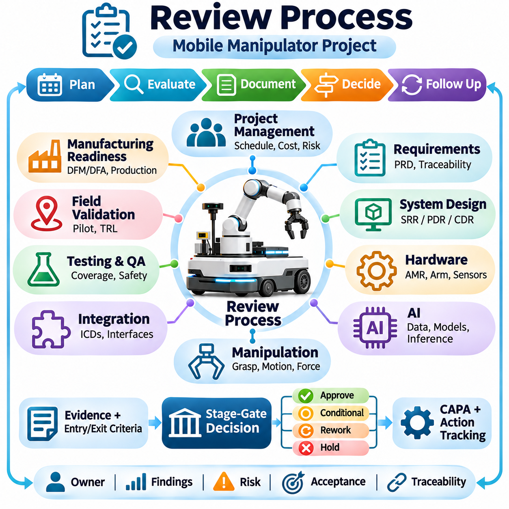
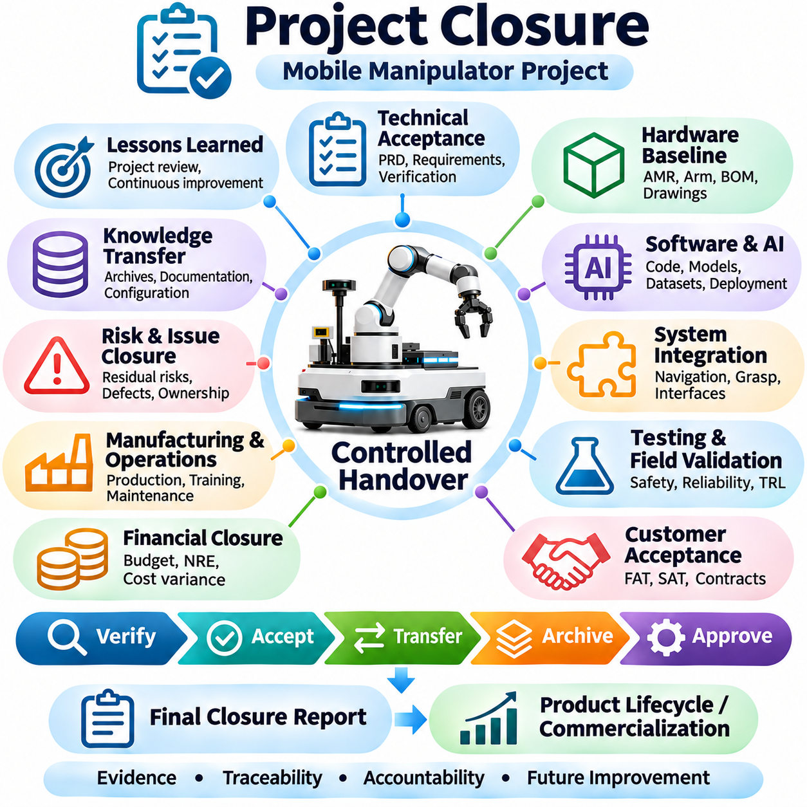

# Chapter 11. Project Management

## 01 Project Lifecycle

{width="7.268055555555556in" height="7.268055555555556in"}

이동형 매니퓰레이터(Mobile Manipulator) 프로젝트는 초기 제품 개념(Product Concept)을 완전히 통합되고 시험을 거쳐 배포 및 유지보수가 가능한 로봇 시스템으로 발전시키는 체계적인 생명주기(Lifecycle)를 따른다. 기존의 로봇 개발과 달리 이동형 매니퓰레이터는 자율이동로봇(Autonomous Mobile Robot, AMR), 로봇 팔(Robotic Arm), 말단장치(End Effector), 인지 센서(Perception Sensor), 인공지능(Artificial Intelligence, AI), 모션 계획(Motion Planning), 플릿 관리 소프트웨어(Fleet Management Software)를 결합한다. 따라서 프로젝트 관리(Project Management)는 시스템 요구사항, 하드웨어 인터페이스, 소프트웨어 아키텍처, 안전성 및 운영 목표 간의 일관성을 유지하면서 다양한 공학 분야를 조율해야 한다.

생명주기는 프로젝트 착수(Project Initiation) 단계에서 시작되며, 사업 목표, 적용 환경, 목표 고객 및 기대 성과를 정의한다. 개발팀은 프로젝트 범위(Project Scope), 초기 예산(Preliminary Budget), 예상 일정, 기술적 실현 가능성(Technical Feasibility) 및 주요 제약조건을 설정한다. 일반적인 고려사항에는 가반하중(Payload Capacity), 자율주행 정확도(Navigation Accuracy), 조작 정밀도(Manipulation Precision), 운영 시간, 환경 조건 및 예상 작업 완료율(Task Completion Rate)이 포함된다. 초기 타당성 평가(Feasibility Assessment)는 제안된 이동형 매니퓰레이션 개념이 가용 기술 및 재정적 자원 범위 내에서 요구 성능을 달성할 수 있는지를 판단한다.

요구사항 정의(Requirements Definition) 단계에서는 고객의 기대사항을 측정 가능한 공학적 사양(Engineering Specification)으로 변환한다. 기능 요구사항(Functional Requirements)은 시스템이 수행해야 하는 기능을 설명하며, 성능 요구사항(Performance Requirements)은 자율주행, 위치 추정(Localization), 객체 검출(Object Detection), 파지(Grasping), 조작(Manipulation) 및 작업 실행(Task Execution)에 대한 정량적 목표를 설정한다. 또한 안전성(Safety), 사이버 보안(Cybersecurity), 유지보수성(Maintainability) 및 규제 요구사항(Regulatory Requirements)을 식별한다. 이러한 요구사항은 제품 요구사항 문서(Product Requirement Document, PRD)의 기반을 형성하며 개발, 시험 및 현장 검증 전반에 걸쳐 추적성(Traceability)을 제공한다.

시스템 개념 및 아키텍처(System Concept and Architecture) 단계에서는 이동형 매니퓰레이터의 전반적인 기술적 구성을 수립한다. 엔지니어는 AMR 플랫폼 유형, 매니퓰레이터 구성, 말단장치 메커니즘, 센서 배치, 컴퓨팅 자원(Computing Resources), 통신 인터페이스 및 제어 아키텍처(Control Architecture)를 결정한다. 특히 이동형 베이스(Mobile Base)와 로봇 팔 사이의 기계적 및 전기적 통합에 주의를 기울여야 한다. 아키텍처는 하중 분포(Load Distribution), 무게중심(Center of Gravity), 진동(Vibration), 전력 소비(Power Consumption), 작업공간 제약(Workspace Limitations) 및 통신 지연(Communication Latency)을 고려해야 한다. 예비 설계 검토(Preliminary Design Review)를 통해 제안된 아키텍처가 정의된 요구사항을 충족할 수 있는지 확인한다.

상세 설계 및 개발(Detailed Design and Development) 단계에서는 승인된 아키텍처를 실제 공학적 구현으로 전환한다. 기계 엔지니어는 섀시(Chassis), 장착 구조물(Mounting Structure), 매니퓰레이터 인터페이스 및 말단장치 메커니즘을 개발한다. 전기 엔지니어는 전력 분배(Power Distribution), 배터리 시스템, 와이어링 하네스(Wiring Harness), 임베디드 제어기(Embedded Controller) 및 센서 인터페이스를 설계한다. 소프트웨어 및 AI 엔지니어는 자율주행, 인지(Perception), 객체 검출, 자세 추정(Pose Estimation), 파지 계획(Grasp Planning) 및 조작 제어(Manipulation Control)를 구현한다. 개발 활동은 병렬적으로 진행될 수 있지만, 인터페이스 사양(Interface Specification)과 형상 관리(Configuration Management)를 통해 독립적으로 개발된 구성요소 간의 호환성을 보장해야 한다.

시제품 제작 및 서브시스템 통합(Prototype Fabrication and Subsystem Integration) 단계에서는 시스템의 최초 물리적 구현체를 구축한다. AMR 플랫폼, 로봇 팔, 센서, 컴퓨팅 하드웨어, 배터리 및 통신 장비를 조립하고 구성한다. 전체 시스템 통합 이전에 개별 서브시스템을 우선 평가한다. 엔지니어는 전기적 연결(Electrical Connection), 기계적 공차(Mechanical Tolerance), 통신 프로토콜(Communication Protocol), 좌표 변환(Coordinate Transformation) 및 안전 메커니즘(Safety Mechanism)을 검증한다. 통합 과정에서는 개별 구성요소의 독립적인 개발 단계에서 발견하기 어려운 문제들이 빈번하게 나타나므로, 기술적 위험(Technical Risk)을 관리하기 위해서는 초기 시제품 평가가 필수적이다.

시스템 검증 및 시험(System Verification and Testing) 단계에서는 통합된 이동형 매니퓰레이터가 공학적 사양을 충족하는지 판단한다. 시험 범위에는 개별 구성요소, 소프트웨어 모듈, 기능적 동작, 시스템 성능, 조작 정확도(Manipulation Accuracy), 자율주행 신뢰성(Navigation Reliability) 및 운영 안전성(Operational Safety)이 포함된다. AI 모델은 대표성 있는 데이터셋(Representative Dataset)과 실제 운영 조건을 활용하여 평가하며, 조작 시험에서는 파지 성공률(Grasp Success Rate), 배치 정확도(Placement Accuracy), 반복 정밀도(Repeatability) 및 복구 동작(Recovery Behavior)을 검토한다. 검증 결과는 사전에 정의된 인수 기준(Acceptance Criteria)과 비교한다. 발견된 실패는 문서화하고 분석한 후 공학적 시정 활동(Corrective Engineering Activities)을 통해 해결한다.

현장 검증(Field Validation)은 실제 운영 조건과 대표적인 고객 업무 흐름(Customer Workflow)에서 시스템을 평가하는 과정이다. 실제 환경에서는 조명 변화, 장애물, 바닥 표면 상태, 객체의 다양성, 통신 중단 및 예측하기 어려운 인간과의 상호작용이 발생하므로 실험실 성능만으로는 운영 준비도(Operational Readiness)를 입증할 수 없다. 시범 배포(Pilot Deployment)를 통해 임무 성공률(Mission Success Rate), 작업 완료 시간(Task Completion Time), 시스템 가용성(System Availability), 위치 추정 정확도(Localization Accuracy) 및 조작 신뢰성(Manipulation Reliability)을 평가하기 위한 운영 데이터를 확보한다. 운영자와 고객으로부터 수집된 피드백(Feedback)은 후속 개발 반복 과정에 반영하여 사용성(Usability), 강건성(Robustness) 및 전반적인 제품 성능을 향상시킨다.

성공적인 검증 이후 프로젝트는 제조 준비 및 제품 출시(Manufacturing Preparation and Product Release) 단계로 진행된다. 공학적 설계는 제조 용이성(Manufacturability), 조립 효율성(Assembly Efficiency), 정비 용이성(Serviceability) 및 생산 비용(Production Cost)의 관점에서 검토된다. 자재 명세서(Bill of Materials, BOM), 공급업체 사양(Supplier Specification), 제조 절차, 검사 기준 및 생산라인 최종 시험(End-of-Line Testing) 프로세스를 수립한다. 생산 준비도 검토(Production Readiness Review)를 통해 제품 구성이 체계적으로 관리되는 제조 공정에 적용할 수 있을 만큼 충분히 성숙했는지 확인한다. 생산된 모든 제품에서 일관된 품질을 보장하기 위해 소프트웨어 버전, AI 모델 구성, 하드웨어 개정 이력(Hardware Revision) 및 교정 절차(Calibration Procedure)의 추적성을 유지해야 한다.

상용 배포(Commercial Deployment)가 프로젝트 생명주기의 종료를 의미하는 것은 아니다. 제품 운영(Product Operation) 단계에서는 운영 모니터링(Operational Monitoring), 예방적 유지보수(Preventive Maintenance), 소프트웨어 업데이트, AI 모델 개선 및 고객 지원(Customer Support)이 필수적인 활동으로 전환된다. 현장 성능 데이터(Field Performance Data)는 반복적으로 발생하는 고장, 구성요소의 성능 저하(Component Degradation), 환경 조건의 변화 및 최적화 기회를 식별하는 데 활용된다. 유지보수 기록(Maintenance Record)과 운영 피드백은 공학적 변경 관리(Engineering Change Management)와 연계되어야 하며, 이를 통해 시스템 안정성과 안전성을 저해하지 않으면서 후속 제품 릴리스(Product Release)에 개선사항을 반영할 수 있다.

프로젝트 종료(Project Closure)는 초기 목표, 기술적 산출물(Technical Deliverables), 일정, 예산 및 인수 기준이 충족되었는지를 공식적으로 평가하는 과정이다. 프로젝트팀은 공학적 문서, 시험 보고서(Test Report), 검증 결과, 제조 기록, 소프트웨어 릴리스 및 미해결 문제 기록(Outstanding Issue Record)을 종합적으로 정리한다. 향후 이동형 매니퓰레이터 개발 프로그램을 개선하기 위해 교훈 및 경험(Lessons Learned)을 기록한다. 해결되지 않은 위험과 장기적인 유지보수 책임은 해당 운영 조직 또는 제품 지원 조직(Product Support Organization)에 이관한다. 체계적인 프로젝트 종료 프로세스는 공학적 지식(Engineering Knowledge)을 보존하고 차세대 제품 개발을 위한 신뢰성 있는 기반을 구축한다.

전체 생명주기에서 프로젝트 관리는 독립적인 공학 활동의 연속이 아니라 지속적인 조율 프로세스(Continuous Coordination Process)로 운영되어야 한다. 요구사항 변경(Requirements Change), 하드웨어 개발 지연, AI 성능 한계, 통합 실패(Integration Failure) 및 공급업체 제약조건은 여러 개발 업무 흐름(Development Workstream)에 동시에 영향을 미칠 수 있다. 정기적인 기술 검토(Technical Review), 마일스톤 평가(Milestone Assessment), 위험 평가(Risk Assessment) 및 형상 관리는 이러한 상호 의존성을 통제하는 데 필요한 가시성(Visibility)을 제공한다. 생명주기의 각 주요 단계 전환(Lifecycle Transition)은 요구되는 기술적 및 관리적 조건이 충족되었음을 입증하는 객관적인 증거(Objective Evidence)를 기반으로 이루어져야 한다.

효과적인 이동형 매니퓰레이터 생명주기는 단계 기반 프로젝트 거버넌스(Stage-based Project Governance)와 반복적 공학 개발(Iterative Engineering Development)을 결합한다. 주요 마일스톤(Milestone)은 관리적 통제체계를 수립하며, 반복적인 시제품 제작(Iterative Prototyping), 시뮬레이션(Simulation), 시험 및 현장 피드백은 새로운 정보가 확보됨에 따라 기술 개발팀이 시스템을 지속적으로 개선할 수 있도록 한다. 이러한 접근 방식은 개발 후기 단계의 통합 위험을 감소시키고, 자원 활용도(Resource Utilization)를 향상시키며, 예측 가능한 프로젝트 수행(Predictable Project Execution)을 지원한다. 궁극적으로 프로젝트 생명주기는 이동형 매니퓰레이션 개념을 안전하고 신뢰성이 높으며 제조 가능하고 상업적으로 지속 가능한 로봇 제품(Robotic Product)으로 전환하기 위한 일관된 프레임워크(Framework)를 제공한다.

## 02 WBS Development

{width="7.268055555555556in" height="7.268055555555556in"}

작업분류체계(Work Breakdown Structure, WBS)는 이동형 매니퓰레이터(Mobile Manipulator) 시스템의 개발, 검증, 제조 및 배포에 필요한 전체 작업 범위를 계층적으로 표현한 구조이다. 복잡한 프로젝트 목표를 관리 가능한 산출물(Deliverables), 서브시스템(Subsystems), 작업 패키지(Work Packages) 및 공학적 활동(Engineering Activities)으로 분해한다. WBS는 프로젝트 생명주기(Project Lifecycle) 전반에 걸쳐 프로젝트 일정 수립(Project Scheduling), 자원 할당(Resource Allocation), 비용 산정(Cost Estimation), 책임 할당(Responsibility Assignment), 진척도 모니터링(Progress Monitoring) 및 기술적 조율(Technical Coordination)을 위한 공통 기반을 제공한다.

WBS 개발은 프로젝트 범위(Project Scope), 고객 요구사항(Customer Requirements), 제품 목표(Product Objectives) 및 예상 산출물(Expected Deliverables)에 대한 포괄적인 이해에서 시작된다. 제품 요구사항 문서(Product Requirement Document, PRD), 시스템 아키텍처(System Architecture), 계약상 의무(Contractual Obligations) 및 프로젝트 생명주기는 작업 구조를 정의하기 위한 주요 입력 요소가 된다. WBS는 요구사항 공학(Requirements Engineering), 하드웨어 개발(Hardware Development), AI 개발(AI Development), 조작 개발(Manipulation Development), 시험(Testing) 및 상용화(Commercialization)를 포함하는 전체 개발 범위를 포괄해야 한다.

WBS의 최상위 계층은 전체 이동형 매니퓰레이터 개발 프로젝트를 나타낸다. 하위 계층에서는 프로젝트를 요구사항 정의(Requirements Definition), 시스템 설계(System Design), 하드웨어 개발, 인공지능 개발(Artificial Intelligence Development), 조작 개발, 시스템 시험(System Testing), 현장 검증(Field Validation), 제조(Manufacturing) 및 품질 보증(Quality Assurance)과 같은 주요 공학적 영역과 생명주기 단계(Lifecycle Phases)로 구분한다. 이러한 계층적 구성(Hierarchical Organization)은 전체 프로젝트 목표와 개별 공학적 산출물 사이의 명확한 관계를 수립한다.

하드웨어 개발은 자율이동로봇(Autonomous Mobile Robot, AMR) 베이스 개발, 매니퓰레이터 선정(Manipulator Selection), 기계 설계(Mechanical Design), 말단장치 개발(End-Effector Development), 배터리 시스템 설계(Battery System Design), 센서 통합(Sensor Integration), 전기 아키텍처(Electrical Architecture), 와이어링 하네스 개발(Wiring Harness Development) 및 임베디드 시스템 개발(Embedded System Development)로 분해할 수 있다. 각 공학적 영역은 다시 설계(Design), 조달(Procurement), 제작(Fabrication), 조립(Assembly), 통합(Integration) 및 검증(Verification) 작업 패키지로 세분화된다. 이러한 분해 구조는 기술적 의존성(Technical Dependencies), 조달 제약조건(Procurement Constraints) 및 하드웨어 통합 요구사항을 식별하는 데 도움을 준다.

인공지능 개발에는 데이터 수집(Data Collection), 데이터 라벨링(Data Labeling), 데이터셋 준비(Dataset Preparation), 모델 선정(Model Selection), 학습(Training), 성능 평가(Performance Evaluation), 최적화(Optimization) 및 배포(Deployment)를 포함하는 독립적인 WBS 구조가 필요하다. 추가적인 작업 패키지에는 객체 검출(Object Detection), 자세 추정(Pose Estimation), 파지 검출(Grasp Detection), 비전-언어 모델(Vision-Language Model, VLM), 로봇 에이전트(Robot Agent) 및 체화형 인공지능(Embodied AI)이 포함될 수 있다. 반복적 개발 활동(Iterative Development Activities)은 실험적 진척이 시스템 수준의 요구사항(System-Level Requirements) 충족에 직접적으로 기여하도록 측정 가능한 산출물(Measurable Deliverables)을 포함해야 한다.

조작 개발(Manipulation Development)은 기구학(Kinematics), 동역학 모델링(Dynamics Modeling), 파지 계획(Grasp Planning), 모션 계획(Motion Planning), 힘 제어(Force Control), 집기 및 배치 작업(Pick-and-Place Operations), 빈 피킹(Bin Picking) 및 작업 실행(Task Execution)을 포괄한다. 개별 작업 패키지는 개발 대상 알고리즘(Algorithms), 시뮬레이션 환경(Simulation Environment), 소프트웨어 인터페이스(Software Interface), 물리적 실험(Physical Experiments) 및 성능 평가 기준(Performance Evaluation Criteria)을 정의해야 한다. 통합 실패(Integration Failure)와 불필요한 개발 지연을 방지하기 위해 인지(Perception), 좌표 변환(Coordinate Transformation), 로봇 팔 제어(Robotic Arm Control) 및 말단장치 동작(End-Effector Operation) 사이의 의존성을 식별해야 한다.

작업 패키지(Work Package)는 프로젝트 범위, 비용, 수행 기간(Duration), 책임 및 산출물을 효과적으로 관리할 수 있는 최하위 분해 수준(Lowest Level of Decomposition)을 나타낸다. 각 작업 패키지는 고유 식별자(Unique Identifier), 명확하게 정의된 작업 범위, 지정된 책임자(Assigned Owner), 예상 자원 요구사항(Estimated Resource Requirements), 완료 기준(Completion Criteria) 및 관련 의존성을 포함해야 한다. 과도한 세분화(Excessive Decomposition)는 관리 오버헤드(Administrative Overhead)를 증가시키는 반면, 불충분한 세분화(Insufficient Decomposition)는 기술적 진척도와 프로젝트 성과(Project Performance)에 대한 가시성(Visibility)을 감소시킨다.

WBS는 모든 하위 구성요소의 작업 범위를 합한 결과가 불필요한 중복 없이 상위 구성요소의 전체 작업 범위를 나타내도록 하는 100% 규칙(100 Percent Rule)을 준수해야 한다. 프로젝트 관리(Project Management), 문서화(Documentation), 안전 공학(Safety Engineering), 규제 준수(Regulatory Compliance), 사이버 보안(Cybersecurity), 형상 관리(Configuration Management) 및 품질 보증도 포함해야 한다. 이러한 지원 활동(Supporting Activities)은 개발 일정, 공학적 비용(Engineering Cost) 및 제품 준비도(Product Readiness)에 상당한 영향을 미치지만, 실제 프로젝트에서는 그 중요성과 필요한 자원이 과소평가되는 경우가 많다.

WBS 사전(WBS Dictionary)은 개별 작업 패키지에 대한 상세한 설명을 제공함으로써 계층적 구조를 보완한다. 여기에는 산출물, 기술 사양(Technical Specifications), 인수 기준(Acceptance Criteria), 가정사항(Assumptions), 제약조건(Constraints), 책임 조직(Responsible Organizations), 필요 자원(Required Resources) 및 관련 공학적 문서(Engineering Documents)가 기록된다. 다학제적 이동형 매니퓰레이터 프로젝트(Multidisciplinary Mobile Manipulator Project)에서 WBS 사전은 공학 개발팀, 외부 공급업체(External Suppliers), 연구기관(Research Institutions), 제조 협력업체(Manufacturing Partners) 및 고객 조직(Customer Organizations) 사이의 모호성(Ambiguity)을 감소시킨다.

완성된 WBS는 프로젝트 일정 수립(Project Scheduling)과 자원 계획(Resource Planning)의 기반으로 활용된다. 작업 패키지는 예상 수행 기간(Estimated Duration), 선행 작업 관계(Predecessor Relationships), 후속 작업 관계(Successor Relationships) 및 마일스톤 목표(Milestone Targets)를 포함하는 일정 관리 활동으로 변환된다. 주공정법(Critical Path Method, CPM) 분석은 프로젝트 완료일에 직접적인 영향을 미치는 활동을 식별하는 데 도움을 준다. 자원 할당은 엔지니어의 가용성(Engineering Availability), GPU 컴퓨팅 인프라(GPU Computing Infrastructure), 시제품 장비(Prototype Equipment), 시험 시설(Testing Facilities) 및 공급업체 조달 소요 기간(Supplier Lead Times)을 고려해야 한다.

비용 관리(Cost Management)는 개별 작업 패키지가 인건비(Labor Cost), 재료비(Material Cost), 장비비(Equipment Cost), 소프트웨어 라이선스(Software License), 외주 비용(Subcontracting Cost) 및 검증 비용(Validation Expenses)을 산정하기 위한 기반을 제공한다는 점에서 WBS 개발과 밀접하게 연계된다. 산정된 비용은 WBS 계층 구조를 통해 집계되어 전체 프로젝트 예산(Project Budget)과 비용 기준선(Cost Baseline)을 수립한다. 이후 획득가치관리(Earned Value Management, EVM)를 활용하여 계획가치(Planned Value, PV), 획득가치(Earned Value, EV) 및 실제비용(Actual Cost, AC)을 비교함으로써 프로젝트 성과를 평가하고 발생하는 일정 또는 예산 편차(Schedule or Budget Deviations)를 식별할 수 있다.

WBS 개발에는 시스템 통합(System Integration), 검증(Verification), 현장 검증(Field Validation) 및 제조 준비도(Manufacturing Readiness)도 포함되어야 한다. 통합 작업 패키지는 기계적 호환성(Mechanical Compatibility), 전기적 연결(Electrical Connections), 통신 인터페이스(Communication Interfaces), 센서 교정(Sensor Calibration) 및 시스템의 협조 동작(Coordinated System Behavior)을 다룬다. 검증 및 타당성 확인(Verification and Validation, V&V) 작업 패키지는 요구사항 충족 여부에 대한 객관적인 증거(Objective Evidence)를 확보하며, 제조 작업 패키지는 공급업체 적격성 평가(Supplier Qualification), 생산 공정(Production Processes), 조립 절차(Assembly Procedures), 품질 관리(Quality Control) 및 생산 준비도(Production Readiness)를 다룬다.

WBS는 전체 프로젝트 생명주기에 걸쳐 공식적인 형상 관리(Configuration Management) 및 변경 관리(Change Management)의 적용을 받아야 한다. 고객 요구사항, 하드웨어 사양(Hardware Specifications), AI 성능 목표(AI Performance Targets) 또는 운영 환경(Operational Environment)의 변화는 기존 작업 패키지의 수정을 요구할 수 있다. 제안된 각각의 변경사항은 프로젝트 범위, 일정, 비용, 자원, 기술적 의존성 및 관련 위험(Associated Risks)에 미치는 영향을 평가해야 한다. 승인된 변경사항(Approved Changes)은 프로젝트 일정, 예산, 책임 할당 및 기술 문서(Technical Documentation) 전반에 걸쳐 일관되게 반영되어야 한다.

궁극적으로 효과적인 WBS는 이동형 매니퓰레이터 개발의 복잡성을 투명하고 통제 가능한 프로젝트 수행 프레임워크(Project Execution Framework)로 전환한다. 전략적 제품 목표(Strategic Product Objectives)를 측정 가능한 공학적 산출물과 연결하는 동시에 다학제적 개발팀(Multidisciplinary Development Teams) 전반에 걸쳐 명확한 책임성(Accountability)을 확립한다. 요구사항, 작업 패키지, 자원, 마일스톤 및 검증 결과(Verification Results) 사이의 일관된 관계를 유지함으로써 WBS는 예측 가능한 개발(Predictable Development), 효과적인 위험 관리(Effective Risk Management) 및 성공적인 상용화(Successful Commercialization)를 지원한다.

## 03 Project Scheduling

{width="7.268055555555556in" height="7.268055555555556in"}

프로젝트 일정 관리(Project Scheduling)는 이동형 매니퓰레이터(Mobile Manipulator) 프로젝트의 전체 생명주기(Lifecycle)에 걸쳐 개발 활동을 구성하고, 수행 순서를 결정하며, 이를 통제하기 위한 체계적인 프로세스이다. 작업분류체계(Work Breakdown Structure, WBS)를 시간 기반 실행 계획(Time-Based Execution Plan)으로 변환하여 공학적 활동의 시작 시점, 필요한 수행 기간 및 특정 산출물(Deliverables)의 완료 시점을 정의한다. 효과적인 프로젝트 일정은 기술적 의존성(Technical Dependencies), 자원 가용성(Resource Availability), 조달(Procurement), 통합(Integration) 및 검증(Validation)을 종합적으로 조율한다.

일정 수립 프로세스(Scheduling Process)는 WBS의 각 작업 패키지(Work Package)와 관련된 활동을 식별하는 것에서 시작된다. 이러한 활동은 요구사항 정의(Requirements Definition), 시스템 아키텍처(System Architecture), 하드웨어 개발(Hardware Development), 인공지능 개발(Artificial Intelligence Development), 조작 개발(Manipulation Development), 시스템 시험(System Testing), 현장 검증(Field Validation), 제조(Manufacturing) 및 품질 보증(Quality Assurance)을 포괄해야 한다. 각 활동에는 명확하게 정의된 작업 범위(Scope), 예상 수행 기간(Estimated Duration), 책임 조직(Responsible Organization), 예상 산출물(Expected Deliverables) 및 측정 가능한 완료 기준(Measurable Completion Criteria)이 포함되어야 한다.

활동 순서 결정(Activity Sequencing)은 개발 작업 사이의 논리적 관계(Logical Relationships)를 수립하는 과정이다. 예를 들어 상세 기계 설계(Mechanical Design)와 전기 설계(Electrical Design)가 확정되기 전에 시스템 아키텍처가 충분한 성숙도(Maturity)에 도달해야 한다. 센서 선정(Sensor Selection)은 인지 소프트웨어 개발(Perception Software Development)에 영향을 미치며, 매니퓰레이터 사양(Manipulator Specifications)은 기구학(Kinematics), 모션 계획(Motion Planning) 및 말단장치 설계(End-Effector Design)에 영향을 미친다. 이러한 의존성을 식별함으로써 상호 호환되지 않는 공학적 의사결정, 불필요한 재작업(Rework) 및 후속 일정 차질(Downstream Schedule Disruption)을 방지할 수 있다.

수행 기간 산정(Duration Estimation)은 현실적인 자원 및 기술적 제약조건에서 개별 개발 활동을 완료하는 데 필요한 시간을 결정하는 과정이다. 산정 방법(Estimation Methods)에는 전문가 판단(Expert Judgment), 과거 프로젝트 데이터(Historical Project Data), 유사 산정(Analogous Estimation), 모수 산정(Parametric Estimation) 및 삼점 산정(Three-Point Estimation)이 포함된다. 하드웨어 조달(Hardware Procurement), 시제품 제작(Prototype Fabrication), AI 모델 학습(AI Model Training), 소프트웨어 디버깅(Software Debugging) 및 규제 시험(Regulatory Testing)은 불확실성(Uncertainty)을 발생시키는 경우가 많으므로, 이를 각 활동의 수행 기간과 일정 예비시간(Schedule Contingency)에 반영해야 한다.

주공정법(Critical Path Method, CPM)은 프로젝트의 가장 빠른 완료 가능 시점을 결정하는 상호 의존적 활동의 최장 경로를 식별하는 방법이다. 별도의 완료 기한 제약조건 없이 일정이 산정되는 경우, 주공정 경로(Critical Path)에 포함된 활동은 일반적으로 총여유시간(Total Float)이 0이다. 이동형 매니퓰레이터 개발에서 주요 주공정 활동에는 장기 납기 부품 조달(Long-Lead Component Procurement), 시제품 조립(Prototype Assembly), 시스템 통합(System Integration), 안전성 검증(Safety Validation) 및 고객 인수 시험(Customer Acceptance Testing)이 포함될 수 있다.

병렬 개발(Parallel Development)은 기계, 전기, 소프트웨어, AI 및 조작 공학 개발팀이 서로 양립할 수 있는 활동을 동시에 수행할 수 있도록 한다. 디지털 트윈(Digital Twin), 시뮬레이션 환경(Simulation Environment), 인터페이스 사양(Interface Specifications) 및 가상 시제품(Virtual Prototype)을 활용하면 실제 물리적 하드웨어가 준비되기 전에 소프트웨어 개발을 시작할 수 있다. 그러나 동시 공학(Concurrent Engineering)은 상호 호환되지 않는 구현으로 인해 발생하는 통합 지연(Integration Delay)을 방지하기 위해 안정적인 인터페이스 정의(Interface Definition), 형상 관리(Configuration Management) 및 정기적인 기술적 조율(Technical Coordination)을 필요로 한다.

하드웨어 개발 일정(Hardware Development Schedule)은 부품 선정(Component Selection), 공급업체 적격성 평가(Supplier Qualification), 조달 소요 기간(Procurement Lead Time), 기계 제작(Mechanical Fabrication), 전기 조립(Electrical Assembly) 및 시제품 검증(Prototype Verification)을 고려해야 한다. 로봇 팔(Robotic Arm), 서보 드라이브(Servo Drive), 산업용 센서(Industrial Sensor), 임베디드 컴퓨팅 플랫폼(Embedded Computing Platform) 및 배터리 시스템(Battery System)과 같은 특수 부품은 장기간의 납기를 요구할 수 있다. 장기 납기 품목(Long-Lead Items)과 대체 공급업체(Alternative Suppliers)를 조기에 식별하면 조달 지연이 주요 통합 마일스톤(Integration Milestones)에 영향을 미칠 가능성을 줄일 수 있다.

AI 개발 일정(AI Development Schedule)은 실험 이전에 모델 성능(Model Performance)을 항상 정확하게 예측할 수 없다는 점에서 기존의 하드웨어 개발 일정과 차이가 있다. 데이터 수집(Data Collection), 데이터 주석 처리(Data Annotation), 모델 학습(Model Training), 하이퍼파라미터 최적화(Hyperparameter Optimization) 및 배포 시험(Deployment Testing)은 여러 차례의 반복 과정(Iterations)을 요구하는 경우가 많다. 일정 수립 과정에서는 측정 가능한 성능 목표(Performance Targets)와 의사결정 시점(Decision Points)을 설정하는 동시에 실험 주기(Experimental Cycles), 데이터셋 개선(Dataset Improvement), GPU 자원 가용성(GPU Resource Availability) 및 모델 회귀 시험(Model Regression Testing)에 필요한 시간을 할당해야 한다.

시스템 통합 일정 관리(System Integration Scheduling)는 기계 조립체(Mechanical Assemblies), 전기 시스템(Electrical Systems), 임베디드 제어기(Embedded Controllers), 인지 모듈(Perception Modules), 조작 알고리즘(Manipulation Algorithms) 및 플릿 관리 소프트웨어(Fleet Management Software)의 가용성을 조율한다. 통합 활동을 시작하기 전에 서브시스템 준비도(Subsystem Readiness)를 평가해야 한다. 점진적 통합(Incremental Integration)은 엔지니어가 개별 인터페이스와 협조 동작(Coordinated Behavior)을 단계적으로 검증할 수 있도록 하며, 시스템 검증 직전에 주요 아키텍처 문제가 발견될 가능성을 감소시킨다.

시험 및 현장 검증(Testing and Field Validation)은 개발 이후 남은 시간에 수행하는 부수적인 활동으로 취급해서는 안 되며, 독립적인 일정 할당(Schedule Allocation)이 필요하다. 기능 시험(Functional Testing), 성능 시험(Performance Testing), AI 검증(AI Validation), 조작 시험(Manipulation Testing), 안전성 평가(Safety Assessment), 신뢰성 시험(Reliability Testing) 및 시범 배포(Pilot Deployment)는 결함 수정(Defect Correction)과 회귀 시험(Regression Testing)에 충분한 시간을 확보할 수 있도록 계획되어야 한다. 현장 검증은 고객 현장의 가용성(Customer Site Availability), 운영 조건(Operational Conditions), 설치 준비도(Installation Readiness) 및 대표적인 업무 흐름(Representative Workflows)에 대한 접근 가능성에도 의존한다.

자원 제약 기반 일정 관리(Resource-Constrained Scheduling)는 공학 인력(Engineering Personnel), 컴퓨팅 인프라(Computing Infrastructure), 시제품 장비(Prototype Equipment), 실험실 시설(Laboratory Facilities) 및 제조 역량(Manufacturing Capacity)의 한계를 고려한다. 이론적으로 병렬 수행이 가능한 활동이라도 동일한 전문 인력이나 시험 장비를 필요로 할 수 있다. 자원 평준화(Resource Leveling)는 자원 할당 충돌(Resource Allocation Conflicts)을 해결하기 위해 활동의 수행 시점을 조정하는 방법이며, 자원 평활화(Resource Smoothing)는 계획된 프로젝트 완료일을 연장하지 않으면서 자원 활용도(Resource Utilization)를 향상시키는 방법이다.

승인된 프로젝트 일정은 실제 개발 진척도(Actual Development Progress)를 측정하기 위한 일정 기준선(Schedule Baseline)을 수립한다. 프로젝트 관리자(Project Manager)는 계획 및 실제 시작일(Planned and Actual Start Dates), 완료일(Completion Dates), 잔여 수행 기간(Remaining Duration), 마일스톤 달성도(Milestone Achievement) 및 일정 편차(Schedule Variance)를 모니터링한다. 간트 차트(Gantt Chart), 의존성 네트워크(Dependency Network), 프로젝트 대시보드(Project Dashboard) 및 획득가치관리(Earned Value Management, EVM)는 일정 지연을 식별하고 그 영향을 평가하며 프로젝트 이해관계자(Stakeholders)에게 프로젝트 상태(Project Status)를 전달하기 위한 상호 보완적인 관리 수단을 제공한다.

일정 통제(Schedule Control)는 기술적 위험(Technical Risks), 공학적 변경(Engineering Changes), 공급업체 지연(Supplier Delays) 및 예상하지 못한 통합 문제(Integration Problems)에 대한 지속적인 평가를 요구한다. 일정 편차가 발생하면 프로젝트 관리자는 활동 순서 재조정(Activity Resequencing), 자원 재할당(Resource Reallocation), 병행 수행(Fast Tracking) 또는 일정 단축(Schedule Compression)을 고려할 수 있다. 일정 복구 전략(Schedule Recovery Strategy)은 추가 비용(Additional Cost), 기술적 의존성, 품질 요구사항(Quality Requirements) 및 안전 의무사항(Safety Obligations)을 기준으로 평가되어야 한다. 승인된 변경사항은 문서화하여 통제된 프로젝트 일정(Controlled Schedule)에 반영해야 한다.

궁극적으로 효과적인 프로젝트 일정 관리는 마일스톤 기반 거버넌스(Milestone-Based Governance)와 반복적 공학 수행(Iterative Engineering Execution)을 결합한다. 순차적 상세 계획(Rolling-Wave Planning)은 단기 활동을 상세하게 정의하는 동시에 향후 활동은 새롭게 확보되는 기술적 정보에 유연하게 대응할 수 있도록 하는 계획 수립 방식이다. 요구사항, 작업 패키지, 의존성, 자원 및 검증 마일스톤(Verification Milestones) 사이의 정합성(Alignment)을 유지함으로써 프로젝트 일정 관리는 예측 가능한 개발(Predictable Development), 통제된 기술적 위험(Controlled Technical Risks), 제조 준비도(Manufacturing Readiness) 및 성공적인 이동형 매니퓰레이터 상용화(Successful Mobile Manipulator Commercialization)를 지원한다.

## 04 Resource Planning

{width="7.268055555555556in" height="7.268055555555556in"}

자원 계획(Resource Planning)은 이동형 매니퓰레이터(Mobile Manipulator) 개발 프로젝트의 전체 생명주기(Lifecycle)에 걸쳐 필요한 자원을 식별하고, 산정하며, 할당하고 관리하기 위한 체계적인 프로세스이다. 공학 인력(Engineering Personnel), 하드웨어 구성요소(Hardware Components), 컴퓨팅 인프라(Computing Infrastructure), 개발 도구(Development Tools), 시험 시설(Testing Facilities), 제조 장비(Manufacturing Equipment) 및 재정적 자원(Financial Resources)을 적절한 시점에 확보함으로써 계획된 활동을 지원하고 프로젝트 목표(Project Objectives)를 달성할 수 있도록 한다.

자원 계획 프로세스(Resource Planning Process)는 작업분류체계(Work Breakdown Structure, WBS), 프로젝트 일정(Project Schedule), 시스템 요구사항(System Requirements) 및 예상 공학적 산출물(Expected Engineering Deliverables)에 대한 분석에서 시작된다. 각 작업 패키지(Work Package)는 필요한 전문 역량(Competencies), 노동 투입량(Labor Effort), 장비(Equipment), 자재(Materials) 및 지원 인프라(Supporting Infrastructure)를 결정하기 위해 평가되어야 한다. 자원 요구사항(Resource Requirements)은 자원 소비(Resource Consumption)와 프로젝트 진척도(Project Progress) 사이의 추적 가능한 관계를 수립할 수 있도록 구체적인 개발 활동에 할당되어야 한다.

인적자원 계획(Human Resource Planning)은 이동형 매니퓰레이터 개발에 다학제적 공학 전문성(Multidisciplinary Engineering Expertise)이 요구되므로 특히 중요하다. 일반적인 프로젝트팀은 시스템 아키텍트(System Architect), 기계 엔지니어(Mechanical Engineer), 전기 엔지니어(Electrical Engineer), 임베디드 소프트웨어 엔지니어(Embedded Software Engineer), AI 전문가(AI Specialist), 로봇공학 엔지니어(Robotics Engineer), 제어 엔지니어(Control Engineer), 안전 엔지니어(Safety Engineer) 및 품질 보증 인력(Quality Assurance Personnel)으로 구성된다. 프로젝트 관리자는 핵심 개발 활동에 배정된 인력의 가용성(Availability)과 기술적 숙련도(Technical Proficiency)를 모두 평가해야 한다.

공학 인력 소요량(Engineering Labor Requirements)은 일반적으로 개별 작업 패키지의 복잡도(Complexity)를 기준으로 인시(Person-Hour) 또는 인월(Person-Month) 단위를 활용하여 산정한다. 과거 프로젝트 데이터(Historical Project Data), 기술적 경험(Technical Experience), 개발 생산성(Development Productivity) 및 예상되는 통합 난이도(Integration Difficulty)는 공학적 투입 공수(Engineering Effort)를 산정하기 위한 기반을 제공한다. 자원 산정(Resource Estimation)은 실제 구현 활동에만 집중하는 것이 아니라 기술 회의(Technical Meeting), 문서화(Documentation), 설계 검토(Design Review), 결함 수정(Defect Correction), 교육(Training) 및 관리 활동(Administrative Activities)도 고려해야 한다.

하드웨어 자원 계획(Hardware Resource Planning)은 자율이동로봇(Autonomous Mobile Robot, AMR) 플랫폼, 로봇 팔(Robotic Arm), 말단장치(End Effector), 센서(Sensor), 임베디드 컴퓨팅 장치(Embedded Computing Device), 모터 제어기(Motor Controller), 배터리 시스템(Battery System) 및 통신 장비(Communication Equipment)의 조달(Procurement)과 할당(Allocation)을 포괄한다. 시제품 수량(Prototype Quantity)은 병렬 개발(Parallel Development), 서브시스템 검증(Subsystem Verification), 시스템 통합(System Integration), 신뢰성 시험(Reliability Testing) 및 예상하지 못한 부품 고장(Component Failure)을 고려하여 결정해야 한다. 조달 소요 기간(Procurement Lead Time)이 긴 핵심 하드웨어에 대해서는 예비 부품(Spare Components)과 대체 공급업체(Alternative Suppliers)를 고려해야 한다.

컴퓨팅 자원 계획(Computing Resource Planning)은 인공지능 개발(Artificial Intelligence Development), 시뮬레이션(Simulation), 소프트웨어 컴파일(Software Compilation), 디지털 트윈 환경(Digital Twin Environment) 및 로봇 시스템 검증(Robotic System Validation)을 지원한다. AI 모델 개발에는 GPU 서버(GPU Server), 고성능 워크스테이션(High-Performance Workstation), 분산 학습 환경(Distributed Training Environment) 및 대용량 데이터 저장장치(Large-Capacity Data Storage)가 필요할 수 있다. 또한 추론 최적화(Inference Optimization), 실시간 성능 평가(Real-Time Performance Evaluation), 열 시험(Thermal Testing) 및 하드웨어별 배포 검증(Hardware-Specific Deployment Validation)을 수행하기 위해 엣지 컴퓨팅 플랫폼(Edge Computing Platform)을 확보해야 한다.

데이터 자원(Data Resources)은 이동형 매니퓰레이터 개발의 또 다른 중요한 구성요소이다. 객체 검출(Object Detection), 자세 추정(Pose Estimation), 파지 검출(Grasp Detection), 비전-언어 모델(Vision-Language Model, VLM) 및 체화형 인공지능(Embodied AI)은 대표성 있는 학습 및 검증 데이터셋(Training and Validation Datasets)을 필요로 한다. 따라서 자원 계획에는 데이터 획득 장비(Data Acquisition Equipment), 데이터 주석 처리 인력(Annotation Personnel), 합성 데이터 생성 도구(Synthetic Data Generation Tools), 저장 인프라(Storage Infrastructure), 데이터셋 관리 시스템(Dataset Management System) 및 데이터 품질(Data Quality)과 버전 추적성(Version Traceability)을 유지하기 위한 메커니즘이 포함되어야 한다.

소프트웨어 자원 계획(Software Resource Planning)은 개발 프레임워크(Development Framework), 시뮬레이션 플랫폼(Simulation Platform), 미들웨어(Middleware), 공학용 애플리케이션(Engineering Application), 소프트웨어 라이선스(Software License) 및 협업 개발 환경(Collaborative Development Environment)을 포괄한다. 로봇공학 프로젝트(Robotics Project)는 ROS 2, MoveIt 2, 컴퓨터 지원 설계 도구(Computer-Aided Design Tools, CAD), 물리 시뮬레이터(Physics Simulator) 및 기계학습 프레임워크(Machine Learning Framework) 등에 의존할 수 있다. 이러한 자원을 공학 개발팀에 할당할 때는 호환성(Compatibility), 라이선스 제약조건(Licensing Constraints), 유지보수 비용(Maintenance Cost), 소프트웨어 버전 관리(Software Version Management) 및 접근 권한(Access Permissions)을 고려해야 한다.

시험 및 검증 자원(Testing and Validation Resources)은 일반적인 개발 자원(Development Resources)과 독립적으로 계획되어야 한다. 객관적인 성능 평가(Objective Performance Evaluation)를 위해서는 전용 실험실(Dedicated Laboratory), 대표 시험 객체(Representative Objects), 교정 장비(Calibration Equipment), 모션 추적 시스템(Motion Tracking System), 힘 측정 장치(Force Measurement Device), 안전성 시험 장비(Safety Testing Equipment) 및 환경 시험 시설(Environmental Test Facility)이 필요하다. 현장 검증(Field Validation)을 위해서는 추가적으로 고객 현장(Customer Site), 운영 인프라(Operational Infrastructure), 설치 인력(Installation Personnel), 대표적인 업무 흐름(Representative Workflow) 및 자격을 갖춘 안전 감독자(Qualified Safety Supervisor)에 대한 접근성이 확보되어야 한다.

제조 자원 계획(Manufacturing Resource Planning)은 프로젝트가 시제품 개발(Prototype Development)에서 상용화(Commercialization) 단계로 발전함에 따라 더욱 중요해진다. 필요한 자원에는 조립 시설(Assembly Facility), 생산용 공구 및 치공구(Production Tooling), 시험 치구(Test Fixture), 검사 장비(Inspection Instrument), 제조 인력(Manufacturing Personnel), 공급업체 생산 역량(Supplier Capacity) 및 물류 인프라(Logistics Infrastructure)가 포함된다. 공학 개발팀과 제조팀 사이의 조기 협력(Early Coordination)은 생산 요구사항(Production Requirements), 조립 절차(Assembly Procedure), 품질 관리(Quality Control) 및 정비 용이성(Serviceability)에 대한 고려사항이 제품 개발에 반영되도록 한다.

자원 할당(Resource Allocation)은 동시에 진행되는 공학적 활동 사이의 의존성(Dependencies)과 자원 확보 경쟁(Resource Competition)을 고려해야 한다. 하나의 로봇 팔, GPU 서버, 시제품 플랫폼(Prototype Platform) 또는 전문 엔지니어(Specialized Engineer)가 여러 작업 패키지에서 동시에 요구될 수 있다. 자원 평준화(Resource Leveling)는 자원 할당 충돌(Resource Allocation Conflict)을 해결하기 위해 활동의 수행 시점을 조정하는 방법이며, 자원 평활화(Resource Smoothing)는 가용한 일정 유연성(Schedule Flexibility) 범위 내에서 자원 활용도를 향상시키는 방법이다. 이러한 기법은 업무 부하(Workload)의 균형을 유지하고, 유휴 자원(Idle Capacity)을 감소시키며, 자원 관련 병목현상(Resource-Related Bottleneck)을 방지하는 데 도움을 준다.

외부 자원 계획(External Resource Planning)은 내부 개발 조직(Internal Development Organization)에서 효율적으로 제공하기 어려운 역량을 확보하기 위한 활동이다. 외부 자원(External Resources)에는 전문 연구기관(Specialized Research Institution), 부품 공급업체(Component Supplier), 위탁 제조업체(Contract Manufacturer), 인증 시험기관(Certification Laboratory), 시스템 통합업체(System Integrator) 및 현장 배포 협력업체(Field Deployment Partner)가 포함될 수 있다. 효과적인 협업(Collaboration)을 유지하기 위해서는 명확하게 정의된 책임(Responsibilities), 계약상 산출물(Contractual Deliverables), 인터페이스 사양(Interface Specification), 인수 기준(Acceptance Criteria) 및 지식재산권 관련 acuerdos(Intellectual Property Arrangements)이 필수적이다.

자원 가용성(Resource Availability)과 자원 활용도(Resource Utilization)는 전체 프로젝트 생명주기에 걸쳐 지속적으로 모니터링되어야 한다. 프로젝트 관리자(Project Manager)는 계획 및 실제 공학적 투입 공수(Planned and Actual Engineering Effort), 장비 활용도(Equipment Utilization), 조달 상태(Procurement Status), 컴퓨팅 자원 소비량(Computing Consumption) 및 잔여 자원 용량(Remaining Resource Capacity)을 비교해야 한다. 자원 일정표(Resource Calendar), 자원 용량 예측(Capacity Forecast), 활용도 지표(Utilization Indicator) 및 프로젝트 대시보드(Project Dashboard)는 발생 가능한 자원 부족(Resource Shortage)을 식별하는 데 도움을 준다. 시정 조치(Corrective Action)에는 자원 재할당(Resource Reallocation), 추가 조달(Additional Procurement), 외주 처리(Outsourcing) 또는 일정 조정(Schedule Adjustment)이 포함될 수 있다.

궁극적으로 효과적인 자원 계획은 프로젝트 범위(Project Scope), 공학적 개발 역량(Engineering Capacity), 기술 인프라(Technical Infrastructure), 개발 일정(Development Schedule) 및 가용 예산(Available Budget) 사이의 일관된 관계를 수립한다. 자원 계획은 변화하는 요구사항(Changing Requirements), 실험 결과(Experimental Results), 통합 과제(Integration Challenges) 및 제조 요구사항(Manufacturing Demands)에 유연하게 대응할 수 있어야 한다. 현실적인 자원 용량 산정(Realistic Capacity Estimation)과 선제적 자원 할당 전략(Proactive Allocation Strategy)을 유지함으로써 이동형 매니퓰레이터 프로젝트는 개발 위험(Development Risk)을 감소시키고, 생산성(Productivity)을 향상시키며, 예측 가능한 상용화 성과(Predictable Commercialization Outcomes)를 달성할 수 있다.

## 05 Risk Management

{width="7.268055555555556in" height="7.268055555555556in"}

위험 관리(Risk Management)는 이동형 매니퓰레이터(Mobile Manipulator) 시스템의 성공적인 개발 및 상용화(Commercialization)에 영향을 미칠 수 있는 불확실성(Uncertainty)을 식별하고, 분석하며, 평가하고, 완화하며, 모니터링하기 위한 체계적인 프로세스이다. 이동형 매니퓰레이터는 기계 시스템(Mechanical System), 전기 아키텍처(Electrical Architecture), 자율주행(Autonomous Navigation), 로봇 조작(Robotic Manipulation) 및 인공지능(Artificial Intelligence, AI)을 결합하므로, 프로젝트 위험(Project Risk)은 다양한 공학 분야와 전체 프로젝트 생명주기(Project Lifecycle)에 걸쳐 평가되어야 한다.

위험 관리 프로세스(Risk Management Process)는 프로젝트 착수(Project Initiation) 단계에서 시작되어 요구사항 정의(Requirements Definition), 시스템 설계(System Design), 하드웨어 개발(Hardware Development), AI 개발(AI Development), 통합(Integration), 시험(Testing), 현장 검증(Field Validation) 및 제조(Manufacturing) 단계까지 지속된다. 잠재적 위험(Potential Risk)은 공학적 경험(Engineering Experience), 타당성 평가(Feasibility Assessment), 설계 검토(Design Review), 과거 프로젝트 데이터(Historical Project Data) 및 이해관계자 피드백(Stakeholder Feedback)을 활용하여 식별해야 한다. 조기 위험 식별(Early Risk Identification)은 불확실성이 심각한 문제로 발전하기 전에 프로젝트팀이 예방 조치(Preventive Measures)를 수립할 수 있도록 한다.

기술적 위험(Technical Risk)은 제안된 시스템 아키텍처(System Architecture), 하드웨어 구성요소(Hardware Components), 소프트웨어 알고리즘(Software Algorithms) 또는 제어 메커니즘(Control Mechanisms)이 요구 성능을 달성하지 못할 가능성에서 발생한다. 대표적인 사례에는 불충분한 가반하중(Payload Capacity), 불안정한 차량 동역학(Vehicle Dynamics), 부정확한 위치 추정(Localization), 제한된 매니퓰레이터 작업공간(Manipulator Workspace), 과도한 통신 지연(Communication Latency) 및 불충분한 컴퓨팅 성능(Computational Performance)이 포함된다. 기술적 타당성 연구(Technical Feasibility Study), 시뮬레이션(Simulation), 신속한 시제품 제작(Rapid Prototyping) 및 점진적 검증(Incremental Verification)은 이러한 불확실성을 감소시키는 데 도움을 준다.

하드웨어 위험(Hardware Risk)은 기계 구조물(Mechanical Structure), 전기 구성요소(Electrical Component), 액추에이터 신뢰성(Actuator Reliability), 배터리 성능(Battery Performance), 센서 통합(Sensor Integration) 및 환경 내구성(Environmental Durability)과 관련된다. 자율이동로봇(Autonomous Mobile Robot, AMR)과 로봇 팔(Robotic Arm)의 결합은 무게중심(Center of Gravity), 구조적 진동(Structural Vibration), 동적 하중(Dynamic Loading) 및 전력 분배(Power Distribution)와 관련된 추가적인 기술적 과제를 발생시킨다. 고장 유형 및 영향 분석(Failure Mode and Effects Analysis, FMEA), 공학적 계산(Engineering Calculation) 및 시제품 시험(Prototype Testing)은 체계적인 하드웨어 위험 평가(Hardware Risk Assessment)를 지원한다.

인공지능 위험(AI Risk)은 불충분한 학습 데이터(Training Data), 부정확한 데이터 주석(Annotation), 모델 일반화 한계(Model Generalization Limitations), 컴퓨팅 제약조건(Computational Constraints) 및 변화하는 운영 환경(Operational Environment)에서 비롯된다. 객체 검출(Object Detection), 자세 추정(Pose Estimation), 파지 검출(Grasp Detection) 및 체화형 인공지능(Embodied AI) 모델은 실험실 환경과 실제 현장 조건에서 서로 다른 성능을 나타낼 수 있다. 대표성 있는 데이터셋(Representative Dataset), 불확실성 추정(Uncertainty Estimation), 독립적 검증(Independent Validation), 모델 회귀 시험(Model Regression Testing) 및 통제된 대체 동작 메커니즘(Controlled Fallback Mechanism)은 AI 관련 운영 위험(Operational Risk)을 감소시키는 데 필수적이다.

조작 위험(Manipulation Risk)은 파지 실패(Grasp Failure), 부정확한 객체 배치(Object Placement), 예상하지 못한 접촉력(Contact Force), 충돌(Collision), 불안정한 궤적(Unstable Trajectory) 및 불충분한 복구 동작(Recovery Behavior)과 관련된다. 이러한 위험은 조작 작업이 불확실한 객체 자세(Object Pose) 또는 부정확한 이동형 플랫폼 위치 제어(Mobile Platform Positioning)에 의존할 때 증가한다. 엔지니어는 대표적인 운영 조건에서 파지 강건성(Grasp Robustness), 좌표 변환 정확도(Coordinate Transformation Accuracy), 모션 계획 제약조건(Motion Planning Constraints), 힘 제어 성능(Force Control Performance) 및 복구 절차(Recovery Procedures)를 평가해야 한다.

시스템 통합 위험(System Integration Risk)은 독립적으로 개발된 하드웨어 및 소프트웨어 구성요소 사이의 상호작용에서 발생한다. 호환되지 않는 통신 프로토콜(Communication Protocol), 일관되지 않은 좌표계(Coordinate Frame), 시간 동기화 오류(Timing Synchronization Error), 전기적 간섭(Electrical Interference) 및 상충하는 제어 명령(Conflicting Control Commands)은 시스템의 신뢰성 있는 동작을 저해할 수 있다. 인터페이스 관리 문서(Interface Control Document, ICD), 형상 관리(Configuration Management), 지속적 통합(Continuous Integration) 및 점진적 시스템 시험(Incremental System Testing)은 최종 검증(Final Validation) 이전에 통합 위험을 식별하고 해결하기 위한 메커니즘을 제공한다.

안전 위험(Safety Risk)은 이동형 매니퓰레이터가 의도하지 않은 움직임으로 인해 인명 부상이나 장비 손상이 발생할 수 있는 물리적 환경(Physical Environment)에서 동작하기 때문에 특별한 주의가 필요하다. 위험원 식별(Hazard Identification)은 이동형 베이스의 이동(Mobile Base Motion), 로봇 팔의 움직임(Robotic Arm Movement), 말단장치 동작(End-Effector Operation), 전기적 위험원(Electrical Hazard), 배터리 고장(Battery Failure) 및 인간-로봇 상호작용(Human-Robot Interaction, HRI)을 포괄해야 한다. 공식적인 안전 위험 평가(Safety Risk Assessment), 보호 조치(Protective Measures), 안전 관련 제어 기능(Safety-Related Control Functions) 및 안전성 검증(Safety Validation)은 일반적인 프로젝트 위험 점수 산정(Project Risk Scoring)과 독립적으로 적용되어야 한다.

일정 및 자원 위험(Schedule and Resource Risk)은 개발 활동에 최초 산정된 것보다 더 많은 시간, 인력, 장비 또는 컴퓨팅 자원 용량(Computing Capacity)이 요구될 때 발생한다. 부품 조달 지연(Component Procurement Delay), 전문 인력 부족(Unavailable Specialists), 반복적인 AI 학습 주기(AI Training Cycles), 실패한 시제품 개발 반복 과정(Prototype Iterations) 및 통합 시험 기간 연장(Extended Integration Testing)은 핵심 프로젝트 마일스톤(Critical Project Milestones)에 영향을 미칠 수 있다. 현실적인 산정(Realistic Estimation), 일정 예비시간(Schedule Contingency), 자원 용량 모니터링(Resource Capacity Monitoring) 및 대체 실행 전략(Alternative Execution Strategy)은 프로젝트의 연속성(Project Continuity)을 유지하는 데 도움을 준다.

재무 및 공급망 위험(Financial and Supply Chain Risk)에는 재료비 상승(Material Cost Increase), 환율 변동(Exchange Rate Fluctuation), 공급업체 의존성(Supplier Dependency), 부품 단종(Component Discontinuation), 예상하지 못한 공학적 비용(Engineering Expenses) 및 제한된 제조 역량(Manufacturing Capacity)이 포함된다. 이동형 매니퓰레이터 프로젝트는 특수 로봇 팔(Specialized Robotic Arm), 서보 드라이브(Servo Drive), 산업용 센서(Industrial Sensor) 및 고성능 컴퓨팅 플랫폼(High-Performance Computing Platform)에 의존할 수 있다. 대체 공급원 확보(Alternative Sourcing), 공급업체 적격성 평가(Supplier Qualification), 비용 예비비(Cost Contingency) 및 생명주기 가용성 평가(Lifecycle Availability Assessment)는 외부 불확실성(External Uncertainty)에 대한 위험 노출도(Risk Exposure)를 감소시킨다.

식별된 위험은 고유 식별자(Unique Identifier), 위험 설명(Risk Description), 잠재적 원인(Potential Causes), 예상 결과(Expected Consequences), 발생 확률(Probability), 영향도(Impact), 우선순위(Priority), 위험 책임자(Risk Owner) 및 완화 전략(Mitigation Strategy)을 포함하는 중앙집중형 위험 등록부(Centralized Risk Register)에 문서화해야 한다. 정성적 위험 평가(Qualitative Risk Assessment)는 일반적으로 확률-영향도 매트릭스(Probability-Impact Matrix)를 활용하여 위험의 우선순위를 결정한다. 반면 민감도 분석(Sensitivity Analysis) 및 몬테카를로 시뮬레이션(Monte Carlo Simulation)과 같은 정량적 기법(Quantitative Techniques)은 일정 불확실성(Schedule Uncertainty)과 재무적 위험 노출도(Financial Exposure)를 평가하는 데 활용할 수 있다.

위험 대응 계획(Risk Response Planning)은 식별된 위협(Identified Threats)에 대응하기 위한 적절한 전략을 수립하는 과정이다. 위험 회피(Risk Avoidance)는 불확실성의 원인을 제거하고, 위험 완화(Risk Mitigation)는 발생 확률 또는 영향도를 감소시키며, 위험 전가(Risk Transfer)는 특정 위험의 결과에 대한 부담을 다른 조직으로 이전하고, 위험 수용(Risk Acceptance)은 남아 있는 위험 노출을 인정하는 방식이다. 완화 활동 이후에도 남아 있는 잔여 위험(Residual Risk)과 완화 활동으로 인해 새롭게 발생하는 이차 위험(Secondary Risk)도 평가해야 한다. 각 위험 대응에는 지정된 책임자(Responsible Owner), 실행 일정(Implementation Schedule) 및 측정 가능한 효과성 평가 기준(Measurable Effectiveness Criteria)이 포함되어야 한다.

위험 모니터링 및 통제(Risk Monitoring and Control)는 변화하는 프로젝트 조건(Project Conditions), 새롭게 발생하는 위협(Emerging Threats) 및 위험 완화 효과성(Mitigation Effectiveness)에 대한 지속적인 평가를 요구한다. 위험 지표(Risk Indicators), 기술 성능 지표(Technical Performance Metrics), 공급업체 보고서(Supplier Reports), 통합 결과(Integration Results) 및 프로젝트 대시보드(Project Dashboard)는 변화하는 불확실성에 대한 가시성(Visibility)을 제공한다. 높은 우선순위의 위험(High-Priority Risk)은 주요 설계 검토(Major Design Review)와 마일스톤 평가(Milestone Assessment) 과정에서 검토되어야 한다. 실제로 발생한 위험은 시정 조치(Corrective Actions)와 상위 보고 절차(Escalation Procedures)를 통해 프로젝트 현안(Project Issue)으로 관리해야 한다.

궁극적으로 효과적인 위험 관리는 예방적 공학(Preventive Engineering), 증거 기반 의사결정(Evidence-Based Decision-Making) 및 지속적인 프로젝트 거버넌스(Continuous Project Governance)를 통합한다. 위험은 시스템 요구사항(System Requirements), 작업 패키지(Work Packages), 프로젝트 일정(Project Schedule), 자원 계획(Resource Plan) 및 검증 활동(Verification Activities)과의 추적성(Traceability)이 유지되어야 한다. 전체 개발 과정에 걸쳐 선제적 위험 식별(Proactive Risk Identification)과 체계적인 위험 완화(Disciplined Risk Mitigation)를 유지함으로써 이동형 매니퓰레이터 프로젝트는 안전성(Safety), 신뢰성(Reliability), 일정 예측 가능성(Schedule Predictability), 비용 통제(Cost Control), 제조 준비도(Manufacturing Readiness) 및 상업적 지속 가능성(Commercial Sustainability)을 향상시킬 수 있다.

## 06 Cost Management

{width="7.268055555555556in" height="7.268055555555556in"}

비용 관리(Cost Management)는 이동형 매니퓰레이터(Mobile Manipulator) 개발 프로젝트의 전체 생명주기(Lifecycle)에 걸쳐 필요한 재정적 자원(Financial Resources)을 산정하고, 예산을 수립하며, 모니터링하고 통제하기 위한 체계적인 프로세스이다. 비용 관리는 요구사항 공학(Requirements Engineering), 시스템 설계(System Design), 하드웨어 개발(Hardware Development), 인공지능(Artificial Intelligence), 소프트웨어 구현(Software Implementation), 시스템 통합(System Integration), 시험(Testing), 현장 검증(Field Validation) 및 제조(Manufacturing)를 포괄한다. 효과적인 비용 관리는 기술적 성능(Technical Performance), 제품 품질(Product Quality), 개발 일정(Development Schedule) 및 상업적 타당성(Commercial Viability) 사이의 균형을 유지한다.

비용 산정(Cost Estimation)은 작업분류체계(Work Breakdown Structure, WBS), 시스템 요구사항(System Requirements), 프로젝트 일정(Project Schedule) 및 자원 계획(Resource Plan)에 대한 분석에서 시작된다. 각 작업 패키지(Work Package)는 예상 인건비(Labor Cost), 재료비(Material Cost), 장비비(Equipment Cost), 소프트웨어 비용(Software Cost), 외주 비용(Subcontracting Cost) 및 검증 비용(Validation Expenses)을 결정하기 위해 평가된다. 비용 산정 기법에는 유사 산정(Analogous Estimation), 모수 산정(Parametric Estimation), 상향식 산정(Bottom-Up Estimation) 및 삼점 산정(Three-Point Estimation)이 포함된다. 공학적 사양(Engineering Specifications)이 성숙함에 따라 비용 산정의 정확도(Estimation Accuracy)도 점진적으로 향상되어야 한다.

공학 인건비(Engineering Labor Cost)는 일반적으로 이동형 매니퓰레이터 개발 비용(Development Expenses)의 상당 부분을 차지한다. 기계 엔지니어(Mechanical Engineer), 전기 엔지니어(Electrical Engineer), 소프트웨어 개발자(Software Developer), AI 전문가(AI Specialist), 로봇공학 엔지니어(Robotics Engineer), 안전 엔지니어(Safety Engineer) 및 프로젝트 관리자(Project Manager)는 서로 다른 수준의 공수를 투입한다. 인건비는 인시(Person-Hour) 또는 인월(Person-Month)에 해당 인력의 비용 단가(Personnel Rate)를 곱하여 산정하며, 간접 인건비(Indirect Labor Cost), 기술적 조율(Technical Coordination) 및 조직 간접비(Organizational Overhead)에 대한 적절한 비용도 반영해야 한다.

하드웨어 개발 비용(Hardware Development Cost)에는 자율이동로봇(Autonomous Mobile Robot, AMR) 플랫폼, 로봇 팔(Robotic Arm), 말단장치(End Effector), 액추에이터(Actuator), 모터 제어기(Motor Controller), 센서(Sensor), 배터리(Battery), 임베디드 컴퓨팅 장치(Embedded Computing Device), 기계 구조물(Mechanical Structure) 및 전기 구성요소(Electrical Components)에 대한 비용이 포함된다. 자재 명세서(Bill of Materials, BOM)는 구성요소 비용(Component Expenses)을 산정하기 위한 체계적인 기반을 제공한다. 예산 수립 과정에서는 시제품 제작(Prototype Fabrication), 기계 가공(Machining), 조립(Assembly), 운송(Transportation), 조달(Procurement) 및 교체 부품(Replacement Components)과 관련된 추가 비용도 고려해야 한다.

인공지능 개발(Artificial Intelligence Development)은 데이터 획득(Data Acquisition), 데이터 주석 처리(Data Annotation), 모델 학습(Model Training), GPU 컴퓨팅 인프라(GPU Computing Infrastructure), 데이터 저장(Data Storage), 소프트웨어 프레임워크(Software Framework) 및 모델 배포(Model Deployment)와 관련된 비용을 발생시킨다. 반복적인 실험(Repeated Experiments), 하이퍼파라미터 최적화(Hyperparameter Optimization), 데이터셋 개선(Dataset Improvement) 및 성능 검증(Performance Validation)은 개발 비용을 증가시킬 수 있다. AI 개발 예산(AI Development Budget)은 실험 과정에서 소비되는 컴퓨팅 자원뿐만 아니라 제품 운영(Product Operation) 전반에 걸쳐 배포된 모델을 유지 관리하기 위한 반복 발생 비용(Recurring Cost)도 고려해야 한다.

소프트웨어 및 조작 개발 비용(Software and Manipulation Development Cost)에는 자율주행 알고리즘(Navigation Algorithm), 인지 모듈(Perception Module), 모션 계획(Motion Planning), 파지 계획(Grasp Planning), 힘 제어(Force Control), 작업 오케스트레이션(Task Orchestration), 플릿 관리(Fleet Management) 및 시스템 인터페이스(System Interface) 개발 비용이 포함된다. 관련 지출에는 공학 인건비, 상용 소프트웨어 라이선스(Commercial Software License), 시뮬레이션 플랫폼(Simulation Platform), 개발 인프라(Development Infrastructure) 및 외부 기술 지원(External Technical Support)이 포함될 수 있다. 재사용 가능한 소프트웨어 아키텍처(Reusable Software Architecture)와 표준화된 인터페이스(Standardized Interface)는 후속 제품 세대(Subsequent Product Generations)의 개발 비용을 절감할 수 있다.

시스템 통합(System Integration), 시험 및 현장 검증(Testing and Field Validation) 단계에서는 예상하지 못한 기술적 문제가 빈번하게 발생하므로 별도의 예산 할당(Financial Allocation)이 필요하다. 관련 비용에는 교정 장비(Calibration Equipment), 시험 치구(Test Fixture), 실험실 시설(Laboratory Facility), 안전성 평가(Safety Assessment), 신뢰성 시험(Reliability Testing), 고객 현장 설치(Customer Site Installation), 운송 및 공학적 지원(Engineering Support)이 포함된다. 예산은 결함 수정(Defect Correction), 회귀 시험(Regression Testing), 시제품 수정(Prototype Modification) 및 반복적인 검증 활동(Repeated Validation Activities)을 수행할 수 있도록 충분한 재정적 여력을 확보해야 한다.

프로젝트 예산 수립(Project Budgeting)은 개별 작업 패키지의 비용 산정 결과를 집계하여 승인된 재정 계획(Approved Financial Plan)을 수립하는 과정이다. 직접비(Direct Cost)는 특정 개발 활동과 직접적으로 관련되며, 간접비(Indirect Cost)에는 관리 지원(Administrative Support), 시설 비용(Facility Expenses), 공유 인프라(Shared Infrastructure) 및 조직 간접비가 포함된다. 우발 예비비(Contingency Reserve)는 식별된 불확실성에 대응하기 위한 비용이며, 관리 예비비(Management Reserve)는 승인된 프로젝트 범위 내에서 예측하지 못한 작업에 대응하기 위한 비용이다. 비용 기준선(Cost Baseline)은 해당 우발 예비비를 포함하지만 관리 예비비는 제외한다.

획득가치관리(Earned Value Management, EVM)는 프로젝트의 비용 및 일정 성과(Cost and Schedule Performance)를 평가하기 위한 정량적 프레임워크(Quantitative Framework)를 제공한다. 계획가치(Planned Value, PV)는 예정된 작업에 배정된 예산 가치를 나타내며, 획득가치(Earned Value, EV)는 완료된 작업에 배정된 예산 가치를 나타낸다. 실제비용(Actual Cost, AC)은 실제로 발생한 지출을 나타낸다. 비용 편차(Cost Variance, CV = EV - AC)와 비용 성과 지수(Cost Performance Index, CPI = EV / AC)는 승인된 비용 기준선으로부터 발생하는 재무적 편차(Financial Deviation)를 식별하는 데 도움을 준다.

비용 예측(Cost Forecasting)은 실제 지출(Actual Expenditure), 완료된 작업(Completed Work), 잔여 활동(Remaining Activities) 및 예상 위험(Anticipated Risks)을 기반으로 프로젝트의 예상 재무적 결과(Financial Outcome)를 산정하는 과정이다. 완료 시점 예상 총비용(Estimate at Completion, EAC)은 프로젝트의 예상 전체 비용을 나타내며, 잔여 작업 예상 비용(Estimate to Complete, ETC)은 남아 있는 작업을 완료하는 데 필요한 예상 비용을 나타낸다. 정기적인 비용 예측(Regular Forecasting)은 재정적 제약조건(Financial Constraints)이 개발 활동에 차질을 발생시키기 전에 프로젝트 관리자가 잠재적인 예산 초과(Budget Overrun)를 식별하고 시정 조치(Corrective Measures)를 수행할 수 있도록 한다.

제조 비용 관리(Manufacturing Cost Management)는 프로젝트가 상용화(Commercialization) 단계로 발전함에 따라 더욱 중요해진다. 생산 비용(Production Cost)에는 재료비, 조립 인건비(Assembly Labor Cost), 제조 간접비(Manufacturing Overhead), 생산용 공구 및 치공구(Production Tooling), 검사(Inspection), 포장(Packaging) 및 물류(Logistics) 비용이 포함된다. 제조 용이성을 고려한 설계(Design for Manufacturing, DFM), 조립 용이성을 고려한 설계(Design for Assembly, DFA), 부품 표준화(Component Standardization), 공급업체 최적화(Supplier Optimization) 및 생산 수량 계획(Production Volume Planning)은 제품 성능이나 품질을 저해하지 않으면서 반복적으로 발생하는 제품 단위당 비용(Recurring Unit Cost)을 절감하는 데 도움을 준다.

생명주기 비용 관리(Lifecycle Cost Management)는 재무적 평가(Financial Evaluation)의 범위를 초기 개발 및 제조 비용 이상으로 확장한다. 총소유비용(Total Cost of Ownership, TCO)에는 제품 획득(Acquisition), 설치(Installation), 에너지 소비(Energy Consumption), 유지보수(Maintenance), 예비 부품(Spare Parts), 소프트웨어 업데이트(Software Update), AI 모델 유지관리(AI Model Maintenance), 운영 중단 시간(Operational Downtime) 및 장비 폐기(Equipment Retirement)와 관련된 비용이 포함된다. 시스템 설계 단계에서 생명주기 비용(Lifecycle Cost)을 평가하면 장기적인 운영 효율성(Operational Efficiency)과 고객의 투자수익률(Return on Investment, ROI)을 향상시키는 공학적 의사결정(Engineering Decision-Making)을 지원할 수 있다.

비용 통제(Cost Control)는 실제 지출, 조달 계약에 따른 지출 약정(Procurement Commitments), 공급업체 견적(Supplier Quotations), 공학적 투입 공수(Engineering Effort) 및 잔여 예산 여력(Remaining Budget Capacity)에 대한 지속적인 모니터링을 요구한다. 기술 요구사항(Technical Requirements), 하드웨어 사양(Hardware Specifications), 프로젝트 일정 또는 검증 범위(Validation Scope)의 변경은 공식적인 재무 영향 평가(Financial Impact Assessment)를 거쳐야 한다. 승인된 변경사항(Approved Changes)은 통제된 예산(Controlled Budget)에 반영해야 하며, 비용 절감 활동(Cost Reduction Initiatives)은 필수 성능 요구사항(Mandatory Performance Requirements), 신뢰성(Reliability) 및 안전 요구사항(Safety Requirements)을 유지해야 한다.

궁극적으로 효과적인 비용 관리는 재정 계획(Financial Planning)을 공학적 수행(Engineering Execution), 위험 관리(Risk Management), 자원 할당(Resource Allocation) 및 제품 상용화(Product Commercialization)와 연결한다. 개발 투자(Development Investment)와 상업적 수익성(Commercial Profitability)을 평가하기 위해 비반복성 개발 비용(Non-Recurring Engineering, NRE)은 반복적으로 발생하는 생산 및 운영 비용(Recurring Production and Operational Expenses)과 명확하게 구분되어야 한다. 투명한 비용 기준선(Transparent Cost Baseline), 현실적인 비용 예측(Realistic Cost Forecasting) 및 체계적인 지출 통제(Disciplined Expenditure Control)를 유지함으로써 재무적으로 지속 가능한 이동형 매니퓰레이터 개발(Financially Sustainable Mobile Manipulator Development)을 지원할 수 있다.

## 07 Milestone Management

{width="7.268055555555556in" height="7.268055555555556in"}

마일스톤 관리(Milestone Management)는 이동형 매니퓰레이터(Mobile Manipulator) 개발 프로젝트의 전체 생명주기(Lifecycle)에 걸쳐 주요 성과를 정의하고, 일정을 수립하며, 모니터링하고 평가하기 위한 체계적인 프로세스이다. 일반적인 프로젝트 활동(Project Activities)과 달리 마일스톤(Milestone)은 측정 가능한 완료 시점(Measurable Completion Point), 기술적 성과(Technical Achievement) 또는 의사결정 이벤트(Decision-Making Event)를 나타낸다. 마일스톤은 프로젝트 진척도(Project Progress), 공학적 성숙도(Engineering Maturity), 조직 준비도(Organizational Readiness) 및 상업적 목표(Commercial Objectives)와의 정합성을 평가하기 위한 체계적인 프레임워크를 제공한다.

마일스톤 계획(Milestone Planning)은 프로젝트 목표(Project Objectives), 시스템 요구사항(System Requirements), 작업분류체계(Work Breakdown Structure, WBS), 개발 일정(Development Schedule) 및 예상 공학적 산출물(Expected Engineering Deliverables)에 대한 분석에서 시작된다. 각 마일스톤은 단순히 예정된 기간의 종료가 아니라 의미 있는 성과(Meaningful Achievement)를 나타내야 한다. 마일스톤은 명확하게 정의된 완료 기준(Completion Criteria), 담당 인력(Responsible Personnel), 목표 일자(Target Date), 기술적 의존성(Technical Dependencies) 및 요구되는 승인 절차(Approval Procedures)와 연계되어야 한다.

프로젝트 착수 마일스톤(Project Initiation Milestone)은 후속 개발 활동을 위한 전략적 및 조직적 기반(Strategic and Organizational Foundation)을 수립한다. 대표적인 산출물에는 프로젝트 헌장(Project Charter), 예비 시스템 요구사항(Preliminary System Requirements), 개발 목표(Development Objectives), 타당성 평가(Feasibility Assessment), 프로젝트 조직(Project Organization), 초기 예산(Initial Budget) 및 실행 일정(Implementation Schedule)이 포함된다. 해당 마일스톤의 승인(Approval)은 프로젝트 이해관계자(Project Stakeholders)가 개발 범위(Development Scope)와 예상 성과(Expected Outcomes)에 대해 공통된 이해에 도달했음을 확인하는 과정이다.

요구사항 완료 마일스톤(Requirements Completion Milestone)은 기능 요구사항(Functional Requirements), 성능 요구사항(Performance Requirements), 운영 요구사항(Operational Requirements), 인공지능 요구사항(AI Requirements), 안전 요구사항(Safety Requirements) 및 규제 요구사항(Regulatory Requirements)이 충분히 정의되고 검토되었음을 확인한다. 제품 요구사항 문서(Product Requirement Document, PRD), 운영 시나리오(Operational Scenarios), 인수 기준(Acceptance Criteria) 및 요구사항 추적성 매트릭스(Requirement Traceability Matrix, RTM)는 이를 뒷받침하는 증거를 제공한다. 통제된 요구사항 기준선(Controlled Requirements Baseline)을 수립하면 모호성(Ambiguity)을 감소시키고 후속 개발 단계에서 일관된 공학적 의사결정(Engineering Decision-Making)을 지원할 수 있다.

시스템 설계 마일스톤(System Design Milestone)에는 일반적으로 시스템 요구사항 검토(System Requirements Review, SRR), 예비 설계 검토(Preliminary Design Review, PDR) 및 상세 설계 검토(Critical Design Review, CDR)가 포함된다. 이러한 검토는 시스템 아키텍처(System Architecture), 기계 설계(Mechanical Design), 전기 시스템(Electrical System), 컴퓨팅 인프라(Computing Infrastructure), 제어 아키텍처(Control Architecture) 및 안전 메커니즘(Safety Mechanism)의 점진적인 성숙도를 평가한다. 승인된 설계 문서(Approved Design Documentation)와 인터페이스 관리 문서(Interface Control Documents, ICDs)는 상세 구현(Detailed Implementation) 및 시제품 제작(Prototype Fabrication)을 위한 기반을 수립한다.

하드웨어 개발 마일스톤(Hardware Development Milestone)은 자율이동로봇(Autonomous Mobile Robot, AMR) 플랫폼, 로봇 팔(Robotic Arm), 말단장치(End Effector), 배터리 시스템(Battery System), 센서(Sensor), 임베디드 컴퓨팅 장치(Embedded Computing Device) 및 전기 인프라(Electrical Infrastructure)를 포함하는 물리적 시스템 구성요소(Physical System Components)의 개발 완료 여부와 준비도를 평가한다. 마일스톤 인수(Milestone Acceptance)는 공학 설계 도면(Engineering Drawings), 부품 사양(Component Specifications), 시제품 조립 기록(Prototype Assembly Records), 서브시스템 검증 결과(Subsystem Verification Results) 및 식별된 기술적 한계(Identified Technical Limitations)에 의해 뒷받침되어야 한다.

인공지능 개발 마일스톤(Artificial Intelligence Development Milestone)은 데이터 준비(Data Preparation), 모델 개발(Model Development), 학습(Training), 최적화(Optimization), 배포(Deployment) 및 검증(Validation) 과정에서 측정 가능한 성과를 나타낸다. 객체 검출 정확도(Object Detection Accuracy), 자세 추정 정밀도(Pose Estimation Precision), 파지 검출 성능(Grasp Detection Performance), 추론 지연시간(Inference Latency) 및 모델 강건성(Model Robustness)은 인수 기준으로 활용될 수 있다. AI 마일스톤은 단순히 실험적인 학습 결과(Experimental Training Results)에만 의존하지 않고 통제된 데이터셋(Controlled Dataset)과 대표적인 운영 조건(Representative Operating Conditions)을 활용하여 재현 가능한 성능(Reproducible Performance)을 입증해야 한다.

조작 개발 마일스톤(Manipulation Development Milestone)은 로봇 모션(Robotic Motion)과 작업 수행 능력(Task Execution Capability)의 점진적인 성숙도를 평가한다. 대표적인 성과에는 기구학적 검증(Kinematic Verification), 모션 계획 완료(Motion Planning Completion), 파지 계획 검증(Grasp Planning Validation), 힘 제어 통합(Force Control Integration), 픽앤플레이스 동작(Pick-and-Place Operation) 및 자율 오류 복구(Autonomous Error Recovery)가 포함된다. 인수 기준은 작업 성공률(Task Success Rate), 위치 결정 정확도(Positioning Accuracy), 작업 주기 시간(Cycle Time), 충돌 회피(Collision Avoidance), 조작 안정성(Manipulation Stability) 및 복구 효과성(Recovery Effectiveness)을 고려해야 한다.

시스템 통합 마일스톤(System Integration Milestone)은 독립적으로 개발된 서브시스템(Subsystem)이 통합된 이동형 매니퓰레이터 아키텍처(Integrated Mobile Manipulator Architecture) 내에서 함께 동작할 수 있음을 확인한다. 자율주행(Navigation), 인지(Perception), 조작(Manipulation), 통신(Communication), 작업 오케스트레이션(Task Orchestration) 및 안전 기능(Safety Functions)은 상호 조율된 동작(Coordinated Behavior)을 입증해야 한다. 통합 마일스톤에는 인터페이스 검증(Interface Verification), 동기화 시험(Synchronization Testing), 형상 식별(Configuration Identification), 종단간 기능 시연(End-to-End Functional Demonstration) 및 핵심 통합 결함(Critical Integration Defects)의 해결 결과에 대한 문서화가 포함되어야 한다.

시험 및 검증 마일스톤(Testing and Validation Milestone)은 통합 시스템(Integrated System)이 명시된 요구사항을 충족한다는 객관적인 증거(Objective Evidence)를 확보한다. 기능 시험(Functional Testing), 성능 시험(Performance Testing), AI 검증(AI Validation), 조작 시험(Manipulation Testing), 신뢰성 시험(Reliability Testing) 및 안전성 검증(Safety Validation)은 마일스톤 인수 프로세스(Milestone Acceptance Process)에 기여한다. 현장 배포(Field Deployment) 단계로 진행하기 위한 승인이 이루어지기 전에 시험 보고서(Test Reports), 요구사항 충족 범위(Requirement Coverage), 결함 상태(Defect Status) 및 검증 기록(Verification Records)을 검토해야 한다.

현장 검증 마일스톤(Field Validation Milestone)은 물류창고(Warehouse), 공장(Factory), 병원(Hospital) 및 서비스 환경(Service Environment)을 포함하는 대표적인 운영 조건에서 시스템 성능(System Performance)을 평가한다. 운영 신뢰성(Operational Reliability), 임무 성공률(Mission Success Rate), 조작 정확도(Manipulation Accuracy), 인간-로봇 상호작용(Human-Robot Interaction, HRI) 및 장시간 운영(Long-Duration Operation)은 중요한 평가 기준(Evaluation Criteria)을 제공한다. 기술성숙도(Technology Readiness Level, TRL) 평가는 관련 운영 환경(Relevant Operational Environment)에서 확보된 문서화된 증거(Documented Evidence)에 의해 뒷받침될 경우 마일스톤 의사결정을 지원할 수 있다.

제조 준비도 마일스톤(Manufacturing Readiness Milestone)은 이동형 매니퓰레이터 설계가 시제품 개발(Prototype Development)에서 반복 가능한 생산(Repeatable Production) 단계로 전환될 수 있음을 확인한다. 필수 산출물에는 확정된 자재 명세서(Finalized Bill of Materials, BOM), 승인된 공급업체(Approved Suppliers), 조립 절차(Assembly Procedures), 생산용 공구 및 치공구(Production Tooling), 품질 관리 계획(Quality Control Plan) 및 생산라인 최종 시험 절차(End-of-Line Test Procedures)가 포함될 수 있다. 시험 생산(Pilot Production)과 제조 준비도 검토(Manufacturing Readiness Review)는 생산 역량(Production Capability), 제품 일관성(Product Consistency) 및 허용 가능한 제조 비용(Acceptable Manufacturing Cost)에 대한 증거를 제공한다.

마일스톤 모니터링(Milestone Monitoring)은 계획된 완료 일자(Planned Completion Date), 실제 진척도(Actual Progress), 기술적 의존성(Technical Dependencies), 미해결 위험(Outstanding Risks) 및 산출물 준비도(Deliverable Readiness)에 대한 지속적인 평가를 요구한다. 프로젝트 대시보드(Project Dashboard), 마일스톤 추세 분석(Milestone Trend Analysis, MTA), 일정 예측(Schedule Forecasting) 및 정기 검토 회의(Periodic Review Meeting)는 잠재적인 일정 지연(Potential Delay)에 대한 가시성(Visibility)을 제공한다. 마일스톤 편차(Milestone Deviation)가 발생할 경우 시정 조치(Corrective Action)에는 자원 재할당(Resource Reallocation), 의존성 문제 해결(Dependency Resolution), 기술 설계 변경(Technical Design Modification) 또는 공식적으로 승인된 일정 조정(Authorized Schedule Adjustment)이 포함될 수 있다.

궁극적으로 효과적인 마일스톤 관리는 공학적 진척도(Engineering Progress), 일정 통제(Schedule Control), 비용 관리(Cost Management), 위험 완화(Risk Mitigation) 및 프로젝트 거버넌스(Project Governance)를 통합된 의사결정 프레임워크(Unified Decision-Making Framework) 내에서 결합한다. 단계별 승인 의사결정(Stage-Gate Decision)은 단순한 일정 완료가 아니라 검증된 산출물(Verified Deliverables), 문서화된 인수 기준(Documented Acceptance Criteria) 및 이해관계자 승인(Stakeholder Approval)을 기반으로 이루어져야 한다. 이러한 접근 방식은 예측 가능한 개발(Predictable Development), 체계적인 상용화(Disciplined Commercialization) 및 지속 가능한 이동형 매니퓰레이터 제품 발전(Sustainable Mobile Manipulator Product Evolution)을 지원한다.

## 08 Project Dashboards

{width="7.268055555555556in" height="7.268055555555556in"}

프로젝트 대시보드(Project Dashboard)는 이동형 매니퓰레이터(Mobile Manipulator) 개발 프로젝트의 상태를 모니터링하고, 분석하며, 전달하기 위한 중앙집중형 프레임워크(Centralized Framework)를 제공한다. 프로젝트 대시보드는 공학적 진척도(Engineering Progress), 개발 일정(Development Schedule), 자원 활용도(Resource Utilization), 재무 성과(Financial Performance), 기술적 위험(Technical Risk), 품질 보증(Quality Assurance) 및 마일스톤 달성 현황(Milestone Achievement)과 관련된 정보를 통합한다. 효과적인 대시보드는 복잡한 프로젝트 데이터(Project Data)를 적시에 이루어지는 의사결정(Timely Decision-Making)을 지원하는 실행 가능한 정보(Actionable Information)로 변환한다.

대시보드 개발(Dashboard Development)은 프로젝트 목표(Project Objectives), 이해관계자 요구사항(Stakeholder Requirements), 보고 책임(Reporting Responsibilities) 및 핵심성과지표(Key Performance Indicators, KPIs)를 식별하는 과정에서 시작된다. 각 지표는 명확하게 정의된 측정 방법(Measurement Method), 데이터 출처(Data Source), 보고 주기(Reporting Frequency), 목표값(Target Value) 및 담당 책임자(Responsible Owner)를 가져야 한다. 대시보드 정보는 작업분류체계(Work Breakdown Structure, WBS), 시스템 요구사항(System Requirements), 프로젝트 마일스톤(Project Milestones) 및 전체 개발 전략(Development Strategy)과의 정합성을 유지해야 한다.

프로젝트 일정 대시보드(Project Schedule Dashboard)는 계획된 활동(Planned Activities), 실제 진척도(Actual Progress), 작업 의존성(Task Dependencies), 마일스톤 완료(Milestone Completion) 및 주공정 경로(Critical Path)의 진행 상황을 모니터링한다. 간트 차트(Gantt Chart), 마일스톤 추세 분석(Milestone Trend Analysis, MTA), 일정 편차 지표(Schedule Variance Indicators) 및 완료 시점 예측(Completion Forecast)은 발생 가능한 일정 지연(Emerging Delay)에 대한 가시성(Visibility)을 제공한다. 프로젝트 관리자는 이러한 정보를 활용하여 일정 편차(Schedule Deviation)를 식별하고, 후속 활동(Downstream Activities)에 미치는 영향을 평가하며, 적절한 시정 조치(Corrective Actions)를 조율할 수 있다.

자원 관리 대시보드(Resource Management Dashboard)는 공학 인력 할당(Engineering Personnel Allocation), 장비 가용성(Equipment Availability), 시제품 활용도(Prototype Utilization), 컴퓨팅 인프라(Computing Infrastructure) 및 실험실 수용 역량(Laboratory Capacity)에 대한 가시성을 제공한다. 자원 활용도 지표(Resource Utilization Indicators)는 과도한 업무 부하(Excessive Workload), 불충분한 공학적 개발 역량(Engineering Capacity) 및 동시에 진행되는 개발 활동 사이의 자원 확보 경쟁(Resource Competition)을 식별하는 데 도움을 준다. 계획 및 실제 자원 소비량(Planned and Actual Resource Consumption)을 모니터링하면 효과적인 자원 할당(Resource Allocation)을 지원하고 개발 병목현상(Development Bottleneck)을 감소시킬 수 있다.

재무 대시보드(Financial Dashboard)는 승인된 예산(Approved Budget), 실제 지출(Actual Expenditure), 조달 계약에 따른 지출 약정(Procurement Commitments), 공학 인건비(Engineering Labor Cost) 및 잔여 재정적 자원(Remaining Financial Resources)을 모니터링한다. 비용 편차(Cost Variance, CV), 일정 편차(Schedule Variance, SV), 비용 성과 지수(Cost Performance Index, CPI) 및 일정 성과 지수(Schedule Performance Index, SPI)를 포함하는 획득가치관리(Earned Value Management, EVM) 지표는 프로젝트 성과(Project Performance)에 대한 정량적 측정 수단(Quantitative Measures)을 제공한다. 재무 예측(Financial Forecast)은 잠재적인 예산 초과(Budget Overrun)가 심각한 문제로 발전하기 전에 이를 식별하는 데 도움을 준다.

하드웨어 개발 대시보드(Hardware Development Dashboard)는 자율이동로봇(Autonomous Mobile Robot, AMR) 플랫폼, 로봇 팔(Robotic Arm), 말단장치(End Effector), 센서(Sensor), 배터리 시스템(Battery System) 및 임베디드 컴퓨팅 장치(Embedded Computing Device)의 공학적 성숙도(Engineering Maturity)를 추적한다. 관련 지표에는 설계 완료(Design Completion), 부품 조달 상태(Component Procurement Status), 시제품 제작 진척도(Prototype Fabrication Progress), 조립 준비도(Assembly Readiness) 및 서브시스템 검증 결과(Subsystem Verification Results)가 포함된다. 하드웨어 관련 현안(Hardware-Related Issues)은 담당 공학 개발팀(Responsible Engineering Teams)과 영향을 받는 마일스톤(Affected Milestones)에 대한 추적성(Traceability)을 유지해야 한다.

인공지능 개발 대시보드(Artificial Intelligence Development Dashboard)는 데이터셋 준비(Dataset Preparation), 데이터 주석 품질(Annotation Quality), 모델 학습(Model Training), 실험 결과(Experimental Results), 추론 성능(Inference Performance) 및 배포 준비도(Deployment Readiness)를 모니터링한다. 관련 지표에는 객체 검출 정확도(Object Detection Accuracy), 자세 추정 오차(Pose Estimation Error), 파지 검출 성능(Grasp Detection Performance), 추론 지연시간(Inference Latency), GPU 활용도(GPU Utilization) 및 모델 강건성(Model Robustness)이 포함될 수 있다. 데이터셋 버전(Dataset Version), 모델 체크포인트(Model Checkpoint), 실험 구성(Experimental Configuration) 및 검증 결과(Validation Results)는 지속적인 추적성을 유지해야 한다.

조작 개발 대시보드(Manipulation Development Dashboard)는 로봇 모션(Robotic Motion), 파지 계획(Grasp Planning), 궤적 생성(Trajectory Generation), 힘 제어(Force Control) 및 자율 작업 수행(Autonomous Task Execution)의 개발 진척도와 성능을 평가한다. 대표적인 지표에는 파지 성공률(Grasp Success Rate), 위치 결정 정확도(Positioning Accuracy), 조작 주기 시간(Manipulation Cycle Time), 충돌 발생 빈도(Collision Frequency) 및 오류 복구 효과성(Error Recovery Effectiveness)이 포함된다. 성능 추세(Performance Trends)는 엔지니어가 알고리즘의 한계(Algorithmic Limitations), 기계적 제약조건(Mechanical Constraints) 및 통합 문제(Integration Problems)를 식별하는 데 도움을 준다.

시스템 통합 대시보드(System Integration Dashboard)는 인터페이스 호환성(Interface Compatibility), 통신 신뢰성(Communication Reliability), 동기화 정확도(Synchronization Accuracy), 소프트웨어 형상(Software Configuration) 및 서브시스템 상호운용성(Subsystem Interoperability)을 모니터링한다. 통합 상태(Integration Status)는 식별된 인터페이스 요구사항(Interface Requirements), 미해결 결함(Outstanding Defects), 담당 개발팀(Responsible Teams) 및 검증 증거(Verification Evidence)와 연계되어야 한다. 지속적인 모니터링(Continuous Monitoring)은 시스템 수준 시험(System-Level Testing) 및 현장 배포(Field Deployment) 이전에 미해결 통합 문제가 누적되는 것을 방지하는 데 도움을 준다.

시험 및 품질 보증 대시보드(Testing and Quality Assurance Dashboard)는 단위 시험(Unit Testing), 통합 시험(Integration Testing), 기능 시험(Functional Testing), 성능 평가(Performance Evaluation), 신뢰성 시험(Reliability Testing) 및 안전성 검증(Safety Validation)에서 확보된 정보를 통합한다. 주요 지표에는 시험 수행 진척도(Test Execution Progress), 시험 통과율(Test Pass Rate), 요구사항 검증 범위(Requirement Verification Coverage), 결함 심각도(Defect Severity) 및 시정 조치 상태(Corrective Action Status)가 포함된다. 안전에 중대한 영향을 미치는 고장(Safety-Critical Failure)은 독립적으로 확인할 수 있어야 하며, 종합 성과 지표(Aggregate Performance Indicators)에 의해 가려져서는 안 된다.

현장 검증 대시보드(Field Validation Dashboard)는 대표적인 운영 조건(Representative Operating Conditions)에서 이동형 매니퓰레이터의 성능을 모니터링한다. 관련 지표에는 임무 성공률(Mission Success Rate), 운영 가용성(Operational Availability), 조작 정확도(Manipulation Accuracy), 개입 빈도(Intervention Frequency), 에너지 소비량(Energy Consumption) 및 장시간 운영 신뢰성(Long-Duration Reliability)이 포함된다. 물류창고(Warehouse), 공장(Factory), 병원(Hospital) 및 서비스 환경(Service Environment)에서 수집된 운영 데이터(Operational Data)는 시스템 최적화(System Optimization), 고객 인수(Customer Acceptance) 및 기술성숙도(Technology Readiness Level, TRL) 평가를 지원한다.

제조 대시보드(Manufacturing Dashboard)는 생산 준비도(Production Readiness), 공급업체 성과(Supplier Performance), 자재 명세서 비용(Bill of Materials Cost, BOM Cost), 조립 진척도(Assembly Progress), 재고 가용성(Inventory Availability) 및 제조 품질(Manufacturing Quality)에 대한 가시성을 제공한다. 초회 합격률(First-Pass Yield, FPY), 생산 주기 시간(Production Cycle Time), 부품 고장률(Component Failure Rate) 및 생산라인 최종 시험 결과(End-of-Line Test Results)와 같은 지표는 제조 최적화(Manufacturing Optimization)를 지원한다. 이러한 대시보드는 시제품 개발(Prototype Development)에서 대량 생산(Mass Production)으로 전환되는 과정에서 점차 중요해진다.

위험 및 마일스톤 대시보드(Risk and Milestone Dashboard)는 식별된 위험(Identified Risks), 위험 완화 활동(Mitigation Activities), 미해결 현안(Outstanding Issues), 마일스톤 준비도(Milestone Readiness) 및 보류 중인 관리 의사결정(Pending Management Decisions)을 요약한다. 적색-황색-녹색 상태 지표(Red-Amber-Green Status Indicators, RAG)는 사전에 설정된 임계값(Established Thresholds)으로부터의 편차를 전달할 수 있으며, 관련 보조 정보(Supporting Information)는 그 원인과 결과를 설명한다. 마일스톤 완료 여부는 주관적인 진척도 추정(Subjective Progress Estimation)이 아니라 검증된 산출물(Verified Deliverables)과 인수 기준(Acceptance Criteria)을 통해 결정되어야 한다.

대시보드 아키텍처(Dashboard Architecture)는 프로젝트 관리 플랫폼(Project Management Platform), 요구사항 관리 시스템(Requirements Management System), 버전 관리 저장소(Version Control Repository), 시험 자동화 프레임워크(Test Automation Framework), 기계학습 운영 플랫폼(Machine Learning Operations Platform, MLOps) 및 전사적 자원 관리 시스템(Enterprise Resource Planning System, ERP)으로부터 신뢰할 수 있는 데이터를 통합해야 한다. 자동화된 데이터 수집(Automated Data Collection)은 수동 보고 오류(Manual Reporting Error)를 감소시키며, 접근 제어(Access Control), 데이터 유효성 검증(Data Validation), 업데이트 타임스탬프(Update Timestamp) 및 이력 기록(Historical Records)은 정보 무결성(Information Integrity), 책임성(Accountability) 및 조직 투명성(Organizational Transparency)을 강화한다.

궁극적으로 효과적인 프로젝트 대시보드는 공학적 수행(Engineering Execution), 일정 관리(Schedule Management), 자원 할당(Resource Allocation), 비용 통제(Cost Control), 위험 관리(Risk Management) 및 상용화 준비도(Commercial Readiness)를 연결하는 통합 정보 환경(Unified Information Environment)을 수립한다. 대시보드 검토(Dashboard Review)는 문서화된 의사결정(Documented Decisions), 시정 조치(Corrective Actions), 책임 할당(Assigned Responsibilities) 및 측정 가능한 후속 활동(Measurable Follow-Up Activities)으로 이어져야 한다. 이러한 접근 방식은 프로젝트 거버넌스(Project Governance), 개발 예측 가능성(Development Predictability) 및 조직 효율성(Organizational Efficiency)을 향상시킨다.

## 09 Review Process

{width="7.268055555555556in" height="7.268055555555556in"}

검토 프로세스(Review Process)는 이동형 매니퓰레이터(Mobile Manipulator) 개발 프로젝트의 전체 생명주기(Lifecycle)에 걸쳐 프로젝트 진척도(Project Progress), 기술적 성숙도(Technical Maturity), 공학적 산출물(Engineering Deliverables) 및 조직 준비도(Organizational Readiness)를 평가하기 위한 체계적인 메커니즘이다. 검토 프로세스는 개발 활동이 승인된 요구사항(Approved Requirements), 성능 목표(Performance Objectives), 재정적 제약조건(Financial Constraints) 및 상용화 전략(Commercialization Strategy)과의 정합성을 유지하도록 보장한다. 효과적인 검토는 충분한 정보에 기반한 의사결정(Informed Decision-Making), 책임성(Accountability) 및 기술적 문제(Technical Problems)의 조기 식별(Early Identification)을 지원한다.

검토 계획(Review Planning)은 검토 목표(Review Objectives), 평가 기준(Evaluation Criteria), 필수 문서(Required Documentation), 참여자(Participants), 책임(Responsibilities) 및 예정된 검토 일자(Scheduled Review Dates)를 정의하는 과정에서 시작된다. 검토 활동(Review Activities)은 작업분류체계(Work Breakdown Structure, WBS), 프로젝트 마일스톤(Project Milestones), 개발 일정(Development Schedule) 및 공학적 산출물과 연계되어야 한다. 각 검토는 평가가 일관되게 수행되고 충분한 기술적 증거(Technical Evidence)에 의해 뒷받침될 수 있도록 명확한 진입 기준(Entry Criteria)과 종료 기준(Exit Criteria)을 수립해야 한다.

프로젝트 관리 검토(Project Management Review)는 전체 개발 진척도(Development Progress), 일정 성과(Schedule Performance), 재무 상태(Financial Status), 자원 활용도(Resource Utilization), 기술적 위험(Technical Risks) 및 마일스톤 준비도(Milestone Readiness)를 평가한다. 프로젝트 대시보드(Project Dashboard)는 계획된 성과와 실제 성과(Planned and Actual Performance)에 관한 정량적 정보(Quantitative Information)를 제공한다. 이러한 검토를 통해 프로젝트 관리자(Project Manager)와 이해관계자(Stakeholders)는 승인된 기준선(Approved Baseline)으로부터의 편차를 식별하고, 조직적 제약조건(Organizational Constraints)을 해결하며, 시정 조치(Corrective Actions)의 우선순위를 결정하고 후속 개발 활동(Subsequent Development Activities)을 조율할 수 있다.

요구사항 검토(Requirements Review)는 기능 요구사항(Functional Requirements), 성능 요구사항(Performance Requirements), 운영 요구사항(Operational Requirements), 인공지능 요구사항(AI Requirements), 안전 요구사항(Safety Requirements) 및 규제 요구사항(Regulatory Requirements)의 완전성(Completeness), 일관성(Consistency), 실현 가능성(Feasibility) 및 검증 가능성(Verifiability)을 평가한다. 제품 요구사항 문서(Product Requirement Document, PRD), 운영 시나리오(Operational Scenarios), 인수 기준(Acceptance Criteria) 및 요구사항 추적성 매트릭스(Requirement Traceability Matrix, RTM)는 필수적인 보조 정보를 제공한다. 미해결 요구사항(Unresolved Requirements), 상충하는 사양(Conflicting Specifications) 및 모호한 인수 기준(Ambiguous Acceptance Criteria)은 요구사항 기준선(Requirements Baseline)을 수립하기 전에 해결되어야 한다.

시스템 설계 검토(System Design Review)는 이동형 매니퓰레이터의 기술 아키텍처(Technical Architecture)와 공학적 성숙도(Engineering Maturity)를 평가한다. 공식적인 검토 활동(Formal Review Activities)에는 시스템 요구사항 검토(System Requirements Review, SRR), 예비 설계 검토(Preliminary Design Review, PDR) 및 상세 설계 검토(Critical Design Review, CDR)가 포함될 수 있다. 기계 아키텍처(Mechanical Architecture), 전기 시스템(Electrical System), 센서 구성(Sensor Configuration), 컴퓨팅 인프라(Computing Infrastructure), 제어 메커니즘(Control Mechanism), 통신 인터페이스(Communication Interface) 및 안전 아키텍처(Safety Architecture)는 수립된 시스템 요구사항(System Requirements)을 기준으로 평가된다.

하드웨어 개발 검토(Hardware Development Review)는 자율이동로봇(Autonomous Mobile Robot, AMR) 플랫폼, 로봇 팔(Robotic Arm), 말단장치(End Effector), 센서(Sensor), 배터리 시스템(Battery System), 전기 조립체(Electrical Assembly) 및 임베디드 컴퓨팅 장치(Embedded Computing Device)의 준비도를 검토한다. 공학 설계 도면(Engineering Drawings), 시뮬레이션 결과(Simulation Results), 부품 사양(Component Specifications), 자재 명세서(Bill of Materials, BOM), 시제품 제작 기록(Prototype Fabrication Records) 및 서브시스템 검증 보고서(Subsystem Verification Reports)는 하드웨어 설계 품질(Hardware Design Quality), 신뢰성(Reliability) 및 통합 준비도(Integration Readiness)를 평가하기 위한 객관적인 증거(Objective Evidence)를 제공한다.

인공지능 개발 검토(Artificial Intelligence Development Review)는 데이터셋 품질(Dataset Quality), 데이터 주석 일관성(Annotation Consistency), 모델 아키텍처(Model Architecture), 학습 방법론(Training Methodology), 실험 재현성(Experimental Reproducibility), 추론 성능(Inference Performance) 및 배포 준비도(Deployment Readiness)를 평가한다. 객체 검출 정확도(Object Detection Accuracy), 자세 추정 오차(Pose Estimation Error), 파지 검출 성능(Grasp Detection Performance), 추론 지연시간(Inference Latency) 및 모델 강건성(Model Robustness)은 측정 가능한 평가 기준(Measurable Evaluation Criteria)을 제공한다. AI 검토에서는 데이터셋 편향(Dataset Bias), 운영상 한계(Operational Limitations), 모델 버전 관리(Model Versioning) 및 실패 시나리오(Failure Scenarios)도 검토해야 한다.

조작 개발 검토(Manipulation Development Review)는 로봇 모션(Robotic Motion), 파지 계획(Grasp Planning), 궤적 생성(Trajectory Generation), 힘 제어(Force Control), 작업 수행(Task Execution) 및 자율 오류 복구(Autonomous Error Recovery)의 공학적 성숙도에 중점을 둔다. 평가 기준에는 위치 결정 정확도(Positioning Accuracy), 파지 성공률(Grasp Success Rate), 조작 주기 시간(Manipulation Cycle Time), 충돌 회피(Collision Avoidance) 및 복구 효과성(Recovery Effectiveness)이 포함된다. 시뮬레이션 결과와 실제 로봇 실험(Physical Robot Experiments)은 조작 능력(Manipulation Capability)이 사전에 정의된 운영 요구사항(Predefined Operational Requirements)을 충족한다는 것을 입증해야 한다.

시스템 통합 검토(System Integration Review)는 자율주행(Navigation), 인지(Perception), 조작(Manipulation), 통신(Communication), 작업 오케스트레이션(Task Orchestration) 및 안전 서브시스템(Safety Subsystem) 사이의 상호운용성(Interoperability)을 평가한다. 인터페이스 관리 문서(Interface Control Documents, ICDs), 통합 시험 결과(Integration Test Results), 통신 로그(Communication Logs), 소프트웨어 형상(Software Configuration) 및 동기화 측정값(Synchronization Measurements)은 이를 뒷받침하는 증거를 제공한다. 검토 과정에서는 전체 시스템 성능(Overall System Performance)에 영향을 미칠 수 있는 미해결 인터페이스 불일치(Interface Inconsistencies), 타이밍 문제(Timing Problems), 아키텍처의 한계(Architectural Limitations) 및 의존성(Dependencies)을 식별해야 한다.

시험 및 품질 보증 검토(Testing and Quality Assurance Review)는 검증 범위(Verification Coverage), 시험 수행 진척도(Test Execution Progress), 시험 통과율(Test Pass Rate), 결함 분류(Defect Classification), 신뢰성 평가(Reliability Assessment) 및 안전성 검증 결과(Safety Validation Results)를 검토한다. 요구사항은 해당 시험 절차(Test Procedures) 및 검증 증거(Verification Evidence)에 대한 추적성(Traceability)을 유지해야 한다. 중대한 결함(Critical Defects), 미해결 안전 위험요인(Unresolved Safety Hazards) 및 완료되지 않은 필수 검증 활동(Mandatory Validation Activities)에 대해서는 후속 개발 단계(Subsequent Development Stages)로의 진행을 승인하기 전에 적절한 시정 조치가 이루어져야 한다.

현장 검증 검토(Field Validation Review)는 물류창고(Warehouse), 공장(Factory), 병원(Hospital) 및 서비스 환경(Service Environment)을 포함하는 대표적인 운영 조건(Representative Operating Conditions)에서 이동형 매니퓰레이터의 성능을 평가한다. 운영 가용성(Operational Availability), 임무 성공률(Mission Success Rate), 조작 정확도(Manipulation Accuracy), 인간-로봇 상호작용(Human-Robot Interaction, HRI) 및 장시간 운영 신뢰성(Long-Duration Reliability)은 중요한 평가 기준을 제공한다. 기술성숙도(Technology Readiness Level, TRL) 평가는 문서화된 운영 증거(Documented Operational Evidence)와 명확하게 정의된 검증 결과(Validation Outcomes)에 의해 뒷받침되어야 한다.

제조 준비도 검토(Manufacturing Readiness Review)는 개발된 시스템이 시제품 제작(Prototype Fabrication)에서 반복 가능한 생산(Repeatable Production) 단계로 전환될 수 있는지를 평가한다. 검토 활동에서는 공급업체 준비도(Supplier Readiness), 부품 가용성(Component Availability), 생산 비용(Production Cost), 조립 절차(Assembly Procedures), 제조용 공구 및 치공구(Manufacturing Tooling), 품질 관리 프로세스(Quality Control Process) 및 생산라인 최종 시험(End-of-Line Testing)을 검토한다. 제조 용이성을 고려한 설계(Design for Manufacturing, DFM)와 조립 용이성을 고려한 설계(Design for Assembly, DFA) 평가는 생산 효율성(Production Efficiency)과 제품 일관성(Product Consistency)을 향상시키기 위한 기회를 식별하는 데 도움을 준다.

공식적인 검토 결과(Formal Review Outcomes)는 회의록(Meeting Minutes), 기술적 검토 결과(Technical Findings), 승인 결정(Approval Decisions), 조치 항목(Action Items), 담당 인력(Responsible Personnel) 및 목표 완료 일자(Target Completion Dates)를 통해 문서화되어야 한다. 검토 결과는 심각도(Severity), 기술적 영향(Technical Impact), 안전에 미치는 영향(Safety Implications) 및 프로젝트 위험(Project Risk)에 따라 분류되어야 한다. 시정 및 예방 조치(Corrective and Preventive Action, CAPA) 프로세스, 형상 관리(Configuration Management) 및 변경 통제(Change Control)는 미해결 검토 현안(Outstanding Review Issues)의 체계적인 해결과 검증을 지원한다.

단계별 승인 검토(Stage-Gate Review)는 주요 개발 단계(Major Development Phases) 사이에 공식적인 의사결정 시점(Formal Decision Points)을 수립한다. 검토 승인 권한자(Review Authorities)는 다음 단계로의 진행을 승인하거나, 조건부 승인(Conditional Approval)을 부여하거나, 추가적인 공학 활동(Additional Engineering Activities)을 요구하거나, 필수 기준(Mandatory Criteria)이 충족될 때까지 진행을 보류할 수 있다. 의사결정은 검증된 산출물(Verified Deliverables), 잔여 위험(Residual Risks), 재정적 타당성(Financial Feasibility) 및 기술적 준비도(Technical Readiness)를 반영해야 한다. 조건부 승인을 통해 필수 안전 요구사항(Mandatory Safety Requirements), 규제 요구사항(Regulatory Requirements) 또는 계약상 요구사항(Contractual Requirements)을 우회해서는 안 된다.

궁극적으로 효과적인 검토 프로세스는 기술적 평가(Technical Evaluation), 프로젝트 거버넌스(Project Governance), 품질 보증(Quality Assurance), 위험 관리(Risk Management) 및 지속적인 개선(Continuous Improvement)을 통합 관리 프레임워크(Unified Management Framework) 내에서 결합한다. 다기능 조직의 참여(Cross-Functional Participation), 객관적인 평가 기준(Objective Evaluation Criteria), 투명한 보고(Transparent Reporting) 및 체계적인 후속 관리(Systematic Follow-Up)는 조직적 책임성(Organizational Accountability)을 강화한다. 이러한 활동은 개발 불확실성(Development Uncertainty)을 감소시키고 신뢰성(Reliability), 확장성(Scalability) 및 상업적 지속 가능성(Commercial Sustainability)을 갖춘 이동형 매니퓰레이터 제품 개발을 지원한다.

## 10 Project Closure

{width="7.268055555555556in" height="7.268055555555556in"}

프로젝트 종료(Project Closure)는 이동형 매니퓰레이터(Mobile Manipulator) 개발 프로젝트를 공식적으로 완료하고, 승인된 목표(Approved Objectives)의 달성 여부를 확인하며, 공학적 산출물(Engineering Deliverables)을 적절한 운영 조직(Operational Organizations)으로 이전하기 위한 체계적인 프로세스이다. 프로젝트 종료에는 기술적 인수(Technical Acceptance), 재무 정산(Financial Reconciliation), 계약 이행 완료(Contractual Completion), 문서화(Documentation), 지식 이전(Knowledge Transfer) 및 조직 학습(Organizational Learning)이 포함된다. 효과적인 프로젝트 종료는 개발(Development)에서 상용화(Commercialization)로의 통제된 전환(Controlled Transition)을 확립한다.

프로젝트 종료 계획(Project Closure Planning)은 공학적 개발 활동(Engineering Activities)이 완료된 이후가 아니라 프로젝트 개발의 초기 단계(Initial Stages)부터 시작되어야 한다. 종료 기준(Closure Criteria)은 프로젝트 목표(Project Objectives), 시스템 요구사항(System Requirements), 계약상 의무(Contractual Obligations), 마일스톤(Milestones) 및 예상 산출물(Expected Deliverables)과의 정합성을 유지해야 한다. 이러한 기준을 사전에 수립하면 프로젝트 관리자(Project Manager)가 완료 여부를 객관적으로 평가할 수 있으며, 미해결 책임사항(Unresolved Responsibilities)이 후속 제품 생명주기 활동(Product Lifecycle Activities)에 영향을 미치는 것을 방지할 수 있다.

기술적 종료(Technical Closure)는 개발된 이동형 매니퓰레이터가 승인된 기능 요구사항(Functional Requirements), 성능 요구사항(Performance Requirements), 운영 요구사항(Operational Requirements), 인공지능 요구사항(AI Requirements), 안전 요구사항(Safety Requirements) 및 규제 요구사항(Regulatory Requirements)을 충족한다는 것을 확인하는 과정이다. 제품 요구사항 문서(Product Requirement Document, PRD), 요구사항 추적성 매트릭스(Requirement Traceability Matrix, RTM), 검증 보고서(Verification Reports) 및 유효성 검증 결과(Validation Results)는 필수적인 보조 증거를 제공한다. 미해결 기술적 편차(Outstanding Technical Deviations)는 해결되거나 공식적으로 승인된 인수 절차(Authorized Acceptance Procedures)를 통해 문서화되어야 한다.

하드웨어 종료(Hardware Closure)는 기계 구조(Mechanical Structures), 전기 시스템(Electrical Systems), 자율이동로봇(Autonomous Mobile Robot, AMR) 플랫폼, 로봇 팔(Robotic Arm), 말단장치(End Effector), 센서(Sensor), 배터리 시스템(Battery System) 및 임베디드 컴퓨팅 장치(Embedded Computing Device)의 최종 확정을 포함한다. 공학 설계 도면(Engineering Drawings), 부품 사양(Component Specifications), 자재 명세서(Bill of Materials, BOM), 조립 절차(Assembly Procedures) 및 형상 기록(Configuration Records)은 통합되어야 한다. 승인된 하드웨어 형상(Approved Hardware Configuration)은 제조(Manufacturing), 유지보수(Maintenance) 및 향후 공학적 변경(Engineering Modifications)을 위한 통제된 기준선(Controlled Baseline)을 수립한다.

소프트웨어 및 인공지능 종료(Software and Artificial Intelligence Closure)는 소스 코드(Source Code), 소프트웨어 아키텍처(Software Architecture), 학습된 모델(Trained Models), 데이터셋(Datasets), 구성 파일(Configuration Files), 배포 패키지(Deployment Packages) 및 검증 기록(Validation Records)의 통합을 요구한다. 소프트웨어 의존성(Software Dependencies), 모델 체크포인트(Model Checkpoints), 실험 구성(Experimental Configurations) 및 운영상 한계(Operational Limitations)는 지속적인 추적성(Traceability)을 유지해야 한다. 버전 관리 저장소(Version-Controlled Repositories)와 재현 가능한 배포 절차(Reproducible Deployment Procedures)는 향후 유지보수, 소프트웨어 업데이트(Software Updates), AI 재학습(AI Retraining) 및 제품 개선(Product Enhancement)을 지원한다.

조작 및 시스템 통합 종료(Manipulation and System Integration Closure)는 자율주행(Navigation), 인지(Perception), 로봇 모션(Robotic Motion), 파지 계획(Grasp Planning), 힘 제어(Force Control), 작업 오케스트레이션(Task Orchestration), 통신(Communication) 및 안전 기능(Safety Functions)이 승인된 요구사항에 따라 함께 동작한다는 것을 확인한다. 통합 시험 결과(Integration Test Results), 교정 기록(Calibration Records), 성능 측정값(Performance Measurements) 및 인터페이스 관리 문서(Interface Control Documents, ICDs)는 이를 뒷받침하는 증거를 제공한다. 잔여 통합 한계(Remaining Integration Limitations)는 후속 운영(Subsequent Operations)을 담당하는 조직에 전달되어야 한다.

시험 및 현장 검증 종료(Testing and Field Validation Closure)는 기능 시험 보고서(Functional Test Reports), 성능 평가(Performance Evaluations), 신뢰성 평가(Reliability Assessments), AI 검증 결과(AI Validation Results), 조작 실험(Manipulation Experiments) 및 안전 검증 기록(Safety Verification Records)을 통합한다. 시험 배포(Pilot Deployment) 과정에서 수집된 운영 데이터(Operational Data)는 대표적인 운영 조건(Representative Operating Conditions)에서 시스템 성능을 입증해야 한다. 기술성숙도(Technology Readiness Level, TRL) 평가와 고객 인수 결과(Customer Acceptance Results)는 시스템이 예정된 다음 생명주기 단계(Next Lifecycle Stage)로 전환될 준비가 되었는지를 판단하는 데 도움을 준다.

고객 및 계약 종료(Customer and Contractual Closure)는 합의된 산출물(Agreed Deliverables), 기술 사양(Technical Specifications), 인수 기준(Acceptance Criteria), 문서화, 교육 의무(Training Obligations) 및 계약상 책임(Contractual Responsibilities)이 충족되었는지를 확인하는 과정을 포함한다. 공식적인 인수(Formal Acceptance)에는 공장 인수 시험(Factory Acceptance Testing, FAT), 현장 인수 시험(Site Acceptance Testing, SAT) 및 문서화된 고객 승인(Documented Customer Approval)이 포함될 수 있다. 미이행 계약상 의무(Outstanding Contractual Obligations), 보증 조건(Warranty Conditions) 및 납품 후 지원 책임(Post-Delivery Support Responsibilities)은 명확하게 식별되고 담당 조직에 할당되어야 한다.

재무 종료(Financial Closure)는 승인된 예산(Approved Budget), 실제 지출(Actual Expenditures), 조달 계약에 따른 지출 약정(Procurement Commitments), 외주 계약 비용(Subcontracting Expenses) 및 미지급금(Outstanding Payments)을 정산함으로써 프로젝트의 최종 경제적 성과(Final Economic Performance)를 평가한다. 재무 기록(Financial Records)은 비반복성 개발비(Non-Recurring Engineering, NRE)와 반복적으로 발생하는 제조 및 운영 비용(Recurring Manufacturing and Operational Expenses)을 구분해야 한다. 최종 비용 편차 분석(Final Cost Variance Analysis)은 향후 개발 예산(Development Budget)을 산정하고 상업적 수익성(Commercial Profitability)을 평가하기 위한 중요한 정보를 제공한다.

제조 및 운영 인계(Manufacturing and Operational Handover)는 공학적 개발(Engineering Development)에서 생산(Production), 배포(Deployment), 기술 지원(Technical Support) 및 유지보수(Maintenance)로의 전환을 확립한다. 생산 조직(Production Organizations)은 승인된 설계 문서(Approved Design Documentation), 공급업체 정보(Supplier Information), 조립 지침(Assembly Instructions), 품질 관리 절차(Quality Control Procedures) 및 생산라인 최종 시험 사양(End-of-Line Test Specifications)을 인계받아야 한다. 운영팀(Operational Teams)에는 설치 지침(Installation Guidelines), 유지보수 매뉴얼(Maintenance Manuals), 진단 절차(Diagnostic Procedures), 소프트웨어 배포 패키지(Software Deployment Packages) 및 적절한 기술 교육(Technical Training)이 필요하다.

위험 및 현안 종료(Risk and Issue Closure)는 미해결 기술적 위험(Outstanding Technical Risks), 미해결 결함(Unresolved Defects), 운영상 한계(Operational Limitations) 및 시정 조치 이행 약속(Corrective Action Commitments)에 대한 종합적인 검토를 요구한다. 위험 등록부(Risk Register)와 현안 추적 시스템(Issue Tracking System)은 최종 해결 상태(Final Resolution Status), 수용된 잔여 위험(Accepted Residual Risks) 및 이전된 책임(Transferred Responsibilities)을 반영하도록 업데이트되어야 한다. 단순히 예정된 프로젝트 완료 일자(Scheduled Project Completion Date)에 도달했다는 이유로 필수 안전 및 규제 요구사항(Mandatory Safety and Regulatory Requirements)을 우회해서는 안 된다.

지식 이전 및 문서 관리(Knowledge Transfer and Documentation Management)는 프로젝트의 전체 생명주기 동안 축적된 공학적 지식(Engineering Knowledge)을 보존한다. 설계 의사결정(Design Decisions), 실험 결과(Experimental Results), 기술적 난제(Technical Challenges), 고장 분석(Failure Analysis), 최적화 전략(Optimization Strategies) 및 구현 경험(Implementation Experience)은 체계적으로 보관되어야 한다. 공학적 저장소(Engineering Repositories), 기술 문서(Technical Documentation) 및 형상 기준선(Configuration Baselines)에 대한 통제된 접근(Controlled Access)은 조직의 연속성(Organizational Continuity)을 확보하고 향후 프로젝트에서 중복된 개발 노력(Duplicated Effort)을 감소시킨다.

교훈 도출 활동(Lessons Learned Activities)은 프로젝트 계획(Project Planning), 자원 할당(Resource Allocation), 공학적 방법론(Engineering Methodologies), 공급업체 협력(Supplier Coordination), 위험 관리(Risk Management), 시스템 통합(System Integration) 및 검증 전략(Validation Strategies)의 효과성을 평가한다. 성공적인 접근 방식(Successful Approaches)과 성공하지 못한 개발 활동(Unsuccessful Development Activities)은 모두 객관적으로 분석되어야 한다. 문서화된 분석 결과(Documented Findings)는 지속적인 개선(Continuous Improvement), 더욱 정확한 프로젝트 추정(Project Estimation), 표준화된 개발 프로세스(Standardized Development Processes) 및 조직의 공학적 성숙도(Organizational Engineering Maturity) 향상을 지원한다.

최종 프로젝트 종료 보고서(Final Project Closure Report)는 프로젝트 목표, 완료된 산출물(Completed Deliverables), 마일스톤 달성 현황(Milestone Achievements), 일정 성과(Schedule Performance), 재무 결과(Financial Results), 품질 지표(Quality Indicators), 고객 인수(Customer Acceptance), 잔여 위험(Residual Risks) 및 도출된 교훈(Lessons Learned)을 통합한다. 승인 권한을 가진 이해관계자(Authorized Stakeholders)의 공식 승인(Formal Approval)은 프로젝트의 공식적인 완료(Official Completion)를 확정한다. 보증 지원(Warranty Support), 유지보수 및 제품 개선(Product Improvement)을 포함하는 잔여 생명주기 책임(Remaining Lifecycle Responsibilities)은 지정된 조직(Designated Organizations)으로 이전되어야 한다.

궁극적으로 효과적인 프로젝트 종료는 공학적 성과(Engineering Achievements)를 제품 생명주기 관리(Product Lifecycle Management, PLM), 조직 학습(Organizational Learning), 품질 보증(Quality Assurance) 및 상업적 지속 가능성(Commercial Sustainability)과 연결한다. 특히 지속적인 업데이트(Continuous Updates)와 운영 개선(Operational Improvements)이 요구되는 인공지능 기반 로봇 시스템(AI-Enabled Robotic Systems)의 경우, 프로젝트 완료(Project Completion)가 반드시 제품 개발(Product Development)의 종료를 의미하는 것은 아니다. 체계적인 프로젝트 종료(Structured Project Closure)는 공학적 가치(Engineering Value)를 보존하고 미래 세대의 이동형 매니퓰레이터(Future Mobile Manipulator Generations) 개발을 위한 신뢰할 수 있는 기반(Reliable Foundation)을 확립한다.
