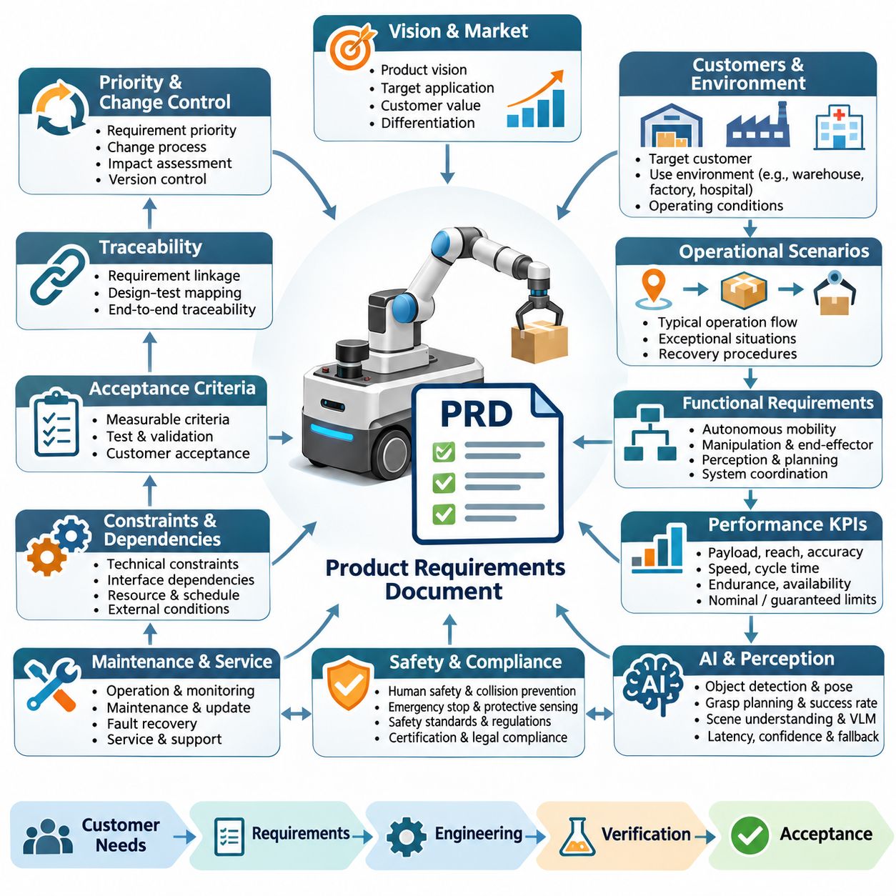
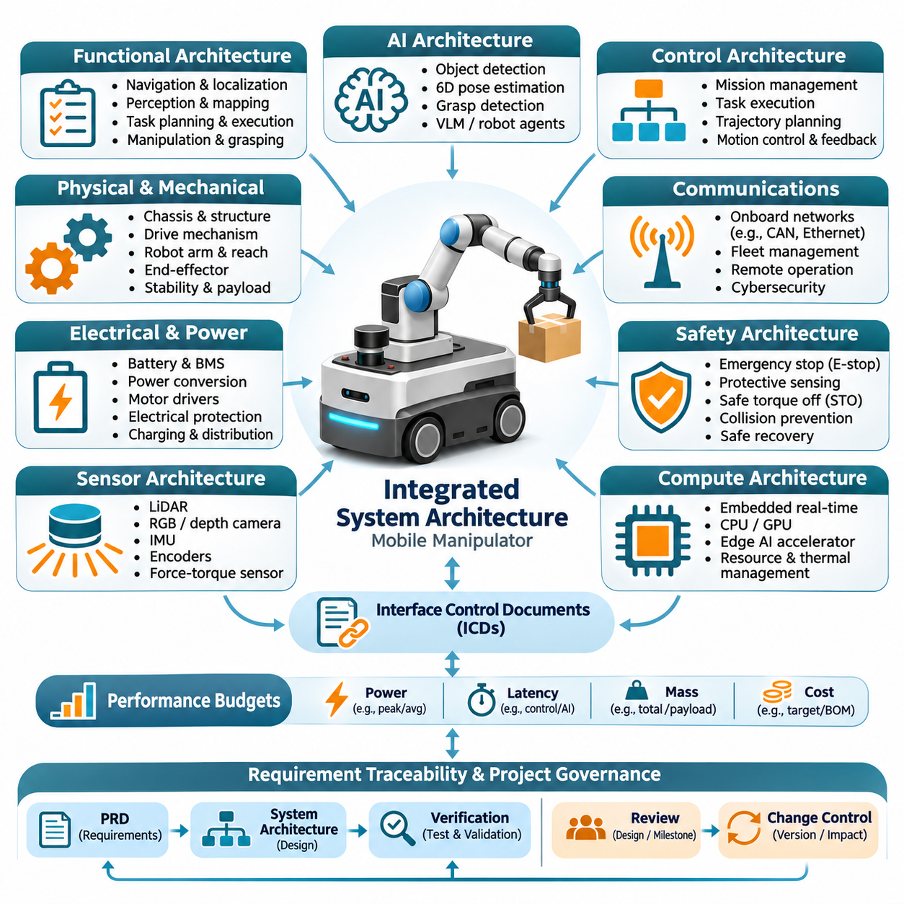
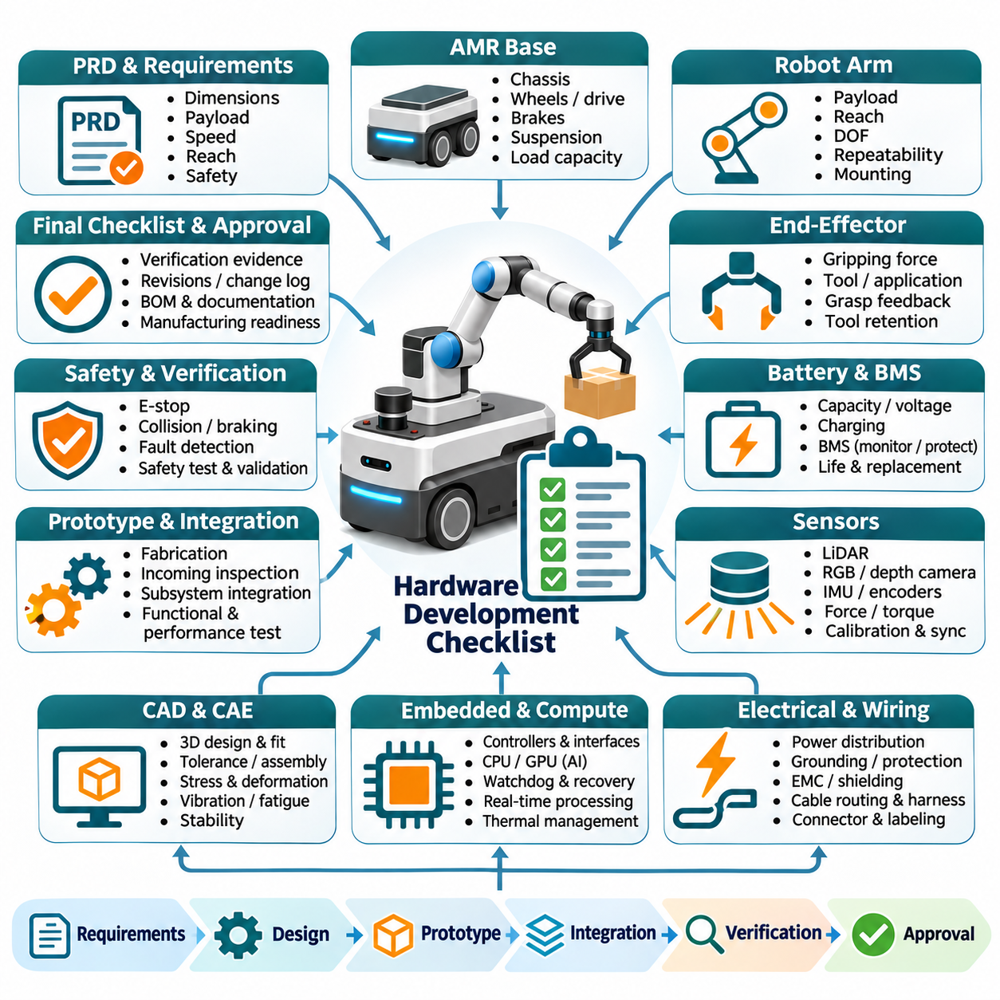
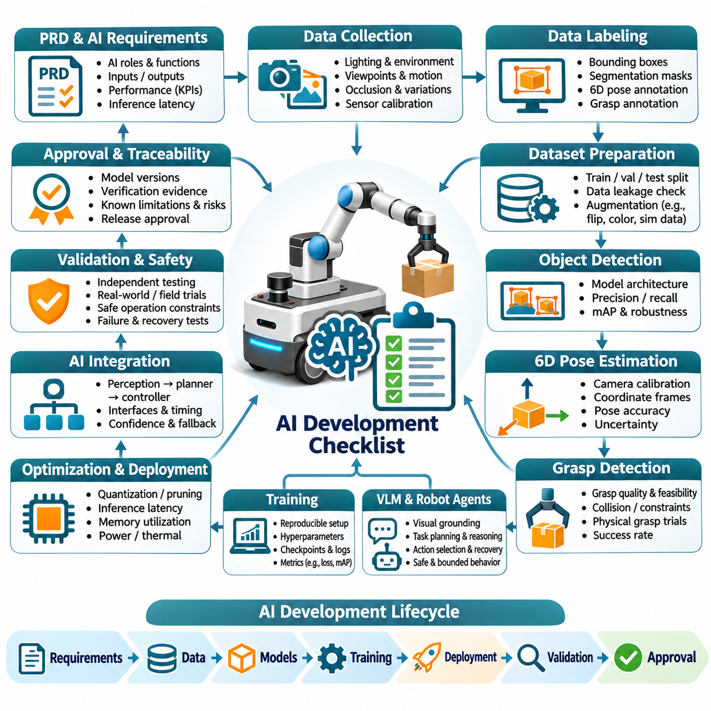
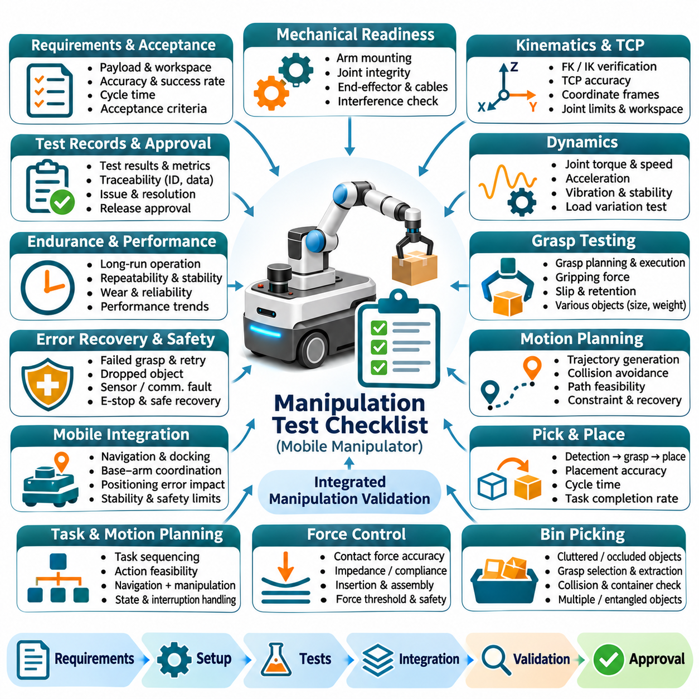
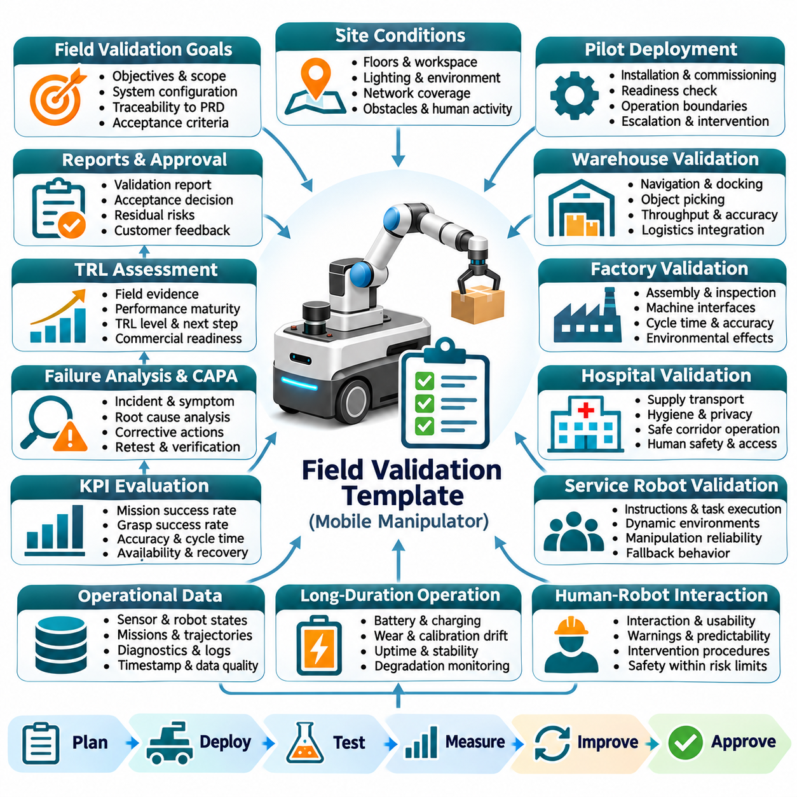
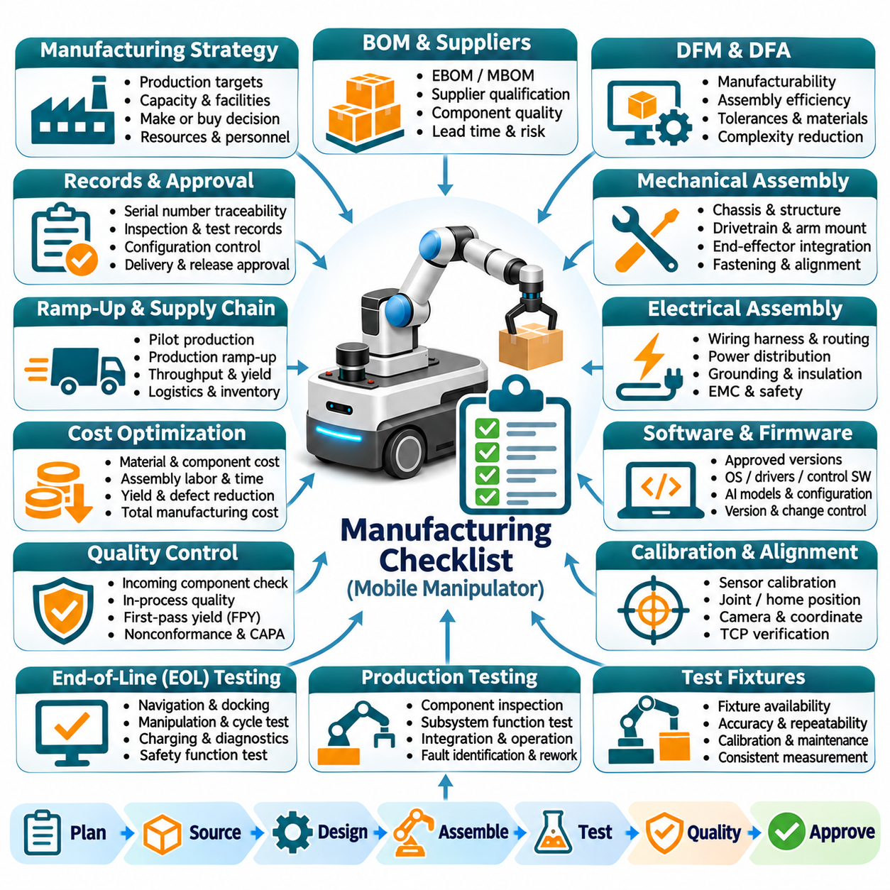
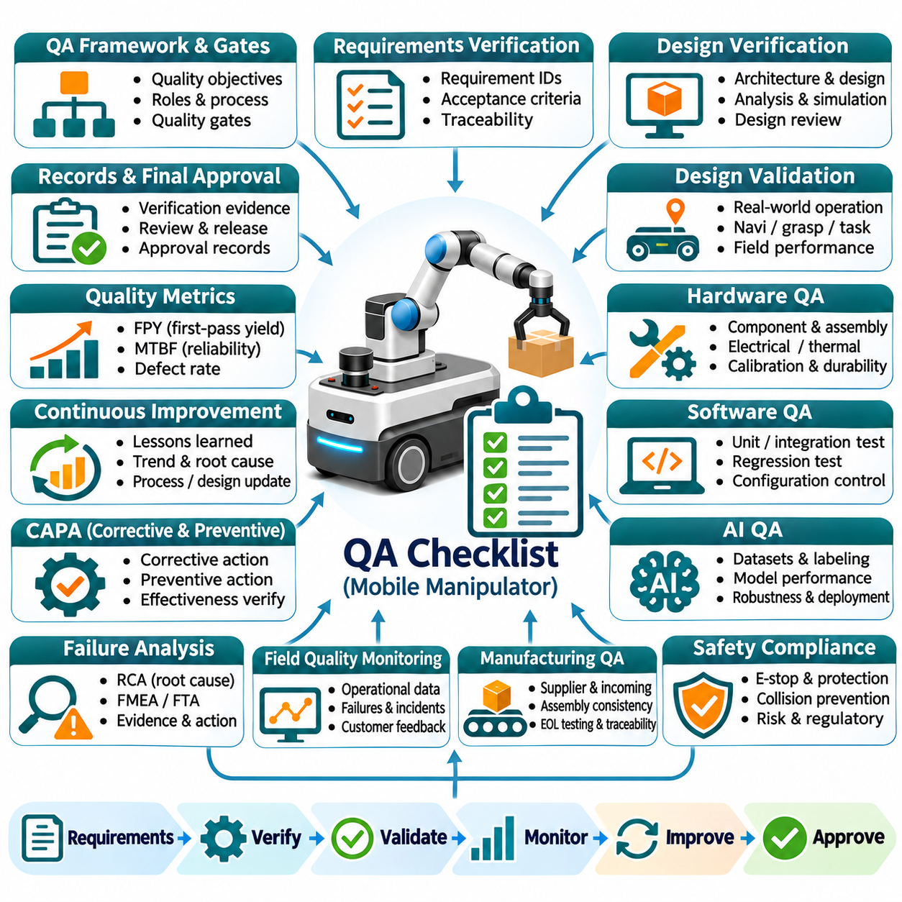
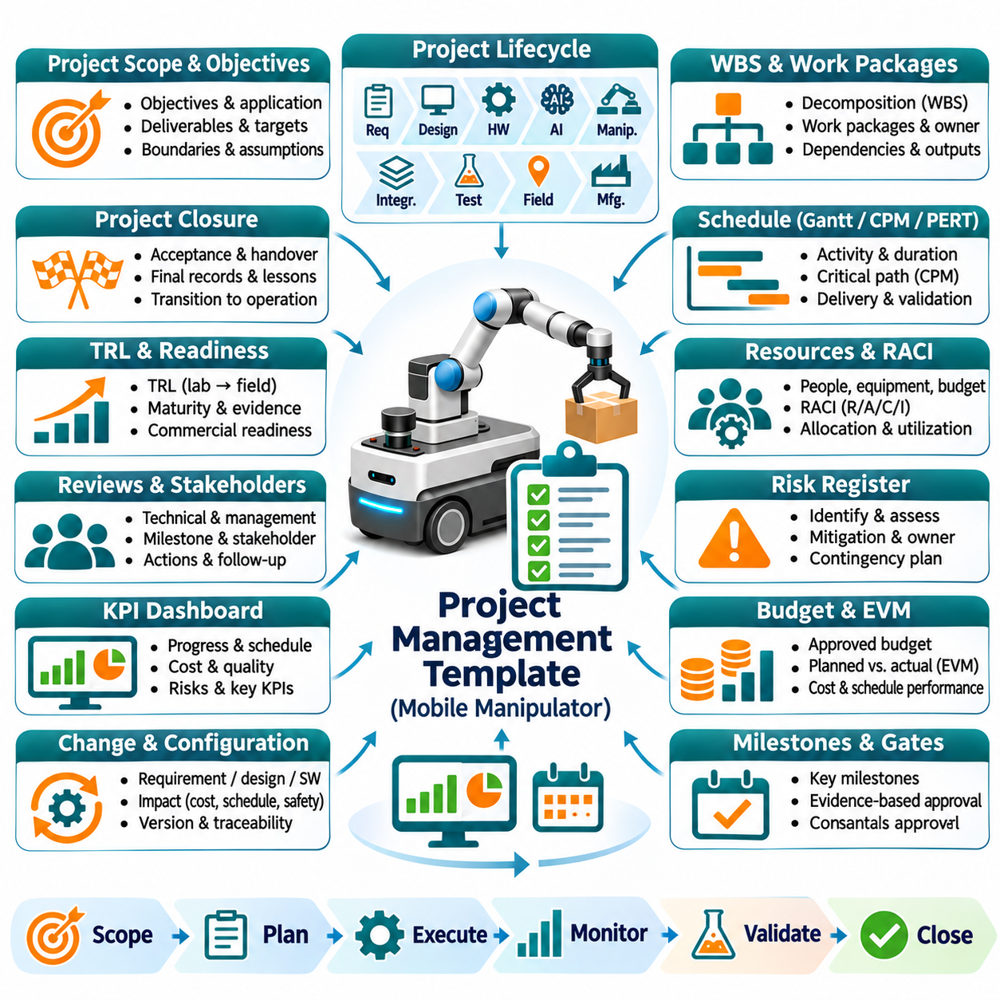

**Volume 05. Mobile Manipulator Projects and Development Manual**

# Chapter 12. Checklists and Templates

## 01 PRD Template

{width="7.268055555555556in" height="7.268055555555556in"}

A Product Requirements Document (PRD) is the foundational reference for defining what a mobile manipulator product must achieve, whom it serves, and under which operational conditions it must perform. It translates market expectations, customer needs, and business objectives into a structured set of product requirements. The PRD should establish a shared understanding among product management, mechanical engineering, electrical engineering, robotics, AI, software, safety, manufacturing, and project management teams.

The document begins with the product vision and intended market positioning. It describes the target application, expected customer value, competitive differentiation, and the principal problems the mobile manipulator is designed to solve. For example, a warehouse mobile manipulator may combine autonomous transportation, object recognition, robotic picking, and material handling. The product vision should explain how these capabilities contribute to operational efficiency rather than simply listing individual technologies.

The target customer and operational environment must be clearly identified. A PRD should describe whether the product is intended for warehouses, factories, hospitals, construction facilities, laboratories, or service environments. Each application introduces different requirements concerning floor conditions, available workspace, human interaction, payload characteristics, operating hours, environmental conditions, and infrastructure. These factors establish the context in which technical requirements must be evaluated.

Customer requirements should be translated into measurable product expectations. Statements such as easy operation, accurate positioning, reliable picking, and continuous operation are insufficient unless they are associated with measurable acceptance criteria. The PRD should define relevant parameters such as navigation accuracy, manipulation precision, payload capacity, cycle time, mission completion rate, operating duration, and recovery performance. Quantitative definitions reduce ambiguity and provide a consistent basis for design decisions and verification.

Operational scenarios describe how the mobile manipulator will be used throughout its working lifecycle. Typical scenarios include autonomous navigation to a workstation, localization relative to a target, robotic arm deployment, object detection, grasp planning, manipulation, transportation, and return to a charging station. The PRD should also consider exceptional situations such as blocked pathways, unexpected obstacles, localization failures, dropped objects, communication interruptions, and manipulation recovery. These scenarios help engineering teams identify requirements that may not be apparent from individual component specifications.

Functional requirements define the capabilities that the product must provide. They cover autonomous mobility, localization, mapping, obstacle avoidance, task scheduling, robotic arm control, end-effector operation, object recognition, grasp planning, and coordination between the mobile platform and manipulator. Each requirement should describe the expected system behavior and its conditions of operation. Interfaces between subsystems should also be considered so that functional responsibilities remain consistent throughout system integration.

Performance requirements establish measurable limits for product operation. Relevant parameters include maximum payload, manipulator reach, positioning accuracy, navigation speed, turning capability, manipulation cycle time, localization stability, battery endurance, charging duration, and system availability. Performance should be evaluated under representative operating conditions rather than only under ideal laboratory circumstances. The PRD should distinguish nominal performance, guaranteed performance, and environmental limitations to prevent unrealistic expectations during product development and customer acceptance.

AI requirements define the expected intelligence of the mobile manipulator. These requirements may include object detection accuracy, six-dimensional object pose estimation, grasp success rate, scene understanding, visual localization, task recognition, and recovery decision performance. Where Vision-Language Models (VLMs), robot agents, or embodied AI are involved, the PRD should describe their intended responsibilities and operational boundaries. AI performance should include measurable evaluation conditions, dataset assumptions, inference latency, confidence handling, and behavior when the model cannot produce a reliable result.

Safety requirements establish the conditions under which the product can operate around people, equipment, and infrastructure. The PRD should address emergency stopping, collision prevention, protective sensing, speed and separation monitoring, manipulator workspace restrictions, safe torque off, and recovery from hazardous conditions. Safety expectations must consider the combined behavior of the AMR and robotic arm because movement of either subsystem can create risks for the entire machine. Applicable safety standards and regulatory obligations should be identified during the requirements phase.

Regulatory requirements describe the certifications, standards, and legal conditions that may affect product design, manufacturing, installation, and operation. Depending on the target market and application, these may include machinery safety, industrial robot safety, mobile robot safety, electrical safety, electromagnetic compatibility, wireless communication, and cybersecurity requirements. The PRD should identify applicable jurisdictions and distinguish mandatory compliance requirements from optional customer specifications. Regulatory assumptions should be reviewed throughout development because changes in product configuration or intended application may introduce additional obligations.

Maintenance requirements define how the product will be inspected, serviced, repaired, and upgraded after deployment. They should cover battery replacement, drive unit maintenance, wheel and suspension inspection, sensor calibration, manipulator servicing, software updates, diagnostic access, spare parts, and technical support. The PRD should also establish expectations for fault detection, maintenance intervals, serviceability, and recovery from common failures. These requirements are important because the total operational value of a mobile manipulator depends on long-term availability, not merely its initial performance.

The PRD should include clear assumptions, constraints, and dependencies. Assumptions may concern facility infrastructure, floor quality, wireless network availability, object characteristics, workstation geometry, and customer operating procedures. Constraints may involve mechanical dimensions, maximum system mass, battery capacity, computing resources, manufacturing cost, or delivery schedules. Dependencies may include third-party robotic arms, sensors, navigation software, fleet management systems, and external infrastructure. Recording these conditions makes it easier to identify risks and understand the consequences of changing requirements.

Acceptance criteria should be defined for every important requirement. Each criterion should specify what will be measured, under which conditions, using which method, and what result constitutes successful completion. For example, a positioning requirement should identify the reference coordinate system, measurement procedure, test environment, and acceptable error range. Similarly, a manipulation success requirement should define the object population, grasp conditions, number of trials, and treatment of unsuccessful operations. Acceptance criteria provide an objective foundation for design verification, system testing, and customer validation.

Requirements should have unique identifiers and maintain traceability throughout the product lifecycle. A requirement should be connected to its originating customer need, corresponding system function, responsible engineering subsystem, verification method, and final test evidence. This relationship allows project teams to determine whether every requirement has been implemented and verified. It also supports impact analysis when a customer requests a change or when engineering constraints require a design modification.

The PRD should distinguish between mandatory requirements, desirable capabilities, and future development opportunities. Mandatory requirements define the minimum conditions for product acceptance, while desirable capabilities provide additional value when resources and schedules permit. Future capabilities may include advanced embodied AI, multi-robot collaboration, autonomous learning, predictive maintenance, and integration with enterprise systems. This classification helps project management control scope and prevents optional features from compromising essential product functions.

A practical PRD should also include requirement ownership, revision history, approval status, and change management procedures. Each requirement should have an accountable owner who can clarify its technical meaning and participate in verification planning. Changes should be evaluated for their effects on architecture, hardware, software, AI models, safety, cost, schedule, and manufacturing. Formal review and approval prevent uncontrolled modifications from propagating across engineering teams.

The completed PRD becomes the principal reference for subsequent system architecture, hardware development, AI development, manipulation development, testing, field validation, manufacturing, and quality assurance. It should remain a controlled engineering document rather than a one-time planning report. As development progresses, requirements may be refined through technical reviews, prototype testing, customer feedback, and field evidence. Every approved change should preserve traceability to the original product objectives.

Ultimately, an effective PRD connects customer expectations with engineering execution and product acceptance. It ensures that the mobile manipulator is developed as an integrated product rather than as a collection of independently optimized subsystems. By defining measurable requirements, operational boundaries, safety expectations, and acceptance conditions at the beginning of a project, the PRD reduces development uncertainty and provides a consistent foundation for delivering a reliable, maintainable, and commercially viable mobile manipulation system.

## 02 System Architecture Template

{width="7.268055555555556in" height="7.268055555555556in"}

A System Architecture Template provides a standardized framework for defining the structural, functional, and operational organization of a mobile manipulator. It translates approved product requirements into an integrated engineering architecture that connects the autonomous mobile robot, robotic manipulator, perception system, computing platform, control software, and safety infrastructure. The architecture establishes a common technical foundation for multidisciplinary development.

The template begins with the system overview, architectural objectives, intended applications, and fundamental design principles. This section identifies the target operating environment, supported missions, system boundaries, external dependencies, and major engineering constraints. It should explain how the proposed architecture satisfies the Product Requirements Document (PRD) while supporting modularity, scalability, reliability, maintainability, and future product expansion.

The functional architecture describes what the mobile manipulator must accomplish independently of specific hardware implementations. It defines autonomous navigation, localization, environmental perception, task planning, robotic manipulation, grasp execution, battery management, and operational monitoring. Functional decomposition establishes relationships between system capabilities and clarifies how individual functions cooperate to complete complex robotic missions.

The physical architecture describes the allocation of system functions to actual hardware and software components. It identifies the mobile platform, robotic arm, end-effector, sensors, motor controllers, embedded processors, edge computing devices, communication interfaces, and power distribution equipment. Each component should have a clearly defined responsibility, installation location, and relationship with neighboring subsystems to support efficient integration.

The mechanical architecture establishes the structural configuration of the mobile manipulator. It includes chassis dimensions, drive mechanisms, manipulator mounting arrangements, structural materials, payload distribution, center of gravity, and mechanical interfaces. Particular attention should be given to stability during combined navigation and manipulation, vibration transmission, structural deformation, maintenance accessibility, and mechanical interference between moving components.

The electrical architecture defines power generation, energy storage, power conversion, electrical distribution, grounding, protection, and wiring connections. It should describe the battery management system, charging interfaces, motor drivers, voltage domains, emergency power isolation, and auxiliary electrical loads. Electrical specifications must account for peak power consumption, simultaneous actuator operation, electromagnetic compatibility, and protection against electrical faults.

The sensor architecture identifies the sensing technologies required for autonomous mobility, environmental understanding, and robotic manipulation. Typical components include LiDAR, RGB cameras, depth cameras, inertial measurement units, wheel encoders, proximity sensors, and force-torque sensors. The template should specify sensor placement, measurement range, accuracy, sampling frequency, calibration procedures, time synchronization, coordinate transformations, and environmental limitations.

The computing architecture defines the distribution of computational responsibilities across embedded controllers, central processing units, graphics processing units, edge AI accelerators, and external servers. Resource allocation should distinguish real-time control, navigation, perception, AI inference, task orchestration, and diagnostic processing. Computational capacity, memory requirements, thermal management, communication bandwidth, and processing latency should be documented.

The AI architecture describes the organization of intelligent functions supporting perception, reasoning, decision-making, and manipulation. It may incorporate object detection, six-dimensional pose estimation, grasp detection, semantic mapping, Vision-Language Models (VLMs), and robot agents. Each AI component should specify its input data, output representation, inference requirements, confidence thresholds, operational limitations, and fallback behavior when predictions are unreliable.

The control architecture establishes the hierarchical relationships between mission management, task execution, trajectory planning, motion control, and actuator-level feedback loops. It should define how the mobile platform and robotic manipulator synchronize their movements while maintaining stability and operational safety. Control frequencies, response times, command priorities, state transitions, feedback mechanisms, and fault-handling responsibilities require explicit definition.

The communication architecture describes information exchange among onboard subsystems, fleet management platforms, remote operation centers, and external enterprise systems. It should specify communication protocols, network topology, message formats, bandwidth requirements, synchronization mechanisms, and cybersecurity provisions. Communication failures, delayed messages, inconsistent system states, and network interruptions must be addressed through appropriate detection and recovery mechanisms.

The safety architecture defines protective functions and their relationships with operational controllers. It should address emergency stopping, protective sensing, safe torque off, collision prevention, speed limitations, workspace monitoring, and safe recovery. Safety-related functions must be allocated according to risk assessment, with appropriate independence from ordinary control and AI processing. Safety requirements should cover combined mobile platform and manipulator behavior.

Interface Control Documents (ICDs) establish formal agreements between interconnected subsystems. Each interface definition should identify participating components, mechanical connection specifications, electrical characteristics, communication protocols, data structures, coordinate conventions, timing requirements, and error-handling procedures. Interface ownership, version compatibility, and approved modifications should be controlled to reduce integration failures during multidisciplinary development.

The template should incorporate architectural performance budgets and requirement traceability. Power consumption, computational utilization, communication latency, positioning uncertainty, system mass, and manufacturing cost should be allocated across relevant subsystems. Each architectural element should be linked to originating requirements, engineering specifications, and planned verification activities. This approach supports systematic trade-off analysis and prevents uncontrolled resource allocation.

Architectural decisions, technical assumptions, dependencies, and engineering risks should be documented alongside alternative design options. The template should record the rationale for component selection, subsystem partitioning, communication standards, and safety implementation strategies. Architectural reviews should evaluate technical feasibility, requirement coverage, interface completeness, integration readiness, manufacturing constraints, and long-term serviceability before approval.

The completed System Architecture Template serves as a controlled engineering reference throughout hardware development, AI development, manipulation development, testing, field validation, manufacturing, and quality assurance. Document ownership, configuration identification, revision history, approval status, and change management procedures must be maintained. A standardized architecture supports repeatable engineering execution and the development of reliable, scalable, and commercially viable mobile manipulators.

## 03 Hardware Development Checklist

{width="7.268055555555556in" height="7.268055555555556in"}

A Hardware Development Checklist provides a systematic framework for verifying that the physical components of a mobile manipulator satisfy approved product requirements, engineering specifications, safety objectives, and manufacturing constraints. It covers the complete hardware development lifecycle, from initial component selection and architectural design to prototype fabrication, subsystem integration, performance verification, and production readiness.

The checklist should begin with hardware requirements and system architecture verification. Engineering teams must confirm that mechanical dimensions, payload capacity, operating speed, manipulation reach, power requirements, environmental conditions, and safety constraints have been clearly defined. Each hardware specification should be traceable to the Product Requirements Document (PRD) and corresponding system architecture to prevent inconsistencies during development.

The autonomous mobile robot (AMR) base should be evaluated against mobility and structural requirements. Verification should cover chassis dimensions, structural strength, ground clearance, wheel configuration, drive mechanisms, steering performance, braking capability, and suspension characteristics. Engineers should confirm that the mobile platform can support the combined mass of the robotic arm, end-effector, payload, battery system, and onboard computing equipment.

Manipulator selection should consider payload capacity, reach, degrees of freedom, positioning repeatability, joint torque, motion speed, and controller compatibility. The checklist must verify that the selected robotic arm can execute intended manipulation tasks within the available workspace. Mounting rigidity, dynamic loading, center-of-gravity displacement, cable routing, and mechanical interference should also be evaluated under representative operating conditions.

End-effector development requires verification of mechanical compatibility, gripping force, object dimensions, payload characteristics, and tool attachment mechanisms. Depending on the intended application, the system may incorporate mechanical grippers, vacuum grippers, adaptive fingers, or specialized tools. The checklist should address tool retention, object detection, grasp feedback, wear resistance, replacement procedures, and prevention of unintended object release.

Battery system verification should address energy capacity, nominal voltage, peak discharge current, charging performance, operating temperature, and expected service life. The battery management system (BMS) must provide appropriate monitoring and protection against electrical and thermal faults. Engineers should evaluate battery mounting, enclosure protection, electrical isolation, replacement accessibility, and compatibility with autonomous charging infrastructure.

Sensor integration should be reviewed to ensure that sensing coverage, measurement accuracy, mounting stability, and environmental resistance satisfy operational requirements. LiDAR, RGB cameras, depth cameras, inertial measurement units, wheel encoders, proximity sensors, and force-torque sensors must be positioned appropriately. Sensor calibration, coordinate alignment, time synchronization, vibration isolation, and cable protection should be verified.

Electrical system development should include verification of power distribution, voltage conversion, current capacity, grounding, circuit protection, and electrical isolation. The checklist must confirm that electrical components can accommodate continuous loads, peak actuator demands, regenerative energy where applicable, and simultaneous subsystem operation. Electromagnetic compatibility, connector ratings, protective devices, and thermal characteristics should also be evaluated.

Wiring harness development requires careful examination of cable specifications, connector selection, terminal compatibility, routing paths, mechanical retention, and identification labels. Harnesses must withstand repeated motion, vibration, abrasion, and environmental exposure throughout the expected operating lifecycle. Power and communication cables should be separated or shielded as appropriate, while service loops and maintenance access should remain sufficient.

Embedded system development should verify processor selection, memory capacity, peripheral interfaces, communication protocols, real-time processing requirements, and firmware compatibility. Embedded controllers must support reliable actuator communication, sensor acquisition, diagnostic monitoring, and fault detection. Hardware watchdogs, startup behavior, power interruption recovery, and defined failure responses should be evaluated during integration testing.

The onboard computing platform should be assessed for compatibility with navigation, perception, AI inference, and manipulation workloads. CPU and GPU resources, memory bandwidth, storage capacity, network interfaces, and power consumption must satisfy anticipated operating demands. Thermal management should be verified under sustained computational workloads to prevent excessive temperatures, performance throttling, and unexpected system shutdowns.

Computer-Aided Design (CAD) verification should confirm dimensional accuracy, assembly compatibility, manufacturing tolerances, mounting interfaces, and component accessibility. The complete mechanical assembly must be examined for interference between moving parts, sensors, wiring harnesses, and structural elements. Computer-Aided Engineering (CAE) simulations should evaluate structural stress, deformation, vibration, fatigue, and stability under representative loading conditions.

Prototype fabrication should follow controlled engineering drawings, approved material specifications, and defined assembly procedures. Incoming components must be inspected for dimensional conformity, material quality, electrical characteristics, and manufacturing defects. Prototype assembly records should document deviations, installation difficulties, component modifications, and unexpected integration problems to support subsequent design optimization.

Hardware integration and verification should evaluate the complete mobile manipulator under normal and abnormal operating conditions. Testing should include mobility performance, manipulation accuracy, structural stability, electrical loading, thermal behavior, communication reliability, and battery endurance. Safety-related hardware, emergency stopping, protective sensing, braking mechanisms, and fault responses must be verified against applicable safety requirements.

The completed checklist should record verification results, responsible engineers, supporting evidence, unresolved issues, corrective actions, and approval status. Hardware revisions, CAD models, electrical schematics, bills of materials, and component specifications must remain under configuration control. Final approval should confirm that the hardware satisfies development objectives and is ready for subsequent system validation, manufacturing preparation, and quality assurance.

## 04 AI Development Checklist

{width="7.268055555555556in" height="7.268055555555556in"}

An AI Development Checklist provides a systematic framework for ensuring that artificial intelligence components developed for a mobile manipulator satisfy functional, performance, reliability, safety, and operational requirements. It covers the complete AI development lifecycle, including requirement analysis, data collection, data labeling, model selection, training, optimization, deployment, integration, and validation within representative operating environments.

The checklist should begin with AI requirement verification and alignment with the approved Product Requirements Document (PRD). Engineering teams must identify the responsibilities of each AI component, expected input and output characteristics, performance targets, inference latency, and computational constraints. Measurable acceptance criteria should distinguish model-level performance from the operational performance of the integrated robotic system.

Data collection should be evaluated to ensure that training and validation datasets adequately represent the intended operating environment. Collected data should reflect variations in illumination, object geometry, surface characteristics, background complexity, camera viewpoints, occlusion, and robot motion. Dataset coverage, sensor calibration, collection procedures, timestamps, data ownership, and environmental conditions should be documented.

Data labeling and annotation quality must be verified before model training begins. Annotations may include bounding boxes, segmentation masks, object classes, keypoints, six-dimensional poses, grasp configurations, and task descriptions. The checklist should address annotation consistency, labeling guidelines, coordinate conventions, class distribution, ambiguous samples, and independent quality inspections. Dataset versions and labeling histories must remain traceable.

Dataset preparation should ensure appropriate separation between training, validation, and independent test datasets. Images or sequences originating from the same physical scene should be grouped carefully to prevent data leakage. Data augmentation, synthetic data generation, class balancing, normalization, and preprocessing procedures should be reviewed to confirm that they improve generalization without introducing unrealistic operational characteristics.

Object detection model development should verify model architecture selection, detection accuracy, computational efficiency, and robustness under representative conditions. Evaluation metrics may include precision, recall, mean Average Precision (mAP), false positive rates, and inference speed. Particular attention should be given to small objects, overlapping objects, unfamiliar backgrounds, partial occlusion, and detection failures that could affect robotic manipulation.

Object pose estimation development should evaluate the accuracy and consistency of predicted object positions and orientations. Six-dimensional pose estimation must satisfy the spatial precision required by downstream grasp planning and manipulation functions. Camera calibration, depth measurement quality, coordinate transformations, pose ambiguity, object symmetry, and uncertainty estimation should be examined using representative physical objects and test scenarios.

Grasp detection model development should verify the quality, feasibility, and reliability of predicted grasp configurations. Evaluation should consider object geometry, surface friction, gripper limitations, grasp orientation, environmental obstacles, and collision constraints. Predicted grasp candidates should be assessed through physical manipulation trials because high model prediction accuracy does not necessarily guarantee successful robotic grasp execution.

Vision-Language Model (VLM) development should evaluate the system\'s ability to interpret visual observations, natural language instructions, object relationships, and task-specific contextual information. The checklist should address instruction ambiguity, visual grounding, hallucinations, response consistency, inference latency, and computational requirements. Generated instructions must be validated against permitted robot capabilities and operational constraints before execution.

Robot agent and embodied AI development should verify task decomposition, environmental reasoning, action selection, feedback processing, and recovery behavior. Autonomous decisions must remain within predefined operational boundaries and authorized action spaces. Testing should address incomplete observations, unexpected environmental changes, unsuccessful actions, inconsistent task instructions, and conditions requiring safe interruption or human intervention.

Model training should follow reproducible experimental procedures with controlled datasets, configurations, and software environments. Training parameters, learning rates, optimization algorithms, loss functions, random seeds, checkpoints, and hardware configurations must be recorded. Learning curves and validation metrics should be monitored to identify overfitting, underfitting, numerical instability, and undesirable convergence behavior throughout training.

Model optimization and deployment should evaluate compatibility with the target edge computing platform. Quantization, pruning, knowledge distillation, and inference acceleration may reduce computational requirements when appropriately validated. Engineers should measure accuracy degradation, memory utilization, processing latency, power consumption, and thermal behavior under simultaneous navigation, perception, and manipulation workloads.

AI integration should verify communication between perception models, localization systems, task planners, motion planners, and robotic controllers. Input and output formats, coordinate frames, timestamp consistency, confidence thresholds, and error-handling interfaces must be checked. Low-confidence predictions, outdated observations, missing sensor inputs, and inference failures should trigger defined fallback behavior rather than uncontrolled physical actions.

AI validation should include independent datasets, simulation-based testing, controlled laboratory experiments, and representative field trials. Performance must be evaluated across environmental variations, unfamiliar objects, distribution shifts, sensor degradation, and operational disturbances. Safety-critical protective functions should not depend on unverified AI predictions, and physical actions must remain subject to independently validated safety constraints.

The completed checklist should document model identifiers, dataset versions, training configurations, evaluation results, deployment environments, unresolved risks, corrective actions, and approval status. Model artifacts and software dependencies must remain under configuration control. Final approval should establish whether AI components satisfy defined acceptance criteria and are ready for integrated system testing, field validation, and controlled operational deployment.

## 05 Manipulation Test Checklist

{width="7.268055555555556in" height="7.268055555555556in"}

A Manipulation Test Checklist provides a systematic framework for verifying the functional performance, accuracy, reliability, and safety of robotic manipulation within a mobile manipulator. Following the development structure of kinematics, dynamics, grasp planning, motion planning, force control, and manipulation validation, the checklist translates these topics into practical engineering verification activities and measurable acceptance criteria.

Manipulation testing should begin with verification of approved product requirements, manipulation specifications, and system architecture. Engineers must confirm that payload capacity, operational workspace, positioning accuracy, motion speed, grasp success rate, and task completion time have been clearly defined. Each test case should be associated with a unique identifier, specified operating conditions, expected results, and corresponding requirements.

Mechanical readiness should be verified before functional manipulation tests begin. The checklist should address robotic arm mounting, joint integrity, structural rigidity, end-effector attachment, cable routing, and mechanical interference. Fasteners, connectors, protective covers, and moving components must be inspected to ensure that the manipulator can operate throughout its intended workspace without introducing unacceptable mechanical risks.

Kinematic verification should evaluate forward kinematics, inverse kinematics, joint configurations, coordinate transformations, and workspace boundaries. The predicted position and orientation of the Tool Center Point (TCP) should be compared with independently measured results. Testing should include representative joint configurations, singularity regions, joint limits, unreachable targets, and consistency between the mobile platform and manipulator coordinate frames.

Dynamic performance testing should evaluate joint velocities, acceleration characteristics, actuator torque, vibration, and trajectory tracking under representative loading conditions. Engineers must confirm that the manipulator maintains stable motion while handling different payloads and operating at various speeds. Dynamic interactions between the robotic arm and mobile platform should also be examined to identify excessive structural movement or reduced stability.

Grasp planning and execution tests should verify the ability to identify, approach, grasp, retain, and release objects reliably. Representative test objects should include variations in size, shape, weight, orientation, surface material, and friction characteristics. Grasp success rates, object slippage, gripping force, grasp stability, and unintended object release should be recorded to establish the practical reliability of the manipulation system.

Motion planning verification should evaluate trajectory generation, path feasibility, collision avoidance, joint limit compliance, and execution consistency. The checklist should include constrained workspaces, narrow passages, static obstacles, and changes in environmental conditions. Planned trajectories must remain within permitted operating boundaries, while unsuccessful planning attempts should trigger appropriate recovery or safe interruption procedures.

Pick-and-place testing should evaluate the complete sequence of object detection, pose estimation, grasp generation, approach motion, object acquisition, transportation, and placement. Placement accuracy, orientation error, cycle time, and task completion rate should be measured across repeated trials. Tests should distinguish perception failures, grasp failures, motion planning failures, and placement errors to support systematic failure analysis.

Bin-picking validation should examine manipulation performance in cluttered environments containing randomly arranged, partially occluded, or overlapping objects. The checklist should verify object accessibility, grasp candidate selection, collision-free extraction, and adaptation to changing object configurations. Failed extraction attempts, multiple-object acquisition, object entanglement, and interference with container boundaries should be recorded.

Force control and compliant manipulation tests should evaluate contact force accuracy, torque response, impedance behavior, and interaction stability. Representative applications may include insertion, assembly, surface inspection, and controlled contact with workpieces. Engineers should verify force thresholds, contact detection, force sensor calibration, excessive force handling, and safe responses to unexpected contact or external disturbances.

Task and Motion Planning (TAMP) verification should evaluate coordination between high-level task decisions and executable robotic trajectories. Testing should include sequential operations, dependencies between actions, changes in object availability, and transitions between navigation and manipulation. The system must verify action feasibility and relevant preconditions before execution and maintain consistent task states throughout operational interruptions.

Mobile manipulation integration tests should verify coordination between autonomous navigation, docking, localization, and robotic arm operation. Engineers should evaluate the effects of base positioning errors, floor irregularities, vibration, and localization uncertainty on manipulation accuracy. Combined base and arm movements must remain within validated stability limits, operational constraints, and safety-related motion restrictions.

Error recovery and safety testing should examine failed grasps, dropped objects, unreachable targets, sensor interruptions, communication failures, and unexpected obstacles. The system should demonstrate controlled stopping, appropriate fault identification, and authorized recovery without generating hazardous movements. Emergency stopping, protective functions, and restart interlocks must be verified against approved safety requirements and risk assessments.

Performance and endurance testing should evaluate manipulation success rates, positioning repeatability, cycle time, energy consumption, and operational availability over extended periods. Repeated task execution should reveal mechanical wear, thermal effects, calibration drift, actuator degradation, and intermittent failures. Test reports should include representative workloads, trial counts, measurement uncertainty, and statistical summaries of performance variation.

The completed checklist should record test configurations, hardware and software versions, environmental conditions, acceptance criteria, measured results, corrective actions, and approval status. Failed or incomplete tests must remain traceable to responsible engineers and subsequent verification activities. Final approval should confirm readiness for integrated system testing, field validation, or controlled deployment, subject to the applicable release criteria.

## 06 Field Validation Template

{width="7.268055555555556in" height="7.268055555555556in"}

A Field Validation Template provides a standardized framework for evaluating the operational readiness, functional performance, reliability, and safety of a mobile manipulator under representative real-world conditions. It translates laboratory verification results into practical field evidence through pilot deployments, application-specific testing, operational data collection, performance evaluation, and Technology Readiness Level (TRL) assessment.

The template should begin with project identification, validation objectives, target applications, responsible organizations, and the scope of field validation. It should document the mobile manipulator configuration, hardware revisions, software versions, deployed AI models, and operating conditions. Validation objectives must be traceable to approved product requirements, customer expectations, and predefined operational acceptance criteria.

Field environment characterization should describe the physical and operational characteristics of the deployment site. Relevant information includes floor conditions, workspace dimensions, passage widths, illumination, environmental temperature, wireless network coverage, obstacle distribution, and human activity. Site-specific constraints, infrastructure dependencies, and differences between laboratory and field conditions must be documented before testing begins.

Pilot deployment planning should establish installation procedures, commissioning activities, validation schedules, personnel responsibilities, and operational boundaries. The mobile manipulator must undergo preliminary readiness checks covering navigation, manipulation, perception, communication, charging, and protective functions. The template should define escalation procedures, intervention responsibilities, and conditions requiring temporary suspension of operations.

Warehouse validation should evaluate autonomous navigation, workstation docking, object recognition, robotic picking, material transportation, and coordination with existing logistics infrastructure. Representative scenarios should include congested aisles, variable inventory arrangements, changing object characteristics, and interactions with other equipment. Picking accuracy, mission completion rate, operational throughput, and recovery performance should be measured.

Factory validation should assess the mobile manipulator\'s ability to perform manufacturing, assembly, inspection, and material handling tasks within production environments. Testing should consider workstation accessibility, machine interfaces, production cycle times, positioning accuracy, and coordination with existing automation systems. Electromagnetic disturbances, floor vibration, environmental contamination, and production interruptions should also be evaluated.

Hospital validation should examine autonomous transportation and manipulation within healthcare environments characterized by human activity and changing operational conditions. Relevant scenarios include corridor navigation, medical supply transportation, workstation interactions, and coordination with hospital infrastructure. Hygiene requirements, patient privacy, noise limitations, accessibility, and safe operation around vulnerable individuals must be considered.

Service robot validation should evaluate performance in dynamic environments where task requests, object arrangements, and human behavior may change unexpectedly. Testing should address environmental understanding, instruction interpretation, autonomous task execution, service responsiveness, and manipulation reliability. The system should demonstrate appropriate fallback behavior when observations are incomplete or requested actions exceed authorized capabilities.

Human-Robot Interaction (HRI) validation should examine interactions between the mobile manipulator, operators, maintenance personnel, and nearby individuals. The template should assess communication clarity, operational predictability, warning mechanisms, protective responses, and emergency intervention procedures. Human interaction scenarios must remain within approved safety boundaries, with appropriate precautions established through risk assessment.

Long-duration operation testing should evaluate system behavior across extended operating periods and repeated mission execution. Battery endurance, charging reliability, actuator temperature, computational utilization, mechanical wear, calibration drift, and communication stability should be monitored. Operational interruptions, maintenance activities, unexpected shutdowns, and degradation in manipulation or navigation performance must be recorded.

Operational data collection should establish standardized procedures for recording sensor observations, robot states, mission histories, AI inference results, motion trajectories, energy consumption, and diagnostic events. Data records should include synchronized timestamps, system configuration identifiers, and environmental information. Data integrity, storage capacity, access permissions, privacy protection, and retention policies must be maintained.

Key Performance Indicator (KPI) evaluation should compare measured field performance against approved acceptance thresholds. Relevant indicators include mission success rate, navigation accuracy, grasp success rate, placement accuracy, cycle time, operational availability, intervention frequency, energy efficiency, and recovery success rate. Measurement methods, sample sizes, statistical uncertainty, and unsuccessful trials should be documented to ensure objective evaluation.

Failure analysis and corrective action management should identify the technical and operational causes of unsuccessful field activities. Each incident should record the triggering conditions, affected subsystems, observed behavior, operational consequences, and supporting evidence. Corrective actions must be assigned to responsible engineers, evaluated through regression testing, and independently verified where necessary before the affected functionality is released.

Technology Readiness Level (TRL) assessment should determine whether the integrated mobile manipulator has demonstrated the maturity required for its intended application. Assessment evidence should include representative environment testing, functional completeness, operational reliability, safety verification, and system integration results. TRL advancement should depend on documented evidence rather than prototype completion or accumulated operating hours alone.

The completed field validation report should consolidate deployment conditions, test procedures, measured results, KPI outcomes, operational incidents, corrective actions, unresolved risks, and customer feedback. Each validation result should maintain traceability to the corresponding requirement and system configuration. Deviations from approved procedures and limitations affecting the interpretation of field results should be explicitly documented.

Final validation approval should establish whether the mobile manipulator satisfies the defined operational acceptance criteria and is ready for subsequent commercialization, manufacturing preparation, or expanded deployment. Outstanding issues, conditional approvals, operational restrictions, and required follow-up activities must remain under configuration and project management control to support continuous improvement throughout the product lifecycle.

## 07 Manufacturing Checklist

{width="7.268055555555556in" height="7.268055555555556in"}

A Manufacturing Checklist provides a systematic framework for ensuring that mobile manipulators can be produced consistently while satisfying approved technical, quality, safety, and cost requirements. Following the manufacturing structure of this manual, the checklist expands these topics into practical engineering activities covering production preparation, component procurement, assembly, testing, quality control, and mass production readiness.

Manufacturing strategy verification should establish production targets, manufacturing capacity, facility requirements, equipment availability, and personnel responsibilities. Engineers must determine which components will be manufactured internally and which will be procured from external suppliers. Production volumes, assembly cycle times, capital investments, and resource requirements should remain aligned with commercialization objectives.

Bill of Materials (BOM) management should verify that all mechanical, electrical, electronic, and robotic components are accurately documented. The manufacturing BOM must include component identifiers, quantities, specifications, approved manufacturers, revision information, and procurement status. Differences between the Engineering BOM (EBOM) and Manufacturing BOM (MBOM) should be resolved through controlled engineering change procedures.

Supplier management should evaluate supplier capabilities, component quality, production capacity, delivery reliability, and technical support. Critical components such as robotic arms, drive units, batteries, sensors, industrial computers, and safety controllers should undergo appropriate supplier qualification. Alternative suppliers, component obsolescence risks, procurement lead times, and incoming inspection requirements must be documented.

Design for Manufacturing (DFM) and Design for Assembly (DFA) verification should evaluate whether the mobile manipulator can be manufactured efficiently using available production technologies. Engineers should review component geometry, dimensional tolerances, material selection, fabrication processes, fastening methods, and assembly accessibility. Design complexity and unnecessary component variations should be minimized without compromising performance or safety.

Assembly process verification should confirm that manufacturing instructions, assembly sequences, workstation layouts, tooling requirements, and inspection procedures have been established. Mechanical assembly must address chassis construction, drivetrain installation, robotic arm mounting, end-effector integration, and structural alignment. Critical fastening torque values, structural reinforcement requirements, and dimensional tolerances must remain traceable.

Electrical assembly verification should evaluate wiring harness installation, connector engagement, cable protection, grounding, power distribution, communication interfaces, and electrical insulation. Battery installation and high-current connections must follow approved safety procedures. Cable routing should prevent interference with moving components, excessive bending, mechanical stress, and electromagnetic compatibility problems.

Software and firmware installation should ensure that each manufactured mobile manipulator receives approved operating systems, device drivers, control software, navigation algorithms, AI models, and safety-related configurations. Version identifiers, installation procedures, configuration parameters, and software dependencies must remain traceable. Unauthorized software modifications and inconsistent production configurations must be prevented.

Calibration and alignment procedures should verify the accuracy of sensors, robotic joint reference positions, camera parameters, coordinate transformations, and the Tool Center Point (TCP). Calibration equipment must satisfy defined measurement accuracy requirements. Individual calibration results should be associated with product serial numbers to ensure that manufacturing variations do not compromise navigation or manipulation performance.

Test fixture verification should evaluate the availability, accuracy, repeatability, and reliability of manufacturing test equipment. Dedicated fixtures may support electrical testing, mechanical alignment, sensor calibration, actuator verification, and subsystem communication testing. Fixtures must undergo appropriate qualification, periodic calibration, and preventive maintenance to ensure consistent measurement results across production batches.

Production testing should verify individual components, assembled subsystems, and integrated functional capabilities throughout the manufacturing process. Test procedures should address drivetrain performance, battery management, communication integrity, sensor operation, robotic arm movement, and protective functions. Failed units must be identified, segregated, and subjected to controlled troubleshooting and subsequent verification.

End-of-Line (EOL) testing should establish whether each completed mobile manipulator satisfies approved production acceptance criteria. Testing should include autonomous navigation, docking, manipulation, charging, diagnostic functions, and applicable safety functions. Automated test procedures should be implemented where practical, and all measured results must remain associated with the corresponding product serial number and configuration.

Manufacturing quality control should monitor incoming components, in-process assembly activities, and finished products. Relevant quality indicators include defect rates, assembly errors, first-pass yield, rework frequency, process capability, and production consistency. Nonconforming materials and products must be controlled, while recurring defects should trigger root cause analysis and corrective and preventive actions.

Manufacturing cost optimization should evaluate material costs, labor requirements, equipment utilization, assembly complexity, inspection expenses, and production yield. Engineering teams should identify opportunities for component standardization, modular architecture, process automation, and supplier optimization. Cost reduction measures must not compromise approved product specifications, operational reliability, or safety requirements.

Mass production ramp-up and global supply chain readiness should evaluate pilot production results, manufacturing throughput, workforce training, inventory availability, and supplier capacity. Production expansion should proceed through controlled stages supported by stable quality indicators. International logistics, regional procurement risks, regulatory requirements, and supply continuity plans must also be incorporated into manufacturing preparation.

The completed manufacturing checklist should document production configurations, approved suppliers, assembly procedures, inspection results, calibration records, unresolved manufacturing risks, and approval status. Product packaging, transportation protection, identification labels, and delivery documentation must also be verified. Final manufacturing approval should confirm readiness for consistent production, commercial delivery, and lifecycle support.

## 08 QA Checklist

{width="7.268055555555556in" height="7.268055555555556in"}

A Quality Assurance (QA) Checklist provides a systematic framework for ensuring that a mobile manipulator satisfies approved functional, performance, reliability, safety, and regulatory requirements throughout its product lifecycle. Following the quality assurance structure of this manual, the checklist expands these topics into practical engineering activities covering development, manufacturing, field deployment, and continuous improvement.

The quality assurance framework should establish quality objectives, organizational responsibilities, verification procedures, approval authorities, and documentation requirements. Quality assurance activities must be integrated into every development phase rather than being restricted to final product inspection. Quality gates should define the conditions under which engineering deliverables can proceed to subsequent lifecycle stages.

Requirement verification should confirm that functional, performance, AI, safety, regulatory, and maintenance requirements have been clearly defined and approved. Each requirement must have a unique identifier, measurable acceptance criteria, and an appropriate verification method. Requirement traceability should establish explicit relationships between customer expectations, engineering specifications, test cases, and verification evidence.

Design verification should evaluate whether the mechanical, electrical, electronic, software, AI, and control architectures satisfy their specified engineering requirements. Design review records, analytical calculations, simulation results, interface specifications, and laboratory test evidence should be examined. Identified design deficiencies must be documented and resolved through controlled engineering change procedures.

Design validation should confirm that the integrated mobile manipulator satisfies its intended operational purpose under representative real-world conditions. Validation activities should address autonomous navigation, object perception, robotic manipulation, docking, charging, task execution, and human interaction. Differences between laboratory performance and actual operational performance must be systematically investigated.

Hardware quality assurance should verify component specifications, mechanical integrity, electrical connectivity, sensor installation, thermal management, and environmental resistance. Critical assemblies such as the mobile platform, robotic arm, battery system, drivetrain, and safety controllers must satisfy approved inspection criteria. Component revisions, calibration records, and manufacturing deviations should remain traceable.

Software quality assurance should evaluate software architecture, coding standards, interface consistency, configuration management, and functional reliability. Unit testing, integration testing, static code analysis, regression testing, and automated verification should be incorporated into the development process. Software defects must be classified according to severity, operational impact, and potential safety consequences.

AI quality assurance should evaluate dataset integrity, annotation accuracy, model reproducibility, inference performance, robustness, and deployment consistency. Object detection, pose estimation, grasp detection, and AI-based task reasoning should be tested against representative operational scenarios. Model versions, training configurations, evaluation results, and known performance limitations must remain traceable.

Safety compliance verification should confirm that identified hazards have been addressed through appropriate risk reduction measures and validated protective functions. Emergency stopping, collision prevention, speed restrictions, safety interlocks, and fault responses must be evaluated against applicable requirements. Regulatory compliance evidence, residual risks, and operational restrictions should be reviewed before product release.

Manufacturing quality assurance should evaluate supplier qualification, incoming inspection, assembly consistency, calibration procedures, production testing, and End-of-Line (EOL) testing. Product serial numbers must establish traceability between components, manufacturing configurations, and inspection records. Nonconforming products should be segregated until approved corrective actions and subsequent inspections have been completed.

Field quality monitoring should establish procedures for collecting operational data, customer feedback, diagnostic events, maintenance records, and system failure information. Navigation errors, manipulation failures, communication interruptions, battery degradation, and unexpected shutdowns should be monitored throughout deployment. Field quality indicators must support early identification of recurring problems and emerging operational risks.

Failure analysis should determine the fundamental causes of hardware, software, AI, manufacturing, and operational failures. Engineering teams may apply systematic methods such as Root Cause Analysis (RCA), Failure Mode and Effects Analysis (FMEA), Fault Tree Analysis (FTA), and the Five Whys technique. Failure investigations should preserve supporting evidence, affected configurations, and relevant operating conditions.

Corrective and Preventive Action (CAPA) management should ensure that identified quality problems are resolved and their recurrence is prevented. Each action must include a documented problem description, root cause, responsible organization, implementation schedule, and effectiveness verification method. Completed actions should be evaluated through appropriate regression tests, inspections, or operational performance measurements.

Continuous improvement should incorporate lessons learned from engineering development, production activities, field validation, and customer operations. Quality trends, recurring defects, maintenance requirements, and operational inefficiencies should be reviewed periodically. Improvement activities must remain connected to requirement management, design optimization, supplier development, and manufacturing process control.

Quality metrics should provide objective measurements of product quality, development effectiveness, manufacturing consistency, and operational reliability. Relevant indicators include defect density, first-pass yield, requirement verification coverage, Mean Time Between Failures (MTBF), failure recurrence rate, and corrective action closure rate. Measurement definitions and acceptance thresholds must remain consistent and documented.

The completed QA checklist should consolidate verification evidence, validation results, inspection records, compliance documentation, unresolved defects, corrective actions, and approval status. Final quality approval should confirm that applicable acceptance criteria have been satisfied and that residual risks are appropriately controlled. Quality records must remain accessible throughout manufacturing, commercial deployment, maintenance, and lifecycle support.

## 09 Project Management Template

{width="7.268055555555556in" height="7.268055555555556in"}

A Project Management Template provides a standardized framework for planning, executing, monitoring, and controlling mobile manipulator development projects throughout the product lifecycle. Following the project management structure of this manual, the template expands these topics into practical management activities covering project scope, scheduling, resource allocation, risk management, cost control, milestone evaluation, and project closure.

Project identification should establish the project name, development objectives, target applications, participating organizations, responsible personnel, and expected deliverables. The template should document the business justification, customer expectations, technical objectives, contractual obligations, and commercialization targets. Project boundaries and major assumptions must be clearly defined to prevent uncontrolled scope expansion.

Project lifecycle management should organize development activities into structured phases covering requirement definition, system design, hardware development, AI development, manipulation development, system integration, testing, field validation, and manufacturing preparation. Each phase should establish entry criteria, completion criteria, required deliverables, and approval authorities to support controlled progression throughout development.

Work Breakdown Structure (WBS) development should decompose the project into manageable work packages representing engineering, procurement, manufacturing, testing, and management activities. Each work package must include a unique identifier, defined scope, responsible organization, estimated duration, and expected deliverables. Dependencies between work packages should be documented to maintain coordination across development teams.

Project scheduling should establish activity sequences, task durations, dependencies, critical paths, and major delivery dates. Scheduling methods may include Gantt charts, the Critical Path Method (CPM), and the Program Evaluation and Review Technique (PERT). The project schedule must reflect hardware procurement lead times, software development dependencies, integration requirements, and planned validation activities.

Resource planning should identify the personnel, financial resources, computing infrastructure, development equipment, laboratory facilities, and external services required throughout the project. Resource allocation must consider mechanical engineering, electrical engineering, embedded software, AI development, robotics control, manufacturing, and quality assurance. Resource availability and utilization should be monitored periodically.

Organizational responsibility management should establish clear relationships between project managers, system architects, engineering teams, suppliers, research organizations, and customers. A Responsible, Accountable, Consulted, and Informed (RACI) matrix may be used to clarify decision-making authority and task ownership. Communication procedures and escalation mechanisms should support effective coordination among project stakeholders.

Risk management should identify technical, financial, operational, organizational, regulatory, and supply chain risks that may affect project objectives. Each identified risk should include a description, probability, potential impact, priority, responsible owner, and mitigation strategy. The risk register must be reviewed regularly, with contingency plans established for significant risks and critical project dependencies.

Cost management should establish the approved project budget, estimated development expenses, procurement costs, personnel expenditures, manufacturing costs, and financial reserves. Actual expenditures should be compared with planned budgets throughout the project. Earned Value Management (EVM) may support integrated evaluation of cost performance, schedule performance, and estimated expenditure at project completion.

Milestone management should establish measurable checkpoints representing significant technical achievements and project deliverables. Representative milestones include requirement approval, architecture completion, prototype fabrication, AI model validation, integrated system testing, field demonstration, and manufacturing readiness. Milestone approval must depend on documented evidence rather than schedule completion alone.

Change and configuration management should control modifications to approved requirements, system architecture, hardware configurations, software versions, AI models, project schedules, and budgets. Proposed changes must undergo impact assessment covering technical feasibility, cost, schedule, quality, and safety. Approved modifications should remain traceable through formal change records and updated project documentation.

Project dashboards should provide consolidated visibility into development progress, schedule deviations, budget utilization, resource allocation, technical performance, quality indicators, and unresolved risks. Key Performance Indicators (KPIs) should be defined consistently across participating organizations. Dashboard information must be updated regularly to support evidence-based management decisions and timely corrective actions.

Project review processes should establish periodic technical reviews, management reviews, milestone assessments, and stakeholder meetings. Review activities must evaluate engineering deliverables, requirement compliance, integration progress, testing results, financial status, and unresolved development issues. Meeting decisions, assigned actions, responsible personnel, and completion deadlines should be documented and monitored.

Technology Readiness Level (TRL) management should connect engineering progress with demonstrated technological maturity and commercialization objectives. Prototype completion, laboratory verification, representative environment validation, and operational demonstrations should provide supporting evidence for maturity assessments. Advancement between readiness levels must follow applicable assessment criteria and documented results.

Project closure should confirm that contractual obligations, technical deliverables, acceptance criteria, financial settlements, and documentation requirements have been addressed. Final project records should include engineering configurations, validation reports, intellectual property documentation, maintenance information, and lessons learned. Unresolved obligations must be formally transferred to responsible organizations.

The completed project management template should consolidate project baselines, work packages, schedules, resource plans, cost records, risk registers, milestone approvals, and closure documentation. Project-specific thresholds and approval procedures should be established according to organizational and contractual requirements. The template should support subsequent manufacturing, commercialization, operational deployment, and continuous product improvement.
