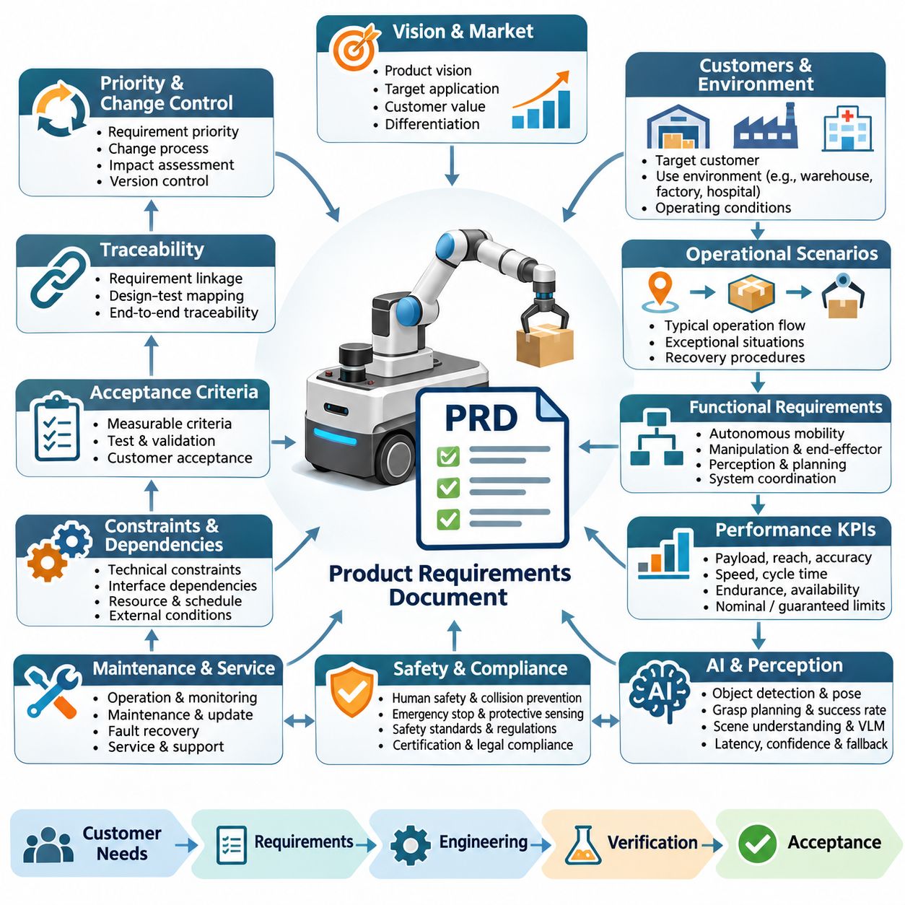
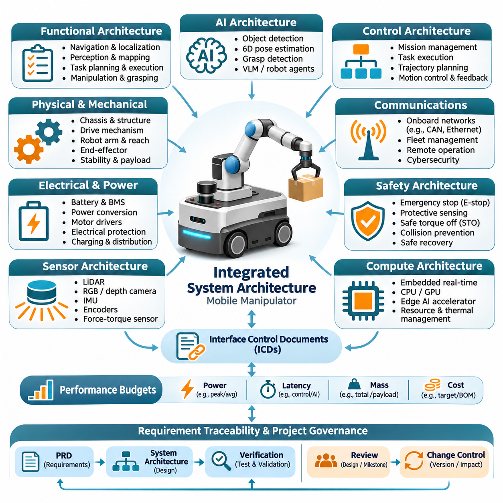
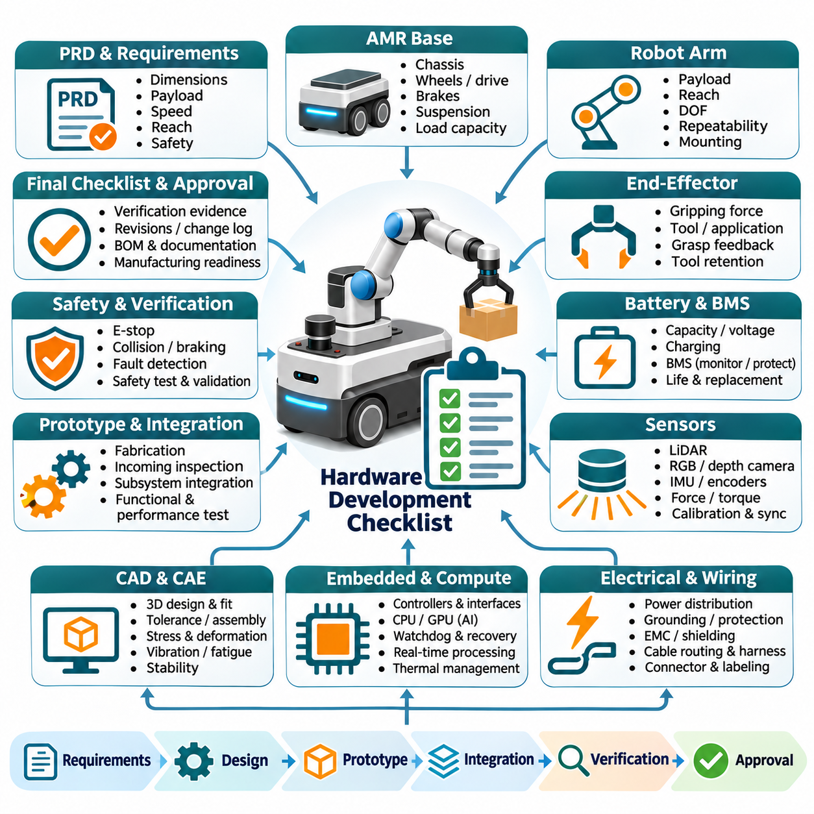
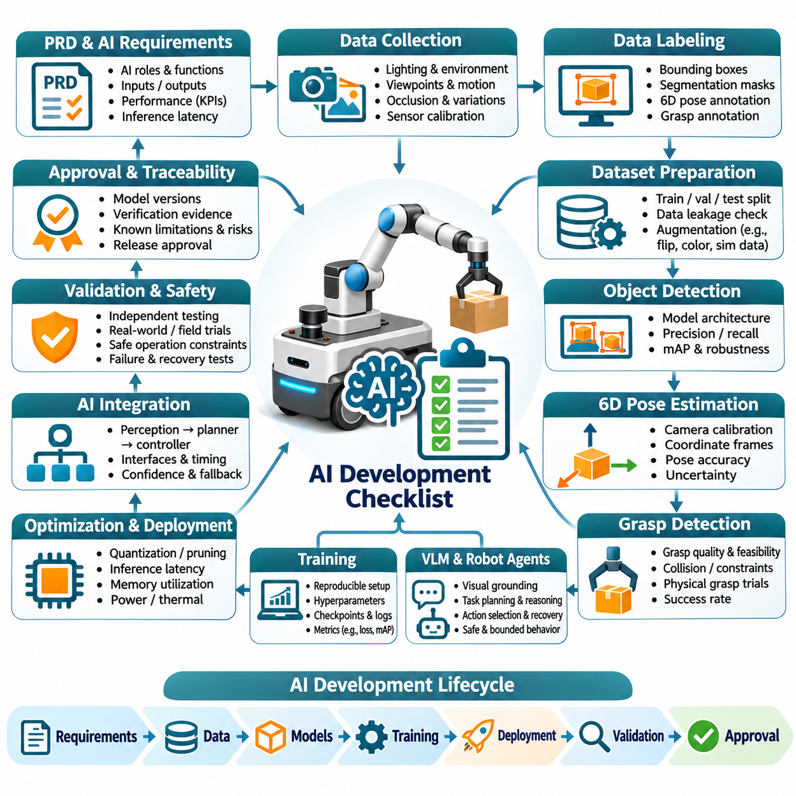
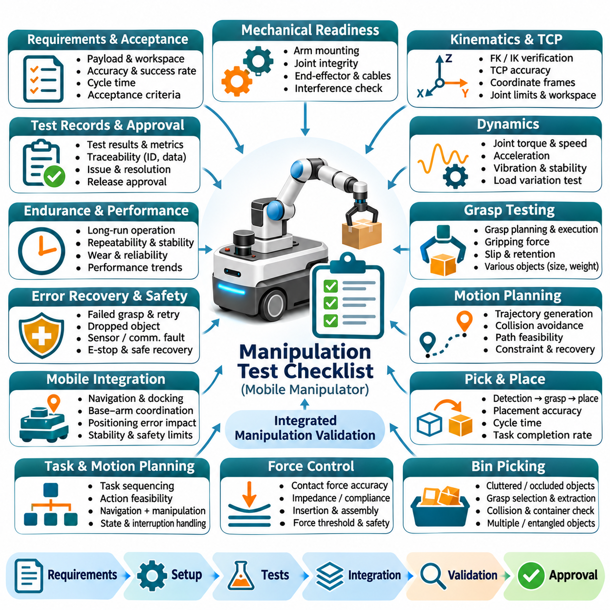
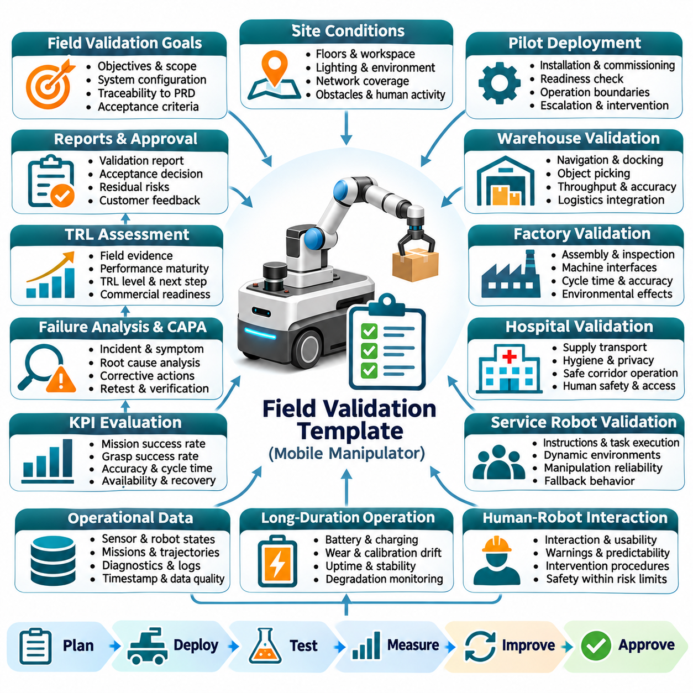
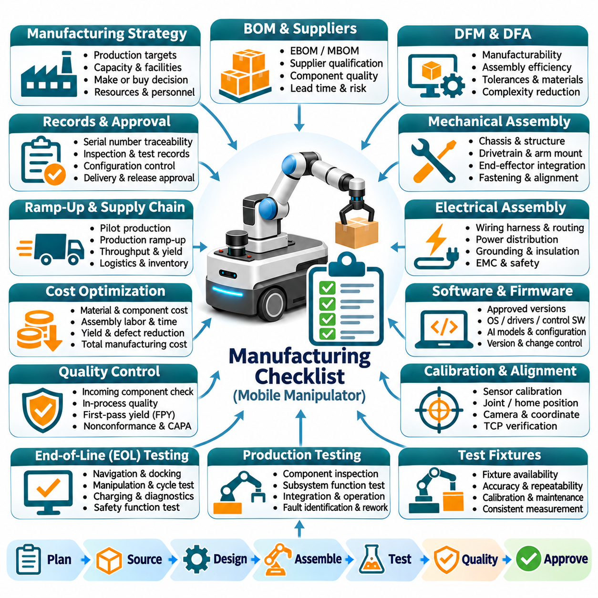
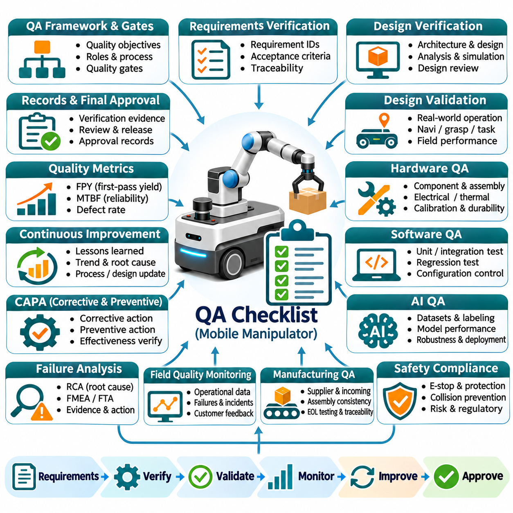
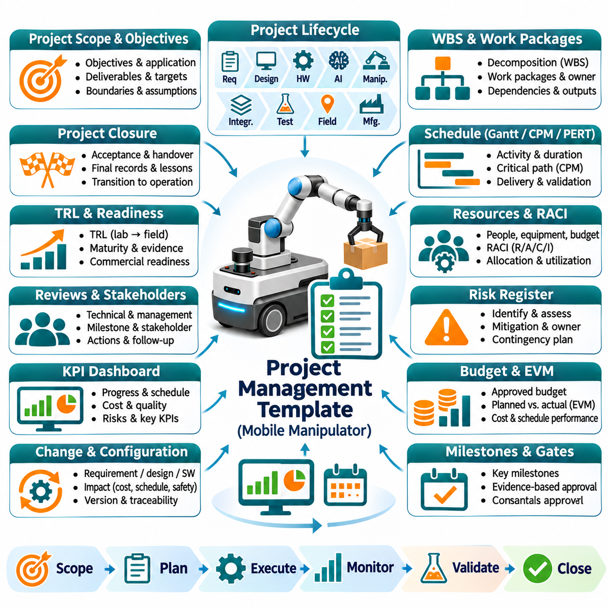

# Chapter 12. Checklists and Templates

## 01 PRD Template

{width="7.268055555555556in" height="7.268055555555556in"}

제품 요구사항 문서(Product Requirements Document, PRD)는 모바일 매니퓰레이터(Mobile Manipulator) 제품이 달성해야 하는 목표, 대상 고객 및 수행해야 하는 운영 조건을 정의하는 기본 참조 문서이다. 시장 기대사항(Market Expectations), 고객 요구사항(Customer Requirements), 사업 목표(Business Objectives)를 구조화된 제품 요구사항으로 변환한다. PRD는 제품 관리, 기계공학, 전기공학, 로봇공학, 인공지능(AI), 소프트웨어, 안전, 제조 및 프로젝트 관리 조직 간의 공통된 이해를 확립해야 한다.

문서는 제품 비전(Product Vision)과 목표 시장 포지셔닝(Market Positioning)으로 시작한다. 목표 응용 분야, 기대 고객 가치, 경쟁 차별화 요소 및 모바일 매니퓰레이터가 해결해야 하는 주요 문제를 설명한다. 예를 들어, 물류창고용 모바일 매니퓰레이터는 자율 운송(Autonomous Transportation), 객체 인식(Object Recognition), 로봇 피킹(Robotic Picking), 자재 취급(Material Handling)을 결합할 수 있다. 제품 비전은 개별 기술을 단순히 나열하기보다는 이러한 기능이 운영 효율성에 어떻게 기여하는지를 설명해야 한다.

목표 고객(Target Customer)과 운영 환경(Operational Environment)은 명확하게 식별되어야 한다. PRD는 제품이 물류창고, 공장, 병원, 건설 현장, 연구실 또는 서비스 환경을 대상으로 하는지를 설명해야 한다. 각 응용 분야는 바닥 상태, 가용 작업공간(Workspace), 인간과의 상호작용(Human Interaction), 적재하중(Payload) 특성, 운영 시간, 환경 조건 및 인프라와 관련하여 서로 다른 요구사항을 가진다. 이러한 요소들은 기술적 요구사항을 평가하기 위한 기준 환경을 확립한다.

고객 요구사항(Customer Requirements)은 측정 가능한 제품 기대사항으로 변환되어야 한다. 쉬운 조작, 정확한 위치 결정, 신뢰성 높은 피킹 및 연속 운영과 같은 표현은 측정 가능한 인수 기준(Acceptance Criteria)이 연결되지 않는다면 충분하지 않다. PRD는 자율주행 정확도(Navigation Accuracy), 조작 정밀도(Manipulation Precision), 적재 용량(Payload Capacity), 사이클 시간(Cycle Time), 임무 완료율(Mission Completion Rate), 운영 지속시간 및 복구 성능(Recovery Performance)과 같은 관련 매개변수를 정의해야 한다. 정량적 정의는 모호성을 줄이고 설계 의사결정과 검증을 위한 일관된 기준을 제공한다.

운영 시나리오(Operational Scenarios)는 모바일 매니퓰레이터가 전체 운영 수명주기(Operational Lifecycle)에서 어떻게 사용되는지를 설명한다. 대표적인 시나리오에는 작업 스테이션까지의 자율주행, 목표물에 대한 상대적 위치 추정(Localization), 로봇 암 전개, 객체 검출(Object Detection), 파지 계획(Grasp Planning), 조작(Manipulation), 운송 및 충전 스테이션 복귀가 포함된다. PRD는 경로 차단, 예상하지 못한 장애물, 위치 추정 실패, 객체 낙하, 통신 중단 및 조작 복구와 같은 예외 상황도 고려해야 한다. 이러한 시나리오는 개별 구성요소의 사양만으로는 확인하기 어려운 요구사항을 식별하는 데 도움이 된다.

기능 요구사항(Functional Requirements)은 제품이 제공해야 하는 기능을 정의한다. 자율 이동(Autonomous Mobility), 위치 추정(Localization), 지도 생성(Mapping), 장애물 회피(Obstacle Avoidance), 작업 스케줄링(Task Scheduling), 로봇 암 제어, 말단장치(End-Effector) 작동, 객체 인식, 파지 계획 및 모바일 플랫폼과 매니퓰레이터 간의 협조 제어를 포함한다. 각각의 요구사항은 기대되는 시스템 동작과 해당 운영 조건을 설명해야 한다. 또한 시스템 통합(System Integration) 전반에서 기능적 책임의 일관성을 유지할 수 있도록 하위 시스템 간의 인터페이스(Interface)도 고려해야 한다.

성능 요구사항(Performance Requirements)은 제품 운영에 대한 측정 가능한 한계와 기준을 확립한다. 관련 매개변수에는 최대 적재하중, 매니퓰레이터 도달거리(Reach), 위치 결정 정확도(Positioning Accuracy), 자율주행 속도, 회전 능력, 조작 사이클 시간, 위치 추정 안정성, 배터리 지속시간, 충전 시간 및 시스템 가용성(System Availability)이 포함된다. 성능은 이상적인 실험실 환경뿐만 아니라 대표적인 실제 운영 조건에서 평가되어야 한다. PRD는 제품 개발 및 고객 인수 과정에서 비현실적인 기대를 방지하기 위해 공칭 성능(Nominal Performance), 보장 성능(Guaranteed Performance) 및 환경적 한계를 구분해야 한다.

인공지능 요구사항(AI Requirements)은 모바일 매니퓰레이터에 기대되는 지능 수준을 정의한다. 이러한 요구사항에는 객체 검출 정확도(Object Detection Accuracy), 6차원 객체 자세 추정(6D Object Pose Estimation), 파지 성공률(Grasp Success Rate), 장면 이해(Scene Understanding), 시각적 위치 추정(Visual Localization), 작업 인식(Task Recognition) 및 복구 의사결정 성능이 포함될 수 있다. 비전 언어 모델(Vision-Language Model, VLM), 로봇 에이전트(Robot Agent) 또는 체화 인공지능(Embodied AI)이 적용되는 경우, PRD는 이들의 책임과 운영 경계를 설명해야 한다. AI 성능에는 측정 가능한 평가 조건, 데이터셋 가정, 추론 지연시간(Inference Latency), 신뢰도 처리 및 모델이 신뢰할 수 있는 결과를 생성하지 못할 때의 동작이 포함되어야 한다.

안전 요구사항(Safety Requirements)은 제품이 사람, 장비 및 인프라 주변에서 운영될 수 있는 조건을 확립한다. PRD는 비상 정지(Emergency Stop), 충돌 방지(Collision Prevention), 보호 감지(Protective Sensing), 속도 및 분리 거리 모니터링(Speed and Separation Monitoring), 매니퓰레이터 작업공간 제한, 안전 토크 차단(Safe Torque Off, STO) 및 위험 상황으로부터의 복구를 다루어야 한다. 어느 한쪽 하위 시스템의 움직임도 전체 기계에 위험을 초래할 수 있으므로 안전 요구사항은 자율이동로봇(Autonomous Mobile Robot, AMR)과 로봇 암의 통합 동작을 고려해야 한다. 적용 가능한 안전 표준과 규제 의무는 요구사항 정의 단계에서 식별되어야 한다.

규제 요구사항(Regulatory Requirements)은 제품 설계, 제조, 설치 및 운영에 영향을 미칠 수 있는 인증(Certification), 표준(Standards) 및 법적 조건을 설명한다. 목표 시장과 응용 분야에 따라 기계 안전(Machinery Safety), 산업용 로봇 안전(Industrial Robot Safety), 이동 로봇 안전(Mobile Robot Safety), 전기 안전(Electrical Safety), 전자파 적합성(Electromagnetic Compatibility, EMC), 무선 통신(Wireless Communication) 및 사이버 보안(Cybersecurity) 요구사항이 포함될 수 있다. PRD는 적용되는 법적 관할권을 식별하고 의무적인 규제 준수 요구사항과 선택적인 고객 사양을 구분해야 한다. 제품 구성이나 의도된 응용 분야의 변경으로 추가적인 의무가 발생할 수 있으므로 규제 관련 가정은 개발 전반에서 검토되어야 한다.

유지보수 요구사항(Maintenance Requirements)은 제품이 배치된 이후 어떻게 점검, 정비, 수리 및 업그레이드되는지를 정의한다. 배터리 교체, 구동장치(Drive Unit) 유지보수, 휠 및 서스펜션 점검, 센서 교정(Sensor Calibration), 매니퓰레이터 정비, 소프트웨어 업데이트, 진단 접근(Diagnostic Access), 예비 부품(Spare Parts) 및 기술 지원을 포함해야 한다. PRD는 고장 검출(Fault Detection), 유지보수 주기, 정비 용이성(Serviceability) 및 일반적인 고장으로부터의 복구에 대한 기대사항도 확립해야 한다. 모바일 매니퓰레이터의 전체 운영 가치는 초기 성능뿐만 아니라 장기적인 가용성에 의존하기 때문에 이러한 요구사항은 중요하다.

PRD는 명확한 가정(Assumptions), 제약조건(Constraints) 및 의존성(Dependencies)을 포함해야 한다. 가정에는 시설 인프라, 바닥 품질, 무선 네트워크 가용성, 객체 특성, 작업 스테이션의 기하학적 구조 및 고객 운영 절차가 포함될 수 있다. 제약조건에는 기계적 치수, 최대 시스템 중량, 배터리 용량, 컴퓨팅 자원, 제조 원가 또는 납품 일정이 포함될 수 있다. 의존성에는 외부 공급업체의 로봇 암, 센서, 자율주행 소프트웨어, 플릿 관리 시스템(Fleet Management System, FMS) 및 외부 인프라가 포함될 수 있다. 이러한 조건을 기록하면 위험을 식별하고 요구사항 변경에 따른 영향을 이해하기 쉬워진다.

모든 주요 요구사항에는 인수 기준(Acceptance Criteria)이 정의되어야 한다. 각 기준은 무엇을 측정하고, 어떠한 조건에서 어떤 방법을 사용하며, 어떤 결과를 성공으로 판단하는지를 명시해야 한다. 예를 들어, 위치 결정 요구사항은 기준 좌표계(Reference Coordinate System), 측정 절차, 시험 환경 및 허용 오차 범위를 식별해야 한다. 이와 유사하게 조작 성공 요구사항은 대상 객체 집단, 파지 조건, 시험 횟수 및 실패한 작업의 처리 방법을 정의해야 한다. 인수 기준은 설계 검증(Design Verification), 시스템 시험(System Testing) 및 고객 유효성 확인(Customer Validation)을 위한 객관적인 기반을 제공한다.

요구사항에는 고유 식별자(Unique Identifier)가 부여되어야 하며 전체 제품 수명주기에서 추적성(Traceability)이 유지되어야 한다. 각각의 요구사항은 최초 고객 요구, 해당 시스템 기능, 담당 엔지니어링 하위 시스템, 검증 방법(Verification Method) 및 최종 시험 증거(Test Evidence)와 연결되어야 한다. 이러한 관계를 통해 프로젝트 팀은 모든 요구사항이 구현되고 검증되었는지를 판단할 수 있다. 또한 고객이 변경을 요청하거나 엔지니어링 제약조건으로 설계 변경이 필요한 경우 영향 분석(Impact Analysis)을 지원한다.

PRD는 필수 요구사항(Mandatory Requirements), 권장 기능(Desirable Capabilities) 및 미래 개발 기회(Future Development Opportunities)를 구분해야 한다. 필수 요구사항은 제품 인수를 위한 최소 조건을 정의하며, 권장 기능은 자원과 일정이 허용되는 경우 추가적인 가치를 제공한다. 미래 기능에는 고도화된 체화 인공지능(Embodied AI), 다중 로봇 협업(Multi-Robot Collaboration), 자율 학습(Autonomous Learning), 예측 유지보수(Predictive Maintenance) 및 기업 시스템과의 통합이 포함될 수 있다. 이러한 분류는 프로젝트 관리 조직이 개발 범위를 통제하고 선택적 기능이 필수 제품 기능을 저해하는 것을 방지하도록 지원한다.

실용적인 PRD는 요구사항 담당 책임(Requirement Ownership), 개정 이력(Revision History), 승인 상태(Approval Status) 및 변경 관리(Change Management) 절차도 포함해야 한다. 각각의 요구사항에는 기술적 의미를 명확하게 설명하고 검증 계획에 참여할 수 있는 담당 책임자가 지정되어야 한다. 변경사항은 아키텍처, 하드웨어, 소프트웨어, AI 모델, 안전, 비용, 일정 및 제조에 미치는 영향을 기준으로 평가되어야 한다. 공식적인 검토와 승인 절차는 통제되지 않은 변경사항이 여러 엔지니어링 조직으로 확산되는 것을 방지한다.

완성된 PRD는 이후의 시스템 아키텍처(System Architecture), 하드웨어 개발(Hardware Development), AI 개발(AI Development), 조작 개발(Manipulation Development), 시험(Testing), 현장 유효성 확인(Field Validation), 제조(Manufacturing) 및 품질 보증(Quality Assurance)을 위한 핵심 참조 문서가 된다. PRD는 일회성 계획 보고서가 아니라 통제되는 엔지니어링 문서(Controlled Engineering Document)로 유지되어야 한다. 개발이 진행됨에 따라 기술 검토, 프로토타입 시험, 고객 피드백 및 현장 증거를 통해 요구사항을 구체화할 수 있다. 승인된 모든 변경사항은 최초 제품 목표에 대한 추적성을 유지해야 한다.

궁극적으로 효과적인 PRD는 고객 기대사항(Customer Expectations), 엔지니어링 실행(Engineering Execution) 및 제품 인수(Product Acceptance)를 연결한다. 모바일 매니퓰레이터가 독립적으로 최적화된 하위 시스템의 집합이 아니라 하나의 통합 제품(Integrated Product)으로 개발되도록 보장한다. 프로젝트 초기 단계에서 측정 가능한 요구사항, 운영 경계(Operational Boundaries), 안전 기대사항 및 인수 조건을 정의함으로써 PRD는 개발 불확실성(Development Uncertainty)을 감소시키고 신뢰성(Reliability), 유지보수성(Maintainability) 및 상업적 실현 가능성(Commercial Viability)을 갖춘 모바일 매니퓰레이션 시스템을 제공하기 위한 일관된 기반을 확립한다.

## 02 System Architecture Template

{width="7.268055555555556in" height="7.268055555555556in"}

시스템 아키텍처 템플릿(System Architecture Template)은 모바일 매니퓰레이터(Mobile Manipulator)의 구조적, 기능적 및 운영적 구성을 정의하기 위한 표준화된 프레임워크(Framework)를 제공한다. 승인된 제품 요구사항(Product Requirements)을 자율이동로봇(Autonomous Mobile Robot, AMR), 로봇 매니퓰레이터(Robotic Manipulator), 인지 시스템(Perception System), 컴퓨팅 플랫폼(Computing Platform), 제어 소프트웨어(Control Software) 및 안전 인프라(Safety Infrastructure)를 연결하는 통합 엔지니어링 아키텍처로 변환한다. 이러한 아키텍처는 다학제적 개발(Multidisciplinary Development)을 위한 공통의 기술적 기반을 확립한다.

템플릿은 시스템 개요(System Overview), 아키텍처 목표(Architectural Objectives), 의도된 응용 분야(Intended Applications) 및 기본 설계 원칙(Design Principles)으로 시작한다. 이 부분에서는 목표 운영 환경, 지원 임무, 시스템 경계(System Boundaries), 외부 의존성(External Dependencies) 및 주요 엔지니어링 제약조건을 식별한다. 제안된 아키텍처가 제품 요구사항 문서(Product Requirements Document, PRD)를 충족하면서 모듈성(Modularity), 확장성(Scalability), 신뢰성(Reliability), 유지보수성(Maintainability) 및 향후 제품 확장을 어떻게 지원하는지 설명해야 한다.

기능 아키텍처(Functional Architecture)는 특정 하드웨어 구현 방식과 독립적으로 모바일 매니퓰레이터가 수행해야 하는 기능을 설명한다. 자율주행(Autonomous Navigation), 위치 추정(Localization), 환경 인지(Environmental Perception), 작업 계획(Task Planning), 로봇 조작(Robotic Manipulation), 파지 실행(Grasp Execution), 배터리 관리(Battery Management) 및 운영 모니터링(Operational Monitoring)을 정의한다. 기능 분해(Functional Decomposition)는 시스템 기능 간의 관계를 확립하고 개별 기능이 복잡한 로봇 임무를 완료하기 위해 어떻게 협력하는지를 명확하게 설명한다.

물리 아키텍처(Physical Architecture)는 시스템 기능을 실제 하드웨어 및 소프트웨어 구성요소에 할당하는 방식을 설명한다. 모바일 플랫폼(Mobile Platform), 로봇 암(Robotic Arm), 말단장치(End-Effector), 센서(Sensor), 모터 제어기(Motor Controller), 임베디드 프로세서(Embedded Processor), 엣지 컴퓨팅 장치(Edge Computing Device), 통신 인터페이스(Communication Interface) 및 전력 분배 장비(Power Distribution Equipment)를 식별한다. 효율적인 통합을 지원하기 위해 각 구성요소의 책임, 설치 위치 및 인접 하위 시스템과의 관계가 명확하게 정의되어야 한다.

기계 아키텍처(Mechanical Architecture)는 모바일 매니퓰레이터의 구조적 구성을 확립한다. 섀시 치수(Chassis Dimensions), 구동 메커니즘(Drive Mechanism), 매니퓰레이터 장착 구성(Manipulator Mounting Arrangement), 구조 재료(Structural Materials), 적재하중 분포(Payload Distribution), 무게중심(Center of Gravity) 및 기계적 인터페이스(Mechanical Interface)를 포함한다. 특히 자율주행과 조작이 결합된 동작에서의 안정성(Stability), 진동 전달(Vibration Transmission), 구조적 변형(Structural Deformation), 유지보수 접근성(Maintenance Accessibility) 및 이동 구성요소 간의 기계적 간섭(Mechanical Interference)에 주의를 기울여야 한다.

전기 아키텍처(Electrical Architecture)는 전력 생성(Power Generation), 에너지 저장(Energy Storage), 전력 변환(Power Conversion), 전력 분배(Electrical Distribution), 접지(Grounding), 보호(Protection) 및 배선 연결(Wiring Connections)을 정의한다. 배터리 관리 시스템(Battery Management System, BMS), 충전 인터페이스(Charging Interface), 모터 드라이버(Motor Driver), 전압 영역(Voltage Domain), 비상 전원 차단(Emergency Power Isolation) 및 보조 전기 부하(Auxiliary Electrical Load)를 설명해야 한다. 전기적 사양은 최대 순간 전력 소비(Peak Power Consumption), 액추에이터의 동시 작동, 전자파 적합성(Electromagnetic Compatibility, EMC) 및 전기적 고장에 대한 보호를 고려해야 한다.

센서 아키텍처(Sensor Architecture)는 자율 이동(Autonomous Mobility), 환경 이해(Environmental Understanding) 및 로봇 조작에 필요한 센싱 기술(Sensing Technology)을 식별한다. 대표적인 구성요소에는 라이다(LiDAR), RGB 카메라(RGB Camera), 깊이 카메라(Depth Camera), 관성 측정 장치(Inertial Measurement Unit, IMU), 휠 엔코더(Wheel Encoder), 근접 센서(Proximity Sensor) 및 힘·토크 센서(Force-Torque Sensor)가 포함된다. 템플릿은 센서 배치(Sensor Placement), 측정 범위, 정확도, 샘플링 주파수(Sampling Frequency), 교정 절차(Calibration Procedure), 시간 동기화(Time Synchronization), 좌표 변환(Coordinate Transformation) 및 환경적 한계를 명시해야 한다.

컴퓨팅 아키텍처(Computing Architecture)는 임베디드 제어기(Embedded Controller), 중앙처리장치(Central Processing Unit, CPU), 그래픽처리장치(Graphics Processing Unit, GPU), 엣지 AI 가속기(Edge AI Accelerator) 및 외부 서버 간의 연산 책임 분배를 정의한다. 자원 할당(Resource Allocation)은 실시간 제어(Real-Time Control), 자율주행, 인지, AI 추론(AI Inference), 작업 오케스트레이션(Task Orchestration) 및 진단 처리를 구분해야 한다. 연산 용량(Computational Capacity), 메모리 요구사항(Memory Requirements), 열 관리(Thermal Management), 통신 대역폭(Communication Bandwidth) 및 처리 지연시간(Processing Latency)도 문서화되어야 한다.

인공지능 아키텍처(AI Architecture)는 인지(Perception), 추론(Reasoning), 의사결정(Decision-Making) 및 조작(Manipulation)을 지원하는 지능형 기능의 구성을 설명한다. 객체 검출(Object Detection), 6차원 자세 추정(6D Pose Estimation), 파지 검출(Grasp Detection), 의미론적 지도 생성(Semantic Mapping), 비전 언어 모델(Vision-Language Model, VLM) 및 로봇 에이전트(Robot Agent)를 포함할 수 있다. 각 AI 구성요소는 입력 데이터(Input Data), 출력 표현(Output Representation), 추론 요구사항(Inference Requirements), 신뢰도 임계값(Confidence Threshold), 운영 한계(Operational Limitations) 및 예측 결과를 신뢰할 수 없는 경우의 대체 동작(Fallback Behavior)을 명시해야 한다.

제어 아키텍처(Control Architecture)는 임무 관리(Mission Management), 작업 실행(Task Execution), 궤적 계획(Trajectory Planning), 모션 제어(Motion Control) 및 액추에이터 수준의 피드백 루프(Actuator-Level Feedback Loop) 간의 계층적 관계를 확립한다. 모바일 플랫폼과 로봇 매니퓰레이터가 안정성과 운영 안전성을 유지하면서 어떻게 동작을 동기화하는지를 정의해야 한다. 제어 주파수(Control Frequency), 응답 시간(Response Time), 명령 우선순위(Command Priority), 상태 전이(State Transition), 피드백 메커니즘(Feedback Mechanism) 및 고장 처리 책임(Fault-Handling Responsibility)은 명시적으로 정의되어야 한다.

통신 아키텍처(Communication Architecture)는 온보드 하위 시스템(Onboard Subsystem), 플릿 관리 플랫폼(Fleet Management Platform), 원격 운영 센터(Remote Operation Center) 및 외부 기업 시스템(Enterprise System) 간의 정보 교환을 설명한다. 통신 프로토콜(Communication Protocol), 네트워크 토폴로지(Network Topology), 메시지 형식(Message Format), 대역폭 요구사항(Bandwidth Requirements), 동기화 메커니즘(Synchronization Mechanism) 및 사이버 보안 대책(Cybersecurity Provisions)을 명시해야 한다. 통신 장애(Communication Failure), 메시지 지연(Message Delay), 일관되지 않은 시스템 상태 및 네트워크 중단(Network Interruption)은 적절한 검출 및 복구 메커니즘을 통해 처리되어야 한다.

안전 아키텍처(Safety Architecture)는 보호 기능(Protective Function)과 운영 제어기(Operational Controller) 간의 관계를 정의한다. 비상 정지(Emergency Stop), 보호 감지(Protective Sensing), 안전 토크 차단(Safe Torque Off, STO), 충돌 방지(Collision Prevention), 속도 제한(Speed Limitation), 작업공간 모니터링(Workspace Monitoring) 및 안전 복구(Safe Recovery)를 다루어야 한다. 안전 관련 기능(Safety-Related Function)은 위험 평가(Risk Assessment)에 따라 할당되어야 하며 일반 제어 및 AI 처리로부터 적절한 독립성(Independence)을 확보해야 한다. 안전 요구사항은 모바일 플랫폼과 매니퓰레이터의 통합 동작을 포괄해야 한다.

인터페이스 제어 문서(Interface Control Document, ICD)는 상호 연결된 하위 시스템 간의 공식적인 합의사항을 확립한다. 각각의 인터페이스 정의는 관련 구성요소, 기계적 연결 사양(Mechanical Connection Specification), 전기적 특성(Electrical Characteristics), 통신 프로토콜, 데이터 구조(Data Structure), 좌표 규약(Coordinate Convention), 타이밍 요구사항(Timing Requirements) 및 오류 처리 절차(Error-Handling Procedure)를 식별해야 한다. 다학제적 개발 과정에서 통합 실패(Integration Failure)를 줄이기 위해 인터페이스 관리 책임(Interface Ownership), 버전 호환성(Version Compatibility) 및 승인된 변경사항이 통제되어야 한다.

템플릿은 아키텍처 성능 예산(Architectural Performance Budget)과 요구사항 추적성(Requirement Traceability)을 포함해야 한다. 전력 소비(Power Consumption), 연산 자원 사용률(Computational Utilization), 통신 지연시간(Communication Latency), 위치 결정 불확실성(Positioning Uncertainty), 시스템 중량(System Mass) 및 제조 원가(Manufacturing Cost)는 관련 하위 시스템에 할당되어야 한다. 각각의 아키텍처 요소는 최초 요구사항, 엔지니어링 사양(Engineering Specification) 및 계획된 검증 활동(Verification Activity)과 연결되어야 한다. 이러한 접근 방식은 체계적인 절충 분석(Trade-off Analysis)을 지원하고 통제되지 않은 자원 할당을 방지한다.

아키텍처 의사결정(Architectural Decision), 기술적 가정(Technical Assumption), 의존성(Dependency) 및 엔지니어링 위험(Engineering Risk)은 대안 설계 방안(Alternative Design Option)과 함께 문서화되어야 한다. 템플릿은 구성요소 선정(Component Selection), 하위 시스템 분할(Subsystem Partitioning), 통신 표준(Communication Standard) 및 안전 구현 전략(Safety Implementation Strategy)에 대한 근거를 기록해야 한다. 아키텍처 검토(Architectural Review)는 승인 이전에 기술적 실현 가능성(Technical Feasibility), 요구사항 충족 범위(Requirement Coverage), 인터페이스 완전성(Interface Completeness), 통합 준비도(Integration Readiness), 제조 제약조건(Manufacturing Constraints) 및 장기적인 정비 용이성(Long-Term Serviceability)을 평가해야 한다.

완성된 시스템 아키텍처 템플릿(System Architecture Template)은 하드웨어 개발(Hardware Development), AI 개발(AI Development), 조작 개발(Manipulation Development), 시험(Testing), 현장 유효성 확인(Field Validation), 제조(Manufacturing) 및 품질 보증(Quality Assurance) 전반에서 통제된 엔지니어링 참조 문서(Controlled Engineering Reference)로 활용된다. 문서 관리 책임(Document Ownership), 형상 식별(Configuration Identification), 개정 이력(Revision History), 승인 상태(Approval Status) 및 변경 관리 절차(Change Management Procedure)는 지속적으로 유지되어야 한다. 표준화된 아키텍처(Standardized Architecture)는 반복 가능한 엔지니어링 실행(Repeatable Engineering Execution)을 지원하고 신뢰성, 확장성 및 상업적 실현 가능성(Commercial Viability)을 갖춘 모바일 매니퓰레이터의 개발을 가능하게 한다.

## 03 Hardware Development Checklist

{width="7.268055555555556in" height="7.268055555555556in"}

하드웨어 개발 체크리스트(Hardware Development Checklist)는 모바일 매니퓰레이터(Mobile Manipulator)의 물리적 구성요소가 승인된 제품 요구사항(Product Requirements), 엔지니어링 사양(Engineering Specifications), 안전 목표(Safety Objectives) 및 제조 제약조건(Manufacturing Constraints)을 충족하는지 검증하기 위한 체계적인 프레임워크(Framework)를 제공한다. 초기 구성요소 선정(Component Selection)과 아키텍처 설계(Architecture Design)부터 프로토타입 제작(Prototype Fabrication), 하위 시스템 통합(Subsystem Integration), 성능 검증(Performance Verification) 및 생산 준비도(Production Readiness)에 이르기까지 전체 하드웨어 개발 수명주기(Hardware Development Lifecycle)를 포괄한다.

체크리스트는 하드웨어 요구사항(Hardware Requirements)과 시스템 아키텍처 검증(System Architecture Verification)으로 시작해야 한다. 엔지니어링 팀은 기계적 치수(Mechanical Dimensions), 적재 용량(Payload Capacity), 운영 속도(Operating Speed), 조작 도달거리(Manipulation Reach), 전력 요구사항(Power Requirements), 환경 조건(Environmental Conditions) 및 안전 제약조건(Safety Constraints)이 명확하게 정의되었는지 확인해야 한다. 개발 과정에서 불일치를 방지하기 위해 각각의 하드웨어 사양은 제품 요구사항 문서(Product Requirements Document, PRD) 및 해당 시스템 아키텍처에 대한 추적성(Traceability)을 확보해야 한다.

자율이동로봇(Autonomous Mobile Robot, AMR) 베이스는 이동성 요구사항(Mobility Requirements)과 구조적 요구사항(Structural Requirements)을 기준으로 평가되어야 한다. 검증에는 섀시 치수(Chassis Dimensions), 구조 강도(Structural Strength), 최저 지상고(Ground Clearance), 휠 구성(Wheel Configuration), 구동 메커니즘(Drive Mechanism), 조향 성능(Steering Performance), 제동 능력(Braking Capability) 및 서스펜션 특성(Suspension Characteristics)이 포함되어야 한다. 엔지니어는 모바일 플랫폼(Mobile Platform)이 로봇 암, 말단장치(End-Effector), 적재하중, 배터리 시스템 및 온보드 컴퓨팅 장비(Onboard Computing Equipment)의 전체 중량을 지지할 수 있는지 확인해야 한다.

매니퓰레이터 선정(Manipulator Selection)은 적재 용량(Payload Capacity), 도달거리(Reach), 자유도(Degrees of Freedom, DoF), 위치 결정 반복정밀도(Positioning Repeatability), 관절 토크(Joint Torque), 동작 속도(Motion Speed) 및 제어기 호환성(Controller Compatibility)을 고려해야 한다. 체크리스트는 선정된 로봇 암이 가용 작업공간(Available Workspace) 내에서 의도된 조작 작업을 수행할 수 있는지 검증해야 한다. 장착 강성(Mounting Rigidity), 동적 하중(Dynamic Loading), 무게중심 이동(Center-of-Gravity Displacement), 케이블 배치(Cable Routing) 및 기계적 간섭(Mechanical Interference)도 대표적인 운영 조건에서 평가되어야 한다.

말단장치 개발(End-Effector Development)은 기계적 호환성(Mechanical Compatibility), 파지력(Gripping Force), 객체 치수(Object Dimensions), 적재하중 특성(Payload Characteristics) 및 도구 장착 메커니즘(Tool Attachment Mechanism)에 대한 검증이 필요하다. 의도된 응용 분야에 따라 시스템은 기계식 그리퍼(Mechanical Gripper), 진공 그리퍼(Vacuum Gripper), 적응형 손가락(Adaptive Finger) 또는 특수 목적 도구(Specialized Tool)를 적용할 수 있다. 체크리스트에는 도구 고정(Tool Retention), 객체 감지(Object Detection), 파지 피드백(Grasp Feedback), 내마모성(Wear Resistance), 교체 절차(Replacement Procedure) 및 의도하지 않은 객체 이탈(Unintended Object Release)의 방지가 포함되어야 한다.

배터리 시스템 검증(Battery System Verification)은 에너지 용량(Energy Capacity), 공칭 전압(Nominal Voltage), 최대 방전 전류(Peak Discharge Current), 충전 성능(Charging Performance), 작동 온도(Operating Temperature) 및 기대 사용 수명(Expected Service Life)을 다루어야 한다. 배터리 관리 시스템(Battery Management System, BMS)은 전기적 및 열적 고장(Electrical and Thermal Fault)에 대한 적절한 모니터링과 보호 기능을 제공해야 한다. 엔지니어는 배터리 장착(Battery Mounting), 외함 보호(Enclosure Protection), 전기적 절연(Electrical Isolation), 교체 접근성(Replacement Accessibility) 및 자율 충전 인프라(Autonomous Charging Infrastructure)와의 호환성을 평가해야 한다.

센서 통합(Sensor Integration)은 센싱 범위(Sensing Coverage), 측정 정확도(Measurement Accuracy), 장착 안정성(Mounting Stability) 및 환경 내성(Environmental Resistance)이 운영 요구사항을 충족하는지 확인하기 위해 검토되어야 한다. 라이다(LiDAR), RGB 카메라(RGB Camera), 깊이 카메라(Depth Camera), 관성 측정 장치(Inertial Measurement Unit, IMU), 휠 엔코더(Wheel Encoder), 근접 센서(Proximity Sensor) 및 힘·토크 센서(Force-Torque Sensor)는 적절한 위치에 배치되어야 한다. 센서 교정(Sensor Calibration), 좌표 정렬(Coordinate Alignment), 시간 동기화(Time Synchronization), 진동 절연(Vibration Isolation) 및 케이블 보호(Cable Protection)도 검증되어야 한다.

전기 시스템 개발(Electrical System Development)은 전력 분배(Power Distribution), 전압 변환(Voltage Conversion), 전류 용량(Current Capacity), 접지(Grounding), 회로 보호(Circuit Protection) 및 전기적 절연(Electrical Isolation)에 대한 검증을 포함해야 한다. 체크리스트는 전기적 구성요소가 연속 부하(Continuous Load), 액추에이터의 최대 전력 요구량(Peak Actuator Demand), 해당되는 경우의 회생 에너지(Regenerative Energy) 및 하위 시스템의 동시 작동을 수용할 수 있는지 확인해야 한다. 전자파 적합성(Electromagnetic Compatibility, EMC), 커넥터 정격(Connector Rating), 보호 장치(Protective Device) 및 열적 특성(Thermal Characteristics)도 평가되어야 한다.

와이어링 하네스 개발(Wiring Harness Development)은 케이블 사양(Cable Specification), 커넥터 선정(Connector Selection), 터미널 호환성(Terminal Compatibility), 배선 경로(Routing Path), 기계적 고정(Mechanical Retention) 및 식별 라벨(Identification Label)에 대한 면밀한 검토가 필요하다. 와이어링 하네스는 예상 운영 수명주기 전반에서 반복적인 움직임(Repeated Motion), 진동(Vibration), 마모(Abrasion) 및 환경 노출(Environmental Exposure)을 견딜 수 있어야 한다. 전력 케이블(Power Cable)과 통신 케이블(Communication Cable)은 필요에 따라 분리하거나 차폐(Shielding)해야 하며, 정비용 여유 배선(Service Loop)과 유지보수 접근성(Maintenance Access)도 충분히 확보되어야 한다.

임베디드 시스템 개발(Embedded System Development)은 프로세서 선정(Processor Selection), 메모리 용량(Memory Capacity), 주변장치 인터페이스(Peripheral Interface), 통신 프로토콜(Communication Protocol), 실시간 처리 요구사항(Real-Time Processing Requirements) 및 펌웨어 호환성(Firmware Compatibility)을 검증해야 한다. 임베디드 제어기(Embedded Controller)는 신뢰성 높은 액추에이터 통신(Actuator Communication), 센서 데이터 수집(Sensor Acquisition), 진단 모니터링(Diagnostic Monitoring) 및 고장 검출(Fault Detection)을 지원해야 한다. 하드웨어 워치독(Hardware Watchdog), 시동 동작(Startup Behavior), 전원 중단 후 복구(Power Interruption Recovery) 및 정의된 고장 대응(Failure Response)은 통합 시험(Integration Testing) 과정에서 평가되어야 한다.

온보드 컴퓨팅 플랫폼(Onboard Computing Platform)은 자율주행(Navigation), 인지(Perception), AI 추론(AI Inference) 및 조작 작업부하(Manipulation Workload)와의 호환성을 기준으로 평가되어야 한다. 중앙처리장치(Central Processing Unit, CPU) 및 그래픽처리장치(Graphics Processing Unit, GPU) 자원, 메모리 대역폭(Memory Bandwidth), 저장 용량(Storage Capacity), 네트워크 인터페이스(Network Interface) 및 전력 소비(Power Consumption)는 예상 운영 요구사항을 충족해야 한다. 과도한 온도 상승, 성능 제한(Performance Throttling) 및 예기치 않은 시스템 종료(System Shutdown)를 방지하기 위해 지속적인 연산 작업부하(Computational Workload) 조건에서 열 관리(Thermal Management)가 검증되어야 한다.

컴퓨터 지원 설계(Computer-Aided Design, CAD) 검증은 치수 정확도(Dimensional Accuracy), 조립 호환성(Assembly Compatibility), 제조 공차(Manufacturing Tolerance), 장착 인터페이스(Mounting Interface) 및 구성요소 접근성(Component Accessibility)을 확인해야 한다. 전체 기계 조립체(Mechanical Assembly)는 이동 부품, 센서, 와이어링 하네스 및 구조 요소 간의 간섭 여부를 검토해야 한다. 컴퓨터 지원 엔지니어링(Computer-Aided Engineering, CAE) 시뮬레이션은 대표적인 하중 조건(Loading Conditions)에서 구조 응력(Structural Stress), 변형(Deformation), 진동(Vibration), 피로(Fatigue) 및 안정성(Stability)을 평가해야 한다.

프로토타입 제작(Prototype Fabrication)은 통제된 엔지니어링 도면(Controlled Engineering Drawing), 승인된 재료 사양(Approved Material Specification) 및 정의된 조립 절차(Assembly Procedure)를 따라야 한다. 입고 구성요소(Incoming Component)는 치수 적합성(Dimensional Conformity), 재료 품질(Material Quality), 전기적 특성(Electrical Characteristics) 및 제조 결함(Manufacturing Defect)에 대해 검사되어야 한다. 프로토타입 조립 기록(Prototype Assembly Record)은 후속 설계 최적화(Design Optimization)를 지원하기 위해 사양 이탈(Deviation), 설치상의 어려움(Installation Difficulty), 구성요소 변경(Component Modification) 및 예상하지 못한 통합 문제(Integration Problem)를 문서화해야 한다.

하드웨어 통합 및 검증(Hardware Integration and Verification)은 정상 및 비정상 운영 조건(Normal and Abnormal Operating Conditions)에서 전체 모바일 매니퓰레이터를 평가해야 한다. 시험에는 이동 성능(Mobility Performance), 조작 정확도(Manipulation Accuracy), 구조적 안정성(Structural Stability), 전기적 부하(Electrical Loading), 열적 거동(Thermal Behavior), 통신 신뢰성(Communication Reliability) 및 배터리 지속시간(Battery Endurance)이 포함되어야 한다. 안전 관련 하드웨어(Safety-Related Hardware), 비상 정지(Emergency Stop), 보호 감지(Protective Sensing), 제동 메커니즘(Braking Mechanism) 및 고장 대응(Fault Response)은 적용 가능한 안전 요구사항을 기준으로 검증되어야 한다.

완성된 체크리스트는 검증 결과(Verification Results), 담당 엔지니어(Responsible Engineers), 근거 자료(Supporting Evidence), 미해결 문제(Unresolved Issues), 시정 조치(Corrective Actions) 및 승인 상태(Approval Status)를 기록해야 한다. 하드웨어 개정 이력(Hardware Revision), CAD 모델(CAD Model), 전기 회로도(Electrical Schematic), 자재 명세서(Bill of Materials, BOM) 및 구성요소 사양(Component Specification)은 형상 관리(Configuration Control)하에 유지되어야 한다. 최종 승인(Final Approval)은 하드웨어가 개발 목표(Development Objectives)를 충족하고 후속 시스템 유효성 확인(System Validation), 제조 준비(Manufacturing Preparation) 및 품질 보증(Quality Assurance)을 수행할 준비가 되었는지 확인해야 한다.

## 04 AI Development Checklist

{width="7.268055555555556in" height="7.268055555555556in"}

인공지능 개발 체크리스트(AI Development Checklist)는 모바일 매니퓰레이터(Mobile Manipulator)를 위해 개발된 인공지능 구성요소(AI Components)가 기능적 요구사항(Functional Requirements), 성능 요구사항(Performance Requirements), 신뢰성(Reliability), 안전성(Safety) 및 운영 요구사항(Operational Requirements)을 충족하도록 보장하기 위한 체계적인 프레임워크(Framework)를 제공한다. 요구사항 분석(Requirement Analysis), 데이터 수집(Data Collection), 데이터 라벨링(Data Labeling), 모델 선정(Model Selection), 학습(Training), 최적화(Optimization), 배포(Deployment), 통합(Integration) 및 대표적인 운영 환경에서의 유효성 확인(Validation)을 포함하는 전체 AI 개발 수명주기(AI Development Lifecycle)를 포괄한다.

체크리스트는 AI 요구사항 검증(AI Requirement Verification)과 승인된 제품 요구사항 문서(Product Requirements Document, PRD)와의 정합성(Alignment) 확인으로 시작해야 한다. 엔지니어링 팀은 각각의 AI 구성요소의 책임, 예상 입력 및 출력 특성(Input and Output Characteristics), 성능 목표(Performance Targets), 추론 지연시간(Inference Latency) 및 연산 제약조건(Computational Constraints)을 식별해야 한다. 측정 가능한 인수 기준(Acceptance Criteria)은 모델 수준의 성능(Model-Level Performance)과 통합 로봇 시스템(Integrated Robotic System)의 운영 성능(Operational Performance)을 구분해야 한다.

데이터 수집(Data Collection)은 학습 및 검증 데이터셋(Training and Validation Datasets)이 의도된 운영 환경을 충분히 대표하는지 확인하기 위해 평가되어야 한다. 수집된 데이터는 조명(Illumination), 객체의 기하학적 구조(Object Geometry), 표면 특성(Surface Characteristics), 배경 복잡성(Background Complexity), 카메라 시점(Camera Viewpoint), 가려짐(Occlusion) 및 로봇 움직임(Robot Motion)의 다양성을 반영해야 한다. 데이터셋 포괄 범위(Dataset Coverage), 센서 교정(Sensor Calibration), 수집 절차(Collection Procedure), 타임스탬프(Timestamp), 데이터 소유권(Data Ownership) 및 환경 조건(Environmental Conditions)은 문서화되어야 한다.

데이터 라벨링(Data Labeling)과 어노테이션 품질(Annotation Quality)은 모델 학습(Model Training)이 시작되기 전에 검증되어야 한다. 어노테이션(Annotation)에는 경계 상자(Bounding Box), 분할 마스크(Segmentation Mask), 객체 클래스(Object Class), 핵심점(Keypoint), 6차원 자세(6D Pose), 파지 구성(Grasp Configuration) 및 작업 설명(Task Description)이 포함될 수 있다. 체크리스트는 어노테이션 일관성(Annotation Consistency), 라벨링 지침(Labeling Guidelines), 좌표 규약(Coordinate Convention), 클래스 분포(Class Distribution), 모호한 샘플(Ambiguous Sample) 및 독립적인 품질 검사(Independent Quality Inspection)를 다루어야 한다. 데이터셋 버전(Dataset Version)과 라벨링 이력(Labeling History)은 추적 가능하게 유지되어야 한다.

데이터셋 준비(Dataset Preparation)는 학습 데이터셋(Training Dataset), 검증 데이터셋(Validation Dataset) 및 독립적인 시험 데이터셋(Independent Test Dataset) 간의 적절한 분리를 보장해야 한다. 동일한 물리적 장면(Physical Scene)에서 생성된 이미지 또는 시퀀스는 데이터 누출(Data Leakage)을 방지하기 위해 신중하게 그룹화되어야 한다. 데이터 증강(Data Augmentation), 합성 데이터 생성(Synthetic Data Generation), 클래스 균형 조정(Class Balancing), 정규화(Normalization) 및 전처리 절차(Preprocessing Procedure)는 비현실적인 운영 특성을 도입하지 않으면서 일반화 성능(Generalization Performance)을 향상시키는지 확인하기 위해 검토되어야 한다.

객체 검출 모델 개발(Object Detection Model Development)은 대표적인 조건에서 모델 아키텍처 선정(Model Architecture Selection), 검출 정확도(Detection Accuracy), 연산 효율성(Computational Efficiency) 및 강건성(Robustness)을 검증해야 한다. 평가 지표(Evaluation Metrics)에는 정밀도(Precision), 재현율(Recall), 평균 정밀도의 평균(mean Average Precision, mAP), 위양성률(False Positive Rate) 및 추론 속도(Inference Speed)가 포함될 수 있다. 특히 소형 객체(Small Object), 중첩 객체(Overlapping Object), 익숙하지 않은 배경(Unfamiliar Background), 부분 가려짐(Partial Occlusion) 및 로봇 조작에 영향을 미칠 수 있는 검출 실패(Detection Failure)에 주의를 기울여야 한다.

객체 자세 추정 개발(Object Pose Estimation Development)은 예측된 객체 위치(Object Position)와 방향(Orientation)의 정확도(Accuracy) 및 일관성(Consistency)을 평가해야 한다. 6차원 자세 추정(6D Pose Estimation)은 후속 파지 계획(Grasp Planning) 및 조작 기능(Manipulation Function)에 필요한 공간적 정밀도(Spatial Precision)를 충족해야 한다. 카메라 교정(Camera Calibration), 깊이 측정 품질(Depth Measurement Quality), 좌표 변환(Coordinate Transformation), 자세 모호성(Pose Ambiguity), 객체 대칭성(Object Symmetry) 및 불확실성 추정(Uncertainty Estimation)은 대표적인 실제 객체와 시험 시나리오(Test Scenario)를 사용하여 검토되어야 한다.

파지 검출 모델 개발(Grasp Detection Model Development)은 예측된 파지 구성(Grasp Configuration)의 품질(Quality), 실현 가능성(Feasibility) 및 신뢰성(Reliability)을 검증해야 한다. 평가 과정에서는 객체의 기하학적 구조(Object Geometry), 표면 마찰(Surface Friction), 그리퍼 한계(Gripper Limitations), 파지 방향(Grasp Orientation), 환경적 장애물(Environmental Obstacles) 및 충돌 제약조건(Collision Constraints)을 고려해야 한다. 높은 모델 예측 정확도(Model Prediction Accuracy)가 반드시 성공적인 로봇 파지 실행(Robotic Grasp Execution)을 보장하지는 않기 때문에 예측된 파지 후보(Grasp Candidate)는 실제 물리적 조작 시험(Physical Manipulation Trial)을 통해 평가되어야 한다.

비전 언어 모델 개발(Vision-Language Model Development, VLM Development)은 시각적 관측(Visual Observation), 자연어 명령(Natural Language Instruction), 객체 간 관계(Object Relationship) 및 작업별 문맥 정보(Task-Specific Contextual Information)를 해석하는 시스템의 능력을 평가해야 한다. 체크리스트는 명령의 모호성(Instruction Ambiguity), 시각적 근거 연결(Visual Grounding), 환각 현상(Hallucination), 응답 일관성(Response Consistency), 추론 지연시간(Inference Latency) 및 연산 요구사항(Computational Requirements)을 다루어야 한다. 생성된 명령(Generated Instruction)은 실행 이전에 허용된 로봇 기능(Robot Capabilities)과 운영 제약조건(Operational Constraints)을 기준으로 유효성이 확인되어야 한다.

로봇 에이전트 및 체화 인공지능 개발(Robot Agent and Embodied AI Development)은 작업 분해(Task Decomposition), 환경 추론(Environmental Reasoning), 행동 선택(Action Selection), 피드백 처리(Feedback Processing) 및 복구 동작(Recovery Behavior)을 검증해야 한다. 자율적 의사결정(Autonomous Decision-Making)은 사전에 정의된 운영 경계(Operational Boundaries)와 승인된 행동 공간(Authorized Action Space) 내에서 이루어져야 한다. 시험 과정에서는 불완전한 관측(Incomplete Observation), 예상하지 못한 환경 변화(Unexpected Environmental Change), 행동 실패(Unsuccessful Action), 일관되지 않은 작업 명령(Inconsistent Task Instruction) 및 안전한 중단(Safe Interruption)이나 인간 개입(Human Intervention)이 필요한 조건을 다루어야 한다.

모델 학습(Model Training)은 통제된 데이터셋, 구성 설정(Configuration) 및 소프트웨어 환경(Software Environment)을 기반으로 재현 가능한 실험 절차(Reproducible Experimental Procedure)를 따라야 한다. 학습 매개변수(Training Parameters), 학습률(Learning Rate), 최적화 알고리즘(Optimization Algorithm), 손실 함수(Loss Function), 무작위 시드(Random Seed), 체크포인트(Checkpoint) 및 하드웨어 구성(Hardware Configuration)은 기록되어야 한다. 전체 학습 과정에서 과적합(Overfitting), 과소적합(Underfitting), 수치적 불안정성(Numerical Instability) 및 바람직하지 않은 수렴 거동(Undesirable Convergence Behavior)을 식별하기 위해 학습 곡선(Learning Curve)과 검증 지표(Validation Metrics)를 모니터링해야 한다.

모델 최적화 및 배포(Model Optimization and Deployment)는 목표 엣지 컴퓨팅 플랫폼(Edge Computing Platform)과의 호환성(Compatibility)을 평가해야 한다. 양자화(Quantization), 가지치기(Pruning), 지식 증류(Knowledge Distillation) 및 추론 가속(Inference Acceleration)은 적절한 유효성 확인을 거친 경우 연산 요구량(Computational Requirements)을 감소시킬 수 있다. 엔지니어는 자율주행(Navigation), 인지(Perception) 및 조작(Manipulation) 작업부하가 동시에 발생하는 조건에서 정확도 저하(Accuracy Degradation), 메모리 사용률(Memory Utilization), 처리 지연시간(Processing Latency), 전력 소비(Power Consumption) 및 열적 거동(Thermal Behavior)을 측정해야 한다.

AI 통합(AI Integration)은 인지 모델(Perception Model), 위치 추정 시스템(Localization System), 작업 계획기(Task Planner), 모션 계획기(Motion Planner) 및 로봇 제어기(Robotic Controller) 간의 통신을 검증해야 한다. 입력 및 출력 형식(Input and Output Format), 좌표 프레임(Coordinate Frame), 타임스탬프 일관성(Timestamp Consistency), 신뢰도 임계값(Confidence Threshold) 및 오류 처리 인터페이스(Error-Handling Interface)가 확인되어야 한다. 낮은 신뢰도의 예측(Low-Confidence Prediction), 최신성이 상실된 관측(Outdated Observation), 센서 입력 누락(Missing Sensor Input) 및 추론 실패(Inference Failure)는 통제되지 않은 물리적 행동(Uncontrolled Physical Action)이 아니라 사전에 정의된 대체 동작(Fallback Behavior)을 유발해야 한다.

AI 유효성 확인(AI Validation)은 독립적인 데이터셋(Independent Dataset), 시뮬레이션 기반 시험(Simulation-Based Testing), 통제된 실험실 실험(Controlled Laboratory Experiment) 및 대표적인 현장 시험(Representative Field Trial)을 포함해야 한다. 성능은 환경적 변화(Environmental Variation), 익숙하지 않은 객체(Unfamiliar Object), 데이터 분포 변화(Distribution Shift), 센서 성능 저하(Sensor Degradation) 및 운영 교란(Operational Disturbance) 전반에서 평가되어야 한다. 안전 필수 보호 기능(Safety-Critical Protective Function)은 검증되지 않은 AI 예측(Unverified AI Prediction)에 의존해서는 안 되며, 물리적 행동(Physical Action)은 독립적으로 유효성이 확인된 안전 제약조건(Safety Constraints)의 통제를 받아야 한다.

완성된 체크리스트는 모델 식별자(Model Identifier), 데이터셋 버전(Dataset Version), 학습 구성(Training Configuration), 평가 결과(Evaluation Results), 배포 환경(Deployment Environment), 미해결 위험(Unresolved Risks), 시정 조치(Corrective Actions) 및 승인 상태(Approval Status)를 문서화해야 한다. 모델 산출물(Model Artifact)과 소프트웨어 의존성(Software Dependency)은 형상 관리(Configuration Control)하에 유지되어야 한다. 최종 승인(Final Approval)은 AI 구성요소가 정의된 인수 기준(Acceptance Criteria)을 충족하는지 확인하고 통합 시스템 시험(Integrated System Testing), 현장 유효성 확인(Field Validation) 및 통제된 운영 배포(Controlled Operational Deployment)를 수행할 준비가 되었는지를 확정해야 한다.

## 05 Manipulation Test Checklist

{width="7.268055555555556in" height="7.268055555555556in"}

조작 시험 체크리스트(Manipulation Test Checklist)는 모바일 매니퓰레이터(Mobile Manipulator) 내에서 로봇 조작(Robotic Manipulation)의 기능적 성능(Functional Performance), 정확도(Accuracy), 신뢰성(Reliability) 및 안전성(Safety)을 검증하기 위한 체계적인 프레임워크(Framework)를 제공한다. 기구학(Kinematics), 동역학(Dynamics), 파지 계획(Grasp Planning), 모션 계획(Motion Planning), 힘 제어(Force Control) 및 조작 유효성 확인(Manipulation Validation)의 개발 구조에 따라 이러한 항목을 실질적인 엔지니어링 검증 활동(Engineering Verification Activities)과 측정 가능한 인수 기준(Acceptance Criteria)으로 변환한다.

조작 시험(Manipulation Testing)은 승인된 제품 요구사항(Product Requirements), 조작 사양(Manipulation Specifications) 및 시스템 아키텍처(System Architecture)의 검증으로 시작해야 한다. 엔지니어는 적재 용량(Payload Capacity), 운영 작업공간(Operational Workspace), 위치 결정 정확도(Positioning Accuracy), 동작 속도(Motion Speed), 파지 성공률(Grasp Success Rate) 및 작업 완료 시간(Task Completion Time)이 명확하게 정의되었는지 확인해야 한다. 각각의 시험 사례(Test Case)는 고유 식별자(Unique Identifier), 명시된 운영 조건(Operating Conditions), 예상 결과(Expected Results) 및 해당 요구사항(Corresponding Requirements)과 연결되어야 한다.

기능적 조작 시험(Functional Manipulation Testing)이 시작되기 전에 기계적 준비도(Mechanical Readiness)가 검증되어야 한다. 체크리스트는 로봇 암 장착(Robotic Arm Mounting), 관절 건전성(Joint Integrity), 구조적 강성(Structural Rigidity), 말단장치 장착(End-Effector Attachment), 케이블 배치(Cable Routing) 및 기계적 간섭(Mechanical Interference)을 다루어야 한다. 매니퓰레이터가 허용할 수 없는 기계적 위험(Mechanical Risk)을 발생시키지 않고 의도된 작업공간 전체에서 작동할 수 있도록 체결부품(Fastener), 커넥터(Connector), 보호 커버(Protective Cover) 및 이동 구성요소(Moving Component)를 검사해야 한다.

기구학 검증(Kinematic Verification)은 정기구학(Forward Kinematics), 역기구학(Inverse Kinematics), 관절 구성(Joint Configuration), 좌표 변환(Coordinate Transformation) 및 작업공간 경계(Workspace Boundary)를 평가해야 한다. 공구 중심점(Tool Center Point, TCP)의 예측 위치(Position)와 방향(Orientation)은 독립적으로 측정된 결과와 비교되어야 한다. 시험에는 대표적인 관절 구성, 특이점 영역(Singularity Region), 관절 한계(Joint Limit), 도달 불가능한 목표점(Unreachable Target) 및 모바일 플랫폼과 매니퓰레이터 좌표 프레임(Coordinate Frame) 간의 일관성(Consistency)이 포함되어야 한다.

동적 성능 시험(Dynamic Performance Testing)은 대표적인 하중 조건(Loading Conditions)에서 관절 속도(Joint Velocity), 가속 특성(Acceleration Characteristics), 액추에이터 토크(Actuator Torque), 진동(Vibration) 및 궤적 추종(Trajectory Tracking)을 평가해야 한다. 엔지니어는 매니퓰레이터가 서로 다른 적재하중(Payload)을 취급하고 다양한 속도로 작동하면서 안정적인 움직임(Stable Motion)을 유지하는지 확인해야 한다. 과도한 구조적 움직임(Structural Movement)이나 안정성 저하(Reduced Stability)를 식별하기 위해 로봇 암과 모바일 플랫폼 간의 동적 상호작용(Dynamic Interaction)도 검토되어야 한다.

파지 계획 및 실행 시험(Grasp Planning and Execution Testing)은 객체를 신뢰성 있게 식별(Identification), 접근(Approach), 파지(Grasp), 유지(Retention) 및 해제(Release)할 수 있는 능력을 검증해야 한다. 대표적인 시험 객체(Test Object)는 크기(Size), 형상(Shape), 중량(Weight), 방향(Orientation), 표면 재료(Surface Material) 및 마찰 특성(Friction Characteristics)의 다양성을 포함해야 한다. 조작 시스템의 실질적인 신뢰성을 확립하기 위해 파지 성공률(Grasp Success Rate), 객체 미끄러짐(Object Slippage), 파지력(Gripping Force), 파지 안정성(Grasp Stability) 및 의도하지 않은 객체 이탈(Unintended Object Release)을 기록해야 한다.

모션 계획 검증(Motion Planning Verification)은 궤적 생성(Trajectory Generation), 경로 실현 가능성(Path Feasibility), 충돌 회피(Collision Avoidance), 관절 한계 준수(Joint Limit Compliance) 및 실행 일관성(Execution Consistency)을 평가해야 한다. 체크리스트에는 제한된 작업공간(Constrained Workspace), 좁은 통로(Narrow Passage), 정적 장애물(Static Obstacle) 및 환경 조건의 변화가 포함되어야 한다. 계획된 궤적은 허용된 운영 경계(Operational Boundaries) 내에 유지되어야 하며, 계획 실패(Unsuccessful Planning Attempt)는 적절한 복구(Recovery) 또는 안전한 중단 절차(Safe Interruption Procedure)를 유발해야 한다.

픽 앤 플레이스 시험(Pick-and-Place Testing)은 객체 검출(Object Detection), 자세 추정(Pose Estimation), 파지 생성(Grasp Generation), 접근 동작(Approach Motion), 객체 획득(Object Acquisition), 운송(Transportation) 및 배치(Placement)에 이르는 전체 작업 순서를 평가해야 한다. 반복적인 시험을 통해 배치 정확도(Placement Accuracy), 방향 오차(Orientation Error), 사이클 시간(Cycle Time) 및 작업 완료율(Task Completion Rate)을 측정해야 한다. 체계적인 고장 분석(Failure Analysis)을 지원하기 위해 시험은 인지 실패(Perception Failure), 파지 실패(Grasp Failure), 모션 계획 실패(Motion Planning Failure) 및 배치 오류(Placement Error)를 구분해야 한다.

빈 피킹 유효성 확인(Bin-Picking Validation)은 무작위로 배열되거나 부분적으로 가려지거나 서로 중첩된 객체가 포함된 복잡한 환경(Cluttered Environment)에서 조작 성능(Manipulation Performance)을 검토해야 한다. 체크리스트는 객체 접근성(Object Accessibility), 파지 후보 선정(Grasp Candidate Selection), 충돌 없는 객체 인출(Collision-Free Extraction) 및 변화하는 객체 배치(Object Configuration)에 대한 적응성을 검증해야 한다. 인출 실패(Failed Extraction Attempt), 다중 객체 획득(Multiple-Object Acquisition), 객체 얽힘(Object Entanglement) 및 용기 경계(Container Boundary)와의 간섭도 기록되어야 한다.

힘 제어 및 순응 조작 시험(Force Control and Compliant Manipulation Testing)은 접촉력 정확도(Contact Force Accuracy), 토크 응답(Torque Response), 임피던스 거동(Impedance Behavior) 및 상호작용 안정성(Interaction Stability)을 평가해야 한다. 대표적인 응용 분야에는 삽입(Insertion), 조립(Assembly), 표면 검사(Surface Inspection) 및 작업 대상물과의 제어된 접촉(Controlled Contact with Workpieces)이 포함될 수 있다. 엔지니어는 힘 임계값(Force Threshold), 접촉 검출(Contact Detection), 힘 센서 교정(Force Sensor Calibration), 과도한 힘에 대한 처리(Excessive Force Handling) 및 예상하지 못한 접촉이나 외부 교란(External Disturbance)에 대한 안전한 대응을 검증해야 한다.

작업 및 모션 계획(Task and Motion Planning, TAMP) 검증은 상위 수준의 작업 의사결정(High-Level Task Decision)과 실행 가능한 로봇 궤적(Executable Robotic Trajectory) 간의 협조 관계를 평가해야 한다. 시험에는 순차적 작업(Sequential Operation), 행동 간 의존성(Action Dependency), 객체 가용성(Object Availability)의 변화 및 자율주행과 조작 간의 전환(Transition)이 포함되어야 한다. 시스템은 실행 이전에 행동 실현 가능성(Action Feasibility)과 관련 사전조건(Precondition)을 검증하고 운영 중단(Operational Interruption) 상황에서도 일관된 작업 상태(Task State)를 유지해야 한다.

모바일 조작 통합 시험(Mobile Manipulation Integration Testing)은 자율주행(Autonomous Navigation), 도킹(Docking), 위치 추정(Localization) 및 로봇 암 작동(Robotic Arm Operation) 간의 협조 동작을 검증해야 한다. 엔지니어는 모바일 베이스의 위치 결정 오차(Base Positioning Error), 바닥 불균일성(Floor Irregularity), 진동(Vibration) 및 위치 추정 불확실성(Localization Uncertainty)이 조작 정확도(Manipulation Accuracy)에 미치는 영향을 평가해야 한다. 모바일 베이스와 로봇 암의 결합 동작은 유효성이 확인된 안정성 한계(Stability Limit), 운영 제약조건(Operational Constraint) 및 안전 관련 동작 제한(Safety-Related Motion Restriction) 내에서 이루어져야 한다.

오류 복구 및 안전 시험(Error Recovery and Safety Testing)은 파지 실패(Failed Grasp), 객체 낙하(Dropped Object), 도달 불가능한 목표점(Unreachable Target), 센서 중단(Sensor Interruption), 통신 장애(Communication Failure) 및 예상하지 못한 장애물(Unexpected Obstacle)을 검토해야 한다. 시스템은 위험한 움직임(Hazardous Movement)을 발생시키지 않고 제어된 정지(Controlled Stopping), 적절한 고장 식별(Fault Identification) 및 승인된 복구(Authorized Recovery)를 수행할 수 있음을 입증해야 한다. 비상 정지(Emergency Stop), 보호 기능(Protective Function) 및 재시작 인터록(Restart Interlock)은 승인된 안전 요구사항(Safety Requirements)과 위험 평가(Risk Assessment)를 기준으로 검증되어야 한다.

성능 및 내구 시험(Performance and Endurance Testing)은 장시간에 걸쳐 조작 성공률(Manipulation Success Rate), 위치 결정 반복정밀도(Positioning Repeatability), 사이클 시간(Cycle Time), 에너지 소비(Energy Consumption) 및 운영 가용성(Operational Availability)을 평가해야 한다. 반복적인 작업 실행은 기계적 마모(Mechanical Wear), 열적 영향(Thermal Effect), 교정 드리프트(Calibration Drift), 액추에이터 성능 저하(Actuator Degradation) 및 간헐적 고장(Intermittent Failure)을 드러낼 수 있어야 한다. 시험 보고서(Test Report)에는 대표적인 작업부하(Workload), 시험 횟수(Trial Count), 측정 불확실성(Measurement Uncertainty) 및 성능 변동(Performance Variation)에 대한 통계적 요약(Statistical Summary)이 포함되어야 한다.

완성된 체크리스트는 시험 구성(Test Configuration), 하드웨어 및 소프트웨어 버전(Hardware and Software Version), 환경 조건(Environmental Conditions), 인수 기준(Acceptance Criteria), 측정 결과(Measured Results), 시정 조치(Corrective Actions) 및 승인 상태(Approval Status)를 기록해야 한다. 실패하거나 완료되지 않은 시험은 담당 엔지니어(Responsible Engineer)와 후속 검증 활동(Subsequent Verification Activity)에 대한 추적성(Traceability)이 유지되어야 한다. 최종 승인(Final Approval)은 적용 가능한 릴리스 기준(Release Criteria)에 따라 통합 시스템 시험(Integrated System Testing), 현장 유효성 확인(Field Validation) 또는 통제된 배포(Controlled Deployment)를 수행할 준비가 되었는지를 확인해야 한다.

## 06 Field Validation Template

{width="7.268055555555556in" height="7.268055555555556in"}

현장 유효성 확인 템플릿(Field Validation Template)은 대표적인 실제 운영 조건(Real-World Operating Conditions)에서 모바일 매니퓰레이터(Mobile Manipulator)의 운영 준비도(Operational Readiness), 기능적 성능(Functional Performance), 신뢰성(Reliability) 및 안전성(Safety)을 평가하기 위한 표준화된 프레임워크(Framework)를 제공한다. 실험실 검증 결과(Laboratory Verification Results)를 시범 배치(Pilot Deployment), 응용 분야별 시험(Application-Specific Testing), 운영 데이터 수집(Operational Data Collection), 성능 평가(Performance Evaluation) 및 기술성숙도(Technology Readiness Level, TRL) 평가를 통해 실질적인 현장 증거(Field Evidence)로 변환한다.

템플릿은 프로젝트 식별(Project Identification), 유효성 확인 목표(Validation Objectives), 목표 응용 분야(Target Applications), 담당 조직(Responsible Organizations) 및 현장 유효성 확인 범위(Field Validation Scope)로 시작해야 한다. 모바일 매니퓰레이터 구성(Configuration), 하드웨어 개정 정보(Hardware Revision), 소프트웨어 버전(Software Version), 배포된 AI 모델(Deployed AI Model) 및 운영 조건(Operating Conditions)을 문서화해야 한다. 유효성 확인 목표는 승인된 제품 요구사항(Product Requirements), 고객 기대사항(Customer Expectations) 및 사전에 정의된 운영 인수 기준(Operational Acceptance Criteria)에 대한 추적성(Traceability)을 확보해야 한다.

현장 환경 특성화(Field Environment Characterization)는 배치 현장(Deployment Site)의 물리적 및 운영적 특성을 설명해야 한다. 관련 정보에는 바닥 상태(Floor Conditions), 작업공간 치수(Workspace Dimensions), 통로 폭(Passage Width), 조명(Illumination), 환경 온도(Environmental Temperature), 무선 네트워크 커버리지(Wireless Network Coverage), 장애물 분포(Obstacle Distribution) 및 인간 활동(Human Activity)이 포함된다. 현장별 제약조건(Site-Specific Constraints), 인프라 의존성(Infrastructure Dependencies) 및 실험실과 현장 조건 간의 차이는 시험이 시작되기 전에 문서화되어야 한다.

시범 배치 계획(Pilot Deployment Planning)은 설치 절차(Installation Procedure), 시운전 활동(Commissioning Activities), 유효성 확인 일정(Validation Schedule), 인력별 책임(Personnel Responsibilities) 및 운영 경계(Operational Boundaries)를 확립해야 한다. 모바일 매니퓰레이터는 자율주행(Navigation), 조작(Manipulation), 인지(Perception), 통신(Communication), 충전(Charging) 및 보호 기능(Protective Functions)을 포함하는 사전 준비도 점검(Preliminary Readiness Check)을 수행해야 한다. 템플릿은 문제 상향 보고 절차(Escalation Procedure), 개입 책임(Intervention Responsibility) 및 일시적인 운영 중단(Temporary Suspension of Operations)이 필요한 조건을 정의해야 한다.

물류창고 유효성 확인(Warehouse Validation)은 자율주행(Autonomous Navigation), 작업 스테이션 도킹(Workstation Docking), 객체 인식(Object Recognition), 로봇 피킹(Robotic Picking), 자재 운송(Material Transportation) 및 기존 물류 인프라(Logistics Infrastructure)와의 협조 동작을 평가해야 한다. 대표적인 시나리오에는 혼잡한 통로(Congested Aisle), 다양한 재고 배치(Variable Inventory Arrangement), 변화하는 객체 특성(Object Characteristics) 및 다른 장비와의 상호작용(Interaction)이 포함되어야 한다. 피킹 정확도(Picking Accuracy), 임무 완료율(Mission Completion Rate), 운영 처리량(Operational Throughput) 및 복구 성능(Recovery Performance)을 측정해야 한다.

공장 유효성 확인(Factory Validation)은 생산 환경(Production Environment) 내에서 모바일 매니퓰레이터가 제조(Manufacturing), 조립(Assembly), 검사(Inspection) 및 자재 취급(Material Handling) 작업을 수행할 수 있는 능력을 평가해야 한다. 시험은 작업 스테이션 접근성(Workstation Accessibility), 기계 인터페이스(Machine Interface), 생산 사이클 시간(Production Cycle Time), 위치 결정 정확도(Positioning Accuracy) 및 기존 자동화 시스템(Automation System)과의 협조 동작을 고려해야 한다. 전자기 교란(Electromagnetic Disturbance), 바닥 진동(Floor Vibration), 환경 오염(Environmental Contamination) 및 생산 중단(Production Interruption)도 평가되어야 한다.

병원 유효성 확인(Hospital Validation)은 인간 활동과 변화하는 운영 조건을 특징으로 하는 의료 환경(Healthcare Environment)에서의 자율 운송(Autonomous Transportation)과 조작 기능을 검토해야 한다. 관련 시나리오에는 복도 자율주행(Corridor Navigation), 의료 물품 운송(Medical Supply Transportation), 작업 스테이션 상호작용(Workstation Interaction) 및 병원 인프라(Hospital Infrastructure)와의 협조 동작이 포함된다. 위생 요구사항(Hygiene Requirements), 환자 개인정보 보호(Patient Privacy), 소음 제한(Noise Limitation), 접근성(Accessibility) 및 취약한 사람 주변에서의 안전한 운영(Safe Operation)이 고려되어야 한다.

서비스 로봇 유효성 확인(Service Robot Validation)은 작업 요청(Task Request), 객체 배치(Object Arrangement) 및 인간 행동(Human Behavior)이 예상하지 못하게 변화할 수 있는 동적 환경(Dynamic Environment)에서의 성능을 평가해야 한다. 시험은 환경 이해(Environmental Understanding), 명령 해석(Instruction Interpretation), 자율 작업 실행(Autonomous Task Execution), 서비스 응답성(Service Responsiveness) 및 조작 신뢰성(Manipulation Reliability)을 다루어야 한다. 시스템은 관측 정보가 불완전하거나 요청된 행동이 승인된 기능 범위(Authorized Capabilities)를 초과하는 경우 적절한 대체 동작(Fallback Behavior)을 수행할 수 있음을 입증해야 한다.

인간-로봇 상호작용 유효성 확인(Human-Robot Interaction Validation, HRI Validation)은 모바일 매니퓰레이터, 운영자(Operator), 유지보수 인력(Maintenance Personnel) 및 주변 사람들 간의 상호작용을 검토해야 한다. 템플릿은 의사소통 명확성(Communication Clarity), 운영 예측 가능성(Operational Predictability), 경고 메커니즘(Warning Mechanism), 보호 대응(Protective Response) 및 비상 개입 절차(Emergency Intervention Procedure)를 평가해야 한다. 인간과의 상호작용 시나리오는 승인된 안전 경계(Safety Boundaries) 내에서 수행되어야 하며, 위험 평가(Risk Assessment)를 통해 적절한 예방조치(Precautions)를 확립해야 한다.

장시간 운영 시험(Long-Duration Operation Testing)은 장시간의 운영 기간과 반복적인 임무 실행(Mission Execution)에 걸쳐 시스템의 동작을 평가해야 한다. 배터리 지속시간(Battery Endurance), 충전 신뢰성(Charging Reliability), 액추에이터 온도(Actuator Temperature), 연산 자원 사용률(Computational Utilization), 기계적 마모(Mechanical Wear), 교정 드리프트(Calibration Drift) 및 통신 안정성(Communication Stability)을 모니터링해야 한다. 운영 중단(Operational Interruption), 유지보수 활동(Maintenance Activity), 예기치 않은 시스템 종료(Unexpected Shutdown) 및 조작이나 자율주행 성능의 저하(Performance Degradation)는 반드시 기록되어야 한다.

운영 데이터 수집(Operational Data Collection)은 센서 관측(Sensor Observation), 로봇 상태(Robot State), 임무 이력(Mission History), AI 추론 결과(AI Inference Results), 동작 궤적(Motion Trajectory), 에너지 소비(Energy Consumption) 및 진단 이벤트(Diagnostic Event)를 기록하기 위한 표준화된 절차를 확립해야 한다. 데이터 기록(Data Record)에는 동기화된 타임스탬프(Synchronized Timestamp), 시스템 구성 식별자(System Configuration Identifier) 및 환경 정보(Environmental Information)가 포함되어야 한다. 데이터 무결성(Data Integrity), 저장 용량(Storage Capacity), 접근 권한(Access Permission), 개인정보 보호(Privacy Protection) 및 데이터 보존 정책(Data Retention Policy)이 유지되어야 한다.

핵심 성과 지표 평가(Key Performance Indicator Evaluation, KPI Evaluation)는 측정된 현장 성능(Field Performance)을 승인된 인수 임계값(Acceptance Threshold)과 비교해야 한다. 관련 지표에는 임무 성공률(Mission Success Rate), 자율주행 정확도(Navigation Accuracy), 파지 성공률(Grasp Success Rate), 배치 정확도(Placement Accuracy), 사이클 시간(Cycle Time), 운영 가용성(Operational Availability), 개입 빈도(Intervention Frequency), 에너지 효율성(Energy Efficiency) 및 복구 성공률(Recovery Success Rate)이 포함된다. 객관적인 평가(Objective Evaluation)를 보장하기 위해 측정 방법(Measurement Method), 표본 크기(Sample Size), 통계적 불확실성(Statistical Uncertainty) 및 실패한 시험(Unsuccessful Trial)을 문서화해야 한다.

고장 분석 및 시정 조치 관리(Failure Analysis and Corrective Action Management)는 실패한 현장 활동의 기술적 및 운영적 원인을 식별해야 한다. 각각의 사고 또는 장애 사건(Incident)은 발생 조건(Triggering Conditions), 영향을 받은 하위 시스템(Affected Subsystems), 관측된 동작(Observed Behavior), 운영상 결과(Operational Consequences) 및 근거 자료(Supporting Evidence)를 기록해야 한다. 시정 조치(Corrective Action)는 담당 엔지니어(Responsible Engineer)에게 할당되어야 하며, 회귀 시험(Regression Testing)을 통해 평가되고 필요한 경우 해당 기능이 릴리스(Release)되기 전에 독립적으로 검증되어야 한다.

기술성숙도 평가(Technology Readiness Level Assessment, TRL Assessment)는 통합 모바일 매니퓰레이터(Integrated Mobile Manipulator)가 의도된 응용 분야에 필요한 기술적 성숙도(Technical Maturity)를 입증하였는지를 판단해야 한다. 평가 증거(Assessment Evidence)에는 대표적인 환경에서의 시험(Representative Environment Testing), 기능적 완전성(Functional Completeness), 운영 신뢰성(Operational Reliability), 안전 검증(Safety Verification) 및 시스템 통합 결과(System Integration Results)가 포함되어야 한다. 기술성숙도 향상(TRL Advancement)은 단순한 프로토타입 완성(Prototype Completion)이나 누적 운영 시간(Accumulated Operating Hours)이 아니라 문서화된 증거(Documented Evidence)를 기반으로 판단되어야 한다.

완성된 현장 유효성 확인 보고서(Field Validation Report)는 배치 조건(Deployment Conditions), 시험 절차(Test Procedure), 측정 결과(Measured Results), KPI 평가 결과(KPI Outcomes), 운영 장애 사건(Operational Incident), 시정 조치(Corrective Action), 미해결 위험(Unresolved Risk) 및 고객 피드백(Customer Feedback)을 종합해야 한다. 각각의 유효성 확인 결과(Validation Result)는 해당 요구사항과 시스템 구성에 대한 추적성(Traceability)을 유지해야 한다. 승인된 절차로부터의 이탈(Deviation)과 현장 결과의 해석에 영향을 미치는 한계사항(Limitations)은 명시적으로 문서화되어야 한다.

최종 유효성 확인 승인(Final Validation Approval)은 모바일 매니퓰레이터가 정의된 운영 인수 기준(Operational Acceptance Criteria)을 충족하고 후속 상용화(Commercialization), 제조 준비(Manufacturing Preparation) 또는 확대 배치(Expanded Deployment)를 수행할 준비가 되었는지를 확정해야 한다. 미해결 문제(Outstanding Issues), 조건부 승인(Conditional Approval), 운영 제한사항(Operational Restrictions) 및 필요한 후속 활동(Follow-Up Activities)은 전체 제품 수명주기(Product Lifecycle)에 걸친 지속적 개선(Continuous Improvement)을 지원하기 위해 형상 관리(Configuration Management) 및 프로젝트 관리(Project Management)의 통제하에 유지되어야 한다.

## 07 Manufacturing Checklist

{width="7.268055555555556in" height="7.268055555555556in"}

제조 체크리스트(Manufacturing Checklist)는 모바일 매니퓰레이터(Mobile Manipulator)가 승인된 기술적 요구사항(Technical Requirements), 품질 요구사항(Quality Requirements), 안전 요구사항(Safety Requirements) 및 비용 요구사항(Cost Requirements)을 충족하면서 일관되게 생산될 수 있도록 보장하기 위한 체계적인 프레임워크(Framework)를 제공한다. 본 매뉴얼의 제조 구조(Manufacturing Structure)에 따라 생산 준비(Production Preparation), 부품 조달(Component Procurement), 조립(Assembly), 시험(Testing), 품질 관리(Quality Control) 및 양산 준비도(Mass Production Readiness)를 포함하는 실질적인 엔지니어링 활동으로 이러한 항목을 확장한다.

제조 전략 검증(Manufacturing Strategy Verification)은 생산 목표(Production Targets), 제조 능력(Manufacturing Capacity), 시설 요구사항(Facility Requirements), 장비 가용성(Equipment Availability) 및 인력별 책임(Personnel Responsibilities)을 확립해야 한다. 엔지니어는 어떤 구성요소를 자체 제조(In-House Manufacturing)하고 어떤 구성요소를 외부 공급업체(External Supplier)로부터 조달할 것인지 결정해야 한다. 생산 수량(Production Volume), 조립 사이클 시간(Assembly Cycle Time), 자본 투자(Capital Investment) 및 자원 요구사항(Resource Requirements)은 상용화 목표(Commercialization Objectives)와의 정합성을 유지해야 한다.

자재 명세서 관리(Bill of Materials Management, BOM Management)는 모든 기계적(Mechanical), 전기적(Electrical), 전자적(Electronic) 및 로봇 관련 구성요소(Robotic Components)가 정확하게 문서화되었는지 검증해야 한다. 제조 자재 명세서(Manufacturing BOM, MBOM)는 부품 식별자(Component Identifier), 수량(Quantity), 사양(Specification), 승인된 제조업체(Approved Manufacturer), 개정 정보(Revision Information) 및 조달 상태(Procurement Status)를 포함해야 한다. 엔지니어링 자재 명세서(Engineering BOM, EBOM)와 제조 자재 명세서 간의 차이는 통제된 엔지니어링 변경 절차(Engineering Change Procedure)를 통해 해결되어야 한다.

공급업체 관리(Supplier Management)는 공급업체 역량(Supplier Capability), 부품 품질(Component Quality), 생산 능력(Production Capacity), 납품 신뢰성(Delivery Reliability) 및 기술 지원(Technical Support)을 평가해야 한다. 로봇 암(Robotic Arm), 구동 유닛(Drive Unit), 배터리(Battery), 센서(Sensor), 산업용 컴퓨터(Industrial Computer) 및 안전 제어기(Safety Controller)와 같은 핵심 구성요소는 적절한 공급업체 적격성 평가(Supplier Qualification)를 거쳐야 한다. 대체 공급업체(Alternative Supplier), 부품 단종 위험(Component Obsolescence Risk), 조달 소요시간(Procurement Lead Time) 및 수입 검사 요구사항(Incoming Inspection Requirements)은 문서화되어야 한다.

제조 용이성 설계(Design for Manufacturing, DFM) 및 조립 용이성 설계(Design for Assembly, DFA) 검증은 가용한 생산 기술(Production Technologies)을 활용하여 모바일 매니퓰레이터를 효율적으로 제조할 수 있는지 평가해야 한다. 엔지니어는 부품의 기하학적 구조(Component Geometry), 치수 공차(Dimensional Tolerance), 재료 선정(Material Selection), 제작 공정(Fabrication Process), 체결 방식(Fastening Method) 및 조립 접근성(Assembly Accessibility)을 검토해야 한다. 성능(Performance)이나 안전성(Safety)을 저하시키지 않으면서 설계 복잡성(Design Complexity)과 불필요한 부품 종류(Component Variation)를 최소화해야 한다.

조립 공정 검증(Assembly Process Verification)은 제조 작업 지침(Manufacturing Instructions), 조립 순서(Assembly Sequence), 작업 스테이션 배치(Workstation Layout), 공구 및 치공구 요구사항(Tooling Requirements) 및 검사 절차(Inspection Procedure)가 확립되었는지 확인해야 한다. 기계적 조립(Mechanical Assembly)은 섀시 제작(Chassis Construction), 구동계 설치(Drivetrain Installation), 로봇 암 장착(Robotic Arm Mounting), 말단장치 통합(End-Effector Integration) 및 구조적 정렬(Structural Alignment)을 다루어야 한다. 핵심 체결 토크값(Fastening Torque), 구조 보강 요구사항(Structural Reinforcement Requirements) 및 치수 공차는 추적 가능하게 유지되어야 한다.

전기적 조립 검증(Electrical Assembly Verification)은 와이어링 하니스 설치(Wiring Harness Installation), 커넥터 체결(Connector Engagement), 케이블 보호(Cable Protection), 접지(Grounding), 전력 분배(Power Distribution), 통신 인터페이스(Communication Interface) 및 전기 절연(Electrical Insulation)을 평가해야 한다. 배터리 설치(Battery Installation)와 대전류 연결(High-Current Connection)은 승인된 안전 절차(Safety Procedure)를 따라야 한다. 케이블 배치(Cable Routing)는 이동 구성요소와의 간섭(Interference), 과도한 굽힘(Excessive Bending), 기계적 응력(Mechanical Stress) 및 전자기 적합성 문제(Electromagnetic Compatibility Problems)를 방지해야 한다.

소프트웨어 및 펌웨어 설치(Software and Firmware Installation)는 제조된 각각의 모바일 매니퓰레이터에 승인된 운영체제(Operating System), 장치 드라이버(Device Driver), 제어 소프트웨어(Control Software), 자율주행 알고리즘(Navigation Algorithm), AI 모델(AI Model) 및 안전 관련 구성 설정(Safety-Related Configuration)이 적용되도록 보장해야 한다. 버전 식별자(Version Identifier), 설치 절차(Installation Procedure), 구성 매개변수(Configuration Parameters) 및 소프트웨어 의존성(Software Dependency)은 추적 가능하게 유지되어야 한다. 승인되지 않은 소프트웨어 변경(Unauthorized Software Modification)과 일관되지 않은 생산 구성(Inconsistent Production Configuration)은 방지되어야 한다.

교정 및 정렬 절차(Calibration and Alignment Procedure)는 센서(Sensor), 로봇 관절 기준 위치(Robotic Joint Reference Position), 카메라 매개변수(Camera Parameters), 좌표 변환(Coordinate Transformation) 및 공구 중심점(Tool Center Point, TCP)의 정확도를 검증해야 한다. 교정 장비(Calibration Equipment)는 정의된 측정 정확도 요구사항(Measurement Accuracy Requirements)을 충족해야 한다. 개별 교정 결과(Calibration Results)는 제조 편차(Manufacturing Variation)가 자율주행이나 조작 성능을 저하시키지 않도록 제품 일련번호(Product Serial Number)와 연결되어야 한다.

시험 치공구 검증(Test Fixture Verification)은 제조 시험 장비(Manufacturing Test Equipment)의 가용성(Availability), 정확도(Accuracy), 반복정밀도(Repeatability) 및 신뢰성(Reliability)을 평가해야 한다. 전용 시험 치공구(Dedicated Test Fixture)는 전기 시험(Electrical Testing), 기계적 정렬(Mechanical Alignment), 센서 교정(Sensor Calibration), 액추에이터 검증(Actuator Verification) 및 하위 시스템 통신 시험(Subsystem Communication Testing)을 지원할 수 있다. 시험 치공구는 생산 배치(Production Batch) 전반에서 일관된 측정 결과(Measurement Results)를 보장하기 위해 적절한 적격성 평가(Qualification), 주기적 교정(Periodic Calibration) 및 예방 유지보수(Preventive Maintenance)를 거쳐야 한다.

생산 시험(Production Testing)은 전체 제조 공정에 걸쳐 개별 구성요소(Individual Component), 조립된 하위 시스템(Assembled Subsystem) 및 통합 기능(Integrated Functional Capability)을 검증해야 한다. 시험 절차(Test Procedure)는 구동계 성능(Drivetrain Performance), 배터리 관리(Battery Management), 통신 무결성(Communication Integrity), 센서 작동(Sensor Operation), 로봇 암 동작(Robotic Arm Movement) 및 보호 기능(Protective Function)을 다루어야 한다. 시험에 실패한 제품(Failed Unit)은 식별 및 격리되어야 하며, 통제된 문제 해결(Troubleshooting)과 후속 검증(Subsequent Verification)을 거쳐야 한다.

생산 라인 최종 시험(End-of-Line Testing, EOL Testing)은 완성된 각각의 모바일 매니퓰레이터가 승인된 생산 인수 기준(Production Acceptance Criteria)을 충족하는지 판단해야 한다. 시험에는 자율주행(Autonomous Navigation), 도킹(Docking), 조작(Manipulation), 충전(Charging), 진단 기능(Diagnostic Function) 및 적용 가능한 안전 기능(Safety Function)이 포함되어야 한다. 실질적으로 적용 가능한 경우 자동화 시험 절차(Automated Test Procedure)를 구현해야 하며, 모든 측정 결과(Measured Results)는 해당 제품의 일련번호 및 구성(Configuration)과 연결되어야 한다.

제조 품질 관리(Manufacturing Quality Control)는 입고 부품(Incoming Component), 공정 중 조립 활동(In-Process Assembly Activity) 및 완제품(Finished Product)을 모니터링해야 한다. 관련 품질 지표(Quality Indicators)에는 불량률(Defect Rate), 조립 오류(Assembly Error), 최초 합격률(First-Pass Yield, FPY), 재작업 빈도(Rework Frequency), 공정 능력(Process Capability) 및 생산 일관성(Production Consistency)이 포함된다. 부적합 자재 및 제품(Nonconforming Materials and Products)은 통제되어야 하며, 반복적으로 발생하는 결함(Recurring Defect)은 근본 원인 분석(Root Cause Analysis)과 시정 및 예방 조치(Corrective and Preventive Action, CAPA)를 유발해야 한다.

제조 비용 최적화(Manufacturing Cost Optimization)는 재료비(Material Cost), 노동력 요구사항(Labor Requirements), 장비 활용률(Equipment Utilization), 조립 복잡성(Assembly Complexity), 검사 비용(Inspection Expense) 및 생산 수율(Production Yield)을 평가해야 한다. 엔지니어링 팀은 부품 표준화(Component Standardization), 모듈형 아키텍처(Modular Architecture), 공정 자동화(Process Automation) 및 공급업체 최적화(Supplier Optimization)의 기회를 식별해야 한다. 비용 절감 조치(Cost Reduction Measures)는 승인된 제품 사양(Product Specifications), 운영 신뢰성(Operational Reliability) 또는 안전 요구사항(Safety Requirements)을 저하시켜서는 안 된다.

양산 확대 및 글로벌 공급망 준비도(Mass Production Ramp-Up and Global Supply Chain Readiness)는 시범 생산 결과(Pilot Production Results), 제조 처리량(Manufacturing Throughput), 작업 인력 교육(Workforce Training), 재고 가용성(Inventory Availability) 및 공급업체 생산 능력(Supplier Capacity)을 평가해야 한다. 생산 확대(Production Expansion)는 안정적인 품질 지표(Stable Quality Indicators)에 의해 뒷받침되는 통제된 단계를 통해 진행되어야 한다. 국제 물류(International Logistics), 지역별 조달 위험(Regional Procurement Risk), 규제 요구사항(Regulatory Requirements) 및 공급 연속성 계획(Supply Continuity Plan)도 제조 준비(Manufacturing Preparation)에 반영되어야 한다.

완성된 제조 체크리스트는 생산 구성(Production Configuration), 승인된 공급업체(Approved Supplier), 조립 절차(Assembly Procedure), 검사 결과(Inspection Results), 교정 기록(Calibration Records), 미해결 제조 위험(Unresolved Manufacturing Risks) 및 승인 상태(Approval Status)를 문서화해야 한다. 제품 포장(Product Packaging), 운송 보호(Transportation Protection), 식별 라벨(Identification Label) 및 납품 문서(Delivery Documentation)도 검증되어야 한다. 최종 제조 승인(Final Manufacturing Approval)은 일관된 생산(Consistent Production), 상업적 납품(Commercial Delivery) 및 제품 수명주기 지원(Lifecycle Support)을 수행할 준비가 되었는지를 확인해야 한다.

## 08 QA Checklist

{width="7.268055555555556in" height="7.268055555555556in"}

품질 보증 체크리스트(Quality Assurance Checklist, QA Checklist)는 모바일 매니퓰레이터(Mobile Manipulator)가 전체 제품 수명주기(Product Lifecycle)에 걸쳐 승인된 기능적 요구사항(Functional Requirements), 성능 요구사항(Performance Requirements), 신뢰성(Reliability), 안전성(Safety) 및 규제 요구사항(Regulatory Requirements)을 충족하도록 보장하기 위한 체계적인 프레임워크(Framework)를 제공한다. 본 매뉴얼의 품질 보증 구조(Quality Assurance Structure)에 따라 개발(Development), 제조(Manufacturing), 현장 배치(Field Deployment) 및 지속적 개선(Continuous Improvement)을 포함하는 실질적인 엔지니어링 활동으로 이러한 항목을 확장한다.

품질 보증 프레임워크(Quality Assurance Framework)는 품질 목표(Quality Objectives), 조직별 책임(Organizational Responsibilities), 검증 절차(Verification Procedures), 승인 권한(Approval Authorities) 및 문서화 요구사항(Documentation Requirements)을 확립해야 한다. 품질 보증 활동(Quality Assurance Activities)은 최종 제품 검사(Final Product Inspection)에 국한되지 않고 모든 개발 단계(Development Phase)에 통합되어야 한다. 품질 게이트(Quality Gate)는 엔지니어링 산출물(Engineering Deliverables)이 후속 수명주기 단계(Subsequent Lifecycle Stage)로 진행할 수 있는 조건을 정의해야 한다.

요구사항 검증(Requirement Verification)은 기능적 요구사항, 성능 요구사항, AI 요구사항(AI Requirements), 안전 요구사항(Safety Requirements), 규제 요구사항 및 유지보수 요구사항(Maintenance Requirements)이 명확하게 정의되고 승인되었는지 확인해야 한다. 각각의 요구사항은 고유 식별자(Unique Identifier), 측정 가능한 인수 기준(Acceptance Criteria) 및 적절한 검증 방법(Verification Method)을 포함해야 한다. 요구사항 추적성(Requirement Traceability)은 고객 기대사항(Customer Expectations), 엔지니어링 사양(Engineering Specifications), 시험 사례(Test Case) 및 검증 증거(Verification Evidence) 간의 명시적인 관계를 확립해야 한다.

설계 검증(Design Verification)은 기계적(Mechanical), 전기적(Electrical), 전자적(Electronic), 소프트웨어(Software), AI 및 제어 아키텍처(Control Architecture)가 명시된 엔지니어링 요구사항(Engineering Requirements)을 충족하는지 평가해야 한다. 설계 검토 기록(Design Review Records), 해석적 계산(Analytical Calculations), 시뮬레이션 결과(Simulation Results), 인터페이스 사양(Interface Specifications) 및 실험실 시험 증거(Laboratory Test Evidence)를 검토해야 한다. 식별된 설계 결함(Design Deficiencies)은 문서화되어야 하며 통제된 엔지니어링 변경 절차(Engineering Change Procedure)를 통해 해결되어야 한다.

설계 유효성 확인(Design Validation)은 통합 모바일 매니퓰레이터(Integrated Mobile Manipulator)가 대표적인 실제 운영 조건(Real-World Operating Conditions)에서 의도된 운영 목적(Operational Purpose)을 충족하는지 확인해야 한다. 유효성 확인 활동(Validation Activities)은 자율주행(Autonomous Navigation), 객체 인지(Object Perception), 로봇 조작(Robotic Manipulation), 도킹(Docking), 충전(Charging), 작업 실행(Task Execution) 및 인간과의 상호작용(Human Interaction)을 다루어야 한다. 실험실 성능(Laboratory Performance)과 실제 운영 성능(Actual Operational Performance) 간의 차이는 체계적으로 조사되어야 한다.

하드웨어 품질 보증(Hardware Quality Assurance)은 부품 사양(Component Specifications), 기계적 건전성(Mechanical Integrity), 전기적 연결성(Electrical Connectivity), 센서 설치(Sensor Installation), 열 관리(Thermal Management) 및 환경 내성(Environmental Resistance)을 검증해야 한다. 모바일 플랫폼(Mobile Platform), 로봇 암(Robotic Arm), 배터리 시스템(Battery System), 구동계(Drivetrain) 및 안전 제어기(Safety Controller)와 같은 핵심 조립체(Critical Assemblies)는 승인된 검사 기준(Inspection Criteria)을 충족해야 한다. 부품 개정 정보(Component Revisions), 교정 기록(Calibration Records) 및 제조 편차(Manufacturing Deviations)는 추적 가능하게 유지되어야 한다.

소프트웨어 품질 보증(Software Quality Assurance)은 소프트웨어 아키텍처(Software Architecture), 코딩 표준(Coding Standards), 인터페이스 일관성(Interface Consistency), 형상 관리(Configuration Management) 및 기능적 신뢰성(Functional Reliability)을 평가해야 한다. 단위 시험(Unit Testing), 통합 시험(Integration Testing), 정적 코드 분석(Static Code Analysis), 회귀 시험(Regression Testing) 및 자동화 검증(Automated Verification)은 개발 프로세스(Development Process)에 통합되어야 한다. 소프트웨어 결함(Software Defects)은 심각도(Severity), 운영 영향(Operational Impact) 및 잠재적인 안전 관련 결과(Potential Safety Consequences)에 따라 분류되어야 한다.

AI 품질 보증(AI Quality Assurance)은 데이터셋 무결성(Dataset Integrity), 어노테이션 정확도(Annotation Accuracy), 모델 재현성(Model Reproducibility), 추론 성능(Inference Performance), 강건성(Robustness) 및 배포 일관성(Deployment Consistency)을 평가해야 한다. 객체 검출(Object Detection), 자세 추정(Pose Estimation), 파지 검출(Grasp Detection) 및 AI 기반 작업 추론(AI-Based Task Reasoning)은 대표적인 운영 시나리오(Operational Scenarios)를 기준으로 시험되어야 한다. 모델 버전(Model Versions), 학습 구성(Training Configurations), 평가 결과(Evaluation Results) 및 알려진 성능 한계(Performance Limitations)는 추적 가능하게 유지되어야 한다.

안전 규정 준수 검증(Safety Compliance Verification)은 식별된 위험원(Identified Hazards)이 적절한 위험 저감 조치(Risk Reduction Measures)와 유효성이 확인된 보호 기능(Validated Protective Functions)을 통해 처리되었는지 확인해야 한다. 비상 정지(Emergency Stopping), 충돌 방지(Collision Prevention), 속도 제한(Speed Restrictions), 안전 인터록(Safety Interlocks) 및 고장 대응(Fault Responses)은 적용 가능한 요구사항(Applicable Requirements)을 기준으로 평가되어야 한다. 규제 준수 증거(Regulatory Compliance Evidence), 잔여 위험(Residual Risks) 및 운영 제한사항(Operational Restrictions)은 제품 릴리스(Product Release) 이전에 검토되어야 한다.

제조 품질 보증(Manufacturing Quality Assurance)은 공급업체 적격성 평가(Supplier Qualification), 수입 검사(Incoming Inspection), 조립 일관성(Assembly Consistency), 교정 절차(Calibration Procedures), 생산 시험(Production Testing) 및 생산 라인 최종 시험(End-of-Line Testing, EOL Testing)을 평가해야 한다. 제품 일련번호(Product Serial Number)는 구성요소(Components), 제조 구성(Manufacturing Configurations) 및 검사 기록(Inspection Records) 간의 추적성을 확립해야 한다. 부적합 제품(Nonconforming Products)은 승인된 시정 조치(Corrective Actions)와 후속 검사(Subsequent Inspections)가 완료될 때까지 격리되어야 한다.

현장 품질 모니터링(Field Quality Monitoring)은 운영 데이터(Operational Data), 고객 피드백(Customer Feedback), 진단 이벤트(Diagnostic Events), 유지보수 기록(Maintenance Records) 및 시스템 고장 정보(System Failure Information)를 수집하기 위한 절차를 확립해야 한다. 자율주행 오류(Navigation Errors), 조작 실패(Manipulation Failures), 통신 중단(Communication Interruptions), 배터리 성능 저하(Battery Degradation) 및 예기치 않은 시스템 종료(Unexpected Shutdowns)는 전체 배치 기간에 걸쳐 모니터링되어야 한다. 현장 품질 지표(Field Quality Indicators)는 반복적으로 발생하는 문제(Recurring Problems)와 새롭게 나타나는 운영 위험(Emerging Operational Risks)의 조기 식별(Early Identification)을 지원해야 한다.

고장 분석(Failure Analysis)은 하드웨어, 소프트웨어, AI, 제조 및 운영 과정에서 발생하는 고장의 근본적인 원인(Fundamental Causes)을 규명해야 한다. 엔지니어링 팀은 근본 원인 분석(Root Cause Analysis, RCA), 고장 형태 및 영향 분석(Failure Mode and Effects Analysis, FMEA), 결함 트리 분석(Fault Tree Analysis, FTA) 및 5회 반복 질문 기법(Five Whys Technique)과 같은 체계적인 분석 방법을 적용할 수 있다. 고장 조사(Failure Investigation)는 근거 자료(Supporting Evidence), 영향을 받은 시스템 구성(Affected Configurations) 및 관련 운영 조건(Operating Conditions)을 보존해야 한다.

시정 및 예방 조치 관리(Corrective and Preventive Action Management, CAPA Management)는 식별된 품질 문제(Quality Problems)가 해결되고 동일한 문제가 재발하지 않도록 보장해야 한다. 각각의 조치는 문서화된 문제 설명(Problem Description), 근본 원인(Root Cause), 담당 조직(Responsible Organization), 실행 일정(Implementation Schedule) 및 효과성 검증 방법(Effectiveness Verification Method)을 포함해야 한다. 완료된 조치(Completed Actions)는 적절한 회귀 시험(Regression Testing), 검사(Inspection) 또는 운영 성능 측정(Operational Performance Measurement)을 통해 평가되어야 한다.

지속적 개선(Continuous Improvement)은 엔지니어링 개발(Engineering Development), 생산 활동(Production Activities), 현장 유효성 확인(Field Validation) 및 고객 운영(Customer Operations)으로부터 얻은 교훈(Lessons Learned)을 반영해야 한다. 품질 추세(Quality Trends), 반복 결함(Recurring Defects), 유지보수 요구사항(Maintenance Requirements) 및 운영 비효율성(Operational Inefficiencies)은 주기적으로 검토되어야 한다. 개선 활동(Improvement Activities)은 요구사항 관리(Requirement Management), 설계 최적화(Design Optimization), 공급업체 역량 개발(Supplier Development) 및 제조 공정 관리(Manufacturing Process Control)와 지속적으로 연계되어야 한다.

품질 지표(Quality Metrics)는 제품 품질(Product Quality), 개발 효과성(Development Effectiveness), 제조 일관성(Manufacturing Consistency) 및 운영 신뢰성(Operational Reliability)에 대한 객관적인 측정값(Objective Measurements)을 제공해야 한다. 관련 지표에는 결함 밀도(Defect Density), 최초 합격률(First-Pass Yield, FPY), 요구사항 검증 범위(Requirement Verification Coverage), 평균 고장 간격(Mean Time Between Failures, MTBF), 고장 재발률(Failure Recurrence Rate) 및 시정 조치 완료율(Corrective Action Closure Rate)이 포함된다. 측정 기준의 정의(Measurement Definitions)와 인수 임계값(Acceptance Thresholds)은 일관되게 유지되고 문서화되어야 한다.

완성된 품질 보증 체크리스트(QA Checklist)는 검증 증거(Verification Evidence), 유효성 확인 결과(Validation Results), 검사 기록(Inspection Records), 규정 준수 문서(Compliance Documentation), 미해결 결함(Unresolved Defects), 시정 조치(Corrective Actions) 및 승인 상태(Approval Status)를 종합해야 한다. 최종 품질 승인(Final Quality Approval)은 적용 가능한 인수 기준(Acceptance Criteria)이 충족되었으며 잔여 위험(Residual Risks)이 적절하게 통제되고 있는지 확인해야 한다. 품질 기록(Quality Records)은 제조(Manufacturing), 상업적 배치(Commercial Deployment), 유지보수(Maintenance) 및 제품 수명주기 지원(Lifecycle Support)의 전체 과정에서 접근 가능하게 유지되어야 한다.

## 09 Project Management Template

{width="7.268055555555556in" height="7.268055555555556in"}

프로젝트 관리 템플릿(Project Management Template)은 전체 제품 수명주기(Product Lifecycle)에 걸쳐 모바일 매니퓰레이터(Mobile Manipulator) 개발 프로젝트를 계획(Planning), 실행(Execution), 모니터링(Monitoring) 및 통제(Control)하기 위한 표준화된 프레임워크(Framework)를 제공한다. 본 매뉴얼의 프로젝트 관리 구조(Project Management Structure)에 따라 프로젝트 범위(Project Scope), 일정 관리(Scheduling), 자원 할당(Resource Allocation), 위험 관리(Risk Management), 비용 통제(Cost Control), 마일스톤 평가(Milestone Evaluation) 및 프로젝트 종료(Project Closure)를 포함하는 실질적인 관리 활동으로 이러한 항목을 확장한다.

프로젝트 식별(Project Identification)은 프로젝트 명칭(Project Name), 개발 목표(Development Objectives), 목표 응용 분야(Target Applications), 참여 조직(Participating Organizations), 담당 인력(Responsible Personnel) 및 예상 산출물(Expected Deliverables)을 확립해야 한다. 템플릿은 사업 타당성(Business Justification), 고객 기대사항(Customer Expectations), 기술적 목표(Technical Objectives), 계약상 의무(Contractual Obligations) 및 상용화 목표(Commercialization Targets)를 문서화해야 한다. 통제되지 않은 범위 확대(Uncontrolled Scope Expansion)를 방지하기 위해 프로젝트 경계(Project Boundaries)와 주요 가정사항(Major Assumptions)을 명확하게 정의해야 한다.

프로젝트 수명주기 관리(Project Lifecycle Management)는 요구사항 정의(Requirement Definition), 시스템 설계(System Design), 하드웨어 개발(Hardware Development), AI 개발(AI Development), 조작 개발(Manipulation Development), 시스템 통합(System Integration), 시험(Testing), 현장 유효성 확인(Field Validation) 및 제조 준비(Manufacturing Preparation)를 포함하는 구조화된 단계로 개발 활동을 구성해야 한다. 개발 과정 전반에서 통제된 단계 진행(Controlled Progression)을 지원하기 위해 각 단계는 진입 기준(Entry Criteria), 완료 기준(Completion Criteria), 필수 산출물(Required Deliverables) 및 승인 권한(Approval Authorities)을 확립해야 한다.

작업 분할 구조 개발(Work Breakdown Structure Development, WBS Development)은 프로젝트를 엔지니어링(Engineering), 조달(Procurement), 제조(Manufacturing), 시험(Testing) 및 관리 활동(Management Activities)을 나타내는 관리 가능한 작업 패키지(Work Package)로 분해해야 한다. 각각의 작업 패키지는 고유 식별자(Unique Identifier), 정의된 범위(Defined Scope), 담당 조직(Responsible Organization), 예상 소요기간(Estimated Duration) 및 예상 산출물(Expected Deliverables)을 포함해야 한다. 개발팀 간의 협조 체계(Coordination)를 유지하기 위해 작업 패키지 간의 의존성(Dependencies)을 문서화해야 한다.

프로젝트 일정 관리(Project Scheduling)는 활동 순서(Activity Sequence), 작업 소요기간(Task Duration), 의존성(Dependencies), 주공정 경로(Critical Path) 및 주요 납품 일정(Major Delivery Dates)을 확립해야 한다. 일정 관리 방법(Scheduling Methods)에는 간트 차트(Gantt Chart), 주공정 경로법(Critical Path Method, CPM) 및 프로그램 평가 및 검토 기법(Program Evaluation and Review Technique, PERT)이 포함될 수 있다. 프로젝트 일정(Project Schedule)은 하드웨어 조달 소요시간(Hardware Procurement Lead Time), 소프트웨어 개발 의존성(Software Development Dependencies), 통합 요구사항(Integration Requirements) 및 계획된 유효성 확인 활동(Planned Validation Activities)을 반영해야 한다.

자원 계획(Resource Planning)은 프로젝트 전반에 걸쳐 필요한 인력(Personnel), 재정 자원(Financial Resources), 연산 인프라(Computing Infrastructure), 개발 장비(Development Equipment), 실험실 시설(Laboratory Facilities) 및 외부 서비스(External Services)를 식별해야 한다. 자원 할당(Resource Allocation)은 기계공학(Mechanical Engineering), 전기공학(Electrical Engineering), 임베디드 소프트웨어(Embedded Software), AI 개발(AI Development), 로봇 제어(Robotics Control), 제조(Manufacturing) 및 품질 보증(Quality Assurance)을 고려해야 한다. 자원 가용성(Resource Availability)과 자원 활용률(Resource Utilization)은 주기적으로 모니터링되어야 한다.

조직별 책임 관리(Organizational Responsibility Management)는 프로젝트 관리자(Project Manager), 시스템 아키텍트(System Architect), 엔지니어링 팀(Engineering Team), 공급업체(Supplier), 연구기관(Research Organization) 및 고객(Customer) 간의 명확한 관계를 확립해야 한다. 의사결정 권한(Decision-Making Authority)과 작업 책임(Task Ownership)을 명확하게 하기 위해 실무 담당자(Responsible), 최종 책임자(Accountable), 자문 대상자(Consulted) 및 정보 공유 대상자(Informed)로 구성된 RACI 매트릭스(RACI Matrix)를 사용할 수 있다. 의사소통 절차(Communication Procedure)와 상향 보고 메커니즘(Escalation Mechanism)은 프로젝트 이해관계자(Project Stakeholders) 간의 효과적인 협조를 지원해야 한다.

위험 관리(Risk Management)는 프로젝트 목표에 영향을 미칠 수 있는 기술적 위험(Technical Risk), 재정적 위험(Financial Risk), 운영 위험(Operational Risk), 조직적 위험(Organizational Risk), 규제 위험(Regulatory Risk) 및 공급망 위험(Supply Chain Risk)을 식별해야 한다. 각각의 식별된 위험은 위험 설명(Risk Description), 발생 확률(Probability), 잠재적 영향(Potential Impact), 우선순위(Priority), 위험 담당자(Risk Owner) 및 위험 완화 전략(Mitigation Strategy)을 포함해야 한다. 위험 등록부(Risk Register)는 정기적으로 검토되어야 하며, 중대한 위험(Significant Risk)과 핵심 프로젝트 의존성(Critical Project Dependencies)에 대한 비상 대응 계획(Contingency Plan)이 확립되어야 한다.

비용 관리(Cost Management)는 승인된 프로젝트 예산(Approved Project Budget), 예상 개발 비용(Estimated Development Expenses), 조달 비용(Procurement Costs), 인건비(Personnel Expenditures), 제조 비용(Manufacturing Costs) 및 예비 재원(Financial Reserves)을 확립해야 한다. 실제 지출(Actual Expenditures)은 프로젝트 전반에 걸쳐 계획된 예산(Planned Budget)과 비교되어야 한다. 획득가치 관리(Earned Value Management, EVM)는 비용 성과(Cost Performance), 일정 성과(Schedule Performance) 및 프로젝트 완료 시점의 예상 지출(Estimated Expenditure at Project Completion)에 대한 통합 평가를 지원할 수 있다.

마일스톤 관리(Milestone Management)는 주요 기술적 성과(Technical Achievements)와 프로젝트 산출물(Project Deliverables)을 나타내는 측정 가능한 점검 지점(Measurable Checkpoints)을 확립해야 한다. 대표적인 마일스톤에는 요구사항 승인(Requirement Approval), 아키텍처 완성(Architecture Completion), 프로토타입 제작(Prototype Fabrication), AI 모델 유효성 확인(AI Model Validation), 통합 시스템 시험(Integrated System Testing), 현장 실증(Field Demonstration) 및 제조 준비도(Manufacturing Readiness)가 포함된다. 마일스톤 승인(Milestone Approval)은 단순한 일정 완료(Schedule Completion)가 아니라 문서화된 증거(Documented Evidence)에 근거해야 한다.

변경 및 형상 관리(Change and Configuration Management)는 승인된 요구사항(Approved Requirements), 시스템 아키텍처(System Architecture), 하드웨어 구성(Hardware Configuration), 소프트웨어 버전(Software Version), AI 모델(AI Model), 프로젝트 일정(Project Schedule) 및 예산(Budget)에 대한 변경을 통제해야 한다. 제안된 변경사항(Proposed Changes)은 기술적 타당성(Technical Feasibility), 비용(Cost), 일정(Schedule), 품질(Quality) 및 안전성(Safety)을 포함하는 영향 평가(Impact Assessment)를 거쳐야 한다. 승인된 변경사항(Approved Modifications)은 공식적인 변경 기록(Formal Change Records)과 갱신된 프로젝트 문서(Project Documentation)를 통해 추적 가능하게 유지되어야 한다.

프로젝트 대시보드(Project Dashboard)는 개발 진행 상황(Development Progress), 일정 편차(Schedule Deviation), 예산 집행률(Budget Utilization), 자원 할당(Resource Allocation), 기술적 성능(Technical Performance), 품질 지표(Quality Indicators) 및 미해결 위험(Unresolved Risks)에 대한 통합 가시성(Consolidated Visibility)을 제공해야 한다. 핵심 성과 지표(Key Performance Indicators, KPIs)는 모든 참여 조직에서 일관되게 정의되어야 한다. 대시보드 정보(Dashboard Information)는 증거 기반 관리 의사결정(Evidence-Based Management Decisions)과 시기적절한 시정 조치(Timely Corrective Actions)를 지원하기 위해 정기적으로 갱신되어야 한다.

프로젝트 검토 프로세스(Project Review Process)는 정기적인 기술 검토(Technical Review), 경영 검토(Management Review), 마일스톤 평가(Milestone Assessment) 및 이해관계자 회의(Stakeholder Meeting)를 확립해야 한다. 검토 활동(Review Activities)은 엔지니어링 산출물(Engineering Deliverables), 요구사항 준수(Requirement Compliance), 통합 진행 상황(Integration Progress), 시험 결과(Testing Results), 재정 상태(Financial Status) 및 미해결 개발 문제(Unresolved Development Issues)를 평가해야 한다. 회의 결정사항(Meeting Decisions), 할당된 조치사항(Assigned Actions), 담당 인력(Responsible Personnel) 및 완료 기한(Completion Deadlines)은 문서화되고 모니터링되어야 한다.

기술성숙도 관리(Technology Readiness Level Management, TRL Management)는 엔지니어링 진행 상황(Engineering Progress)을 입증된 기술적 성숙도(Demonstrated Technological Maturity) 및 상용화 목표(Commercialization Objectives)와 연계해야 한다. 프로토타입 완성(Prototype Completion), 실험실 검증(Laboratory Verification), 대표 환경 유효성 확인(Representative Environment Validation) 및 운영 실증(Operational Demonstration)은 기술성숙도 평가(Maturity Assessment)를 위한 근거 자료(Supporting Evidence)를 제공해야 한다. 기술성숙도 단계 간의 향상(Advancement Between Readiness Levels)은 적용 가능한 평가 기준(Assessment Criteria)과 문서화된 결과(Documented Results)를 따라야 한다.

프로젝트 종료(Project Closure)는 계약상 의무(Contractual Obligations), 기술적 산출물(Technical Deliverables), 인수 기준(Acceptance Criteria), 재정적 정산(Financial Settlements) 및 문서화 요구사항(Documentation Requirements)이 적절하게 처리되었는지 확인해야 한다. 최종 프로젝트 기록(Final Project Records)은 엔지니어링 형상(Engineering Configurations), 유효성 확인 보고서(Validation Reports), 지식재산권 문서(Intellectual Property Documentation), 유지보수 정보(Maintenance Information) 및 프로젝트에서 얻은 교훈(Lessons Learned)을 포함해야 한다. 미해결 의무사항(Unresolved Obligations)은 담당 조직(Responsible Organizations)에 공식적으로 이관되어야 한다.

완성된 프로젝트 관리 템플릿(Project Management Template)은 프로젝트 기준선(Project Baselines), 작업 패키지(Work Packages), 프로젝트 일정(Schedules), 자원 계획(Resource Plans), 비용 기록(Cost Records), 위험 등록부(Risk Registers), 마일스톤 승인(Milestone Approvals) 및 종료 문서(Closure Documentation)를 종합해야 한다. 프로젝트별 임계값(Project-Specific Thresholds)과 승인 절차(Approval Procedures)는 조직적 요구사항(Organizational Requirements) 및 계약상 요구사항(Contractual Requirements)에 따라 확립되어야 한다. 템플릿은 후속 제조(Manufacturing), 상용화(Commercialization), 운영 배치(Operational Deployment) 및 지속적 제품 개선(Continuous Product Improvement)을 지원해야 한다.
